# Локализация и обнаружение ошибок в доказательствах

Полный сводный отчёт по новым экспериментам ноября 2026 года. Срез результатов на 15 ноября 2026 года.

Исследование связывает изменения скрытых представлений языковых моделей с первым формальным отказом Lean. Новые серии проверяют три разных утверждения: несёт ли величина скачка дополнительную информацию; помогают ли полные векторы и обучаемые проекции; объясняются ли наблюдения тяжёлыми хвостами и механизмом Кестена. Результаты этих проверок различаются. Геометрические детекторы дают положительные эффекты в ряде задач, тогда как для универсального преимущества скалярной нормы и специфического механизма Кестена убедительного общего подтверждения не получено.

В отчёт включены завершённые сравнения, отрицательные результаты, переносы между датасетами, контрольные проверки и незавершённая ячейка последней серии. Старые и уточнённые границы тактик, обучение на ProofNet и обучение на Putnam, локализация и наличие ошибки рассматриваются отдельно. Числа из разных популяций не соединяются в одну оценку эффекта.

[Указатель всех отчётов](REPORT_INDEX.md) содержит канонические источники, локальные и серверные пути, опубликованные ссылки и исторические версии. [Полный том с подробными отчётами](FULL_REPORT_RU.md) включает эту сводку и развёрнутые источники. [Таблицы новых серий](tables/) содержат все строки исходных сводных метрик, а не только выбранные положительные сравнения.

## Какие эксперименты объединены

| Серия | Содержание | Подробный отчёт |
| --- | --- | --- |
| 1 | Контроли рецензентов и чувствительность измерения | [Контроли рецензентов и чувствительность измерения](chapters/01_revision.md) |
| 2 | Перенос Putnam и сравнение хвостовых моделей | [Перенос Putnam и сравнение хвостовых моделей](chapters/02_extensions.md) |
| 3 | Первая позиция и дополнительные контроли | [Первая позиция и дополнительные контроли](chapters/03_strengthening.md) |
| 4 | Стриминг PRM и меньшая модель | [Стриминг PRM и меньшая модель](chapters/04_gaps.md) |
| 5 | Обзор новых экспериментов до 11 ноября | [Обзор новых экспериментов до 11 ноября](chapters/05_overview11.md) |
| 6 | Наличие ошибки и прогноз будущего отказа | [Наличие ошибки и прогноз будущего отказа](chapters/06_presence.md) |
| 7 | Условное распределение следующей ошибки | [Условное распределение следующей ошибки](chapters/07_next.md) |
| 8 | Положение максимума относительно отказа | [Положение максимума относительно отказа](chapters/08_lag.md) |
| 9 | Позиционные контроли совпадения | [Позиционные контроли совпадения](chapters/09_position.md) |
| 10 | Распределения максимумов ошибок и surprisal | [Распределения максимумов ошибок и surprisal](chapters/10_distributions.md) |
| 11 | Поправка на длину и предсказание по распределению | [Поправка на длину и предсказание по распределению](chapters/11_length.md) |
| 12 | Совместные гистограммы для каждой длины | [Совместные гистограммы для каждой длины](chapters/12_exact_length.md) |
| 13 | Направление и величина приращения | [Направление и величина приращения](chapters/13_direction.md) |
| 14 | Разложение выигрыша NLL | [Разложение выигрыша NLL](chapters/14_nll.md) |
| 15 | Строгий аудит отбора гибкий baseline и одинаковые префиксы | [Строгий аудит отбора гибкий baseline и одинаковые префиксы](chapters/15_priority.md) |
| 16 | Кестен хвосты и обычный пошаговый риск | [Кестен хвосты и обычный пошаговый риск](chapters/16_kesten.md) |
| 17 | Полная матрица состояния и приращения | [Полная матрица состояния и приращения](chapters/17_state_matrix.md) |
| 18 | Абляции позиции типа длины и surprisal | [Абляции позиции типа длины и surprisal](chapters/18_ablation.md) |
| 19 | Ничьи при выборе позиции ошибки | [Ничьи при выборе позиции ошибки](chapters/19_ties.md) |
| 20 | Устойчивость различий DeepSeek и Goedel | [Устойчивость различий DeepSeek и Goedel](chapters/20_goedel.md) |
| 21 | Тип и длина тактики у Goedel | [Тип и длина тактики у Goedel](chapters/21_type_length.md) |
| 22 | Раздельное обучение на Putnam и полная стриминговая матрица | [Раздельное обучение на Putnam и полная стриминговая матрица](chapters/22_daily.md) |
| 23 | Goedel после удаления длины тактики | [Goedel после удаления длины тактики](chapters/23_no_length.md) |
| 24 | Полная таблица наличия ошибки и прогнозов | [Полная таблица наличия ошибки и прогнозов](chapters/24_presence_full.md) |
| 25 | Длины тактик и проверка новых границ | [Длины тактик и проверка новых границ](chapters/25_granularity_pilot.md) |
| 26 | Полная матрица старых и уточнённых границ | [Полная матрица старых и уточнённых границ](chapters/26_granularity.md) |
| 27 | Проекции гиперплоскости и информация в векторах | [Проекции гиперплоскости и информация в векторах](chapters/27_geometry.md) |
| 28 | Полное состояние Goedel без длины тактики | [Завершённый досчёт X](chapters/28_no_length_state.md) |

Это исследование onebigjump. Более ранние работы с заменой attention, LoRA, gates и MLP, а также финансовые эксперименты относятся к другим проектам и в численные результаты этой статьи не включены.

## Объекты измерения и задачи

Основные генераторы доказательств — DeepSeek-Prover-V2-7B и Goedel-Prover-V2-8B. В первоначальных и отдельных контрольных сериях также участвует Kimina-Prover-Distill-8B. Неформальные решения ProcessBench читают Qwen2.5-7B-Instruct и Qwen2.5-1.5B-Instruct; отдельно применяется замороженная Qwen2.5-Math-PRM-7B. Эти роли нельзя смешивать: состояния модели, читающей чужой готовый ответ, не являются состояниями исходного генератора этого ответа.

ProofNet, miniF2F и Putnam в данном проекте используются как корпуса формальных математических задач и сохранённых попыток доказательства. Для Putnam анализируется конкретная собранная выборка попыток, а не всё множество задач математического соревнования. В доступной выборке Putnam нет полностью проверенных корректных доказательств. Отсюда следует отсутствие некоторых бинарных метрик и ложных тревог на правильных доказательствах, а не их нулевое значение.

Пусть hₜ — скрытый вектор на конце завершённой тактики t на фиксированном слое. В основных новых измерениях h₀ соответствует входу в формальную часть после неформального вступления. Для DeepSeek и Goedel основные слои имеют индексы 14 и 17 при нумерации с нуля; размер вектора равен 4096. Другие слои и начальные точки исследуются как отдельные варианты чувствительности.

    dₜ = hₜ − hₜ₋₁
    rₜ = ‖dₜ‖₂
    zₜ = Σ⁻¹ᐟ²(dₜ − μ)
    Wₜ = ‖zₜ‖₂
    uₜ = zₜ / ‖zₜ‖₂
    qₜ = − среднее log p(токен | предыдущие токены) внутри тактики t

Whitening использует отдельную калибровку по корректным трассам и фиксированную для конкретного протокола регуляризацию ковариации. В геометрической серии Dunit обозначает нормировку сырого dₜ, тогда как u в прежних сериях обычно означает направление whitened-вектора zₜ. Эти два представления различны.

T — индекс первой воспроизводимо отклонённой Lean тактики. L — число сгенерированных фрагментов в полной попытке. Модель может продолжать генерировать после T. Такой суффикс доступен в ретроспективной задаче, но не становится последовательностью проверенных отрицательных примеров для стримингового детектора.

| Задача | Доступная информация | Цель |
| --- | --- | --- |
| Ретроспективная локализация | Всё готовое доказательство, включая длину и суффикс | Выбрать T среди шагов ошибочной попытки |
| Обнаружение текущего отказа | Текущий завершённый фрагмент и предыдущий префикс | Подать первую тревогу на T |
| Наличие ошибки в готовой попытке | Всё доказательство | Отличить ошибочную попытку от строго verified |
| Наличие ошибки к текущему моменту | Доступный префикс | Оценить, появился ли отказ |
| Прогноз на следующий шаг или горизонт | Ещё принятый префикс | Оценить будущий отказ без просмотра будущего текста |

Стриминговая проверка использует сохранённые границы AST. Она проверяет причинную доступность признаков по времени, но не является готовой системой инкрементального разбора Lean и не демонстрирует предотвращение ошибки. Первый формальный отказ также не отождествляется с первым неверным математическим замыслом.

## Устройство локализаторов и оценка

Для ретроспективной локализации линейный score вычисляется отдельно для каждого шага и преобразуется в распределение по кандидатам внутри доказательства.

    aₜ = wᵀφₜ
    p(T = t | доказательство) = exp(aₜ) / Σⱼ exp(aⱼ)
    NLL = −log p(T = наблюдаемое место отказа)

Для стримингового детектора применяется логистическая вероятность на доступном шаге. После первого формального отказа новые шаги не добавляются как корректные наблюдения.

    pₜ = 1 / (1 + exp(−wᵀφₜ))
    BCEₜ = −yₜ log pₜ − (1−yₜ) log(1−pₜ)
    первая тревога = первый t с pₜ выше порога

MD — сильный baseline по позиции, длине тактики, AST-типу, surprisal и его знаковому и абсолютному соседнему изменению. В offline доступны также признаки, использующие полную длину; в streaming они исключены. MDW добавляет whitened-норму, MDR — сырую норму. H и D добавляют полное состояние и сырое приращение. Обозначения C, T, N в более ранних матрицах определяются в соответствующих источниках: C объединяет тип и длину, T оставляет тип, N — длину.

Группы задач разделены между train и test. Основные новые матрицы используют пять внешних и три внутренних разбиения; геометрия, масштабирование, словарь категорий, сплайны и регуляризация обучаются внутри соответствующего train. Обучение непосредственно на Putnam оценивается на его отложенных группах; замороженный перенос ProofNet → Putnam использует только обучение на ProofNet. Это разные режимы, и успех одного не переносится автоматически на другой.

Hit — доля точных локализаций. Exact — доля первых тревог ровно на T среди ошибочных попыток. Early — первая тревога до T. Miss — отсутствие своевременной тревоги согласно протоколу. FPR — тревога на строго корректном доказательстве; её знаменатель отличается от знаменателя Exact. Для полноты рядом с номинальной калибровкой приводится фактический FPR.

В новых таблицах задачи имеют равный вес, затем попытки внутри задачи; конкретная схема усреднения шагов сохраняется из исходного протокола. Доверительные интервалы получены перевыборкой задач при фиксированных обученных моделях. Они не включают всю неопределённость повторного обучения. Поправка Холма применяется внутри указанного семейства сравнений, а не ко всей многомесячной истории исследования. Повторное использование архива делает новые серии исследовательским развитием, а не полностью независимой подтверждающей выборкой.

## Полнота последних серий

| Серия | План единиц | Завершено | Неполные ячейки | Состояние |
| --- | --- | --- | --- | --- |
| Старая и уточнённая разметка | 4224 | 4224 | 0 | Завершена |
| Геометрия и интерпретация | 2816 | 2815 | 1 | Один fit не прошёл критерий сходимости |

| Модель | Обучение / оценка OOF | Ошибочные попытки offline | Задач offline | Все попытки stream | Задач stream |
| --- | --- | --- | --- | --- | --- |
| deepseek | ProofNet | 449 | 165 | 560 | 186 |
| deepseek | Putnam | 117 | 58 | 117 | 58 |
| goedel | ProofNet | 255 | 130 | 334 | 141 |
| goedel | Putnam | 48 | 35 | 48 | 35 |

Основная пара old/fine сравнивается на одинаковом допустимом составе попыток. Дополнительные строки changed_only относятся только к действительно изменённым траекториям. Они хранятся отдельно и не подменяют общую оценку. Недостающий D_retain_all для DeepSeek / Putnam / offline не получает нулевую метрику и не включён в полную итоговую ячейку.

## Что показали исходные дополнительные контроли

Добавление соседнего изменения surprisal усиливает постановку вопроса: сравниваются не только внутренняя величина изменения и средняя неожиданность текста, но и изменения неожиданности между шагами. В исходной разметке положительный добавочный эффект нормы у DeepSeek невелик; у Goedel он отсутствует в рассматриваемом ProofNet-сравнении. Отдельная проверка без первого кандидата существенно ослабляет эффект DeepSeek. Это условный контроль с известной первой ошибкой, а не обычный online-протокол.

| Модель | Кандидаты | N / G | M0 | M0W | MD | MDW | MDW−MD, п.п. [95%] |
|---|---|---|---|---|---|---|---|
| deepseek | все | 452 / 166 | 40.85% | 43.51% | 39.39% | 42.20% | +2.81 [+0.90; +5.02] |
| deepseek | t≥2; t*≥2, новое обучение | 353 / 148 | 39.68% | 40.92% | 39.56% | 39.62% | +0.06 [-1.80; +2.08] |
| goedel | все | 259 / 133 | 57.82% | 57.13% | 57.32% | 55.69% | -1.63 [-4.32; +0.63] |
| goedel | t≥2; t*≥2, новое обучение | 176 / 105 | 52.38% | 52.38% | 51.90% | 52.22% | +0.32 [-2.54; +2.86] |

Для t≥2 сохраняются исходные t и t/L, а Δq берётся относительно реально существовавшей предыдущей тактики. Это отдельная условная популяция с переобучением; её проценты нельзя напрямую сравнивать с основной строкой как изменение на тех же попытках.

| Модель | NLL MD | NLL MDW | NLL MD−MDW [95%] | ±1 MD / MDW | Exact p Holm2 | NLL p Holm2 | Helped / harmed |
|---|---|---|---|---|---|---|---|
| deepseek | 1.77968 | 1.77045 | +0.00923 [-0.00397; +0.02216] | 50.85% / 53.18% | 0.01770 | 0.16569 | 16 / 4 |
| goedel | 1.57061 | 1.62617 | -0.05556 [-0.09206; -0.02137] | 65.68% / 64.17% | 0.19374 | 0.00580 | 4 / 7 |

Первичные exact и NLL не дают одинакового вывода для обеих моделей. Отдельное исключение первого шага существенно меняет величину добавочного эффекта. Полные first/interior/last и length-страты, включая пустую last-страту, находятся в JSON метрик.

### Вторичные miniF2F-сравнения

Новая исследовательская nested CV на архивных evaluation-задачах. Общий детерминированный реестр групп фиксирует split между моделями и температурами; это не прежний frozen-transfer протокол T=0,6→1,0.

| Модель | T | N / G | MD | MDW | Δ exact, п.п. [95%] | NLL MD / MDW |
|---|---|---|---|---|---|---|
| deepseek | 0.6 | 528 / 122 | 49.44% | 50.45% | +1.01 [-0.42; +2.43] | 1.66854 / 1.66711 |
| deepseek | 1.0 | 541 / 140 | 45.85% | 46.05% | +0.20 [-2.29; +2.68] | 1.68768 / 1.67794 |
| goedel | 0.6 | 448 / 122 | 37.05% | 38.32% | +1.27 [-1.74; +4.28] | 2.00866 / 1.98027 |
| goedel | 1.0 | 453 / 124 | 39.85% | 40.04% | +0.19 [-1.83; +2.56] | 1.86589 / 1.85750 |
| kimina | 0.6 | 320 / 94 | 28.90% | 31.82% | +2.93 [-1.28; +7.33] | 2.33191 / 2.35228 |
| kimina | 1.0 | 483 / 120 | 37.30% | 36.83% | -0.47 [-2.63; +1.06] | 2.10971 / 2.10570 |

### Online detector

Старый detector использовал q минус среднее предыдущих q. Теперь добавлены именно соседняя Δq и её модуль. HD — простые текущие/прошлые признаки; HDW добавляет исходные три jump-признака. Полная длина и будущий максимум запрещены. Порог выбран по inner-OOF verified proofs; на test он фиксирован.

| Модель | Verified / failed | Целевой FPR | Exact HD / HDW | Реальный test FPR HD / HDW | Early HD / HDW |
|---|---|---|---|---|---|
| deepseek | 35 / 452 | 0.1 | 14.62% / 13.59% | 15.62% / 15.62% | 3.23% / 2.93% |
| deepseek | 35 / 452 | 0.2 | 18.70% / 21.18% | 28.12% / 36.46% | 4.64% / 6.04% |
| goedel | 40 / 259 | 0.1 | 8.33% / 8.96% | 4.39% / 4.39% | 0.75% / 1.69% |
| goedel | 40 / 259 | 0.2 | 18.01% / 14.16% | 14.91% / 10.53% | 5.33% / 3.70% |

Источник: [Контроли рецензентов и чувствительность измерения](chapters/01_revision.md).

Чувствительность к слоям, shrinkage и anchor не превращает наблюдение в универсальное правило. Проверка с одинаковым текстом exact/apply/rw в разных формальных контекстах показывает, что большой скачок не является общим монотонным индикатором неверности. В этих ограниченных синтетических семействах surprisal различает корректность существенно лучше нормы.

Корпус: exact, apply и rw; 75 pilot-четвёрок на 15 базовых конструкциях и 300 test-четвёрок на 60 других конструкциях. По пять вариантов имён/порядка гипотез/принятого префикса/дистракторов на конструкцию. Эти варианты не считаются независимыми задачами. Все четыре исполнения каждой четверки проверены настоящим Lean; sorry, parse/resource failures не заменяют отрицательную метку.

В A гипотеза hx имеет целевой тип, hy — другой; в B типы меняются местами. Сравниваются буквально те же тексты тактик. D=(w_A(hy)−w_A(hx)+w_B(hx)−w_B(hy))/2. Положительный D соответствует большему скачку на отклонённой тактике. Same-text ranking сравнивает одну и ту же тактику между A/B; ничьи дают 0,5. Порог шанса — 50%.

| Модель | D(w), 95% | Rank w, same text [95%] | Rank q, same text [95%] | Simple exact | Simple + w exact | Δ exact, п.п. [95%] |
|---|---|---|---|---|---|---|
| deepseek | -1.2528 [-1.71322; -0.78013] | 33.33% [+26.17; +40.83] | 100.00% [+100.00; +100.00] | 99.67% | 99.17% | -0.50 [-1.17; +0.00] |
| goedel | -1.0407 [-1.20937; -0.86864] | 19.83% [+15.33; +24.67] | 99.83% [+99.50; +100.00] | 98.67% | 98.67% | +0.00 [+0.00; +0.00] |
| kimina | -3.4040 [-3.99099; -2.81938] | 11.17% [+7.33; +15.17] | 99.67% [+99.17; +100.00] | 96.67% | 98.50% | +1.83 [+0.83; +2.83] |

Simple использует длину тактики, q, соседнюю Δq, |Δq| и отсутствие предыдущего шага; Simple+w добавляет log(1+w). Conditional-logistic выбор между двумя тактиками настроен только на pilot-конструкциях с групповым inner CV. Test-конструкции не участвовали в подборе λ. Коэффициент скачка не ограничен по знаку.

В этих простых синтетических конструкциях raw jump не ведёт себя как универсальный возрастающий индикатор ошибки. Перенос такого результата на естественные длинные доказательства ограничен: семейства exact/apply/rw и синтетические типы специально контролируются. Данные по каждой семье, все четыре w/q/Δq и learned NLL сохранены, включая отрицательные эффекты. Для всех трёх моделей в E5 использован один простой completion-промпт; это отдельный контролируемый режим, а не оценка стандартного chat/CoT-промпта каждой модели. В этом корпусе formal-entry совпадает с концом предоставленного промпта, потому что заголовок уже заканчивается на by; оба индекса сохранены явно.

Источник: [Контроли рецензентов и чувствительность измерения](chapters/01_revision.md).

Полные альтернативные слои, префиксные контроли и изменения состояния Lean находятся в [Контроли рецензентов и чувствительность измерения](chapters/01_revision.md). Переносы на новые Putnam-попытки и ограничения покрытия приведены в [Перенос Putnam и сравнение хвостовых моделей](chapters/02_extensions.md) и [Первая позиция и дополнительные контроли](chapters/03_strengthening.md).

## Норма направление и полное состояние

Полный вектор сохраняет координатную информацию, которую норма сворачивает в одно число. При этом направление после нормировки тоже может терять полезную величину. Поэтому сравниваются сырая разность, whitened-разность, её норма, направление, их сочетание, состояние, предыдущее состояние и гибкий baseline.

Прежняя матрица показывает, что у DeepSeek текущее состояние улучшает likelihood в нескольких сравнениях, в том числе относительно гибкого baseline. Нормированное направление не обязано выигрывать по NLL: улучшение Hit и улучшение вероятностей — разные цели. Все варианты и срезы T > 1 приведены в [Полная матрица состояния и приращения](chapters/17_state_matrix.md); развёрнутая постановка с контролем предыдущего состояния — в [Строгий аудит отбора гибкий baseline и одинаковые префиксы](chapters/15_priority.md).

В следующей исторической таблице delta означает выигрыш NLL: потери reference минус потери new. Локализаторы обучены на ProofNet; Putnam здесь оценивает замороженный перенос. Это не отдельное обучение на Putnam из следующего раздела.

| model | dataset | new | reference | delta | ci95 | ci_family_bonferroni8 | p_holm8 | tasks | attempts |
| --- | --- | --- | --- | --- | --- | --- | --- | --- | --- |
| deepseek | ProofNet | state | B | 0.1506 | [0.04799286663216905, 0.2575663514037345] | [0.005851002605364031, 0.2995439003912403] | 0.0132 | 166 | 452 |
| deepseek | ProofNet | state | prev | 0.4376 | [0.3279184803076688, 0.5528436778282877] | [0.2831124411090857, 0.5966197193779877] | 0.0008 | 166 | 452 |
| deepseek | ProofNet | u | r | -0.1163 | [-0.2157201741239891, -0.014133622884932355] | [-0.2537787071145294, 0.026553459767423092] | 0.0308 | 166 | 452 |
| deepseek | ProofNet | flexstate | flex | 0.2127 | [0.09624044986934976, 0.33351289933367007] | [0.04641859664838299, 0.3799109967059259] | 0.0025 | 166 | 452 |
| deepseek | Putnam | state | B | 0.2154 | [0.04659399156957907, 0.39738332314671393] | [-0.017435543967651585, 0.47188540745534874] | 0.0308 | 58 | 118 |
| deepseek | Putnam | state | prev | 0.8469 | [0.7005439958841752, 0.9893754857999078] | [0.6452556102088225, 1.049738976411883] | 0.0008 | 58 | 118 |
| deepseek | Putnam | u | r | -0.2735 | [-0.4396609075071856, -0.09962691650222019] | [-0.49402563511031455, -0.028452030957810688] | 0.0048 | 58 | 118 |
| deepseek | Putnam | flexstate | flex | 0.4244 | [0.24214041441084763, 0.605253153444099] | [0.1675602986401478, 0.6794160331611098] | 0.0008 | 58 | 118 |

Источник: [Строгий аудит отбора гибкий baseline и одинаковые префиксы](chapters/15_priority.md).

## Обучение на Putnam и перенос между датасетами

Выполнены отдельное обучение локализаторов на Putnam, исходные ProofNet-разбиения и перенос без дообучения. Языковые модели при этом остаются замороженными; обучается локализатор по сохранённым представлениям. Увеличение числа обучаемых координат может улучшить попадание и одновременно ухудшить NLL, особенно на небольшой выборке Putnam.

| Модель / обучение → оценка / режим | MD | MDW | MDR | H | D | Dunit | Hn_signed | LDn_signed | Hdistance |
| --- | --- | --- | --- | --- | --- | --- | --- | --- | --- |
| deepseek / ProofNet → Putnam / frozen | 37.50 / +0.00 | 37.64 / +0.14 | 37.50 / +0.00 | 45.83 / +8.33 | 41.38 / +3.88 | 44.25 / +6.75 | 39.94 / +2.44 | 40.37 / +2.87 | 47.41 / +9.91 |
| deepseek / ProofNet → miniF2F / frozen | 41.49 / +0.00 | 43.20 / +1.71 | 41.36 / -0.14 | 41.54 / +0.05 | 43.98 / +2.49 | 41.26 / -0.23 | 44.02 / +2.53 | 45.49 / +4.00 | 42.03 / +0.54 |
| deepseek / ProofNet → ProofNet / oof | 38.67 / +0.00 | 38.92 / +0.25 | 38.77 / +0.10 | 44.87 / +6.20 | 45.18 / +6.51 | 42.09 / +3.42 | 46.82 / +8.15 | 44.03 / +5.36 | 46.72 / +8.05 |
| deepseek / Putnam → Putnam / oof | 27.59 / +0.00 | 31.47 / +3.88 | 26.29 / -1.29 | 40.66 / +13.07 | 39.22 / +11.64 | 39.51 / +11.93 | 42.24 / +14.66 | 40.37 / +12.79 | 38.79 / +11.21 |
| goedel / ProofNet → Putnam / frozen | 40.00 / +0.00 | 40.00 / +0.00 | 40.00 / +0.00 | 42.38 / +2.38 | 37.14 / -2.86 | 33.81 / -6.19 | 40.00 / +0.00 | 34.29 / -5.71 | 42.38 / +2.38 |
| goedel / ProofNet → miniF2F / frozen | 29.25 / +0.00 | 29.92 / +0.67 | 30.19 / +0.94 | 38.38 / +9.13 | 32.92 / +3.67 | 32.77 / +3.52 | 31.12 / +1.87 | 30.38 / +1.13 | 36.03 / +6.77 |
| goedel / ProofNet → ProofNet / oof | 53.38 / +0.00 | 55.05 / +1.67 | 53.00 / -0.38 | 47.13 / -6.26 | 49.15 / -4.23 | 48.38 / -5.00 | 56.38 / +3.00 | 51.58 / -1.81 | 55.05 / +1.67 |
| goedel / Putnam → Putnam / oof | 28.57 / +0.00 | 31.43 / +2.86 | 28.57 / +0.00 | 43.81 / +15.24 | 39.05 / +10.48 | 33.33 / +4.76 | 40.00 / +11.43 | 36.19 / +7.62 | 34.29 / +5.71 |

В ячейках указаны Hit в процентах и дельта к MD в процентных пунктах. Таблица относится к уточнённой разметке последней геометрической серии. Она не является повторной записью прежней матрицы с другим округлением.

| Модель / обучение → оценка / режим | MD | MDW | MDR | H | D | Dunit | Hn_signed | LDn_signed | Hdistance |
| --- | --- | --- | --- | --- | --- | --- | --- | --- | --- |
| deepseek / ProofNet → Putnam / frozen | 1.9540 / +0.0000 | 1.9399 / +0.0140 | 1.9498 / +0.0042 | 1.5255 / +0.4285 | 1.9872 / -0.0333 | 1.9704 / -0.0165 | 1.9348 / +0.0191 | 1.9685 / -0.0145 | 1.6489 / +0.3051 |
| deepseek / ProofNet → miniF2F / frozen | 1.9559 / +0.0000 | 1.9395 / +0.0164 | 1.9576 / -0.0017 | 1.7055 / +0.2504 | 2.0197 / -0.0638 | 2.0291 / -0.0732 | 1.8706 / +0.0853 | 1.8825 / +0.0734 | 1.8982 / +0.0576 |
| deepseek / ProofNet → ProofNet / oof | 1.8666 / +0.0000 | 1.8571 / +0.0095 | 1.8655 / +0.0012 | 1.6970 / +0.1696 | 1.8676 / -0.0010 | 1.8822 / -0.0156 | 1.7635 / +0.1031 | 1.8027 / +0.0640 | 1.7208 / +0.1458 |
| deepseek / Putnam → Putnam / oof | 2.1775 / +0.0000 | 2.1608 / +0.0167 | 2.1745 / +0.0029 | 1.8270 / +0.3504 | 2.1204 / +0.0570 | 2.1092 / +0.0683 | 1.9280 / +0.2494 | 2.0076 / +0.1698 | 1.8414 / +0.3361 |
| goedel / ProofNet → Putnam / frozen | 2.0861 / +0.0000 | 2.1278 / -0.0417 | 2.0889 / -0.0028 | 1.8093 / +0.2768 | 2.0909 / -0.0048 | 2.0459 / +0.0401 | 2.0693 / +0.0168 | 2.1559 / -0.0698 | 2.0006 / +0.0854 |
| goedel / ProofNet → miniF2F / frozen | 2.3656 / +0.0000 | 2.3233 / +0.0422 | 2.3632 / +0.0023 | 1.9113 / +0.4542 | 2.2659 / +0.0996 | 2.2828 / +0.0827 | 2.2664 / +0.0992 | 2.2565 / +0.1090 | 2.1666 / +0.1990 |
| goedel / ProofNet → ProofNet / oof | 1.6735 / +0.0000 | 1.6661 / +0.0074 | 1.6868 / -0.0133 | 1.7363 / -0.0628 | 1.8284 / -0.1548 | 1.8505 / -0.1770 | 1.6572 / +0.0163 | 1.6846 / -0.0111 | 1.6068 / +0.0668 |
| goedel / Putnam → Putnam / oof | 2.0966 / +0.0000 | 2.1006 / -0.0039 | 2.1163 / -0.0196 | 1.9773 / +0.1194 | 2.4020 / -0.3053 | 2.3012 / -0.2046 | 2.0346 / +0.0620 | 2.1872 / -0.0906 | 2.0172 / +0.0794 |

В таблице NLL меньшее значение лучше. Знак после слеша — NLL(MD) минус NLL(вариант). Положительная дельта означает улучшение. Все оставшиеся arms, включая нормированные векторы, PCA и случайные контроли, сохранены в таблицах и подробном [Проекции гиперплоскости и информация в векторах](chapters/27_geometry.md).

## Обучаемые проекции и гиперплоскости

Обучаемый бинарный классификатор задаёт нормаль n и смещение b. Из приращения можно взять знаковую проекцию, её модуль и компоненту в касательной гиперплоскости. Из состояния можно взять знаковое расстояние до разделяющей плоскости.

    sₜ = nᵀdₜ / ‖n‖₂
    абсолютная проекция = |sₜ|
    касательная величина = ‖dₜ − n(nᵀdₜ)/‖n‖₂²‖₂
    расстояние состояния = (nᵀhₜ + b)/‖n‖₂

Hn и Dn — нормали отдельных hazard-пробников по состоянию и приращению. CHn и CDn обучаются совместно с metadata. LHn и LDn берутся из локализатора соответствующего режима. Hdistance использует плоскость бинарного hazard-пробника, поскольку свободное смещение в условном softmax по кандидатам не идентифицируется.

Проекция обучается заново внутри каждого внутреннего train. Однако это двухэтапный обучаемый метод: offline Hn также использует допустимые risk-set наблюдения обучающих групп, включая корректные префиксы и verified-попытки. Поэтому сравнение с обычным offline MD не изолирует единственную операцию замены нормы проекцией при одинаковой схеме обучения. Оно оценивает весь указанный способ построения детектора.

| Модель | Датасет | Δ Hit п.п. | 95% CI п.п. | p Holm | Размер семейства | Задач |
| --- | --- | --- | --- | --- | --- | --- |
| deepseek | ProofNet | +8.05 | [3.91; 12.35] | 0.0174 | 88 | 165 |
| deepseek | Putnam | +15.95 | [7.61; 25.14] | 0.0344 | 88 | 58 |
| goedel | ProofNet | +3.38 | [-1.35; 8.18] | 1.0000 | 88 | 130 |
| goedel | Putnam | +11.43 | [2.86; 22.86] | 1.0000 | 88 | 35 |

Здесь приведены все четыре OOF-сочетания двух моделей и двух датасетов для основного сравнения Hn_signed с MDR. Для DeepSeek интервалы положительны и поправка Холма сохраняет эффект. Для Goedel этого вывода в данных сравнениях нет. Положительный точечный эффект без соответствующей проверки не объявляется общим преимуществом.

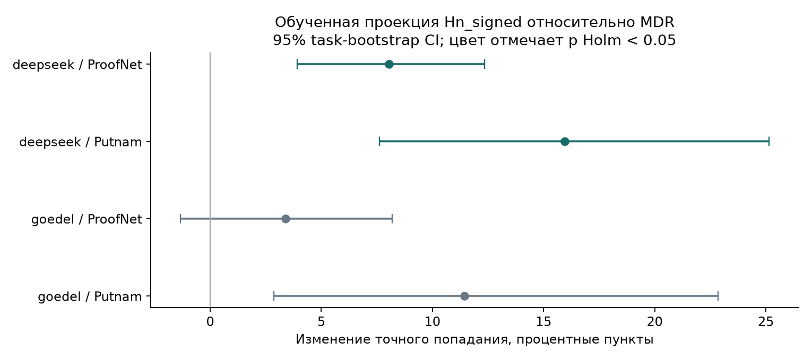

Состояние, расстояние до плоскости, знаковая проекция и абсолютная проекция имеют разный смысл. Если направление полезно, это ещё не означает, что размер скачка сам по себе является причиной отказа.

## Максимум проекции как отдельное правило

Локализатор с проекцией и простое правило «выбрать максимальную проекцию» — разные методы. В первом используются metadata и обученная вероятностная модель. Во втором вся траектория сворачивается в argmax одного score.

| Модель / обучение → оценка | white_norm | raw_norm | Hn_signed | LDn_signed | Hn_abs | H_nearest_plane | MD |
| --- | --- | --- | --- | --- | --- | --- | --- |
| deepseek / ProofNet → Putnam / frozen | 18.68 | 15.66 | 32.18 | 32.47 | 17.39 | 14.51 | 37.50 |
| deepseek / ProofNet → miniF2F / frozen | 18.09 | 14.33 | 34.35 | 33.08 | 14.44 | 27.47 | 41.49 |
| deepseek / ProofNet → ProofNet / oof | 19.07 | 22.27 | 37.17 | 40.01 | 20.77 | 16.24 | 38.67 |
| deepseek / Putnam → Putnam / oof | 18.68 | 15.66 | 34.20 | 36.49 | 23.56 | 17.10 | 27.59 |
| goedel / ProofNet → Putnam / frozen | 6.67 | 11.43 | 26.67 | 22.38 | 15.24 | 26.67 | 40.00 |
| goedel / ProofNet → miniF2F / frozen | 21.46 | 6.48 | 29.75 | 29.92 | 8.62 | 29.61 | 29.25 |
| goedel / ProofNet → ProofNet / oof | 25.00 | 25.22 | 43.00 | 40.88 | 23.06 | 23.65 | 53.38 |
| goedel / Putnam → Putnam / oof | 6.67 | 11.43 | 28.10 | 30.95 | 18.57 | 9.05 | 28.57 |

Проверки максимумов выполняются на тех же внешних разбиениях. Выигрыш над whitened-нормой следует читать отдельно от выигрыша над MD. В предусмотренных сравнениях максимумов с MD положительного эффекта после поправки Холма не получено. Отдельные максимумы проекций лучше нормы, но это не делает их заменой сильного локализатора.

## Стриминговое обнаружение первого отказа

| Модель / обучение → оценка / режим | MD | MDW | MDR | H | D | Dunit | Hn_signed | LDn_signed | Hdistance |
| --- | --- | --- | --- | --- | --- | --- | --- | --- | --- |
| deepseek / ProofNet → Putnam / frozen | 4.45 / NA | 4.45 / NA | 4.45 / NA | 12.50 / NA | 7.90 / NA | 4.45 / NA | 16.52 / NA | 15.80 / NA | 21.41 / NA |
| deepseek / ProofNet → miniF2F / frozen | 3.46 / 9.91 | 0.76 / 1.64 | 3.46 / 8.99 | 7.66 / 5.77 | 4.34 / 5.83 | 4.93 / 5.05 | 9.26 / 8.40 | 8.17 / 7.26 | 8.42 / 5.83 |
| deepseek / ProofNet → ProofNet / oof | 11.05 / 8.33 | 10.68 / 11.71 | 11.20 / 9.01 | 11.35 / 9.46 | 11.38 / 11.49 | 9.76 / 13.51 | 11.42 / 11.71 | 16.10 / 14.41 | 15.16 / 9.91 |
| deepseek / Putnam → Putnam / oof | 9.20 / NA | 10.06 / NA | 10.06 / NA | 30.75 / NA | 12.50 / NA | 13.65 / NA | 25.72 / NA | 26.44 / NA | 29.31 / NA |
| goedel / ProofNet → Putnam / frozen | 5.71 / NA | 10.95 / NA | 5.71 / NA | 7.62 / NA | 5.71 / NA | 17.14 / NA | 6.67 / NA | 16.67 / NA | 13.33 / NA |
| goedel / ProofNet → miniF2F / frozen | 1.48 / 2.57 | 1.21 / 1.20 | 1.48 / 2.45 | 0.00 / 0.00 | 2.91 / 1.66 | 3.58 / 2.09 | 3.02 / 2.95 | 3.83 / 2.28 | 1.28 / 1.37 |
| goedel / ProofNet → ProofNet / oof | 9.49 / 9.72 | 10.00 / 12.22 | 9.23 / 8.06 | 7.23 / 8.06 | 15.95 / 8.33 | 15.44 / 8.33 | 12.69 / 10.00 | 21.44 / 10.00 | 14.77 / 7.22 |
| goedel / Putnam → Putnam / oof | 14.76 / NA | 14.76 / NA | 11.90 / NA | 4.29 / NA | 11.43 / NA | 10.95 / NA | 10.48 / NA | 14.76 / NA | 16.19 / NA |

В ячейках указаны Exact и фактический verified FPR в процентах при номинальной калибровке 10%. NA означает отсутствие корректных доказательств в соответствующей оценке. Для Putnam при собственном обучении cutoff выбирается по принятым префиксам; при переносе сохраняется cutoff ProofNet. Эти режимы не обеспечивают известный FPR на правильных Putnam-доказательствах.

| Модель / обучение → оценка / режим | MD | MDW | MDR | H | D | Dunit | Hn_signed | LDn_signed | Hdistance |
| --- | --- | --- | --- | --- | --- | --- | --- | --- | --- |
| deepseek / ProofNet → Putnam / frozen | 0.3652 / +0.0000 | 0.3632 / +0.0021 | 0.3655 / -0.0003 | 0.3217 / +0.0435 | 0.3729 / -0.0076 | 0.3732 / -0.0080 | 0.3748 / -0.0096 | 0.3632 / +0.0021 | 0.3275 / +0.0377 |
| deepseek / ProofNet → miniF2F / frozen | 0.3516 / +0.0000 | 0.2830 / +0.0686 | 0.3457 / +0.0059 | 0.2776 / +0.0740 | 0.3073 / +0.0443 | 0.3155 / +0.0360 | 0.2801 / +0.0715 | 0.2689 / +0.0826 | 0.2624 / +0.0892 |
| deepseek / ProofNet → ProofNet / oof | 0.4494 / +0.0000 | 0.4455 / +0.0039 | 0.4492 / +0.0002 | 0.3824 / +0.0670 | 0.4169 / +0.0325 | 0.4210 / +0.0283 | 0.4109 / +0.0384 | 0.4028 / +0.0465 | 0.3888 / +0.0606 |
| deepseek / Putnam → Putnam / oof | 0.3975 / +0.0000 | 0.3974 / +0.0002 | 0.3987 / -0.0011 | 0.3959 / +0.0017 | 0.4698 / -0.0722 | 0.4695 / -0.0719 | 0.3935 / +0.0041 | 0.4093 / -0.0118 | 0.3521 / +0.0454 |
| goedel / ProofNet → Putnam / frozen | 0.3437 / +0.0000 | 0.3457 / -0.0020 | 0.3458 / -0.0021 | 0.3524 / -0.0087 | 0.4335 / -0.0898 | 0.4201 / -0.0764 | 0.3652 / -0.0215 | 0.3834 / -0.0397 | 0.3331 / +0.0106 |
| goedel / ProofNet → miniF2F / frozen | 0.3345 / +0.0000 | 0.2696 / +0.0649 | 0.3339 / +0.0006 | 0.2546 / +0.0799 | 0.2666 / +0.0679 | 0.2739 / +0.0606 | 0.2820 / +0.0525 | 0.2357 / +0.0987 | 0.2328 / +0.1017 |
| goedel / ProofNet → ProofNet / oof | 0.4064 / +0.0000 | 0.4003 / +0.0061 | 0.4114 / -0.0050 | 0.3856 / +0.0208 | 0.4264 / -0.0200 | 0.4313 / -0.0249 | 0.3946 / +0.0119 | 0.3885 / +0.0180 | 0.3584 / +0.0481 |
| goedel / Putnam → Putnam / oof | 0.4615 / +0.0000 | 0.4624 / -0.0009 | 0.4666 / -0.0051 | 0.4631 / -0.0016 | 0.5311 / -0.0696 | 0.5194 / -0.0579 | 0.4792 / -0.0177 | 0.4813 / -0.0198 | 0.4190 / +0.0425 |

| Модель / данные | Сравнение | Метрика | Δ | 95% CI | p Holm |
| --- | --- | --- | --- | --- | --- |
| deepseek / ProofNet | LDn_signed-MDR | nll | 0.0464 | [0.0215; 0.0709] | 0.0405 |
| deepseek / ProofNet | LDn_signed-MDR | exact@0.1 | 4.8990 | [0.74; 9.08] | 1.0000 |
| deepseek / ProofNet | LDn_signed-MDR | false_alarm@0.1 | 5.4054 | [-4.50; 16.44] | 1.0000 |
| deepseek / ProofNet | Hdistance-MD | nll | 0.0606 | [0.0381; 0.0828] | 0.0176 |
| deepseek / ProofNet | Hdistance-MD | exact@0.1 | 4.1111 | [0.25; 8.02] | 1.0000 |
| deepseek / ProofNet | Hdistance-MD | false_alarm@0.1 | 1.5766 | [-7.66; 11.49] | 1.0000 |
| deepseek / ProofNet | Hdistance-MD | nll | 0.0606 | [0.0381; 0.0828] | 0.0991 |
| deepseek / ProofNet | Hdistance-MD | exact@0.1 | 4.1111 | [0.25; 8.02] | 1.0000 |
| deepseek / ProofNet | Hdistance-MD | false_alarm@0.1 | 1.5766 | [-7.66; 11.49] | 1.0000 |
| deepseek / Putnam | LDn_signed-MDR | nll | -0.0106 | [-0.0627; 0.0346] | 1.0000 |
| deepseek / Putnam | LDn_signed-MDR | exact@0.1 | 16.3793 | [5.60; 26.73] | 0.3542 |
| deepseek / Putnam | LDn_signed-MDR | false_alarm@0.1 | NA | NA | NA |
| deepseek / Putnam | Hdistance-MD | nll | 0.0454 | [0.0115; 0.0772] | 1.0000 |
| deepseek / Putnam | Hdistance-MD | exact@0.1 | 20.1149 | [10.63; 29.74] | 0.0088 |
| deepseek / Putnam | Hdistance-MD | false_alarm@0.1 | NA | NA | NA |
| deepseek / Putnam | Hdistance-MD | nll | 0.0454 | [0.0115; 0.0772] | 1.0000 |
| deepseek / Putnam | Hdistance-MD | exact@0.1 | 20.1149 | [10.63; 29.74] | 0.0496 |
| deepseek / Putnam | Hdistance-MD | false_alarm@0.1 | NA | NA | NA |
| goedel / ProofNet | LDn_signed-MDR | nll | 0.0230 | [-0.0123; 0.0551] | 1.0000 |
| goedel / ProofNet | LDn_signed-MDR | exact@0.1 | 12.2051 | [6.67; 18.14] | 0.0088 |
| goedel / ProofNet | LDn_signed-MDR | false_alarm@0.1 | 1.9444 | [-6.39; 11.67] | 1.0000 |
| goedel / ProofNet | Hdistance-MD | nll | 0.0481 | [0.0248; 0.0728] | 0.0176 |
| goedel / ProofNet | Hdistance-MD | exact@0.1 | 5.2821 | [0.38; 10.44] | 1.0000 |
| goedel / ProofNet | Hdistance-MD | false_alarm@0.1 | -2.5000 | [-8.33; 3.33] | 1.0000 |
| goedel / ProofNet | Hdistance-MD | nll | 0.0481 | [0.0248; 0.0728] | 0.0991 |
| goedel / ProofNet | Hdistance-MD | exact@0.1 | 5.2821 | [0.38; 10.44] | 1.0000 |
| goedel / ProofNet | Hdistance-MD | false_alarm@0.1 | -2.5000 | [-8.33; 3.33] | 1.0000 |
| goedel / Putnam | LDn_signed-MDR | nll | -0.0146 | [-0.0492; 0.0243] | 1.0000 |
| goedel / Putnam | LDn_signed-MDR | exact@0.1 | 2.8571 | [-6.19; 12.38] | 1.0000 |
| goedel / Putnam | LDn_signed-MDR | false_alarm@0.1 | NA | NA | NA |
| goedel / Putnam | Hdistance-MD | nll | 0.0425 | [-0.0094; 0.0868] | 1.0000 |
| goedel / Putnam | Hdistance-MD | exact@0.1 | 1.4286 | [-10.48; 13.81] | 1.0000 |
| goedel / Putnam | Hdistance-MD | false_alarm@0.1 | NA | NA | NA |
| goedel / Putnam | Hdistance-MD | nll | 0.0425 | [-0.0094; 0.0868] | 1.0000 |
| goedel / Putnam | Hdistance-MD | exact@0.1 | 1.4286 | [-10.48; 13.81] | 1.0000 |
| goedel / Putnam | Hdistance-MD | false_alarm@0.1 | NA | NA | NA |

Для NLL положительный знак означает снижение потерь; для Exact — рост попаданий; для FPR — рост ложных тревог. Вероятностные изменения представлены в процентных пунктах.

У Goedel / ProofNet обученная LDn-проекция даёт заметную прибавку Exact относительно MDR, при этом фактический FPR также меняется. Расстояние состояния до плоскости улучшает NLL в ряде условий. Данные не позволяют подменить эти результаты утверждением о предотвращении ошибок или о доминировании при строго одинаковом FPR.

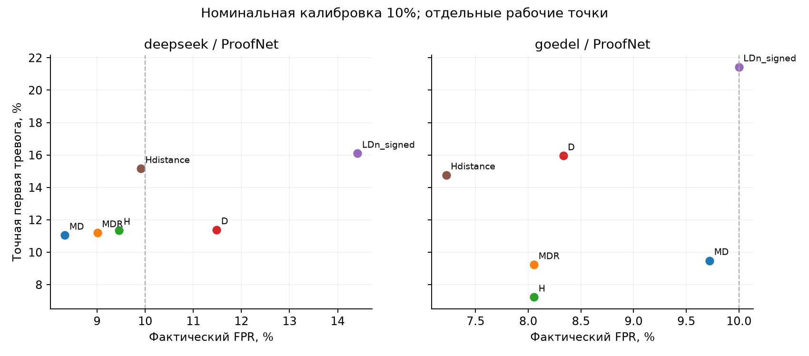

## Что можно извлечь из скрытых векторов

Проверки декодирования отвечают, содержится ли в представлении информация о позиции, длине, типе и surprisal. Они сами по себе не показывают, что именно эту информацию использует оптимальный локализатор. Поэтому дополнительно удаляются связанные с metadata подпространства, после чего локализатор обучается заново.

| Модель / данные | Вектор | Признак | R² | Accuracy % | Majority accuracy % | Balanced accuracy % |
| --- | --- | --- | --- | --- | --- | --- |
| deepseek / ProofNet | H | position | 0.5971 | NA | NA | NA |
| deepseek / ProofNet | H | log_tokens | 0.7957 | NA | NA | NA |
| deepseek / ProofNet | H | surprisal | 0.0922 | NA | NA | NA |
| deepseek / ProofNet | H | tactic_type | NA | 92.67 | 22.29 | 91.46 |
| deepseek / ProofNet | D | position | 0.1285 | NA | NA | NA |
| deepseek / ProofNet | D | log_tokens | 0.6303 | NA | NA | NA |
| deepseek / ProofNet | D | surprisal | -0.0607 | NA | NA | NA |
| deepseek / ProofNet | D | tactic_type | NA | 75.98 | 22.29 | 68.32 |
| deepseek / Putnam | H | position | 0.4836 | NA | NA | NA |
| deepseek / Putnam | H | log_tokens | 0.7644 | NA | NA | NA |
| deepseek / Putnam | H | surprisal | -0.0777 | NA | NA | NA |
| deepseek / Putnam | H | tactic_type | NA | 92.85 | 21.83 | 92.04 |
| deepseek / Putnam | D | position | -0.2743 | NA | NA | NA |
| deepseek / Putnam | D | log_tokens | 0.3907 | NA | NA | NA |
| deepseek / Putnam | D | surprisal | -0.2961 | NA | NA | NA |
| deepseek / Putnam | D | tactic_type | NA | 61.65 | 21.83 | 58.02 |
| goedel / ProofNet | H | position | 0.5723 | NA | NA | NA |
| goedel / ProofNet | H | log_tokens | 0.8251 | NA | NA | NA |
| goedel / ProofNet | H | surprisal | 0.2156 | NA | NA | NA |
| goedel / ProofNet | H | tactic_type | NA | 91.40 | 29.15 | 88.05 |
| goedel / ProofNet | D | position | 0.0712 | NA | NA | NA |
| goedel / ProofNet | D | log_tokens | 0.6521 | NA | NA | NA |
| goedel / ProofNet | D | surprisal | 0.0303 | NA | NA | NA |
| goedel / ProofNet | D | tactic_type | NA | 74.81 | 29.15 | 66.92 |
| goedel / Putnam | H | position | 0.3864 | NA | NA | NA |
| goedel / Putnam | H | log_tokens | 0.6708 | NA | NA | NA |
| goedel / Putnam | H | surprisal | -0.1230 | NA | NA | NA |
| goedel / Putnam | H | tactic_type | NA | 90.01 | 22.48 | 82.54 |
| goedel / Putnam | D | position | -1.0624 | NA | NA | NA |
| goedel / Putnam | D | log_tokens | 0.3174 | NA | NA | NA |
| goedel / Putnam | D | surprisal | -0.5578 | NA | NA | NA |
| goedel / Putnam | D | tactic_type | NA | 56.22 | 22.48 | 48.37 |

Скрытое состояние хорошо кодирует тип и длину тактики. Приращение тоже содержит такую информацию, но показатели отличаются. Низкий или отрицательный R² для surprisal означает отсутствие полезного переноса именно этого линейного readout относительно обучающей константы.

Удаление выполняется ортогональной проекцией из диапазона взвешенной кросс-ковариации между вектором и блоками metadata. Это не гарантирует удаления всей нелинейной информации. Из того же пространства может исчезнуть информация о корректности, коррелирующая с типом или длиной.

| Модель / данные | Вариант | Hit % | NLL |
| --- | --- | --- | --- |
| deepseek / ProofNet | H | 44.87 | 1.6970 |
| deepseek / ProofNet | D | 45.18 | 1.8676 |
| deepseek / ProofNet | H_erase_all | 44.35 | 1.8902 |
| deepseek / ProofNet | D_erase_all | 39.84 | 2.1755 |
| deepseek / ProofNet | H_retain_all | 43.47 | 1.7612 |
| deepseek / ProofNet | D_retain_all | 43.42 | 1.8305 |
| deepseek / ProofNet | H_erase_random0 | 46.48 | 1.7097 |
| deepseek / ProofNet | H_erase_random1 | 46.84 | 1.7057 |
| deepseek / ProofNet | H_erase_random2 | 45.88 | 1.6979 |
| deepseek / ProofNet | D_erase_random0 | 44.22 | 1.8663 |
| deepseek / ProofNet | D_erase_random1 | 45.89 | 1.8664 |
| deepseek / ProofNet | D_erase_random2 | 45.08 | 1.8656 |
| deepseek / Putnam | H | 40.66 | 1.8270 |
| deepseek / Putnam | D | 39.22 | 2.1204 |
| deepseek / Putnam | H_erase_all | 32.47 | 2.3364 |
| deepseek / Putnam | D_erase_all | 29.02 | 2.5081 |
| deepseek / Putnam | H_retain_all | 41.52 | 1.8676 |
| deepseek / Putnam | H_erase_random0 | 42.39 | 1.8254 |
| deepseek / Putnam | H_erase_random1 | 38.94 | 1.8259 |
| deepseek / Putnam | H_erase_random2 | 40.66 | 1.8257 |
| deepseek / Putnam | D_erase_random0 | 39.51 | 2.1186 |
| deepseek / Putnam | D_erase_random1 | 38.65 | 2.1236 |
| deepseek / Putnam | D_erase_random2 | 39.22 | 2.1244 |
| goedel / ProofNet | H | 47.13 | 1.7363 |
| goedel / ProofNet | D | 49.15 | 1.8284 |
| goedel / ProofNet | H_erase_all | 40.44 | 2.1405 |
| goedel / ProofNet | D_erase_all | 34.86 | 2.2294 |
| goedel / ProofNet | H_retain_all | 48.42 | 1.6772 |
| goedel / ProofNet | D_retain_all | 50.46 | 1.7064 |
| goedel / ProofNet | H_erase_random0 | 47.13 | 1.7369 |
| goedel / ProofNet | H_erase_random1 | 47.90 | 1.7321 |
| goedel / ProofNet | H_erase_random2 | 47.13 | 1.7366 |
| goedel / ProofNet | D_erase_random0 | 49.92 | 1.8242 |
| goedel / ProofNet | D_erase_random1 | 49.15 | 1.8255 |
| goedel / ProofNet | D_erase_random2 | 49.92 | 1.8279 |
| goedel / Putnam | H | 43.81 | 1.9773 |
| goedel / Putnam | D | 39.05 | 2.4020 |
| goedel / Putnam | H_erase_all | 29.52 | 2.3590 |
| goedel / Putnam | D_erase_all | 17.14 | 2.7990 |
| goedel / Putnam | H_retain_all | 40.95 | 2.1695 |
| goedel / Putnam | D_retain_all | 35.71 | 2.3274 |
| goedel / Putnam | H_erase_random0 | 43.81 | 1.9741 |
| goedel / Putnam | H_erase_random1 | 43.81 | 1.9797 |
| goedel / Putnam | H_erase_random2 | 43.81 | 1.9759 |
| goedel / Putnam | D_erase_random0 | 39.05 | 2.3991 |
| goedel / Putnam | D_erase_random1 | 39.05 | 2.4032 |
| goedel / Putnam | D_erase_random2 | 39.05 | 2.4024 |

Случайные подпространства имеют тот же ранг и три фиксированных seed. Их строки приведены отдельно. Более сильное ухудшение после целевого удаления поддерживает связь полезных направлений с metadata, но не доказывает, что весь сигнал сводится к известным признакам. Последние также продолжают входить в MD явно.

| Модель / данные | Режим | Нормаль | Пар фолдов | Среднее cosine | Минимум | Максимум |
| --- | --- | --- | --- | --- | --- | --- |
| deepseek / ProofNet | offline | Hn | 10 | 0.7366 | 0.7212 | 0.7648 |
| deepseek / ProofNet | offline | LDn | 10 | 0.7202 | 0.6909 | 0.7506 |
| deepseek / ProofNet | stream | Hn | 10 | 0.7273 | 0.6935 | 0.7713 |
| deepseek / ProofNet | stream | LDn | 10 | 0.7297 | 0.6658 | 0.7838 |
| deepseek / Putnam | offline | Hn | 10 | 0.7510 | 0.7227 | 0.7834 |
| deepseek / Putnam | offline | LDn | 10 | 0.7563 | 0.7053 | 0.8235 |
| deepseek / Putnam | stream | Hn | 10 | 0.7510 | 0.7227 | 0.7834 |
| deepseek / Putnam | stream | LDn | 10 | 0.7479 | 0.6947 | 0.8035 |
| goedel / ProofNet | offline | Hn | 10 | 0.7274 | 0.6136 | 0.7970 |
| goedel / ProofNet | offline | LDn | 10 | 0.7272 | 0.6570 | 0.7765 |
| goedel / ProofNet | stream | Hn | 10 | 0.7414 | 0.7096 | 0.7745 |
| goedel / ProofNet | stream | LDn | 10 | 0.7395 | 0.6876 | 0.7956 |
| goedel / Putnam | offline | Hn | 10 | 0.7490 | 0.6913 | 0.8175 |
| goedel / Putnam | offline | LDn | 10 | 0.7146 | 0.5539 | 0.8214 |
| goedel / Putnam | stream | Hn | 10 | 0.7490 | 0.6913 | 0.8175 |
| goedel / Putnam | stream | LDn | 10 | 0.7110 | 0.5773 | 0.8304 |

Сходство нормалей между внешними фолдами — описательная диагностика. Фолды используют пересекающиеся обучающие наборы, поэтому высокое cosine не является независимой репликацией направления. Полные таблицы normal_overlap и normal_stability включены в комплект.

## Почему Goedel отличается

Сравнение по фолдам и исключение отдельных задач показывают, что прежнее ухудшение при добавлении состояния на ProofNet не сводится к одной случайной задаче. На общих задачах моделей различие сохраняется, но тексты доказательств и доступные популяции различаются, поэтому это не эксперимент с одним и тем же текстом.

Длина и тип тактики у Goedel дают сильный исходный сигнал. В длина-only локализаторе рост score фактически приводит к выбору самого длинного фрагмента. Длинный AST-фрагмент может включать вложенные конструкции, комментарии и составные доказательства.

| Данные | Модель | Hit % | Выбран максимум длины % | Совпадение с первым максимумом % |
| --- | --- | --- | --- | --- |
| ProofNet | N | 42.67 | 100.00 | 100.00 |
| ProofNet | T | 37.83 | 35.24 | 35.24 |
| ProofNet | C | 47.37 | 64.50 | 64.50 |
| Putnam | N | 45.24 | 100.00 | 100.00 |
| Putnam | T | 30.00 | 34.76 | 34.76 |
| Putnam | C | 42.38 | 54.29 | 54.29 |

Источник: [Тип и длина тактики у Goedel](chapters/21_type_length.md).

Удаление явной длины не обеспечивает устойчивого восстановления добавочной ценности нормы или сырой разности на ProofNet. Векторы и тип тактики могут сохранять информацию о длине косвенно.

| Вариант | Hit, % | Δ к своему baseline, п.п. | NLL |
| --- | ---: | ---: | ---: |
| PST | 50.43 | 0.00 | 1.7115 |
| PSTW | 50.93 | 0.50 | 1.6976 |
| PST_deltaX | 51.37 | 0.94 | 1.7566 |
| PST_u | 48.30 | -2.13 | 1.8833 |
| PST_state | 49.20 | -1.23 | 1.6938 |
| MD_noN | 50.39 | 0.00 | 1.7183 |
| MD_noNW | 51.05 | 0.66 | 1.7038 |
| MD_noN_deltaX | 51.37 | 0.98 | 1.7559 |
| MD_noN_u | 49.05 | -1.34 | 1.8835 |
| MD_noN_state | 49.20 | -1.19 | 1.6935 |

Источник: [Goedel после удаления длины тактики](chapters/23_no_length.md).

На Putnam и в стриминге картина иная; полная абляция содержит также ухудшения при переносе и изменения FPR. [Goedel после удаления длины тактики](chapters/23_no_length.md). Утверждение «для Goedel скрытые представления бесполезны» не соответствует совокупности выполненных сравнений.


## Полное состояние Goedel без длины тактики: досчёт 15 ноября

| Добавка к baseline | Hit baseline, % | Hit + X, % | Δ Hit, п.п. | 95% CI Δ Hit | NLL baseline | NLL + X | Выигрыш NLL | 95% CI NLL |
| --- | --- | --- | --- | --- | --- | --- | --- | --- |
| PST_state | 50.43 | 49.20 | -1.23 | [-8.53; 6.08] | 1.7115 | 1.6938 | 0.0177 | [-0.1316; 0.1687] |
| MD_noN_state | 50.39 | 49.20 | -1.19 | [-8.40; 6.02] | 1.7183 | 1.6935 | 0.0248 | [-0.1260; 0.1800] |

Удаление явной длины меняет и baseline, и модель с состоянием: положительная разница приростов может возникнуть из-за ослабления baseline. Для прямой проверки ниже показаны обе абсолютные модели и парная разница разниц. Это проверка предсказательной ценности конкретного регуляризованного линейного локализатора; она не устанавливает причинную роль длины и не исключает её косвенное кодирование в X или типе тактики.

Прежние −6,99 п.п. относятся к MD_state−MD; сопоставимый вариант без длины — MD_noN_state−MD_noN. В новом расчёте эффект X для этого baseline равен -1.19 п.п., 95% CI [-8.40; 6.02]. Сама модель с X после удаления длины меняется на -1.13 п.п., baseline — на -6.93 п.п.

Завершены 44/44 новых fits; 12 новых ячеек, вместе с исторической абляцией 60/60. Полное доказательство и стриминг, ProofNet и Putnam, перенос и реальные FPR приведены в новом подробном разделе.

[Подробный досчёт состояния X, все режимы, интервалы и сравнение с длиной](chapters/28_no_length_state.md).

## Более мелкие формальные фрагменты

Новые границы выбираются по структуре Lean, а затем проверяются семантическим replay и соответствием токенов. Старые точки скрытых состояний проходят проверку совпадения; для новых границ извлекаются новые состояния. Изменить гранулярность удалось только для части попыток. На Putnam и miniF2F у Goedel в этой серии новых допустимых разбиений не появилось.

| Модель | Данные | Кандидатов изменено | Прошли проверку |
| --- | --- | --- | --- |
| deepseek | ProofNet | 31 | 28 |
| deepseek | Putnam | 6 | 5 |
| deepseek | miniF2F | 1 | 1 |
| goedel | ProofNet | 22 | 18 |
| goedel | Putnam | 0 | 0 |
| goedel | miniF2F | 0 | 0 |

| Модель | Версия | Вариант | Hit % | Hit после отображения % | Ширина участка в символах | NLL |
| --- | --- | --- | --- | --- | --- | --- |
| deepseek | old | MD | 40.49 | 40.49 | 418.6 | 1.7891 |
| deepseek | old | MDW | 41.60 | 41.60 | 417.7 | 1.7799 |
| deepseek | old | N | 31.61 | 31.61 | 566.0 | 2.2457 |
| deepseek | old | deltaX | 46.68 | 46.68 | 370.9 | 1.7958 |
| deepseek | old | state | 47.29 | 47.29 | 337.4 | 1.6297 |
| goedel | old | MD | 57.04 | 57.04 | 680.6 | 1.6080 |
| goedel | old | MDW | 54.67 | 54.67 | 769.8 | 1.6698 |
| goedel | old | N | 41.35 | 41.35 | 1054.6 | 2.0825 |
| goedel | old | deltaX | 50.63 | 50.63 | 699.5 | 1.7594 |
| goedel | old | state | 49.56 | 49.56 | 590.2 | 1.6776 |
| deepseek | fine | MD | 38.67 | 41.25 | 387.2 | 1.8666 |
| deepseek | fine | MDW | 38.92 | 41.50 | 384.6 | 1.8571 |
| deepseek | fine | N | 29.04 | 31.61 | 536.3 | 2.3320 |
| deepseek | fine | deltaX | 45.18 | 47.15 | 335.8 | 1.8676 |
| deepseek | fine | state | 44.87 | 46.99 | 310.9 | 1.6970 |
| goedel | fine | MD | 53.38 | 54.79 | 479.1 | 1.6735 |
| goedel | fine | MDW | 55.05 | 56.46 | 531.7 | 1.6661 |
| goedel | fine | N | 38.01 | 40.83 | 827.9 | 2.1821 |
| goedel | fine | deltaX | 49.15 | 50.56 | 438.9 | 1.8284 |
| goedel | fine | state | 47.13 | 49.12 | 459.7 | 1.7363 |

Hit на собственной сетке old/fine сравнивает разные разрешения цели. Поэтому дополнительно измеряются попадание после отображения в старую границу, пересечение исходного участка и ширина предсказанного фрагмента в символах. Нельзя считать снижение ширины участка автоматическим улучшением точного Hit или переносить результат небольшой changed_only-подвыборки на весь корпус.

В старом/новом сравнении норма может менять знак небольшого эффекта. На ProofNet Goedel уточнение границ меняет point estimate MDW относительно MD, но для вывода используются парные интервалы и поправка, а не знак разности двух округлённых процентов. Все 48 вариантов, оба режима и переносы находятся в [Полная матрица старых и уточнённых границ](chapters/26_granularity.md).

## Наличие ошибки и прогноз будущего отказа

Задача наличия ошибки включает корректные доказательства и отличается от выбора места в уже известной ошибочной попытке. Выполнены offline, present, future1, future3, future5 и future_end, отдельные source-наборы ProofNet и miniF2F, OOF-оценки и замороженные переносы.

| Модель | Оценка | Цель | B | BW | BD | BH |
| --- | --- | --- | --- | --- | --- | --- |
| deepseek | ProofNet | offline | 0.3223 | 0.3153 | 0.3562 | 0.3364 |
| deepseek | ProofNet | present | 0.4745 | 0.4720 | 0.4725 | 0.4249 |
| deepseek | ProofNet | future1 | 0.6056 | 0.6073 | 0.6077 | 0.5710 |
| deepseek | ProofNet | future3 | 0.6596 | 0.6589 | 0.6573 | 0.6392 |
| deepseek | ProofNet | future5 | 0.6010 | 0.6019 | 0.5850 | 0.5745 |
| deepseek | ProofNet | future_end | 0.4299 | 0.4288 | 0.3505 | 0.2942 |
| deepseek | Putnam | offline | 0.0858 | 0.0879 | 0.0442 | 0.0221 |
| deepseek | Putnam | present | 0.4352 | 0.4297 | 0.4022 | 0.3711 |
| deepseek | Putnam | future1 | 0.5621 | 0.5621 | 0.5705 | 0.5263 |
| deepseek | Putnam | future3 | 0.6779 | 0.6776 | 0.7011 | 0.7030 |
| deepseek | Putnam | future5 | 0.6089 | 0.6090 | 0.6295 | 0.6513 |
| deepseek | Putnam | future_end | 0.1900 | 0.1801 | 0.1115 | 0.0525 |
| goedel | ProofNet | offline | 0.3614 | 0.3469 | 0.3539 | 0.3246 |
| goedel | ProofNet | present | 0.4595 | 0.4522 | 0.4297 | 0.4129 |
| goedel | ProofNet | future1 | 0.6269 | 0.6238 | 0.6767 | 0.6011 |
| goedel | ProofNet | future3 | 0.6257 | 0.6269 | 0.6338 | 0.5869 |
| goedel | ProofNet | future5 | 0.5568 | 0.5536 | 0.5289 | 0.4997 |
| goedel | ProofNet | future_end | 0.4156 | 0.4122 | 0.3305 | 0.2630 |
| goedel | Putnam | offline | 0.1025 | 0.1006 | 0.0297 | 0.0133 |
| goedel | Putnam | present | 0.5327 | 0.5087 | 0.5079 | 0.4091 |
| goedel | Putnam | future1 | 0.5686 | 0.5658 | 0.5883 | 0.5732 |
| goedel | Putnam | future3 | 0.6824 | 0.6835 | 0.7850 | 0.7312 |
| goedel | Putnam | future5 | 0.5775 | 0.5773 | 0.6396 | 0.6444 |
| goedel | Putnam | future_end | 0.1734 | 0.1727 | 0.1178 | 0.0669 |

Здесь показана NLL выбранных векторных и скалярных вариантов, обученных на ProofNet, для оценки на ProofNet и Putnam. Полная таблица всех режимов, источников и переносов приведена в [Полная таблица наличия ошибки и прогнозов](chapters/24_presence_full.md). Её NA для AUROC/AP на Putnam с одним классом сохраняются. Маленькая NLL на выборке только ошибочных доказательств не демонстрирует способность различать правильные и неправильные попытки.

Число будущих отказов и число уже имеющихся отказов отвечают на разные вопросы. При оценке future1 используется только ещё принятый префикс. Наличие hₜ после текущего фрагмента допустимо для обнаружения отказа в этом фрагменте, но не для прогноза его корректности до генерации.

## Почему снижение NLL не гарантирует точную тревогу

Точные исходные предсказания E14, без изменения коэффициентов или порогов. NLL разлагается с весами всей исходной выборки; показатели тревог воспроизводят исходное усреднение E14 отдельно среди ошибочных/корректных доказательств. Версия v2 уточняет это различие и проверяет совпадение агрегированных показателей тревог; значения NLL не меняются. Положительный вклад означает снижение NLL. Три категории суммируются в общий выигрыш с исходными весами задач, попыток и шагов.

| Модель / набор | Метод | Общий выигрыш | Первый отказ | Принятый префикс ошибочного | Проверенное доказательство |
|---|---|---:|---:|---:|---:|
| deepseek/ProofNet | HDW | 0.001788 | 0.000810 | 0.000334 | 0.000644 |
| deepseek/ProofNet | HD_state | 0.099219 | 0.037053 | 0.064154 | -0.001988 |
| deepseek/ProofNet | HD_increment | 0.058460 | 0.000090 | 0.054630 | 0.003741 |
| deepseek/Putnam | HDW | 0.002735 | -0.000722 | 0.003457 | 0.000000 |
| deepseek/Putnam | HD_state | 0.033478 | 0.000747 | 0.032732 | 0.000000 |
| deepseek/Putnam | HD_increment | -0.017852 | -0.036960 | 0.019108 | 0.000000 |
| goedel/ProofNet | HDW | 0.007524 | 0.003062 | 0.002920 | 0.001542 |
| goedel/ProofNet | HD_state | 0.020635 | -0.017744 | 0.035961 | 0.002418 |
| goedel/ProofNet | HD_increment | -0.013115 | -0.055971 | 0.032745 | 0.010111 |
| goedel/Putnam | HDW | -0.004561 | -0.018447 | 0.013886 | 0.000000 |
| goedel/Putnam | HD_state | -0.027273 | -0.060022 | 0.032750 | 0.000000 |
| goedel/Putnam | HD_increment | -0.102183 | -0.129176 | 0.026993 | 0.000000 |

Интервалы и условные NLL — в metrics.json. Переходы ранняя/точная/пропуск и расстояния до исходных порогов — trace_transitions.csv каждого набора; калибровка по фиксированным бинам — calibration.csv. Putnam не содержит корректных доказательств. Этот аудит показывает источники изменения метрики, но не доказывает причинный механизм.

Источник: [Разложение выигрыша NLL](chapters/14_nll.md).

Принятых шагов обычно больше, чем первых отказов. Улучшение вероятностей на них может давать выигрыш средней NLL даже при ухудшении score на самом отказе. Кроме того, первая тревога зависит от порога и всех предшествующих score. Это объяснение поведения метрик, а не доказательство устройства рассуждения модели.

## Одинаковые префиксы и изменённая корректность

В matched-prefix серии из одного и того же формального префикса генерируются альтернативные продолжения. Проверяются общий предыдущий hidden state, контекст Lean и первая законченная AST-тактика. Для сравнения информативны задачи, где среди альтернатив есть и принятые, и отклонённые продолжения.

Старый обработчик поддерживал только верхний уровень AST и оставлял по 11 задач. До генерации зафиксирована поправка C-1: поддержка вложенных контекстов при сохранении точного токенового префикса, Lean header, целей и локального контекста. Доступны 165/114 исходных задач; feasibility pilot — по 40 задач и 8 альтернатив. Задачи пилота исключаются из основного анализа.

Проверяется первая завершённая AST-тактика, а не первая строка. Accepted, включая завершение доказательства, даёт Y=0; надёжное семантическое отклонение — Y=1. Parse, timeout, resource, sorry, несовпадение контекста и неполная токеновая граница не превращаются в семантические ошибки. Все дубликаты и исключения сохраняются.

Для каждой группы альтернатив используется одна форма padded-forward и каноническое измерение префикса. Xprev должен совпадать побитно, previous-q общий. Замороженные B/BH/BD детекторы взяты из соответствующего OOF-fold исходной задачи. BH содержит текущее состояние и среднее по уже наблюдённому префиксу; отдельно показывается только векторный вклад ретроспективного state-probe. Полный ретроспективный score с неизвестными L/last не применяется.

Within-prefix AUC усредняется по независимым задачам; ties дают 0.5. Основной контраст — BH-B. При числе mixed-задач меньше 20 доверительный интервал не выводится. Основной M и K фиксируются из пилотной дисперсии, частоты mixed-групп и профиля ресурсов. Верхние пределы: 400 задач/модель, K=16, всего 60 новых GPU-часов и 1200 Lean CPU-часов. Сбор не продолжается до значимости.

| model | phase | score | metric | value | ci95 | ci95_MC_seed2 | independent_mixed_tasks | bootstrap_replicates | primary | CI_halfwidth | precision_halfwidth_target | precision_target_met | CI_missing_reason |
| --- | --- | --- | --- | --- | --- | --- | --- | --- | --- | --- | --- | --- | --- |
| deepseek | pilot | BH-B | paired_delta_AUC | 0.0000 | — | — | 2 | 10000 | False | — | 0.1000 | False | fewer_than_20_groups |
| deepseek | pilot | BD-B | paired_delta_AUC | 0.0000 | — | — | 2 | 10000 | False | — | 0.1000 | False | fewer_than_20_groups |
| deepseek | main | BH-B | paired_delta_AUC | 0.1144 | — | — | 9 | 10000 | True | — | 0.1000 | False | fewer_than_20_groups |
| deepseek | main | BD-B | paired_delta_AUC | 0.0911 | — | — | 9 | 10000 | False | — | 0.1000 | False | fewer_than_20_groups |
| goedel | pilot | BH-B | paired_delta_AUC | 0.0357 | — | — | 4 | 10000 | False | — | 0.1000 | False | fewer_than_20_groups |
| goedel | pilot | BD-B | paired_delta_AUC | 0.0000 | — | — | 4 | 10000 | False | — | 0.1000 | False | fewer_than_20_groups |
| goedel | main | BH-B | paired_delta_AUC | 0.0380 | — | — | 10 | 10000 | True | — | 0.1000 | False | fewer_than_20_groups |
| goedel | main | BD-B | paired_delta_AUC | -0.0076 | — | — | 10 | 10000 | False | — | 0.1000 | False | fewer_than_20_groups |

Источник: [Строгий аудит отбора гибкий baseline и одинаковые префиксы](chapters/15_priority.md).

Число независимых mixed-задач недостаточно для предусмотренных интервалов. Положительная точечная разность AUC у DeepSeek остаётся описательной. Большое число альтернатив одного префикса не заменяет большое число независимых задач.

## Распределения места ошибки максимума и surprisal

Сходные общие гистограммы могут возникнуть без дополнительной связи внутри конкретного доказательства. Поэтому использованы несколько контролей: случайная позиция внутри той же длины, максимум другой попытки той же длины, попытка другой задачи и более строгая попытка той же задачи, а также обучаемое распределение места ошибки.

Для известной ошибочной траектории с длиной L и отказом T равномерная случайная позиция U удовлетворяет:

    P(U < T | L,T) = (T−1)/L
    P(U = T | L,T) = 1/L

Этот контроль знает наблюдаемые L и T для вычисления ожидаемой доли совпадений. Он не является онлайн-предиктором и не обучается угадывать T. Контроль с чужим максимумом сохраняет эмпирические предпочтения позиций; его покрытие зависит от наличия подходящей другой попытки.

| Модель / набор | Попытки / задачи | Охват веса, % | Свой максимум, % | Чужой максимум, % | Разница, п.п. [95%] | Семейный интервал |
|---|---|---|---|---|---|---|
| deepseek/ProofNet | 438 / 165 | 97.04 | 24.36 | 18.90 | 5.46 [1.55; 9.84] | [-0.17; 12.09] |
| deepseek/miniF2F | 513 / 121 | 97.15 | 23.39 | 16.34 | 7.06 [0.77; 13.39] | [-2.31; 15.93] |
| deepseek/Putnam | 100 / 53 | 84.05 | 19.55 | 13.56 | 5.99 [-3.76; 16.73] | [-8.73; 21.82] |
| goedel/ProofNet | 229 / 117 | 85.03 | 43.88 | 36.12 | 7.75 [-1.72; 16.82] | [-7.06; 21.16] |
| goedel/miniF2F | 423 / 117 | 92.48 | 27.10 | 13.64 | 13.46 [6.79; 20.83] | [3.99; 24.60] |
| goedel/Putnam | 32 / 25 | 64.29 | 5.02 | 10.97 | -5.95 [-24.42; 14.07] | [-35.99; 26.03] |

Источник: [Распределения максимумов ошибок и surprisal](chapters/10_distributions.md).

Эффект в matched-популяции нельзя сравнивать с несопоставленным процентом на всех попытках. Внутри одной задачи покрытие значительно меньше, а некоторые Putnam-срезы слишком малы для интервалов. Увеличение точности над uniform и добавочная информация над сильным baseline не являются одним утверждением.

Проверены разные величины:


$$
D=M_W-T,\qquad \mathbb{E}[D],\qquad
\mathbb{E}[D/L],\qquad P(D\le0).
$$


Отрицательное среднее означает опережение, положительное — запаздывание. Вероятность $P(D\le0)>1/2$ характеризует большинство случаев; знак среднего она не определяет.

| Модель / набор | Среднее M_W−T, шаги [95%] | Медиана M_W−T | Среднее (M_W−T)/L, % длины [95%] | M_W≤T, % [95%] | Среднее M_Q−T [95%] |
|---|---|---|---|---|---|
| deepseek/ProofNet | 2.07 [0.89; 3.34] | 1.00 | 8.04 [3.99; 12.04] | 49.07 [43.20; 54.76] | 4.28 [2.98; 5.70] |
| deepseek/miniF2F | -0.29 [-1.35; 0.73] | 0.00 | -1.46 [-5.93; 2.90] | 62.10 [55.22; 68.79] | 1.34 [0.28; 2.42] |
| deepseek/Putnam | -0.15 [-2.20; 2.18] | 0.00 | -6.53 [-13.91; 0.58] | 62.07 [52.01; 71.70] | 2.52 [0.52; 4.64] |
| goedel/ProofNet | 2.53 [0.40; 5.42] | 0.00 | 4.36 [-0.17; 9.02] | 55.16 [47.88; 62.49] | 6.54 [3.82; 9.78] |
| goedel/miniF2F | 0.51 [-1.16; 2.36] | 0.00 | -1.25 [-5.46; 2.83] | 60.41 [53.27; 67.35] | 3.10 [1.20; 5.42] |
| goedel/Putnam | -3.12 [-6.23; -0.55] | -1.00 | -9.54 [-20.13; 1.07] | 63.33 [47.62; 78.11] | -1.02 [-4.28; 1.75] |


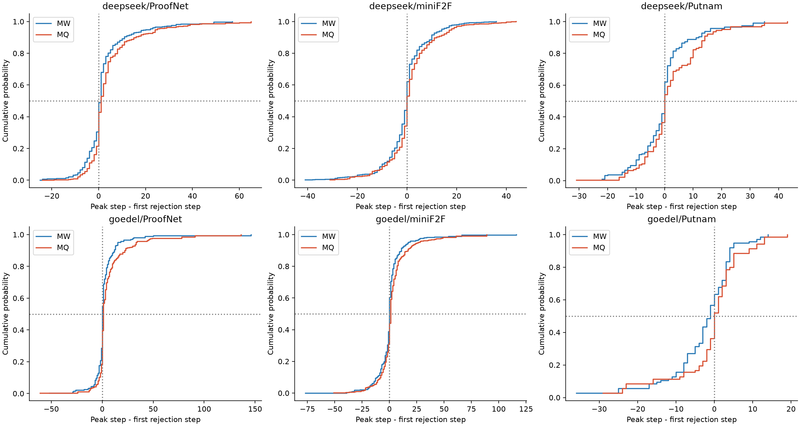

На ProofNet точечные средние положительны у обеих моделей. На Goedel / miniF2F большинство максимумов не позже отказа, но среднее смещение положительно: хвост поздних максимумов меняет знак среднего. На Goedel / Putnam обычный 95% интервал среднего числа шагов отрицателен, однако интервал после нормирования на длину включает ноль. При консервативном расширении интервала среднего по той же формуле family12 он также включает ноль; формально это дополнительная чувствительность вне основного семейства локализации. Нельзя описывать опережение как общий установленный закон.

Источник: [Распределения максимумов ошибок и surprisal](chapters/10_distributions.md).

Универсальное утверждение о раннем максимуме не подтверждается: направление средней задержки меняется между наборами. Положительная доля максимумов до отказа может существовать одновременно с положительной средней задержкой из-за асимметрии распределения. Гипотеза о более раннем ошибочном выборе остаётся отдельной от измерения первого отказа Lean.

## Длина доказательства и риск следующей ошибки

Смесь длин сама по себе создаёт неравномерное распределение абсолютных позиций. Даже при равномерном положении внутри каждой длины:

    P(U = t) = сумма по L ≥ t величин P(L)/L

Для контроля применены относительная позиция t/L, общая смесь длин, сравнения при точном L и отношение к контролю с такими же длинами. Стандартизация ограничивается общим покрытием длин; она не создаёт наблюдений для отсутствующих групп.

Для максимума скачка проверена доля попаданий в первые два шага. Контроль сохраняет фактические длины и равномерно выбирает позицию; его ожидание равно среднему $\min(2,L)/L$.

| Модель / набор | Максимум в первых двух шагах, % | Контроль длины, % | Разница, п.п. [95%] |
|---|---|---|---|
| deepseek/ProofNet | 34,58 | 25,11 | 9,47 [5,04; 13,96] |
| deepseek/miniF2F | 18,99 | 19,04 | -0,06 [-4,45; 4,72] |
| deepseek/Putnam | 29,60 | 15,01 | 14,58 [5,21; 24,72] |
| goedel/ProofNet | 42,61 | 26,30 | 16,30 [10,37; 22,30] |
| goedel/miniF2F | 15,27 | 16,88 | -1,61 [-5,13; 2,11] |
| goedel/Putnam | 37,14 | 15,04 | 22,10 [7,95; 36,86] |


На miniF2F избытка именно первых двух позиций относительно этого контроля не видно. На ProofNet и Putnam он сохраняется. Это не утверждение о равномерности всего распределения максимумов и не проверка совпадения максимума с ошибкой конкретной попытки.

Источник: [Поправка на длину и предсказание по распределению](chapters/11_length.md).

Гистограммы ошибок при каждой длине, совместные места максимумов и surprisal, а также таблицы Hits и интервалы представлены в [Совместные гистограммы для каждой длины](chapters/12_exact_length.md). Малые страты не используются для выбора «удачной длины» и подтверждающего утверждения. Высокий Hit внутри одной длины может быть объяснён тем, что почти все отказы и почти все максимумы находятся на одной позиции.

| Модель | Данные | k | Задач в риске | Следующая ошибка % | Поздняя ошибка % | Без ошибки % | 95% CI следующей |
| --- | --- | --- | --- | --- | --- | --- | --- |
| deepseek | ProofNet | 0 | 187 | 16.74 | 67.71 | 15.56 | [12.25; 21.43] |
| deepseek | ProofNet | 1 | 171 | 15.10 | 66.21 | 18.68 | [10.82; 19.81] |
| deepseek | ProofNet | 2 | 159 | 10.69 | 67.31 | 22.01 | [7.00; 14.83] |
| deepseek | ProofNet | 5 | 116 | 8.63 | 69.37 | 22.00 | NA |
| deepseek | miniF2F | 0 | 202 | 3.70 | 44.27 | 52.03 | NA |
| deepseek | miniF2F | 1 | 198 | 3.88 | 42.09 | 54.03 | NA |
| deepseek | miniF2F | 2 | 196 | 4.51 | 39.28 | 56.21 | [2.60; 6.78] |
| deepseek | miniF2F | 5 | 159 | 3.40 | 45.21 | 51.39 | NA |
| deepseek | Putnam | 0 | 58 | 9.48 | 90.52 | 0.00 | NA |
| deepseek | Putnam | 1 | 56 | 6.67 | 93.33 | 0.00 | NA |
| deepseek | Putnam | 2 | 55 | 14.63 | 85.37 | 0.00 | NA |
| deepseek | Putnam | 5 | 42 | 10.15 | 89.85 | 0.00 | NA |
| goedel | ProofNet | 0 | 144 | 24.73 | 60.56 | 14.71 | [18.58; 31.10] |
| goedel | ProofNet | 1 | 121 | 13.64 | 66.82 | 19.54 | [8.52; 19.34] |
| goedel | ProofNet | 2 | 108 | 14.76 | 62.61 | 22.63 | [8.95; 21.33] |
| goedel | ProofNet | 5 | 63 | 15.86 | 61.37 | 22.77 | NA |
| goedel | miniF2F | 0 | 200 | 3.18 | 40.82 | 56.00 | NA |
| goedel | miniF2F | 1 | 198 | 2.93 | 39.23 | 57.84 | NA |
| goedel | miniF2F | 2 | 194 | 4.14 | 36.27 | 59.59 | [2.34; 6.22] |
| goedel | miniF2F | 5 | 163 | 2.79 | 39.95 | 57.26 | NA |
| goedel | Putnam | 0 | 35 | 11.43 | 88.57 | 0.00 | NA |
| goedel | Putnam | 1 | 31 | 2.69 | 97.31 | 0.00 | NA |
| goedel | Putnam | 2 | 31 | 13.81 | 86.19 | 0.00 | NA |
| goedel | Putnam | 5 | 21 | 17.54 | 82.46 | 0.00 | NA |

В таблице показаны выбранные k для условия уже завершённых корректных шагов. Полный отчёт различает completed_k, next_attempted и eventual_failure. Последнее условие использует знание того, что попытка когда-нибудь завершится отказом, и поэтому не является реальным знанием онлайн-детектора. Мода среди отдельных позиций не означает большую абсолютную вероятность ошибки на следующем шаге.

## Surprisal и различение корректных и ошибочных попыток

Surprisal растёт на первом отказе относительно соседних доступных шагов в ряде парных проверок, но максимум по всему доказательству может слабо различать его общий исход. Корреляция со скачком неполная: признаки могут нести как общую, так и различную информацию.

| Модель / набор | Q отказа − Q предыдущей тактики [95%] | Q отказа − среднее Q префикса [95%] | Среднее Q суффикса − Q отказа [95%] |
|---|---|---|---|
| deepseek/ProofNet | 0.0315 [0.0187; 0.0441] | 0.0420 [0.0324; 0.0527] | -0.0370 [-0.0477; -0.0268] |
| deepseek/miniF2F | 0.0259 [0.0143; 0.0372] | 0.0336 [0.0254; 0.0421] | -0.0197 [-0.0293; -0.0101] |
| deepseek/Putnam | 0.0463 [0.0262; 0.0686] | 0.0541 [0.0371; 0.0739] | -0.0569 [-0.0752; -0.0397] |
| goedel/ProofNet | 0.0467 [0.0298; 0.0644] | 0.0528 [0.0385; 0.0685] | -0.0535 [-0.0696; -0.0392] |
| goedel/miniF2F | 0.0313 [0.0200; 0.0433] | 0.0360 [0.0274; 0.0451] | -0.0205 [-0.0326; -0.0088] |
| goedel/Putnam | 0.0525 [0.0272; 0.0782] | 0.0472 [0.0242; 0.0709] | -0.0504 [-0.0785; -0.0232] |


Первые два контраста положительны во всех шести сочетаниях с положительными обычными 95% интервалами. Это относится к отказам после первого шага. Во всех шести случаях средний surprisal последующего сгенерированного суффикса ниже surprisal на отказе. Такое снижение не означает, что доказательство снова стало правильным: после отказа Lean не подтвердил эти шаги.

Источник: [Распределения максимумов ошибок и surprisal](chapters/10_distributions.md).

Ниже AUC — вероятность, что значение признака в ошибочной попытке больше, чем в правильной попытке другой задачи точно той же длины; равенство даёт 0,5. Это условная парная concordance, а не AUROC произвольной смеси длин. Для позиции направление заранее фиксировано: большее t/L считается большим score; значение около 0,5 не исключает нелинейных различий формы распределений.

| Модель / набор | Задачи: ошибка / правильно | Охват веса ошибочных, % | AUC max W [95%] | AUC max Q [95%] | AUC позиции W [95%] | AUC позиции Q [95%] |
|---|---|---|---|---|---|---|
| deepseek/ProofNet | 124 / 37 | 59.30 | 0.490 [0.362; 0.629] | 0.573 [0.477; 0.676] | 0.531 [0.446; 0.614] | 0.451 [0.372; 0.533] |
| deepseek/miniF2F | 117 / 126 | 84.67 | 0.749 [0.684; 0.812] | 0.500 [0.434; 0.564] | 0.480 [0.411; 0.552] | 0.467 [0.384; 0.543] |
| goedel/ProofNet | 89 / 30 | 57.79 | 0.424 [0.303; 0.552] | 0.552 [0.420; 0.682] | 0.406 [0.308; 0.509] | 0.429 [0.311; 0.546] |
| goedel/miniF2F | 117 / 137 | 87.26 | 0.713 [0.629; 0.790] | 0.575 [0.509; 0.640] | 0.462 [0.400; 0.527] | 0.506 [0.447; 0.568] |


На miniF2F величина максимального скачка сохраняет различительную способность при одинаковой длине. На ProofNet обычные интервалы AUC max W включают 0,5. Положение максимума само по себе значительно слабее; интервалы приведённых позиционных AUC включают 0,5.

Дополнительная нормировка max W / median W не универсальна: она может менять картину в зависимости от набора. Её условные AUC приведены ниже, чтобы не выбирать нормировку после просмотра удачного результата.

| Модель / набор | AUC max W / median W при одной длине [95%] |
|---|---|
| deepseek/ProofNet | 0.621 [0.507; 0.723] |
| deepseek/miniF2F | 0.485 [0.400; 0.569] |
| goedel/ProofNet | 0.544 [0.420; 0.675] |
| goedel/miniF2F | 0.564 [0.485; 0.639] |


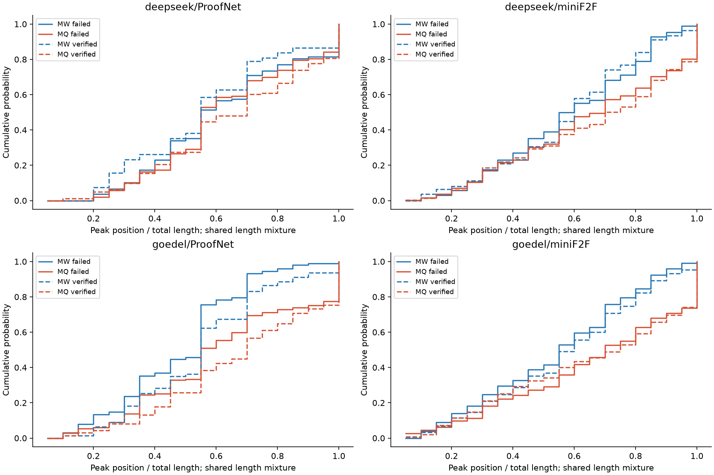

Для этого рисунка обе категории приводятся к одной смеси точных длин: масса длины пропорциональна минимуму исходных масс двух классов; нужны хотя бы две задачи каждого класса на длину. Это отдельная описательная популяция, а не парная оценка из предыдущей таблицы.

| Модель / набор | Охват общего веса, % | TV позиций W после стандартизации | TV позиций Q после стандартизации |
|---|---|---|---|
| deepseek/ProofNet | 54.00 | 0.218 | 0.203 |
| deepseek/miniF2F | 89.16 | 0.178 | 0.129 |
| goedel/ProofNet | 51.71 | 0.174 | 0.210 |
| goedel/miniF2F | 89.19 | 0.111 | 0.141 |

Источник: [Распределения максимумов ошибок и surprisal](chapters/10_distributions.md).

Контроли длины и задачи существенны: разные доказательства могут различаться по длине, типам шагов, сложности и отбору. Одна корреляция или разность средних не заменяет предсказательную проверку на новых задачах.

## PRM и проверка вне исходных моделей

| Срез | PRM argmin | Норма скачка | Surprisal |
|---|---:|---:|---:|
| pooled | 52.15% | 20.29% | 19.94% |
| gsm8k | 71.09% | 27.89% | 27.21% |
| math | 56.76% | 18.96% | 20.65% |
| olympiadbench | 51.11% | 18.22% | 19.60% |
| omnimath | 43.83% | 20.40% | 17.55% |
| Qwen_family | 50.23% | 20.44% | 21.45% |
| other_generator | 54.39% | 20.33% | 17.85% |

Полные интервалы, страты и проверки находятся в metrics.json рядом с отчётом.

Источник: [Стриминг PRM и меньшая модель](chapters/04_gaps.md).

| Вариант | Hit % | NLL |
| --- | --- | --- |
| M0 | 39.49 | 1.5935 |
| M1 | 39.16 | 1.5982 |
| M0_PRM | 62.49 | 1.0220 |
| M1_PRM | 62.45 | 1.0236 |

M1 добавляет норму скачка к M0; суффикс PRM добавляет признаки готовой process reward model. Сохраняется одинаковая task-weighted оценка.

PRM применяется в своём математическом домене к тем же готовым текстам ProcessBench. Это сравнение с готовой моделью оценки шагов, а не Lean-верификатор. Первый score ниже фиксированного порога, минимум score и обучаемый локализатор по score — разные правила.

| Срез | M0 | M1 | Delta, п.п. |
|---|---:|---:|---:|
| pooled | 39.99% | 39.72% | -0.276 |
| Qwen_family | 41.79% | 41.70% | -0.087 |
| other_generator | 35.63% | 35.04% | -0.589 |
| gsm8k | 45.58% | 46.94% | 1.361 |
| math | 39.98% | 39.98% | 0.0 |
| olympiadbench | 36.54% | 36.10% | -0.443 |
| omnimath | 40.42% | 39.56% | -0.854 |

Полные интервалы, страты и проверки находятся в metrics.json рядом с отчётом.

Источник: [Стриминг PRM и меньшая модель](chapters/04_gaps.md).

Меньшая Qwen-модель читает сохранённые решения. Отсутствие положительного pooled-эффекта нормы в этом опыте ограничивает обобщение исходной эвристики. Оно не является экспериментом, в котором изолирован только размер модели, и не описывает её собственную генерацию.

## Хвостовые модели и механизм Кестена

Локализация экстремума допускает разные типы хвостов. Чтобы выделить тяжёлый степенной хвост, нужны его отличительные свойства и сравнения с альтернативами на отложенных данных. Чтобы выделить механизм Кестена, дополнительно нужна связь с измеренной мультипликативной динамикой, а не только форма распределения одной нормы.

Историческая проверка E9 обучала хвостовые модели только на тренировочных задачах. Основной порог — 95-й процентиль train; сравнивается условная плотность превышений. Для подгонки требовались не менее 80 train-превышений и 20 train-групп. Ниже DeepSeek, ProofNet, принятые шаги до первого отказа.

| Семейство | NLL | Test превышений | Test задач | Фолдов |
| --- | --- | --- | --- | --- |
| pareto | 3.37756 | 116 | 49 | 5 |
| exponential | 3.37030 | 116 | 49 | 5 |
| lognormal | 3.36675 | 116 | 49 | 5 |
| gpd | 3.36679 | 116 | 49 | 5 |

Меньшая NLL лучше. Для exponential минус Pareto в обозначении выигрыша NLL:

Выигрыш exponential = **0.00726**, 95% CI [-0.00006; 0.01455].

Поэтому здесь нет преимущества Pareto. Различие между альтернативами также не следует объявлять установленным только по порядку точечных оценок.

| Оценка на train в пяти фолдах | Минимум | Максимум |
| --- | --- | --- |
| Hill | 0.05962 | 0.06445 |
| Moment | -0.13998 | -0.03937 |
| GPD shape | -0.16888 | -0.06486 |

У Goedel и для первых отказов E9 не набрал заранее требуемого хвостового покрытия. Это недостаток данных, а не измеренный нулевой эффект. Отрицательные signed moment/GPD на доступном диапазоне не выделяют положительный индекс Кестена; они также не доказывают точный асимптотический закон ограниченного хвоста.

Симуляция рекурсии Кестена проверяет следствия выбранной модели. Она не является эмпирическим свидетельством того, что prover реализует эту рекурсию.

Источник: [Кестен хвосты и обычный пошаговый риск](chapters/16_kesten.md).

В таблице Pareto не имеет преимущества. Знак moment/GPD оценок и ограниченное число превышений должны сохраняться, а не заменяться положительной оценкой Hill. Для некоторых моделей и страт данных для хвостового сравнения недостаточно; это отсутствие оценки, а не измеренный нулевой эффект.

«Текущий» и «следующий» имеют разные risk sets, поэтому их абсолютные NLL нельзя сравнивать как качество одной задачи.

| Модель | Данные | Ошибка | Задач | Попыток | Шагов | Constant | Position | B | BW | BWT |
| --- | --- | --- | --- | --- | --- | --- | --- | --- | --- | --- |
| deepseek | ProofNet | текущий | 187 | 563 | 3216 | 0.63099 | 0.60444 | 0.48568 | 0.48180 | 0.48159 |
| deepseek | ProofNet | следующий | 171 | 464 | 2653 | 0.61647 | 0.59769 | 0.60500 | 0.60334 | 0.60230 |
| deepseek | miniF2F | текущий | 202 | 1303 | 12237 | 0.35048 | 0.35074 | 0.28210 | 0.26993 | 0.27038 |
| deepseek | miniF2F | следующий | 198 | 1263 | 10934 | 0.35498 | 0.35385 | 0.34653 | 0.33781 | 0.33426 |
| goedel | ProofNet | текущий | 144 | 338 | 1838 | 0.67296 | 0.62395 | 0.46616 | 0.44184 | 0.45156 |
| goedel | ProofNet | следующий | 121 | 255 | 1500 | 0.63081 | 0.62324 | 0.62624 | 0.62596 | 0.62434 |
| goedel | miniF2F | текущий | 200 | 1256 | 14144 | 0.31814 | 0.31555 | 0.25352 | 0.23796 | 0.24212 |
| goedel | miniF2F | следующий | 198 | 1227 | 12888 | 0.33544 | 0.33983 | 0.31705 | 0.31038 | 0.30339 |

Далее положительная $\Delta\mathrm{NLL}$ означает выигрыш: loss исходной модели минус loss дополненной.

| Модель | Данные | Ошибка | Сравнение | Δ NLL | 95% CI | p Holm |
| --- | --- | --- | --- | --- | --- | --- |
| deepseek | ProofNet | current | BW против B | +0.00388 | [-0.00330; 0.01072] | 1.0000 |
| deepseek | ProofNet | current | BWT против BW | +0.00021 | [-0.00821; 0.00864] | 1.0000 |
| deepseek | ProofNet | next | BW против B | +0.00167 | [-0.00400; 0.00748] | 1.0000 |
| deepseek | ProofNet | next | BWT против BW | +0.00104 | [-0.00255; 0.00474] | 1.0000 |
| deepseek | miniF2F | current | BW против B | +0.01217 | [0.00270; 0.02178] | 0.1837 |
| deepseek | miniF2F | current | BWT против BW | -0.00044 | [-0.00317; 0.00205] | 1.0000 |
| deepseek | miniF2F | next | BW против B | +0.00872 | [0.00022; 0.01810] | 0.6171 |
| deepseek | miniF2F | next | BWT против BW | +0.00355 | [-0.00334; 0.01058] | 1.0000 |
| goedel | ProofNet | current | BW против B | +0.02432 | [0.00039; 0.04801] | 0.5460 |
| goedel | ProofNet | current | BWT против BW | -0.00972 | [-0.02197; 0.00132] | 0.8950 |
| goedel | ProofNet | next | BW против B | +0.00028 | [-0.00167; 0.00233] | 1.0000 |
| goedel | ProofNet | next | BWT против BW | +0.00162 | [-0.00066; 0.00375] | 1.0000 |
| goedel | miniF2F | current | BW против B | +0.01555 | [0.00297; 0.02968] | 0.3297 |
| goedel | miniF2F | current | BWT против BW | -0.00416 | [-0.00737; -0.00109] | 0.1488 |
| goedel | miniF2F | next | BW против B | +0.00667 | [-0.00048; 0.01464] | 0.8335 |
| goedel | miniF2F | next | BWT против BW | +0.00700 | [0.00099; 0.01408] | 0.4816 |

Из 16 основных контрастов 0 показывают положительный эффект при p Holm < 0,05. Это не доказывает отсутствие эффекта: часть номинальных интервалов положительна, но после учёта всего семейства проверок убедительной общей прибавки не получено. Специальные хвостовые признаки также не дают устойчивого преимущества сверх BW.

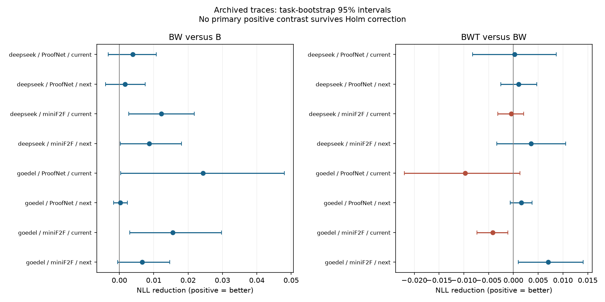

Полные Brier, все модели и переносы: [model_metrics.csv](assets/185503bc4d31_model_metrics.csv). Все контрасты и интервалы: [contrasts.csv](assets/03ebe7cf4f3f_contrasts.csv).

Важно сравнивать также с Position: более подробная B не обязана лучше обобщаться при конечной выборке. Например, на ProofNet в прогнозе следующего шага её преимущество не установлено самим включением дополнительных признаков. Таблица сохраняет более простой контроль, чтобы улучшение относительно B не выдавалось автоматически за победу над всеми обычными моделями.

Источник: [Кестен хвосты и обычный пошаговый риск](chapters/16_kesten.md).

Экспоненциальный закон успеха по длине возникает при постоянном пошаговом риске:

    P(T > L) = (1−p)^L

Та же формула получается для независимых превышений порога при любой форме распределения скачков. При изменяющемся риске используется произведение вероятностей выживания на шагах. Поэтому само качество прогноза по длине не идентифицирует остаточные экстремумы или тяжёлые хвосты.

Дополнительные хвостовые признаки проверены после позиции, surprisal, длины и истории величины скачка. Основные сравнения не дали общей положительной добавки после поправки; отдельный перенос DeepSeek miniF2F → Putnam по next-step NLL является вторичным результатом. Он показывает возможность предсказательной информации, но не выделяет Кестен из альтернатив.

## Аудит отбора и исправления прежних трактовок

| модель | все попытки | strict verified | whole_ok | sorryAx среди предполагаемых недостающих | локализованные отказы | покрытие nonverified, % |
| --- | --- | --- | --- | --- | --- | --- |
| deepseek | 840 | 111 | 155 | 44 | 452 | 62.0027 |
| goedel | 840 | 79 | 167 | 88 | 259 | 34.0342 |

Поле whole_proof_ok означает успешность определённого этапа elaboration и само по себе не гарантирует отсутствие дыр в доказательстве. Все предполагаемые недостающие verified-попытки имеют зависимость от sorryAx; их replay не подтверждает корректность. Их нельзя добавлять как отрицательные примеры ошибки. Все действительно verified-попытки уже имеют состояния. Восстановление дополнительных verified-состояний и refit расширенного v2 в этой популяции не требуются: допустимое множество не расширилось.

Предложенная замена покрытия на 66,0% / 38,5% не применяется. Знаменатель nonverified равен всем evaluation-попыткам минус строго verified. Существующие примерно 62% / 34% согласуются с этим определением. Технические pilot-попытки не подмешиваются в evaluation.

В population_manifest сохранены исходные и строгие метки, SHA исходных записей, причины исключения и пересекающиеся флаги. AST и токеновые длины при отсутствии корректного измерения остаются пропусками. Состав тактик рассчитывается по AST, с отдельными весами по тактикам и по задачам/попыткам.

Источник: [Строгий аудит отбора гибкий baseline и одинаковые префиксы](chapters/15_priority.md).

Поле whole_proof_ok нельзя использовать вместо строгой корректности. Успешная elaboration с зависимостью от sorryAx не превращает попытку в правильное доказательство. Исправленный аудит сохраняет прежнее покрытие обучаемой популяции; более высокие проценты, фигурировавшие в промежуточном отчёте, не используются.

Отсутствие первого отказа на последней тактике в старой eligible-популяции проверено на коде и фикстурах. Общего запрета на такой случай нет. Суффикс после отказа и правила отбора помогают объяснить наблюдаемую картину, но не позволяют переносить позиционный baseline на все возможные ошибки рассуждения.

Исторические отчёты могут содержать статусы очередей, предложения следующих опытов и обозначения до уточнений. Они сохраняются как источники с датой и SHA; актуальная полнота последних серий приведена в начале сводки. Старые состояния очереди не означают, что эти задания всё ещё выполняются.

## Ответы на вопросы рецензентов

| Рецензент | Вопрос | Ответ | Источник |
| --- | --- | --- | --- |
| 1ooR и wDaH | Поддержка Кестена и тяжёлых хвостов | Подтверждения специфического механизма нет | [Кестен хвосты и обычный пошаговый риск](chapters/16_kesten.md) |
| 1ooR | Отличие от обычного пошагового риска | Проверено; основные scalar/tail контрасты не проходят Holm | [Кестен хвосты и обычный пошаговый риск](chapters/16_kesten.md) |
| 1ooR | Причины исключений и состав выборки | Аудит выполнен; selection bias ограничивает вывод | [Строгий аудит отбора гибкий baseline и одинаковые префиксы](chapters/15_priority.md) |
| 1ooR | Последний шаг и начальный anchor | Разметка и чувствительность проверены; универсального закона нет | [Контроли рецензентов и чувствительность измерения](chapters/01_revision.md) |
| wDaH | Изменения surprisal | Добавлены signed и absolute изменения; вклад нормы зависит от модели | [Контроли рецензентов и чувствительность измерения](chapters/01_revision.md) |
| wDaH | Первый отказ и первая ошибка рассуждения | Измеряется формальный отказ; внутренний неверный выбор не установлен | [Полная матрица старых и уточнённых границ](chapters/26_granularity.md) |
| 22Kj | Сравнение с hidden probes | Полные матрицы и геометрические признаки; положительные результаты отдельных методов | [Проекции гиперплоскости и информация в векторах](chapters/27_geometry.md) |
| 22Kj | Сравнение с PRM | PRM сильнее простого максимума нормы на общей ProcessBench выборке | [Стриминг PRM и меньшая модель](chapters/04_gaps.md) |
| 22Kj | Практическая польза online | Есть эффекты проекций; одинаковый FPR и предотвращение требуют проверки | [Проекции гиперплоскости и информация в векторах](chapters/27_geometry.md) |
| 22Kj | DeepSeek против Goedel | Проверены фолды, общие задачи, длина, тип и границы; единой причины не установлено | [Устойчивость различий DeepSeek и Goedel](chapters/20_goedel.md) |
| 22Kj | P5 и успех по длине | Предсказательная полезность длины не выделяет EVT | [Кестен хвосты и обычный пошаговый риск](chapters/16_kesten.md) |
| 22Kj | Меньшие модели и неформальные решения | Выполнен reader-based опыт 1.5B; положительной pooled добавки нормы нет | [Стриминг PRM и меньшая модель](chapters/04_gaps.md) |

Новые положительные результаты относятся к извлечению информации обучаемыми геометрическими признаками на обозначенных популяциях. Они не заменяют проверку специфических теоретических предпосылок. Связь результатов с условными утверждениями теории и ограничение цели до формального отказа должны быть отражены в тексте статьи.

## Что остаётся исследовать

Для обобщения геометрического результата нужна независимая выборка задач, собранная после фиксации представления, обучения и критериев сравнения. Это особенно существенно для больших матриц, многократно использующих тот же архив.

Для практического online-применения нужны более точная оценка на корректных доказательствах, сравнение при сопоставимом фактическом FPR, инкрементальное определение границ и отдельный эксперимент с вмешательством в генерацию. Нынешняя тревога на завершённом ошибочном фрагменте не измеряет предотвращение отказа.

Для механистической интерпретации нужно отделить кодирование типа, длины и позиции от информации о формальной корректности на достаточно большом числе контролируемых контекстов. Удаление коррелирующего подпространства и наблюдаемая стабильность нормали — диагностические шаги, не полное причинное объяснение.

Для специфической гипотезы Кестена необходимы независимо определённые динамические переменные и проверяемая связь их мультипликативных коэффициентов с хвостовыми предсказаниями. По одной локализации максимума и экспоненциальной кривой успеха такую связь установить нельзя.

## Где находятся материалы

Основной локальный каталог: /Users/den/work/Airi_work/evolve_alpha_handover/reports/onebigjump_complete_20261115.

Серверный каталог: /beegfs/home/denis.rakhmankin/onebigjump/runs/research_synthesis_20261115_v1/delivery.

Канонические исходники находятся под /beegfs/home/denis.rakhmankin/onebigjump/runs/. [Каталог отчётов](REPORT_INDEX.md) содержит точные пути каждой серии. GitHub проверен по дереву коммита 818fe065afaa6bc9127d804aa6e2467e5f897cc8; в этой публикации добавлены новые геометрические серии.

Пакет включает исходные сводные таблицы, проверенные локальные копии подробных отчётов, графики, реестр публикаций и manifest сборки. Оригинальные веса моделей, полные hidden-state массивы и все поштучные предсказания остаются в серверных каталогах исходных серий; их не следует путать с компактными отчётными метриками.

Таблицы последних серий собраны из сохранённых metrics и contrasts без переобучения. Manifest содержит SHA256 входов и выходов, Python и библиотеки, узел и Slurm job, git commit и dirty-статус. Проверены полнота ключей, совпадение MD между геометрической и fine-матрицей, отсутствие подмены NA нулями и локальные ссылки созданных документов.


# Подробные результаты всех включённых серий

Следующие разделы сохраняют постановки и таблицы источников. Повторяющиеся числа в обзорах не считаются независимыми экспериментами. Исторические статусы, планы и прежние формулировки читаются с учётом актуального аудита и новых серий выше.


## Приложение 1 Контроли рецензентов и чувствительность измерения

Источник: [Контроли рецензентов и чувствительность измерения](chapters/01_revision.md). Сервер: /beegfs/home/denis.rakhmankin/onebigjump/runs/revision_20261107_v1/delivery_final/REPORT_ONEBIGJUMP_REVISION_20261107_RU.md.

Для состава strictly verified применяется исправленный аудит из сводки. Старые промежуточные проценты расширенного покрытия не заменяют этот аудит.

Сформировано: 2026-11-07T20:41:16.686512+00:00. Проект onebigjump; исходный commit bf0bdbe21c00fb9bd677da5a0318eac83f1c8f98. Рабочее дерево было изменено до этой серии; исходный diff, статус и хеши сохранены. Существующие результаты не перезаписаны.

#### Что выполнено

Завершены новые расчёты E0–E6: воспроизведение архива, аудит меток, adjacent delta-surprisal, чувствительность геометрии и anchors, полноразмерные линейные probes, перекрёстный Lean-тест и анализ принятых переходов. Исторические контроли и статус расширений E7–E9 приведены отдельно. Новая независимая natural-task репликация и новые семейства хвостовых распределений в эту серию не входят.

Это **локализация первой воспроизводимо отклонённой Lean тактики**. Она не размечает момент возникновения ошибочного замысла. Кандидаты в ретроспективной задаче включают весь исходный AST-путь, в том числе текст после отказа. Метка 0 после отказа не означает корректность.

#### Модели, измерения и статистика

DeepSeek-Prover-V2-7B — основной prover; Goedel-Prover-V2-8B — репликация. Kimina-Prover-Distill-8B включена во вторичные miniF2F-сравнения и новый перекрёстный тест. Веса языковых моделей заморожены; fine-tuning не выполнялся. Новые forwards выполнены в BF16/SDPA на одном A100 за раз.

Для тактики t состояние X_t снимается после decoder block на её последнем исходном токене. Основные блоки: 14 для DeepSeek и 17 для Goedel/Kimina, индексация с нуля. Hook сравнен с hidden_states[block+1]; embedding-состояние не принято за блок.

Измерения: ξ_t = X_t − X_(t−1); w_t = ‖Σ_ρ^(−1/2)(ξ_t−μ)‖₂; Σ_ρ = (1−ρ)Σ + ρ·tr(Σ)/d·I. Это норма, не квадрат нормы. Основной anchor — вход в формальную часть; ρ=0,1. μ и Σ получены на отдельных проверенных miniF2F calibration-задачах.

q_t — среднее −log p исходных токенов тактики, с предсказанием token[k] из logits[k−1]. Δq_t=q_t−q_(t−1). Для первого шага Δq=0; уже существующий first-индикатор кодирует отсутствие предыдущего шага, дополнительная дублирующая колонка не добавлялась.

M0: прежние spline-преобразования позиции t, t/L, log(1+число токенов), q, индикаторы первого/последнего шага и AST-тип тактики. M0W=M0+log(1+w). MD=M0+Δq+|Δq|. MDW=MD+log(1+w). Все добавленные числовые признаки стандартизованы только по соответствующему train-fold.

Локализатор: p_it=exp(r_it)/Σ_s exp(r_is); loss=−Σ_i a_i log p_i,t* + λ‖β‖²/2, где a_i=1/(G·n_g). Сначала равны веса групп задач, затем попыток внутри группы. Сохранены исходные 5 внешних × 3 внутренних split, сетка λ и критерий inner NLL. Все scalers, knots и категории обучаются заново внутри train.

Интервалы: 20 000 парных bootstrap групп при **фиксированных OOF-моделях**. Они не учитывают полностью неопределённость повторного обучения CV. ProofNet и архивный miniF2F уже исследовались раньше; новые анализы этих данных остаются исследовательскими. Два основных exact-сравнения MDW−MD корректируются Holm отдельно от семейства двух NLL-сравнений. Чувствительности не выбирались по знаку результата.

#### E0–E1: воспроизведение и разметка

| Модель | Попытки / группы learned | M0 exact | M0W exact | Побитовая проверка старых признаков |
|---|---|---|---|---|
| deepseek | 452 / 166 | 40.85% | 43.51% | jump и q совпали; сохранённые предсказания воспроизведены |
| goedel | 259 / 133 | 57.82% | 57.13% | jump и q совпали; сохранённые предсказания воспроизведены |

Полное повторное обучение M0/M0W также воспроизвело исходные вероятности и предсказания. Все восемь исторических argmax-ячеек miniF2F/ProofNet, включая T=1,0, проверены по исходным артефактам.

| Модель | Все evaluation | Verified по старой category | Whole-proof verified | Не verified: старый / уточнённый знаменатель | Eligible learned / argmax |
|---|---|---|---|---|---|
| deepseek | 840 | 111 | 155 | 729 / 685 | 452 / 456 |
| goedel | 840 | 79 | 167 | 761 / 673 | 259 / 262 |

Уточнены знаменатели coverage: прежняя category и отдельный whole_proof_ok отвечают на разные вопросы; например, завершившая Lean-доказательство генерация могла быть помечена generation_truncation. Основная learned-популяция и её t* не изменились. Разница с argmax-популяцией обусловлена дополнительным исключением неполных токенных границ.

Полная взаимоисключающая классификация:

| Модель | Категория аудита | Попытки |
|---|---|---|
| deepseek | accepted_but_unsolved | 22 |
| deepseek | ambiguous_localization | 50 |
| deepseek | context_mismatch | 9 |
| deepseek | generation_truncation | 55 |
| deepseek | included_reproducible_rejection | 452 |
| deepseek | parse_error | 38 |
| deepseek | resource_or_internal | 54 |
| deepseek | sorry_invalid | 1 |
| deepseek | token_boundary_incomplete | 4 |
| deepseek | verified | 155 |
| goedel | accepted_but_unsolved | 14 |
| goedel | ambiguous_localization | 48 |
| goedel | context_mismatch | 7 |
| goedel | generation_truncation | 294 |
| goedel | included_reproducible_rejection | 259 |
| goedel | parse_error | 32 |
| goedel | resource_or_internal | 16 |
| goedel | token_boundary_incomplete | 3 |
| goedel | verified | 167 |

##### Почему нет первого отказа на последней тактике

В коде не обнаружен общий запрет t*=L. Реальные Lean-fixtures проверили первый, внутренний и последний отказы, принятый последний шаг с незакрытыми целями, полностью корректное доказательство, parse error и ресурсный сбой. Дополнительная проверка полного production-пути прошла через verify_one, AST-replay и исходные токенные границы: последний отказ сохранил p2_eligible=True.

| Модель | Есть AST-observer / все | Последняя тактика exact в learned | Осталось шагов после отказа: min / median / max |
|---|---|---|---|
| deepseek | 651 / 840 | 442 | 1 / 7 / 82 |
| goedel | 410 / 840 | 252 | 1 / 6 / 161 |

В этой выбранной популяции ошибка обычно находится внутри построения вспомогательного доказательства, после которого остаётся завершающая тактика. Найденные последние отказы более грубого старого replay относятся к исключённым truncated/sorry-ответам; они перечислены в E1_last_lineage. Для исключённых попыток без точного AST-observer положение t* неизвестно. Поэтому отсутствие последних отказов — свойство наблюдаемой выбранной популяции, не основание обобщать качество на любые ошибки.

#### E2: добавочная ценность после Δq

| Модель | Кандидаты | N / G | M0 | M0W | MD | MDW | MDW−MD, п.п. [95%] |
|---|---|---|---|---|---|---|---|
| deepseek | все | 452 / 166 | 40.85% | 43.51% | 39.39% | 42.20% | +2.81 [+0.90; +5.02] |
| deepseek | t≥2; t*≥2, новое обучение | 353 / 148 | 39.68% | 40.92% | 39.56% | 39.62% | +0.06 [-1.80; +2.08] |
| goedel | все | 259 / 133 | 57.82% | 57.13% | 57.32% | 55.69% | -1.63 [-4.32; +0.63] |
| goedel | t≥2; t*≥2, новое обучение | 176 / 105 | 52.38% | 52.38% | 51.90% | 52.22% | +0.32 [-2.54; +2.86] |

Для t≥2 сохраняются исходные t и t/L, а Δq берётся относительно реально существовавшей предыдущей тактики. Это отдельная условная популяция с переобучением; её проценты нельзя напрямую сравнивать с основной строкой как изменение на тех же попытках.

| Модель | NLL MD | NLL MDW | NLL MD−MDW [95%] | ±1 MD / MDW | Exact p Holm2 | NLL p Holm2 | Helped / harmed |
|---|---|---|---|---|---|---|---|
| deepseek | 1.77968 | 1.77045 | +0.00923 [-0.00397; +0.02216] | 50.85% / 53.18% | 0.01770 | 0.16569 | 16 / 4 |
| goedel | 1.57061 | 1.62617 | -0.05556 [-0.09206; -0.02137] | 65.68% / 64.17% | 0.19374 | 0.00580 | 4 / 7 |

Первичные exact и NLL не дают одинакового вывода для обеих моделей. Отдельное исключение первого шага существенно меняет величину добавочного эффекта. Полные first/interior/last и length-страты, включая пустую last-страту, находятся в JSON метрик.

##### Вторичные miniF2F-сравнения

Новая исследовательская nested CV на архивных evaluation-задачах. Общий детерминированный реестр групп фиксирует split между моделями и температурами; это не прежний frozen-transfer протокол T=0,6→1,0.

| Модель | T | N / G | MD | MDW | Δ exact, п.п. [95%] | NLL MD / MDW |
|---|---|---|---|---|---|---|
| deepseek | 0.6 | 528 / 122 | 49.44% | 50.45% | +1.01 [-0.42; +2.43] | 1.66854 / 1.66711 |
| deepseek | 1.0 | 541 / 140 | 45.85% | 46.05% | +0.20 [-2.29; +2.68] | 1.68768 / 1.67794 |
| goedel | 0.6 | 448 / 122 | 37.05% | 38.32% | +1.27 [-1.74; +4.28] | 2.00866 / 1.98027 |
| goedel | 1.0 | 453 / 124 | 39.85% | 40.04% | +0.19 [-1.83; +2.56] | 1.86589 / 1.85750 |
| kimina | 0.6 | 320 / 94 | 28.90% | 31.82% | +2.93 [-1.28; +7.33] | 2.33191 / 2.35228 |
| kimina | 1.0 | 483 / 120 | 37.30% | 36.83% | -0.47 [-2.63; +1.06] | 2.10971 / 2.10570 |

##### Online detector

Старый detector использовал q минус среднее предыдущих q. Теперь добавлены именно соседняя Δq и её модуль. HD — простые текущие/прошлые признаки; HDW добавляет исходные три jump-признака. Полная длина и будущий максимум запрещены. Порог выбран по inner-OOF verified proofs; на test он фиксирован.

| Модель | Verified / failed | Целевой FPR | Exact HD / HDW | Реальный test FPR HD / HDW | Early HD / HDW |
|---|---|---|---|---|---|
| deepseek | 35 / 452 | 0.1 | 14.62% / 13.59% | 15.62% / 15.62% | 3.23% / 2.93% |
| deepseek | 35 / 452 | 0.2 | 18.70% / 21.18% | 28.12% / 36.46% | 4.64% / 6.04% |
| goedel | 40 / 259 | 0.1 | 8.33% / 8.96% | 4.39% / 4.39% | 0.75% / 1.69% |
| goedel | 40 / 259 | 0.2 | 18.01% / 14.16% | 14.91% / 10.53% | 5.33% / 3.70% |

#### E3: слой, whitening, anchor

Все десять вариантов показаны; лучший вариант не заменяет исходную основную конфигурацию. Меняется один фактор. Prompt-fixed заменяет только первый increment при прежнем whitening; prompt-recalibrated использует transform по тем же разрешённым calibration-задачам с другим anchor.

| Модель | Вариант | MDW exact, все | Δ к MD, п.п. [95%] | Δ без первого кандидата, п.п. [95%] |
|---|---|---|---|---|
| deepseek | primary | 42.20% | +2.81 [+0.90; +5.02] | +0.06 [-1.80; +2.08] |
| deepseek | layer_lower | 41.15% | +1.76 [+0.05; +3.77] | +0.28 [-1.52; +2.31] |
| deepseek | layer_upper | 42.75% | +3.36 [+1.05; +6.02] | +1.07 [-0.90; +3.21] |
| deepseek | rho_001 | 42.20% | +2.81 [+0.90; +5.02] | +0.51 [-1.35; +2.53] |
| deepseek | rho_05 | 42.20% | +2.81 [+0.90; +5.02] | +0.23 [-1.63; +2.31] |
| deepseek | rho_1 | 40.75% | +1.36 [+0.15; +2.96] | +0.28 [-1.18; +2.14] |
| deepseek | raw | 40.75% | +1.36 [+0.15; +2.96] | +0.28 [-1.18; +2.14] |
| deepseek | centered | 40.75% | +1.36 [+0.15; +2.96] | +0.28 [-1.18; +2.14] |
| deepseek | prompt_fixed | 40.70% | +1.31 [-0.10; +3.06] | +0.06 [-1.80; +2.08] |
| deepseek | prompt_recalibrated | 41.90% | +2.51 [+0.70; +4.67] | +0.06 [-1.80; +2.08] |
| goedel | primary | 55.69% | -1.63 [-4.32; +0.63] | +0.32 [-2.54; +2.86] |
| goedel | layer_lower | 56.25% | -1.07 [-3.20; +0.75] | -0.95 [-3.65; +1.27] |
| goedel | layer_upper | 56.13% | -1.19 [-3.20; +0.25] | +0.00 [-3.02; +3.17] |
| goedel | rho_001 | 56.44% | -0.88 [-3.07; +0.94] | +0.32 [-2.54; +2.86] |
| goedel | rho_05 | 56.13% | -1.19 [-3.82; +0.94] | -0.16 [-2.86; +2.22] |
| goedel | rho_1 | 57.13% | -0.19 [-1.32; +0.94] | -1.43 [-4.76; +1.27] |
| goedel | raw | 57.13% | -0.19 [-1.32; +0.94] | -1.27 [-3.49; +0.00] |
| goedel | centered | 57.13% | -0.19 [-1.32; +0.94] | -1.43 [-4.76; +1.27] |
| goedel | prompt_fixed | 57.07% | -0.25 [-2.26; +1.25] | +0.32 [-2.54; +2.86] |
| goedel | prompt_recalibrated | 56.44% | -0.88 [-3.07; +0.94] | +0.32 [-2.54; +2.86] |

Нижний/верхний блок — 6/21 у DeepSeek и 8/26 у Goedel. Полные argmax-оценки и исходный uniform сохраняются отдельно от learned-популяции. У каждого варианта одинаковое покрытие; ни один вариант не получил дополнительного отбора по результату.

Пилот с forward только промпта показал небольшие BF16-расхождения с полным контекстом. Эти pilot anchors не используются в итоговых сравнениях: выполнен полный forward всех исходных последовательностей, сохранены оба anchor и все слои; состояния на архивных границах обязаны совпасть побитово.

##### Префикс до известного t* и matched verified pseudo-prefix

Это диагностика с известным концом отказа, не online accuracy. C1 использует проверенное доказательство той же группы и ту же точку отсечения; C2 использует префиксы с более поздним первым отказом. В этой компактной prefix-таблице веса равны по попыткам; equal-group варианты и интервалы сохранены в summary.json. Совместно ресемплируются целые группы. При недостаточном числе независимых групп CI не приводится.

| Модель | Вариант | Prefix hit | Uniform | C1 N / группы | C1 hit / control | C2 hit / control |
|---|---|---|---|---|---|---|
| deepseek | primary | 42.86% | 24.76% | 27 / 14 | 55.56% / 41.98% | 42.98% / 34.80% |
| deepseek | layer_lower | 43.70% | 24.76% | 27 / 14 | 62.96% / 54.32% | 43.82% / 28.94% |
| deepseek | layer_upper | 38.38% | 24.76% | 27 / 14 | 51.85% / 51.85% | 38.48% / 32.87% |
| deepseek | rho_001 | 42.86% | 24.76% | 27 / 14 | 55.56% / 41.98% | 42.98% / 34.63% |
| deepseek | rho_05 | 42.30% | 24.76% | 27 / 14 | 59.26% / 50.62% | 42.42% / 35.28% |
| deepseek | rho_1 | 39.50% | 24.76% | 27 / 14 | 44.44% / 19.14% | 39.61% / 24.71% |
| deepseek | raw | 33.33% | 24.76% | 27 / 14 | 29.63% / 9.26% | 33.43% / 19.42% |
| deepseek | centered | 39.50% | 24.76% | 27 / 14 | 44.44% / 19.14% | 39.61% / 24.71% |
| deepseek | prompt_fixed | 6.16% | 24.76% | 27 / 14 | 7.41% / 0.00% | 6.18% / 2.77% |
| deepseek | prompt_recalibrated | 42.86% | 24.76% | 27 / 14 | 55.56% / 41.98% | 42.98% / 35.31% |
| goedel | primary | 41.34% | 24.40% | 19 / 11 | 36.84% / 29.82% | 41.57% / 24.93% |
| goedel | layer_lower | 37.43% | 24.40% | 19 / 11 | 52.63% / 36.84% | 37.64% / 24.36% |
| goedel | layer_upper | 32.96% | 24.40% | 19 / 11 | 21.05% / 21.05% | 33.15% / 22.85% |
| goedel | rho_001 | 38.55% | 24.40% | 19 / 11 | 36.84% / 31.58% | 38.76% / 24.98% |
| goedel | rho_05 | 45.25% | 24.40% | 19 / 11 | 47.37% / 36.84% | 45.51% / 24.58% |
| goedel | rho_1 | 13.41% | 24.40% | 19 / 11 | 15.79% / 19.30% | 13.48% / 6.19% |
| goedel | raw | 7.82% | 24.40% | 19 / 11 | 10.53% / 19.30% | 7.87% / 2.80% |
| goedel | centered | 13.41% | 24.40% | 19 / 11 | 15.79% / 19.30% | 13.48% / 6.19% |
| goedel | prompt_fixed | 7.82% | 24.40% | 19 / 11 | 0.00% / 0.00% | 7.87% / 1.26% |
| goedel | prompt_recalibrated | 43.02% | 24.40% | 19 / 11 | 47.37% / 31.58% | 43.26% / 24.92% |

Архивные miniF2F/Kimina readout-, whitening- и prefix-чувствительности включены как уже выполненные проверки; их не выдаём за новую независимую выборку. Формальная версия tail/threshold диагностик воспроизведена с исходными правилами и числами превышений; signed Hill/moment/GPD остаются в archive_extensions/metrics.json.

#### E4: полноразмерные линейные probes

MD_state добавляет линейный score X_t, MD_increment — линейный score ξ_t. Использованы все 4096 координат, без PCA. Каждый scaler обучен внутри своего train-fold; регуляризация выбрана тем же inner NLL. Веса LLM не менялись.

| Модель | MD | MDW | MD + state | MD + increment | NLL MD / MDW / state / increment | CPU wall, мин |
|---|---|---|---|---|---|---|
| deepseek | 39.39% | 42.20% | 47.64% | 46.82% | 1.77968 / 1.77045 / 1.62908 / 1.78748 | 16.07 |
| goedel | 57.32% | 55.69% | 50.33% | 51.49% | 1.57061 / 1.62617 / 1.67394 / 1.74147 | 11.00 |

Размеры design matrix и коэффициентов по folds, все OOF-вероятности, λ, расходы и интервалы парных сравнений находятся в E4/*/{fits в fold-*.json, metrics.json, predictions.json}. Сравнение относится к этим регуляризованным линейным probes на имеющемся числе задач, а не к пределу возможностей всех probes.

#### E5: одинаковый текст тактики, изменённая корректность

Корпус: exact, apply и rw; 75 pilot-четвёрок на 15 базовых конструкциях и 300 test-четвёрок на 60 других конструкциях. По пять вариантов имён/порядка гипотез/принятого префикса/дистракторов на конструкцию. Эти варианты не считаются независимыми задачами. Все четыре исполнения каждой четверки проверены настоящим Lean; sorry, parse/resource failures не заменяют отрицательную метку.

В A гипотеза hx имеет целевой тип, hy — другой; в B типы меняются местами. Сравниваются буквально те же тексты тактик. D=(w_A(hy)−w_A(hx)+w_B(hx)−w_B(hy))/2. Положительный D соответствует большему скачку на отклонённой тактике. Same-text ranking сравнивает одну и ту же тактику между A/B; ничьи дают 0,5. Порог шанса — 50%.

| Модель | D(w), 95% | Rank w, same text [95%] | Rank q, same text [95%] | Simple exact | Simple + w exact | Δ exact, п.п. [95%] |
|---|---|---|---|---|---|---|
| deepseek | -1.2528 [-1.71322; -0.78013] | 33.33% [+26.17; +40.83] | 100.00% [+100.00; +100.00] | 99.67% | 99.17% | -0.50 [-1.17; +0.00] |
| goedel | -1.0407 [-1.20937; -0.86864] | 19.83% [+15.33; +24.67] | 99.83% [+99.50; +100.00] | 98.67% | 98.67% | +0.00 [+0.00; +0.00] |
| kimina | -3.4040 [-3.99099; -2.81938] | 11.17% [+7.33; +15.17] | 99.67% [+99.17; +100.00] | 96.67% | 98.50% | +1.83 [+0.83; +2.83] |

Simple использует длину тактики, q, соседнюю Δq, |Δq| и отсутствие предыдущего шага; Simple+w добавляет log(1+w). Conditional-logistic выбор между двумя тактиками настроен только на pilot-конструкциях с групповым inner CV. Test-конструкции не участвовали в подборе λ. Коэффициент скачка не ограничен по знаку.

В этих простых синтетических конструкциях raw jump не ведёт себя как универсальный возрастающий индикатор ошибки. Перенос такого результата на естественные длинные доказательства ограничен: семейства exact/apply/rw и синтетические типы специально контролируются. Данные по каждой семье, все четыре w/q/Δq и learned NLL сохранены, включая отрицательные эффекты. Для всех трёх моделей в E5 использован один простой completion-промпт; это отдельный контролируемый режим, а не оценка стандартного chat/CoT-промпта каждой модели. В этом корпусе formal-entry совпадает с концом предоставленного промпта, потому что заголовок уже заканчивается на by; оба индекса сохранены явно.

#### E6: принятые тактики и изменение состояния Lean

Включены только реально принятые шаги до отказа и шаги проверенных доказательств. Счётчики целей основаны на множествах Lean goal IDs внутри перехода. Число строк объявлений и длина pretty-printed state — прокси; размер AST выражений по ним не заявляется. Execution-outcome признаки используются только для объяснения log(1+w), не для pre-Lean детектора ошибок.

| Модель | Принятые шаги / группы | Verified / pre-failure | Порог τ | Превышений / группы | Held-out MSE baseline / +transition | Δ MSE [95%] |
|---|---|---|---|---|---|---|
| deepseek | 2275 / 150 | 275 / 2000 | 152.7247 | 195 / 69 | 0.05403 / 0.05337 | +0.000665 [-0.00056; +0.00207] |
| goedel | 1363 / 110 | 282 / 1081 | 98.9471 | 199 / 59 | 0.09586 / 0.09516 | +0.000702 [-0.00201; +0.00331] |

Порог перенесён из архивной независимой threshold-calibration части; её группы не пересекаются с whitening-fit группами. В первом техническом расчёте E6 по ошибке использовался эмпирический 99-й процентиль самих whitening-fit приращений. Он сохранён для аудита, но не используется в этой таблице. Исправление затронуло только отметку large_jump и набор примеров; regression/OOF-оценки порог не используют и не изменились.

Примеры крупных принятых переходов выбраны фиксированным SHA256-правилом; для каждого сохранены исходная тактика, before/after, w, q и ссылка на Lean detail. Это наблюдательные связи, не причинная идентификация механизма ошибок.

#### E7–E9 и границы выполненной работы

| Блок | Фактический статус | Что осталось |
|---|---|---|
| E7 | archived exact-prefix audit completed | A new fixed-prefix continuation collection would be needed if archived coverage is insufficient; not replace missing mixed outcomes by adaptive generation. |
| E8 | historical protocols and results retained; no fresh natural-task confirmatory replication in this campaign | Freeze H1-H4 on a newly sampled task-family-disjoint natural-task corpus after development; pilot and renamings must not count as independent tasks. |
| E9 | formal-entry archived threshold rates reproduced; archived Hill/moment/GPD retained | Held-out tail-family likelihood comparison and held-out conditional rank model are optional new work; no fresh claim of Kesten or regularly varying tails. |

В строгом поиске одинаковых исходных token-prefix среди доступных принятых/первых отклонённых шагов получено:

| Модель | Шаги | Уникальные префиксы | Разные продолжения одного префикса | Mixed outcome |
|---|---|---|---|---|
| deepseek | 2727 | 2727 | 0 | 0 |
| goedel | 1624 | 1624 | 0 | 0 |

Новые естественные продолжения для E7 не генерировались; новая natural-task серия H1–H4 для E8 не выдаётся за выполненную. Архивный Appendix-H/ProofNet и T=1 transfer уже изучались, поэтому повторный расчёт не делает их независимым подтверждением. Для E9 сохранены прежние signed оценки; положительный Hill сам по себе не устанавливает регулярно меняющийся хвост, а логнормальное распределение не относится к таким хвостам.

#### Материалы для статьи и ответа рецензентам

Доступен архив сентябрьских отчётов и draft, а замечания 1ooR/wDaH/22Kj взяты из задания. Текущая публичная страница OpenReview/API не открылась (HTTP 403); точное совпадение серверного draft с поданной версией ICLR 2027 не установлено. Поэтому ниже указаны смысловые места для вставки, не выдуманные номера строк актуальной статьи. Ответы в OpenReview не публиковались.

| Рецензент / вопрос | Проверка и численная опора | Допустимый вывод | Место в статье | Ограничение |
|---|---|---|---|---|
| 1ooR: отбор и последний шаг | E1: все попытки учтены; last-step fixture проходит production/token path; исходные learned-числа воспроизведены | Метка работает на последнем шаге; текущая выбранная популяция последних отказов не содержит | Dataset/labeling + eligibility appendix | Неизвестные t* у исключённых не восстанавливаются догадкой |
| 1ooR: геометрия | E3 и geometry.csv: все слои, shrinkages, raw/centered, оба anchor; prefix_controls.csv | Эффект оценивается вместе с чувствительностью к выбору readout и первого шага | Sensitivity appendix | Исторические данные, множественные описательные варианты |
| wDaH: Δsurprisal | E2 + E2-online: MDW−MD, exact/NLL, first-step-excluded refit; primary_contrasts.csv | Можно утверждать добавочную предсказательную ценность только в конкретной модели/популяции и метрике | Incremental value + online subsection | Разные prover-модели дают разные результаты; CI условны на OOF fits |
| wDaH: начало ошибки | Операциональная метка t* и исключение post-error из E6 | Измеряется первый воспроизводимый отказ Lean | Definitions/limitations | Это не начало ошибочного рассуждения |
| 22Kj: probes | E4, полные 4096 координат, одинаковые split/loss/tuning | Сравнение с конкретными регуляризованными линейными probes | Practical payoff | Не универсальная оценка всех возможных probes/PRM |
| 22Kj: объяснение скачка | E5: текст фиксирован, корректность меняется; E6: принятые переходы и goal states | Простая монотонная интерпретация raw jump ограничена; q в контролируемом корпусе информативен | Controlled tests + discussion | Синтетические типы и наблюдательный E6 |
| Все: Кестен/фиксированный порог | Архивная formal-entry tail/threshold диагностика; отрицательные и смешанные результаты сохранены | Наблюдения не устанавливают механизм Кестена или универсальный порог отказа | Theory/empirical scope | Не выполнено новое held-out сравнение семейств хвостовых распределений |

##### Rebuttal-ready factual text

On the archived ProofNet deepseek cohort (452 attempts, 166 task groups), adding the jump feature after adjacent surprisal-change controls changed equal-group exact localization by +2.81 percentage points (fixed-OOF group-bootstrap 95% CI [+0.90; +5.02]). Retraining with the first candidate excluded gave +0.06 points ([-1.80; +2.08]). These are exploratory analyses of previously inspected data, not a fresh confirmatory evaluation.

On the archived ProofNet goedel cohort (259 attempts, 133 task groups), adding the jump feature after adjacent surprisal-change controls changed equal-group exact localization by -1.63 percentage points (fixed-OOF group-bootstrap 95% CI [-4.32; +0.63]). Retraining with the first candidate excluded gave +0.32 points ([-2.54; +2.86]). These are exploratory analyses of previously inspected data, not a fresh confirmatory evaluation.

#### Проверка, ресурсы и воспроизводимость

Финальная проверка: 62 обязательных выходов; 8692 проверок выходных digest; 49696 распределений вероятностей. Проверены gradient, shift/позиции, исходные split и отсутствие пересечения pilot/test конструкций. Все требуемые проверки прошли.

Каждое вычисление выполнялось в Slurm. Исторические результаты, исходные checkpoints/токены и архивные manifests не изменялись. Неудачные технические задания сохранены в логах; исправлялась только новая серия. В E3 DeepSeek один inner-fit завершился статусом ABNORMAL при max|gradient|=4,79×10⁻⁸. Недостающие варианты досчитаны с повтором того же L-BFGS-B из нуля и увеличенным maxls 40→200; loss, λ-grid, splits и критерии сходимости сохранены. Завершённые варианты не пересчитывались. Исходники, зависимости, первоначальный git diff/status и версии библиотек входят в пакет воспроизводимости.

Ссылки на основные таблицы: [scores.csv](assets/846c51a77cf7_scores.csv), [primary_contrasts.csv](assets/dd28616902d6_primary_contrasts.csv), [geometry.csv](assets/bd5ccf8c9853_geometry.csv), [prefix_controls.csv](assets/d99a5c64d9cd_prefix_controls.csv), [crossed.csv](assets/de3ba1b5b683_crossed.csv). Полный машинный свод — summary.json (полный исходник на Жоресе: /beegfs/home/denis.rakhmankin/onebigjump/runs/revision_20261107_v1/delivery_final/summary.json).

#### Карта кода, входов и проверенных выходов

Пути ниже даны относительно onebigjump. Новые скрипты находятся в experiments/revision_20261107_v1, новые результаты — в runs/revision_20261107_v1.

| Блок | Код новой проверки | Основные входы / переиспользованный код | Готовые выходы | Статус |
|---|---|---|---|---|
| E0 | audit.py | audit/lean_localizer_20260925_v1 + исходные OOF/состояния | E0/metrics.json | воспроизведён |
| E1 | label_audit.py, last_lineage.py, production_fixtures_v2.py | whole-proof outcome, frozen observer и semantic replay | E1_archive, E1_last_lineage, E1_production_v2 | завершён, живой Lean проверен |
| E2 | localizer.py, online.py, secondary.py | старый engine и сохранённые групповые splits; NNG_A5 hazard | E2, E2_online, secondary | завершён |
| E3 | geometry.py + geometry_retry.py, full_anchors.py, anchor_compare.py, prefix_controls.py | NNG_vectors, NNG_A2 whitening; prefix_positional_control | E3, E3_anchor, E3_prefix | завершён |
| E4 | probe.py | те же ProofNet rows/splits; 4096D boundary states | E4 | завершён; PCA не использовалась |
| E5 | crossed_corpus.py, crossed_extract.py, crossed_kimina.py, crossed_analyze_all3.py | новый замороженный корпус; реальные Lean-исходы | E5_corpus, E5_gpu, E5_analysis_all3 | завершён, 3 prover-модели |
| E6 | transitions.py, correct_threshold.py | принятые события replay; независимый archival threshold | E6, E6_corrected_threshold | завершён; используется исправленный порог |
| E7–E9 | archive_extensions.py | сохранённые prefixes, Appendix H и tail-артефакты | archive_extensions | архив проверен; новые расширения перечислены отдельно |

#### Дополнение: argmax и uniform на полной доступной популяции

Это описательные point estimates. Все варианты используют одинаковые попытки внутри модели. Кандидаты и популяция all/nonfirst соответствуют названиям; candidate-first исключается отдельно от основной learned-популяции. Числа не объединяются с learned exact.

| Модель | Вариант | N / G | Exact / uniform, equal-group | Δ, п.п. | Exact / uniform, attempt-weighted |
|---|---|---|---|---|---|
| deepseek | primary | 456 / 167 | 18.39% / 12.50% | +5.90 | 20.39% / 13.34% |
| deepseek | layer_lower | 456 / 167 | 25.27% / 12.50% | +12.77 | 28.73% / 13.34% |
| deepseek | layer_upper | 456 / 167 | 20.08% / 12.50% | +7.58 | 22.15% / 13.34% |
| deepseek | rho_001 | 456 / 167 | 19.29% / 12.50% | +6.80 | 20.61% / 13.34% |
| deepseek | rho_05 | 456 / 167 | 18.31% / 12.50% | +5.82 | 19.96% / 13.34% |
| deepseek | rho_1 | 456 / 167 | 24.48% / 12.50% | +11.99 | 25.66% / 13.34% |
| deepseek | raw | 456 / 167 | 24.20% / 12.50% | +11.71 | 26.32% / 13.34% |
| deepseek | centered | 456 / 167 | 24.48% / 12.50% | +11.99 | 25.66% / 13.34% |
| deepseek | prompt_fixed | 456 / 167 | 21.21% / 12.50% | +8.71 | 22.81% / 13.34% |
| deepseek | prompt_recalibrated | 456 / 167 | 18.64% / 12.50% | +6.15 | 20.18% / 13.34% |
| goedel | primary | 262 / 134 | 26.37% / 13.08% | +13.29 | 29.39% / 14.16% |
| goedel | layer_lower | 262 / 134 | 27.74% / 13.08% | +14.65 | 31.30% / 14.16% |
| goedel | layer_upper | 262 / 134 | 26.24% / 13.08% | +13.16 | 27.86% / 14.16% |
| goedel | rho_001 | 262 / 134 | 25.56% / 13.08% | +12.48 | 28.24% / 14.16% |
| goedel | rho_05 | 262 / 134 | 27.49% / 13.08% | +14.40 | 30.92% / 14.16% |
| goedel | rho_1 | 262 / 134 | 28.54% / 13.08% | +15.46 | 30.92% / 14.16% |
| goedel | raw | 262 / 134 | 27.24% / 13.08% | +14.16 | 30.15% / 14.16% |
| goedel | centered | 262 / 134 | 28.54% / 13.08% | +15.46 | 30.92% / 14.16% |
| goedel | prompt_fixed | 262 / 134 | 28.17% / 13.08% | +15.09 | 30.92% / 14.16% |
| goedel | prompt_recalibrated | 262 / 134 | 27.43% / 13.08% | +14.34 | 28.24% / 14.16% |

Полные all/nonfirst показатели с обоими весами: [argmax.csv](assets/cd3853e1294c_argmax.csv).

#### Дополнение: неопределённость probes

Все интервалы ниже — парные bootstrap по группам при фиксированных OOF-предсказаниях. Это вторичные сравнения; отдельные p-values не используются для объявления семейства подтверждённых эффектов.

| Модель | Контраст | Δ exact, п.п. [95%] | Выигрыш NLL [95%] |
|---|---|---|---|
| deepseek | MD_state-MD | +8.2473 [+2.1228; +14.4981] | +0.1506 [+0.0449; +0.2570] |
| deepseek | MD_increment-MD | +7.4283 [+1.1546; +13.8038] | -0.0078 [-0.1050; +0.0902] |
| deepseek | MDW-MD_state | -5.4360 [-11.3396; +0.4475] | -0.1414 [-0.2461; -0.0367] |
| deepseek | MDW-MD_increment | -4.6170 [-10.7114; +1.4417] | +0.0170 [-0.0796; +0.1123] |
| goedel | MD_state-MD | -6.9925 [-14.1103; +0.0251] | -0.1033 [-0.2588; +0.0550] |
| goedel | MD_increment-MD | -5.8271 [-12.0927; +0.3133] | -0.1709 [-0.3206; -0.0122] |
| goedel | MDW-MD_state | +5.3634 [-1.6541; +12.5063] | +0.0478 [-0.1105; +0.2005] |
| goedel | MDW-MD_increment | +4.1980 [-1.8170; +10.2130] | +0.1153 [-0.0383; +0.2590] |

Совместимый готовый process reward model для этого формата Lean-шагов в проверенной инфраструктуре не найден; PRM baseline остаётся открытым пунктом. Новая большая PRM не обучалась.

#### Дополнение: типы принятых переходов и примеры E6

Категории ниже определены только по изменению числа целей: уменьшилось / увеличилось / сохранилось. Равное число целей допускает замену цели и изменение гипотез. Это не доказательство семантической эквивалентности состояний.

| Модель | Переход | Все принятые: шаги / группы | Выше τ: шаги / группы | Только verified выше τ: шаги / группы |
|---|---|---|---|---|
| deepseek | fewer_goals | 694 / 103 | 39 / 26 | 5 / 5 |
| deepseek | more_goals | 130 / 50 | 20 / 14 | 1 / 1 |
| deepseek | same_goal_count | 1451 / 148 | 136 / 58 | 10 / 4 |
| goedel | fewer_goals | 537 / 66 | 44 / 27 | 16 / 8 |
| goedel | more_goals | 60 / 26 | 31 / 16 | 2 / 2 |
| goedel | same_goal_count | 766 / 105 | 124 / 50 | 18 / 4 |

##### deepseek: evaluation:proofnet-8:Artin_exercise_10_2_4:T0.6:a00, шаг 2

Шаг принят Lean; полное доказательство позднее завершилось отказом. w=155.80732, q=0.10283, Δq=0.06442. Пример взят из сохранённой SHA256-выборки: первый в своей категории verified/pre-failure.

```lean
have h₁ : p ∈ span ({2} : Set (Polynomial ℤ)) := hp.1
```

Состояние до:

```text
p : ℤ[X]
hp : p ∈ Ideal.span {2} ⊓ Ideal.span {X}
⊢ p ∈ Ideal.span {2 * X}
```

Состояние после:

```text
p : ℤ[X]
hp : p ∈ Ideal.span {2} ⊓ Ideal.span {X}
h₁ : p ∈ Ideal.span {2}
⊢ p ∈ Ideal.span {2 * X}
```

Источник: `/beegfs/home/denis.rakhmankin/onebigjump/runs/followthrough_20260915_v1/p2_pipeline/deepseek/verification-1/a33ef502534e8f7841b8057a43a7567e7a3b7d995b6689943175684a06fa4e37.json.gz`; SHA256 `8a4d45a090b72c2635f8c3746cc12271f1ecc7b7e9a8fbf8d53174cd9e3c2ac8`.

##### goedel: evaluation:proofnet-199:Axler_exercise_1_4:T0.6:a00, шаг 3

Шаг принят Lean; полное доказательство позднее завершилось отказом. w=102.05051, q=0.05892, Δq=0.00865. Пример взят из сохранённой SHA256-выборки: первый в своей категории verified/pre-failure.

```lean
exact Or.inl ha
```

Состояние до:

```text
case pos
F : Type u_1
V : Type u_2
inst✝² : AddCommGroup V
inst✝¹ : Field F
inst✝ : Module F V
v : V
a : F
h : a • v = 0
ha : a = 0
⊢ a = 0 ∨ v = 0
```

Состояние после:

```text
(нет целей)
```

Источник: `/beegfs/home/denis.rakhmankin/onebigjump/runs/followthrough_20260915_v1/p2_pipeline/goedel/verification-3/a0c5ac9b785340cea28e26b61c53582b76ba9091362e9c150eaafc88ac518bb8.json.gz`; SHA256 `fdf8754ffe5eafc41e6c186d1da8bece16dd7e2b2f7dc3383e0f73569210414c`.

##### goedel: evaluation:proofnet-217:Dummit_Foote_exercise_1_1_29:T0.6:a00, шаг 9

Шаг принят Lean; полное доказательство проверено. w=100.82358, q=0.00788, Δq=0.00787. Пример взят из сохранённой SHA256-выборки: первый в своей категории verified/pre-failure.

```lean
rintro ⟨hA, hB⟩ x y
```

Состояние до:

```text
A : Type u_1
B : Type u_2
inst✝¹ : Group A
inst✝ : Group B
h_imp : (∀ (x y : A × B), x * y = y * x) → (∀ (x y : A), x * y = y * x) ∧ ∀ (x y : B), x * y = y * x
⊢ ((∀ (x y : A), x * y = y * x) ∧ ∀ (x y : B), x * y = y * x) → ∀ (x y : A × B), x * y = y * x
```

Состояние после:

```text
A : Type u_1
B : Type u_2
inst✝¹ : Group A
inst✝ : Group B
h_imp : (∀ (x y : A × B), x * y = y * x) → (∀ (x y : A), x * y = y * x) ∧ ∀ (x y : B), x * y = y * x
hA : ∀ (x y : A), x * y = y * x
hB : ∀ (x y : B), x * y = y * x
x y : A × B
⊢ x * y = y * x
```

Источник: `/beegfs/home/denis.rakhmankin/onebigjump/runs/followthrough_20260915_v1/p2_pipeline/goedel/verification-0/5597f5ed1644533dabdb819b0e6db36b71c8a4262de65f530b6efa497f97827c.json.gz`; SHA256 `1dcfe2c9d68a438f375fc1a1b4f9947c2bf2f4cbc90b789a66382310507693c6`.

#### Предлагаемые правки статьи

**Abstract.** Назвать эмпирическое событие первым воспроизводимым отказом Lean. Описать измеряемую связь геометрии скрытых состояний с этим событием и модельную зависимость добавочной локализации. Не представлять наблюдательную связь как установление механизма Кестена или универсального порога.

**Contributions.** Разделить три результата: теоретическую условную модель; воспроизводимый аудит и измерение Lean-события; сравнение предсказательных признаков и контролируемые проверки. Добавить Δsurprisal, полный линейный probe, crossed-корпус и корректные переходы как самостоятельные эмпирические проверки с явными ограничениями.

**Эксперименты.** Главную learned-таблицу дополнить MD/MDW с равными весами задач и Holm2, отдельно показать refit без первого кандидата. Вынести argmax, онлайн-детектор и prefix-диагностику в разные таблицы с собственными популяциями. В чувствительности показать все заранее заданные варианты, не выбирать лучший по текущему тесту. Добавить полные интервалы probes и отрицательные/модельно различающиеся результаты E5/E6.

**Ограничения.** Текущий ProofNet/miniF2F анализ повторно использует уже исследованные данные. E5 — новые отложенные синтетические конструкции с общим completion-промптом; перенос между семействами приведён в отдельном вторичном анализе ниже. Новые естественные развилки E7, нетронутые задачи E8, held-out сравнение хвостовых семейств E9 и PRM требуют отдельных запусков. Точное совпадение доступного draft с текущей подачей не проверено из-за недоступности OpenReview.

#### Дополнительный учёт ресурсов

Новый каталог расчётов до упаковки отчёта: 1.021 GiB. Валидация 1500 синтетических Lean-исполнений заняла 52.34 с внутри выделенного задания, без staging. CPU-задания запрашивали 4 CPU / 32 GiB RAM; GPU-задания — 4 CPU / 64 GiB host RAM и одну A100 80 GB. Пакет GPU metadata содержит измеренную память и throughput. Извлечение выполнялось с batch=1; переход на другой dtype или многообъектный batch не использовался.

#### E5: перенос на другое семейство тактик

Для каждого holdout-семейства локализатор обучен только на pilot-конструкциях двух других семейств: 10 групп. Регуляризация выбирается 3-fold group CV там же. Затем оцениваются 100 test-четвёрок / 20 групп оставленного семейства. Все три holdout и все prover-модели показаны. Это вторичная исследовательская проверка, выполненная после общего E5-анализа; новый датированный addendum сохранён до расчёта. Тестовые признаки и outcomes не используются в обучении, scalers или выборе λ.

| Модель | Новое семейство | Simple exact | Simple+w exact | Δ, п.п. [95%] | NLL Simple / +w |
|---|---|---|---|---|---|
| deepseek | exact | 100.00% | 100.00% | +0.00 [+0.00; +0.00] | 0.00002 / 0.00001 |
| deepseek | apply | 100.00% | 100.00% | +0.00 [+0.00; +0.00] | 0.00074 / 0.00099 |
| deepseek | rw | 99.00% | 98.50% | -0.50 [-1.50; +0.00] | 0.12344 / 0.12244 |
| goedel | exact | 100.00% | 100.00% | +0.00 [+0.00; +0.00] | 0.00376 / 0.00364 |
| goedel | apply | 96.00% | 95.50% | -0.50 [-1.50; +0.00] | 0.10043 / 0.09472 |
| goedel | rw | 100.00% | 100.00% | +0.00 [+0.00; +0.00] | 0.01336 / 0.01390 |
| kimina | exact | 93.50% | 95.50% | +2.00 [+0.50; +4.00] | 0.13229 / 0.08581 |
| kimina | apply | 96.50% | 99.00% | +2.50 [+1.00; +4.50] | 0.06548 / 0.02305 |
| kimina | rw | 100.00% | 100.00% | +0.00 [+0.00; +0.00] | 0.01546 / 0.05490 |

CSV: [family_transfer.csv](assets/6ef6e077e44b_family_transfer.csv). При 20 базовых конструкциях на семейство точность интервалов ограничена; повторные варианты одной конструкции ресемплируются вместе.

#### Численная таблица для rebuttal

Эта таблица дополняет карту замечаний выше конкретными оценками и интервалами. Числа построены из тех же метрик, что основной отчёт.

| Замечание | Проверка | Результат [95%] | Допустимая формулировка | Раздел | Осталось |
|---|---|---|---|---|---|
| wDaH | deepseek: MDW−MD exact | +2.811 [+0.904; +5.020] п.п. | Добавочная локализация зависит от модели и популяции | Incremental value | Исследованные ранее ProofNet; фиксированные OOF fits |
| 22Kj | deepseek: state probe−MD exact | +8.247 [+2.123; +14.498] п.п. | Сравнение с конкретным полным линейным probe | Probe baseline | Малое число независимых групп; не все возможные probes |
| 22Kj | deepseek: E6 gain MSE | +0.001 [-0.001; +0.002] | Измерены наблюдательные связи на принятых шагах | Accepted transitions | CI включает отсутствие улучшения; текстовые прокси |
| wDaH | goedel: MDW−MD exact | -1.629 [-4.323; +0.627] п.п. | Добавочная локализация зависит от модели и популяции | Incremental value | Исследованные ранее ProofNet; фиксированные OOF fits |
| 22Kj | goedel: state probe−MD exact | -6.992 [-14.110; +0.025] п.п. | Сравнение с конкретным полным линейным probe | Probe baseline | Малое число независимых групп; не все возможные probes |
| 22Kj | goedel: E6 gain MSE | +0.001 [-0.002; +0.003] | Измерены наблюдательные связи на принятых шагах | Accepted transitions | CI включает отсутствие улучшения; текстовые прокси |
| 22Kj | deepseek: raw w same-text ranking | 33.33% [26.17; 40.83] | В этом корпусе больший raw jump не является возрастающим индикатором отказа | Crossed control | Синтетические конструкции; общий completion-промпт |
| 22Kj | goedel: raw w same-text ranking | 19.83% [15.33; 24.67] | В этом корпусе больший raw jump не является возрастающим индикатором отказа | Crossed control | Синтетические конструкции; общий completion-промпт |
| 22Kj | kimina: raw w same-text ranking | 11.17% [7.33; 15.17] | В этом корпусе больший raw jump не является возрастающим индикатором отказа | Crossed control | Синтетические конструкции; общий completion-промпт |
| 1ooR | Последний отказ Lean | 5/5 production fixtures; последний отказ p2_eligible=True | Общего фильтра t*=L не обнаружено | Labeling / eligibility | Fixtures не оценивают частоту в естественной популяции; CI неприменим |

Фактический GPU-расход этой серии на момент отчёта по Slurm: **0.298 GPU-часа**. Это elapsed allocation × число GPU; запрошенный walltime не является фактическим расходом. Полная ведомость — slurm_accounting.psv (исходный путь: slurm_accounting.psv).

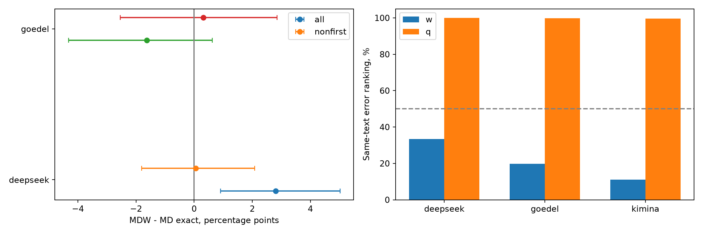

Серверная папка: /beegfs/home/denis.rakhmankin/onebigjump/runs/revision_20261107_v1. Код: experiments/revision_20261107_v1. Связанные первичные данные и большие состояния остаются на сервере; в компактный локальный пакет включены отчёт, таблицы, итоговые метрики, проверки, исходники и диагностические логи.

## Приложение 2 Перенос Putnam и сравнение хвостовых моделей

Источник: [Перенос Putnam и сравнение хвостовых моделей](chapters/02_extensions.md). Сервер: /beegfs/home/denis.rakhmankin/onebigjump/runs/extensions_20261108_v1/delivery/report.md.

Все таблицы автоматически построены из сохранённых метрик. Группировка и bootstrap выполняются по независимым задачам, а не по отдельным попыткам.

#### Устройство серии

E8 использует 76 новых для истории проекта задач PutnamBench, 4 попытки на задачу и две модели. Отдельные 12 пилотных задач исключены из итоговых метрик. LLM заморожены, BF16; temperature=0.6, максимум 8192 новых токенов. Локализаторы обучены исключительно на старом ProofNet, включая выбор регуляризации и преобразований. Это перенос между наборами задач, а не ещё одна выборка ProofNet.

Новизна относится к истории этого проекта: отсутствие задач в предобучении моделей не установлено. Совместимость формулировок проверена Lean с технической заглушкой; эта проверка не является проверкой эталонного доказательства. Исходные токены, полные ответы, исключения и причины потерь покрытия сохранены.

MD использует признаки шага, surprisal и его изменения; MDW добавляет размер скачка представления. Дополнительно проверяются полный вектор состояния и вектор приращения. Метрики локализации относятся к траекториям с установленной первой ошибкой. Hit — доля точных локализаций; window1 — ошибка не более одного шага; NLL — минус логарифм вероятности истинного шага. Успех генерации полного доказательства — другая величина.

Доверительные интервалы используют 20000 перевыборок групп при минимум 20 группах. Для двух моделей поправка Holm применяется отдельно к основной точности и NLL. При недостаточном числе групп приводятся описательные оценки. Мощность для эффекта 2–3 процентных пункта заранее не гарантируется.

#### E8: покрытие и перенос

| Модель | Всего тестовых попыток | Пригодны для локализации | Группы |
| --- | --- | --- | --- |
| deepseek | 304 | 118 | 58 |
| goedel | 304 | 48 | 35 |


| Модель | Популяция | Метод | Hit, % | ±1 шаг, % | NLL |
| --- | --- | --- | --- | --- | --- |
| deepseek | all | MD | 33.4770 | 41.6667 | 1.9359 |
| deepseek | all | MDW | 34.1954 | 41.3793 | 1.9202 |
| deepseek | all | MD_state | 49.4253 | 51.2931 | 1.7205 |
| deepseek | all | MD_increment | 35.0575 | 44.1092 | 2.0507 |
| deepseek | nonfirst | MD | 35.4167 | 43.6012 | 1.9241 |
| deepseek | nonfirst | MDW | 37.3512 | 45.0893 | 1.9090 |
| goedel | all | MD | 45.7143 | 49.5238 | 2.0755 |
| goedel | all | MDW | 45.7143 | 49.5238 | 2.1098 |
| goedel | all | MD_state | 50.9524 | 59.0476 | 1.8459 |
| goedel | all | MD_increment | 36.1905 | 42.3810 | 2.1105 |
| goedel | nonfirst | MD | 39.2473 | 49.4624 | 2.0979 |
| goedel | nonfirst | MDW | 38.7097 | 47.8495 | 2.1325 |


| Модель | Популяция | Сравнение | Метрика | Изменение | 95% CI | p Holm |
| --- | --- | --- | --- | --- | --- | --- |
| deepseek | all | MDW-MD | hit | 0.7184 | [-0.017241379310344827, 0.03160919540229885] | 1.0000 |
| deepseek | all | MDW-MD | nll | 0.0156 | [-0.01038483762970493, 0.041298217316394985] | 0.2372 |
| deepseek | all | MDW-MD | window1 | -0.2874 | [-0.02586206896551724, 0.017241379310344827] | — |
| deepseek | all | MD_state-MD | hit | 15.9483 | [0.05028735632183909, 0.27011494252873564] | — |
| deepseek | all | MD_state-MD | nll | 0.2154 | [0.044062231807643286, 0.39926665127647226] | — |
| deepseek | all | MD_state-MD | window1 | 9.6264 | [-0.001436781609195401, 0.1954022988505747] | — |
| deepseek | all | MD_increment-MD | hit | 1.5805 | [-0.054597701149425276, 0.09195402298850575] | — |
| deepseek | all | MD_increment-MD | nll | -0.1149 | [-0.2888360803542094, 0.07008019138459338] | — |
| deepseek | all | MD_increment-MD | window1 | 2.4425 | [-0.048850574712643674, 0.10488505747126438] | — |
| deepseek | all | MDW-MD_state | hit | -15.2299 | [-0.264367816091954, -0.04166666666666667] | — |
| deepseek | all | MDW-MD_state | nll | -0.1997 | [-0.38660812003966194, -0.024654103763392575] | — |
| deepseek | all | MDW-MD_state | window1 | -9.9138 | [-0.19827586206896552, -1.1389356890559531e-17] | — |
| deepseek | nonfirst | MDW-MD | hit | 1.9345 | [-0.008928571428571428, 0.06547619047619048] | — |
| deepseek | nonfirst | MDW-MD | nll | 0.0150 | [-0.006626171367015105, 0.036761068323260426] | — |
| deepseek | nonfirst | MDW-MD | window1 | 1.4881 | [0.0, 0.038690476190476185] | — |
| goedel | all | MDW-MD | hit | 0.0000 | [0.0, 0.0] | 1.0000 |
| goedel | all | MDW-MD | nll | -0.0343 | [-0.07784625299457446, 0.007688264272501178] | 0.2294 |
| goedel | all | MDW-MD | window1 | 0.0000 | [0.0, 0.0] | — |
| goedel | all | MD_state-MD | hit | 5.2381 | [-0.10476190476190476, 0.20952380952380953] | — |
| goedel | all | MD_state-MD | nll | 0.2296 | [-0.08085771608178777, 0.5689201712593532] | — |
| goedel | all | MD_state-MD | window1 | 9.5238 | [-0.07142857142857142, 0.2571428571428571] | — |
| goedel | all | MD_increment-MD | hit | -9.5238 | [-0.2666666666666666, 0.07619047619047618] | — |
| goedel | all | MD_increment-MD | nll | -0.0350 | [-0.39992371935115273, 0.34555461139617416] | — |
| goedel | all | MD_increment-MD | window1 | -7.1429 | [-0.2476190476190476, 0.1] | — |
| goedel | all | MDW-MD_state | hit | -5.2381 | [-0.20952380952380953, 0.10476190476190476] | — |
| goedel | all | MDW-MD_state | nll | -0.2639 | [-0.6103438629330253, 0.05037208304905674] | — |
| goedel | all | MDW-MD_state | window1 | -9.5238 | [-0.2571428571428571, 0.07142857142857142] | — |
| goedel | nonfirst | MDW-MD | hit | -0.5376 | [-0.08602150537634409, 0.059139784946236555] | — |
| goedel | nonfirst | MDW-MD | nll | -0.0346 | [-0.08007802897517395, 0.009410309820317809] | — |
| goedel | nonfirst | MDW-MD | window1 | -1.6129 | [-0.0967741935483871, 0.04838709677419355] | — |

Изменения Hit и window1 показаны в процентных пунктах; их CI в таблице хранится в долях. Для NLL положительное изменение означает уменьшение потерь. H1/H3 и H2 с фактическим покрытием приведены в metrics.json; H2 в этой серии описательный, без bootstrap-интервалов.

#### E7: естественные продолжения
На одну задачу выбирается один естественный принятый префикс по фиксированному хеш-порядку без отбора по w/q или исходам. Генерируются восемь продолжений. Lean оценивает первую полностью завершённую тактику; незавершённые, неоднозначные, ресурсные и токенизационные случаи исключаются с указанием причины. Primary-анализ сохраняет частоты повторяющихся валидных текстов; чувствительность по уникальным текстам приведена отдельно.


| Модель | Назначено префиксов | Измерено | Со смешанными исходами | Валидные альтернативы |
| --- | --- | --- | --- | --- |
| deepseek | 5 | 5 | 0 | 25 |
| goedel | 3 | 2 | 0 | 14 |


| Модель | Выборка | Признак | Pair rank, % | 95% CI |
| --- | --- | --- | --- | --- |
| deepseek | raw_pair_rank | w | — | None |
| deepseek | raw_pair_rank | q | — | None |
| deepseek | raw_pair_rank | delta_q | — | None |
| deepseek | distinct_text_pair_rank | w | — | None |
| deepseek | distinct_text_pair_rank | q | — | None |
| deepseek | distinct_text_pair_rank | delta_q | — | None |
| goedel | raw_pair_rank | w | — | None |
| goedel | raw_pair_rank | q | — | None |
| goedel | raw_pair_rank | delta_q | — | None |
| goedel | distinct_text_pair_rank | w | — | None |
| goedel | distinct_text_pair_rank | q | — | None |
| goedel | distinct_text_pair_rank | delta_q | — | None |

Pair rank оценивает вероятность большего признака у отвергнутой тактики, с половинным вкладом равенств. Нулевая величина — 50%. Для обучаемого сравнения simple и simple+jump используется вложенная групповая кросс-валидация; все продолжения одного префикса остаются в одной группе.

##### deepseek: обучаемое сравнение

```json
{
  "status": "insufficient_mixed_groups"
}
```

##### goedel: обучаемое сравнение

```json
{
  "status": "insufficient_mixed_groups"
}
```

#### E9: хвосты и ранговое объяснение

E9 — анализ архивных ProofNet-траекторий на прежних групповых разбиениях. Пороги хвостов выбираются только на train; accepted-pre и first-error анализируются отдельно. Подгонка требует не менее 80 превышений и 20 обучающих групп. Недостаток данных не заменяется ослаблением порогов. Знаки moment и GPD сохраняются; положительный Hill сам по себе не устанавливает семейство хвоста.

| Модель | Популяция / квантиль | Семейство | Фолдов | Тестовых превышений | Групп | NLL | Вне поддержки |
| --- | --- | --- | --- | --- | --- | --- | --- |
| deepseek | accepted_pre/0.9 | pareto | 5 | 212 | 72 | 3.5015 | 0 |
| deepseek | accepted_pre/0.9 | exponential | 5 | 212 | 72 | 3.4922 | 0 |
| deepseek | accepted_pre/0.9 | lognormal | 5 | 212 | 72 | 3.4896 | 0 |
| deepseek | accepted_pre/0.9 | gpd | 5 | 212 | 72 | 3.4873 | 0 |
| deepseek | accepted_pre/0.95 | pareto | 5 | 116 | 49 | 3.3776 | 0 |
| deepseek | accepted_pre/0.95 | exponential | 5 | 116 | 49 | 3.3703 | 0 |
| deepseek | accepted_pre/0.95 | lognormal | 5 | 116 | 49 | 3.3668 | 0 |
| deepseek | accepted_pre/0.95 | gpd | 5 | 116 | 49 | 3.3668 | 0 |
| deepseek | accepted_pre/0.975 | pareto | 0 | 0 | 0 | — | 0 |
| deepseek | accepted_pre/0.975 | exponential | 0 | 0 | 0 | — | 0 |
| deepseek | accepted_pre/0.975 | lognormal | 0 | 0 | 0 | — | 0 |
| deepseek | accepted_pre/0.975 | gpd | 0 | 0 | 0 | — | 0 |
| deepseek | first_error/0.9 | pareto | 0 | 0 | 0 | — | 0 |
| deepseek | first_error/0.9 | exponential | 0 | 0 | 0 | — | 0 |
| deepseek | first_error/0.9 | lognormal | 0 | 0 | 0 | — | 0 |
| deepseek | first_error/0.9 | gpd | 0 | 0 | 0 | — | 0 |
| deepseek | first_error/0.95 | pareto | 0 | 0 | 0 | — | 0 |
| deepseek | first_error/0.95 | exponential | 0 | 0 | 0 | — | 0 |
| deepseek | first_error/0.95 | lognormal | 0 | 0 | 0 | — | 0 |
| deepseek | first_error/0.95 | gpd | 0 | 0 | 0 | — | 0 |
| deepseek | first_error/0.975 | pareto | 0 | 0 | 0 | — | 0 |
| deepseek | first_error/0.975 | exponential | 0 | 0 | 0 | — | 0 |
| deepseek | first_error/0.975 | lognormal | 0 | 0 | 0 | — | 0 |
| deepseek | first_error/0.975 | gpd | 0 | 0 | 0 | — | 0 |
| goedel | accepted_pre/0.9 | pareto | 0 | 0 | 0 | — | 0 |
| goedel | accepted_pre/0.9 | exponential | 0 | 0 | 0 | — | 0 |
| goedel | accepted_pre/0.9 | lognormal | 0 | 0 | 0 | — | 0 |
| goedel | accepted_pre/0.9 | gpd | 0 | 0 | 0 | — | 0 |
| goedel | accepted_pre/0.95 | pareto | 0 | 0 | 0 | — | 0 |
| goedel | accepted_pre/0.95 | exponential | 0 | 0 | 0 | — | 0 |
| goedel | accepted_pre/0.95 | lognormal | 0 | 0 | 0 | — | 0 |
| goedel | accepted_pre/0.95 | gpd | 0 | 0 | 0 | — | 0 |
| goedel | accepted_pre/0.975 | pareto | 0 | 0 | 0 | — | 0 |
| goedel | accepted_pre/0.975 | exponential | 0 | 0 | 0 | — | 0 |
| goedel | accepted_pre/0.975 | lognormal | 0 | 0 | 0 | — | 0 |
| goedel | accepted_pre/0.975 | gpd | 0 | 0 | 0 | — | 0 |
| goedel | first_error/0.9 | pareto | 0 | 0 | 0 | — | 0 |
| goedel | first_error/0.9 | exponential | 0 | 0 | 0 | — | 0 |
| goedel | first_error/0.9 | lognormal | 0 | 0 | 0 | — | 0 |
| goedel | first_error/0.9 | gpd | 0 | 0 | 0 | — | 0 |
| goedel | first_error/0.95 | pareto | 0 | 0 | 0 | — | 0 |
| goedel | first_error/0.95 | exponential | 0 | 0 | 0 | — | 0 |
| goedel | first_error/0.95 | lognormal | 0 | 0 | 0 | — | 0 |
| goedel | first_error/0.95 | gpd | 0 | 0 | 0 | — | 0 |
| goedel | first_error/0.975 | pareto | 0 | 0 | 0 | — | 0 |
| goedel | first_error/0.975 | exponential | 0 | 0 | 0 | — | 0 |
| goedel | first_error/0.975 | lognormal | 0 | 0 | 0 | — | 0 |
| goedel | first_error/0.975 | gpd | 0 | 0 | 0 | — | 0 |


| Модель | Популяция / квантиль | Fold | Статус | Hill | Moment | GPD shape |
| --- | --- | --- | --- | --- | --- | --- |
| deepseek | accepted_pre/0.9 | 0 | fitted | 0.0810 | -0.2367 | -0.2227 |
| deepseek | accepted_pre/0.9 | 1 | fitted | 0.0716 | -0.1455 | -0.1707 |
| deepseek | accepted_pre/0.9 | 2 | fitted | 0.0746 | -0.0917 | -0.1276 |
| deepseek | accepted_pre/0.9 | 3 | fitted | 0.0774 | -0.1463 | -0.1601 |
| deepseek | accepted_pre/0.9 | 4 | fitted | 0.0720 | -0.1147 | -0.1273 |
| deepseek | accepted_pre/0.95 | 0 | fitted | 0.0645 | -0.1400 | -0.1689 |
| deepseek | accepted_pre/0.95 | 1 | fitted | 0.0598 | -0.0912 | -0.1145 |
| deepseek | accepted_pre/0.95 | 2 | fitted | 0.0610 | -0.1044 | -0.1295 |
| deepseek | accepted_pre/0.95 | 3 | fitted | 0.0626 | -0.0394 | -0.0649 |
| deepseek | accepted_pre/0.95 | 4 | fitted | 0.0596 | -0.0764 | -0.0888 |
| deepseek | accepted_pre/0.975 | 0 | insufficient_training_tail | — | — | — |
| deepseek | accepted_pre/0.975 | 1 | insufficient_training_tail | — | — | — |
| deepseek | accepted_pre/0.975 | 2 | insufficient_training_tail | — | — | — |
| deepseek | accepted_pre/0.975 | 3 | insufficient_training_tail | — | — | — |
| deepseek | accepted_pre/0.975 | 4 | insufficient_training_tail | — | — | — |
| deepseek | first_error/0.9 | 0 | insufficient_training_tail | — | — | — |
| deepseek | first_error/0.9 | 1 | insufficient_training_tail | — | — | — |
| deepseek | first_error/0.9 | 2 | insufficient_training_tail | — | — | — |
| deepseek | first_error/0.9 | 3 | insufficient_training_tail | — | — | — |
| deepseek | first_error/0.9 | 4 | insufficient_training_tail | — | — | — |
| deepseek | first_error/0.95 | 0 | insufficient_training_tail | — | — | — |
| deepseek | first_error/0.95 | 1 | insufficient_training_tail | — | — | — |
| deepseek | first_error/0.95 | 2 | insufficient_training_tail | — | — | — |
| deepseek | first_error/0.95 | 3 | insufficient_training_tail | — | — | — |
| deepseek | first_error/0.95 | 4 | insufficient_training_tail | — | — | — |
| deepseek | first_error/0.975 | 0 | insufficient_training_tail | — | — | — |
| deepseek | first_error/0.975 | 1 | insufficient_training_tail | — | — | — |
| deepseek | first_error/0.975 | 2 | insufficient_training_tail | — | — | — |
| deepseek | first_error/0.975 | 3 | insufficient_training_tail | — | — | — |
| deepseek | first_error/0.975 | 4 | insufficient_training_tail | — | — | — |
| goedel | accepted_pre/0.9 | 0 | insufficient_training_tail | — | — | — |
| goedel | accepted_pre/0.9 | 1 | insufficient_training_tail | — | — | — |
| goedel | accepted_pre/0.9 | 2 | insufficient_training_tail | — | — | — |
| goedel | accepted_pre/0.9 | 3 | insufficient_training_tail | — | — | — |
| goedel | accepted_pre/0.9 | 4 | insufficient_training_tail | — | — | — |
| goedel | accepted_pre/0.95 | 0 | insufficient_training_tail | — | — | — |
| goedel | accepted_pre/0.95 | 1 | insufficient_training_tail | — | — | — |
| goedel | accepted_pre/0.95 | 2 | insufficient_training_tail | — | — | — |
| goedel | accepted_pre/0.95 | 3 | insufficient_training_tail | — | — | — |
| goedel | accepted_pre/0.95 | 4 | insufficient_training_tail | — | — | — |
| goedel | accepted_pre/0.975 | 0 | insufficient_training_tail | — | — | — |
| goedel | accepted_pre/0.975 | 1 | insufficient_training_tail | — | — | — |
| goedel | accepted_pre/0.975 | 2 | insufficient_training_tail | — | — | — |
| goedel | accepted_pre/0.975 | 3 | insufficient_training_tail | — | — | — |
| goedel | accepted_pre/0.975 | 4 | insufficient_training_tail | — | — | — |
| goedel | first_error/0.9 | 0 | insufficient_training_tail | — | — | — |
| goedel | first_error/0.9 | 1 | insufficient_training_tail | — | — | — |
| goedel | first_error/0.9 | 2 | insufficient_training_tail | — | — | — |
| goedel | first_error/0.9 | 3 | insufficient_training_tail | — | — | — |
| goedel | first_error/0.9 | 4 | insufficient_training_tail | — | — | — |
| goedel | first_error/0.95 | 0 | insufficient_training_tail | — | — | — |
| goedel | first_error/0.95 | 1 | insufficient_training_tail | — | — | — |
| goedel | first_error/0.95 | 2 | insufficient_training_tail | — | — | — |
| goedel | first_error/0.95 | 3 | insufficient_training_tail | — | — | — |
| goedel | first_error/0.95 | 4 | insufficient_training_tail | — | — | — |
| goedel | first_error/0.975 | 0 | insufficient_training_tail | — | — | — |
| goedel | first_error/0.975 | 1 | insufficient_training_tail | — | — | — |
| goedel | first_error/0.975 | 2 | insufficient_training_tail | — | — | — |
| goedel | first_error/0.975 | 3 | insufficient_training_tail | — | — | — |
| goedel | first_error/0.975 | 4 | insufficient_training_tail | — | — | — |


| Модель | Длина | Метод | Наблюдаемый hit | Предсказанный hit | Brier | Групп |
| --- | --- | --- | --- | --- | --- | --- |
| deepseek | all | pooled | 0.4127 | 0.3049 | 0.1812 | 148 |
| deepseek | all | conditioned | 0.4127 | 0.3071 | 0.1811 | 148 |
| deepseek | all | uniform | 0.4127 | 0.2400 | 0.1991 | 148 |
| deepseek | 2-4 | pooled | 0.6667 | 0.4367 | 0.2394 | 94 |
| deepseek | 2-4 | conditioned | 0.6667 | 0.4425 | 0.2400 | 94 |
| deepseek | 2-4 | uniform | 0.6667 | 0.3679 | 0.2730 | 94 |
| deepseek | 5-10 | pooled | 0.2222 | 0.2148 | 0.1648 | 87 |
| deepseek | 5-10 | conditioned | 0.2222 | 0.2148 | 0.1648 | 87 |
| deepseek | 5-10 | uniform | 0.2222 | 0.1462 | 0.1709 | 87 |
| deepseek | 11+ | pooled | 0.1410 | 0.1139 | 0.1167 | 39 |
| deepseek | 11+ | conditioned | 0.1410 | 0.1139 | 0.1167 | 39 |
| deepseek | 11+ | uniform | 0.1410 | 0.0638 | 0.1228 | 39 |
| goedel | all | pooled | 0.3762 | 0.3198 | 0.2014 | 105 |
| goedel | all | conditioned | 0.3762 | 0.3198 | 0.2014 | 105 |
| goedel | all | uniform | 0.3762 | 0.2464 | 0.2106 | 105 |
| goedel | 2-4 | pooled | 0.6120 | 0.4412 | 0.2662 | 61 |
| goedel | 2-4 | conditioned | 0.6120 | 0.4412 | 0.2662 | 61 |
| goedel | 2-4 | uniform | 0.6120 | 0.3723 | 0.2866 | 61 |
| goedel | 5-10 | pooled | 0.1812 | 0.2372 | 0.1550 | 46 |
| goedel | 5-10 | conditioned | 0.1812 | 0.2372 | 0.1550 | 46 |
| goedel | 5-10 | uniform | 0.1812 | 0.1566 | 0.1516 | 46 |
| goedel | 11+ | pooled | 0.2174 | 0.1250 | 0.1708 | 23 |
| goedel | 11+ | conditioned | 0.2174 | 0.1250 | 0.1708 | 23 |
| goedel | 11+ | uniform | 0.2174 | 0.0604 | 0.1893 | 23 |

#### Покрытие и артефакты

```json
{
  "deepseek": {
    "assigned_attempts": 328,
    "pilot_groups": 12,
    "test_groups": 76,
    "E7_requested": 40,
    "E7_labels": {
      "rejected": 25,
      "runtime_error": 4,
      "resource_error": 2,
      "no_complete_first_tactic": 9
    }
  },
  "goedel": {
    "assigned_attempts": 328,
    "pilot_groups": 12,
    "test_groups": 76,
    "E7_requested": 24,
    "E7_labels": {
      "no_complete_first_tactic": 10,
      "rejected": 14
    }
  }
}
```

Проверено 155 manifests, 13847 ссылок с хешами и 966 распределений вероятностей. Полные метрики: metrics.json; плоский экспорт: metrics.csv; проверки: validation.json. Исходные версии и причины технических повторов находятся в manifests, source_history и EXECUTION_NOTES.md.

## Приложение 3 Первая позиция и дополнительные контроли

Источник: [Первая позиция и дополнительные контроли](chapters/03_strengthening.md). Сервер: /beegfs/home/denis.rakhmankin/onebigjump/runs/strengthening_20261110_v1/delivery/recovery_20261110_final/REPORT_RU.md.

Срез: 2026-11-10T19:57:37+03:00, Москва.

Проверен проект /beegfs/home/denis.rakhmankin/onebigjump: серии 7–8 ноября и новые проверки 10 ноября 2026. Другие проекты аккаунта не входят в научный разбор. Доступный контракт статьи: docs/experimental_specification.md. Совпадение этого документа с последним поданным PDF не установлено.

#### Вывод для статьи

Универсальное объяснение отказов Lean через величину одного скачка скрытого состояния не подтверждено. Положительный архивный результат DeepSeek ослабевает при контроле первого шага и не получил убедительного подтверждения на PutnamBench. Для Goedel добавочная польза нормы скачка не подтверждена. Более перспективен полный вектор состояния DeepSeek; его необходимо сопоставлять с сильными baseline и контролями.

Усиление статьи — в устранении альтернативных объяснений, проверке переноса и полном раскрытии отрицательных результатов. Подбор конфигурации до положительного результата не проводился.

#### Какие эксперименты завершились

| Серия | Фактический результат |
| --- | --- |
| E0–E1 | Воспроизведение архива, аудит меток/знаменателей и live Lean fixtures завершены, включая исправленные повторы. |
| E2 | Adjacent Δsurprisal, отдельный nonfirst refit, online и вторичные miniF2F сравнения завершены. |
| E3 | Проверены слои, whitening, anchor и matched prefixes; лучший вариант не подменяет основной. |
| E4 | Полноразмерные probes состояния и приращения завершены. |
| E5 | Контролируемый синтетический тест трёх моделей и перенос семейства тактик завершены. |
| E6 | Крупные корректные Lean переходы проанализированы; причинность не установлена. |
| E8 | Новые для истории проекта PutnamBench задачи с frozen переносом старых локализаторов завершены. |
| E9 | Held-out хвостовые семейства и rank-модель на архиве завершены; большинство хвостовых ячеек недостаточно наполнены. |
| E7 | Генерация, Lean-разметка, измерения и анализ завершены; смешанных исходов внутри выбранных префиксов не получено. |

Аудит 10 ноября подтвердил SHA256 всех 3179 уникальных выходных файлов E7–E9. Полная валидация E0–E6 и исходный отчёт сохранены в runs/revision_20261107_v1/delivery_checked.

Причина зависания E7: задача 8526320 подготовила данные и отправила дочерние этапы, затем упала при отправке отчёта с устаревшими Slurm dependencies. Генерация 8526436 получила DependencyNeverSatisfied. После успешного аудита 8530954 зависимость заменена на этот аудит; исходные запросы, seed и все научные этапы сохранены. Новый отчёт зависит от действующего анализа.

#### Основные результаты

MD использует позицию, длину, тип тактики, surprisal и соседнюю Δsurprisal. MDW добавляет log(1+w), где w — норма whitened increment. Exact — локализация первого воспроизводимого отказа Lean, с равными весами задач; это не доля решённых теорем. Интервалы — 20 000 парных bootstrap задач, условных на обученные модели.

| Выборка | Модель | Кандидаты | N | Группы | MD,% | MDW,% | Δ,п.п. | 95% CI,п.п. |
| --- | --- | --- | --- | --- | --- | --- | --- | --- |
| ProofNet, архив | deepseek | all | 452 | 166 | 39.39 | 42.20 | +2.81 | [+0.904; +5.020] |
| ProofNet, архив | deepseek | nonfirst | 353 | 148 | 39.56 | 39.62 | +0.06 | [-1.802; +2.083] |
| ProofNet, архив | goedel | all | 259 | 133 | 57.32 | 55.69 | -1.63 | [-4.323; +0.627] |
| ProofNet, архив | goedel | nonfirst | 176 | 105 | 51.90 | 52.22 | +0.32 | [-2.540; +2.857] |
| PutnamBench, перенос | deepseek | all | 118 | 58 | 33.48 | 34.20 | +0.72 | [-1.724; +3.161] |
| PutnamBench, перенос | deepseek | nonfirst | 107 | 56 | 35.42 | 37.35 | +1.93 | [-0.893; +6.548] |
| PutnamBench, перенос | goedel | all | 48 | 35 | 45.71 | 45.71 | +0.00 | [+0.000; +0.000] |
| PutnamBench, перенос | goedel | nonfirst | 44 | 31 | 39.25 | 38.71 | -0.54 | [-8.602; +5.914] |

nonfirst исключает первый кандидат и попытки с t*=1; исходные позиции/длины и предыдущая Δq сохранены. Это отдельная условная оценка с переобучением на архиве.

У Goedel в основной E8 MD/MDW не изменили ни одного бинарного exact-исхода: bootstrap даёт [0;0]. Это вырожденная эмпирическая оценка, не доказательство точной эквивалентности в генеральной совокупности. Оба основных exact-контраста E8 незначимы после Holm по двум моделям. Интервалы NLL также включают ноль.

##### Покрытие E8

| Модель | Назначено | Локализуемые попытки | Доля,% | Группы |
| --- | --- | --- | --- | --- |
| deepseek | 304 | 118 | 38.82 | 58 |
| goedel | 304 | 48 | 15.79 | 35 |

76 тестовых задач × 4 попытки на каждую модель; отдельные 12 пилотных задач не входят в тест. Новизна относительно истории проекта не означает отсутствия в предобучении LLM. t* исключённых попыток не угадывается. Низкое покрытие Goedel ограничивает обобщение.

##### Полный вектор состояния

| Модель | MD,% | MD+state,% | Δ,п.п. | 95% CI,п.п. |
| --- | --- | --- | --- | --- |
| deepseek | 33.48 | 49.43 | +15.95 | [+5.029; +27.011] |
| goedel | 45.71 | 50.95 | +5.24 | [-10.476; +20.952] |

Это заранее предусмотренное вторичное сравнение E8. Положительный результат полного вектора не подтверждает универсальность его скалярной нормы. Новые E11/E12 проверяют влияние первого кандидата и соответствие вектора шагу.

#### Хвосты и ранговое объяснение: E9

| Модель | Популяция, q=.95 | Семейство | Фолды | Превышения | Группы | Test NLL |
| --- | --- | --- | --- | --- | --- | --- |
| deepseek | accepted_pre | pareto | 5 | 116 | 49 | 3.37756 |
| deepseek | accepted_pre | exponential | 5 | 116 | 49 | 3.37030 |
| deepseek | accepted_pre | lognormal | 5 | 116 | 49 | 3.36675 |
| deepseek | accepted_pre | gpd | 5 | 116 | 49 | 3.36679 |
| deepseek | first_error | pareto | 0 | 0 | 0 | — |
| deepseek | first_error | exponential | 0 | 0 | 0 | — |
| deepseek | first_error | lognormal | 0 | 0 | 0 | — |
| deepseek | first_error | gpd | 0 | 0 | 0 | — |
| goedel | accepted_pre | pareto | 0 | 0 | 0 | — |
| goedel | accepted_pre | exponential | 0 | 0 | 0 | — |
| goedel | accepted_pre | lognormal | 0 | 0 | 0 | — |
| goedel | accepted_pre | gpd | 0 | 0 | 0 | — |
| goedel | first_error | pareto | 0 | 0 | 0 | — |
| goedel | first_error | exponential | 0 | 0 | 0 | — |
| goedel | first_error | lognormal | 0 | 0 | 0 | — |
| goedel | first_error | gpd | 0 | 0 | 0 | — |

Основной q=.95, принятые шаги DeepSeek: выигрыш exponential над Pareto по NLL +0.007261, CI [-0.000062; +0.014546]; включает ноль. Преимущество exponential на q=.90 вторично и не заменяет основной порог.

Для Goedel и первых отказов не выполняется фиксированный минимум ≥80 train-превышений и ≥20 групп. Это нехватка данных, а не доказательство отсутствия хвоста. Положительный Hill не идентифицирует регулярную вариацию; механизм Кестена текущими наблюдениями не установлен.

Rank-модель улучшает Brier против uniform на архиве, но conditioned-вариант часто заменяется pooled из-за покрытия. Его независимое преимущество не установлено.

#### Новые эксперименты: обоснование и протокол

| Эксперимент | Проверка | Объём / ограничения |
| --- | --- | --- |
| E7 восстановлена | Естественные альтернативы после принятого префикса | 5/3 групп DeepSeek/Goedel, по 8 продолжений; только описательные выводы. |
| E10 | То же на историческом ProofNet | По 9 внутренних префиксов × 8 продолжений; отдельная малая выборка. |
| E11 | Полный вектор после исключения первого шага | Новый nonfirst fit только на ProofNet; λ по исходным group-CV; frozen Putnam test. Также mask-first без refit. |
| E12 | Согласование векторного вклада с внутренним шагом | 999 перестановок; первый/последний фиксированы, остальные признаки неизменны; не тест причинности. |
| E13 | Первый шаг при одном исходном формальном состоянии | 100 задач/модель × 8 продолжений; Δq=0, previous отсутствует. Не заменяет внутренние префиксы. |

E13 добавлена после входного аудита малого покрытия E10 и до новых генераций. Префиксы фиксированы SHA256-правилом без отбора по w/q или исходам новых продолжений. Ровно заданное число попыток, без добора до mixed outcomes. Новые альтернативы исторических задач не называются новым независимым корпусом.

E10/E13 сохраняют частоты дубликатов primary и unique-text sensitivity. Задача остаётся целиком в одной группе nested 5×3 CV. CI/learned оценки только при ≥20 смешанных группах; иначе результат описательный. Токенизационные, Lean, ресурсные и незавершённые случаи учитываются отдельно.

#### Новые результаты, готовые на этот срез

| Модель | Probe/кандидаты | Original,% | Permuted mean,% | Original NLL | Permuted NLL |
| --- | --- | --- | --- | --- | --- |
| deepseek | MD_state/all | 49.43 | 12.81 | 1.7205 | 3.1363 |
| deepseek | MD_state/nonfirst | 49.70 | 9.10 | 1.6624 | 3.2470 |
| deepseek | MD_increment/all | 35.06 | 14.13 | 2.0507 | 3.0427 |
| deepseek | MD_increment/nonfirst | 35.12 | 9.61 | 2.0129 | 3.1172 |
| goedel | MD_state/all | 50.95 | 18.92 | 1.8459 | 2.9804 |
| goedel | MD_state/nonfirst | 51.08 | 10.02 | 1.8901 | 3.1650 |
| goedel | MD_increment/all | 36.19 | 11.93 | 2.1105 | 2.9913 |
| goedel | MD_increment/nonfirst | 45.70 | 10.24 | 2.1205 | 3.1064 |

Падение качества согласуется с информацией, привязанной к шагу. Но перестановка также разрушает связь с содержанием, типом и внутренней позицией; это не доказательство специфичности к корректности, не exchangeability p-value и не откалиброванный альтернативный классификатор.

| E11 deepseek | N | Группы | MD,% | MD+state,% | Δ,п.п. | 95% CI |
| --- | --- | --- | --- | --- | --- | --- |
| nonfirst_refit | 107 | 56 | 35.42 | 48.36 | +12.95 | [+1.190; +25.000] |
| original_fit_first_masked | 107 | 56 | 38.84 | 49.70 | +10.86 | [+0.298; +21.726] |

| E11 goedel | N | Группы | MD,% | MD+state,% | Δ,п.п. | 95% CI |
| --- | --- | --- | --- | --- | --- | --- |
| nonfirst_refit | 44 | 31 | 39.25 | 51.61 | +12.37 | [-1.613; +26.882] |
| original_fit_first_masked | 44 | 31 | 40.32 | 51.08 | +10.75 | [-3.763; +25.806] |

| E7 | Назначено | Измерено | Mixed группы | Альтернативы | w rank,% | CI,% | Learned |
| --- | --- | --- | --- | --- | --- | --- | --- |
| deepseek | 5 | 5 | 0 | 25 | — | нет | insufficient_mixed_groups |
| goedel | 3 | 2 | 0 | 14 | — | нет | insufficient_mixed_groups |

| E10 | Назначено | Измерено | Mixed группы | Альтернативы | w rank,% | CI,% | Learned |
| --- | --- | --- | --- | --- | --- | --- | --- |
| deepseek | 9 | 8 | 2 | 52 | 25.00 | нет | insufficient_mixed_groups |
| goedel | 9 | 9 | 1 | 51 | 83.33 | нет | insufficient_mixed_groups |

| E13 | Назначено | Измерено | Mixed группы | Альтернативы | w rank,% | CI,% | Learned |
| --- | --- | --- | --- | --- | --- | --- | --- |
| deepseek | 100 | 91 | 14 | 573 | 44.35 | нет | insufficient_mixed_groups |
| goedel | 100 | 91 | 12 | 542 | 41.01 | нет | insufficient_mixed_groups |

#### Продолжение после лимита времени

На проверке очередь была пустой: родительская CPU-разметка завершилась TIMEOUT, зависимые GPU/analysis задания были отменены Slurm. Продолжение сохраняет 1507 готовых меток и обрабатывает оставшиеся 237 ответов; после этого запускаются прежние extraction и analysis. Сводка проверки сохранённых артефактов:

```json
{
  "pass": true,
  "counts": {
    "strengthening_20261110_v1/deepseek": {
      "requested": 72,
      "saved": 72,
      "remaining": 0,
      "shards": {
        "0": {
          "saved": 18,
          "manifest": true
        },
        "1": {
          "saved": 18,
          "manifest": true
        },
        "2": {
          "saved": 18,
          "manifest": true
        },
        "3": {
          "saved": 18,
          "manifest": true
        }
      }
    },
    "strengthening_20261110_v1/goedel": {
      "requested": 72,
      "saved": 72,
      "remaining": 0,
      "shards": {
        "0": {
          "saved": 18,
          "manifest": true
        },
        "1": {
          "saved": 18,
          "manifest": true
        },
        "2": {
          "saved": 18,
          "manifest": true
        },
        "3": {
          "saved": 18,
          "manifest": true
        }
      }
    },
    "entry_controls_20261110_v1/deepseek": {
      "requested": 800,
      "saved": 563,
      "remaining": 237,
      "shards": {
        "0": {
          "saved": 200,
          "manifest": true
        },
        "1": {
          "saved": 200,
          "manifest": true
        },
        "2": {
          "saved": 163,
          "manifest": false
        }
      }
    },
    "entry_controls_20261110_v1/goedel": {
      "requested": 800,
      "saved": 800,
      "remaining": 0,
      "shards": {
        "0": {
          "saved": 200,
          "manifest": true
        },
        "1": {
          "saved": 200,
          "manifest": true
        },
        "2": {
          "saved": 200,
          "manifest": true
        },
        "3": {
          "saved": 200,
          "manifest": true
        }
      }
    }
  },
  "verified_files": 4588,
  "retry_scope": "only missing DeepSeek E13 labels; no new generation or sample selection"
}
```

#### Что изменить в статье

1. Описывать локализацию первого воспроизводимого отказа Lean, а не начало неверного замысла.
2. Показать рядом архив, frozen Putnam перенос, покрытие и nonfirst; не заявлять универсальность нормы скачка.
3. Выделить полный вектор как сильный baseline; раскрыть вторичный/исследовательский статус и все знаки эффектов.
4. Оставить тяжёлые хвосты и Кестена условной теорией, не установленным эмпирическим механизмом.
5. Добавить реальные prefix-контроли, все исключения, протоколы и manifests в appendix.

Пока не запущены новый большой независимый корпус для эффектов в несколько п.п. и хвостов первых отказов, PRM baseline и причинные hidden-state interventions. Текущий план сначала закрывает конкретные смешения при ограниченном бюджете. Новые попытки на старых задачах не заменяют новые независимые группы.

#### Задания, ресурсы и воспроизводимость

Все расчёты и live-проверки идут через Slurm. GPU этапы E7 → E10/E13 связаны последовательно: максимум одна A100. Новые объединённые generation и extraction ограничены по 2 часа, суммарно не более 4 GPU-часов резервирования; это не фактический расход. CPU-verification упакована в 2 параллельных элемента (по 4 логических shard каждый) для лимита очереди, без изменения научного протокола. После TIMEOUT DeepSeek CPU-разметки возобновлены только два незавершённых E13 shard отдельными двухчасовыми заданиями. Сохранённые ответы и метки не пересчитываются; выборка не расширена.

| Этап | Slurm ID |
| --- | --- |
| audit | 8530954 |
| E7_generation | 8526436 |
| E7_Lean | 8526437 |
| E7_states | 8526438 |
| E7_analysis | 8526439 |
| E7_E9_report | 8530959 |
| E10_prepare_failed | 8530955 |
| E10_prepare | 8530960 |
| E10_checks | 8530962 |
| E13_prepare | 8530961 |
| E13_checks | 8530963 |
| E11_deepseek | 8530956 |
| E11_goedel | 8530957 |
| E12 | 8530958 |
| E10_E13_generation | 8530965 |
| E10_E13_Lean | 8530966 |
| E10_E13_states | 8530967 |
| E10_E13_analysis | 8530968 |
| report_snapshot | 8530970 |
| report_final | 8530971 |
| report_snapshot_v2 | 8530972 |
| recovery-audit | 8532107 |
| E13-Lean-resume | 8532108 |
| E10E13-states-resume | 8532109 |
| E10E13-analysis-resume | 8532110 |
| recovery-final-report | 8532111 |
| recovery-status-report | 8532112 |

На входе дерево было dirty, commit bf0bdbe21c00fb9bd677da5a0318eac83f1c8f98 сам по себе не воспроизводит запуск. Датированные новые исходники и manifests сохраняют digests входов/выходов, пакеты, хосты и source. Старые результаты и технические неудачи не удалены.

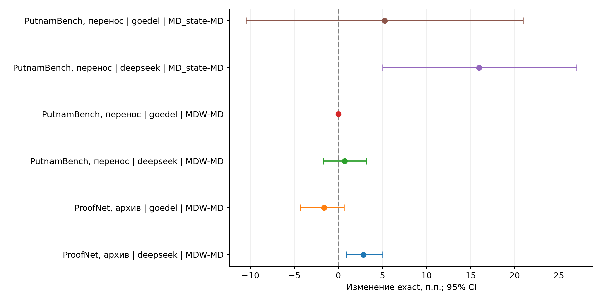

#### Источники

- Числа и новые результаты: metrics.json (полный исходник на Жоресе: /beegfs/home/denis.rakhmankin/onebigjump/runs/strengthening_20261110_v1/delivery/recovery_20261110_final/metrics.json).
- Компактное сравнение: [comparison.csv](assets/b56a22a2363c_comparison.csv).
- Фактический снимок Slurm: slurm_status.psv (исходный путь: slurm_status.psv).
- E0–E6: runs/revision_20261107_v1/delivery_checked/REPORT_ONEBIGJUMP_REVISION_20261107_RU.md.
- E8/E9: runs/extensions_20261108_v1/{E8_analysis,E9}/metrics.json.
- Новые протоколы: experiments/{strengthening_20261110_v1,entry_controls_20261110_v1}/PROTOCOL.md.

Отчёт не означает завершения задач, которые на срезе Slurm ещё RUNNING/PENDING. Следующий серверный отчёт строится после окончания новых этапов, включая неуспешные исходы.

## Приложение 4 Стриминг PRM и меньшая модель

Источник: [Стриминг PRM и меньшая модель](chapters/04_gaps.md). Сервер: /beegfs/home/denis.rakhmankin/onebigjump/runs/reviewer_gaps_20261110_v1/delivery/final/REPORT_RU.md.

Серия reviewer_gaps_20261110_v1. Числа в таблицах получены из сохранённых метрик; незавершённые опыты не считаются результатами. Старые задания и артефакты сохранены.

#### Готовые результаты на новых задачах Putnam

Это точность локализации первой отклонённой тактики среди пригодных траекторий, с равным весом групп задач. Это не доля доказанных теорем.

| Модель | Пригодных / назначенных | Групп | MD: признаки + surprisal/изменения | + норма скачка | + полный вектор | + вектор приращения |
|---|---:|---:|---:|---:|---:|---:|
| deepseek | 118 / 304 | 58 | 33.48% | 34.20% | 49.43% | 35.06% |
| goedel | 48 / 304 | 35 | 45.71% | 45.71% | 50.95% | 36.19% |

| Модель | Сравнение с MD | Изменение точности, п.п. | 95% CI, п.п. |
|---|---|---:|---|
| deepseek | MDW-MD | +0.72 | [-1.72, 3.16] |
| deepseek | MD_state-MD | +15.95 | [5.03, 27.01] |
| goedel | MDW-MD | +0.00 | [0.0, 0.0] |
| goedel | MD_state-MD | +5.24 | [-10.48, 20.95] |

Полный вектор даёт более заметный результат, чем одна норма, особенно у DeepSeek. Но существующий локализатор рассматривает готовое решение целиком. Его результат нельзя переносить на последовательный детектор без отдельной проверки. Для Goedel нулевой парный выигрыш нормы на этой выборке не является доказательством эквивалентности методов.

#### Проверка без ошибок на первом шаге

| Модель | Попытки / группы | MD | Полный вектор, переобучение без первых ошибок |
|---|---:|---:|---:|
| deepseek | 107 / 56 | 35.42% | 48.36% |
| goedel | 44 / 31 | 39.25% | 51.61% |

#### Сопоставление с рецензиями

| Замечание | Состояние | Уже выполнено / новое действие |
|---|---|---|
| Incremental value beyond surprisal and its changes | done | revision_20261107_v1 E2/E2_online; extensions E8. Do not duplicate. Report small model-dependent norm contribution, include signed and absolute adjacent surprisal changes. |
| Layers, whitening/shrinkage, formal-entry versus prompt anchor | done | revision_20261107_v1 E3, controlled anchor recalibration. Use all predefined cells, no selection of a favourable layer. |
| Coverage, exclusions and absent last-step failures | done | revision_20261107_v1 E1 and last-step Lean fixtures; E8 full denominator. Retain unknown first-error status of exclusions. Do not turn unfinished proofs into tactic errors. |
| Hidden-state probe baseline | done plus new E14 | revision E4; frozen Putnam E8; nonfirst-refit E11; permutation E12. Existing retrospective vector benefit motivates causal online comparison, which is not yet measured. |
| Process reward model comparison | new E15 | No genuine pretrained PRM in completed campaigns; ProcessBench B2 already available. Qwen2.5-Math-PRM-7B on identical archived ProcessBench texts/splits; raw scores and nested M0+PRM versus M0+PRM+jump. |
| Practical causal online error detection | new E14 | Old HD/HDW are causal; full state/increment comparisons were retrospective. No final L or future steps; archive nested group training, verified-calibrated thresholds, frozen Putnam transfer. External FPR unavailable if no verified external examples. |
| Beyond Lean and 7-8B scale | domain done; new size E16 | Completed NNG_B2 ProcessBench Qwen2.5-7B reader, NNG_B1 symbolic reader. Same natural-language benchmark, Qwen2.5-1.5B-Instruct reader, same task split and learning protocol. Reader trajectories are not original generator trajectories. |
| Constant hazard and other explanations of success-length law | done | experiments/E2_length_law/a and b: fitted held-out success-length alternatives and local failure hazards. Present alternatives. Exponential decay alone does not identify extreme-value dynamics. |
| Does empirical tail behaviour support Kesten/EVT? | done diagnostics; text needs revision | Signed Hill/moment/GPD diagnostics; E9 held-out Pareto/exponential/lognormal/GPD comparison. Do not identify the Kesten surrogate with transformer dynamics or assume coupling supported by data. No experiment selected just to obtain a positive tail claim. |
| Matched-prefix alternatives and correctness versus semantic novelty | E5/E6/E7 done; E10/E13 underway | Same-text controlled examples and accepted transitions complete; expanded natural alternatives and formal-entry continuations being verified. Keep current E10/E13 jobs. E13 formal-entry results cannot be substituted for interior-prefix results; mixed-outcome support must be reported. |
| First reasoning error versus first rejected Lean tactic; framing and organization | editorial limitation | Lean labels and current validation protocol identify first kernel/tactic rejection only. Use operational label in title/claims. ProcessBench adds human-annotated math errors but does not retrospectively establish earliest semantic error in Lean traces. |

#### Новые постановки

**E14. Последовательный детектор.** Для DeepSeek и Goedel сравниваются HD, HDW, HD+state и HD+increment. Полный вектор имеет 4096 координат, PCA не применяется. Используются шаги до первой ошибки включительно и корректные доказательства. Ни полная будущая длина, ни признаки будущих шагов не подаются модели. Преобразования и регуляризация обучаются внутри nested group CV. Порог задаётся по максимумам оценок на корректных валидационных траекториях для целевого FPR 10% и 20%; фактический FPR измеряется отдельно на тесте. Замороженный перенос — на Putnam. Отдельно выводится срез ошибок после первого шага.

**E15. Настоящая PRM.** Qwen2.5-Math-PRM-7B оценивает исходные размеченные шаги ProcessBench. Сравниваются argmin её оценки с argmax нормы скачка/surprisal, а также первое значение p(correct)<0.5 с известной первой ошибкой. Доля корректно принятых верных решений и точность первого обнаружения ошибки объединяются гармоническим средним, которое не следует путать с binary classification F1. Дополнительно обучаются M0, M1, M0+PRM, M1+PRM с разделением задач. Контекст PRM 4096: без обрезки; отдельный учёт покрытия и сравнение на общих примерах. Это PRM для математики, а не дообученный на Lean верификатор.

**E16. Меньшая модель.** Qwen2.5-1.5B-Instruct читает те же решения ProcessBench, что и готовый 7B-эксперимент; zero-based слой14 из28, shrinkage0.1, параметры whitening только по корректной calibration. Сохраняются исходные группы и разделение30/70, отчёты по четырём поднаборам и семействам генераторов. Новых ответов не генерируется. Это сравнение траекторий чтения, а не состояний исходных моделей-авторов решений.

Гиперпараметры не выбираются по новой тестовой выборке. Bootstrap перевыбирает задачи; при числе вносящих вклад групп меньше20 доверительный интервал не публикуется. Интервалы используют фиксированные предсказания, без повторного обучения в bootstrap.

#### Уже имевшийся опыт вне Lean

ProcessBench, reader Qwen2.5-7B-Instruct: M0 39.49%, M1 с нормой скачка 39.16%; разница -0.32 п.п. Этот опыт повторно не запускается.

#### Статус новой серии

| Этап | Готовый результат / текущий артефакт |
|---|---|
| E14/deepseek | Готово: runs/reviewer_gaps_20261110_v1/E14/deepseek/metrics.json |
| E14/goedel | Готово: runs/reviewer_gaps_20261110_v1/E14/goedel/metrics.json |
| E15 | Готово: runs/reviewer_gaps_20261110_v1/E15/metrics.json |
| E16 | Готово: runs/reviewer_gaps_20261110_v1/E16/metrics.json |

E15: назначено 3400, подготовлено 3400, исключено 0; контекст 4096 токенов.

E16: назначено 3400, подготовлено 3400, исключено 0; контекст 32768 токенов.

##### Итог E14/deepseek

| Выборка | Метод | Exact при пороге FPR10% | Фактический FPR | NLL |
|---|---|---:|---:|---:|
| ProofNet | HD | 14.62% | 15.62% | 0.4452 |
| ProofNet | HDW | 13.59% | 15.62% | 0.4434 |
| ProofNet | HD_state | 13.80% | 15.62% | 0.346 |
| ProofNet | HD_increment | 13.60% | 15.62% | 0.3867 |
| Putnam_frozen | HD | 8.62% | — | 0.3544 |
| Putnam_frozen | HDW | 7.76% | — | 0.3516 |
| Putnam_frozen | HD_state | 11.78% | — | 0.3209 |
| Putnam_frozen | HD_increment | 13.51% | — | 0.3722 |

Полные интервалы, страты и проверки находятся в metrics.json рядом с отчётом.

##### Итог E14/goedel

| Выборка | Метод | Exact при пороге FPR10% | Фактический FPR | NLL |
|---|---|---:|---:|---:|
| ProofNet | HD | 8.33% | 4.39% | 0.3947 |
| ProofNet | HDW | 8.96% | 4.39% | 0.3872 |
| ProofNet | HD_state | 12.71% | 10.53% | 0.3741 |
| ProofNet | HD_increment | 17.59% | 5.26% | 0.4078 |
| Putnam_frozen | HD | 4.29% | — | 0.3218 |
| Putnam_frozen | HDW | 8.10% | — | 0.3263 |
| Putnam_frozen | HD_state | 6.19% | — | 0.349 |
| Putnam_frozen | HD_increment | 5.71% | — | 0.4239 |

Полные интервалы, страты и проверки находятся в metrics.json рядом с отчётом.

##### Итог E15

| Срез | PRM argmin | Норма скачка | Surprisal |
|---|---:|---:|---:|
| pooled | 52.15% | 20.29% | 19.94% |
| gsm8k | 71.09% | 27.89% | 27.21% |
| math | 56.76% | 18.96% | 20.65% |
| olympiadbench | 51.11% | 18.22% | 19.60% |
| omnimath | 43.83% | 20.40% | 17.55% |
| Qwen_family | 50.23% | 20.44% | 21.45% |
| other_generator | 54.39% | 20.33% | 17.85% |

Полные интервалы, страты и проверки находятся в metrics.json рядом с отчётом.

##### Итог E16

| Срез | M0 | M1 | Delta, п.п. |
|---|---:|---:|---:|
| pooled | 39.99% | 39.72% | -0.276 |
| Qwen_family | 41.79% | 41.70% | -0.087 |
| other_generator | 35.63% | 35.04% | -0.589 |
| gsm8k | 45.58% | 46.94% | 1.361 |
| math | 39.98% | 39.98% | 0.0 |
| olympiadbench | 36.54% | 36.10% | -0.443 |
| omnimath | 40.42% | 39.56% | -0.854 |

Полные интервалы, страты и проверки находятся в metrics.json рядом с отчётом.

#### Задания и воспроизводимость

```json
{
  "date": "2026-11-10",
  "jobs": {
    "download": 8532134,
    "initial_vector_validation": 8532136,
    "preflight": 8532138,
    "gaps-prepare": 8532152,
    "E14-deepseek": 8532153,
    "E14-deepseek-resume": 8532154,
    "E14-goedel": 8532155,
    "E14-goedel-resume": 8532156,
    "E15-PRM-1": 8532157,
    "E15-PRM-2": 8532158,
    "E16-1p5B-1": 8532159,
    "E16-1p5B-2": 8532160,
    "E15-analysis": 8532161,
    "E16-analysis": 8532162,
    "gaps-final-report": 8532163,
    "gaps-launch-report": 8532164
  },
  "new_GPU_reservation_hours_max": 8,
  "gpu_concurrency": 1,
  "gpu_session_hours": 2,
  "protected_existing_jobs": [
    8532108,
    8532109,
    8532110,
    8532111
  ],
  "model_ids": [
    "Qwen/Qwen2.5-Math-PRM-7B",
    "Qwen/Qwen2.5-1.5B-Instruct"
  ],
  "source_sha256": {
    "/beegfs/home/denis.rakhmankin/onebigjump/experiments/reviewer_gaps_20261110_v1/PROTOCOL.md": "91daa6fd2e8243581ba88218b6b61e8c4025d7db98120b5feea0cc2b9328eccb",
    "/beegfs/home/denis.rakhmankin/onebigjump/experiments/reviewer_gaps_20261110_v1/online_vectors.py": "6da49fba90b447f50cd590cea39324d77a988b38530e615470cea6c17bd53bf1",
    "/beegfs/home/denis.rakhmankin/onebigjump/experiments/reviewer_gaps_20261110_v1/prm_analysis.py": "3adf73d65eca0bd616105830bc07d709785fe6fddd48853c817d7aa43f18096a",
    "/beegfs/home/denis.rakhmankin/onebigjump/experiments/reviewer_gaps_20261110_v1/prepare_readers.py": "1a21fd9fa3f349dca8d14319f5a895999798a8e23bebe70e94e2dec892a74b0d",
    "/beegfs/home/denis.rakhmankin/onebigjump/experiments/reviewer_gaps_20261110_v1/gpu.sbatch": "0575d83fe248f7d890e2761943020052d11d3a19d60aeabe102fdc71f44367c4",
    "/beegfs/home/denis.rakhmankin/onebigjump/experiments/reviewer_gaps_20261110_v1/review_matrix.json": "4550b1a2ea701e32ac50da861af7d7f0fdb56d4e1df3c75e9925777f97c102e0",
    "/beegfs/home/denis.rakhmankin/onebigjump/experiments/reviewer_gaps_20261110_v1/preflight.py": "aaa2302ed356f60c3e0533977bbff611ecb6df8dd74b3edf8daa917d83858434",
    "/beegfs/home/denis.rakhmankin/onebigjump/experiments/reviewer_gaps_20261110_v1/small_extract.py": "30cf7b8aa9bbb47a9a287c178ed86b407ddb5c77c747c1862affbf3816d8a206",
    "/beegfs/home/denis.rakhmankin/onebigjump/experiments/reviewer_gaps_20261110_v1/gap_common.py": "6f993d221a00c1e477b5787e355ba8237ffc13cafb9706dc25c0b0b64a6f0db5",
    "/beegfs/home/denis.rakhmankin/onebigjump/experiments/reviewer_gaps_20261110_v1/report_gaps.py": "dc2785b5346b2cddf93a4dbccdf0cc268f90c08de11f4760c5ffd3d822be7034",
    "/beegfs/home/denis.rakhmankin/onebigjump/experiments/reviewer_gaps_20261110_v1/prm_extract.py": "c0f3a891636e1968358fd01901045989f6ca08a599e2b896e6c63d80c52a4873",
    "/beegfs/home/denis.rakhmankin/onebigjump/experiments/reviewer_gaps_20261110_v1/cpu.sbatch": "410047959522042bc8e18bd89462b62c691f762fd6845459ce6a4884a057f1aa",
    "/beegfs/home/denis.rakhmankin/onebigjump/experiments/reviewer_gaps_20261110_v1/reviewer_comments.txt": "7ac67280b83040ca17c47a7575252f96c818f9390afc4f3d58058e07a8d34f39",
    "/beegfs/home/denis.rakhmankin/onebigjump/experiments/reviewer_gaps_20261110_v1/download.py": "30256f86ca74254800787d481cbdd336e56261dcec581ee133233d78151163d8",
    "/beegfs/home/denis.rakhmankin/onebigjump/experiments/reviewer_gaps_20261110_v1/small_analysis.py": "0050582fbdd3d0dbdc065f24c241f5509921d653c38bec01a632a0795a16db4d"
  }
}
```

Новая очередь ограничена четырьмя последовательными двухчасовыми GPU-слотами: до8 зарезервированных A100-часов. Это верхняя граница бронирования, а не уже потраченное время. Каждая траектория сохраняется отдельно; продолжения используют готовые файлы. CPU-обучение не требует новых LLM-forward. Внешние GPU-задания зависят от ранее поставленного E10/E13, поэтому не прерывают его.

Снимок Slurm:

```text
JobID|JobName|State|ExitCode|Elapsed|Start|End
8532109|obj-E10E13-states-resume|COMPLETED|0:0|00:09:12|2026-11-10T19:47:46|2026-11-10T19:56:58
8532110|obj-E10E13-analysis-resume|COMPLETED|0:0|00:00:27|2026-11-10T19:56:58|2026-11-10T19:57:25
8532111|obj-recovery-final-report|COMPLETED|0:0|00:00:20|2026-11-10T19:57:25|2026-11-10T19:57:45
8532108_2|obj-E13-Lean-resume|COMPLETED|0:0|00:08:14|2026-11-10T19:25:11|2026-11-10T19:33:25
8532108_3|obj-E13-Lean-resume|COMPLETED|0:0|00:22:20|2026-11-10T19:25:11|2026-11-10T19:47:31
8532134|obj-gaps-download|COMPLETED|0:0|00:04:11|2026-11-10T19:37:08|2026-11-10T19:41:19
8532136|obj-E14-validate|COMPLETED|0:0|00:00:26|2026-11-10T19:40:24|2026-11-10T19:40:50
8532138|obj-gaps-preflight|COMPLETED|0:0|00:00:22|2026-11-10T19:42:17|2026-11-10T19:42:39
8532152|obj-gaps-prepare|COMPLETED|0:0|00:01:09|2026-11-10T19:45:24|2026-11-10T19:46:33
8532153|obj-E14-deepseek|COMPLETED|0:0|00:21:21|2026-11-10T19:45:24|2026-11-10T20:06:45
8532154|obj-E14-deepseek-resume|COMPLETED|0:0|00:00:13|2026-11-10T20:06:45|2026-11-10T20:06:58
8532155|obj-E14-goedel|COMPLETED|0:0|00:25:18|2026-11-10T19:45:24|2026-11-10T20:10:42
8532156|obj-E14-goedel-resume|COMPLETED|0:0|00:00:13|2026-11-10T20:10:42|2026-11-10T20:10:55
8532157|obj-E15-PRM-1|COMPLETED|0:0|00:04:44|2026-11-10T19:57:46|2026-11-10T20:02:30
8532158|obj-E15-PRM-2|COMPLETED|0:0|00:00:21|2026-11-10T20:02:46|2026-11-10T20:03:07
8532159|obj-E16-1p5B-1|COMPLETED|0:0|00:03:24|2026-11-10T20:03:46|2026-11-10T20:07:10
8532160|obj-E16-1p5B-2|COMPLETED|0:0|00:00:27|2026-11-10T20:07:46|2026-11-10T20:08:13
8532161|obj-E15-analysis|COMPLETED|0:0|00:01:32|2026-11-10T20:03:07|2026-11-10T20:04:39
8532162|obj-E16-analysis|COMPLETED|0:0|00:03:15|2026-11-10T20:08:13|2026-11-10T20:11:28
8532163|obj-gaps-final-report|RUNNING|0:0|00:00:03|2026-11-10T20:11:28|Unknown
8532164|obj-gaps-launch-report|COMPLETED|0:0|00:00:13|2026-11-10T19:46:33|2026-11-10T19:46:46

```

#### Что остаётся ограничением исследования

Сами дополнительные опыты не устанавливают Kesten-механизм в трансформере и не превращают первую отклонённую Lean-тактику в первую ошибку рассуждения. Разницу между предпосылками теорем, диагностикой и измеренными результатами нужно отразить в тексте статьи. Экспоненциальное снижение успеха с длиной имеет альтернативное объяснение через риск ошибки на каждом шаге; соответствующие сравнения уже выполнены. Возможное пересечение ProcessBench с предобучением моделей неизвестно. В новых опытах нет заранее гарантированного положительного эффекта.

Официальные источники: [PRM](https://huggingface.co/Qwen/Qwen2.5-Math-PRM-7B), [ProcessBench](https://github.com/QwenLM/ProcessBench), [1.5B reader](https://huggingface.co/Qwen/Qwen2.5-1.5B-Instruct).

## Приложение 5 Обзор новых экспериментов до 11 ноября

Источник: [Обзор новых экспериментов до 11 ноября](chapters/05_overview11.md). Сервер: /beegfs/home/denis.rakhmankin/onebigjump/runs/research_synthesis_20261115_v1/input/published/research_update_20261111/REPORT_RU.md.

Для состава strictly verified применяется исправленный аудит из сводки. Старые промежуточные проценты расширенного покрытия не заменяют этот аудит.

Подробный отчёт по завершённым дополнительным сериям и запущенному исследованию наличия и прогноза ошибки. Дата публикации: **11 ноября 2026, Москва**.

Документ объединяет измерения E0–E16, отдельные проверки пороговой связи и внутри одной задачи, сравнения закона длины, standalone-baseline и анализ векторных детекторов. Исторические A1/A4 и закон длины включены для полноты ответа рецензентам; их перенос в этот отчёт не означает нового запуска. Attention/LoRA/MLP-эксперименты другого проекта сюда не входят.

При подготовке публикации SSH к Жоресу несколько раз завершился `Connection reset by peer` до авторизации. Завершённые результаты ниже взяты из ранее выгруженных серверных отчётов, метрик и manifests. Текущее состояние выполняющейся серии не переобозначается как завершённое. Последний успешный просмотр в этой переписке показывал 11 завершённых вычислительных блоков новой серии из 144; эта цифра — историческое наблюдение, не актуальный срез Slurm и не число научных результатов. Последнее подтверждённое создание очереди сохранено в launch_receipt.json.

В этой публикации выполнена только сборка документации из готовых файлов: языковые модели и детекторы заново не обучались, статистические интервалы не пересчитывались, серверные задания не отменялись. Все таблицы, добавленные сборщиком, читают сохранённые значения; старые численные разделы перенесены из готовых серверных отчётов. Исходные байты метрик и хеши опубликованы вместе с текстом.

#### Содержание

- [1. Кто попросил эксперимент с меньшей моделью](#section-1)
- [2. Какие задачи различаются в отчёте](#section-2)
- [3. Общая математическая постановка](#section-3)
- [4. Данные, модели, baseline и статистический протокол](#section-4)
- [5. Реестр новых проверок](#section-5)
- [6. E0–E6: воспроизведение, baseline, геометрия и контролируемые переходы](#section-6)
- [7. E8: перенос на PutnamBench](#section-7)
- [8. E7, E10, E13: альтернативные продолжения одинакового состояния](#section-8)
- [9. E9: хвостовые альтернативы и ранговое объяснение](#section-9)
- [10. E11 и E12: первый шаг и соответствие вектора тактике](#section-10)
- [11. E14: последовательные векторные детекторы](#section-11)
- [12. E15: сравнение с настоящей PRM на ProcessBench](#section-12)
- [13. E16: reader 1,5B — локализация и наличие ошибки](#section-13)
- [14. Каждый простой baseline отдельно: standalone-аудит](#section-14)
- [15. Какую информацию использует векторный детектор: аудит E14](#section-15)
- [16. Пороговая гипотеза, зависимость экстремумов и наличие ошибки внутри задачи](#section-16)
- [17. Закон длины: семь моделей успеха и риск первой локальной ошибки](#section-17)
- [18. Новая полная серия: наличие ошибки и прогноз будущего отказа](#section-18)
- [19. Какие вопросы получили ответы и что остаётся открытым](#section-19)
- [20. Воспроизводимость, полнота и навигация по артефактам](#section-20)

<a id="section-1"></a>
#### 1. Кто попросил эксперимент с меньшей моделью

Рецензент **22Kj** написал: “Can the localization findings generalize beyond 7-8B Lean provers, particularly to informal reasoning where the first error is harder to identify?”

Это вопрос об обобщении за пределы Lean-prover моделей на 7–8B параметров. Прямого требования взять меньшую модель или конкретно 1,5B в нём нет. Эксперимент E16 с Qwen2.5-1.5B-Instruct выбрал агент в рамках общего разрешения пользователя подготовить недостающие проверки. Он проверяет другую размерность модели и неформальные математические тексты. Он **не отвечает** на вопрос об увеличении размера модели, не отделяет чистый эффект размера от всех различий моделей и использует чтение готового решения, а не собственную генерацию этой модели.

Соответственно, корректная атрибуция: «дополнительная проверка обобщения, выбранная авторами/агентом в ответ на широкий вопрос рецензента».

<a id="section-2"></a>
#### 2. Какие задачи различаются в отчёте

1. **Локализация:** заранее известно, что доказательство содержит воспроизводимый отказ; нужно выбрать его первый шаг.
2. **Наличие ошибки в готовом доказательстве:** среди корректных и ошибочных ответов определить, содержит ли ответ ошибку.
3. **Последовательное обнаружение:** после очередной законченной тактики решить, возникла ли ошибка к текущему моменту. Будущие тактики недоступны.
4. **Прогноз:** пока префикс корректен, предсказать последующую ошибку на заданном горизонте.
5. **Предотвращение:** изменить генерацию по сигналу детектора и измерить долю корректно завершённых доказательств. Такой замкнутый эксперимент в завершённые серии не входит.

Процент exact-localization не равен доле доказанных теорем. Низкая NLL не гарантирует более точного времени первой тревоги. Положительный эффект полного вектора не переносится автоматически на его норму. Корректность тактики Lean не размечает момент возникновения неверного математического замысла.

<a id="section-3"></a>
#### 3. Общая математическая постановка

Пусть X_t — residual-stream состояние на последнем исходном токене законченной тактики t. X_0 — состояние на входе в формальную часть после возможного неформального рассуждения. Используются исходные сгенерированные токены и teacher-forced forward замороженной LLM. В E0–E14 основные decoder blocks, с нулевой индексацией: 14 у DeepSeek, 17 у Goedel; для векторных признаков доступны все 4096 координат.

```text
increment_t = X_t - X_(t-1)
Sigma_rho = (1-rho) Sigma + rho * trace(Sigma)/d * I
w_t = || Sigma_rho^(-1/2) (increment_t - mu) ||_2
q_t = mean over tokens k of tactic t: -log p(token_k | tokens before k)
Delta_q_t = q_t - q_(t-1),  Delta_q_1 = 0
```

w — норма после whitening, не квадрат нормы; основной rho=0,1. Параметры mu и Sigma получены на разрешённых корректных calibration-задачах. Высокая норма сообщает о величине изменения; полный вектор сохраняет ещё и направление. Неформальные токены до formal-entry не имеют Lean-метки, но могут влиять на X_0.

Основной ретроспективный локализатор выбирает один из L шагов:

```text
score_it = b + beta^T features_it
p_it = exp(score_it) / sum_s exp(score_is)
NLL_localization = sum_i a_i * (-log p_i,t_star)
training_loss = NLL_localization + lambda * ||beta||_2^2 / 2
```

Отдельного исхода «ошибки нет» у этого softmax нет. После первого отказа остальные сгенерированные тактики не считаются Lean-принятыми: их текст может входить в ретроспективный набор кандидатов, но не предоставляет меток корректного исполнения.

Для бинарного детектора используется другая задача:

```text
p = 1 / (1 + exp(-score))
NLL_binary = -mean_weighted[y*log(p) + (1-y)*log(1-p)]
Brier = mean_weighted[(p-y)^2]
```

Нельзя сравнивать численные значения этих двух NLL напрямую: разные исходы, нормировки и наборы примеров.

<a id="section-4"></a>
#### 4. Данные, модели, baseline и статистический протокол

**ProofNet** — формальные математические задачи; в основной архивной evaluation было по 840 попыток DeepSeek и Goedel. **miniF2F** — формализованные математические задачи, архивные температуры 0,6 и 1,0. **PutnamBench** — формальные задачи по математическим соревнованиям Putnam; новая для истории проекта проверка переноса. **ProcessBench** — готовые неформальные математические решения с разметкой первой ошибки и корректных ответов. Контролируемая дедукция задаёт длину вывода и проверяет локальные шаги отдельным symbolic checker.

DeepSeek-Prover-V2-7B и Goedel-Prover-V2-8B — основные модели новых Lean-проверок. Kimina-Prover-Distill-8B входит в исторические miniF2F и синтетический crossed-control E5. Qwen2.5-7B-Instruct и Qwen2.5-1.5B-Instruct в ProcessBench — **readers**, читающие чужие решения; Qwen2.5-Math-PRM-7B — отдельная специализированная модель оценки шагов.

M0: позиция, относительная позиция, длина тактики, surprisal, индикаторы первого/последнего шага и AST-тип. MD добавляет соседние Delta_q и |Delta_q|. Суффикс W добавляет log(1+w). MD_state и MD_increment добавляют линейный вклад полного состояния или приращения. Ретроспективные признаки t/L и last запрещены в streaming. HD — текущие и прошлые обычные признаки; HDW добавляет историю нормы. Названия M0/M1 в ProcessBench относятся к его собственному reader-протоколу; одинаковая буква не означает тождественную design matrix во всех сериях.

Основная единица разделения и неопределённости — задача или exercise group. Повторные попытки одной задачи не считаются независимыми. В основной nested CV используются 5 внешних и 3 внутренних fold; scaler, spline knots, категории и lambda определяются внутри train. Putnam оценивается замороженными моделями, обученными на ProofNet. Само по себе обучение на ProofNet с проверкой на других группах ProofNet не является утечкой; повторное исследование уже изученного архива делает новые сравнения исследовательскими.

В большинстве завершённых серий интервалы строятся по 20 000 bootstrap групп при фиксированных OOF/frozen предсказаниях. Они не включают всю неопределённость переобучения. Для закона длины использовался refit-bootstrap, указанный отдельно. Ниже всегда различаются равные веса задач (основные) и попыток (вторичные). При малом числе групп отсутствие CI обозначается явно. Точечный ноль и CI [0;0] при совпавших предсказаниях не являются доказательством эквивалентности.

Далее **изменение Hit** задаётся в процентных пунктах; положительный **выигрыш NLL** означает `NLL_baseline - NLL_new`. В таблицах абляций «замена−полный» положительная разность NLL, напротив, означает ухудшение после замены. Направление указано рядом с каждой таблицей.


<a id="section-5"></a>
#### 5. Реестр новых проверок


| Серия | Проверка | Состояние доступного результата | Причина |
| --- | --- | --- | --- |
| E0–E1 | Воспроизведение, границы тактик, категории исключений, последний отказ | Завершено | 1ooR: coverage и last-step |
| E2 | Добавочная ценность после соседнего изменения surprisal, nonfirst, online | Завершено | wDaH и 22Kj: сильные output-baseline |
| E3 | Слои, shrinkage, whitening, anchor, matched prefixes | Завершено | 1ooR: чувствительность измерения |
| E4 | Полные линейные probes состояния и приращения | Завершено | 22Kj: hidden-state baseline |
| E5 | Одинаковая тактика при изменённой корректности; перенос семьи тактик | Завершено | Корректность против текста/новизны |
| E6 | Крупные скачки на реально принятых переходах | Завершено | Специфичность скачка к ошибке |
| E7/E10/E13 | Альтернативы после одинакового префикса, включая formal-entry | Расчёты завершены; mixed-групп мало | Естественные контроли |
| E8 | Замороженный перенос ProofNet → Putnam | Завершено | Независимые от настройки задачи |
| E9 | Pareto/exponential/lognormal/GPD и ранговая модель | Завершено; неполное хвостовое покрытие | 1ooR: альтернативы EVT/Kesten |
| E11/E12 | Nonfirst refit и перестановка векторного вклада | Завершено | Первый шаг и привязка информации к шагу |
| E14 | Последовательные HD/HDW/state/increment | Завершено | Streaming-полезность векторов |
| E15 | PRM на исходных шагах ProcessBench | Завершено | 22Kj: process reward model |
| E16 | Qwen2.5-1.5B reader на том же ProcessBench | Завершено | Выбранная агентом проверка широкого вопроса 22Kj |
| A1/A4 | Пороговая связь, зависимость экстремумов, наличие ошибки внутри задачи | Исторические расчёты завершены; включены в сводку | Предпосылки теории и presence |
| Length a/b | Форма success–length и риск первой локальной ошибки | Завершено | 1ooR/22Kj: обычный риск ошибки как альтернатива |
| Standalone | Каждый простой baseline отдельно; несовпадающие попадания | Завершено | Прямой вопрос пользователя |
| Interpretability | Разложение logit, абляция и аппроксимация обычными признаками | Завершено | Прямой вопрос пользователя |
| Error presence | Offline, presence, будущая ошибка на четырёх горизонтах | Запущено; итоговых метрик в этом пакете нет | Прямой запрос пользователя на полноценную серию |


<a id="section-6"></a>
#### 6. E0–E6: воспроизведение, baseline, геометрия и контролируемые переходы

Ниже перенесены численные разделы готового серверного отчёта 7 ноября. Полные значения и источники — summary.json (полный исходник на Жоресе: /beegfs/home/denis.rakhmankin/onebigjump/runs/research_synthesis_20261115_v1/input/published/research_update_20261111/evidence/revision/summary.json), [протокол](assets/0e855b2bea65_protocol.md), проверки (полный исходник на Жоресе: /beegfs/home/denis.rakhmankin/onebigjump/runs/research_synthesis_20261115_v1/input/published/research_update_20261111/evidence/revision/validation.json). Это завершённые расчёты; старые строки о будущем E7–E9 или отсутствии PRM сюда не переносятся.


#### E0–E1: воспроизведение и разметка

| Модель | Попытки / группы learned | M0 exact | M0W exact | Побитовая проверка старых признаков |
|---|---|---|---|---|
| deepseek | 452 / 166 | 40.85% | 43.51% | jump и q совпали; сохранённые предсказания воспроизведены |
| goedel | 259 / 133 | 57.82% | 57.13% | jump и q совпали; сохранённые предсказания воспроизведены |

Полное повторное обучение M0/M0W также воспроизвело исходные вероятности и предсказания. Все восемь исторических argmax-ячеек miniF2F/ProofNet, включая T=1,0, проверены по исходным артефактам.

| Модель | Все evaluation | Verified по старой category | Whole-proof verified | Не verified: старый / уточнённый знаменатель | Eligible learned / argmax |
|---|---|---|---|---|---|
| deepseek | 840 | 111 | 155 | 729 / 685 | 452 / 456 |
| goedel | 840 | 79 | 167 | 761 / 673 | 259 / 262 |

Уточнены знаменатели coverage: прежняя category и отдельный whole_proof_ok отвечают на разные вопросы; например, завершившая Lean-доказательство генерация могла быть помечена generation_truncation. Основная learned-популяция и её t* не изменились. Разница с argmax-популяцией обусловлена дополнительным исключением неполных токенных границ.

Полная взаимоисключающая классификация:

| Модель | Категория аудита | Попытки |
|---|---|---|
| deepseek | accepted_but_unsolved | 22 |
| deepseek | ambiguous_localization | 50 |
| deepseek | context_mismatch | 9 |
| deepseek | generation_truncation | 55 |
| deepseek | included_reproducible_rejection | 452 |
| deepseek | parse_error | 38 |
| deepseek | resource_or_internal | 54 |
| deepseek | sorry_invalid | 1 |
| deepseek | token_boundary_incomplete | 4 |
| deepseek | verified | 155 |
| goedel | accepted_but_unsolved | 14 |
| goedel | ambiguous_localization | 48 |
| goedel | context_mismatch | 7 |
| goedel | generation_truncation | 294 |
| goedel | included_reproducible_rejection | 259 |
| goedel | parse_error | 32 |
| goedel | resource_or_internal | 16 |
| goedel | token_boundary_incomplete | 3 |
| goedel | verified | 167 |

##### Почему нет первого отказа на последней тактике

В коде не обнаружен общий запрет t*=L. Реальные Lean-fixtures проверили первый, внутренний и последний отказы, принятый последний шаг с незакрытыми целями, полностью корректное доказательство, parse error и ресурсный сбой. Дополнительная проверка полного production-пути прошла через verify_one, AST-replay и исходные токенные границы: последний отказ сохранил p2_eligible=True.

| Модель | Есть AST-observer / все | Последняя тактика exact в learned | Осталось шагов после отказа: min / median / max |
|---|---|---|---|
| deepseek | 651 / 840 | 442 | 1 / 7 / 82 |
| goedel | 410 / 840 | 252 | 1 / 6 / 161 |

В этой выбранной популяции ошибка обычно находится внутри построения вспомогательного доказательства, после которого остаётся завершающая тактика. Найденные последние отказы более грубого старого replay относятся к исключённым truncated/sorry-ответам; они перечислены в E1_last_lineage. Для исключённых попыток без точного AST-observer положение t* неизвестно. Поэтому отсутствие последних отказов — свойство наблюдаемой выбранной популяции, не основание обобщать качество на любые ошибки.

#### E2: добавочная ценность после Δq

| Модель | Кандидаты | N / G | M0 | M0W | MD | MDW | MDW−MD, п.п. [95%] |
|---|---|---|---|---|---|---|---|
| deepseek | все | 452 / 166 | 40.85% | 43.51% | 39.39% | 42.20% | +2.81 [+0.90; +5.02] |
| deepseek | t≥2; t*≥2, новое обучение | 353 / 148 | 39.68% | 40.92% | 39.56% | 39.62% | +0.06 [-1.80; +2.08] |
| goedel | все | 259 / 133 | 57.82% | 57.13% | 57.32% | 55.69% | -1.63 [-4.32; +0.63] |
| goedel | t≥2; t*≥2, новое обучение | 176 / 105 | 52.38% | 52.38% | 51.90% | 52.22% | +0.32 [-2.54; +2.86] |

Для t≥2 сохраняются исходные t и t/L, а Δq берётся относительно реально существовавшей предыдущей тактики. Это отдельная условная популяция с переобучением; её проценты нельзя напрямую сравнивать с основной строкой как изменение на тех же попытках.

| Модель | NLL MD | NLL MDW | NLL MD−MDW [95%] | ±1 MD / MDW | Exact p Holm2 | NLL p Holm2 | Helped / harmed |
|---|---|---|---|---|---|---|---|
| deepseek | 1.77968 | 1.77045 | +0.00923 [-0.00397; +0.02216] | 50.85% / 53.18% | 0.01770 | 0.16569 | 16 / 4 |
| goedel | 1.57061 | 1.62617 | -0.05556 [-0.09206; -0.02137] | 65.68% / 64.17% | 0.19374 | 0.00580 | 4 / 7 |

Первичные exact и NLL не дают одинакового вывода для обеих моделей. Отдельное исключение первого шага существенно меняет величину добавочного эффекта. Полные first/interior/last и length-страты, включая пустую last-страту, находятся в JSON метрик.

##### Вторичные miniF2F-сравнения

Новая исследовательская nested CV на архивных evaluation-задачах. Общий детерминированный реестр групп фиксирует split между моделями и температурами; это не прежний frozen-transfer протокол T=0,6→1,0.

| Модель | T | N / G | MD | MDW | Δ exact, п.п. [95%] | NLL MD / MDW |
|---|---|---|---|---|---|---|
| deepseek | 0.6 | 528 / 122 | 49.44% | 50.45% | +1.01 [-0.42; +2.43] | 1.66854 / 1.66711 |
| deepseek | 1.0 | 541 / 140 | 45.85% | 46.05% | +0.20 [-2.29; +2.68] | 1.68768 / 1.67794 |
| goedel | 0.6 | 448 / 122 | 37.05% | 38.32% | +1.27 [-1.74; +4.28] | 2.00866 / 1.98027 |
| goedel | 1.0 | 453 / 124 | 39.85% | 40.04% | +0.19 [-1.83; +2.56] | 1.86589 / 1.85750 |
| kimina | 0.6 | 320 / 94 | 28.90% | 31.82% | +2.93 [-1.28; +7.33] | 2.33191 / 2.35228 |
| kimina | 1.0 | 483 / 120 | 37.30% | 36.83% | -0.47 [-2.63; +1.06] | 2.10971 / 2.10570 |

##### Online detector

Старый detector использовал q минус среднее предыдущих q. Теперь добавлены именно соседняя Δq и её модуль. HD — простые текущие/прошлые признаки; HDW добавляет исходные три jump-признака. Полная длина и будущий максимум запрещены. Порог выбран по inner-OOF verified proofs; на test он фиксирован.

| Модель | Verified / failed | Целевой FPR | Exact HD / HDW | Реальный test FPR HD / HDW | Early HD / HDW |
|---|---|---|---|---|---|
| deepseek | 35 / 452 | 0.1 | 14.62% / 13.59% | 15.62% / 15.62% | 3.23% / 2.93% |
| deepseek | 35 / 452 | 0.2 | 18.70% / 21.18% | 28.12% / 36.46% | 4.64% / 6.04% |
| goedel | 40 / 259 | 0.1 | 8.33% / 8.96% | 4.39% / 4.39% | 0.75% / 1.69% |
| goedel | 40 / 259 | 0.2 | 18.01% / 14.16% | 14.91% / 10.53% | 5.33% / 3.70% |

#### E3: слой, whitening, anchor

Все десять вариантов показаны; лучший вариант не заменяет исходную основную конфигурацию. Меняется один фактор. Prompt-fixed заменяет только первый increment при прежнем whitening; prompt-recalibrated использует transform по тем же разрешённым calibration-задачам с другим anchor.

| Модель | Вариант | MDW exact, все | Δ к MD, п.п. [95%] | Δ без первого кандидата, п.п. [95%] |
|---|---|---|---|---|
| deepseek | primary | 42.20% | +2.81 [+0.90; +5.02] | +0.06 [-1.80; +2.08] |
| deepseek | layer_lower | 41.15% | +1.76 [+0.05; +3.77] | +0.28 [-1.52; +2.31] |
| deepseek | layer_upper | 42.75% | +3.36 [+1.05; +6.02] | +1.07 [-0.90; +3.21] |
| deepseek | rho_001 | 42.20% | +2.81 [+0.90; +5.02] | +0.51 [-1.35; +2.53] |
| deepseek | rho_05 | 42.20% | +2.81 [+0.90; +5.02] | +0.23 [-1.63; +2.31] |
| deepseek | rho_1 | 40.75% | +1.36 [+0.15; +2.96] | +0.28 [-1.18; +2.14] |
| deepseek | raw | 40.75% | +1.36 [+0.15; +2.96] | +0.28 [-1.18; +2.14] |
| deepseek | centered | 40.75% | +1.36 [+0.15; +2.96] | +0.28 [-1.18; +2.14] |
| deepseek | prompt_fixed | 40.70% | +1.31 [-0.10; +3.06] | +0.06 [-1.80; +2.08] |
| deepseek | prompt_recalibrated | 41.90% | +2.51 [+0.70; +4.67] | +0.06 [-1.80; +2.08] |
| goedel | primary | 55.69% | -1.63 [-4.32; +0.63] | +0.32 [-2.54; +2.86] |
| goedel | layer_lower | 56.25% | -1.07 [-3.20; +0.75] | -0.95 [-3.65; +1.27] |
| goedel | layer_upper | 56.13% | -1.19 [-3.20; +0.25] | +0.00 [-3.02; +3.17] |
| goedel | rho_001 | 56.44% | -0.88 [-3.07; +0.94] | +0.32 [-2.54; +2.86] |
| goedel | rho_05 | 56.13% | -1.19 [-3.82; +0.94] | -0.16 [-2.86; +2.22] |
| goedel | rho_1 | 57.13% | -0.19 [-1.32; +0.94] | -1.43 [-4.76; +1.27] |
| goedel | raw | 57.13% | -0.19 [-1.32; +0.94] | -1.27 [-3.49; +0.00] |
| goedel | centered | 57.13% | -0.19 [-1.32; +0.94] | -1.43 [-4.76; +1.27] |
| goedel | prompt_fixed | 57.07% | -0.25 [-2.26; +1.25] | +0.32 [-2.54; +2.86] |
| goedel | prompt_recalibrated | 56.44% | -0.88 [-3.07; +0.94] | +0.32 [-2.54; +2.86] |

Нижний/верхний блок — 6/21 у DeepSeek и 8/26 у Goedel. Полные argmax-оценки и исходный uniform сохраняются отдельно от learned-популяции. У каждого варианта одинаковое покрытие; ни один вариант не получил дополнительного отбора по результату.

Пилот с forward только промпта показал небольшие BF16-расхождения с полным контекстом. Эти pilot anchors не используются в итоговых сравнениях: выполнен полный forward всех исходных последовательностей, сохранены оба anchor и все слои; состояния на архивных границах обязаны совпасть побитово.

##### Префикс до известного t* и matched verified pseudo-prefix

Это диагностика с известным концом отказа, не online accuracy. C1 использует проверенное доказательство той же группы и ту же точку отсечения; C2 использует префиксы с более поздним первым отказом. В этой компактной prefix-таблице веса равны по попыткам; equal-group варианты и интервалы сохранены в summary.json. Совместно ресемплируются целые группы. При недостаточном числе независимых групп CI не приводится.

| Модель | Вариант | Prefix hit | Uniform | C1 N / группы | C1 hit / control | C2 hit / control |
|---|---|---|---|---|---|---|
| deepseek | primary | 42.86% | 24.76% | 27 / 14 | 55.56% / 41.98% | 42.98% / 34.80% |
| deepseek | layer_lower | 43.70% | 24.76% | 27 / 14 | 62.96% / 54.32% | 43.82% / 28.94% |
| deepseek | layer_upper | 38.38% | 24.76% | 27 / 14 | 51.85% / 51.85% | 38.48% / 32.87% |
| deepseek | rho_001 | 42.86% | 24.76% | 27 / 14 | 55.56% / 41.98% | 42.98% / 34.63% |
| deepseek | rho_05 | 42.30% | 24.76% | 27 / 14 | 59.26% / 50.62% | 42.42% / 35.28% |
| deepseek | rho_1 | 39.50% | 24.76% | 27 / 14 | 44.44% / 19.14% | 39.61% / 24.71% |
| deepseek | raw | 33.33% | 24.76% | 27 / 14 | 29.63% / 9.26% | 33.43% / 19.42% |
| deepseek | centered | 39.50% | 24.76% | 27 / 14 | 44.44% / 19.14% | 39.61% / 24.71% |
| deepseek | prompt_fixed | 6.16% | 24.76% | 27 / 14 | 7.41% / 0.00% | 6.18% / 2.77% |
| deepseek | prompt_recalibrated | 42.86% | 24.76% | 27 / 14 | 55.56% / 41.98% | 42.98% / 35.31% |
| goedel | primary | 41.34% | 24.40% | 19 / 11 | 36.84% / 29.82% | 41.57% / 24.93% |
| goedel | layer_lower | 37.43% | 24.40% | 19 / 11 | 52.63% / 36.84% | 37.64% / 24.36% |
| goedel | layer_upper | 32.96% | 24.40% | 19 / 11 | 21.05% / 21.05% | 33.15% / 22.85% |
| goedel | rho_001 | 38.55% | 24.40% | 19 / 11 | 36.84% / 31.58% | 38.76% / 24.98% |
| goedel | rho_05 | 45.25% | 24.40% | 19 / 11 | 47.37% / 36.84% | 45.51% / 24.58% |
| goedel | rho_1 | 13.41% | 24.40% | 19 / 11 | 15.79% / 19.30% | 13.48% / 6.19% |
| goedel | raw | 7.82% | 24.40% | 19 / 11 | 10.53% / 19.30% | 7.87% / 2.80% |
| goedel | centered | 13.41% | 24.40% | 19 / 11 | 15.79% / 19.30% | 13.48% / 6.19% |
| goedel | prompt_fixed | 7.82% | 24.40% | 19 / 11 | 0.00% / 0.00% | 7.87% / 1.26% |
| goedel | prompt_recalibrated | 43.02% | 24.40% | 19 / 11 | 47.37% / 31.58% | 43.26% / 24.92% |

Архивные miniF2F/Kimina readout-, whitening- и prefix-чувствительности включены как уже выполненные проверки; их не выдаём за новую независимую выборку. Формальная версия tail/threshold диагностик воспроизведена с исходными правилами и числами превышений; signed Hill/moment/GPD остаются в archive_extensions/metrics.json.

#### E4: полноразмерные линейные probes

MD_state добавляет линейный score X_t, MD_increment — линейный score ξ_t. Использованы все 4096 координат, без PCA. Каждый scaler обучен внутри своего train-fold; регуляризация выбрана тем же inner NLL. Веса LLM не менялись.

| Модель | MD | MDW | MD + state | MD + increment | NLL MD / MDW / state / increment | CPU wall, мин |
|---|---|---|---|---|---|---|
| deepseek | 39.39% | 42.20% | 47.64% | 46.82% | 1.77968 / 1.77045 / 1.62908 / 1.78748 | 16.07 |
| goedel | 57.32% | 55.69% | 50.33% | 51.49% | 1.57061 / 1.62617 / 1.67394 / 1.74147 | 11.00 |

Размеры design matrix и коэффициентов по folds, все OOF-вероятности, λ, расходы и интервалы парных сравнений находятся в E4/*/{fits в fold-*.json, metrics.json, predictions.json}. Сравнение относится к этим регуляризованным линейным probes на имеющемся числе задач, а не к пределу возможностей всех probes.

#### E5: одинаковый текст тактики, изменённая корректность

Корпус: exact, apply и rw; 75 pilot-четвёрок на 15 базовых конструкциях и 300 test-четвёрок на 60 других конструкциях. По пять вариантов имён/порядка гипотез/принятого префикса/дистракторов на конструкцию. Эти варианты не считаются независимыми задачами. Все четыре исполнения каждой четверки проверены настоящим Lean; sorry, parse/resource failures не заменяют отрицательную метку.

В A гипотеза hx имеет целевой тип, hy — другой; в B типы меняются местами. Сравниваются буквально те же тексты тактик. D=(w_A(hy)−w_A(hx)+w_B(hx)−w_B(hy))/2. Положительный D соответствует большему скачку на отклонённой тактике. Same-text ranking сравнивает одну и ту же тактику между A/B; ничьи дают 0,5. Порог шанса — 50%.

| Модель | D(w), 95% | Rank w, same text [95%] | Rank q, same text [95%] | Simple exact | Simple + w exact | Δ exact, п.п. [95%] |
|---|---|---|---|---|---|---|
| deepseek | -1.2528 [-1.71322; -0.78013] | 33.33% [+26.17; +40.83] | 100.00% [+100.00; +100.00] | 99.67% | 99.17% | -0.50 [-1.17; +0.00] |
| goedel | -1.0407 [-1.20937; -0.86864] | 19.83% [+15.33; +24.67] | 99.83% [+99.50; +100.00] | 98.67% | 98.67% | +0.00 [+0.00; +0.00] |
| kimina | -3.4040 [-3.99099; -2.81938] | 11.17% [+7.33; +15.17] | 99.67% [+99.17; +100.00] | 96.67% | 98.50% | +1.83 [+0.83; +2.83] |

Simple использует длину тактики, q, соседнюю Δq, |Δq| и отсутствие предыдущего шага; Simple+w добавляет log(1+w). Conditional-logistic выбор между двумя тактиками настроен только на pilot-конструкциях с групповым inner CV. Test-конструкции не участвовали в подборе λ. Коэффициент скачка не ограничен по знаку.

В этих простых синтетических конструкциях raw jump не ведёт себя как универсальный возрастающий индикатор ошибки. Перенос такого результата на естественные длинные доказательства ограничен: семейства exact/apply/rw и синтетические типы специально контролируются. Данные по каждой семье, все четыре w/q/Δq и learned NLL сохранены, включая отрицательные эффекты. Для всех трёх моделей в E5 использован один простой completion-промпт; это отдельный контролируемый режим, а не оценка стандартного chat/CoT-промпта каждой модели. В этом корпусе formal-entry совпадает с концом предоставленного промпта, потому что заголовок уже заканчивается на by; оба индекса сохранены явно.

#### E6: принятые тактики и изменение состояния Lean

Включены только реально принятые шаги до отказа и шаги проверенных доказательств. Счётчики целей основаны на множествах Lean goal IDs внутри перехода. Число строк объявлений и длина pretty-printed state — прокси; размер AST выражений по ним не заявляется. Execution-outcome признаки используются только для объяснения log(1+w), не для pre-Lean детектора ошибок.

| Модель | Принятые шаги / группы | Verified / pre-failure | Порог τ | Превышений / группы | Held-out MSE baseline / +transition | Δ MSE [95%] |
|---|---|---|---|---|---|---|
| deepseek | 2275 / 150 | 275 / 2000 | 152.7247 | 195 / 69 | 0.05403 / 0.05337 | +0.000665 [-0.00056; +0.00207] |
| goedel | 1363 / 110 | 282 / 1081 | 98.9471 | 199 / 59 | 0.09586 / 0.09516 | +0.000702 [-0.00201; +0.00331] |

Порог перенесён из архивной независимой threshold-calibration части; её группы не пересекаются с whitening-fit группами. В первом техническом расчёте E6 по ошибке использовался эмпирический 99-й процентиль самих whitening-fit приращений. Он сохранён для аудита, но не используется в этой таблице. Исправление затронуло только отметку large_jump и набор примеров; regression/OOF-оценки порог не используют и не изменились.

Примеры крупных принятых переходов выбраны фиксированным SHA256-правилом; для каждого сохранены исходная тактика, before/after, w, q и ссылка на Lean detail. Это наблюдательные связи, не причинная идентификация механизма ошибок.


#### Дополнение: argmax и uniform на полной доступной популяции

Это описательные point estimates. Все варианты используют одинаковые попытки внутри модели. Кандидаты и популяция all/nonfirst соответствуют названиям; candidate-first исключается отдельно от основной learned-популяции. Числа не объединяются с learned exact.

| Модель | Вариант | N / G | Exact / uniform, equal-group | Δ, п.п. | Exact / uniform, attempt-weighted |
|---|---|---|---|---|---|
| deepseek | primary | 456 / 167 | 18.39% / 12.50% | +5.90 | 20.39% / 13.34% |
| deepseek | layer_lower | 456 / 167 | 25.27% / 12.50% | +12.77 | 28.73% / 13.34% |
| deepseek | layer_upper | 456 / 167 | 20.08% / 12.50% | +7.58 | 22.15% / 13.34% |
| deepseek | rho_001 | 456 / 167 | 19.29% / 12.50% | +6.80 | 20.61% / 13.34% |
| deepseek | rho_05 | 456 / 167 | 18.31% / 12.50% | +5.82 | 19.96% / 13.34% |
| deepseek | rho_1 | 456 / 167 | 24.48% / 12.50% | +11.99 | 25.66% / 13.34% |
| deepseek | raw | 456 / 167 | 24.20% / 12.50% | +11.71 | 26.32% / 13.34% |
| deepseek | centered | 456 / 167 | 24.48% / 12.50% | +11.99 | 25.66% / 13.34% |
| deepseek | prompt_fixed | 456 / 167 | 21.21% / 12.50% | +8.71 | 22.81% / 13.34% |
| deepseek | prompt_recalibrated | 456 / 167 | 18.64% / 12.50% | +6.15 | 20.18% / 13.34% |
| goedel | primary | 262 / 134 | 26.37% / 13.08% | +13.29 | 29.39% / 14.16% |
| goedel | layer_lower | 262 / 134 | 27.74% / 13.08% | +14.65 | 31.30% / 14.16% |
| goedel | layer_upper | 262 / 134 | 26.24% / 13.08% | +13.16 | 27.86% / 14.16% |
| goedel | rho_001 | 262 / 134 | 25.56% / 13.08% | +12.48 | 28.24% / 14.16% |
| goedel | rho_05 | 262 / 134 | 27.49% / 13.08% | +14.40 | 30.92% / 14.16% |
| goedel | rho_1 | 262 / 134 | 28.54% / 13.08% | +15.46 | 30.92% / 14.16% |
| goedel | raw | 262 / 134 | 27.24% / 13.08% | +14.16 | 30.15% / 14.16% |
| goedel | centered | 262 / 134 | 28.54% / 13.08% | +15.46 | 30.92% / 14.16% |
| goedel | prompt_fixed | 262 / 134 | 28.17% / 13.08% | +15.09 | 30.92% / 14.16% |
| goedel | prompt_recalibrated | 262 / 134 | 27.43% / 13.08% | +14.34 | 28.24% / 14.16% |

Полные all/nonfirst показатели с обоими весами: argmax.csv.


#### Дополнение: неопределённость probes

Все интервалы ниже — парные bootstrap по группам при фиксированных OOF-предсказаниях. Это вторичные сравнения; отдельные p-values не используются для объявления семейства подтверждённых эффектов.

| Модель | Контраст | Δ exact, п.п. [95%] | Выигрыш NLL [95%] |
|---|---|---|---|
| deepseek | MD_state-MD | +8.2473 [+2.1228; +14.4981] | +0.1506 [+0.0449; +0.2570] |
| deepseek | MD_increment-MD | +7.4283 [+1.1546; +13.8038] | -0.0078 [-0.1050; +0.0902] |
| deepseek | MDW-MD_state | -5.4360 [-11.3396; +0.4475] | -0.1414 [-0.2461; -0.0367] |
| deepseek | MDW-MD_increment | -4.6170 [-10.7114; +1.4417] | +0.0170 [-0.0796; +0.1123] |
| goedel | MD_state-MD | -6.9925 [-14.1103; +0.0251] | -0.1033 [-0.2588; +0.0550] |
| goedel | MD_increment-MD | -5.8271 [-12.0927; +0.3133] | -0.1709 [-0.3206; -0.0122] |
| goedel | MDW-MD_state | +5.3634 [-1.6541; +12.5063] | +0.0478 [-0.1105; +0.2005] |
| goedel | MDW-MD_increment | +4.1980 [-1.8170; +10.2130] | +0.1153 [-0.0383; +0.2590] |

На дату E4 PRM для данного формата Lean не использовалась. Последующее сравнение с математической PRM на ProcessBench описано в E15; оно не является Lean-PRM baseline.


#### E5: перенос на другое семейство тактик

Для каждого holdout-семейства локализатор обучен только на pilot-конструкциях двух других семейств: 10 групп. Регуляризация выбирается 3-fold group CV там же. Затем оцениваются 100 test-четвёрок / 20 групп оставленного семейства. Все три holdout и все prover-модели показаны. Это вторичная исследовательская проверка, выполненная после общего E5-анализа; новый датированный addendum сохранён до расчёта. Тестовые признаки и outcomes не используются в обучении, scalers или выборе λ.

| Модель | Новое семейство | Simple exact | Simple+w exact | Δ, п.п. [95%] | NLL Simple / +w |
|---|---|---|---|---|---|
| deepseek | exact | 100.00% | 100.00% | +0.00 [+0.00; +0.00] | 0.00002 / 0.00001 |
| deepseek | apply | 100.00% | 100.00% | +0.00 [+0.00; +0.00] | 0.00074 / 0.00099 |
| deepseek | rw | 99.00% | 98.50% | -0.50 [-1.50; +0.00] | 0.12344 / 0.12244 |
| goedel | exact | 100.00% | 100.00% | +0.00 [+0.00; +0.00] | 0.00376 / 0.00364 |
| goedel | apply | 96.00% | 95.50% | -0.50 [-1.50; +0.00] | 0.10043 / 0.09472 |
| goedel | rw | 100.00% | 100.00% | +0.00 [+0.00; +0.00] | 0.01336 / 0.01390 |
| kimina | exact | 93.50% | 95.50% | +2.00 [+0.50; +4.00] | 0.13229 / 0.08581 |
| kimina | apply | 96.50% | 99.00% | +2.50 [+1.00; +4.50] | 0.06548 / 0.02305 |
| kimina | rw | 100.00% | 100.00% | +0.00 [+0.00; +0.00] | 0.01546 / 0.05490 |

CSV: family_transfer.csv. При 20 базовых конструкциях на семейство точность интервалов ограничена; повторные варианты одной конструкции ресемплируются вместе.


<a id="section-7"></a>
#### 7. E8: перенос на PutnamBench

Выбраны 76 тестовых задач × 4 попытки для каждой модели; отдельные 12 пилотных задач не входят в тест. Генерация: temperature=0,6, максимум 8192 новых токенов, замороженные LLM. Все преобразования и регуляризация локализаторов выбраны на старом ProofNet. Новизна задач относится к истории проекта; отсутствие их в предобучении LLM неизвестно.

Учитываются только траектории с надёжно локализованным отказом и полными токенными границами. Поэтому результаты условны на eligibility. Полные данные: метрики E7–E9 (полный исходник на Жоресе: /beegfs/home/denis.rakhmankin/onebigjump/runs/research_synthesis_20261115_v1/input/published/research_update_20261111/evidence/extensions/metrics.json), аудит артефактов (полный исходник на Жоресе: /beegfs/home/denis.rakhmankin/onebigjump/runs/research_synthesis_20261115_v1/input/published/research_update_20261111/evidence/extensions/validation.json).


| Модель | Назначено попыток | Пригодно | Групп | Исключения |
| --- | --- | --- | --- | --- |
| deepseek | 304 | 118 | 58 | {"not_eligible": 185, "extracted": 118, "incomplete_token_boundaries": 1} |
| goedel | 304 | 48 | 35 | {"not_eligible": 255, "extracted": 48, "incomplete_token_boundaries": 1} |


| Модель | Популяция | N | G | Метод | Exact, % | ±1 шаг, % | NLL |
| --- | --- | --- | --- | --- | --- | --- | --- |
| deepseek | all | 118 | 58 | MD | 33.48 | 41.67 | 1.93586 |
| deepseek | all | 118 | 58 | MDW | 34.20 | 41.38 | 1.92021 |
| deepseek | all | 118 | 58 | MD_state | 49.43 | 51.29 | 1.72050 |
| deepseek | all | 118 | 58 | MD_increment | 35.06 | 44.11 | 2.05071 |
| deepseek | nonfirst | 107 | 56 | MD | 35.42 | 43.60 | 1.92406 |
| deepseek | nonfirst | 107 | 56 | MDW | 37.35 | 45.09 | 1.90905 |
| goedel | all | 48 | 35 | MD | 45.71 | 49.52 | 2.07550 |
| goedel | all | 48 | 35 | MDW | 45.71 | 49.52 | 2.10979 |
| goedel | all | 48 | 35 | MD_state | 50.95 | 59.05 | 1.84594 |
| goedel | all | 48 | 35 | MD_increment | 36.19 | 42.38 | 2.11047 |
| goedel | nonfirst | 44 | 31 | MD | 39.25 | 49.46 | 2.09793 |
| goedel | nonfirst | 44 | 31 | MDW | 38.71 | 47.85 | 2.13250 |


Изменения exact и window1 вместе с их CI переведены в процентные пункты. NLL — выигрыш, положительное число означает уменьшение потерь. Поправка Holm2 применена к основным двум моделям; «—» не означает p=0.


| Модель | Популяция | Контраст | Метрика | Изменение | 95% CI | p Holm2 |
| --- | --- | --- | --- | --- | --- | --- |
| deepseek | all | MDW-MD | hit | 0.72 | [-1.72; 3.16] | 1.0000 |
| deepseek | all | MDW-MD | nll | 0.01564 | [-0.01038; 0.04130] | 0.2372 |
| deepseek | all | MDW-MD | window1 | -0.29 | [-2.59; 1.72] | — |
| deepseek | all | MD_state-MD | hit | 15.95 | [5.03; 27.01] | — |
| deepseek | all | MD_state-MD | nll | 0.21536 | [0.04406; 0.39927] | — |
| deepseek | all | MD_state-MD | window1 | 9.63 | [-0.14; 19.54] | — |
| deepseek | all | MD_increment-MD | hit | 1.58 | [-5.46; 9.20] | — |
| deepseek | all | MD_increment-MD | nll | -0.11485 | [-0.28884; 0.07008] | — |
| deepseek | all | MD_increment-MD | window1 | 2.44 | [-4.89; 10.49] | — |
| deepseek | all | MDW-MD_state | hit | -15.23 | [-26.44; -4.17] | — |
| deepseek | all | MDW-MD_state | nll | -0.19971 | [-0.38661; -0.02465] | — |
| deepseek | all | MDW-MD_state | window1 | -9.91 | [-19.83; -0.00] | — |
| deepseek | nonfirst | MDW-MD | hit | 1.93 | [-0.89; 6.55] | — |
| deepseek | nonfirst | MDW-MD | nll | 0.01501 | [-0.00663; 0.03676] | — |
| deepseek | nonfirst | MDW-MD | window1 | 1.49 | [0.00; 3.87] | — |
| goedel | all | MDW-MD | hit | 0.00 | [0.00; 0.00] | 1.0000 |
| goedel | all | MDW-MD | nll | -0.03429 | [-0.07785; 0.00769] | 0.2294 |
| goedel | all | MDW-MD | window1 | 0.00 | [0.00; 0.00] | — |
| goedel | all | MD_state-MD | hit | 5.24 | [-10.48; 20.95] | — |
| goedel | all | MD_state-MD | nll | 0.22956 | [-0.08086; 0.56892] | — |
| goedel | all | MD_state-MD | window1 | 9.52 | [-7.14; 25.71] | — |
| goedel | all | MD_increment-MD | hit | -9.52 | [-26.67; 7.62] | — |
| goedel | all | MD_increment-MD | nll | -0.03498 | [-0.39992; 0.34555] | — |
| goedel | all | MD_increment-MD | window1 | -7.14 | [-24.76; 10.00] | — |
| goedel | all | MDW-MD_state | hit | -5.24 | [-20.95; 10.48] | — |
| goedel | all | MDW-MD_state | nll | -0.26385 | [-0.61034; 0.05037] | — |
| goedel | all | MDW-MD_state | window1 | -9.52 | [-25.71; 7.14] | — |
| goedel | nonfirst | MDW-MD | hit | -0.54 | [-8.60; 5.91] | — |
| goedel | nonfirst | MDW-MD | nll | -0.03457 | [-0.08008; 0.00941] | — |
| goedel | nonfirst | MDW-MD | window1 | -1.61 | [-9.68; 4.84] | — |


У Goedel MD и MDW совпали по каждому бинарному exact-исходу в основной популяции, поэтому парный bootstrap вырожден. Это описание данных. У DeepSeek вектор состояния имеет положительный перенос по exact и NLL; вектор приращения такого же результата не даёт. Норму, состояние и приращение нельзя объединять в одно утверждение «скачки работают».


<a id="section-8"></a>
#### 8. E7, E10, E13: альтернативные продолжения одинакового состояния


E7 использует внутренние принятые префиксы новых Putnam-задач; E10 расширяет внутренние префиксы на историческом ProofNet; E13 берёт formal-entry одной и той же задачи. После каждого выбранного состояния запрошено восемь продолжений. Выбор префикса фиксирован хеш-порядком до новых исходов, без отбора по w/q. Добирать ответы до появления смешанных исходов не разрешалось протоколом.

Lean оценивает первую полностью завершённую тактику. Для paired-ranking необходимы корректная и отклонённая альтернативы одного префикса. При отсутствии таких mixed-групп испытание технически завершено, но требуемый статистический контраст не идентифицируется. Незавершённые/ресурсные ответы не превращаются в отрицательные метки. Primary сохраняет частоту дубликатов; unique-text sensitivity учитывается отдельно. Данные — controls/metrics.json (полный исходник на Жоресе: /beegfs/home/denis.rakhmankin/onebigjump/runs/research_synthesis_20261115_v1/input/published/research_update_20261111/evidence/controls/metrics.json).


| Серия | Модель | Назначено | Измерено | Mixed G | Повторы | Признак | Rank, % | 95% CI | Статус |
| --- | --- | --- | --- | --- | --- | --- | --- | --- | --- |
| E7 | deepseek | 5 | 5 | 0 | raw_pair_rank | w | — | — | descriptive_small_group_count |
| E7 | deepseek | 5 | 5 | 0 | raw_pair_rank | q | — | — | descriptive_small_group_count |
| E7 | deepseek | 5 | 5 | 0 | raw_pair_rank | delta_q | — | — | descriptive_small_group_count |
| E7 | deepseek | 5 | 5 | 0 | distinct_text_pair_rank | w | — | — | descriptive_small_group_count |
| E7 | deepseek | 5 | 5 | 0 | distinct_text_pair_rank | q | — | — | descriptive_small_group_count |
| E7 | deepseek | 5 | 5 | 0 | distinct_text_pair_rank | delta_q | — | — | descriptive_small_group_count |
| E7 | goedel | 3 | 2 | 0 | raw_pair_rank | w | — | — | descriptive_small_group_count |
| E7 | goedel | 3 | 2 | 0 | raw_pair_rank | q | — | — | descriptive_small_group_count |
| E7 | goedel | 3 | 2 | 0 | raw_pair_rank | delta_q | — | — | descriptive_small_group_count |
| E7 | goedel | 3 | 2 | 0 | distinct_text_pair_rank | w | — | — | descriptive_small_group_count |
| E7 | goedel | 3 | 2 | 0 | distinct_text_pair_rank | q | — | — | descriptive_small_group_count |
| E7 | goedel | 3 | 2 | 0 | distinct_text_pair_rank | delta_q | — | — | descriptive_small_group_count |
| E10 | deepseek | 9 | 8 | 2 | raw_pair_rank | w | 25.00 | — | descriptive_small_group_count |
| E10 | deepseek | 9 | 8 | 2 | raw_pair_rank | q | 19.64 | — | descriptive_small_group_count |
| E10 | deepseek | 9 | 8 | 2 | raw_pair_rank | delta_q | 19.64 | — | descriptive_small_group_count |
| E10 | deepseek | 9 | 8 | 2 | distinct_text_pair_rank | w | 25.00 | — | descriptive_small_group_count |
| E10 | deepseek | 9 | 8 | 2 | distinct_text_pair_rank | q | 19.64 | — | descriptive_small_group_count |
| E10 | deepseek | 9 | 8 | 2 | distinct_text_pair_rank | delta_q | 19.64 | — | descriptive_small_group_count |
| E10 | goedel | 9 | 9 | 1 | raw_pair_rank | w | 83.33 | — | descriptive_small_group_count |
| E10 | goedel | 9 | 9 | 1 | raw_pair_rank | q | 91.67 | — | descriptive_small_group_count |
| E10 | goedel | 9 | 9 | 1 | raw_pair_rank | delta_q | 91.67 | — | descriptive_small_group_count |
| E10 | goedel | 9 | 9 | 1 | distinct_text_pair_rank | w | 83.33 | — | descriptive_small_group_count |
| E10 | goedel | 9 | 9 | 1 | distinct_text_pair_rank | q | 91.67 | — | descriptive_small_group_count |
| E10 | goedel | 9 | 9 | 1 | distinct_text_pair_rank | delta_q | 91.67 | — | descriptive_small_group_count |
| E13 | deepseek | 100 | 91 | 14 | raw_pair_rank | w | 44.35 | — | descriptive_small_group_count |
| E13 | deepseek | 100 | 91 | 14 | raw_pair_rank | q | 43.47 | — | descriptive_small_group_count |
| E13 | deepseek | 100 | 91 | 14 | raw_pair_rank | delta_q | 50.00 | — | descriptive_small_group_count |
| E13 | deepseek | 100 | 91 | 14 | distinct_text_pair_rank | w | 45.46 | — | descriptive_small_group_count |
| E13 | deepseek | 100 | 91 | 14 | distinct_text_pair_rank | q | 42.02 | — | descriptive_small_group_count |
| E13 | deepseek | 100 | 91 | 14 | distinct_text_pair_rank | delta_q | 50.00 | — | descriptive_small_group_count |
| E13 | goedel | 100 | 91 | 12 | raw_pair_rank | w | 41.01 | — | descriptive_small_group_count |
| E13 | goedel | 100 | 91 | 12 | raw_pair_rank | q | 58.61 | — | descriptive_small_group_count |
| E13 | goedel | 100 | 91 | 12 | raw_pair_rank | delta_q | 50.00 | — | descriptive_small_group_count |
| E13 | goedel | 100 | 91 | 12 | distinct_text_pair_rank | w | 42.12 | — | descriptive_small_group_count |
| E13 | goedel | 100 | 91 | 12 | distinct_text_pair_rank | q | 56.53 | — | descriptive_small_group_count |
| E13 | goedel | 100 | 91 | 12 | distinct_text_pair_rank | delta_q | 50.00 | — | descriptive_small_group_count |


В E13 Delta_q=0, поскольку предыдущей формальной тактики ещё нет. Его rank 50% в этой постановке — результат ничьих, а не полезного прогноза. E13 не заменяет внутренний matched-prefix эксперимент. Во всех доступных mixed-популяциях меньше установленного минимума 20 групп; learned-проверка не объявляется успешно оценённой. Для продолжения нужна заранее заданная более крупная выборка, а не отбор префиксов по уже увиденному успеху.


<a id="section-9"></a>
#### 9. E9: хвостовые альтернативы и ранговое объяснение


#### E9: хвосты и ранговое объяснение

E9 — анализ архивных ProofNet-траекторий на прежних групповых разбиениях. Пороги хвостов выбираются только на train; accepted-pre и first-error анализируются отдельно. Подгонка требует не менее 80 превышений и 20 обучающих групп. Недостаток данных не заменяется ослаблением порогов. Знаки moment и GPD сохраняются; положительный Hill сам по себе не устанавливает семейство хвоста.

| Модель | Популяция / квантиль | Семейство | Фолдов | Тестовых превышений | Групп | NLL | Вне поддержки |
| --- | --- | --- | --- | --- | --- | --- | --- |
| deepseek | accepted_pre/0.9 | pareto | 5 | 212 | 72 | 3.5015 | 0 |
| deepseek | accepted_pre/0.9 | exponential | 5 | 212 | 72 | 3.4922 | 0 |
| deepseek | accepted_pre/0.9 | lognormal | 5 | 212 | 72 | 3.4896 | 0 |
| deepseek | accepted_pre/0.9 | gpd | 5 | 212 | 72 | 3.4873 | 0 |
| deepseek | accepted_pre/0.95 | pareto | 5 | 116 | 49 | 3.3776 | 0 |
| deepseek | accepted_pre/0.95 | exponential | 5 | 116 | 49 | 3.3703 | 0 |
| deepseek | accepted_pre/0.95 | lognormal | 5 | 116 | 49 | 3.3668 | 0 |
| deepseek | accepted_pre/0.95 | gpd | 5 | 116 | 49 | 3.3668 | 0 |
| deepseek | accepted_pre/0.975 | pareto | 0 | 0 | 0 | — | 0 |
| deepseek | accepted_pre/0.975 | exponential | 0 | 0 | 0 | — | 0 |
| deepseek | accepted_pre/0.975 | lognormal | 0 | 0 | 0 | — | 0 |
| deepseek | accepted_pre/0.975 | gpd | 0 | 0 | 0 | — | 0 |
| deepseek | first_error/0.9 | pareto | 0 | 0 | 0 | — | 0 |
| deepseek | first_error/0.9 | exponential | 0 | 0 | 0 | — | 0 |
| deepseek | first_error/0.9 | lognormal | 0 | 0 | 0 | — | 0 |
| deepseek | first_error/0.9 | gpd | 0 | 0 | 0 | — | 0 |
| deepseek | first_error/0.95 | pareto | 0 | 0 | 0 | — | 0 |
| deepseek | first_error/0.95 | exponential | 0 | 0 | 0 | — | 0 |
| deepseek | first_error/0.95 | lognormal | 0 | 0 | 0 | — | 0 |
| deepseek | first_error/0.95 | gpd | 0 | 0 | 0 | — | 0 |
| deepseek | first_error/0.975 | pareto | 0 | 0 | 0 | — | 0 |
| deepseek | first_error/0.975 | exponential | 0 | 0 | 0 | — | 0 |
| deepseek | first_error/0.975 | lognormal | 0 | 0 | 0 | — | 0 |
| deepseek | first_error/0.975 | gpd | 0 | 0 | 0 | — | 0 |
| goedel | accepted_pre/0.9 | pareto | 0 | 0 | 0 | — | 0 |
| goedel | accepted_pre/0.9 | exponential | 0 | 0 | 0 | — | 0 |
| goedel | accepted_pre/0.9 | lognormal | 0 | 0 | 0 | — | 0 |
| goedel | accepted_pre/0.9 | gpd | 0 | 0 | 0 | — | 0 |
| goedel | accepted_pre/0.95 | pareto | 0 | 0 | 0 | — | 0 |
| goedel | accepted_pre/0.95 | exponential | 0 | 0 | 0 | — | 0 |
| goedel | accepted_pre/0.95 | lognormal | 0 | 0 | 0 | — | 0 |
| goedel | accepted_pre/0.95 | gpd | 0 | 0 | 0 | — | 0 |
| goedel | accepted_pre/0.975 | pareto | 0 | 0 | 0 | — | 0 |
| goedel | accepted_pre/0.975 | exponential | 0 | 0 | 0 | — | 0 |
| goedel | accepted_pre/0.975 | lognormal | 0 | 0 | 0 | — | 0 |
| goedel | accepted_pre/0.975 | gpd | 0 | 0 | 0 | — | 0 |
| goedel | first_error/0.9 | pareto | 0 | 0 | 0 | — | 0 |
| goedel | first_error/0.9 | exponential | 0 | 0 | 0 | — | 0 |
| goedel | first_error/0.9 | lognormal | 0 | 0 | 0 | — | 0 |
| goedel | first_error/0.9 | gpd | 0 | 0 | 0 | — | 0 |
| goedel | first_error/0.95 | pareto | 0 | 0 | 0 | — | 0 |
| goedel | first_error/0.95 | exponential | 0 | 0 | 0 | — | 0 |
| goedel | first_error/0.95 | lognormal | 0 | 0 | 0 | — | 0 |
| goedel | first_error/0.95 | gpd | 0 | 0 | 0 | — | 0 |
| goedel | first_error/0.975 | pareto | 0 | 0 | 0 | — | 0 |
| goedel | first_error/0.975 | exponential | 0 | 0 | 0 | — | 0 |
| goedel | first_error/0.975 | lognormal | 0 | 0 | 0 | — | 0 |
| goedel | first_error/0.975 | gpd | 0 | 0 | 0 | — | 0 |


| Модель | Популяция / квантиль | Fold | Статус | Hill | Moment | GPD shape |
| --- | --- | --- | --- | --- | --- | --- |
| deepseek | accepted_pre/0.9 | 0 | fitted | 0.0810 | -0.2367 | -0.2227 |
| deepseek | accepted_pre/0.9 | 1 | fitted | 0.0716 | -0.1455 | -0.1707 |
| deepseek | accepted_pre/0.9 | 2 | fitted | 0.0746 | -0.0917 | -0.1276 |
| deepseek | accepted_pre/0.9 | 3 | fitted | 0.0774 | -0.1463 | -0.1601 |
| deepseek | accepted_pre/0.9 | 4 | fitted | 0.0720 | -0.1147 | -0.1273 |
| deepseek | accepted_pre/0.95 | 0 | fitted | 0.0645 | -0.1400 | -0.1689 |
| deepseek | accepted_pre/0.95 | 1 | fitted | 0.0598 | -0.0912 | -0.1145 |
| deepseek | accepted_pre/0.95 | 2 | fitted | 0.0610 | -0.1044 | -0.1295 |
| deepseek | accepted_pre/0.95 | 3 | fitted | 0.0626 | -0.0394 | -0.0649 |
| deepseek | accepted_pre/0.95 | 4 | fitted | 0.0596 | -0.0764 | -0.0888 |
| deepseek | accepted_pre/0.975 | 0 | insufficient_training_tail | — | — | — |
| deepseek | accepted_pre/0.975 | 1 | insufficient_training_tail | — | — | — |
| deepseek | accepted_pre/0.975 | 2 | insufficient_training_tail | — | — | — |
| deepseek | accepted_pre/0.975 | 3 | insufficient_training_tail | — | — | — |
| deepseek | accepted_pre/0.975 | 4 | insufficient_training_tail | — | — | — |
| deepseek | first_error/0.9 | 0 | insufficient_training_tail | — | — | — |
| deepseek | first_error/0.9 | 1 | insufficient_training_tail | — | — | — |
| deepseek | first_error/0.9 | 2 | insufficient_training_tail | — | — | — |
| deepseek | first_error/0.9 | 3 | insufficient_training_tail | — | — | — |
| deepseek | first_error/0.9 | 4 | insufficient_training_tail | — | — | — |
| deepseek | first_error/0.95 | 0 | insufficient_training_tail | — | — | — |
| deepseek | first_error/0.95 | 1 | insufficient_training_tail | — | — | — |
| deepseek | first_error/0.95 | 2 | insufficient_training_tail | — | — | — |
| deepseek | first_error/0.95 | 3 | insufficient_training_tail | — | — | — |
| deepseek | first_error/0.95 | 4 | insufficient_training_tail | — | — | — |
| deepseek | first_error/0.975 | 0 | insufficient_training_tail | — | — | — |
| deepseek | first_error/0.975 | 1 | insufficient_training_tail | — | — | — |
| deepseek | first_error/0.975 | 2 | insufficient_training_tail | — | — | — |
| deepseek | first_error/0.975 | 3 | insufficient_training_tail | — | — | — |
| deepseek | first_error/0.975 | 4 | insufficient_training_tail | — | — | — |
| goedel | accepted_pre/0.9 | 0 | insufficient_training_tail | — | — | — |
| goedel | accepted_pre/0.9 | 1 | insufficient_training_tail | — | — | — |
| goedel | accepted_pre/0.9 | 2 | insufficient_training_tail | — | — | — |
| goedel | accepted_pre/0.9 | 3 | insufficient_training_tail | — | — | — |
| goedel | accepted_pre/0.9 | 4 | insufficient_training_tail | — | — | — |
| goedel | accepted_pre/0.95 | 0 | insufficient_training_tail | — | — | — |
| goedel | accepted_pre/0.95 | 1 | insufficient_training_tail | — | — | — |
| goedel | accepted_pre/0.95 | 2 | insufficient_training_tail | — | — | — |
| goedel | accepted_pre/0.95 | 3 | insufficient_training_tail | — | — | — |
| goedel | accepted_pre/0.95 | 4 | insufficient_training_tail | — | — | — |
| goedel | accepted_pre/0.975 | 0 | insufficient_training_tail | — | — | — |
| goedel | accepted_pre/0.975 | 1 | insufficient_training_tail | — | — | — |
| goedel | accepted_pre/0.975 | 2 | insufficient_training_tail | — | — | — |
| goedel | accepted_pre/0.975 | 3 | insufficient_training_tail | — | — | — |
| goedel | accepted_pre/0.975 | 4 | insufficient_training_tail | — | — | — |
| goedel | first_error/0.9 | 0 | insufficient_training_tail | — | — | — |
| goedel | first_error/0.9 | 1 | insufficient_training_tail | — | — | — |
| goedel | first_error/0.9 | 2 | insufficient_training_tail | — | — | — |
| goedel | first_error/0.9 | 3 | insufficient_training_tail | — | — | — |
| goedel | first_error/0.9 | 4 | insufficient_training_tail | — | — | — |
| goedel | first_error/0.95 | 0 | insufficient_training_tail | — | — | — |
| goedel | first_error/0.95 | 1 | insufficient_training_tail | — | — | — |
| goedel | first_error/0.95 | 2 | insufficient_training_tail | — | — | — |
| goedel | first_error/0.95 | 3 | insufficient_training_tail | — | — | — |
| goedel | first_error/0.95 | 4 | insufficient_training_tail | — | — | — |
| goedel | first_error/0.975 | 0 | insufficient_training_tail | — | — | — |
| goedel | first_error/0.975 | 1 | insufficient_training_tail | — | — | — |
| goedel | first_error/0.975 | 2 | insufficient_training_tail | — | — | — |
| goedel | first_error/0.975 | 3 | insufficient_training_tail | — | — | — |
| goedel | first_error/0.975 | 4 | insufficient_training_tail | — | — | — |


| Модель | Длина | Метод | Наблюдаемый hit | Предсказанный hit | Brier | Групп |
| --- | --- | --- | --- | --- | --- | --- |
| deepseek | all | pooled | 0.4127 | 0.3049 | 0.1812 | 148 |
| deepseek | all | conditioned | 0.4127 | 0.3071 | 0.1811 | 148 |
| deepseek | all | uniform | 0.4127 | 0.2400 | 0.1991 | 148 |
| deepseek | 2-4 | pooled | 0.6667 | 0.4367 | 0.2394 | 94 |
| deepseek | 2-4 | conditioned | 0.6667 | 0.4425 | 0.2400 | 94 |
| deepseek | 2-4 | uniform | 0.6667 | 0.3679 | 0.2730 | 94 |
| deepseek | 5-10 | pooled | 0.2222 | 0.2148 | 0.1648 | 87 |
| deepseek | 5-10 | conditioned | 0.2222 | 0.2148 | 0.1648 | 87 |
| deepseek | 5-10 | uniform | 0.2222 | 0.1462 | 0.1709 | 87 |
| deepseek | 11+ | pooled | 0.1410 | 0.1139 | 0.1167 | 39 |
| deepseek | 11+ | conditioned | 0.1410 | 0.1139 | 0.1167 | 39 |
| deepseek | 11+ | uniform | 0.1410 | 0.0638 | 0.1228 | 39 |
| goedel | all | pooled | 0.3762 | 0.3198 | 0.2014 | 105 |
| goedel | all | conditioned | 0.3762 | 0.3198 | 0.2014 | 105 |
| goedel | all | uniform | 0.3762 | 0.2464 | 0.2106 | 105 |
| goedel | 2-4 | pooled | 0.6120 | 0.4412 | 0.2662 | 61 |
| goedel | 2-4 | conditioned | 0.6120 | 0.4412 | 0.2662 | 61 |
| goedel | 2-4 | uniform | 0.6120 | 0.3723 | 0.2866 | 61 |
| goedel | 5-10 | pooled | 0.1812 | 0.2372 | 0.1550 | 46 |
| goedel | 5-10 | conditioned | 0.1812 | 0.2372 | 0.1550 | 46 |
| goedel | 5-10 | uniform | 0.1812 | 0.1566 | 0.1516 | 46 |
| goedel | 11+ | pooled | 0.2174 | 0.1250 | 0.1708 | 23 |
| goedel | 11+ | conditioned | 0.2174 | 0.1250 | 0.1708 | 23 |
| goedel | 11+ | uniform | 0.2174 | 0.0604 | 0.1893 | 23 |


Основной порог q=0,95 не дал убедительного преимущества Pareto над альтернативами. Большая часть ячеек первых отказов и Goedel не удовлетворяет заранее заданному количеству train-превышений и групп. Наличие положительной оценки Hill само по себе не выбирает регулярно меняющийся хвост: Hill не выдаёт отрицательных значений. Signed moment/GPD и их непригодные endpoint-решения сохранены в хвостовых диагностиках (полный исходник на Жоресе: /beegfs/home/denis.rakhmankin/onebigjump/runs/research_synthesis_20261115_v1/input/published/research_update_20261111/evidence/revision/tails.json). Отсутствие достаточных превышений нельзя записывать как нулевой эффект.


<a id="section-10"></a>
#### 10. E11 и E12: первый шаг и соответствие вектора тактике


E11 включает две проверки: (а) новое обучение на ProofNet после исключения первых кандидатов и попыток с первой ошибкой на шаге 1; (б) маскирование первого кандидата у исходного fit. Putnam остаётся внешним тестом. Эти процедуры различаются: маскирование не равно переобучению. Исходные t, L и реальные соседние Delta_q не перенумеровываются.

E12 переставляет векторный вклад между внутренними шагами одной траектории 999 раз, сохраняя первый/последний шаг и остальные признаки. Это диагностика привязки score к шагу. Интервал распределения перестановок не является CI разницы обученных методов; перестановка не устанавливает причинность или специфичность к корректности.


| Модель | Проверка | N | G | Метод | Exact, % | ±1, % | NLL |
| --- | --- | --- | --- | --- | --- | --- | --- |
| deepseek | nonfirst_refit | 107 | 56 | MD_state | 48.36 | 50.74 | 1.68787 |
| deepseek | nonfirst_refit | 107 | 56 | MD_increment | 35.12 | 43.30 | 2.02551 |
| deepseek | nonfirst_refit | 107 | 56 | MD | 35.42 | 43.60 | 1.92406 |
| deepseek | nonfirst_refit | 107 | 56 | MDW | 37.35 | 45.09 | 1.90905 |
| deepseek | original_fit_first_masked | 107 | 56 | MD | 38.84 | 47.02 | 1.89133 |
| deepseek | original_fit_first_masked | 107 | 56 | MDW | 40.18 | 46.13 | 1.87528 |
| deepseek | original_fit_first_masked | 107 | 56 | MD_state | 49.70 | 51.64 | 1.66235 |
| deepseek | original_fit_first_masked | 107 | 56 | MD_increment | 35.12 | 43.30 | 2.01288 |
| goedel | nonfirst_refit | 44 | 31 | MD_state | 51.61 | 60.22 | 1.96562 |
| goedel | nonfirst_refit | 44 | 31 | MD_increment | 43.55 | 50.54 | 2.13546 |
| goedel | nonfirst_refit | 44 | 31 | MD | 39.25 | 49.46 | 2.09793 |
| goedel | nonfirst_refit | 44 | 31 | MDW | 38.71 | 47.85 | 2.13250 |
| goedel | original_fit_first_masked | 44 | 31 | MD | 40.32 | 49.46 | 2.11734 |
| goedel | original_fit_first_masked | 44 | 31 | MDW | 40.32 | 49.46 | 2.15703 |
| goedel | original_fit_first_masked | 44 | 31 | MD_state | 51.08 | 60.22 | 1.89007 |
| goedel | original_fit_first_masked | 44 | 31 | MD_increment | 45.70 | 52.69 | 2.12049 |


| Модель | Проверка | Контраст | Метрика | Изменение | 95% CI |
| --- | --- | --- | --- | --- | --- |
| deepseek | nonfirst_refit | MDW-MD | hit | 1.9345 | [-0.8929; 6.2500] |
| deepseek | nonfirst_refit | MDW-MD | nll | 0.0150 | [-0.0067; 0.0366] |
| deepseek | nonfirst_refit | MDW-MD | window1 | 1.4881 | [0.0000; 3.8690] |
| deepseek | nonfirst_refit | MD_state-MD | hit | 12.9464 | [1.1905; 25.0000] |
| deepseek | nonfirst_refit | MD_state-MD | nll | 0.2362 | [0.0667; 0.4161] |
| deepseek | nonfirst_refit | MD_state-MD | window1 | 7.1429 | [-3.7202; 18.3036] |
| deepseek | nonfirst_refit | MD_increment-MD | hit | -0.2976 | [-8.0357; 7.4405] |
| deepseek | nonfirst_refit | MD_increment-MD | nll | -0.1015 | [-0.2862; 0.0941] |
| deepseek | nonfirst_refit | MD_increment-MD | window1 | -0.2976 | [-8.3333; 8.0357] |
| deepseek | nonfirst_refit | MD_state-MDW | hit | 11.0119 | [-0.1488; 22.4702] |
| deepseek | nonfirst_refit | MD_state-MDW | nll | 0.2212 | [0.0492; 0.4025] |
| deepseek | nonfirst_refit | MD_state-MDW | window1 | 5.6548 | [-5.2083; 16.6667] |
| deepseek | original_fit_first_masked | MDW-MD | hit | 1.3393 | [-1.7857; 5.8036] |
| deepseek | original_fit_first_masked | MDW-MD | nll | 0.0160 | [-0.0113; 0.0435] |
| deepseek | original_fit_first_masked | MDW-MD | window1 | -0.8929 | [-2.6786; 0.0000] |
| deepseek | original_fit_first_masked | MD_state-MD | hit | 10.8631 | [0.2976; 21.7262] |
| deepseek | original_fit_first_masked | MD_state-MD | nll | 0.2290 | [0.0565; 0.4122] |
| deepseek | original_fit_first_masked | MD_state-MD | window1 | 4.6131 | [-5.0595; 14.1369] |
| deepseek | original_fit_first_masked | MD_increment-MD | hit | -3.7202 | [-11.6071; 3.8690] |
| deepseek | original_fit_first_masked | MD_increment-MD | nll | -0.1216 | [-0.3069; 0.0723] |
| deepseek | original_fit_first_masked | MD_increment-MD | window1 | -3.7202 | [-12.0536; 4.6131] |
| deepseek | original_fit_first_masked | MD_state-MDW | hit | 9.5238 | [-0.7440; 19.9442] |
| deepseek | original_fit_first_masked | MD_state-MDW | nll | 0.2129 | [0.0400; 0.3981] |
| deepseek | original_fit_first_masked | MD_state-MDW | window1 | 5.5060 | [-4.3155; 15.1823] |
| goedel | nonfirst_refit | MDW-MD | hit | -0.5376 | [-8.6022; 5.9140] |
| goedel | nonfirst_refit | MDW-MD | nll | -0.0346 | [-0.0807; 0.0088] |
| goedel | nonfirst_refit | MDW-MD | window1 | -1.6129 | [-9.6774; 4.8387] |
| goedel | nonfirst_refit | MD_state-MD | hit | 12.3656 | [-1.6129; 26.8817] |
| goedel | nonfirst_refit | MD_state-MD | nll | 0.1323 | [-0.1846; 0.4879] |
| goedel | nonfirst_refit | MD_state-MD | window1 | 10.7527 | [-2.1505; 24.7312] |
| goedel | nonfirst_refit | MD_increment-MD | hit | 4.3011 | [-6.4516; 16.1290] |
| goedel | nonfirst_refit | MD_increment-MD | nll | -0.0375 | [-0.4235; 0.3604] |
| goedel | nonfirst_refit | MD_increment-MD | window1 | 1.0753 | [-11.8280; 13.9785] |
| goedel | nonfirst_refit | MD_state-MDW | hit | 12.9032 | [0.0000; 29.0323] |
| goedel | nonfirst_refit | MD_state-MDW | nll | 0.1669 | [-0.1566; 0.5307] |
| goedel | nonfirst_refit | MD_state-MDW | window1 | 12.3656 | [-1.6129; 26.8817] |
| goedel | original_fit_first_masked | MDW-MD | hit | 0.0000 | [0.0000; 0.0000] |
| goedel | original_fit_first_masked | MDW-MD | nll | -0.0397 | [-0.0837; 0.0011] |
| goedel | original_fit_first_masked | MDW-MD | window1 | 0.0000 | [0.0000; 0.0000] |
| goedel | original_fit_first_masked | MD_state-MD | hit | 10.7527 | [-3.7634; 25.8065] |
| goedel | original_fit_first_masked | MD_state-MD | nll | 0.2273 | [-0.0751; 0.5779] |
| goedel | original_fit_first_masked | MD_state-MD | window1 | 10.7527 | [-2.1505; 24.7312] |
| goedel | original_fit_first_masked | MD_increment-MD | hit | 5.3763 | [-6.4516; 18.2796] |
| goedel | original_fit_first_masked | MD_increment-MD | nll | -0.0032 | [-0.3773; 0.3927] |
| goedel | original_fit_first_masked | MD_increment-MD | window1 | 3.2258 | [-10.7527; 17.2312] |
| goedel | original_fit_first_masked | MD_state-MDW | hit | 10.7527 | [-3.7634; 25.8065] |
| goedel | original_fit_first_masked | MD_state-MDW | nll | 0.2670 | [-0.0425; 0.6253] |
| goedel | original_fit_first_masked | MD_state-MDW | window1 | 10.7527 | [-2.1505; 24.7312] |


| Модель | Вариант | N | G | Original exact, % | Переставленный, % | Квантили 2,5–97,5% | Original NLL | Средний permuted NLL |
| --- | --- | --- | --- | --- | --- | --- | --- | --- |
| deepseek | MD_state/all | 118 | 58 | 49.43 | 12.81 | [7.90; 18.54] | 1.7205 | 3.1363 |
| deepseek | MD_state/nonfirst | 107 | 56 | 49.70 | 9.10 | [3.72; 15.18] | 1.6624 | 3.2470 |
| deepseek | MD_increment/all | 118 | 58 | 35.06 | 14.13 | [9.34; 19.54] | 2.0507 | 3.0427 |
| deepseek | MD_increment/nonfirst | 107 | 56 | 35.12 | 9.61 | [4.32; 16.07] | 2.0129 | 3.1172 |
| goedel | MD_state/all | 48 | 35 | 50.95 | 18.92 | [11.43; 28.60] | 1.8459 | 2.9804 |
| goedel | MD_state/nonfirst | 44 | 31 | 51.08 | 10.02 | [2.15; 19.89] | 1.8901 | 3.1650 |
| goedel | MD_increment/all | 48 | 35 | 36.19 | 11.93 | [6.67; 19.52] | 2.1105 | 2.9913 |
| goedel | MD_increment/nonfirst | 44 | 31 | 45.70 | 10.24 | [1.61; 20.43] | 2.1205 | 3.1064 |


<a id="section-11"></a>
#### 11. E14: последовательные векторные детекторы


Сравниваются HD, HDW, HD_state и HD_increment. Каждый score использует текущий завершённый шаг и прошлую историю; полная будущая длина и будущий максимум исключены. Данные включают префикс до первого отказа включительно и корректные траектории. После отказа risk set заканчивается, поэтому E14 не обучает отдельный класс «ошибка уже была раньше» на полном суффиксе.

Предиктор — регуляризованная логистическая модель. NLL оценивает вероятности на шагах risk set. Порог выбран по максимуму оценок на корректных inner-OOF траекториях для целей trace-level FPR 10% и 20%; это цель на calibration, а не гарантия такого же FPR на test. Первое пересечение порога на ошибочной траектории классифицируется как точное, раннее либо пропуск. Поскольку наблюдение заканчивается первым отказом, позднее обнаружение E14 не оценивает.

Архивные завершённые границы и AST-типы восстанавливаются из полного сохранённого разбора. Поэтому причинная доступность трактуется на уровне уже законченной выровненной тактики; проверка не является готовым live incremental parser. В новой presence-серии AST-типы из полного разбора дополнительно исключены из всех streaming/forecast моделей.

ProofNet оценивается nested group CV; Putnam — frozen transfer. Корректных Putnam-траекторий в этой популяции нет, поэтому test FPR отсутствует. Полные метрики: E14–E16 (полный исходник на Жоресе: /beegfs/home/denis.rakhmankin/onebigjump/runs/research_synthesis_20261115_v1/input/published/research_update_20261111/evidence/gaps/metrics.json), [протокол](assets/12e873847f23_protocol.md).


##### E14 / deepseek


| Выборка | Срез | N | G | Метод | Цель FPR | Exact % [CI] | FPR % [CI] | Рано % [CI] | Пропуск % [CI] | NLL [CI] |
| --- | --- | --- | --- | --- | --- | --- | --- | --- | --- | --- |
| ProofNet | all | 487 | 166 | HD | 0.1 | 14.62 [10.46; 19.15] | 15.62 — | 3.23 [1.19; 5.73] | 82.15 [77.27; 86.76] | 0.4452 [0.4178; 0.4729] |
| ProofNet | all | 487 | 166 | HD | 0.2 | 18.70 [14.07; 23.53] | 28.12 — | 4.64 [2.28; 7.38] | 76.66 [71.40; 81.70] | 0.4452 [0.4178; 0.4729] |
| ProofNet | all | 487 | 166 | HDW | 0.1 | 13.59 [9.61; 17.94] | 15.62 — | 2.93 [1.10; 5.17] | 83.47 [78.86; 87.84] | 0.4434 [0.4128; 0.4746] |
| ProofNet | all | 487 | 166 | HDW | 0.2 | 21.18 [16.41; 26.24] | 36.46 — | 6.04 [3.20; 9.28] | 72.77 [67.24; 78.08] | 0.4434 [0.4128; 0.4746] |
| ProofNet | all | 487 | 166 | HD_state | 0.1 | 13.80 [9.94; 18.01] | 15.62 — | 0.30 [0.00; 0.90] | 85.90 [81.68; 89.77] | 0.3460 [0.3173; 0.3762] |
| ProofNet | all | 487 | 166 | HD_state | 0.2 | 18.36 [13.90; 23.08] | 19.79 — | 0.60 [0.00; 1.51] | 81.03 [76.28; 85.54] | 0.3460 [0.3173; 0.3762] |
| ProofNet | all | 487 | 166 | HD_increment | 0.1 | 13.60 [9.64; 17.82] | 15.62 — | 0.30 [0.00; 0.90] | 86.09 [81.83; 90.06] | 0.3867 [0.3544; 0.4212] |
| ProofNet | all | 487 | 166 | HD_increment | 0.2 | 20.43 [15.41; 25.65] | 17.71 — | 1.91 [0.50; 3.82] | 77.66 [72.39; 82.73] | 0.3867 [0.3544; 0.4212] |
| ProofNet | nonfirst | 353 | 148 | HD | 0.1 | 5.65 [2.93; 8.84] | — — | 4.79 [1.97; 8.16] | 89.56 [85.08; 93.59] | 0.4571 [0.4263; 0.4902] |
| ProofNet | nonfirst | 353 | 148 | HD | 0.2 | 8.86 [5.57; 12.58] | — — | 6.70 [3.49; 10.42] | 84.44 [79.40; 89.01] | 0.4571 [0.4263; 0.4902] |
| ProofNet | nonfirst | 353 | 148 | HDW | 0.1 | 6.84 [3.83; 10.29] | — — | 4.45 [1.86; 7.60] | 88.72 [84.19; 92.77] | 0.4547 [0.4202; 0.4915] |
| ProofNet | nonfirst | 353 | 148 | HDW | 0.2 | 12.04 [8.21; 16.22] | — — | 8.28 [4.56; 12.50] | 79.68 [74.11; 84.85] | 0.4547 [0.4202; 0.4915] |
| ProofNet | nonfirst | 353 | 148 | HD_state | 0.1 | 12.66 [8.52; 17.16] | — — | 0.34 [0.00; 1.01] | 87.00 [82.44; 91.16] | 0.3280 [0.2975; 0.3603] |
| ProofNet | nonfirst | 353 | 148 | HD_state | 0.2 | 15.81 [11.07; 20.93] | — — | 0.68 [0.00; 1.69] | 83.51 [78.33; 88.29] | 0.3280 [0.2975; 0.3603] |
| ProofNet | nonfirst | 353 | 148 | HD_increment | 0.1 | 9.52 [5.91; 13.51] | — — | 0.34 [0.00; 1.01] | 90.15 [86.09; 93.81] | 0.4091 [0.3689; 0.4528] |
| ProofNet | nonfirst | 353 | 148 | HD_increment | 0.2 | 14.70 [9.97; 19.71] | — — | 2.59 [0.68; 5.07] | 82.71 [77.36; 87.61] | 0.4091 [0.3689; 0.4528] |
| Putnam_frozen | all | 118 | 58 | HD | 0.1 | 8.62 [3.74; 14.37] | — — | 0.00 [0.00; 0.00] | 91.38 [85.63; 96.26] | 0.3544 [0.2939; 0.4200] |
| Putnam_frozen | all | 118 | 58 | HD | 0.2 | 14.51 [7.90; 21.84] | — — | 2.01 [0.00; 4.60] | 83.48 [75.72; 90.38] | 0.3544 [0.2939; 0.4200] |
| Putnam_frozen | all | 118 | 58 | HDW | 0.1 | 7.76 [3.45; 12.64] | — — | 0.86 [0.00; 2.59] | 91.38 [86.21; 95.98] | 0.3516 [0.2890; 0.4218] |
| Putnam_frozen | all | 118 | 58 | HDW | 0.2 | 15.09 [8.48; 22.56] | — — | 2.30 [0.00; 6.32] | 82.61 [74.43; 89.94] | 0.3516 [0.2890; 0.4218] |
| Putnam_frozen | all | 118 | 58 | HD_state | 0.1 | 11.78 [5.75; 18.97] | — — | 0.57 [0.00; 1.72] | 87.64 [80.46; 93.97] | 0.3209 [0.2589; 0.3919] |
| Putnam_frozen | all | 118 | 58 | HD_state | 0.2 | 18.25 [10.63; 26.72] | — — | 2.30 [0.00; 5.17] | 79.45 [70.83; 87.36] | 0.3209 [0.2589; 0.3919] |
| Putnam_frozen | all | 118 | 58 | HD_increment | 0.1 | 13.51 [6.90; 20.98] | — — | 7.47 [3.16; 12.36] | 79.02 [70.83; 86.78] | 0.3722 [0.3094; 0.4411] |
| Putnam_frozen | all | 118 | 58 | HD_increment | 0.2 | 13.51 [6.90; 20.98] | — — | 7.47 [3.16; 12.36] | 79.02 [70.83; 86.78] | 0.3722 [0.3094; 0.4411] |
| Putnam_frozen | nonfirst | 107 | 56 | HD | 0.1 | 8.04 [2.68; 14.29] | — — | 0.00 [0.00; 0.00] | 91.96 [85.71; 97.32] | 0.3293 [0.2755; 0.3891] |
| Putnam_frozen | nonfirst | 107 | 56 | HD | 0.2 | 14.14 [7.14; 22.32] | — — | 2.68 [0.00; 6.25] | 83.18 [74.85; 90.62] | 0.3293 [0.2755; 0.3891] |
| Putnam_frozen | nonfirst | 107 | 56 | HDW | 0.1 | 7.14 [2.68; 12.50] | — — | 0.89 [0.00; 2.68] | 91.96 [86.61; 97.32] | 0.3255 [0.2703; 0.3881] |
| Putnam_frozen | nonfirst | 107 | 56 | HDW | 0.2 | 15.03 [7.88; 23.21] | — — | 2.68 [0.00; 7.14] | 82.29 [73.51; 90.18] | 0.3255 [0.2703; 0.3881] |
| Putnam_frozen | nonfirst | 107 | 56 | HD_state | 0.1 | 13.39 [6.55; 21.43] | — — | 0.89 [0.00; 2.68] | 85.71 [77.68; 92.86] | 0.2549 [0.2149; 0.3002] |
| Putnam_frozen | nonfirst | 107 | 56 | HD_state | 0.2 | 20.98 [12.20; 30.36] | — — | 2.68 [0.00; 6.25] | 76.34 [66.96; 85.27] | 0.2549 [0.2149; 0.3002] |
| Putnam_frozen | nonfirst | 107 | 56 | HD_increment | 0.1 | 13.69 [6.70; 21.58] | — — | 8.33 [3.57; 13.99] | 77.98 [68.90; 86.46] | 0.3409 [0.2815; 0.4093] |
| Putnam_frozen | nonfirst | 107 | 56 | HD_increment | 0.2 | 13.69 [6.70; 21.58] | — — | 8.33 [3.57; 13.99] | 77.98 [68.90; 86.46] | 0.3409 [0.2815; 0.4093] |


| Выборка | Срез | Контраст | Изменение [95% CI] | Групп | Статус |
| --- | --- | --- | --- | --- | --- |
| ProofNet | all | HDW-HD/0.1/exact | -1.02 [-2.81; 0.90] | 166 | exploratory_cluster_bootstrap |
| ProofNet | all | HDW-HD/0.2/exact | 2.48 [0.82; 4.42] | 166 | exploratory_cluster_bootstrap |
| ProofNet | all | HDW-HD/nll | 0.0018 [-0.0065; 0.0098] | 166 | exploratory_cluster_bootstrap |
| ProofNet | all | HD_state-HD/0.1/exact | -0.82 [-5.58; 3.97] | 166 | exploratory_cluster_bootstrap |
| ProofNet | all | HD_state-HD/0.2/exact | -0.34 [-4.83; 4.15] | 166 | exploratory_cluster_bootstrap |
| ProofNet | all | HD_state-HD/nll | 0.0992 [0.0713; 0.1261] | 166 | exploratory_cluster_bootstrap |
| ProofNet | all | HD_increment-HD/0.1/exact | -1.01 [-5.52; 3.47] | 166 | exploratory_cluster_bootstrap |
| ProofNet | all | HD_increment-HD/0.2/exact | 1.73 [-3.17; 6.69] | 166 | exploratory_cluster_bootstrap |
| ProofNet | all | HD_increment-HD/nll | 0.0585 [0.0289; 0.0867] | 166 | exploratory_cluster_bootstrap |
| ProofNet | nonfirst | HDW-HD/0.1/exact | 1.18 [-0.28; 3.10] | 148 | exploratory_cluster_bootstrap |
| ProofNet | nonfirst | HDW-HD/0.2/exact | 3.18 [1.28; 5.46] | 148 | exploratory_cluster_bootstrap |
| ProofNet | nonfirst | HDW-HD/nll | 0.0024 [-0.0066; 0.0108] | 148 | exploratory_cluster_bootstrap |
| ProofNet | nonfirst | HD_state-HD/0.1/exact | 7.00 [2.82; 11.45] | 148 | exploratory_cluster_bootstrap |
| ProofNet | nonfirst | HD_state-HD/0.2/exact | 6.95 [2.73; 11.54] | 148 | exploratory_cluster_bootstrap |
| ProofNet | nonfirst | HD_state-HD/nll | 0.1291 [0.1027; 0.1553] | 148 | exploratory_cluster_bootstrap |
| ProofNet | nonfirst | HD_increment-HD/0.1/exact | 3.86 [-0.66; 8.50] | 148 | exploratory_cluster_bootstrap |
| ProofNet | nonfirst | HD_increment-HD/0.2/exact | 5.83 [0.77; 11.09] | 148 | exploratory_cluster_bootstrap |
| ProofNet | nonfirst | HD_increment-HD/nll | 0.0480 [0.0190; 0.0761] | 148 | exploratory_cluster_bootstrap |
| Putnam_frozen | all | HDW-HD/0.1/exact | -0.86 [-2.59; 0.00] | 58 | exploratory_cluster_bootstrap |
| Putnam_frozen | all | HDW-HD/0.2/exact | 0.57 [0.00; 1.72] | 58 | exploratory_cluster_bootstrap |
| Putnam_frozen | all | HDW-HD/nll | 0.0027 [-0.0114; 0.0172] | 58 | exploratory_cluster_bootstrap |
| Putnam_frozen | all | HD_state-HD/0.1/exact | 3.16 [-2.87; 10.06] | 58 | exploratory_cluster_bootstrap |
| Putnam_frozen | all | HD_state-HD/0.2/exact | 3.74 [-2.87; 11.21] | 58 | exploratory_cluster_bootstrap |
| Putnam_frozen | all | HD_state-HD/nll | 0.0335 [-0.0203; 0.0815] | 58 | exploratory_cluster_bootstrap |
| Putnam_frozen | all | HD_increment-HD/0.1/exact | 4.89 [-1.58; 11.78] | 58 | exploratory_cluster_bootstrap |
| Putnam_frozen | all | HD_increment-HD/0.2/exact | -1.01 [-8.05; 6.03] | 58 | exploratory_cluster_bootstrap |
| Putnam_frozen | all | HD_increment-HD/nll | -0.0179 [-0.0589; 0.0227] | 58 | exploratory_cluster_bootstrap |
| Putnam_frozen | nonfirst | HDW-HD/0.1/exact | -0.89 [-2.68; 0.00] | 56 | exploratory_cluster_bootstrap |
| Putnam_frozen | nonfirst | HDW-HD/0.2/exact | 0.89 [0.00; 2.68] | 56 | exploratory_cluster_bootstrap |
| Putnam_frozen | nonfirst | HDW-HD/nll | 0.0038 [-0.0106; 0.0188] | 56 | exploratory_cluster_bootstrap |
| Putnam_frozen | nonfirst | HD_state-HD/0.1/exact | 5.36 [-2.38; 13.39] | 56 | exploratory_cluster_bootstrap |
| Putnam_frozen | nonfirst | HD_state-HD/0.2/exact | 6.85 [-0.45; 14.88] | 56 | exploratory_cluster_bootstrap |
| Putnam_frozen | nonfirst | HD_state-HD/nll | 0.0744 [0.0349; 0.1188] | 56 | exploratory_cluster_bootstrap |
| Putnam_frozen | nonfirst | HD_increment-HD/0.1/exact | 5.65 [-0.89; 12.65] | 56 | exploratory_cluster_bootstrap |
| Putnam_frozen | nonfirst | HD_increment-HD/0.2/exact | -0.45 [-7.74; 6.85] | 56 | exploratory_cluster_bootstrap |
| Putnam_frozen | nonfirst | HD_increment-HD/nll | -0.0116 [-0.0509; 0.0294] | 56 | exploratory_cluster_bootstrap |


##### E14 / goedel


| Выборка | Срез | N | G | Метод | Цель FPR | Exact % [CI] | FPR % [CI] | Рано % [CI] | Пропуск % [CI] | NLL [CI] |
| --- | --- | --- | --- | --- | --- | --- | --- | --- | --- | --- |
| ProofNet | all | 299 | 133 | HD | 0.1 | 8.33 [4.82; 12.41] | 4.39 — | 0.75 [0.00; 2.26] | 90.91 [86.65; 94.67] | 0.3947 [0.3457; 0.4480] |
| ProofNet | all | 299 | 133 | HD | 0.2 | 18.01 [12.56; 24.12] | 14.91 — | 5.33 [2.19; 9.09] | 76.67 [69.87; 82.96] | 0.3947 [0.3457; 0.4480] |
| ProofNet | all | 299 | 133 | HDW | 0.1 | 8.96 [5.33; 13.03] | 4.39 — | 1.69 [0.00; 3.95] | 89.35 [84.84; 93.36] | 0.3872 [0.3340; 0.4472] |
| ProofNet | all | 299 | 133 | HDW | 0.2 | 14.16 [9.52; 19.24] | 10.53 — | 3.70 [1.19; 6.77] | 82.14 [76.25; 87.59] | 0.3872 [0.3340; 0.4472] |
| ProofNet | all | 299 | 133 | HD_state | 0.1 | 12.71 [7.99; 17.79] | 10.53 — | 0.00 [0.00; 0.00] | 87.29 [82.21; 92.01] | 0.3741 [0.3208; 0.4326] |
| ProofNet | all | 299 | 133 | HD_state | 0.2 | 23.92 [17.79; 30.44] | 16.67 — | 1.13 [0.00; 3.01] | 74.95 [68.30; 81.28] | 0.3741 [0.3208; 0.4326] |
| ProofNet | all | 299 | 133 | HD_increment | 0.1 | 17.59 [12.16; 23.43] | 5.26 — | 0.00 [0.00; 0.00] | 82.41 [76.57; 87.84] | 0.4078 [0.3490; 0.4739] |
| ProofNet | all | 299 | 133 | HD_increment | 0.2 | 27.87 [21.23; 34.82] | 17.54 — | 2.94 [0.88; 5.64] | 69.19 [62.09; 76.00] | 0.4078 [0.3490; 0.4739] |
| ProofNet | nonfirst | 176 | 105 | HD | 0.1 | 1.90 [0.00; 4.76] | — — | 0.95 [0.00; 2.86] | 97.14 [93.33; 100.00] | 0.4238 [0.3634; 0.4894] |
| ProofNet | nonfirst | 176 | 105 | HD | 0.2 | 6.90 [3.02; 11.43] | — — | 8.10 [3.33; 13.33] | 85.00 [78.41; 90.95] | 0.4238 [0.3634; 0.4894] |
| ProofNet | nonfirst | 176 | 105 | HDW | 0.1 | 3.17 [0.48; 6.51] | — — | 2.38 [0.00; 5.71] | 94.44 [90.16; 98.10] | 0.4171 [0.3508; 0.4920] |
| ProofNet | nonfirst | 176 | 105 | HDW | 0.2 | 7.70 [3.73; 12.30] | — — | 6.19 [2.38; 10.95] | 86.11 [79.84; 91.75] | 0.4171 [0.3508; 0.4920] |
| ProofNet | nonfirst | 176 | 105 | HD_state | 0.1 | 9.76 [5.00; 15.08] | — — | 0.00 [0.00; 0.00] | 90.24 [84.92; 95.00] | 0.3537 [0.2983; 0.4144] |
| ProofNet | nonfirst | 176 | 105 | HD_state | 0.2 | 17.30 [10.79; 24.29] | — — | 1.90 [0.00; 4.76] | 80.79 [73.65; 87.62] | 0.3537 [0.2983; 0.4144] |
| ProofNet | nonfirst | 176 | 105 | HD_increment | 0.1 | 12.54 [7.14; 18.57] | — — | 0.00 [0.00; 0.00] | 87.46 [81.43; 92.86] | 0.4386 [0.3669; 0.5204] |
| ProofNet | nonfirst | 176 | 105 | HD_increment | 0.2 | 19.21 [12.70; 26.35] | — — | 4.21 [1.19; 7.94] | 76.59 [69.05; 83.65] | 0.4386 [0.3669; 0.5204] |
| Putnam_frozen | all | 48 | 35 | HD | 0.1 | 4.29 [0.00; 11.43] | — — | 0.00 [0.00; 0.00] | 95.71 [88.57; 100.00] | 0.3218 [0.2552; 0.3946] |
| Putnam_frozen | all | 48 | 35 | HD | 0.2 | 16.67 [5.71; 29.52] | — — | 4.29 [0.00; 11.43] | 79.05 [65.71; 90.95] | 0.3218 [0.2552; 0.3946] |
| Putnam_frozen | all | 48 | 35 | HDW | 0.1 | 8.10 [0.95; 17.14] | — — | 0.00 [0.00; 0.00] | 91.90 [82.86; 99.05] | 0.3263 [0.2620; 0.3952] |
| Putnam_frozen | all | 48 | 35 | HDW | 0.2 | 13.81 [3.81; 25.71] | — — | 0.00 [0.00; 0.00] | 86.19 [74.29; 96.19] | 0.3263 [0.2620; 0.3952] |
| Putnam_frozen | all | 48 | 35 | HD_state | 0.1 | 6.19 [0.95; 13.81] | — — | 0.00 [0.00; 0.00] | 93.81 [86.19; 99.05] | 0.3490 [0.2784; 0.4309] |
| Putnam_frozen | all | 48 | 35 | HD_state | 0.2 | 13.33 [3.81; 24.76] | — — | 2.86 [0.00; 8.57] | 83.81 [71.43; 94.29] | 0.3490 [0.2784; 0.4309] |
| Putnam_frozen | all | 48 | 35 | HD_increment | 0.1 | 5.71 [0.00; 14.29] | — — | 0.00 [0.00; 0.00] | 94.29 [85.71; 100.00] | 0.4239 [0.3340; 0.5261] |
| Putnam_frozen | all | 48 | 35 | HD_increment | 0.2 | 10.95 [2.86; 21.43] | — — | 2.86 [0.00; 8.57] | 86.19 [74.29; 96.19] | 0.4239 [0.3340; 0.5261] |
| Putnam_frozen | nonfirst | 44 | 31 | HD | 0.1 | 1.61 [0.00; 4.84] | — — | 0.00 [0.00; 0.00] | 98.39 [95.16; 100.00] | 0.3341 [0.2634; 0.4112] |
| Putnam_frozen | nonfirst | 44 | 31 | HD | 0.2 | 12.37 [3.23; 24.19] | — — | 4.84 [0.00; 12.90] | 82.80 [69.89; 93.55] | 0.3341 [0.2634; 0.4112] |
| Putnam_frozen | nonfirst | 44 | 31 | HDW | 0.1 | 5.91 [0.00; 13.98] | — — | 0.00 [0.00; 0.00] | 94.09 [86.02; 100.00] | 0.3348 [0.2666; 0.4063] |
| Putnam_frozen | nonfirst | 44 | 31 | HDW | 0.2 | 9.14 [1.08; 19.35] | — — | 0.00 [0.00; 0.00] | 90.86 [80.65; 98.92] | 0.3348 [0.2666; 0.4063] |
| Putnam_frozen | nonfirst | 44 | 31 | HD_state | 0.1 | 6.99 [1.08; 15.05] | — — | 0.00 [0.00; 0.00] | 93.01 [84.95; 98.92] | 0.2924 [0.2413; 0.3460] |
| Putnam_frozen | nonfirst | 44 | 31 | HD_state | 0.2 | 15.05 [4.30; 27.96] | — — | 3.23 [0.00; 9.68] | 81.72 [67.74; 93.55] | 0.2924 [0.2413; 0.3460] |
| Putnam_frozen | nonfirst | 44 | 31 | HD_increment | 0.1 | 6.45 [0.00; 16.13] | — — | 0.00 [0.00; 0.00] | 93.55 [83.87; 100.00] | 0.3724 [0.2919; 0.4658] |
| Putnam_frozen | nonfirst | 44 | 31 | HD_increment | 0.2 | 12.37 [3.23; 24.19] | — — | 3.23 [0.00; 9.68] | 84.41 [71.51; 95.70] | 0.3724 [0.2919; 0.4658] |


| Выборка | Срез | Контраст | Изменение [95% CI] | Групп | Статус |
| --- | --- | --- | --- | --- | --- |
| ProofNet | all | HDW-HD/0.1/exact | 0.63 [-2.13; 3.76] | 133 | exploratory_cluster_bootstrap |
| ProofNet | all | HDW-HD/0.2/exact | -3.85 [-7.98; -0.03] | 133 | exploratory_cluster_bootstrap |
| ProofNet | all | HDW-HD/nll | 0.0075 [-0.0092; 0.0221] | 133 | exploratory_cluster_bootstrap |
| ProofNet | all | HD_state-HD/0.1/exact | 4.37 [-1.39; 10.19] | 133 | exploratory_cluster_bootstrap |
| ProofNet | all | HD_state-HD/0.2/exact | 5.91 [-0.88; 12.74] | 133 | exploratory_cluster_bootstrap |
| ProofNet | all | HD_state-HD/nll | 0.0206 [-0.0213; 0.0624] | 133 | exploratory_cluster_bootstrap |
| ProofNet | all | HD_increment-HD/0.1/exact | 9.26 [3.25; 15.48] | 133 | exploratory_cluster_bootstrap |
| ProofNet | all | HD_increment-HD/0.2/exact | 9.86 [3.75; 16.17] | 133 | exploratory_cluster_bootstrap |
| ProofNet | all | HD_increment-HD/nll | -0.0131 [-0.0605; 0.0329] | 133 | exploratory_cluster_bootstrap |
| ProofNet | nonfirst | HDW-HD/0.1/exact | 1.27 [-1.75; 4.29] | 105 | exploratory_cluster_bootstrap |
| ProofNet | nonfirst | HDW-HD/0.2/exact | 0.79 [-3.25; 4.92] | 105 | exploratory_cluster_bootstrap |
| ProofNet | nonfirst | HDW-HD/nll | 0.0066 [-0.0137; 0.0239] | 105 | exploratory_cluster_bootstrap |
| ProofNet | nonfirst | HD_state-HD/0.1/exact | 7.86 [2.86; 13.17] | 105 | exploratory_cluster_bootstrap |
| ProofNet | nonfirst | HD_state-HD/0.2/exact | 10.40 [3.81; 17.38] | 105 | exploratory_cluster_bootstrap |
| ProofNet | nonfirst | HD_state-HD/nll | 0.0700 [0.0307; 0.1121] | 105 | exploratory_cluster_bootstrap |
| ProofNet | nonfirst | HD_increment-HD/0.1/exact | 10.63 [5.08; 16.83] | 105 | exploratory_cluster_bootstrap |
| ProofNet | nonfirst | HD_increment-HD/0.2/exact | 12.30 [5.63; 19.37] | 105 | exploratory_cluster_bootstrap |
| ProofNet | nonfirst | HD_increment-HD/nll | -0.0148 [-0.0727; 0.0413] | 105 | exploratory_cluster_bootstrap |
| Putnam_frozen | all | HDW-HD/0.1/exact | 3.81 [0.00; 10.48] | 35 | exploratory_cluster_bootstrap |
| Putnam_frozen | all | HDW-HD/0.2/exact | -2.86 [-8.57; 0.00] | 35 | exploratory_cluster_bootstrap |
| Putnam_frozen | all | HDW-HD/nll | -0.0046 [-0.0234; 0.0132] | 35 | exploratory_cluster_bootstrap |
| Putnam_frozen | all | HD_state-HD/0.1/exact | 1.90 [-6.67; 10.48] | 35 | exploratory_cluster_bootstrap |
| Putnam_frozen | all | HD_state-HD/0.2/exact | -3.33 [-16.67; 9.52] | 35 | exploratory_cluster_bootstrap |
| Putnam_frozen | all | HD_state-HD/nll | -0.0273 [-0.1222; 0.0539] | 35 | exploratory_cluster_bootstrap |
| Putnam_frozen | all | HD_increment-HD/0.1/exact | 1.43 [-8.57; 11.43] | 35 | exploratory_cluster_bootstrap |
| Putnam_frozen | all | HD_increment-HD/0.2/exact | -5.71 [-18.57; 7.14] | 35 | exploratory_cluster_bootstrap |
| Putnam_frozen | all | HD_increment-HD/nll | -0.1022 [-0.2013; -0.0169] | 35 | exploratory_cluster_bootstrap |
| Putnam_frozen | nonfirst | HDW-HD/0.1/exact | 4.30 [0.00; 11.83] | 31 | exploratory_cluster_bootstrap |
| Putnam_frozen | nonfirst | HDW-HD/0.2/exact | -3.23 [-9.68; 0.00] | 31 | exploratory_cluster_bootstrap |
| Putnam_frozen | nonfirst | HDW-HD/nll | -0.0007 [-0.0214; 0.0190] | 31 | exploratory_cluster_bootstrap |
| Putnam_frozen | nonfirst | HD_state-HD/0.1/exact | 5.38 [0.00; 12.90] | 31 | exploratory_cluster_bootstrap |
| Putnam_frozen | nonfirst | HD_state-HD/0.2/exact | 2.69 [-8.60; 14.53] | 31 | exploratory_cluster_bootstrap |
| Putnam_frozen | nonfirst | HD_state-HD/nll | 0.0417 [-0.0093; 0.0923] | 31 | exploratory_cluster_bootstrap |
| Putnam_frozen | nonfirst | HD_increment-HD/0.1/exact | 4.84 [-3.23; 16.13] | 31 | exploratory_cluster_bootstrap |
| Putnam_frozen | nonfirst | HD_increment-HD/0.2/exact | 0.00 [-11.29; 12.90] | 31 | exploratory_cluster_bootstrap |
| Putnam_frozen | nonfirst | HD_increment-HD/nll | -0.0383 [-0.1139; 0.0262] | 31 | exploratory_cluster_bootstrap |


В таблицах контрастов E14 NLL имеет знак выигрыша относительно HD; exact — процентные пункты. У Goedel на ProofNet есть положительный exact-контраст increment, но NLL не улучшилась; на Putnam NLL increment хуже HD. У DeepSeek state улучшает NLL на ProofNet, а точность первой тревоги не показывает соответствующего прироста. Это разные свойства вероятностной модели, а не противоречие между метриками.


<a id="section-12"></a>
#### 12. E15: сравнение с настоящей PRM на ProcessBench


Qwen2.5-Math-PRM-7B оценивает те же исходные тексты и размеченные шаги ProcessBench. Контекст — 4096 токенов, без обрезки; назначено и подготовлено 3400 примеров. Исходный reader — Qwen2.5-7B-Instruct. Reader и PRM не являются моделями, сгенерировавшими все эти решения.

Проверяются: минимум вероятности корректности PRM по шагам; первое p(correct)<0,5; максимум нормы; максимум surprisal. Локализация считается на ошибочных ответах. На корректных измеряется отсутствие ложной тревоги. Гармоническое среднее этих двух долей в ProcessBench не является обычным бинарным F1. Для supervised-сравнения используются M0, M1=M0+jump, M0+PRM и M1+PRM с разделением задач. E15 не является сравнением с Lean-специализированной PRM.


| Срез | Все N | Все G | PRM argmin exact % | Jump exact % | Surprisal exact % | Первый PRM<0,5 exact % | Верные без тревог % |
| --- | --- | --- | --- | --- | --- | --- | --- |
| pooled | 2361 | 1990 | 52.15 [49.56; 54.71] | 20.29 [18.27; 22.39] | 19.94 [17.91; 22.03] | 62.48 [60.01; 64.92] | 89.84 [87.71; 91.87] |
| gsm8k | 279 | 261 | 71.09 [63.70; 78.26] | 27.89 [20.95; 35.37] | 27.21 [20.25; 34.59] | 72.45 [65.14; 79.53] | 96.18 [92.50; 99.22] |
| math | 710 | 678 | 56.76 [52.01; 61.49] | 18.96 [15.28; 22.85] | 20.65 [16.83; 24.64] | 68.84 [64.29; 73.26] | 93.40 [90.39; 96.13] |
| olympiadbench | 657 | 371 | 51.11 [46.03; 56.29] | 18.22 [14.30; 22.31] | 19.60 [15.67; 23.65] | 58.58 [53.57; 63.52] | 84.02 [78.67; 88.99] |
| omnimath | 715 | 680 | 43.83 [39.60; 48.00] | 20.40 [17.01; 23.85] | 17.55 [14.37; 20.84] | 56.93 [52.70; 61.10] | 84.71 [79.11; 89.94] |
| Qwen_family | 1625 | 1438 | 50.23 [47.11; 53.34] | 20.44 [17.93; 23.02] | 21.45 [18.95; 24.07] | 57.29 [54.23; 60.30] | 89.88 [87.41; 92.26] |
| other_generator | 736 | 708 | 54.39 [50.10; 58.62] | 20.33 [16.93; 23.80] | 17.85 [14.63; 21.21] | 70.76 [66.70; 74.59] | 89.77 [85.65; 93.63] |


Все значения выше — с равными весами групп и 95% CI; denominator exact включает только ошибочные ответы, denominator no-false-alarm — только корректные. Полные знаменатели каждой метрики есть в JSON; N/G в начале строки относятся ко всему срезу.


При фиксированном пороге PRM 0,5 также сохранён benchmark-показатель H=2ab/(a+b), где a — доля корректных ответов без тревоги, b — точная первая тревога на ошибочных. Здесь используется вариант с равными весами попыток; CI перевыбирает задачи. Это не precision/recall F1.


| Срез | Корректных N | Ошибочных N | H, % | 95% CI, % |
| --- | --- | --- | --- | --- |
| pooled | 806 | 1555 | 72.87 | [70.98; 74.72] |
| gsm8k | 131 | 148 | 82.55 | [77.39; 87.24] |
| math | 288 | 422 | 79.18 | [75.94; 82.23] |
| olympiadbench | 217 | 440 | 67.24 | [63.33; 70.97] |
| omnimath | 170 | 545 | 68.32 | [64.74; 71.72] |
| Qwen_family | 590 | 1035 | 69.43 | [66.97; 71.79] |
| other_generator | 216 | 520 | 79.16 | [76.13; 82.00] |


| Срез | Метод | Exact % [CI] | ±1 % [CI] | NLL [CI] |
| --- | --- | --- | --- | --- |
| pooled | M0 | 39.49 [37.03; 41.97] | 64.96 [62.53; 67.41] | 1.5935 [1.5526; 1.6351] |
| pooled | M1 | 39.16 [36.69; 41.66] | 64.72 [62.26; 67.17] | 1.5982 [1.5578; 1.6394] |
| pooled | M0_PRM | 62.49 [60.00; 64.96] | 79.17 [77.07; 81.22] | 1.0220 [0.9704; 1.0763] |
| pooled | M1_PRM | 62.45 [59.97; 64.93] | 79.12 [77.02; 81.17] | 1.0236 [0.9718; 1.0779] |
| gsm8k | M0 | 48.98 [40.82; 57.14] | 73.81 [66.67; 80.61] | 1.2167 [1.1189; 1.3216] |
| gsm8k | M1 | 47.62 [39.46; 55.78] | 73.13 [65.99; 79.93] | 1.2292 [1.1317; 1.3335] |
| gsm8k | M0_PRM | 77.89 [71.09; 84.35] | 90.14 [85.03; 94.56] | 0.5862 [0.4526; 0.7307] |
| gsm8k | M1_PRM | 77.89 [71.09; 84.35] | 90.14 [85.03; 94.56] | 0.5869 [0.4525; 0.7324] |
| math | M0 | 40.82 [36.11; 45.53] | 68.24 [63.77; 72.71] | 1.5093 [1.4375; 1.5848] |
| math | M1 | 39.86 [35.14; 44.57] | 68.48 [64.01; 72.95] | 1.5137 [1.4427; 1.5884] |
| math | M0_PRM | 67.75 [63.16; 72.22] | 82.73 [79.11; 86.35] | 0.9135 [0.8106; 1.0213] |
| math | M1_PRM | 67.63 [63.16; 72.10] | 82.73 [79.11; 86.35] | 0.9157 [0.8122; 1.0240] |
| olympiadbench | M0 | 35.38 [30.62; 40.25] | 62.57 [57.64; 67.50] | 1.7237 [1.6353; 1.8131] |
| olympiadbench | M1 | 35.88 [31.12; 40.75] | 62.62 [57.64; 67.55] | 1.7277 [1.6404; 1.8155] |
| olympiadbench | M0_PRM | 55.79 [50.86; 60.83] | 74.31 [69.93; 78.63] | 1.1115 [1.0057; 1.2203] |
| olympiadbench | M1_PRM | 56.45 [51.52; 61.46] | 74.75 [70.43; 79.01] | 1.1147 [1.0084; 1.2238] |
| omnimath | M0 | 38.14 [33.97; 42.22] | 61.29 [57.12; 65.37] | 1.6903 [1.6242; 1.7586] |
| omnimath | M1 | 38.14 [34.06; 42.22] | 60.63 [56.45; 64.71] | 1.6937 [1.6281; 1.7615] |
| omnimath | M0_PRM | 57.87 [53.61; 62.14] | 76.09 [72.49; 79.70] | 1.1778 [1.0971; 1.2603] |
| omnimath | M1_PRM | 57.50 [53.23; 61.67] | 75.71 [72.01; 79.32] | 1.1782 [1.0973; 1.2609] |
| Qwen_family | M0 | 40.27 [37.21; 43.34] | 64.53 [61.53; 67.47] | 1.6012 [1.5509; 1.6526] |
| Qwen_family | M1 | 40.22 [37.14; 43.30] | 64.82 [61.86; 67.75] | 1.6079 [1.5576; 1.6590] |
| Qwen_family | M0_PRM | 60.59 [57.45; 63.64] | 76.46 [73.78; 79.04] | 1.0889 [1.0231; 1.1576] |
| Qwen_family | M1_PRM | 60.70 [57.59; 63.73] | 76.60 [73.90; 79.18] | 1.0915 [1.0254; 1.1606] |
| other_generator | M0 | 37.30 [33.10; 41.52] | 66.14 [62.08; 70.24] | 1.6025 [1.5362; 1.6693] |
| other_generator | M1 | 36.51 [32.35; 40.67] | 64.96 [60.84; 69.09] | 1.6037 [1.5383; 1.6698] |
| other_generator | M0_PRM | 65.78 [61.69; 69.84] | 84.25 [81.07; 87.33] | 0.9195 [0.8410; 1.0015] |
| other_generator | M1_PRM | 65.49 [61.36; 69.55] | 83.86 [80.65; 87.00] | 0.9189 [0.8406; 1.0009] |


| Срез | Парный контраст | Изменение [95% CI] |
| --- | --- | --- |
| pooled | M1-M0/hit | -0.32 [-1.15; 0.50] |
| pooled | M0_PRM-M0/hit | 23.00 [20.00; 25.96] |
| pooled | M1_PRM-M0_PRM/hit | -0.04 [-0.50; 0.43] |
| gsm8k | M1-M0/hit | -1.36 [-4.08; 1.36] |
| gsm8k | M0_PRM-M0/hit | 28.91 [19.39; 38.44] |
| gsm8k | M1_PRM-M0_PRM/hit | 0.00 [0.00; 0.00] |
| math | M1-M0/hit | -0.97 [-2.42; 0.48] |
| math | M0_PRM-M0/hit | 26.93 [21.26; 32.49] |
| math | M1_PRM-M0_PRM/hit | -0.12 [-0.85; 0.60] |
| olympiadbench | M1-M0/hit | 0.50 [-1.16; 2.16] |
| olympiadbench | M0_PRM-M0/hit | 20.40 [14.65; 26.30] |
| olympiadbench | M1_PRM-M0_PRM/hit | 0.66 [0.00; 1.66] |
| omnimath | M1-M0/hit | 0.00 [-1.33; 1.33] |
| omnimath | M0_PRM-M0/hit | 19.73 [14.90; 24.67] |
| omnimath | M1_PRM-M0_PRM/hit | -0.38 [-1.33; 0.57] |
| Qwen_family | M1-M0/hit | -0.05 [-1.04; 0.94] |
| Qwen_family | M0_PRM-M0/hit | 20.32 [16.82; 23.80] |
| Qwen_family | M1_PRM-M0_PRM/hit | 0.10 [-0.42; 0.63] |
| other_generator | M1-M0/hit | -0.79 [-2.16; 0.59] |
| other_generator | M0_PRM-M0/hit | 28.49 [23.28; 33.79] |
| other_generator | M1_PRM-M0_PRM/hit | -0.29 [-0.98; 0.39] |


В pooled-сравнении PRM даёт крупный прирост поверх простых признаков. После добавления PRM норма скачка практически не меняет exact. Это ограничивает пользу данного reader-признака в данном протоколе; стоимость PRM и стоимость чтения скрытых состояний здесь не сравнивались в одном budget-matched эксперименте.


<a id="section-13"></a>
#### 13. E16: reader 1,5B — локализация и наличие ошибки


Qwen2.5-1.5B-Instruct читает те же 3400 решений ProcessBench, что и опыт с reader 7B; новых решений не генерируется. Слой 14 из 28 (нумерация с нуля), shrinkage=0,1, whitening только на корректной calibration. Сохранены разделение задач 30/70 и четыре поднабора, а также разделение по семейству исходного генератора. Контекст 32768, исключений по подготовке в сохранённом результате нет.

Здесь есть две разные оценки: добавление нормы к обученному локализатору и различение корректного/ошибочного решения по одной статистике готовой траектории. Отсутствие прироста в первой задаче не означает отсутствие ассоциации во второй. На одной паре моделей нельзя изолированно оценить закон масштабирования.


| Срез | M0 exact % [CI] | M1 exact % [CI] | Разность, п.п. [CI] | M0 NLL | M1 NLL |
| --- | --- | --- | --- | --- | --- |
| pooled | 39.99 [37.46; 42.49] | 39.72 [37.17; 42.20] | -0.28 [-0.97; 0.40] | 1.5850 [1.5417; 1.6295] | 1.5894 [1.5464; 1.6334] |
| Qwen_family | 41.79 [38.74; 44.82] | 41.70 [38.64; 44.75] | -0.09 [-0.97; 0.78] | 1.5901 [1.5364; 1.6444] | 1.5950 [1.5418; 1.6483] |
| other_generator | 35.63 [31.47; 39.82] | 35.04 [30.91; 39.16] | -0.59 [-1.57; 0.39] | 1.5983 [1.5290; 1.6701] | 1.6022 [1.5335; 1.6731] |
| gsm8k | 45.58 [37.41; 53.74] | 46.94 [38.78; 55.10] | 1.36 [-1.36; 4.08] | 1.2721 [1.1592; 1.3991] | 1.2774 [1.1660; 1.4032] |
| math | 39.98 [35.39; 44.69] | 39.98 [35.39; 44.69] | 0.00 [-1.21; 1.45] | 1.5147 [1.4376; 1.5960] | 1.5174 [1.4412; 1.5976] |
| olympiadbench | 36.54 [31.73; 41.53] | 36.10 [31.28; 40.97] | -0.44 [-2.05; 1.05] | 1.7092 [1.6185; 1.8045] | 1.7132 [1.6233; 1.8071] |
| omnimath | 40.42 [36.24; 44.59] | 39.56 [35.39; 43.74] | -0.85 [-1.80; 0.00] | 1.6566 [1.5869; 1.7283] | 1.6624 [1.5932; 1.7336] |


D1=log(max w), D2=log(max w / median w), D3=log(max q). Следующая AUROC использует полное готовое решение и не является streaming-прогнозом; метки — human-annotated ProcessBench outcome, а не Lean.


| Срез | N | G | Статистика | AUROC | 95% CI |
| --- | --- | --- | --- | --- | --- |
| pooled | 2361 | 1990 | D1 | 0.6586 | [0.6337; 0.6831] |
| pooled | 2361 | 1990 | D2 | 0.5557 | [0.5307; 0.5812] |
| pooled | 2361 | 1990 | D3 | 0.6360 | [0.6108; 0.6608] |
| Qwen_family | 1625 | 1438 | D1 | 0.6465 | [0.6170; 0.6750] |
| Qwen_family | 1625 | 1438 | D2 | 0.5393 | [0.5091; 0.5689] |
| Qwen_family | 1625 | 1438 | D3 | 0.6388 | [0.6101; 0.6677] |
| other_generator | 736 | 708 | D1 | 0.6734 | [0.6293; 0.7164] |
| other_generator | 736 | 708 | D2 | 0.5959 | [0.5500; 0.6414] |
| other_generator | 736 | 708 | D3 | 0.6059 | [0.5579; 0.6523] |
| gsm8k | 279 | 261 | D1 | 0.5969 | [0.5275; 0.6644] |
| gsm8k | 279 | 261 | D2 | 0.5366 | [0.4658; 0.6068] |
| gsm8k | 279 | 261 | D3 | 0.5510 | [0.4816; 0.6195] |
| math | 710 | 678 | D1 | 0.6491 | [0.6069; 0.6904] |
| math | 710 | 678 | D2 | 0.5825 | [0.5391; 0.6249] |
| math | 710 | 678 | D3 | 0.6642 | [0.6222; 0.7051] |
| olympiadbench | 657 | 371 | D1 | 0.6203 | [0.5676; 0.6724] |
| olympiadbench | 657 | 371 | D2 | 0.4877 | [0.4323; 0.5434] |
| olympiadbench | 657 | 371 | D3 | 0.6178 | [0.5658; 0.6698] |
| omnimath | 715 | 680 | D1 | 0.6621 | [0.6121; 0.7108] |
| omnimath | 715 | 680 | D2 | 0.5310 | [0.4807; 0.5800] |
| omnimath | 715 | 680 | D3 | 0.6739 | [0.6279; 0.7183] |


Дополнительная пороговая диагностика E16: доля траекторий, где максимум превышает порог, калиброванный по указанному квантилю корректных calibration-шагов. В строках correct это частота превышения на корректных ответах, **не specificity**. Шаговый calibration-квантиль не равен целевой trace-level FPR.


| Срез | Квантиль / исход | N | G | Превышение, % [95% CI] |
| --- | --- | --- | --- | --- |
| pooled | 0.9/correct | 806.0 | 758 | 86.41 [83.95; 88.80] |
| pooled | 0.9/failed | 1555.0 | 1389 | 96.48 [95.51; 97.39] |
| pooled | 0.95/correct | 806.0 | 758 | 79.09 [76.17; 81.96] |
| pooled | 0.95/failed | 1555.0 | 1389 | 93.21 [91.88; 94.46] |
| pooled | 0.975/correct | 806.0 | 758 | 69.06 [65.78; 72.31] |
| pooled | 0.975/failed | 1555.0 | 1389 | 85.62 [83.79; 87.39] |
| pooled | 0.99/correct | 806.0 | 758 | 45.65 [42.12; 49.19] |
| pooled | 0.99/failed | 1555.0 | 1389 | 69.88 [67.52; 72.23] |
| Qwen_family | 0.9/correct | 590.0 | 563 | 85.88 [83.00; 88.66] |
| Qwen_family | 0.9/failed | 1035.0 | 958 | 95.88 [94.60; 97.08] |
| Qwen_family | 0.95/correct | 590.0 | 563 | 78.15 [74.76; 81.48] |
| Qwen_family | 0.95/failed | 1035.0 | 958 | 92.64 [90.98; 94.22] |
| Qwen_family | 0.975/correct | 590.0 | 563 | 67.67 [63.83; 71.49] |
| Qwen_family | 0.975/failed | 1035.0 | 958 | 84.22 [81.90; 86.44] |
| Qwen_family | 0.99/correct | 590.0 | 563 | 44.58 [40.50; 48.68] |
| Qwen_family | 0.99/failed | 1035.0 | 958 | 67.59 [64.68; 70.44] |
| other_generator | 0.9/correct | 216.0 | 215 | 88.60 [84.33; 92.73] |
| other_generator | 0.9/failed | 520.0 | 509 | 97.68 [96.32; 98.85] |
| other_generator | 0.95/correct | 216.0 | 215 | 82.56 [77.46; 87.50] |
| other_generator | 0.95/failed | 520.0 | 509 | 94.73 [92.74; 96.57] |
| other_generator | 0.975/correct | 216.0 | 215 | 73.26 [67.30; 79.15] |
| other_generator | 0.975/failed | 520.0 | 509 | 88.83 [86.04; 91.50] |
| other_generator | 0.99/correct | 216.0 | 215 | 49.07 [42.48; 55.79] |
| other_generator | 0.99/failed | 520.0 | 509 | 74.59 [70.79; 78.31] |
| gsm8k | 0.9/correct | 131.0 | 131 | 77.10 [69.70; 84.00] |
| gsm8k | 0.9/failed | 148.0 | 147 | 88.10 [82.77; 93.00] |
| gsm8k | 0.95/correct | 131.0 | 131 | 68.70 [60.63; 76.38] |
| gsm8k | 0.95/failed | 148.0 | 147 | 79.93 [73.31; 86.18] |
| gsm8k | 0.975/correct | 131.0 | 131 | 54.20 [45.45; 62.69] |
| gsm8k | 0.975/failed | 148.0 | 147 | 68.37 [60.76; 75.64] |
| gsm8k | 0.99/correct | 131.0 | 131 | 38.17 [29.77; 46.51] |
| gsm8k | 0.99/failed | 148.0 | 147 | 51.02 [42.86; 59.18] |
| math | 0.9/correct | 288.0 | 288 | 87.85 [83.97; 91.55] |
| math | 0.9/failed | 422.0 | 414 | 96.98 [95.26; 98.51] |
| math | 0.95/correct | 288.0 | 288 | 80.90 [76.31; 85.38] |
| math | 0.95/failed | 422.0 | 414 | 93.72 [91.31; 95.92] |
| math | 0.975/correct | 288.0 | 288 | 69.10 [63.70; 74.31] |
| math | 0.975/failed | 422.0 | 414 | 82.49 [78.80; 86.02] |
| math | 0.99/correct | 288.0 | 288 | 39.24 [33.66; 44.86] |
| math | 0.99/failed | 422.0 | 414 | 63.65 [59.05; 68.27] |
| olympiadbench | 0.9/correct | 217.0 | 169 | 84.62 [79.29; 89.61] |
| olympiadbench | 0.9/failed | 440.0 | 301 | 96.07 [93.89; 98.01] |
| olympiadbench | 0.95/correct | 217.0 | 169 | 78.99 [73.01; 84.71] |
| olympiadbench | 0.95/failed | 440.0 | 301 | 92.25 [89.20; 95.02] |
| olympiadbench | 0.975/correct | 217.0 | 169 | 68.93 [62.15; 75.50] |
| olympiadbench | 0.975/failed | 440.0 | 301 | 84.47 [80.50; 88.21] |
| olympiadbench | 0.99/correct | 217.0 | 169 | 51.48 [44.24; 58.65] |
| olympiadbench | 0.99/failed | 440.0 | 301 | 66.67 [61.72; 71.47] |
| omnimath | 0.9/correct | 170.0 | 170 | 92.94 [88.83; 96.55] |
| omnimath | 0.9/failed | 545.0 | 527 | 98.67 [97.58; 99.61] |
| omnimath | 0.95/correct | 170.0 | 170 | 84.12 [78.36; 89.38] |
| omnimath | 0.95/failed | 545.0 | 527 | 97.06 [95.54; 98.39] |
| omnimath | 0.975/correct | 170.0 | 170 | 80.59 [74.27; 86.25] |
| omnimath | 0.975/failed | 545.0 | 527 | 93.55 [91.40; 95.56] |
| omnimath | 0.99/correct | 170.0 | 170 | 56.47 [49.09; 63.82] |
| omnimath | 0.99/failed | 545.0 | 527 | 81.88 [78.56; 85.05] |


| Статистика | Mixed tasks | G | Beta | 95% CI | Bonferroni3 CI | Fit converged | Успешных bootstrap |
| --- | --- | --- | --- | --- | --- | --- | --- |
| D1 | 157 | 157 | 2.21083 | [1.02756; 4.18399] | [0.78504; 4.71044] | True | 20000 |
| D2 | 157 | 157 | 1.54189 | [0.06456; 3.64532] | [-0.25239; 4.15475] | True | 20000 |
| D3 | 157 | 157 | 1.24501 | [0.71674; 1.94210] | [0.61746; 2.12677] | True | 20000 |


У D1 есть положительная ассоциация с наличием ошибки, в том числе в условном анализе внутри задач. Это не доказывает добавочную ценность сверх всех output-признаков: D1, D2 и D3 здесь исследуются отдельно. Условный коэффициент оценивается на наблюдаемой популяции, не является held-out качеством классификатора. Нельзя переносить этот reader-результат на состояния DeepSeek/Goedel или на прогноз до появления ошибки.


<a id="section-14"></a>
#### 14. Каждый простой baseline отдельно: standalone-аудит


Exploratory scalar standalone localization audit on existing DeepSeek and Goedel traces.
ProofNet complete-feature historical localizer cohort (452/259 expected), and E8 Putnam eligible evaluation (118/48 expected). No new LLM runs or detector fitting. Frozen original jump scores and labels.
Compare earliest argmax whitened jump, surprisal, signed adjacent surprisal change (first=0), absolute adjacent change, token length, first and last tactic. Uniform expectation is 1/L. All scores use complete generated proof and are retrospective. Compare exact and +/-1 step. Primary equal-task weighting; secondary equal-attempt. Paired bootstrap whole task groups 20000, no CI below20 groups. All contrasts exploratory with no multiplicity correction; no equivalence claim from a nonsignificant difference.
For jump versus each baseline save both-hit, jump-only, baseline-only, both-miss and identical-prediction rates. Oracle either-hit is only an upper-bound diagnostic for choosing between the two predictions, never claimed as deployable accuracy or independent semantic information.
Separate nonfirst sensitivity excludes first candidate and traces with first rejection at candidate1; original adjacent changes retained. No local-peak rule selected or evaluated; this audit concerns global maxima.


Сравниваются earliest argmax нормы, surprisal, соседнего знакового/абсолютного изменения surprisal, длины тактики; отдельно первый/последний шаг и ожидание uniform 1/L. Это глобальные максимумы готовой траектории. Отдельное правило локального пика в данном аудите не тестировалось. Для streaming подтверждение локального пика по следующему шагу добавило бы задержку, которую нужно учитывать явно.


| Модель / данные / срез | N | G | Jump | q | Delta q | abs Delta q | Tokens | First | Last | Uniform |
| --- | --- | --- | --- | --- | --- | --- | --- | --- | --- | --- |
| deepseek/ProofNet/all | 452 | 166 | 18.50 [14.36; 22.94] | 21.40 [16.79; 26.26] | 21.08 [16.52; 25.92] | 9.22 [6.10; 12.73] | 32.43 [26.64; 38.24] | 19.81 [14.64; 25.21] | 0.00 [0.00; 0.00] | 12.55 [10.77; 14.41] |
| deepseek/ProofNet/nonfirst | 353 | 148 | 22.03 [16.94; 27.36] | 19.50 [14.32; 24.85] | 20.15 [14.92; 25.63] | 11.90 [7.95; 16.16] | 29.75 [23.62; 36.07] | 19.79 [14.38; 25.51] | 0.00 [0.00; 0.00] | 10.81 [9.19; 12.54] |
| deepseek/Putnam/all | 118 | 58 | 19.83 [12.79; 27.59] | 17.53 [10.34; 25.57] | 13.79 [7.61; 20.83] | 6.90 [2.73; 12.07] | 28.74 [19.97; 37.93] | 9.48 [3.74; 16.38] | 0.00 [0.00; 0.00] | 7.51 [6.10; 9.12] |
| deepseek/Putnam/nonfirst | 107 | 56 | 20.24 [12.35; 28.87] | 18.15 [10.71; 26.19] | 15.18 [8.18; 22.92] | 8.33 [3.27; 14.58] | 30.36 [20.54; 40.77] | 6.25 [1.79; 11.61] | 0.00 [0.00; 0.00] | 7.62 [6.19; 9.18] |
| goedel/ProofNet/all | 259 | 133 | 26.57 [20.43; 33.08] | 21.27 [15.69; 27.28] | 17.69 [12.49; 23.40] | 8.61 [4.54; 13.16] | 42.67 [35.40; 50.06] | 28.66 [21.85; 35.95] | 0.00 [0.00; 0.00] | 13.15 [10.99; 15.44] |
| goedel/ProofNet/nonfirst | 176 | 105 | 26.51 [19.36; 34.29] | 23.10 [16.11; 30.40] | 19.44 [13.10; 26.27] | 11.98 [6.67; 18.02] | 37.38 [29.28; 45.63] | 18.81 [12.22; 25.87] | 0.00 [0.00; 0.00] | 10.63 [8.48; 12.96] |
| goedel/Putnam/all | 48 | 35 | 6.67 [0.95; 14.29] | 15.71 [5.71; 27.62] | 20.95 [9.52; 33.81] | 5.71 [0.00; 12.86] | 45.24 [30.00; 60.95] | 11.43 [2.86; 22.86] | 0.00 [0.00; 0.00] | 7.52 [6.03; 9.14] |
| goedel/Putnam/nonfirst | 44 | 31 | 6.45 [1.08; 12.90] | 14.52 [4.30; 26.88] | 23.66 [10.75; 37.63] | 6.45 [0.00; 14.52] | 44.62 [27.96; 61.29] | 2.69 [0.00; 6.99] | 0.00 [0.00; 0.00] | 7.54 [5.87; 9.48] |


Все оценки выше — exact в процентах [95% CI], с равными весами групп. «Nonfirst» одновременно удаляет первый кандидат и попытки с первой ошибкой на нём; соседние изменения сохраняют своё исходное определение.


| Срез | Baseline | Jump−baseline, п.п. | Только jump, % | Только baseline, % | Оба попали, % | Oracle либо один, % |
| --- | --- | --- | --- | --- | --- | --- |
| deepseek/ProofNet/all | surprisal | -2.90 [-8.18; 2.35] | 10.47 [7.61; 13.60] | 13.37 [9.75; 17.20] | 8.03 [5.07; 11.35] | 31.87 [26.80; 37.10] |
| deepseek/ProofNet/all | signed_dq | -2.57 [-7.69; 2.58] | 10.50 [7.59; 13.67] | 13.07 [9.47; 16.85] | 8.00 [5.12; 11.27] | 31.58 [26.34; 36.93] |
| deepseek/ProofNet/all | abs_dq | 9.28 [4.98; 13.65] | 14.05 [10.59; 17.76] | 4.76 [2.69; 7.25] | 4.46 [2.30; 7.02] | 23.27 [18.57; 28.19] |
| deepseek/ProofNet/all | tokens | -13.92 [-20.86; -6.88] | 11.26 [7.89; 14.94] | 25.18 [19.98; 30.44] | 7.25 [4.60; 10.29] | 43.68 [37.69; 49.64] |
| deepseek/ProofNet/all | first | -1.31 [-8.52; 6.03] | 17.00 [12.94; 21.37] | 18.30 [13.45; 23.44] | 1.51 [0.45; 2.81] | 36.81 [30.97; 42.70] |
| deepseek/ProofNet/all | last | 18.50 [14.36; 22.94] | 18.50 [14.36; 22.94] | 0.00 [0.00; 0.00] | 0.00 [0.00; 0.00] | 18.50 [14.36; 22.94] |
| deepseek/ProofNet/nonfirst | surprisal | 2.53 [-3.09; 8.10] | 12.40 [8.83; 16.23] | 9.87 [6.35; 13.77] | 9.63 [5.91; 13.74] | 31.90 [25.89; 38.00] |
| deepseek/ProofNet/nonfirst | signed_dq | 1.88 [-4.12; 7.81] | 12.71 [9.01; 16.71] | 10.83 [7.07; 14.96] | 9.31 [5.74; 13.25] | 32.86 [26.67; 39.01] |
| deepseek/ProofNet/nonfirst | abs_dq | 10.13 [4.88; 15.45] | 15.87 [11.64; 20.37] | 5.74 [3.15; 8.68] | 6.16 [3.23; 9.52] | 27.77 [22.13; 33.51] |
| deepseek/ProofNet/nonfirst | tokens | -7.72 [-14.66; -0.86] | 11.08 [7.38; 15.17] | 18.80 [13.87; 24.09] | 10.95 [6.98; 15.19] | 40.83 [34.33; 47.39] |
| deepseek/ProofNet/nonfirst | first | 2.24 [-3.21; 7.76] | 11.39 [7.78; 15.32] | 9.14 [5.71; 12.97] | 10.64 [6.59; 15.09] | 31.17 [25.06; 37.33] |
| deepseek/ProofNet/nonfirst | last | 22.03 [16.94; 27.36] | 22.03 [16.94; 27.36] | 0.00 [0.00; 0.00] | 0.00 [0.00; 0.00] | 22.03 [16.94; 27.36] |
| deepseek/Putnam/all | surprisal | 2.30 [-5.60; 10.06] | 11.78 [6.32; 17.82] | 9.48 [4.74; 14.94] | 8.05 [2.87; 14.51] | 29.31 [20.69; 38.36] |
| deepseek/Putnam/all | signed_dq | 6.03 [-1.72; 13.94] | 13.36 [7.33; 20.11] | 7.33 [3.45; 11.64] | 6.47 [2.16; 11.78] | 27.16 [18.97; 35.92] |
| deepseek/Putnam/all | abs_dq | 12.93 [5.75; 20.55] | 18.10 [11.49; 25.29] | 5.17 [2.01; 8.91] | 1.72 [0.00; 5.17] | 25.00 [16.95; 33.76] |
| deepseek/Putnam/all | tokens | -8.91 [-19.83; 2.16] | 11.93 [5.75; 19.25] | 20.83 [13.65; 28.59] | 7.90 [3.59; 12.93] | 40.66 [30.89; 50.57] |
| deepseek/Putnam/all | first | 10.34 [0.43; 20.11] | 18.10 [11.21; 25.86] | 7.76 [2.59; 14.08] | 1.72 [0.00; 4.60] | 27.59 [18.97; 36.78] |
| deepseek/Putnam/all | last | 19.83 [12.79; 27.59] | 19.83 [12.79; 27.59] | 0.00 [0.00; 0.00] | 0.00 [0.00; 0.00] | 19.83 [12.79; 27.59] |
| deepseek/Putnam/nonfirst | surprisal | 2.08 [-7.29; 11.61] | 13.10 [6.55; 20.54] | 11.01 [5.36; 17.56] | 7.14 [2.23; 13.39] | 31.25 [21.88; 41.07] |
| deepseek/Putnam/nonfirst | signed_dq | 5.06 [-4.91; 15.18] | 14.73 [7.59; 22.62] | 9.67 [4.17; 15.92] | 5.51 [1.49; 10.71] | 29.91 [20.68; 39.73] |
| deepseek/Putnam/nonfirst | abs_dq | 11.90 [2.68; 21.43] | 18.45 [11.01; 26.49] | 6.55 [2.38; 11.76] | 1.79 [0.00; 5.36] | 26.79 [17.86; 36.31] |
| deepseek/Putnam/nonfirst | tokens | -10.12 [-22.47; 2.38] | 13.24 [6.40; 21.13] | 23.36 [15.03; 32.14] | 6.99 [2.53; 12.35] | 43.60 [32.74; 54.61] |
| deepseek/Putnam/nonfirst | first | 13.99 [4.61; 23.81] | 18.01 [10.42; 26.49] | 4.02 [0.45; 8.93] | 2.23 [0.00; 4.91] | 24.26 [15.77; 33.33] |
| deepseek/Putnam/nonfirst | last | 20.24 [12.35; 28.87] | 20.24 [12.35; 28.87] | 0.00 [0.00; 0.00] | 0.00 [0.00; 0.00] | 20.24 [12.35; 28.87] |
| goedel/ProofNet/all | surprisal | 5.30 [-1.19; 11.88] | 14.10 [9.52; 18.98] | 8.80 [5.25; 12.72] | 12.47 [8.02; 17.48] | 35.36 [28.72; 42.24] |
| goedel/ProofNet/all | signed_dq | 8.87 [2.39; 15.33] | 16.54 [11.84; 21.62] | 7.67 [4.26; 11.62] | 10.03 [5.89; 14.66] | 34.24 [27.44; 41.19] |
| goedel/ProofNet/all | abs_dq | 17.96 [10.93; 25.04] | 22.74 [17.17; 28.70] | 4.79 [1.75; 8.45] | 3.82 [1.25; 6.95] | 31.35 [24.69; 38.22] |
| goedel/ProofNet/all | tokens | -16.10 [-24.12; -8.21] | 8.77 [5.26; 12.72] | 24.87 [18.67; 31.52] | 17.79 [12.47; 23.62] | 51.44 [44.05; 58.84] |
| goedel/ProofNet/all | first | -2.09 [-10.46; 6.18] | 14.91 [10.09; 20.18] | 17.01 [11.53; 22.98] | 11.65 [7.21; 16.60] | 43.57 [36.05; 51.22] |
| goedel/ProofNet/all | last | 26.57 [20.43; 33.08] | 26.57 [20.43; 33.08] | 0.00 [0.00; 0.00] | 0.00 [0.00; 0.00] | 26.57 [20.43; 33.08] |
| goedel/ProofNet/nonfirst | surprisal | 3.41 [-4.29; 11.19] | 13.41 [8.33; 19.13] | 10.00 [5.56; 15.08] | 13.10 [7.62; 19.05] | 36.51 [28.57; 44.68] |
| goedel/ProofNet/nonfirst | signed_dq | 7.06 [0.00; 14.29] | 14.44 [9.29; 20.24] | 7.38 [3.73; 11.59] | 12.06 [6.83; 17.94] | 33.89 [26.11; 42.06] |
| goedel/ProofNet/nonfirst | abs_dq | 14.52 [7.30; 21.98] | 19.05 [13.10; 25.56] | 4.52 [1.43; 8.33] | 7.46 [3.17; 12.54] | 31.03 [23.33; 39.05] |
| goedel/ProofNet/nonfirst | tokens | -10.87 [-20.79; -0.79] | 12.78 [7.46; 18.81] | 23.65 [16.75; 30.95] | 13.73 [8.17; 19.76] | 50.16 [41.75; 58.73] |
| goedel/ProofNet/nonfirst | first | 7.70 [-0.24; 15.87] | 15.24 [9.68; 21.43] | 7.54 [3.33; 12.38] | 11.27 [6.19; 16.98] | 34.05 [26.19; 42.22] |
| goedel/ProofNet/nonfirst | last | 26.51 [19.36; 34.29] | 26.51 [19.36; 34.29] | 0.00 [0.00; 0.00] | 0.00 [0.00; 0.00] | 26.51 [19.36; 34.29] |
| goedel/Putnam/all | surprisal | -9.05 [-23.33; 4.29] | 6.67 [0.95; 14.29] | 15.71 [5.71; 27.62] | 0.00 [0.00; 0.00] | 22.38 [10.95; 34.76] |
| goedel/Putnam/all | signed_dq | -14.29 [-29.05; 0.48] | 6.67 [0.95; 14.29] | 20.95 [9.52; 33.81] | 0.00 [0.00; 0.00] | 27.62 [15.24; 40.95] |
| goedel/Putnam/all | abs_dq | 0.95 [-9.05; 10.95] | 6.67 [0.95; 14.29] | 5.71 [0.00; 12.86] | 0.00 [0.00; 0.00] | 12.38 [4.29; 22.38] |
| goedel/Putnam/all | tokens | -38.57 [-53.81; -23.81] | 2.38 [0.00; 6.19] | 40.95 [26.19; 56.19] | 4.29 [0.00; 11.43] | 47.62 [31.43; 63.81] |
| goedel/Putnam/all | first | -4.76 [-16.19; 4.76] | 3.81 [0.00; 8.57] | 8.57 [0.00; 20.00] | 2.86 [0.00; 8.57] | 15.24 [5.71; 27.14] |
| goedel/Putnam/all | last | 6.67 [0.95; 14.29] | 6.67 [0.95; 14.29] | 0.00 [0.00; 0.00] | 0.00 [0.00; 0.00] | 6.67 [0.95; 14.29] |
| goedel/Putnam/nonfirst | surprisal | -8.06 [-22.04; 4.30] | 5.38 [0.00; 11.83] | 13.44 [3.23; 25.81] | 1.08 [0.00; 3.23] | 19.89 [8.60; 32.26] |
| goedel/Putnam/nonfirst | signed_dq | -17.20 [-32.80; -3.23] | 5.38 [0.00; 11.83] | 22.58 [9.68; 36.56] | 1.08 [0.00; 3.23] | 29.03 [15.59; 43.55] |
| goedel/Putnam/nonfirst | abs_dq | -0.00 [-10.75; 9.68] | 6.45 [1.08; 12.90] | 6.45 [0.00; 14.52] | 0.00 [0.00; 0.00] | 12.90 [4.84; 22.58] |
| goedel/Putnam/nonfirst | tokens | -38.17 [-54.84; -22.04] | 2.69 [0.00; 6.99] | 40.86 [24.73; 57.53] | 3.76 [0.00; 8.60] | 47.31 [30.11; 64.52] |
| goedel/Putnam/nonfirst | first | 3.76 [-2.15; 10.22] | 5.38 [1.08; 10.75] | 1.61 [0.00; 4.84] | 1.08 [0.00; 3.23] | 8.06 [1.61; 15.05] |
| goedel/Putnam/nonfirst | last | 6.45 [1.08; 12.90] | 6.45 [1.08; 12.90] | 0.00 [0.00; 0.00] | 0.00 [0.00; 0.00] | 6.45 [1.08; 12.90] |


Oracle — верхняя диагностическая граница при знании правильного выбора между двумя методами, не реализуемая точность. Несовпадающие попадания мотивируют проверку комбинации, но сами по себе не устанавливают независимую семантическую информацию. Полные window1 и одинаковые предсказания сохранены в метриках (полный исходник на Жоресе: /beegfs/home/denis.rakhmankin/onebigjump/runs/research_synthesis_20261115_v1/input/published/research_update_20261111/evidence/standalone/metrics.json).


<a id="section-15"></a>
#### 15. Какую информацию использует векторный детектор: аудит E14


Аудит использует замороженные коэффициенты E14 и исходные внешние fold. Сначала из коэффициентов восстановлены сохранённые вероятности и NLL; результат проверки — reconstruction.json (полный исходник на Жоресе: /beegfs/home/denis.rakhmankin/onebigjump/runs/research_synthesis_20261115_v1/input/published/research_update_20261111/evidence/interpretability/reconstruction.json). Затем logit разложен на вклад обычных признаков совместного fit и векторную проекцию. Это разложение конкретной линейной модели, не обнаружение отдельного «нейрона ошибки».

```text
logit_t = baseline_part_t + vector_projection_t
vector_projection_t = beta_vector^T standardized_vector_t
```

Абляция zero_vector зануляет только второе слагаемое при прежних коэффициентах и порогах. Это соответствует среднему train-вектору после стандартизации, может создавать необычное сочетание признаков и не эквивалентно переобученному HD.

Nuisance-surrogate аппроксимирует векторную проекцию обычными HDW-признаками, обучаясь только на соответствующих train-группах. Ridge=0,001 фиксирована без подбора на test. R² вычисляется относительно среднего train-проекции; он может быть отрицательным. Это доля объясняемой вариации конкретного score, не «процент объяснённой информации об ошибке».

Дополнительно сравниваются проекция на первом отказе и на предыдущих принятых шагах, в том числе того же типа тактики внутри одной траектории. Контроль типа не устраняет полностью позицию, длину и сложность. Аудит post-hoc, без изменения LLM или порогов.


| Срез | Вектор | N | G | Surrogate R² | Полный NLL | Zero NLL | Surrogate NLL |
| --- | --- | --- | --- | --- | --- | --- | --- |
| deepseek/ProofNet | HD_state | 487 | 166 | 0.5526 | 0.3460 [0.3171; 0.3766] | 0.6283 [0.5944; 0.6635] | 0.4500 [0.4110; 0.4905] |
| deepseek/ProofNet | HD_increment | 487 | 166 | 0.5484 | 0.3867 [0.3543; 0.4211] | 0.6303 [0.5963; 0.6667] | 0.4418 [0.4093; 0.4751] |
| deepseek/Putnam | HD_state | 118 | 58 | 0.5355 | 0.3209 [0.2596; 0.3920] | 0.5212 [0.4735; 0.5725] | 0.3703 [0.3033; 0.4481] |
| deepseek/Putnam | HD_increment | 118 | 58 | 0.4885 | 0.3722 [0.3096; 0.4416] | 0.5276 [0.4821; 0.5785] | 0.3780 [0.3202; 0.4430] |
| goedel/ProofNet | HD_state | 299 | 133 | 0.6285 | 0.3741 [0.3213; 0.4331] | 0.6414 [0.6059; 0.6767] | 0.3936 [0.3418; 0.4522] |
| goedel/ProofNet | HD_increment | 299 | 133 | 0.5775 | 0.4078 [0.3499; 0.4741] | 0.6489 [0.6172; 0.6811] | 0.4004 [0.3531; 0.4527] |
| goedel/Putnam | HD_state | 48 | 35 | 0.5137 | 0.3490 [0.2772; 0.4318] | 0.5213 [0.4677; 0.5802] | 0.3391 [0.2724; 0.4138] |
| goedel/Putnam | HD_increment | 48 | 35 | 0.4869 | 0.4239 [0.3337; 0.5272] | 0.5479 [0.5041; 0.5989] | 0.3447 [0.2846; 0.4091] |


Знак следующих контрастов — NLL после замены минус NLL полного детектора; положительная разность означает потерю качества.


| Срез | Вектор | Абляция | Разность NLL [95% CI] |
| --- | --- | --- | --- |
| deepseek/ProofNet | HD_state | zero_vector-full/nll | 0.2823 [0.2416; 0.3240] |
| deepseek/ProofNet | HD_state | nuisance_surrogate-full/nll | 0.1041 [0.0714; 0.1382] |
| deepseek/ProofNet | HD_increment | zero_vector-full/nll | 0.2436 [0.1976; 0.2904] |
| deepseek/ProofNet | HD_increment | nuisance_surrogate-full/nll | 0.0551 [0.0252; 0.0848] |
| deepseek/Putnam | HD_state | zero_vector-full/nll | 0.2003 [0.1517; 0.2464] |
| deepseek/Putnam | HD_state | nuisance_surrogate-full/nll | 0.0494 [-0.0044; 0.0999] |
| deepseek/Putnam | HD_increment | zero_vector-full/nll | 0.1553 [0.1010; 0.2073] |
| deepseek/Putnam | HD_increment | nuisance_surrogate-full/nll | 0.0058 [-0.0322; 0.0422] |
| goedel/ProofNet | HD_state | zero_vector-full/nll | 0.2674 [0.2068; 0.3251] |
| goedel/ProofNet | HD_state | nuisance_surrogate-full/nll | 0.0195 [-0.0166; 0.0539] |
| goedel/ProofNet | HD_increment | zero_vector-full/nll | 0.2411 [0.1728; 0.3052] |
| goedel/ProofNet | HD_increment | nuisance_surrogate-full/nll | -0.0074 [-0.0504; 0.0321] |
| goedel/Putnam | HD_state | zero_vector-full/nll | 0.1722 [0.1195; 0.2234] |
| goedel/Putnam | HD_state | nuisance_surrogate-full/nll | -0.0099 [-0.0982; 0.0669] |
| goedel/Putnam | HD_increment | zero_vector-full/nll | 0.1239 [0.0438; 0.1927] |
| goedel/Putnam | HD_increment | nuisance_surrogate-full/nll | -0.0793 [-0.1674; -0.0044] |


| Срез | Вектор | Сравнение | Траекторий | Групп | Разность logit [95% CI] | Статус |
| --- | --- | --- | --- | --- | --- | --- |
| deepseek/ProofNet | HD_state | within_trace/projection_difference | 353.0 | 148 | 2.5781 [2.3609; 2.7945] | exploratory_cluster_bootstrap |
| deepseek/ProofNet | HD_state | within_same_type/projection_difference | 84.0 | 64 | 1.2094 [0.9232; 1.4981] | exploratory_cluster_bootstrap |
| deepseek/ProofNet | HD_increment | within_trace/projection_difference | 353.0 | 148 | 1.4868 [1.2419; 1.7281] | exploratory_cluster_bootstrap |
| deepseek/ProofNet | HD_increment | within_same_type/projection_difference | 84.0 | 64 | 0.3221 [-0.0218; 0.6808] | exploratory_cluster_bootstrap |
| deepseek/Putnam | HD_state | within_trace/projection_difference | 107.0 | 56 | 2.9226 [2.5815; 3.2539] | exploratory_cluster_bootstrap |
| deepseek/Putnam | HD_state | within_same_type/projection_difference | 32.0 | 24 | 1.0916 [0.6340; 1.5357] | exploratory_cluster_bootstrap |
| deepseek/Putnam | HD_increment | within_trace/projection_difference | 107.0 | 56 | 1.6026 [1.2117; 1.9853] | exploratory_cluster_bootstrap |
| deepseek/Putnam | HD_increment | within_same_type/projection_difference | 32.0 | 24 | -0.0276 [-0.6516; 0.5352] | exploratory_cluster_bootstrap |
| goedel/ProofNet | HD_state | within_trace/projection_difference | 176.0 | 105 | 2.7580 [2.4365; 3.0764] | exploratory_cluster_bootstrap |
| goedel/ProofNet | HD_state | within_same_type/projection_difference | 44.0 | 36 | 0.6630 [0.3441; 1.0004] | exploratory_cluster_bootstrap |
| goedel/ProofNet | HD_increment | within_trace/projection_difference | 176.0 | 105 | 1.5303 [1.1385; 1.9118] | exploratory_cluster_bootstrap |
| goedel/ProofNet | HD_increment | within_same_type/projection_difference | 44.0 | 36 | -0.1919 [-0.8062; 0.3970] | exploratory_cluster_bootstrap |
| goedel/Putnam | HD_state | within_trace/projection_difference | 44.0 | 31 | 2.3913 [1.9862; 2.8196] | exploratory_cluster_bootstrap |
| goedel/Putnam | HD_state | within_same_type/projection_difference | 14.0 | 12 | 0.7265 — | descriptive_only_small_cell |
| goedel/Putnam | HD_increment | within_trace/projection_difference | 44.0 | 31 | 1.3268 [0.7577; 1.8922] | exploratory_cluster_bootstrap |
| goedel/Putnam | HD_increment | within_same_type/projection_difference | 14.0 | 12 | 0.7189 — | descriptive_only_small_cell |


Доступные результаты допускают вклад контекстной информации, не полностью описываемой выбранными обычными признаками. Они не идентифицируют её как знание логической корректности. Нельзя по коэффициентам в произвольном базисе скрытого пространства приписать отдельным координатам устойчивые смысловые значения.


<a id="section-16"></a>
#### 16. Пороговая гипотеза, зависимость экстремумов и наличие ошибки внутри задачи


A1 и A4 — ранее выполненные анализы, которые непосредственно относятся к новым вопросам. Они используют готовые архивные измерения. Порог на verified calibration не обеспечивает одинаковую частоту ложных тревог при переносе между датасетами. Условие «первый отказ совпадает с первым превышением» и условие «максимум совпадает с первым превышением» проверяются отдельно; их вероятности нельзя перемножать без независимости.


### A1: coupling и экстремальная зависимость

Исследовательский анализ сохранённых пяти популяций Table 1. Новых ответов, forwards и Lean-проверок нет. Все исходные проценты воспроизведены до этого анализа.
Основные trace-level доли имеют равный вес попыток; дополнительно в metrics.json — среднее групповых отношений. Для chi/theta числитель и знаменатель суммируют соответствующие пары/превышения: это exposure-weighted оценки внутри группы, а не среднее индивидуальных theta. Bootstrap целых задач/exercise groups, 20 000 повторов. Ячейки с <20 вносящими вклад группами или <30 превышениями оставлены без интервалов.
Порог — квантиль verified calibration задач threshold-fold0, не использованных для обучения исходного transform. Transform formal-entry, shrinkage=.1, средний слой. Коэффициенты Poisson-кривой theta_runs1 и Fbar оценены на той же внешней calibration; evaluation не используется для их подгонки.
#### Таблица порогов
| Набор | q | u | P(M>u\|failed) | P(M>u\|verified) | P(T=F\|M>u,failed) | P(F=t*\|M>u,failed) | P(T=t*\|M>u,failed) | theta runs1 | theta blocks |
|---|---:|---:|---:|---:|---:|---:|---:|---:|---:|
| miniF2F/deepseek | 0.9 | 104.74 | 61.74% | 36.05% | 31.60% | 9.82% | 16.26% | 44.46% | 15.57% |
| miniF2F/deepseek | 0.95 | 119.61 | 44.13% | 25.00% | 48.93% | 15.02% | 16.74% | 49.64% | 24.78% |
| miniF2F/deepseek | 0.975 | 136.24 | 23.11% | 13.37% | 54.92% | 18.85% | 15.57% | 54.04% | 32.51% |
| miniF2F/deepseek | 0.99 | 152.72 | 9.66% | 8.14% | 58.82% | 1.96% | 3.92% | 67.88% | 47.45% |
| miniF2F/goedel | 0.9 | 67.04 | 63.39% | 41.99% | 32.39% | 14.44% | 20.07% | 45.62% | 13.85% |
| miniF2F/goedel | 0.95 | 74.704 | 50.45% | 29.00% | 37.17% | 17.70% | 18.14% | 49.05% | 17.48% |
| miniF2F/goedel | 0.975 | 83.589 | 38.39% | 20.78% | 50.58% | 20.35% | 17.44% | 52.95% | 25.49% |
| miniF2F/goedel | 0.99 | 98.947 | 18.97% | 10.82% | 50.59% | 11.76% | 7.06% | 49.42% | 31.79% |
| miniF2F/kimina | 0.9 | 84.114 | 69.14% | 47.00% | 28.12% | 11.61% | 18.30% | 48.84% | 18.05% |
| miniF2F/kimina | 0.95 | 91.445 | 57.72% | 35.48% | 37.97% | 19.79% | 18.72% | 51.55% | 23.38% |
| miniF2F/kimina | 0.975 | 97.352 | 48.77% | 27.19% | 41.14% | 23.42% | 17.72% | 52.95% | 26.66% |
| miniF2F/kimina | 0.99 | 105.85 | 39.81% | 21.20% | 48.84% | 28.68% | 19.38% | 57.23% | 33.72% |
| ProofNet/deepseek | 0.9 | 104.74 | 90.79% | 88.57% | 14.73% | 21.01% | 20.29% | 29.31% | 9.92% |
| ProofNet/deepseek | 0.95 | 119.61 | 84.65% | 62.86% | 25.91% | 22.54% | 19.43% | 40.61% | 14.48% |
| ProofNet/deepseek | 0.975 | 136.24 | 73.68% | 42.86% | 40.77% | 22.62% | 18.15% | 50.07% | 22.85% |
| ProofNet/deepseek | 0.99 | 152.72 | 52.63% | 22.86% | 50.83% | 20.83% | 15.00% | 60.06% | 35.38% |
| ProofNet/goedel | 0.9 | 67.04 | 93.13% | 85.00% | 18.44% | 27.46% | 25.00% | 28.83% | 9.14% |
| ProofNet/goedel | 0.95 | 74.704 | 87.79% | 75.00% | 23.48% | 26.09% | 23.91% | 34.82% | 11.47% |
| ProofNet/goedel | 0.975 | 83.589 | 79.77% | 67.50% | 24.88% | 28.71% | 24.88% | 40.46% | 15.11% |
| ProofNet/goedel | 0.99 | 98.947 | 65.65% | 35.00% | 40.70% | 31.98% | 25.58% | 53.03% | 24.00% |

Таблица показывает точечные оценки. Для каждой ячейки оба вида веса, интервалы и их статус находятся в metrics.json; отсутствие интервала не скрыто.
#### Разложение
A={M>u}. P(T=t*)=P(A)[P(T=F=t*|A)+P(T=t*,F≠t*|A)]+P(Aᶜ)P(T=t*|Aᶜ), все вероятности условны на eligible failed. Произведение r_clust*r_coup не используется: эти события зависимы. Проверено точное целочисленное равенство для всех 20 ячеек.
#### Максимум префикса
| Набор | t*=1, исключено | Prefix hit | Uniform E[1/t*] | Разность | 95% CI разности |
|---|---:|---:|---:|---:|---|
| miniF2F/deepseek | 40 | 38.52% | 16.97% | 21.56% | [0.15095201892488255, 0.2800206093716335] |
| miniF2F/goedel | 29 | 38.19% | 16.51% | 21.67% | [0.15324363515837866, 0.2809633999878852] |
| miniF2F/kimina | 32 | 35.27% | 16.71% | 18.57% | [0.11656899009433831, 0.26070285734880594] |
| ProofNet/deepseek | 99 | 42.86% | 24.76% | 18.10% | [0.12733484627079875, 0.2345696608310107] |
| ProofNet/goedel | 83 | 41.34% | 24.40% | 16.94% | [0.0999306499074609, 0.23602100374705182] |


#### Интерпретация и пределы
Доли превышений на ошибочных и verified трассах проверяют необходимое разделение для coupling. Отдельные r_clust и r_coup показывают, можно ли объяснить непопадание максимумов одним кластерным смещением. Ни одна из этих оценок не является доказательством асимптотической теоремы.
Runs здесь буквально число серий / число превышений с r=1 или2: разность индексов >r открывает новый кластер, границы трасс никогда не склеиваются. Blocks=число непустых трасс / число превышений. При коротких нестационарных трассах это конечновыборочные диагностики, а не автоматически состоятельные оценки одного общего theta.
Chi_h=P(w[t+h]>u|w[t]>u), пары внутри трасс. Рядом сохранена маргинальная доля превышений на тех же доступных будущих позициях: так граничный эффект не маскируется под зависимость. Гистограммы отношений конечнопороговые; это не доказанная предельная tail-process law.
Observed L зависит от генерации и исхода; кривая доли failed относится только к verified+eligible failed, исключая другие причины неуспеха. Она не заменяет контролируемую длину P5. Первый anchor-инкремент показан отдельно. Все пять относительных бинов также сохранены в metrics.json.
#### Формулировка для статьи
We evaluated finite-threshold coupling and clustering diagnostics on five previously studied Lean-proof cohorts. Thresholds and a Poisson exceedance reference were calibrated on separate verified tasks. First-exceedance alignment, prefix maxima, lagged exceedance probabilities and within-trace runs separate threshold coupling from clustering and positional nonstationarity; these exploratory diagnostics do not establish asymptotic tail laws.


### A4: различение verified и eligible failed внутри задачи

Только задачи с обоими исходами приT=.6. D1=logmaxw,D2=log(maxw/medianw),D3=logmaxq. Условная логистическая регрессия с task-strata и ковариатамиD,logL,(logL)^2, безpenalty. Точный denominator суммирует все размещения фиксированного числа failures внутри задачи. Это ассоциация на наблюдаемой популяции, не held-out accuracy.
Основная likelihood — один член на задачу; вторичная — одинаковый суммарный вес exercise group. Bootstrap20000целыхзадач miniF2F/exercisegroupsProofNet, коэффициенты переобучены в каждом повторе. При<20groups интервалы подавлены. Неустойчивые/разделённыеMLE отдельно;CIнепубликуетсяесли>5%bootstrapfitнепригодны.
Bonferroni9 внутриbenchmark (3модели×3статистики; отсутствующаяKiminaProofNetостаётсяпустымслотом), дополнительноconservativeglobal15. Within-task AUROCсырогоD усредняется по задачам и exercisegroups;регрессиянеиспользуетсядляегоподгонки.
| Ячейка | Mixed tasks / groups | D | Beta | 95% CI | Bonferroni9 CI | AUROC equal-group |
|---|---:|---|---:|---|---|---:|
| miniF2F/deepseek | 46 / 46 | D1 | 0.76220 | [-1.4870481139287666, 2.6335653389306386] | [-2.39082760601743, 3.4599286410559675] | 0.5741 |
| miniF2F/deepseek | 46 / 46 | D2 | -1.17417 | [-3.5640845355790955, 0.8787320596529907] | [-4.727851125228712, 1.70628665983896] | 0.5280 |
| miniF2F/deepseek | 46 / 46 | D3 | 0.15634 | [-0.5728505189498088, 0.8290566595221106] | [-0.9527315545863942, 1.1281983885953757] | 0.5252 |
| miniF2F/goedel | 59 / 59 | D1 | -0.09532 | [-1.5608449622914726, 1.4920216969038664] | [-2.1993477151014056, 2.347342443871568] | 0.5123 |
| miniF2F/goedel | 59 / 59 | D2 | -1.31994 | [-3.0119858212316073, 0.13778365256672198] | [-3.793745493017376, 0.8911071392654785] | 0.4857 |
| miniF2F/goedel | 59 / 59 | D3 | -0.29560 | [-0.8237538294973982, 0.199466459689499] | [-1.0604270297523526, 0.4232410581299373] | 0.4772 |
| miniF2F/kimina | 48 / 48 | D1 | 2.08913 | [-0.3949149468153983, 4.593735158905211] | [-1.3783660063557759, 5.803573864130677] | 0.5633 |
| miniF2F/kimina | 48 / 48 | D2 | 1.07586 | [-1.5460213297841794, 3.6332863164373648] | [-2.786794088085007, 4.70999812947972] | 0.5522 |
| miniF2F/kimina | 48 / 48 | D3 | 0.27428 | [-0.03517463561152102, 0.6822271233647016] | [-0.14257001461101063, 0.889878130497758] | 0.6184 |
| ProofNet/deepseek | 15 / 15 | D1 | -2.46080 | None | None | 0.5778 |
| ProofNet/deepseek | 15 / 15 | D2 | -1.56015 | None | None | 0.6167 |
| ProofNet/deepseek | 15 / 15 | D3 | 0.38947 | None | None | 0.5444 |
| ProofNet/goedel | 19 / 18 | D1 | -0.52824 | None | None | 0.5880 |
| ProofNet/goedel | 19 / 18 | D2 | 1.34127 | None | None | 0.6944 |
| ProofNet/goedel | 19 / 18 | D3 | -0.43962 | None | None | 0.5787 |


#### Формулировка для статьи
We assessed within-problem associations between trace-level extremes and proof failure, conditioning on problem identity and adjusting for observed proof length. Analyses include only problems with both verified and reliably localized failed attempts; they do not estimate failure detection over all generated answers.


Полные значения: A1 (полный исходник на Жоресе: /beegfs/home/denis.rakhmankin/onebigjump/runs/research_synthesis_20261115_v1/input/published/research_update_20261111/evidence/coupling/metrics.json), A4 (полный исходник на Жоресе: /beegfs/home/denis.rakhmankin/onebigjump/runs/research_synthesis_20261115_v1/input/published/research_update_20261111/evidence/within_task/metrics.json). Within-task AUROC в A4 является ассоциацией на mixed-популяции. Она не заменяет новый классификатор, проверенный на отложенных группах с корректными и ошибочными доказательствами.


<a id="section-17"></a>
#### 17. Закон длины: семь моделей успеха и риск первой локальной ошибки


Сохранённые ниже отчёты относятся к отдельной синтетической дедукции. Успех достижения конечной цели и первая невалидная локальная формула — разные исходы. Сравнение по длине не измеряет одновременно residual-экстремумы и не идентифицирует механизм Кестена.


### E2a: форма зависимости успеха от длины

Оригинальные1000 calibration/500 evaluation задач на каждую температуру. Семь моделей обучены только по calibration log-loss.10 000 парных bootstrap отдельно внутри каждого L и каждой части; все модели переобучены в каждом повторе. Веса attempt и equal-group совпадают: одна попытка на task ID. Повторение форм графов ограничивает структурное обобщение.
Log-loss использует численный clip1e−12; Lin по определению ограничена[.001,.999]. NP — отдельные calibration-частоты по L, не гарантированная верхняя граница качества на evaluation.

| T | Модель | Brier | Log-loss |
|---|---|---:|---:|
| 0.6 | C | 0.148912 | 0.474532 |
| 0.6 | X1 | 0.142429 | 0.449618 |
| 0.6 | X2 | 0.141081 | 0.446366 |
| 0.6 | W | 0.141613 | 0.447506 |
| 0.6 | G | 0.140828 | 0.446291 |
| 0.6 | Lin | 0.140691 | 0.449819 |
| 0.6 | NP | 0.138840 | 0.443699 |
| 1.0 | C | 0.139785 | 0.452733 |
| 1.0 | X1 | 0.126903 | 0.404329 |
| 1.0 | X2 | 0.126727 | 0.405418 |
| 1.0 | W | 0.126763 | 0.405605 |
| 1.0 | G | 0.126585 | 0.404583 |
| 1.0 | Lin | 0.127407 | 0.405445 |
| 1.0 | NP | 0.127070 | 0.409027 |

#### Парные контрасты

X1−альтернатива: отрицательная разность в пользу экспоненты. Семейство Holm12 на температуру:6 альтернатив×2 метрики. P-values — двусторонний null-centered bootstrap, не доля обычных повторов ниже нуля.

| T | Альтернатива | Метрика | Разность | 95% | p Holm |
|---|---|---|---:|---|---:|
| 0.6 | C | Brier | -0.006483 | [-0.01615777226523749, 0.002833393873822627] | 1.0000 |
| 0.6 | C | log_loss | -0.024913 | [-0.05288096763342029, 0.0030008813826128905] | 1.0000 |
| 0.6 | X2 | Brier | +0.001348 | [-0.00018004750372851983, 0.003717219422670782] | 1.0000 |
| 0.6 | X2 | log_loss | +0.003253 | [-0.0007072237833327873, 0.00921740881195593] | 1.0000 |
| 0.6 | W | Brier | +0.000815 | [-0.001534928673539309, 0.0029564255061020474] | 1.0000 |
| 0.6 | W | log_loss | +0.002112 | [-0.004338701702620964, 0.00766107332661458] | 1.0000 |
| 0.6 | G | Brier | +0.001601 | [-0.000686618324332501, 0.0038530004605264625] | 1.0000 |
| 0.6 | G | log_loss | +0.003328 | [-0.003105002921497654, 0.00898375560214763] | 1.0000 |
| 0.6 | Lin | Brier | +0.001738 | [-0.0015594512065733638, 0.004757548311474739] | 1.0000 |
| 0.6 | Lin | log_loss | -0.000200 | [-0.02970225988681966, 0.010659222392562714] | 1.0000 |
| 0.6 | NP | Brier | +0.003589 | [-0.003047642991436006, 0.007713204112177891] | 1.0000 |
| 0.6 | NP | log_loss | +0.005919 | [-0.19781362811766434, 0.018682299398625923] | 1.0000 |
| 1.0 | C | Brier | -0.012882 | [-0.022310573074650213, -0.003672117526726909] | 0.0902 |
| 1.0 | C | log_loss | -0.048404 | [-0.07481583961442743, -0.02132361234516341] | 0.0036 |
| 1.0 | X2 | Brier | +0.000176 | [-0.003327711886098626, 0.002715951575028032] | 1.0000 |
| 1.0 | X2 | log_loss | -0.001089 | [-0.010374769098932583, 0.00511892539016767] | 1.0000 |
| 1.0 | W | Brier | +0.000140 | [-0.0030443247648108754, 0.0023665613143877113] | 1.0000 |
| 1.0 | W | log_loss | -0.001277 | [-0.010227222490488774, 0.0041628081683675175] | 1.0000 |
| 1.0 | G | Brier | +0.000318 | [-0.003226785089862187, 0.0028449867049924883] | 1.0000 |
| 1.0 | G | log_loss | -0.000255 | [-0.00961657243654664, 0.005707295446978028] | 1.0000 |
| 1.0 | Lin | Brier | -0.000504 | [-0.005174537884219853, 0.0035947067922742076] | 1.0000 |
| 1.0 | Lin | log_loss | -0.001117 | [-0.013769610699845529, 0.009847508844494797] | 1.0000 |
| 1.0 | NP | Brier | -0.000167 | [-0.0074906938146336475, 0.00391117687953889] | 1.0000 |
| 1.0 | NP | log_loss | -0.004699 | [-0.033853693145144595, 0.007411980276388871] | 1.0000 |


#### Formulation for the paper

We compared seven calibration-fitted success–length models on held-out deduction outcomes, propagating calibration and evaluation uncertainty with length-stratified refitting bootstrap. Model comparisons test predictive shape on the archived length range, while repeated graph templates and the distinction between local invalidity and goal failure limit mechanistic interpretation.


### E2b: hazard первой локальной ошибки

Номер первой невыводимой формулы взят из сохранённого symbolic checker. Отсутствие цели при валидных шагах не превращается в искусственную ошибку. Риск-сеты заканчиваются первой ошибкой или последним наблюдаемым шагом, j≤12.
Кривые calibration/evaluation показаны отдельно. Модели и likelihood-ratio тесты обучены только на calibration.20 000 непараметрических task-bootstrap с refit дают интервалы коэффициентов;10 000 параметрических bootstrap на каждый LR переобучают обе модели. Нулевые симуляции условны на наблюдаемом горизонте; это не утверждение независимости цензурирования.

| T | Сравнение | LR | Bootstrap p |
|---|---|---:|---:|
| 0.6 | constant → trend | 64.9263 | 9.999000099990002e-05 |
| 0.6 | trend → full | 140.2901 | 9.999000099990002e-05 |
| 1.0 | constant → trend | 43.0994 | 9.999000099990002e-05 |
| 1.0 | trend → full | 107.5714 | 9.999000099990002e-05 |

#### Кривые hazard

| T | Выборка | j | Events / risk groups | h(j) | 95% |
|---|---|---:|---:|---:|---|
| 0.6 | calibration | 1 | 107 / 1000 | 10.70% | [+8.80, +12.70] |
| 0.6 | calibration | 2 | 116 / 893 | 12.99% | [+10.82, +15.21] |
| 0.6 | calibration | 3 | 171 / 777 | 22.01% | [+19.10, +24.94] |
| 0.6 | calibration | 4 | 112 / 565 | 19.82% | [+16.61, +23.16] |
| 0.6 | calibration | 5 | 92 / 411 | 22.38% | [+18.47, +26.40] |
| 0.6 | calibration | 6 | 58 / 276 | 21.01% | [+16.32, +25.84] |
| 0.6 | calibration | 7 | 41 / 197 | 20.81% | [+15.31, +26.63] |
| 0.6 | calibration | 8 | 33 / 125 | 26.40% | [+18.85, +34.38] |
| 0.6 | calibration | 9 | 15 / 70 | 21.43% | [+12.05, +31.51] |
| 0.6 | calibration | 10 | 14 / 44 | 31.82% | [+18.42, +46.00] |
| 0.6 | calibration | 11 | 10 / 18 | 55.56% | descriptive |
| 0.6 | calibration | 12 | 1 / 2 | 50.00% | descriptive |
| 0.6 | evaluation | 1 | 50 / 500 | 10.00% | [+7.40, +12.80] |
| 0.6 | evaluation | 2 | 60 / 450 | 13.33% | [+10.29, +16.52] |
| 0.6 | evaluation | 3 | 74 / 390 | 18.97% | [+15.14, +22.92] |
| 0.6 | evaluation | 4 | 63 / 301 | 20.93% | [+16.46, +25.61] |
| 0.6 | evaluation | 5 | 44 / 216 | 20.37% | [+15.15, +25.87] |
| 0.6 | evaluation | 6 | 33 / 147 | 22.45% | [+15.83, +29.38] |
| 0.6 | evaluation | 7 | 22 / 103 | 21.36% | [+13.68, +29.41] |
| 0.6 | evaluation | 8 | 14 / 65 | 21.54% | [+11.76, +32.08] |
| 0.6 | evaluation | 9 | 7 / 39 | 17.95% | [+6.52, +30.95] |
| 0.6 | evaluation | 10 | 3 / 27 | 11.11% | [+0.00, +24.24] |
| 0.6 | evaluation | 11 | 4 / 16 | 25.00% | descriptive |
| 0.6 | evaluation | 12 | 4 / 6 | 66.67% | descriptive |
| 1.0 | calibration | 1 | 115 / 1000 | 11.50% | [+9.60, +13.50] |
| 1.0 | calibration | 2 | 141 / 885 | 15.93% | [+13.53, +18.36] |
| 1.0 | calibration | 3 | 177 / 744 | 23.79% | [+20.79, +26.90] |
| 1.0 | calibration | 4 | 113 / 533 | 21.20% | [+17.77, +24.71] |
| 1.0 | calibration | 5 | 86 / 382 | 22.51% | [+18.37, +26.68] |
| 1.0 | calibration | 6 | 66 / 254 | 25.98% | [+20.59, +31.51] |
| 1.0 | calibration | 7 | 31 / 166 | 18.67% | [+12.95, +24.84] |
| 1.0 | calibration | 8 | 26 / 109 | 23.85% | [+16.22, +32.14] |
| 1.0 | calibration | 9 | 17 / 63 | 26.98% | [+16.39, +38.60] |
| 1.0 | calibration | 10 | 10 / 39 | 25.64% | [+12.50, +40.00] |
| 1.0 | calibration | 11 | 8 / 21 | 38.10% | [+17.65, +60.00] |
| 1.0 | calibration | 12 | 1 / 6 | 16.67% | descriptive |
| 1.0 | evaluation | 1 | 43 / 500 | 8.60% | [+6.20, +11.20] |
| 1.0 | evaluation | 2 | 69 / 457 | 15.10% | [+11.85, +18.44] |
| 1.0 | evaluation | 3 | 81 / 388 | 20.88% | [+16.88, +25.06] |
| 1.0 | evaluation | 4 | 58 / 289 | 20.07% | [+15.49, +24.75] |
| 1.0 | evaluation | 5 | 45 / 208 | 21.63% | [+16.11, +27.37] |
| 1.0 | evaluation | 6 | 35 / 142 | 24.65% | [+17.81, +32.00] |
| 1.0 | evaluation | 7 | 25 / 98 | 25.51% | [+17.20, +34.44] |
| 1.0 | evaluation | 8 | 13 / 60 | 21.67% | [+11.54, +32.43] |
| 1.0 | evaluation | 9 | 11 / 35 | 31.43% | [+16.22, +48.00] |
| 1.0 | evaluation | 10 | 6 / 17 | 35.29% | descriptive |
| 1.0 | evaluation | 11 | 2 / 6 | 33.33% | descriptive |
| 1.0 | evaluation | 12 | 1 / 1 | 100.00% | descriptive |

#### Эффект длины и последнего шага

| T | Коэффициент полной модели | Beta | 95% |
|---|---|---:|---|
| 0.6 | intercept | -1.715340 | [-1.8886168428299306, -1.5457718018948365] |
| 0.6 | j_scaled | +0.155103 | [-0.0678628640896789, 0.37966287810753735] |
| 0.6 | assigned_L_scaled | +0.447439 | [0.2991670152996359, 0.6005822050862833] |
| 0.6 | last_assigned | +1.637672 | [1.3698724177196309, 1.9024230406228595] |
| 1.0 | intercept | -1.604973 | [-1.7799208002861246, -1.4227931882297462] |
| 1.0 | j_scaled | +0.102068 | [-0.12176278590638738, 0.3381089700114823] |
| 1.0 | assigned_L_scaled | +0.328375 | [0.1821969199535765, 0.4791594151144926] |
| 1.0 | last_assigned | +1.465901 | [1.1889965058123637, 1.7376558336247734] |


#### Formulation for the paper

We evaluated first-invalid-inference hazards using archived stepwise labels and tested calibration-fitted constant, position-dependent and assigned-length-dependent models. These hazards concern local validity and are not interchangeable with the probability of reaching the final goal.


Улучшение над константной вероятностью подтверждает полезность длины в этой постановке. Сходное качество нескольких кривых не выбирает единственный механизм. Простая постоянная локальная hazard на calibration уступает более гибким моделям; это не является подтверждением EVT. Эти два Markdown-файла — точные копии готовых серверных отчётов; отдельные исходные JSON закона длины в локальном пакете отсутствовали, и их наличие здесь не заявляется.


<a id="section-18"></a>
#### 18. Новая полная серия: наличие ошибки и прогноз будущего отказа


Это отдельная запущенная серия `error_presence_20261111_v1` для DeepSeek и Goedel. В данном отчёте есть протокол, подготовленная матрица, coverage, preflight и подтверждение отправки; итоговых prediction/summary файлов новой серии здесь нет. Ни один ожидаемый результат не заполняется прежней метрикой локализации.

Обучение проводится отдельно на ProofNet и miniF2F, с переносом в обе стороны и на Putnam. LLM заморожены; используются сохранённые состояния. CPU-обучение детекторов не требует новых GPU forwards. В каждой из шести задач сравниваются 19 arms, пять outer fold и отдельный frozen refit. Полная матрица — 144 вычислительных блока, а не 144 независимых научных эксперимента.

**Шесть исходов:** offline — наличие надёжно локализованного отказа в полном доказательстве; present — отказ уже произошёл к текущему префиксу; future1/future3/future5 — отказ в следующих 1/3/5 завершённых тактиках; future_end — отказ до конца продолжения. Future-модели используют только ещё корректные префиксы. Time0 — formal-entry после возможного неформального вступления.

```text
t = число уже завершённых тактик; f = индекс первого отказа с нуля
present_y(t) = 1[t >= f+1]
future_H_y(t) = 1[f существует и f+1 <= t+H], только при t < L и t <= f
future_end_y(t) = 1[в продолжении существует надёжный отказ], тот же risk set
```

Для корректной траектории f отсутствует, present/future метки равны нулю на допустимых префиксах. Нормальное успешное завершение до горизонта — наблюдаемый no-event. Неизвестные исходы, parse errors и ресурсные сбои не записываются в корректные. После отказа суффикс используется для offline/present, но исключён из future-задач.

В отличие от E14, расширен набор доступных корректных траекторий и сохранён весь наблюдаемый суффикс. **Coverage остаётся условным:** для ProofNet использован доступный архив извлечённых verified состояний, а не все ответы, которые уточнённый whole-proof аудит признал корректными. В E1 whole-proof verified было 155/167, в новой feature-cohort — 111/79. Эти знаменатели нельзя смешивать. Полный аудит категории/доступности сохранён; дополнительная проверка недостающих корректных состояний остаётся необходимой для заявления о покрытии всей популяции.


| Модель | Набор | Включено | Групп | Корректных | С отказом | Групп с корректными | Групп с отказом |
| --- | --- | --- | --- | --- | --- | --- | --- |
| deepseek | ProofNet | 563 | 187 | 111 | 452 | 37 | 166 |
| deepseek | miniF2F | 1303 | 202 | 775 | 528 | 126 | 122 |
| deepseek | Putnam | 118 | 58 | 0 | 118 | 0 | 58 |
| goedel | ProofNet | 338 | 144 | 79 | 259 | 30 | 133 |
| goedel | miniF2F | 1256 | 200 | 808 | 448 | 137 | 122 |
| goedel | Putnam | 48 | 35 | 0 | 48 | 0 | 35 |


Putnam не содержит корректных доказательств в этой feature-cohort. Поэтому offline AUROC/AP и частота ложных тревог на корректных Putnam-доказательствах не определены. Это не запрещает все prefix-метрики: принятые шаги до отказа дают отрицательные prefix-примеры, а доступность обоих классов зависит от конкретной задачи и горизонта.


Arms: Constant, Length, Q, DQ, W, MaxW, RelativeW, MaxQ, Metadata, QW, DQW, LengthW, B, BW, H, D, BH, BD, BHD. Q/DQ — текущие и прошлые surprisal и его изменения; W — история скалярной нормы. H/D — текущий вектор и среднее уже наблюдённых векторов состояния/приращения. Основные парные сравнения — BH−B и BW−B. Metadata в streaming/forecast совпадает с Length: AST-типы из полного разбора намеренно исключены, дублирующий контроль явно обозначен.

Используется ridge-logistic с intercept без штрафа, lambda из {1; 0,1; 0,01; 0,001}, выбор по inner-OOF task-weighted binary NLL. Веса: сначала равны задачи, затем попытки одной задачи, затем допустимые префиксы попытки; классы искусственно не балансируются. Скейлеры, spline knots и категории вычисляются только по train. Разбиения 5×3 групповые; frozen refit выбирается внутри полного source-корпуса и затем применяется к другим наборам без перенастройки.

Метрики: AUROC, average precision с долей положительных примеров, NLL, Brier, калибровочные бины, precision/recall/F1 и реализованная FPR при фиксированных порогах 5/10/20% и 0,5. У present порог калибруется по максимуму score на каждой корректной траектории. Отдельно учитываются ранние/точные/поздние тревоги, задержка и пропуски. Для прогноза предусмотрены фиксированные landmarks 0/1/3/5/10. Bootstrap — 2000 групп при фиксированных предсказаниях; двухклассовые CI требуют достаточного числа групп каждого исхода.


| Проверка перед запуском | Результат |
| --- | --- |
| prefix_invariance_future_and_truncation | True |
| labels_horizons_and_no_postfailure_forecast | True |
| optimizer_gradient | True |
| weighted_metrics_ties_thresholds_singleclass | True |
| causal_design_excludes_full_parse_types | True |
| all_sources_compile | True |
| all_group_splits_and_classes | True |
| labels_total_length_not_model_inputs | True |


| Параметр запуска | Значение |
| --- | --- |
| Время отправки, Москва | 2026-11-11T02:01:20.496518+03:00 |
| array_job | 8532414 |
| controller_job | 8532415 |
| fit_work_units | 144 |
| initial_queued_units | 12 |
| batch_size | 12 |
| htc_qos_max_submitted | 16 |
| scientific_cells | 24 |
| arms | 19 |
| max_parallel_fit_workers | 8 |
| cpus_per_worker | 4 |
| memory_GB_per_worker | 48 |
| walltime_hours_per_worker | 2 |
| automatic_continuations | 4 |
| summary_and_delivery_automatic | True |
| new_generation | False |
| gpu_jobs | 0 |
| preflight_job | 8532412 |


Slurm HTC разрешает 8 одновременно работающих и 16 отправленных задач на пользователя; поэтому зафиксирован автоматический dispatch пакетами по 12, с двухчасовыми CPU-задачами и продолжением checkpoints. Первая отправка полного массива была отклонена QOS до запуска; научная матрица не изменена. Имеется до четырёх автоматических продолжений; при устойчивой ошибке контроллер должен отметить необходимость вмешательства, а не объявить успех. Сборка итогового отчёта зависит от наличия всех требуемых outputs. [Протокол](https://github.com/Kilkaintomat/Scoltech-big_jump/blob/818fe065afaa6bc9127d804aa6e2467e5f897cc8/reports/localizer_daily_20261113/presence_protocol.txt), матрица (полный исходник на Жоресе: /beegfs/home/denis.rakhmankin/onebigjump/runs/research_synthesis_20261115_v1/input/published/research_update_20261111/evidence/presence/matrix.json), запуск (полный исходник на Жоресе: /beegfs/home/denis.rakhmankin/onebigjump/runs/research_synthesis_20261115_v1/input/published/research_update_20261111/evidence/presence/launch_receipt.json), preflight (полный исходник на Жоресе: /beegfs/home/denis.rakhmankin/onebigjump/runs/research_synthesis_20261115_v1/input/published/research_update_20261111/evidence/presence/preflight.json).


<a id="section-19"></a>
#### 19. Какие вопросы получили ответы и что остаётся открытым


| Вопрос | Доступный результат | Ограничение / следующий различающий опыт |
| --- | --- | --- |
| Ассоциация максимума и первого отказа | В архиве есть преимущество над length-adjusted uniform и prefix-контроли | Это относительная локализация внутри eligible failed |
| Добавочная польза нормы | Малая и зависящая от модели/первого шага; frozen перенос неубедителен | Не считать отсутствие значимости доказательством нулевой информации |
| Польза полного вектора | DeepSeek: положительный ретроспективный перенос; Goedel: положительный streaming exact на ProofNet | Результаты относятся к разным метрикам и режимам |
| Преимущество над PRM | В ProcessBench математическая PRM существенно сильнее standalone jump | Нет Lean-PRM и budget-matched comparison |
| Другая размерность и неформальные решения | Reader 1,5B проверен; presence-ассоциация есть, добавки к локализатору нет | Не тест больших моделей или native generator states |
| Универсальная монотонность нормы | Crossed-control даёт контрпримеры; большие принятые переходы существуют | Не превращать их в утверждение об отсутствии любого сигнала |
| Слой/whitening/anchor | Sensitivity проведена, результат зависит от измерения | Лучший вариант не заменяет исходную основную конфигурацию |
| Exclusions и последний шаг | Категории и fixtures проверены, общего запрета t*=L не найдено | Отбор популяции всё равно ограничивает обобщение |
| EVT/Kesten как механизм | Наблюдения не выделили этот механизм среди альтернатив | Нужны измеримые различающие предсказания и больше независимых хвостовых событий |
| Экспоненциальный закон длины | Длина полезна; экспонента не выделена среди гибких альтернатив | Постоянная локальная hazard также не описывает всё |
| Что кодирует probe | Часть score предсказывается обычными признаками, часть остаётся | Нужны содержательные контроли и вмешательства; causal attribution отсутствует |
| Есть ли ошибка / будет ли ошибка | Некоторые прежние ассоциации измерены; полная новая серия запущена | Дождаться полных held-out presence/forecast outputs |
| Предотвращение отказа | Выполненные опыты не измеряют эту задачу | Закрытый цикл вмешательства с фиксированным бюджетом и конечной Lean-успешностью |


Повторная работа с архивом и многие вторичные контрасты имеют исследовательский статус. Положительный CI относится к указанной популяции, метрике и сохранённым fit, а не ко всем моделям и способам измерения. Смена вывода «локализация» на «наличие ошибки» требует соответствующей постановки с корректными ответами. Уточнённый whole-proof аудит и доступность скрытых состояний — разные уровни покрытия.

Для расширения причинной интерпретации нужны естественные продолжения одинакового префикса с достаточным числом mixed-групп, содержательная разметка типов ошибок и вмешательства с контролем величины/случайного направления изменения состояния. Для проверки практической пользы нужны новые независимые задачи с обоими исходами и сравнение конечной успешности при одинаковом бюджете. Для EVT необходимо заранее задать наблюдаемое различие с альтернативными процессами, а не считать любую успешную локализацию подтверждением тяжёлого хвоста.

<a id="section-20"></a>
#### 20. Воспроизводимость, полнота и навигация по артефактам

В evidence (исходный путь: evidence) опубликованы компактные метрики, протоколы, исходные manifests, preflight, списки моделей/контрастов и таблицы. Оригинальные manifests содержат серверные абсолютные пути; они сохранены как provenance и не обещают, что все checkpoint/activation файлы входят в этот Git-пакет. Полные LLM-веса, скрытые массивы, тексты всех генераций и optimizer checkpoints не загружались в GitHub.

Новый publication_manifest.json (полный исходник на Жоресе: /beegfs/home/denis.rakhmankin/onebigjump/runs/research_synthesis_20261115_v1/input/published/research_update_20261111/publication_manifest.json) фиксирует SHA-256 ровно опубликованных файлов и отдельно исходные локальные копии серверных артефактов. Он не подменяет manifests научных прогонов. metric_index.csv.gz (исходный путь: metric_index.csv.gz) — плоский указатель всех скалярных значений из включённых JSON с JSON-pointer к источнику; это экспорт сохранённых значений, без новых статистических оценок. Служебные поля, счётчики и метрики в нём различаются своим путём, а не выдаются за одну общую оценку качества.

Сборка документа не запускала `make test` или `make test-all`: новый код экспериментов не публикуется и сервер недоступен. Исторические проверки каждой серии приведены в её manifests/validation; они не обозначаются как заново пройденные. Проверки текущей публикации ограничены целостностью копий, ссылками, структурой таблиц и отсутствием незаполненных placeholders. Они описаны в publication_validation.json.

Официальные идентификаторы использованных ресурсов: [DeepSeek-Prover-V2-7B](https://huggingface.co/deepseek-ai/DeepSeek-Prover-V2-7B), [Goedel-Prover-V2-8B](https://huggingface.co/Goedel-LM/Goedel-Prover-V2-8B), [ProcessBench](https://github.com/QwenLM/ProcessBench), [Qwen2.5-Math-PRM-7B](https://huggingface.co/Qwen/Qwen2.5-Math-PRM-7B), [Qwen2.5-1.5B-Instruct](https://huggingface.co/Qwen/Qwen2.5-1.5B-Instruct). Ревизии и технические параметры конкретных запусков определяются сохранёнными manifests, а не текущим состоянием этих страниц.

## Приложение 6 Наличие ошибки и прогноз будущего отказа

Источник: [Наличие ошибки и прогноз будущего отказа](chapters/06_presence.md). Сервер: /beegfs/home/denis.rakhmankin/onebigjump/runs/error_presence_20261111_v1/delivery/REPORT_RU.md.

Обучались только детекторы. Веса prover-моделей и исходные ответы сохранены. Все числа построены из метрик; эксперименты на ранее исследованных корпусах имеют exploratory статус.

Постановки: offline — ошибка в полном формальном доказательстве; present — ошибка уже содержится в доступном префиксе; future1/3/5 — отказ в следующие тактики при пока принятом префиксе; future_end — отказ до конца продолжения. Отказ Lean не отождествляется с самой ранней математической ошибкой.

Данные включают все доступные корректные попытки, а не только задачи со смешанными исходами. Группы задач разделены в nested5×3 CV. Отдельные refit на полном исходном корпусе дают frozen перенос на другой корпус и Putnam. Putnam без корректных попыток не даёт AUROC или оценки ложных тревог для полного доказательства.

Streaming — causal replay сохранённых состояний на завершённых тактиках. Предикторы не используют конечную длину, будущие шаги, место отказа или ответы Lean. Будущие ошибки предсказываются только до первого отказа; после него метка present поглощающая.

#### Основные сравнения

| Модель | Обучение | Проверка | Задача | Метод | AUROC | AP | NLL | Brier | Recall при калибровке FPR10% | FPR по строкам |
|---|---|---|---|---|---:|---:|---:|---:|---:|---:|
| deepseek | ProofNet | ProofNet | offline | Constant | 0.4707 | 0.8342 | 0.4327 | 0.1315 | 0.0000 | 0.0000 |
| deepseek | ProofNet | ProofNet | offline | Length | 0.8152 | 0.9570 | 0.3433 | 0.1061 | 0.5145 | 0.0773 |
| deepseek | ProofNet | ProofNet | offline | Q | 0.6498 | 0.8854 | 0.4261 | 0.1274 | 0.2627 | 0.1346 |
| deepseek | ProofNet | ProofNet | offline | MaxW | 0.6534 | 0.9097 | 0.4147 | 0.1272 | 0.2708 | 0.0892 |
| deepseek | ProofNet | ProofNet | offline | B | 0.8449 | 0.9675 | 0.3223 | 0.1008 | 0.5264 | 0.0716 |
| deepseek | ProofNet | ProofNet | offline | BW | 0.8538 | 0.9689 | 0.3153 | 0.0989 | 0.4932 | 0.0745 |
| deepseek | ProofNet | ProofNet | offline | BH | 0.8445 | 0.9645 | 0.3364 | 0.0982 | 0.6206 | 0.1862 |
| deepseek | ProofNet | ProofNet | offline | BD | 0.8091 | 0.9524 | 0.3562 | 0.1061 | 0.5179 | 0.0937 |
| deepseek | ProofNet | ProofNet | offline | BHD | 0.8449 | 0.9607 | 0.3497 | 0.0983 | 0.6591 | 0.1461 |
| deepseek | ProofNet | miniF2F | offline | Constant | 0.5000 | 0.4797 | 1.0492 | 0.3826 | 0.0000 | 0.0000 |
| deepseek | ProofNet | miniF2F | offline | Length | 0.8170 | 0.8009 | 0.8932 | 0.3080 | 0.6606 | 0.1742 |
| deepseek | ProofNet | miniF2F | offline | Q | 0.5756 | 0.5704 | 0.9937 | 0.3581 | 0.1413 | 0.0723 |
| deepseek | ProofNet | miniF2F | offline | MaxW | 0.4600 | 0.5060 | 0.9369 | 0.3480 | 0.0767 | 0.0287 |
| deepseek | ProofNet | miniF2F | offline | B | 0.7934 | 0.7636 | 0.9022 | 0.3018 | 0.5612 | 0.1330 |
| deepseek | ProofNet | miniF2F | offline | BW | 0.8244 | 0.7896 | 0.7117 | 0.2342 | 0.5012 | 0.0965 |
| deepseek | ProofNet | miniF2F | offline | BH | 0.8953 | 0.8655 | 0.7246 | 0.2215 | 0.6782 | 0.1095 |
| deepseek | ProofNet | miniF2F | offline | BD | 0.8554 | 0.8359 | 0.8194 | 0.2709 | 0.5903 | 0.1136 |
| deepseek | ProofNet | miniF2F | offline | BHD | 0.8877 | 0.8651 | 0.8198 | 0.2476 | 0.6906 | 0.1457 |
| deepseek | ProofNet | Putnam | offline | Constant | — | — | 0.1691 | 0.0242 | 0.0000 | — |
| deepseek | ProofNet | Putnam | offline | Length | — | — | 0.0910 | 0.0141 | 0.7069 | — |
| deepseek | ProofNet | Putnam | offline | Q | — | — | 0.1726 | 0.0338 | 0.2227 | — |
| deepseek | ProofNet | Putnam | offline | MaxW | — | — | 0.1759 | 0.0282 | 0.2917 | — |
| deepseek | ProofNet | Putnam | offline | B | — | — | 0.0858 | 0.0170 | 0.6911 | — |
| deepseek | ProofNet | Putnam | offline | BW | — | — | 0.0879 | 0.0178 | 0.6997 | — |
| deepseek | ProofNet | Putnam | offline | BH | — | — | 0.0221 | 0.0016 | 0.8693 | — |
| deepseek | ProofNet | Putnam | offline | BD | — | — | 0.0442 | 0.0040 | 0.7931 | — |
| deepseek | ProofNet | Putnam | offline | BHD | — | — | 0.0160 | 0.0008 | 0.8736 | — |
| goedel | ProofNet | ProofNet | offline | Constant | 0.4821 | 0.8480 | 0.4178 | 0.1255 | 0.0000 | 0.0000 |
| goedel | ProofNet | ProofNet | offline | Length | 0.8271 | 0.9650 | 0.3398 | 0.1040 | 0.4994 | 0.1287 |
| goedel | ProofNet | ProofNet | offline | Q | 0.6459 | 0.9175 | 0.4035 | 0.1231 | 0.2883 | 0.1259 |
| goedel | ProofNet | ProofNet | offline | MaxW | 0.5570 | 0.8731 | 0.4163 | 0.1250 | 0.0726 | 0.0551 |
| goedel | ProofNet | ProofNet | offline | B | 0.7985 | 0.9497 | 0.3614 | 0.1094 | 0.4627 | 0.0933 |
| goedel | ProofNet | ProofNet | offline | BW | 0.8134 | 0.9598 | 0.3469 | 0.1060 | 0.5109 | 0.0866 |
| goedel | ProofNet | ProofNet | offline | BH | 0.8535 | 0.9691 | 0.3246 | 0.0960 | 0.5733 | 0.0854 |
| goedel | ProofNet | ProofNet | offline | BD | 0.7989 | 0.9513 | 0.3539 | 0.0995 | 0.3067 | 0.0787 |
| goedel | ProofNet | ProofNet | offline | BHD | 0.8394 | 0.9646 | 0.3561 | 0.0997 | 0.5421 | 0.0787 |
| goedel | ProofNet | miniF2F | offline | Constant | 0.5000 | 0.4400 | 1.1434 | 0.4169 | 0.0000 | 0.0000 |
| goedel | ProofNet | miniF2F | offline | Length | 0.7958 | 0.7150 | 1.0859 | 0.3681 | 0.6103 | 0.1721 |
| goedel | ProofNet | miniF2F | offline | Q | 0.6718 | 0.5870 | 1.0995 | 0.3951 | 0.2641 | 0.1264 |
| goedel | ProofNet | miniF2F | offline | MaxW | 0.8017 | 0.7325 | 1.0336 | 0.3862 | 0.0506 | 0.0037 |
| goedel | ProofNet | miniF2F | offline | B | 0.7795 | 0.7186 | 1.0465 | 0.3813 | 0.4022 | 0.0925 |
| goedel | ProofNet | miniF2F | offline | BW | 0.8055 | 0.7517 | 0.9534 | 0.3498 | 0.4672 | 0.1044 |
| goedel | ProofNet | miniF2F | offline | BH | 0.8383 | 0.7732 | 0.7886 | 0.2417 | 0.2410 | 0.0341 |
| goedel | ProofNet | miniF2F | offline | BD | 0.7963 | 0.7033 | 0.9975 | 0.2957 | 0.2714 | 0.0754 |
| goedel | ProofNet | miniF2F | offline | BHD | 0.8305 | 0.7648 | 0.8536 | 0.2496 | 0.2015 | 0.0310 |
| goedel | ProofNet | Putnam | offline | Constant | — | — | 0.1591 | 0.0216 | 0.0000 | — |
| goedel | ProofNet | Putnam | offline | Length | — | — | 0.0719 | 0.0067 | 0.6143 | — |
| goedel | ProofNet | Putnam | offline | Q | — | — | 0.1246 | 0.0151 | 0.3524 | — |
| goedel | ProofNet | Putnam | offline | MaxW | — | — | 0.1619 | 0.0224 | 0.1000 | — |
| goedel | ProofNet | Putnam | offline | B | — | — | 0.1025 | 0.0102 | 0.4143 | — |
| goedel | ProofNet | Putnam | offline | BW | — | — | 0.1006 | 0.0102 | 0.6190 | — |
| goedel | ProofNet | Putnam | offline | BH | — | — | 0.0133 | 0.0005 | 0.7667 | — |
| goedel | ProofNet | Putnam | offline | BD | — | — | 0.0297 | 0.0025 | 0.6048 | — |
| goedel | ProofNet | Putnam | offline | BHD | — | — | 0.0102 | 0.0004 | 0.7000 | — |
| deepseek | miniF2F | miniF2F | offline | Constant | 0.4848 | 0.4704 | 0.6925 | 0.2497 | 0.0000 | 0.0000 |
| deepseek | miniF2F | miniF2F | offline | Length | 0.8324 | 0.8074 | 0.5089 | 0.1663 | 0.5473 | 0.1002 |
| deepseek | miniF2F | miniF2F | offline | Q | 0.7459 | 0.7046 | 0.5972 | 0.2047 | 0.3446 | 0.0936 |
| deepseek | miniF2F | miniF2F | offline | MaxW | 0.7973 | 0.7047 | 0.5189 | 0.1736 | 0.3215 | 0.1257 |
| deepseek | miniF2F | miniF2F | offline | B | 0.8394 | 0.7940 | 0.4975 | 0.1605 | 0.4990 | 0.1013 |
| deepseek | miniF2F | miniF2F | offline | BW | 0.8642 | 0.8136 | 0.4743 | 0.1508 | 0.5672 | 0.0966 |
| deepseek | miniF2F | miniF2F | offline | BH | 0.9049 | 0.8798 | 0.4023 | 0.1201 | 0.6738 | 0.0975 |
| deepseek | miniF2F | miniF2F | offline | BD | 0.8851 | 0.8435 | 0.4321 | 0.1332 | 0.6477 | 0.1005 |
| deepseek | miniF2F | miniF2F | offline | BHD | 0.9010 | 0.8667 | 0.4206 | 0.1233 | 0.6957 | 0.1004 |
| deepseek | miniF2F | ProofNet | offline | Constant | 0.5000 | 0.8444 | 0.7220 | 0.2644 | 0.0000 | 0.0000 |
| deepseek | miniF2F | ProofNet | offline | Length | 0.8186 | 0.9583 | 0.6508 | 0.2293 | 0.4022 | 0.0430 |
| deepseek | miniF2F | ProofNet | offline | Q | 0.6062 | 0.8853 | 0.7350 | 0.2631 | 0.2497 | 0.2026 |
| deepseek | miniF2F | ProofNet | offline | MaxW | 0.4233 | 0.8145 | 0.5195 | 0.1661 | 0.2786 | 0.3653 |
| deepseek | miniF2F | ProofNet | offline | B | 0.7499 | 0.9419 | 0.6408 | 0.2178 | 0.3672 | 0.0573 |
| deepseek | miniF2F | ProofNet | offline | BW | 0.8006 | 0.9583 | 0.4664 | 0.1460 | 0.6915 | 0.2550 |
| deepseek | miniF2F | ProofNet | offline | BH | 0.8886 | 0.9791 | 0.3073 | 0.0994 | 0.7563 | 0.1265 |
| deepseek | miniF2F | ProofNet | offline | BD | 0.8113 | 0.9616 | 0.5089 | 0.1616 | 0.5948 | 0.0866 |
| deepseek | miniF2F | ProofNet | offline | BHD | 0.8631 | 0.9736 | 0.3653 | 0.1175 | 0.7426 | 0.1614 |
| deepseek | miniF2F | Putnam | offline | Constant | — | — | 0.7346 | 0.2707 | 0.0000 | — |
| deepseek | miniF2F | Putnam | offline | Length | — | — | 0.4710 | 0.1546 | 0.5920 | — |
| deepseek | miniF2F | Putnam | offline | Q | — | — | 0.5549 | 0.1852 | 0.3448 | — |
| deepseek | miniF2F | Putnam | offline | MaxW | — | — | 0.3105 | 0.0735 | 0.4195 | — |
| deepseek | miniF2F | Putnam | offline | B | — | — | 0.3650 | 0.1100 | 0.6006 | — |
| deepseek | miniF2F | Putnam | offline | BW | — | — | 0.3086 | 0.0756 | 0.8391 | — |
| deepseek | miniF2F | Putnam | offline | BH | — | — | 0.0579 | 0.0075 | 0.9626 | — |
| deepseek | miniF2F | Putnam | offline | BD | — | — | 0.1712 | 0.0351 | 0.8736 | — |
| deepseek | miniF2F | Putnam | offline | BHD | — | — | 0.0624 | 0.0094 | 0.9684 | — |
| goedel | miniF2F | miniF2F | offline | Constant | 0.4624 | 0.4191 | 0.6874 | 0.2471 | 0.0000 | 0.0000 |
| goedel | miniF2F | miniF2F | offline | Length | 0.8071 | 0.7395 | 0.5328 | 0.1771 | 0.4713 | 0.0967 |
| goedel | miniF2F | miniF2F | offline | Q | 0.6972 | 0.6266 | 0.6274 | 0.2185 | 0.2894 | 0.0851 |
| goedel | miniF2F | miniF2F | offline | MaxW | 0.7956 | 0.7043 | 0.5399 | 0.1812 | 0.4243 | 0.1074 |
| goedel | miniF2F | miniF2F | offline | B | 0.8591 | 0.8199 | 0.4664 | 0.1503 | 0.5737 | 0.0893 |
| goedel | miniF2F | miniF2F | offline | BW | 0.8747 | 0.8370 | 0.4405 | 0.1421 | 0.5824 | 0.0964 |
| goedel | miniF2F | miniF2F | offline | BH | 0.9224 | 0.8950 | 0.3513 | 0.1104 | 0.7278 | 0.0893 |
| goedel | miniF2F | miniF2F | offline | BD | 0.8850 | 0.8471 | 0.4270 | 0.1356 | 0.6310 | 0.0920 |
| goedel | miniF2F | miniF2F | offline | BHD | 0.9144 | 0.8884 | 0.3732 | 0.1181 | 0.6773 | 0.0811 |
| goedel | miniF2F | ProofNet | offline | Constant | 0.5000 | 0.8529 | 0.7855 | 0.2960 | 0.0000 | 0.0000 |
| goedel | miniF2F | ProofNet | offline | Length | 0.7939 | 0.9570 | 0.8865 | 0.2988 | 0.3471 | 0.0512 |
| goedel | miniF2F | ProofNet | offline | Q | 0.6555 | 0.9155 | 0.7410 | 0.2691 | 0.2424 | 0.0826 |
| goedel | miniF2F | ProofNet | offline | MaxW | 0.5720 | 0.8808 | 0.4625 | 0.1444 | 0.7686 | 0.7678 |
| goedel | miniF2F | ProofNet | offline | B | 0.8225 | 0.9626 | 0.8476 | 0.2762 | 0.3669 | 0.0472 |
| goedel | miniF2F | ProofNet | offline | BW | 0.8131 | 0.9611 | 0.5975 | 0.1965 | 0.5185 | 0.0826 |
| goedel | miniF2F | ProofNet | offline | BH | 0.8948 | 0.9790 | 0.3935 | 0.1230 | 0.7196 | 0.1473 |
| goedel | miniF2F | ProofNet | offline | BD | 0.8828 | 0.9780 | 0.4690 | 0.1491 | 0.6230 | 0.0433 |
| goedel | miniF2F | ProofNet | offline | BHD | 0.8913 | 0.9791 | 0.3765 | 0.1197 | 0.7654 | 0.1709 |
| goedel | miniF2F | Putnam | offline | Constant | — | — | 0.8210 | 0.3136 | 0.0000 | — |
| goedel | miniF2F | Putnam | offline | Length | — | — | 0.4706 | 0.1493 | 0.4857 | — |
| goedel | miniF2F | Putnam | offline | Q | — | — | 0.6112 | 0.2110 | 0.3381 | — |
| goedel | miniF2F | Putnam | offline | MaxW | — | — | 0.3119 | 0.0767 | 0.7905 | — |
| goedel | miniF2F | Putnam | offline | B | — | — | 0.3715 | 0.1103 | 0.6381 | — |
| goedel | miniF2F | Putnam | offline | BW | — | — | 0.2428 | 0.0581 | 0.7857 | — |
| goedel | miniF2F | Putnam | offline | BH | — | — | 0.0997 | 0.0145 | 0.9905 | — |
| goedel | miniF2F | Putnam | offline | BD | — | — | 0.2207 | 0.0490 | 0.8619 | — |
| goedel | miniF2F | Putnam | offline | BHD | — | — | 0.0987 | 0.0144 | 0.9905 | — |
| deepseek | ProofNet | ProofNet | present | Constant | 0.4906 | 0.6121 | 0.6654 | 0.2363 | 0.0000 | 0.0000 |
| deepseek | ProofNet | ProofNet | present | Length | 0.8152 | 0.8704 | 0.5072 | 0.1680 | 0.2571 | 0.0321 |
| deepseek | ProofNet | ProofNet | present | Q | 0.7644 | 0.8180 | 0.5388 | 0.1816 | 0.1661 | 0.0262 |
| deepseek | ProofNet | ProofNet | present | MaxW | 0.6810 | 0.7461 | 0.6256 | 0.2159 | 0.2243 | 0.0812 |
| deepseek | ProofNet | ProofNet | present | B | 0.8379 | 0.8846 | 0.4745 | 0.1566 | 0.3160 | 0.0295 |
| deepseek | ProofNet | ProofNet | present | BW | 0.8390 | 0.8821 | 0.4720 | 0.1553 | 0.3373 | 0.0373 |
| deepseek | ProofNet | ProofNet | present | BH | 0.8730 | 0.8994 | 0.4249 | 0.1358 | 0.2351 | 0.0166 |
| deepseek | ProofNet | ProofNet | present | BD | 0.8397 | 0.8649 | 0.4725 | 0.1536 | 0.1709 | 0.0262 |
| deepseek | ProofNet | ProofNet | present | BHD | 0.8704 | 0.8959 | 0.4295 | 0.1377 | 0.2461 | 0.0222 |
| deepseek | ProofNet | miniF2F | present | Constant | 0.5000 | 0.2706 | 0.8312 | 0.3176 | 0.0000 | 0.0000 |
| deepseek | ProofNet | miniF2F | present | Length | 0.8167 | 0.6467 | 0.7144 | 0.2486 | 0.3100 | 0.0346 |
| deepseek | ProofNet | miniF2F | present | Q | 0.7036 | 0.4721 | 0.7036 | 0.2540 | 0.1446 | 0.0301 |
| deepseek | ProofNet | miniF2F | present | MaxW | 0.3483 | 0.1990 | 0.9574 | 0.3582 | 0.0729 | 0.2871 |
| deepseek | ProofNet | miniF2F | present | B | 0.8079 | 0.6259 | 0.6429 | 0.2252 | 0.3241 | 0.0478 |
| deepseek | ProofNet | miniF2F | present | BW | 0.7138 | 0.5131 | 0.7979 | 0.2876 | 0.2860 | 0.0713 |
| deepseek | ProofNet | miniF2F | present | BH | 0.8479 | 0.6564 | 0.5880 | 0.2012 | 0.1553 | 0.0148 |
| deepseek | ProofNet | miniF2F | present | BD | 0.8330 | 0.6499 | 0.5203 | 0.1731 | 0.1363 | 0.0095 |
| deepseek | ProofNet | miniF2F | present | BHD | 0.8572 | 0.6879 | 0.5389 | 0.1838 | 0.1372 | 0.0071 |
| deepseek | ProofNet | Putnam | present | Constant | 0.5000 | 0.6289 | 0.6598 | 0.2335 | 0.0000 | 0.0000 |
| deepseek | ProofNet | Putnam | present | Length | 0.8584 | 0.9137 | 0.4663 | 0.1546 | 0.3640 | 0.0214 |
| deepseek | ProofNet | Putnam | present | Q | 0.7812 | 0.8567 | 0.5212 | 0.1772 | 0.2218 | 0.0175 |
| deepseek | ProofNet | Putnam | present | MaxW | 0.7054 | 0.8020 | 0.6043 | 0.2085 | 0.2197 | 0.0410 |
| deepseek | ProofNet | Putnam | present | B | 0.8756 | 0.9265 | 0.4352 | 0.1432 | 0.4822 | 0.0317 |
| deepseek | ProofNet | Putnam | present | BW | 0.8765 | 0.9242 | 0.4297 | 0.1405 | 0.4657 | 0.0281 |
| deepseek | ProofNet | Putnam | present | BH | 0.9154 | 0.9505 | 0.3711 | 0.1183 | 0.2741 | 0.0000 |
| deepseek | ProofNet | Putnam | present | BD | 0.8978 | 0.9367 | 0.4022 | 0.1254 | 0.2410 | 0.0034 |
| deepseek | ProofNet | Putnam | present | BHD | 0.9191 | 0.9528 | 0.3669 | 0.1169 | 0.2708 | 0.0023 |
| goedel | ProofNet | ProofNet | present | Constant | 0.4525 | 0.6480 | 0.6341 | 0.2210 | 0.0000 | 0.0000 |
| goedel | ProofNet | ProofNet | present | Length | 0.8216 | 0.9015 | 0.4865 | 0.1584 | 0.3115 | 0.0283 |
| goedel | ProofNet | ProofNet | present | Q | 0.7319 | 0.8409 | 0.5381 | 0.1821 | 0.1701 | 0.0293 |
| goedel | ProofNet | ProofNet | present | MaxW | 0.5924 | 0.7458 | 0.6191 | 0.2145 | 0.1296 | 0.0562 |
| goedel | ProofNet | ProofNet | present | B | 0.8328 | 0.9076 | 0.4595 | 0.1514 | 0.2948 | 0.0291 |
| goedel | ProofNet | ProofNet | present | BW | 0.8384 | 0.9063 | 0.4522 | 0.1480 | 0.3415 | 0.0239 |
| goedel | ProofNet | ProofNet | present | BH | 0.8669 | 0.9158 | 0.4129 | 0.1299 | 0.1934 | 0.0125 |
| goedel | ProofNet | ProofNet | present | BD | 0.8604 | 0.9178 | 0.4297 | 0.1383 | 0.1884 | 0.0116 |
| goedel | ProofNet | ProofNet | present | BHD | 0.8723 | 0.9217 | 0.4117 | 0.1309 | 0.2168 | 0.0137 |
| goedel | ProofNet | miniF2F | present | Constant | 0.5000 | 0.2517 | 0.9353 | 0.3655 | 0.0000 | 0.0000 |
| goedel | ProofNet | miniF2F | present | Length | 0.7988 | 0.5619 | 0.8519 | 0.3067 | 0.3693 | 0.0706 |
| goedel | ProofNet | miniF2F | present | Q | 0.7367 | 0.4697 | 0.8384 | 0.3032 | 0.1671 | 0.0428 |
| goedel | ProofNet | miniF2F | present | MaxW | 0.7266 | 0.4590 | 0.5947 | 0.2122 | 0.0351 | 0.0046 |
| goedel | ProofNet | miniF2F | present | B | 0.7989 | 0.5644 | 0.7677 | 0.2717 | 0.2544 | 0.0392 |
| goedel | ProofNet | miniF2F | present | BW | 0.8336 | 0.6111 | 0.5131 | 0.1716 | 0.1522 | 0.0175 |
| goedel | ProofNet | miniF2F | present | BH | 0.8085 | 0.5852 | 0.5268 | 0.1788 | 0.0563 | 0.0031 |
| goedel | ProofNet | miniF2F | present | BD | 0.8262 | 0.6017 | 0.6294 | 0.2244 | 0.1228 | 0.0145 |
| goedel | ProofNet | miniF2F | present | BHD | 0.8217 | 0.6067 | 0.5025 | 0.1716 | 0.1317 | 0.0098 |
| goedel | ProofNet | Putnam | present | Constant | 0.5000 | 0.6145 | 0.6742 | 0.2403 | 0.0000 | 0.0000 |
| goedel | ProofNet | Putnam | present | Length | 0.7949 | 0.8477 | 0.5564 | 0.1863 | 0.3809 | 0.0973 |
| goedel | ProofNet | Putnam | present | Q | 0.7579 | 0.7870 | 0.5868 | 0.1953 | 0.1718 | 0.0693 |
| goedel | ProofNet | Putnam | present | MaxW | 0.6206 | 0.7254 | 0.6506 | 0.2296 | 0.0904 | 0.0242 |
| goedel | ProofNet | Putnam | present | B | 0.8110 | 0.8204 | 0.5327 | 0.1674 | 0.3537 | 0.1195 |
| goedel | ProofNet | Putnam | present | BW | 0.8211 | 0.8357 | 0.5087 | 0.1590 | 0.2897 | 0.0846 |
| goedel | ProofNet | Putnam | present | BH | 0.9033 | 0.9370 | 0.4091 | 0.1339 | 0.2114 | 0.0015 |
| goedel | ProofNet | Putnam | present | BD | 0.8220 | 0.8489 | 0.5079 | 0.1676 | 0.2439 | 0.0508 |
| goedel | ProofNet | Putnam | present | BHD | 0.9035 | 0.9397 | 0.4135 | 0.1367 | 0.4538 | 0.0166 |
| deepseek | miniF2F | miniF2F | present | Constant | 0.4818 | 0.2624 | 0.5841 | 0.1975 | 0.0000 | 0.0000 |
| deepseek | miniF2F | miniF2F | present | Length | 0.8254 | 0.6694 | 0.4366 | 0.1391 | 0.1501 | 0.0083 |
| deepseek | miniF2F | miniF2F | present | Q | 0.7500 | 0.5015 | 0.5065 | 0.1678 | 0.1277 | 0.0267 |
| deepseek | miniF2F | miniF2F | present | MaxW | 0.7598 | 0.4698 | 0.4880 | 0.1637 | 0.1638 | 0.0681 |
| deepseek | miniF2F | miniF2F | present | B | 0.8239 | 0.6624 | 0.4388 | 0.1402 | 0.1301 | 0.0081 |
| deepseek | miniF2F | miniF2F | present | BW | 0.8481 | 0.6746 | 0.4162 | 0.1336 | 0.1347 | 0.0099 |
| deepseek | miniF2F | miniF2F | present | BH | 0.9049 | 0.7681 | 0.3452 | 0.1075 | 0.1860 | 0.0111 |
| deepseek | miniF2F | miniF2F | present | BD | 0.8827 | 0.7067 | 0.3881 | 0.1190 | 0.0903 | 0.0093 |
| deepseek | miniF2F | miniF2F | present | BHD | 0.9026 | 0.7685 | 0.3475 | 0.1067 | 0.1860 | 0.0098 |
| deepseek | miniF2F | ProofNet | present | Constant | 0.5000 | 0.6174 | 0.9277 | 0.3565 | 0.0000 | 0.0000 |
| deepseek | miniF2F | ProofNet | present | Length | 0.8125 | 0.8650 | 0.7928 | 0.2808 | 0.1062 | 0.0079 |
| deepseek | miniF2F | ProofNet | present | Q | 0.7382 | 0.8164 | 0.8249 | 0.3019 | 0.0766 | 0.0034 |
| deepseek | miniF2F | ProofNet | present | MaxW | 0.5537 | 0.6451 | 0.7371 | 0.2637 | 0.5797 | 0.5069 |
| deepseek | miniF2F | ProofNet | present | B | 0.8200 | 0.8691 | 0.7644 | 0.2709 | 0.0740 | 0.0044 |
| deepseek | miniF2F | ProofNet | present | BW | 0.8075 | 0.8592 | 0.6311 | 0.2210 | 0.1299 | 0.0120 |
| deepseek | miniF2F | ProofNet | present | BH | 0.8590 | 0.9057 | 0.5152 | 0.1662 | 0.3725 | 0.0324 |
| deepseek | miniF2F | ProofNet | present | BD | 0.8215 | 0.8682 | 0.6633 | 0.2193 | 0.1027 | 0.0077 |
| deepseek | miniF2F | ProofNet | present | BHD | 0.8457 | 0.8963 | 0.6113 | 0.1855 | 0.3912 | 0.0344 |
| deepseek | miniF2F | Putnam | present | Constant | 0.5000 | 0.6289 | 0.9391 | 0.3618 | 0.0000 | 0.0000 |
| deepseek | miniF2F | Putnam | present | Length | 0.8620 | 0.9157 | 0.6174 | 0.2114 | 0.2075 | 0.0028 |
| deepseek | miniF2F | Putnam | present | Q | 0.7507 | 0.8307 | 0.7519 | 0.2749 | 0.1344 | 0.0133 |
| deepseek | miniF2F | Putnam | present | MaxW | 0.5462 | 0.6329 | 0.6914 | 0.2483 | 0.6209 | 0.5533 |
| deepseek | miniF2F | Putnam | present | B | 0.8691 | 0.9207 | 0.6009 | 0.2047 | 0.1505 | 0.0007 |
| deepseek | miniF2F | Putnam | present | BW | 0.8735 | 0.9207 | 0.5123 | 0.1694 | 0.2369 | 0.0130 |
| deepseek | miniF2F | Putnam | present | BH | 0.9142 | 0.9453 | 0.3615 | 0.1141 | 0.5028 | 0.0255 |
| deepseek | miniF2F | Putnam | present | BD | 0.8911 | 0.9273 | 0.4513 | 0.1442 | 0.2018 | 0.0058 |
| deepseek | miniF2F | Putnam | present | BHD | 0.9065 | 0.9417 | 0.3825 | 0.1202 | 0.5556 | 0.0438 |
| goedel | miniF2F | miniF2F | present | Constant | 0.4534 | 0.2332 | 0.5659 | 0.1890 | 0.0000 | 0.0000 |
| goedel | miniF2F | miniF2F | present | Length | 0.8039 | 0.5898 | 0.4451 | 0.1442 | 0.1019 | 0.0107 |
| goedel | miniF2F | miniF2F | present | Q | 0.7312 | 0.4396 | 0.5005 | 0.1666 | 0.0927 | 0.0271 |
| goedel | miniF2F | miniF2F | present | MaxW | 0.7831 | 0.5187 | 0.4661 | 0.1527 | 0.2705 | 0.0607 |
| goedel | miniF2F | miniF2F | present | B | 0.8098 | 0.5899 | 0.4413 | 0.1430 | 0.0875 | 0.0096 |
| goedel | miniF2F | miniF2F | present | BW | 0.8361 | 0.6329 | 0.4167 | 0.1349 | 0.1573 | 0.0134 |
| goedel | miniF2F | miniF2F | present | BH | 0.8860 | 0.7094 | 0.3611 | 0.1160 | 0.1551 | 0.0085 |
| goedel | miniF2F | miniF2F | present | BD | 0.8510 | 0.6395 | 0.4089 | 0.1304 | 0.0723 | 0.0044 |
| goedel | miniF2F | miniF2F | present | BHD | 0.8846 | 0.7221 | 0.3618 | 0.1146 | 0.1595 | 0.0091 |
| goedel | miniF2F | ProofNet | present | Constant | 0.5000 | 0.6726 | 1.0227 | 0.3973 | 0.0000 | 0.0000 |
| goedel | miniF2F | ProofNet | present | Length | 0.7955 | 0.8858 | 0.9789 | 0.3345 | 0.0796 | 0.0009 |
| goedel | miniF2F | ProofNet | present | Q | 0.7369 | 0.8467 | 0.9343 | 0.3422 | 0.0733 | 0.0031 |
| goedel | miniF2F | ProofNet | present | MaxW | 0.6200 | 0.7745 | 0.6759 | 0.2398 | 0.6583 | 0.5041 |
| goedel | miniF2F | ProofNet | present | B | 0.8100 | 0.8955 | 0.8689 | 0.2976 | 0.0809 | 0.0006 |
| goedel | miniF2F | ProofNet | present | BW | 0.8192 | 0.8993 | 0.6395 | 0.2232 | 0.2079 | 0.0106 |
| goedel | miniF2F | ProofNet | present | BH | 0.8796 | 0.9278 | 0.5702 | 0.1966 | 0.1347 | 0.0066 |
| goedel | miniF2F | ProofNet | present | BD | 0.8414 | 0.9011 | 0.6034 | 0.1994 | 0.1441 | 0.0165 |
| goedel | miniF2F | ProofNet | present | BHD | 0.8501 | 0.9158 | 0.6488 | 0.2131 | 0.1970 | 0.0097 |
| goedel | miniF2F | Putnam | present | Constant | 0.5000 | 0.6145 | 0.9594 | 0.3685 | 0.0000 | 0.0000 |
| goedel | miniF2F | Putnam | present | Length | 0.7503 | 0.7950 | 0.7771 | 0.2745 | 0.0373 | 0.0025 |
| goedel | miniF2F | Putnam | present | Q | 0.7334 | 0.7855 | 0.7855 | 0.2920 | 0.0498 | 0.0058 |
| goedel | miniF2F | Putnam | present | MaxW | 0.6320 | 0.7320 | 0.6798 | 0.2415 | 0.6549 | 0.4578 |
| goedel | miniF2F | Putnam | present | B | 0.7626 | 0.7844 | 0.6777 | 0.2406 | 0.0759 | 0.0204 |
| goedel | miniF2F | Putnam | present | BW | 0.7870 | 0.8294 | 0.5643 | 0.1936 | 0.2331 | 0.0540 |
| goedel | miniF2F | Putnam | present | BH | 0.8696 | 0.9133 | 0.4683 | 0.1511 | 0.2986 | 0.0074 |
| goedel | miniF2F | Putnam | present | BD | 0.8154 | 0.8617 | 0.5412 | 0.1820 | 0.1481 | 0.0188 |
| goedel | miniF2F | Putnam | present | BHD | 0.8737 | 0.9179 | 0.4637 | 0.1473 | 0.3975 | 0.0140 |
| deepseek | ProofNet | ProofNet | future1 | Constant | 0.4636 | 0.3064 | 0.6310 | 0.2195 | 0.0000 | 0.0000 |
| deepseek | ProofNet | ProofNet | future1 | Length | 0.6279 | 0.4057 | 0.6036 | 0.2078 | 0.4271 | 0.2184 |
| deepseek | ProofNet | ProofNet | future1 | Q | 0.6131 | 0.3990 | 0.6101 | 0.2104 | 0.0000 | 0.0003 |
| deepseek | ProofNet | ProofNet | future1 | MaxW | 0.6206 | 0.4033 | 0.6066 | 0.2089 | 0.4271 | 0.2184 |
| deepseek | ProofNet | ProofNet | future1 | B | 0.6242 | 0.4064 | 0.6056 | 0.2085 | 0.4271 | 0.2184 |
| deepseek | ProofNet | ProofNet | future1 | BW | 0.6170 | 0.4021 | 0.6073 | 0.2090 | 0.3133 | 0.1710 |
| deepseek | ProofNet | ProofNet | future1 | BH | 0.7150 | 0.5440 | 0.5710 | 0.1920 | 0.3713 | 0.1193 |
| deepseek | ProofNet | ProofNet | future1 | BD | 0.6477 | 0.4345 | 0.6077 | 0.2068 | 0.0516 | 0.0210 |
| deepseek | ProofNet | ProofNet | future1 | BHD | 0.7123 | 0.5405 | 0.5880 | 0.1946 | 0.3954 | 0.1143 |
| deepseek | ProofNet | miniF2F | future1 | Constant | 0.5000 | 0.1111 | 0.4733 | 0.1441 | 0.0000 | 0.0000 |
| deepseek | ProofNet | miniF2F | future1 | Length | 0.5736 | 0.1398 | 0.4432 | 0.1349 | 0.0000 | 0.0000 |
| deepseek | ProofNet | miniF2F | future1 | Q | 0.5719 | 0.1390 | 0.4468 | 0.1359 | 0.0000 | 0.0000 |
| deepseek | ProofNet | miniF2F | future1 | MaxW | 0.5119 | 0.1268 | 0.4996 | 0.1575 | 0.0000 | 0.0000 |
| deepseek | ProofNet | miniF2F | future1 | B | 0.5728 | 0.1402 | 0.4480 | 0.1360 | 0.0000 | 0.0000 |
| deepseek | ProofNet | miniF2F | future1 | BW | 0.5467 | 0.1340 | 0.4561 | 0.1395 | 0.0000 | 0.0000 |
| deepseek | ProofNet | miniF2F | future1 | BH | 0.6931 | 0.2037 | 0.3419 | 0.1004 | 0.0361 | 0.0175 |
| deepseek | ProofNet | miniF2F | future1 | BD | 0.6130 | 0.1597 | 0.4014 | 0.1226 | 0.0189 | 0.0065 |
| deepseek | ProofNet | miniF2F | future1 | BHD | 0.6634 | 0.1937 | 0.3447 | 0.1006 | 0.0304 | 0.0159 |
| deepseek | ProofNet | Putnam | future1 | Constant | 0.5000 | 0.2524 | 0.5772 | 0.1938 | 0.0000 | 0.0000 |
| deepseek | ProofNet | Putnam | future1 | Length | 0.6063 | 0.3302 | 0.5561 | 0.1857 | 0.0000 | 0.0000 |
| deepseek | ProofNet | Putnam | future1 | Q | 0.5735 | 0.3152 | 0.5639 | 0.1887 | 0.0000 | 0.0000 |
| deepseek | ProofNet | Putnam | future1 | MaxW | 0.5667 | 0.3143 | 0.5623 | 0.1878 | 0.0000 | 0.0000 |
| deepseek | ProofNet | Putnam | future1 | B | 0.5834 | 0.3195 | 0.5621 | 0.1878 | 0.0000 | 0.0000 |
| deepseek | ProofNet | Putnam | future1 | BW | 0.5838 | 0.3196 | 0.5621 | 0.1879 | 0.0000 | 0.0000 |
| deepseek | ProofNet | Putnam | future1 | BH | 0.6796 | 0.4326 | 0.5263 | 0.1741 | 0.1266 | 0.0325 |
| deepseek | ProofNet | Putnam | future1 | BD | 0.6068 | 0.3456 | 0.5705 | 0.1884 | 0.0228 | 0.0035 |
| deepseek | ProofNet | Putnam | future1 | BHD | 0.6618 | 0.4043 | 0.5461 | 0.1787 | 0.1139 | 0.0312 |
| goedel | ProofNet | ProofNet | future1 | Constant | 0.4360 | 0.3590 | 0.6730 | 0.2399 | 0.0000 | 0.0000 |
| goedel | ProofNet | ProofNet | future1 | Length | 0.6601 | 0.5043 | 0.6190 | 0.2147 | 0.0000 | 0.0000 |
| goedel | ProofNet | ProofNet | future1 | Q | 0.6125 | 0.4753 | 0.6529 | 0.2277 | 0.0000 | 0.0000 |
| goedel | ProofNet | ProofNet | future1 | MaxW | 0.6399 | 0.4962 | 0.6233 | 0.2162 | 0.0000 | 0.0000 |
| goedel | ProofNet | ProofNet | future1 | B | 0.6439 | 0.4987 | 0.6269 | 0.2176 | 0.1389 | 0.0609 |
| goedel | ProofNet | ProofNet | future1 | BW | 0.6432 | 0.4979 | 0.6238 | 0.2164 | 0.1389 | 0.0609 |
| goedel | ProofNet | ProofNet | future1 | BH | 0.7411 | 0.6368 | 0.6011 | 0.2015 | 0.3535 | 0.0799 |
| goedel | ProofNet | ProofNet | future1 | BD | 0.6486 | 0.4920 | 0.6767 | 0.2255 | 0.0163 | 0.0255 |
| goedel | ProofNet | ProofNet | future1 | BHD | 0.7394 | 0.6329 | 0.6355 | 0.2058 | 0.3597 | 0.0977 |
| goedel | ProofNet | miniF2F | future1 | Constant | 0.5000 | 0.0949 | 0.5389 | 0.1740 | 0.0000 | 0.0000 |
| goedel | ProofNet | miniF2F | future1 | Length | 0.5496 | 0.1185 | 0.4657 | 0.1463 | 0.0000 | 0.0000 |
| goedel | ProofNet | miniF2F | future1 | Q | 0.5802 | 0.1277 | 0.4816 | 0.1495 | 0.0000 | 0.0000 |
| goedel | ProofNet | miniF2F | future1 | MaxW | 0.6266 | 0.1357 | 0.4432 | 0.1383 | 0.0000 | 0.0000 |
| goedel | ProofNet | miniF2F | future1 | B | 0.5684 | 0.1226 | 0.4696 | 0.1461 | 0.0000 | 0.0000 |
| goedel | ProofNet | miniF2F | future1 | BW | 0.5552 | 0.1197 | 0.4819 | 0.1514 | 0.0000 | 0.0000 |
| goedel | ProofNet | miniF2F | future1 | BH | 0.6951 | 0.1996 | 0.3086 | 0.0881 | 0.0413 | 0.0015 |
| goedel | ProofNet | miniF2F | future1 | BD | 0.6168 | 0.1352 | 0.4086 | 0.1281 | 0.0036 | 0.0013 |
| goedel | ProofNet | miniF2F | future1 | BHD | 0.6639 | 0.1778 | 0.3123 | 0.0882 | 0.0090 | 0.0017 |
| goedel | ProofNet | Putnam | future1 | Constant | 0.5000 | 0.2618 | 0.6123 | 0.2101 | 0.0000 | 0.0000 |
| goedel | ProofNet | Putnam | future1 | Length | 0.6536 | 0.3799 | 0.5577 | 0.1875 | 0.0000 | 0.0000 |
| goedel | ProofNet | Putnam | future1 | Q | 0.5735 | 0.3399 | 0.5856 | 0.1982 | 0.0000 | 0.0000 |
| goedel | ProofNet | Putnam | future1 | MaxW | 0.5944 | 0.3554 | 0.5686 | 0.1912 | 0.0000 | 0.0000 |
| goedel | ProofNet | Putnam | future1 | B | 0.6250 | 0.3644 | 0.5686 | 0.1911 | 0.0000 | 0.0000 |
| goedel | ProofNet | Putnam | future1 | BW | 0.6269 | 0.3661 | 0.5658 | 0.1900 | 0.0000 | 0.0000 |
| goedel | ProofNet | Putnam | future1 | BH | 0.6487 | 0.4446 | 0.5732 | 0.1903 | 0.1091 | 0.0605 |
| goedel | ProofNet | Putnam | future1 | BD | 0.6297 | 0.3854 | 0.5883 | 0.1934 | 0.0182 | 0.0000 |
| goedel | ProofNet | Putnam | future1 | BHD | 0.6613 | 0.4525 | 0.5824 | 0.1873 | 0.1273 | 0.0538 |
| deepseek | miniF2F | miniF2F | future1 | Constant | 0.4352 | 0.0980 | 0.3505 | 0.0991 | 0.0000 | 0.0000 |
| deepseek | miniF2F | miniF2F | future1 | Length | 0.5829 | 0.1324 | 0.3455 | 0.0984 | 0.0881 | 0.0758 |
| deepseek | miniF2F | miniF2F | future1 | Q | 0.5313 | 0.1186 | 0.3510 | 0.0992 | 0.0993 | 0.1306 |
| deepseek | miniF2F | miniF2F | future1 | MaxW | 0.5468 | 0.1193 | 0.3488 | 0.0991 | 0.0544 | 0.0835 |
| deepseek | miniF2F | miniF2F | future1 | B | 0.5898 | 0.1375 | 0.3451 | 0.0983 | 0.0710 | 0.0686 |
| deepseek | miniF2F | miniF2F | future1 | BW | 0.6230 | 0.1563 | 0.3383 | 0.0971 | 0.1461 | 0.0959 |
| deepseek | miniF2F | miniF2F | future1 | BH | 0.7785 | 0.2741 | 0.3034 | 0.0903 | 0.4125 | 0.1105 |
| deepseek | miniF2F | miniF2F | future1 | BD | 0.6802 | 0.2097 | 0.3268 | 0.0947 | 0.1733 | 0.0493 |
| deepseek | miniF2F | miniF2F | future1 | BHD | 0.7612 | 0.2657 | 0.3121 | 0.0918 | 0.3943 | 0.1138 |
| deepseek | miniF2F | ProofNet | future1 | Constant | 0.5000 | 0.3241 | 0.7917 | 0.2644 | 0.0000 | 0.0000 |
| deepseek | miniF2F | ProofNet | future1 | Length | 0.5958 | 0.3970 | 0.7537 | 0.2535 | 0.0410 | 0.0370 |
| deepseek | miniF2F | ProofNet | future1 | Q | 0.6263 | 0.4229 | 0.7708 | 0.2597 | 0.5424 | 0.3253 |
| deepseek | miniF2F | ProofNet | future1 | MaxW | 0.6322 | 0.4266 | 0.7361 | 0.2515 | 0.0000 | 0.0000 |
| deepseek | miniF2F | ProofNet | future1 | B | 0.6139 | 0.4101 | 0.7536 | 0.2544 | 0.0252 | 0.0275 |
| deepseek | miniF2F | ProofNet | future1 | BW | 0.5460 | 0.3505 | 0.7220 | 0.2479 | 0.1454 | 0.1651 |
| deepseek | miniF2F | ProofNet | future1 | BH | 0.6245 | 0.4202 | 0.7481 | 0.2468 | 0.2984 | 0.2229 |
| deepseek | miniF2F | ProofNet | future1 | BD | 0.6249 | 0.4296 | 0.7661 | 0.2509 | 0.1183 | 0.0844 |
| deepseek | miniF2F | ProofNet | future1 | BHD | 0.6319 | 0.4283 | 0.7810 | 0.2493 | 0.3546 | 0.2357 |
| deepseek | miniF2F | Putnam | future1 | Constant | 0.5000 | 0.2524 | 0.6426 | 0.2086 | 0.0000 | 0.0000 |
| deepseek | miniF2F | Putnam | future1 | Length | 0.5710 | 0.3054 | 0.6443 | 0.2065 | 0.0171 | 0.0386 |
| deepseek | miniF2F | Putnam | future1 | Q | 0.5574 | 0.3083 | 0.6381 | 0.2074 | 0.3758 | 0.2476 |
| deepseek | miniF2F | Putnam | future1 | MaxW | 0.5873 | 0.3237 | 0.6131 | 0.2018 | 0.0000 | 0.0000 |
| deepseek | miniF2F | Putnam | future1 | B | 0.5681 | 0.3092 | 0.6358 | 0.2056 | 0.0000 | 0.0307 |
| deepseek | miniF2F | Putnam | future1 | BW | 0.5644 | 0.2936 | 0.6081 | 0.2004 | 0.0987 | 0.0983 |
| deepseek | miniF2F | Putnam | future1 | BH | 0.6486 | 0.4125 | 0.5662 | 0.1844 | 0.5941 | 0.3936 |
| deepseek | miniF2F | Putnam | future1 | BD | 0.6025 | 0.3089 | 0.6155 | 0.2015 | 0.1874 | 0.1411 |
| deepseek | miniF2F | Putnam | future1 | BHD | 0.6410 | 0.3824 | 0.5779 | 0.1873 | 0.5782 | 0.3993 |
| goedel | miniF2F | miniF2F | future1 | Constant | 0.3939 | 0.0784 | 0.3181 | 0.0866 | 0.0000 | 0.0000 |
| goedel | miniF2F | miniF2F | future1 | Length | 0.6210 | 0.1424 | 0.3100 | 0.0848 | 0.1077 | 0.0418 |
| goedel | miniF2F | miniF2F | future1 | Q | 0.5866 | 0.1149 | 0.3134 | 0.0862 | 0.0357 | 0.0261 |
| goedel | miniF2F | miniF2F | future1 | MaxW | 0.5430 | 0.1057 | 0.3123 | 0.0859 | 0.1423 | 0.1009 |
| goedel | miniF2F | miniF2F | future1 | B | 0.6461 | 0.1567 | 0.3022 | 0.0840 | 0.1185 | 0.0429 |
| goedel | miniF2F | miniF2F | future1 | BW | 0.6763 | 0.1800 | 0.2941 | 0.0826 | 0.1351 | 0.0522 |
| goedel | miniF2F | miniF2F | future1 | BH | 0.8232 | 0.3121 | 0.2556 | 0.0752 | 0.5121 | 0.1159 |
| goedel | miniF2F | miniF2F | future1 | BD | 0.7009 | 0.2088 | 0.2887 | 0.0811 | 0.1642 | 0.0464 |
| goedel | miniF2F | miniF2F | future1 | BHD | 0.8014 | 0.3088 | 0.2633 | 0.0761 | 0.5241 | 0.1117 |
| goedel | miniF2F | ProofNet | future1 | Constant | 0.5000 | 0.3917 | 0.9830 | 0.3263 | 0.0000 | 0.0000 |
| goedel | miniF2F | ProofNet | future1 | Length | 0.5948 | 0.4666 | 0.9164 | 0.3073 | 0.0500 | 0.1129 |
| goedel | miniF2F | ProofNet | future1 | Q | 0.6024 | 0.4771 | 0.9006 | 0.3072 | 0.0649 | 0.0996 |
| goedel | miniF2F | ProofNet | future1 | MaxW | 0.6772 | 0.5358 | 0.8764 | 0.3036 | 0.6315 | 0.3010 |
| goedel | miniF2F | ProofNet | future1 | B | 0.5956 | 0.4685 | 0.9243 | 0.3080 | 0.0660 | 0.1164 |
| goedel | miniF2F | ProofNet | future1 | BW | 0.5563 | 0.4393 | 0.8996 | 0.3058 | 0.1121 | 0.2057 |
| goedel | miniF2F | ProofNet | future1 | BH | 0.6859 | 0.5468 | 0.7504 | 0.2597 | 0.6891 | 0.3883 |
| goedel | miniF2F | ProofNet | future1 | BD | 0.6345 | 0.4884 | 0.9072 | 0.3075 | 0.1100 | 0.1327 |
| goedel | miniF2F | ProofNet | future1 | BHD | 0.6805 | 0.5359 | 0.7739 | 0.2632 | 0.7195 | 0.4118 |
| goedel | miniF2F | Putnam | future1 | Constant | 0.5000 | 0.2618 | 0.6901 | 0.2211 | 0.0000 | 0.0000 |
| goedel | miniF2F | Putnam | future1 | Length | 0.5668 | 0.3266 | 0.6995 | 0.2183 | 0.0182 | 0.0712 |
| goedel | miniF2F | Putnam | future1 | Q | 0.5357 | 0.2941 | 0.6808 | 0.2179 | 0.0618 | 0.1244 |
| goedel | miniF2F | Putnam | future1 | MaxW | 0.5936 | 0.3564 | 0.6504 | 0.2123 | 0.4365 | 0.1999 |
| goedel | miniF2F | Putnam | future1 | B | 0.5406 | 0.3161 | 0.7123 | 0.2200 | 0.0618 | 0.1155 |
| goedel | miniF2F | Putnam | future1 | BW | 0.4966 | 0.2833 | 0.7105 | 0.2240 | 0.0740 | 0.1842 |
| goedel | miniF2F | Putnam | future1 | BH | 0.6693 | 0.5226 | 0.5440 | 0.1768 | 0.5700 | 0.3839 |
| goedel | miniF2F | Putnam | future1 | BD | 0.6109 | 0.3558 | 0.6599 | 0.2112 | 0.1392 | 0.1374 |
| goedel | miniF2F | Putnam | future1 | BHD | 0.6723 | 0.5063 | 0.5552 | 0.1781 | 0.5892 | 0.3769 |
| deepseek | ProofNet | ProofNet | future3 | Constant | 0.4779 | 0.5601 | 0.6825 | 0.2447 | 0.0000 | 0.0000 |
| deepseek | ProofNet | ProofNet | future3 | Length | 0.6219 | 0.6599 | 0.6566 | 0.2321 | 0.2495 | 0.1494 |
| deepseek | ProofNet | ProofNet | future3 | Q | 0.6140 | 0.6546 | 0.6601 | 0.2338 | 0.2524 | 0.1528 |
| deepseek | ProofNet | ProofNet | future3 | MaxW | 0.6002 | 0.6505 | 0.6621 | 0.2349 | 0.2495 | 0.1494 |
| deepseek | ProofNet | ProofNet | future3 | B | 0.6168 | 0.6571 | 0.6596 | 0.2336 | 0.2495 | 0.1494 |
| deepseek | ProofNet | ProofNet | future3 | BW | 0.6137 | 0.6560 | 0.6589 | 0.2333 | 0.2495 | 0.1494 |
| deepseek | ProofNet | ProofNet | future3 | BH | 0.6864 | 0.7205 | 0.6392 | 0.2222 | 0.2080 | 0.0801 |
| deepseek | ProofNet | ProofNet | future3 | BD | 0.6418 | 0.6752 | 0.6573 | 0.2312 | 0.0727 | 0.0394 |
| deepseek | ProofNet | ProofNet | future3 | BHD | 0.6841 | 0.7175 | 0.6515 | 0.2260 | 0.2218 | 0.0854 |
| deepseek | ProofNet | miniF2F | future3 | Constant | 0.5000 | 0.2405 | 0.7824 | 0.2943 | 0.0000 | 0.0000 |
| deepseek | ProofNet | miniF2F | future3 | Length | 0.5479 | 0.2731 | 0.7466 | 0.2746 | 0.2894 | 0.2092 |
| deepseek | ProofNet | miniF2F | future3 | Q | 0.5459 | 0.2752 | 0.7384 | 0.2706 | 0.2953 | 0.2112 |
| deepseek | ProofNet | miniF2F | future3 | MaxW | 0.4814 | 0.2499 | 0.8204 | 0.3111 | 0.2894 | 0.2092 |
| deepseek | ProofNet | miniF2F | future3 | B | 0.5400 | 0.2715 | 0.7431 | 0.2729 | 0.2894 | 0.2092 |
| deepseek | ProofNet | miniF2F | future3 | BW | 0.5248 | 0.2651 | 0.7585 | 0.2807 | 0.2894 | 0.2092 |
| deepseek | ProofNet | miniF2F | future3 | BH | 0.7042 | 0.3947 | 0.5771 | 0.1980 | 0.0331 | 0.0089 |
| deepseek | ProofNet | miniF2F | future3 | BD | 0.6297 | 0.3215 | 0.6408 | 0.2282 | 0.0246 | 0.0048 |
| deepseek | ProofNet | miniF2F | future3 | BHD | 0.6882 | 0.3882 | 0.5637 | 0.1928 | 0.0350 | 0.0115 |
| deepseek | ProofNet | Putnam | future3 | Constant | 0.5000 | 0.5372 | 0.6932 | 0.2500 | 0.0000 | 0.0000 |
| deepseek | ProofNet | Putnam | future3 | Length | 0.6049 | 0.6222 | 0.6756 | 0.2412 | 0.3093 | 0.1862 |
| deepseek | ProofNet | Putnam | future3 | Q | 0.5689 | 0.5990 | 0.6920 | 0.2491 | 0.3115 | 0.2047 |
| deepseek | ProofNet | Putnam | future3 | MaxW | 0.5746 | 0.6048 | 0.6813 | 0.2441 | 0.3093 | 0.1862 |
| deepseek | ProofNet | Putnam | future3 | B | 0.5942 | 0.6145 | 0.6779 | 0.2424 | 0.3093 | 0.1862 |
| deepseek | ProofNet | Putnam | future3 | BW | 0.5958 | 0.6146 | 0.6776 | 0.2423 | 0.3093 | 0.1862 |
| deepseek | ProofNet | Putnam | future3 | BH | 0.5771 | 0.6169 | 0.7030 | 0.2529 | 0.0794 | 0.0358 |
| deepseek | ProofNet | Putnam | future3 | BD | 0.5745 | 0.6095 | 0.7011 | 0.2520 | 0.0522 | 0.0378 |
| deepseek | ProofNet | Putnam | future3 | BHD | 0.5711 | 0.6191 | 0.7196 | 0.2583 | 0.0863 | 0.0427 |
| goedel | ProofNet | ProofNet | future3 | Constant | 0.4216 | 0.5845 | 0.6652 | 0.2360 | 0.0000 | 0.0000 |
| goedel | ProofNet | ProofNet | future3 | Length | 0.6366 | 0.7150 | 0.6280 | 0.2188 | 0.0911 | 0.0705 |
| goedel | ProofNet | ProofNet | future3 | Q | 0.6208 | 0.7027 | 0.6332 | 0.2211 | 0.0009 | 0.0000 |
| goedel | ProofNet | ProofNet | future3 | MaxW | 0.6355 | 0.7140 | 0.6307 | 0.2200 | 0.0911 | 0.0705 |
| goedel | ProofNet | ProofNet | future3 | B | 0.6369 | 0.7177 | 0.6257 | 0.2178 | 0.0911 | 0.0705 |
| goedel | ProofNet | ProofNet | future3 | BW | 0.6374 | 0.7119 | 0.6269 | 0.2182 | 0.0920 | 0.0740 |
| goedel | ProofNet | ProofNet | future3 | BH | 0.7315 | 0.7879 | 0.5869 | 0.1995 | 0.2837 | 0.0742 |
| goedel | ProofNet | ProofNet | future3 | BD | 0.6541 | 0.7120 | 0.6338 | 0.2178 | 0.0632 | 0.0507 |
| goedel | ProofNet | ProofNet | future3 | BHD | 0.7216 | 0.7829 | 0.6094 | 0.2073 | 0.2360 | 0.0702 |
| goedel | ProofNet | miniF2F | future3 | Constant | 0.5000 | 0.2070 | 0.8824 | 0.3423 | 0.0000 | 0.0000 |
| goedel | ProofNet | miniF2F | future3 | Length | 0.5576 | 0.2422 | 0.7830 | 0.2899 | 0.0000 | 0.0000 |
| goedel | ProofNet | miniF2F | future3 | Q | 0.5918 | 0.2616 | 0.7802 | 0.2896 | 0.0000 | 0.0000 |
| goedel | ProofNet | miniF2F | future3 | MaxW | 0.5834 | 0.2550 | 0.8425 | 0.3188 | 0.0000 | 0.0000 |
| goedel | ProofNet | miniF2F | future3 | B | 0.5653 | 0.2463 | 0.7942 | 0.2963 | 0.0000 | 0.0000 |
| goedel | ProofNet | miniF2F | future3 | BW | 0.5441 | 0.2389 | 0.8391 | 0.3175 | 0.0000 | 0.0000 |
| goedel | ProofNet | miniF2F | future3 | BH | 0.6866 | 0.3292 | 0.5123 | 0.1711 | 0.0186 | 0.0069 |
| goedel | ProofNet | miniF2F | future3 | BD | 0.6370 | 0.2816 | 0.6340 | 0.2247 | 0.0157 | 0.0038 |
| goedel | ProofNet | miniF2F | future3 | BHD | 0.6736 | 0.3248 | 0.5155 | 0.1701 | 0.0162 | 0.0054 |
| goedel | ProofNet | Putnam | future3 | Constant | 0.5000 | 0.5450 | 0.7039 | 0.2550 | 0.0000 | 0.0000 |
| goedel | ProofNet | Putnam | future3 | Length | 0.6045 | 0.6122 | 0.6759 | 0.2405 | 0.0000 | 0.0000 |
| goedel | ProofNet | Putnam | future3 | Q | 0.5953 | 0.6128 | 0.6856 | 0.2455 | 0.0000 | 0.0000 |
| goedel | ProofNet | Putnam | future3 | MaxW | 0.5460 | 0.5906 | 0.7030 | 0.2536 | 0.0000 | 0.0000 |
| goedel | ProofNet | Putnam | future3 | B | 0.6099 | 0.6150 | 0.6824 | 0.2439 | 0.0000 | 0.0000 |
| goedel | ProofNet | Putnam | future3 | BW | 0.6031 | 0.6120 | 0.6835 | 0.2443 | 0.0000 | 0.0000 |
| goedel | ProofNet | Putnam | future3 | BH | 0.5897 | 0.6522 | 0.7312 | 0.2605 | 0.0629 | 0.0240 |
| goedel | ProofNet | Putnam | future3 | BD | 0.5218 | 0.5716 | 0.7850 | 0.2802 | 0.0105 | 0.0561 |
| goedel | ProofNet | Putnam | future3 | BHD | 0.5803 | 0.6430 | 0.7758 | 0.2718 | 0.0717 | 0.0347 |
| deepseek | miniF2F | miniF2F | future3 | Constant | 0.4546 | 0.2220 | 0.5530 | 0.1832 | 0.0000 | 0.0000 |
| deepseek | miniF2F | miniF2F | future3 | Length | 0.6013 | 0.3138 | 0.5398 | 0.1784 | 0.1371 | 0.0600 |
| deepseek | miniF2F | miniF2F | future3 | Q | 0.5663 | 0.2680 | 0.5491 | 0.1817 | 0.1369 | 0.1001 |
| deepseek | miniF2F | miniF2F | future3 | MaxW | 0.5743 | 0.2645 | 0.5386 | 0.1788 | 0.0818 | 0.0852 |
| deepseek | miniF2F | miniF2F | future3 | B | 0.5967 | 0.2999 | 0.5414 | 0.1792 | 0.1298 | 0.0696 |
| deepseek | miniF2F | miniF2F | future3 | BW | 0.6470 | 0.3442 | 0.5226 | 0.1732 | 0.1855 | 0.0817 |
| deepseek | miniF2F | miniF2F | future3 | BH | 0.8122 | 0.5733 | 0.4312 | 0.1403 | 0.4532 | 0.1080 |
| deepseek | miniF2F | miniF2F | future3 | BD | 0.7215 | 0.4511 | 0.4826 | 0.1598 | 0.2576 | 0.0739 |
| deepseek | miniF2F | miniF2F | future3 | BHD | 0.8048 | 0.5621 | 0.4368 | 0.1423 | 0.4367 | 0.1088 |
| deepseek | miniF2F | ProofNet | future3 | Constant | 0.5000 | 0.5746 | 0.9358 | 0.3560 | 0.0000 | 0.0000 |
| deepseek | miniF2F | ProofNet | future3 | Length | 0.5610 | 0.6200 | 0.9086 | 0.3399 | 0.0667 | 0.0924 |
| deepseek | miniF2F | ProofNet | future3 | Q | 0.6057 | 0.6620 | 0.9038 | 0.3417 | 0.4845 | 0.2888 |
| deepseek | miniF2F | ProofNet | future3 | MaxW | 0.6111 | 0.6647 | 0.8619 | 0.3270 | 0.0000 | 0.0000 |
| deepseek | miniF2F | ProofNet | future3 | B | 0.5720 | 0.6315 | 0.9025 | 0.3400 | 0.0412 | 0.0486 |
| deepseek | miniF2F | ProofNet | future3 | BW | 0.5148 | 0.5917 | 0.8377 | 0.3146 | 0.2449 | 0.2886 |
| deepseek | miniF2F | ProofNet | future3 | BH | 0.6352 | 0.6679 | 0.8368 | 0.3019 | 0.3864 | 0.2495 |
| deepseek | miniF2F | ProofNet | future3 | BD | 0.6090 | 0.6460 | 0.8770 | 0.3234 | 0.2109 | 0.1760 |
| deepseek | miniF2F | ProofNet | future3 | BHD | 0.6304 | 0.6625 | 0.8692 | 0.3077 | 0.3784 | 0.2471 |
| deepseek | miniF2F | Putnam | future3 | Constant | 0.5000 | 0.5372 | 0.8928 | 0.3366 | 0.0000 | 0.0000 |
| deepseek | miniF2F | Putnam | future3 | Length | 0.5450 | 0.5712 | 0.9310 | 0.3426 | 0.0476 | 0.0667 |
| deepseek | miniF2F | Putnam | future3 | Q | 0.5331 | 0.5773 | 0.8920 | 0.3342 | 0.3218 | 0.2520 |
| deepseek | miniF2F | Putnam | future3 | MaxW | 0.5869 | 0.6138 | 0.8320 | 0.3128 | 0.0000 | 0.0000 |
| deepseek | miniF2F | Putnam | future3 | B | 0.5167 | 0.5558 | 0.9070 | 0.3380 | 0.0174 | 0.0450 |
| deepseek | miniF2F | Putnam | future3 | BW | 0.5256 | 0.5510 | 0.8433 | 0.3137 | 0.1892 | 0.1953 |
| deepseek | miniF2F | Putnam | future3 | BH | 0.6114 | 0.6343 | 0.7621 | 0.2694 | 0.5722 | 0.4069 |
| deepseek | miniF2F | Putnam | future3 | BD | 0.5633 | 0.5955 | 0.8306 | 0.3039 | 0.3046 | 0.2545 |
| deepseek | miniF2F | Putnam | future3 | BHD | 0.6103 | 0.6349 | 0.7816 | 0.2707 | 0.5973 | 0.4141 |
| goedel | miniF2F | miniF2F | future3 | Constant | 0.4108 | 0.1790 | 0.5154 | 0.1659 | 0.0000 | 0.0000 |
| goedel | miniF2F | miniF2F | future3 | Length | 0.6171 | 0.2991 | 0.4970 | 0.1597 | 0.1732 | 0.0580 |
| goedel | miniF2F | miniF2F | future3 | Q | 0.5476 | 0.2276 | 0.5141 | 0.1659 | 0.0339 | 0.0265 |
| goedel | miniF2F | miniF2F | future3 | MaxW | 0.5393 | 0.2156 | 0.5102 | 0.1648 | 0.1068 | 0.1043 |
| goedel | miniF2F | miniF2F | future3 | B | 0.6255 | 0.2979 | 0.4951 | 0.1594 | 0.1891 | 0.0634 |
| goedel | miniF2F | miniF2F | future3 | BW | 0.6536 | 0.3011 | 0.4856 | 0.1579 | 0.1737 | 0.0754 |
| goedel | miniF2F | miniF2F | future3 | BH | 0.8026 | 0.4685 | 0.4125 | 0.1353 | 0.3844 | 0.1029 |
| goedel | miniF2F | miniF2F | future3 | BD | 0.7149 | 0.3956 | 0.4530 | 0.1470 | 0.2401 | 0.0654 |
| goedel | miniF2F | miniF2F | future3 | BHD | 0.8001 | 0.4732 | 0.4150 | 0.1364 | 0.3891 | 0.1030 |
| goedel | miniF2F | ProofNet | future3 | Constant | 0.5000 | 0.6291 | 1.0769 | 0.4115 | 0.0000 | 0.0000 |
| goedel | miniF2F | ProofNet | future3 | Length | 0.5785 | 0.6769 | 1.0282 | 0.3814 | 0.1214 | 0.1567 |
| goedel | miniF2F | ProofNet | future3 | Q | 0.6089 | 0.7068 | 0.9902 | 0.3766 | 0.0916 | 0.0914 |
| goedel | miniF2F | ProofNet | future3 | MaxW | 0.6521 | 0.7351 | 0.9603 | 0.3692 | 0.5256 | 0.2690 |
| goedel | miniF2F | ProofNet | future3 | B | 0.5886 | 0.6809 | 1.0286 | 0.3796 | 0.1404 | 0.1562 |
| goedel | miniF2F | ProofNet | future3 | BW | 0.5517 | 0.6602 | 0.9353 | 0.3528 | 0.2354 | 0.2913 |
| goedel | miniF2F | ProofNet | future3 | BH | 0.6949 | 0.7708 | 0.7045 | 0.2502 | 0.7159 | 0.4056 |
| goedel | miniF2F | ProofNet | future3 | BD | 0.6429 | 0.7200 | 0.9069 | 0.3439 | 0.2742 | 0.2291 |
| goedel | miniF2F | ProofNet | future3 | BHD | 0.6949 | 0.7703 | 0.7164 | 0.2534 | 0.7114 | 0.3968 |
| goedel | miniF2F | Putnam | future3 | Constant | 0.5000 | 0.5450 | 0.9640 | 0.3622 | 0.0000 | 0.0000 |
| goedel | miniF2F | Putnam | future3 | Length | 0.5150 | 0.5658 | 1.0076 | 0.3657 | 0.0709 | 0.1021 |
| goedel | miniF2F | Putnam | future3 | Q | 0.5727 | 0.6285 | 0.9245 | 0.3430 | 0.1732 | 0.0804 |
| goedel | miniF2F | Putnam | future3 | MaxW | 0.5483 | 0.5917 | 0.8996 | 0.3389 | 0.3044 | 0.2109 |
| goedel | miniF2F | Putnam | future3 | B | 0.5383 | 0.5924 | 1.0079 | 0.3591 | 0.1510 | 0.0962 |
| goedel | miniF2F | Putnam | future3 | BW | 0.5034 | 0.5637 | 0.9203 | 0.3377 | 0.2243 | 0.2484 |
| goedel | miniF2F | Putnam | future3 | BH | 0.5827 | 0.6446 | 0.7511 | 0.2726 | 0.5734 | 0.4539 |
| goedel | miniF2F | Putnam | future3 | BD | 0.5668 | 0.6126 | 0.8514 | 0.3141 | 0.3495 | 0.3154 |
| goedel | miniF2F | Putnam | future3 | BHD | 0.5865 | 0.6502 | 0.7624 | 0.2760 | 0.5736 | 0.4247 |
| deepseek | ProofNet | ProofNet | future5 | Constant | 0.4822 | 0.6788 | 0.6204 | 0.2145 | 0.0000 | 0.0000 |
| deepseek | ProofNet | ProofNet | future5 | Length | 0.6126 | 0.7594 | 0.6008 | 0.2063 | 0.1738 | 0.0961 |
| deepseek | ProofNet | ProofNet | future5 | Q | 0.6069 | 0.7561 | 0.6036 | 0.2074 | 0.0000 | 0.0003 |
| deepseek | ProofNet | ProofNet | future5 | MaxW | 0.5791 | 0.7468 | 0.6038 | 0.2077 | 0.1738 | 0.0961 |
| deepseek | ProofNet | ProofNet | future5 | B | 0.6128 | 0.7612 | 0.6010 | 0.2063 | 0.1738 | 0.0961 |
| deepseek | ProofNet | ProofNet | future5 | BW | 0.6071 | 0.7572 | 0.6019 | 0.2068 | 0.1738 | 0.0961 |
| deepseek | ProofNet | ProofNet | future5 | BH | 0.6913 | 0.7978 | 0.5745 | 0.1926 | 0.1951 | 0.0854 |
| deepseek | ProofNet | ProofNet | future5 | BD | 0.6563 | 0.7762 | 0.5850 | 0.1983 | 0.0895 | 0.0526 |
| deepseek | ProofNet | ProofNet | future5 | BHD | 0.6893 | 0.7977 | 0.5830 | 0.1954 | 0.1832 | 0.0947 |
| deepseek | ProofNet | miniF2F | future5 | Constant | 0.5000 | 0.3140 | 0.9177 | 0.3558 | 0.0000 | 0.0000 |
| deepseek | ProofNet | miniF2F | future5 | Length | 0.5257 | 0.3367 | 0.8850 | 0.3365 | 0.2696 | 0.2097 |
| deepseek | ProofNet | miniF2F | future5 | Q | 0.5348 | 0.3441 | 0.8796 | 0.3349 | 0.2696 | 0.2097 |
| deepseek | ProofNet | miniF2F | future5 | MaxW | 0.4557 | 0.3101 | 0.9383 | 0.3617 | 0.2696 | 0.2097 |
| deepseek | ProofNet | miniF2F | future5 | B | 0.5225 | 0.3383 | 0.8862 | 0.3385 | 0.2696 | 0.2097 |
| deepseek | ProofNet | miniF2F | future5 | BW | 0.5085 | 0.3317 | 0.8898 | 0.3396 | 0.2696 | 0.2097 |
| deepseek | ProofNet | miniF2F | future5 | BH | 0.7385 | 0.4907 | 0.6576 | 0.2321 | 0.0244 | 0.0093 |
| deepseek | ProofNet | miniF2F | future5 | BD | 0.6485 | 0.3974 | 0.7388 | 0.2694 | 0.0272 | 0.0112 |
| deepseek | ProofNet | miniF2F | future5 | BHD | 0.7224 | 0.4820 | 0.6449 | 0.2282 | 0.0254 | 0.0090 |
| deepseek | ProofNet | Putnam | future5 | Constant | 0.5000 | 0.6891 | 0.6198 | 0.2142 | 0.0000 | 0.0000 |
| deepseek | ProofNet | Putnam | future5 | Length | 0.5951 | 0.7573 | 0.6101 | 0.2104 | 0.2921 | 0.1642 |
| deepseek | ProofNet | Putnam | future5 | Q | 0.5755 | 0.7435 | 0.6139 | 0.2119 | 0.2935 | 0.1812 |
| deepseek | ProofNet | Putnam | future5 | MaxW | 0.5652 | 0.7431 | 0.6112 | 0.2108 | 0.2921 | 0.1642 |
| deepseek | ProofNet | Putnam | future5 | B | 0.6008 | 0.7559 | 0.6089 | 0.2097 | 0.2921 | 0.1642 |
| deepseek | ProofNet | Putnam | future5 | BW | 0.5979 | 0.7563 | 0.6090 | 0.2098 | 0.2921 | 0.1642 |
| deepseek | ProofNet | Putnam | future5 | BH | 0.5528 | 0.7369 | 0.6513 | 0.2277 | 0.0685 | 0.0568 |
| deepseek | ProofNet | Putnam | future5 | BD | 0.5790 | 0.7546 | 0.6295 | 0.2194 | 0.0701 | 0.0358 |
| deepseek | ProofNet | Putnam | future5 | BHD | 0.5601 | 0.7414 | 0.6563 | 0.2293 | 0.0749 | 0.0560 |
| goedel | ProofNet | ProofNet | future5 | Constant | 0.4243 | 0.6896 | 0.5897 | 0.1997 | 0.0000 | 0.0000 |
| goedel | ProofNet | ProofNet | future5 | Length | 0.6323 | 0.7969 | 0.5586 | 0.1872 | 0.0848 | 0.0694 |
| goedel | ProofNet | ProofNet | future5 | Q | 0.6300 | 0.7923 | 0.5584 | 0.1867 | 0.0008 | 0.0047 |
| goedel | ProofNet | ProofNet | future5 | MaxW | 0.6331 | 0.8004 | 0.5586 | 0.1877 | 0.0848 | 0.0694 |
| goedel | ProofNet | ProofNet | future5 | B | 0.6329 | 0.7960 | 0.5568 | 0.1863 | 0.0922 | 0.0619 |
| goedel | ProofNet | ProofNet | future5 | BW | 0.6437 | 0.8002 | 0.5536 | 0.1852 | 0.0856 | 0.0716 |
| goedel | ProofNet | ProofNet | future5 | BH | 0.7575 | 0.8660 | 0.4997 | 0.1622 | 0.2985 | 0.0852 |
| goedel | ProofNet | ProofNet | future5 | BD | 0.6904 | 0.8137 | 0.5289 | 0.1724 | 0.0979 | 0.0588 |
| goedel | ProofNet | ProofNet | future5 | BHD | 0.7520 | 0.8563 | 0.5134 | 0.1660 | 0.2627 | 0.0863 |
| goedel | ProofNet | miniF2F | future5 | Constant | 0.5000 | 0.2710 | 1.0374 | 0.4073 | 0.0000 | 0.0000 |
| goedel | ProofNet | miniF2F | future5 | Length | 0.5507 | 0.3070 | 0.9289 | 0.3513 | 0.2661 | 0.1860 |
| goedel | ProofNet | miniF2F | future5 | Q | 0.5714 | 0.3230 | 0.9273 | 0.3532 | 0.0000 | 0.0000 |
| goedel | ProofNet | miniF2F | future5 | MaxW | 0.5856 | 0.3238 | 0.9742 | 0.3723 | 0.2661 | 0.1860 |
| goedel | ProofNet | miniF2F | future5 | B | 0.5582 | 0.3134 | 0.9422 | 0.3604 | 0.2661 | 0.1860 |
| goedel | ProofNet | miniF2F | future5 | BW | 0.5343 | 0.3021 | 0.9837 | 0.3776 | 0.2661 | 0.1860 |
| goedel | ProofNet | miniF2F | future5 | BH | 0.7246 | 0.4611 | 0.5828 | 0.2016 | 0.0412 | 0.0081 |
| goedel | ProofNet | miniF2F | future5 | BD | 0.6373 | 0.3517 | 0.7368 | 0.2647 | 0.0088 | 0.0047 |
| goedel | ProofNet | miniF2F | future5 | BHD | 0.7155 | 0.4724 | 0.5735 | 0.1966 | 0.0323 | 0.0066 |
| goedel | ProofNet | Putnam | future5 | Constant | 0.5000 | 0.7154 | 0.5977 | 0.2038 | 0.0000 | 0.0000 |
| goedel | ProofNet | Putnam | future5 | Length | 0.6591 | 0.7925 | 0.5686 | 0.1901 | 0.2938 | 0.1815 |
| goedel | ProofNet | Putnam | future5 | Q | 0.6408 | 0.7898 | 0.5807 | 0.1966 | 0.0000 | 0.0000 |
| goedel | ProofNet | Putnam | future5 | MaxW | 0.5862 | 0.7718 | 0.5950 | 0.2030 | 0.2938 | 0.1815 |
| goedel | ProofNet | Putnam | future5 | B | 0.6640 | 0.7949 | 0.5775 | 0.1948 | 0.2938 | 0.1815 |
| goedel | ProofNet | Putnam | future5 | BW | 0.6589 | 0.7937 | 0.5773 | 0.1947 | 0.2938 | 0.1815 |
| goedel | ProofNet | Putnam | future5 | BH | 0.6081 | 0.7774 | 0.6444 | 0.2186 | 0.1985 | 0.1300 |
| goedel | ProofNet | Putnam | future5 | BD | 0.5804 | 0.7700 | 0.6396 | 0.2197 | 0.0579 | 0.0364 |
| goedel | ProofNet | Putnam | future5 | BHD | 0.6048 | 0.7732 | 0.6662 | 0.2251 | 0.2211 | 0.1409 |
| deepseek | miniF2F | miniF2F | future5 | Constant | 0.4708 | 0.2997 | 0.6229 | 0.2157 | 0.0000 | 0.0000 |
| deepseek | miniF2F | miniF2F | future5 | Length | 0.5952 | 0.3866 | 0.6106 | 0.2106 | 0.1318 | 0.0595 |
| deepseek | miniF2F | miniF2F | future5 | Q | 0.5713 | 0.3550 | 0.6174 | 0.2132 | 0.0431 | 0.0310 |
| deepseek | miniF2F | miniF2F | future5 | MaxW | 0.5872 | 0.3611 | 0.6008 | 0.2077 | 0.0469 | 0.0295 |
| deepseek | miniF2F | miniF2F | future5 | B | 0.5922 | 0.3900 | 0.6071 | 0.2094 | 0.1295 | 0.0709 |
| deepseek | miniF2F | miniF2F | future5 | BW | 0.6516 | 0.4206 | 0.5845 | 0.2014 | 0.2013 | 0.1046 |
| deepseek | miniF2F | miniF2F | future5 | BH | 0.8237 | 0.6547 | 0.4678 | 0.1555 | 0.4778 | 0.1071 |
| deepseek | miniF2F | miniF2F | future5 | BD | 0.7423 | 0.5544 | 0.5258 | 0.1796 | 0.3149 | 0.0957 |
| deepseek | miniF2F | miniF2F | future5 | BHD | 0.8232 | 0.6563 | 0.4678 | 0.1557 | 0.4580 | 0.1064 |
| deepseek | miniF2F | ProofNet | future5 | Constant | 0.5000 | 0.6887 | 0.9151 | 0.3548 | 0.0000 | 0.0000 |
| deepseek | miniF2F | ProofNet | future5 | Length | 0.5419 | 0.7160 | 0.8959 | 0.3413 | 0.0886 | 0.1296 |
| deepseek | miniF2F | ProofNet | future5 | Q | 0.5909 | 0.7505 | 0.8963 | 0.3445 | 0.0167 | 0.0223 |
| deepseek | miniF2F | ProofNet | future5 | MaxW | 0.4705 | 0.6867 | 0.8275 | 0.3153 | 0.0000 | 0.0000 |
| deepseek | miniF2F | ProofNet | future5 | B | 0.5534 | 0.7197 | 0.8963 | 0.3435 | 0.0603 | 0.0935 |
| deepseek | miniF2F | ProofNet | future5 | BW | 0.4730 | 0.6762 | 0.8026 | 0.3022 | 0.2761 | 0.3505 |
| deepseek | miniF2F | ProofNet | future5 | BH | 0.6714 | 0.7874 | 0.7601 | 0.2725 | 0.4117 | 0.2359 |
| deepseek | miniF2F | ProofNet | future5 | BD | 0.6295 | 0.7573 | 0.8211 | 0.3070 | 0.2946 | 0.2252 |
| deepseek | miniF2F | ProofNet | future5 | BHD | 0.6657 | 0.7827 | 0.7833 | 0.2785 | 0.4036 | 0.2450 |
| deepseek | miniF2F | Putnam | future5 | Constant | 0.5000 | 0.6891 | 0.9154 | 0.3549 | 0.0000 | 0.0000 |
| deepseek | miniF2F | Putnam | future5 | Length | 0.5261 | 0.7048 | 0.9621 | 0.3654 | 0.0685 | 0.1109 |
| deepseek | miniF2F | Putnam | future5 | Q | 0.4931 | 0.7032 | 0.9272 | 0.3577 | 0.0179 | 0.0347 |
| deepseek | miniF2F | Putnam | future5 | MaxW | 0.4638 | 0.6832 | 0.8237 | 0.3136 | 0.0000 | 0.0000 |
| deepseek | miniF2F | Putnam | future5 | B | 0.4719 | 0.6752 | 0.9469 | 0.3637 | 0.0471 | 0.1045 |
| deepseek | miniF2F | Putnam | future5 | BW | 0.4710 | 0.6699 | 0.8351 | 0.3155 | 0.2335 | 0.2926 |
| deepseek | miniF2F | Putnam | future5 | BH | 0.5905 | 0.7524 | 0.7149 | 0.2553 | 0.5587 | 0.4501 |
| deepseek | miniF2F | Putnam | future5 | BD | 0.5275 | 0.7213 | 0.7952 | 0.2967 | 0.4181 | 0.4233 |
| deepseek | miniF2F | Putnam | future5 | BHD | 0.5949 | 0.7526 | 0.7163 | 0.2532 | 0.5656 | 0.4646 |
| goedel | miniF2F | miniF2F | future5 | Constant | 0.4357 | 0.2442 | 0.5874 | 0.1988 | 0.0000 | 0.0000 |
| goedel | miniF2F | miniF2F | future5 | Length | 0.6178 | 0.3894 | 0.5666 | 0.1901 | 0.1941 | 0.0726 |
| goedel | miniF2F | miniF2F | future5 | Q | 0.5434 | 0.2928 | 0.5870 | 0.1989 | 0.0421 | 0.0298 |
| goedel | miniF2F | miniF2F | future5 | MaxW | 0.5569 | 0.2885 | 0.5784 | 0.1959 | 0.0168 | 0.0277 |
| goedel | miniF2F | miniF2F | future5 | B | 0.6150 | 0.3580 | 0.5674 | 0.1914 | 0.1682 | 0.0775 |
| goedel | miniF2F | miniF2F | future5 | BW | 0.6613 | 0.3887 | 0.5484 | 0.1857 | 0.2072 | 0.0887 |
| goedel | miniF2F | miniF2F | future5 | BH | 0.8284 | 0.5882 | 0.4414 | 0.1483 | 0.4062 | 0.1060 |
| goedel | miniF2F | miniF2F | future5 | BD | 0.7381 | 0.4985 | 0.5018 | 0.1691 | 0.3003 | 0.0791 |
| goedel | miniF2F | miniF2F | future5 | BHD | 0.8270 | 0.5863 | 0.4435 | 0.1498 | 0.3964 | 0.1081 |
| goedel | miniF2F | ProofNet | future5 | Constant | 0.5000 | 0.7290 | 1.0375 | 0.4073 | 0.0000 | 0.0000 |
| goedel | miniF2F | ProofNet | future5 | Length | 0.5767 | 0.7647 | 0.9931 | 0.3758 | 0.1300 | 0.1684 |
| goedel | miniF2F | ProofNet | future5 | Q | 0.6272 | 0.8058 | 0.9609 | 0.3732 | 0.0649 | 0.0408 |
| goedel | miniF2F | ProofNet | future5 | MaxW | 0.6375 | 0.8121 | 0.9086 | 0.3529 | 0.0000 | 0.0000 |
| goedel | miniF2F | ProofNet | future5 | B | 0.5838 | 0.7712 | 0.9741 | 0.3689 | 0.1607 | 0.1890 |
| goedel | miniF2F | ProofNet | future5 | BW | 0.5362 | 0.7495 | 0.8713 | 0.3310 | 0.2780 | 0.3297 |
| goedel | miniF2F | ProofNet | future5 | BH | 0.7231 | 0.8593 | 0.6485 | 0.2264 | 0.6318 | 0.3237 |
| goedel | miniF2F | ProofNet | future5 | BD | 0.6764 | 0.8168 | 0.8518 | 0.3242 | 0.3056 | 0.2089 |
| goedel | miniF2F | ProofNet | future5 | BHD | 0.7273 | 0.8612 | 0.6664 | 0.2318 | 0.6315 | 0.3029 |
| goedel | miniF2F | Putnam | future5 | Constant | 0.5000 | 0.7154 | 1.0240 | 0.4011 | 0.0000 | 0.0000 |
| goedel | miniF2F | Putnam | future5 | Length | 0.5434 | 0.7484 | 1.0641 | 0.4024 | 0.0984 | 0.1068 |
| goedel | miniF2F | Putnam | future5 | Q | 0.5316 | 0.7530 | 0.9911 | 0.3845 | 0.0829 | 0.0607 |
| goedel | miniF2F | Putnam | future5 | MaxW | 0.5388 | 0.7553 | 0.9176 | 0.3561 | 0.0000 | 0.0000 |
| goedel | miniF2F | Putnam | future5 | B | 0.5272 | 0.7497 | 1.0603 | 0.3989 | 0.1333 | 0.1038 |
| goedel | miniF2F | Putnam | future5 | BW | 0.5106 | 0.7391 | 0.9044 | 0.3421 | 0.2611 | 0.2662 |
| goedel | miniF2F | Putnam | future5 | BH | 0.5716 | 0.7689 | 0.7422 | 0.2684 | 0.5342 | 0.4184 |
| goedel | miniF2F | Putnam | future5 | BD | 0.5817 | 0.7740 | 0.8639 | 0.3267 | 0.3832 | 0.3251 |
| goedel | miniF2F | Putnam | future5 | BHD | 0.5698 | 0.7760 | 0.7681 | 0.2770 | 0.5323 | 0.4176 |
| deepseek | ProofNet | ProofNet | future_end | Constant | 0.4707 | 0.8342 | 0.4327 | 0.1315 | 0.0000 | 0.0000 |
| deepseek | ProofNet | ProofNet | future_end | Length | 0.5655 | 0.8756 | 0.4257 | 0.1296 | 0.1600 | 0.1067 |
| deepseek | ProofNet | ProofNet | future_end | Q | 0.5383 | 0.8669 | 0.4323 | 0.1316 | 0.1651 | 0.0794 |
| deepseek | ProofNet | ProofNet | future_end | MaxW | 0.5552 | 0.8696 | 0.4270 | 0.1301 | 0.1584 | 0.0825 |
| deepseek | ProofNet | ProofNet | future_end | B | 0.5601 | 0.8735 | 0.4299 | 0.1310 | 0.0937 | 0.0533 |
| deepseek | ProofNet | ProofNet | future_end | BW | 0.5292 | 0.8640 | 0.4288 | 0.1307 | 0.1584 | 0.0825 |
| deepseek | ProofNet | ProofNet | future_end | BH | 0.8726 | 0.9695 | 0.2942 | 0.0889 | 0.5517 | 0.0871 |
| deepseek | ProofNet | ProofNet | future_end | BD | 0.7899 | 0.9417 | 0.3505 | 0.1008 | 0.2944 | 0.0540 |
| deepseek | ProofNet | ProofNet | future_end | BHD | 0.8783 | 0.9703 | 0.2875 | 0.0868 | 0.5758 | 0.0850 |
| deepseek | ProofNet | miniF2F | future_end | Constant | 0.5000 | 0.4797 | 1.0492 | 0.3826 | 0.0000 | 0.0000 |
| deepseek | ProofNet | miniF2F | future_end | Length | 0.5220 | 0.4888 | 1.0315 | 0.3726 | 0.2324 | 0.2283 |
| deepseek | ProofNet | miniF2F | future_end | Q | 0.5286 | 0.4963 | 1.0227 | 0.3726 | 0.2316 | 0.2256 |
| deepseek | ProofNet | miniF2F | future_end | MaxW | 0.3868 | 0.4327 | 1.0694 | 0.3862 | 0.2316 | 0.2256 |
| deepseek | ProofNet | miniF2F | future_end | B | 0.5319 | 0.4972 | 1.0157 | 0.3657 | 0.0133 | 0.0099 |
| deepseek | ProofNet | miniF2F | future_end | BW | 0.4328 | 0.4532 | 1.0416 | 0.3785 | 0.2316 | 0.2256 |
| deepseek | ProofNet | miniF2F | future_end | BH | 0.8698 | 0.8296 | 0.7869 | 0.2546 | 0.6900 | 0.1418 |
| deepseek | ProofNet | miniF2F | future_end | BD | 0.7571 | 0.6981 | 0.8266 | 0.2818 | 0.3257 | 0.0816 |
| deepseek | ProofNet | miniF2F | future_end | BHD | 0.8728 | 0.8329 | 0.7831 | 0.2503 | 0.7083 | 0.1490 |
| deepseek | ProofNet | Putnam | future_end | Constant | — | — | 0.1691 | 0.0242 | 0.0000 | — |
| deepseek | ProofNet | Putnam | future_end | Length | — | — | 0.1853 | 0.0311 | 0.2636 | — |
| deepseek | ProofNet | Putnam | future_end | Q | — | — | 0.1807 | 0.0284 | 0.2586 | — |
| deepseek | ProofNet | Putnam | future_end | MaxW | — | — | 0.1794 | 0.0278 | 0.2524 | — |
| deepseek | ProofNet | Putnam | future_end | B | — | — | 0.1900 | 0.0344 | 0.0250 | — |
| deepseek | ProofNet | Putnam | future_end | BW | — | — | 0.1801 | 0.0281 | 0.2524 | — |
| deepseek | ProofNet | Putnam | future_end | BH | — | — | 0.0525 | 0.0068 | 0.8119 | — |
| deepseek | ProofNet | Putnam | future_end | BD | — | — | 0.1115 | 0.0148 | 0.4066 | — |
| deepseek | ProofNet | Putnam | future_end | BHD | — | — | 0.0458 | 0.0055 | 0.8403 | — |
| goedel | ProofNet | ProofNet | future_end | Constant | 0.4821 | 0.8480 | 0.4178 | 0.1255 | 0.0000 | 0.0000 |
| goedel | ProofNet | ProofNet | future_end | Length | 0.5502 | 0.8796 | 0.4129 | 0.1245 | 0.1853 | 0.1143 |
| goedel | ProofNet | ProofNet | future_end | Q | 0.5621 | 0.8820 | 0.4147 | 0.1250 | 0.0000 | 0.0000 |
| goedel | ProofNet | ProofNet | future_end | MaxW | 0.6050 | 0.8876 | 0.4074 | 0.1230 | 0.1853 | 0.1143 |
| goedel | ProofNet | ProofNet | future_end | B | 0.5432 | 0.8754 | 0.4156 | 0.1254 | 0.1853 | 0.1143 |
| goedel | ProofNet | ProofNet | future_end | BW | 0.5566 | 0.8779 | 0.4122 | 0.1243 | 0.1853 | 0.1143 |
| goedel | ProofNet | ProofNet | future_end | BH | 0.8853 | 0.9739 | 0.2630 | 0.0773 | 0.5947 | 0.0958 |
| goedel | ProofNet | ProofNet | future_end | BD | 0.7644 | 0.9360 | 0.3305 | 0.0937 | 0.2650 | 0.0627 |
| goedel | ProofNet | ProofNet | future_end | BHD | 0.8893 | 0.9748 | 0.2589 | 0.0761 | 0.6152 | 0.0876 |
| goedel | ProofNet | miniF2F | future_end | Constant | 0.5000 | 0.4400 | 1.1434 | 0.4169 | 0.0000 | 0.0000 |
| goedel | ProofNet | miniF2F | future_end | Length | 0.4917 | 0.4444 | 1.1079 | 0.4058 | 0.0000 | 0.0000 |
| goedel | ProofNet | miniF2F | future_end | Q | 0.5207 | 0.4583 | 1.1106 | 0.4074 | 0.0000 | 0.0000 |
| goedel | ProofNet | miniF2F | future_end | MaxW | 0.3955 | 0.3995 | 1.1997 | 0.4286 | 0.0000 | 0.0000 |
| goedel | ProofNet | miniF2F | future_end | B | 0.5270 | 0.4584 | 1.1055 | 0.4047 | 0.0000 | 0.0000 |
| goedel | ProofNet | miniF2F | future_end | BW | 0.4076 | 0.4087 | 1.1458 | 0.4155 | 0.0000 | 0.0000 |
| goedel | ProofNet | miniF2F | future_end | BH | 0.8623 | 0.8088 | 0.6756 | 0.2178 | 0.4426 | 0.0688 |
| goedel | ProofNet | miniF2F | future_end | BD | 0.7085 | 0.6022 | 0.8347 | 0.2875 | 0.1230 | 0.0345 |
| goedel | ProofNet | miniF2F | future_end | BHD | 0.8667 | 0.8123 | 0.6494 | 0.2107 | 0.3964 | 0.0530 |
| goedel | ProofNet | Putnam | future_end | Constant | — | — | 0.1591 | 0.0216 | 0.0000 | — |
| goedel | ProofNet | Putnam | future_end | Length | — | — | 0.1723 | 0.0258 | 0.0000 | — |
| goedel | ProofNet | Putnam | future_end | Q | — | — | 0.1701 | 0.0249 | 0.0000 | — |
| goedel | ProofNet | Putnam | future_end | MaxW | — | — | 0.1752 | 0.0271 | 0.0000 | — |
| goedel | ProofNet | Putnam | future_end | B | — | — | 0.1734 | 0.0263 | 0.0000 | — |
| goedel | ProofNet | Putnam | future_end | BW | — | — | 0.1727 | 0.0262 | 0.0000 | — |
| goedel | ProofNet | Putnam | future_end | BH | — | — | 0.0669 | 0.0101 | 0.6475 | — |
| goedel | ProofNet | Putnam | future_end | BD | — | — | 0.1178 | 0.0165 | 0.2791 | — |
| goedel | ProofNet | Putnam | future_end | BHD | — | — | 0.0605 | 0.0088 | 0.6630 | — |
| deepseek | miniF2F | miniF2F | future_end | Constant | 0.4848 | 0.4704 | 0.6925 | 0.2497 | 0.0000 | 0.0000 |
| deepseek | miniF2F | miniF2F | future_end | Length | 0.6058 | 0.5555 | 0.6726 | 0.2402 | 0.1510 | 0.0829 |
| deepseek | miniF2F | miniF2F | future_end | Q | 0.5827 | 0.5392 | 0.6803 | 0.2435 | 0.1345 | 0.0850 |
| deepseek | miniF2F | miniF2F | future_end | MaxW | 0.6530 | 0.5718 | 0.6453 | 0.2281 | 0.2253 | 0.1170 |
| deepseek | miniF2F | miniF2F | future_end | B | 0.6103 | 0.5629 | 0.6664 | 0.2375 | 0.1535 | 0.0895 |
| deepseek | miniF2F | miniF2F | future_end | BW | 0.7165 | 0.6580 | 0.6064 | 0.2108 | 0.2709 | 0.0994 |
| deepseek | miniF2F | miniF2F | future_end | BH | 0.8936 | 0.8451 | 0.4042 | 0.1271 | 0.6656 | 0.1184 |
| deepseek | miniF2F | miniF2F | future_end | BD | 0.8491 | 0.8173 | 0.4729 | 0.1552 | 0.5696 | 0.1091 |
| deepseek | miniF2F | miniF2F | future_end | BHD | 0.8965 | 0.8549 | 0.3974 | 0.1253 | 0.6724 | 0.1178 |
| deepseek | miniF2F | ProofNet | future_end | Constant | 0.5000 | 0.8444 | 0.7220 | 0.2644 | 0.0000 | 0.0000 |
| deepseek | miniF2F | ProofNet | future_end | Length | 0.5105 | 0.8482 | 0.7329 | 0.2670 | 0.0921 | 0.0948 |
| deepseek | miniF2F | ProofNet | future_end | Q | 0.4994 | 0.8400 | 0.7347 | 0.2698 | 0.0493 | 0.0905 |
| deepseek | miniF2F | ProofNet | future_end | MaxW | 0.4310 | 0.8259 | 0.6222 | 0.2154 | 0.3444 | 0.4175 |
| deepseek | miniF2F | ProofNet | future_end | B | 0.4930 | 0.8352 | 0.7362 | 0.2696 | 0.0682 | 0.0954 |
| deepseek | miniF2F | ProofNet | future_end | BW | 0.4499 | 0.8288 | 0.6057 | 0.2080 | 0.3743 | 0.4649 |
| deepseek | miniF2F | ProofNet | future_end | BH | 0.8659 | 0.9699 | 0.3811 | 0.1172 | 0.6522 | 0.1248 |
| deepseek | miniF2F | ProofNet | future_end | BD | 0.7654 | 0.9396 | 0.5040 | 0.1694 | 0.4977 | 0.1814 |
| deepseek | miniF2F | ProofNet | future_end | BHD | 0.8722 | 0.9715 | 0.3653 | 0.1119 | 0.6872 | 0.1373 |
| deepseek | miniF2F | Putnam | future_end | Constant | — | — | 0.7346 | 0.2707 | 0.0000 | — |
| deepseek | miniF2F | Putnam | future_end | Length | — | — | 0.7715 | 0.2826 | 0.0874 | — |
| deepseek | miniF2F | Putnam | future_end | Q | — | — | 0.7473 | 0.2758 | 0.0981 | — |
| deepseek | miniF2F | Putnam | future_end | MaxW | — | — | 0.5312 | 0.1711 | 0.4578 | — |
| deepseek | miniF2F | Putnam | future_end | B | — | — | 0.7630 | 0.2813 | 0.0810 | — |
| deepseek | miniF2F | Putnam | future_end | BW | — | — | 0.4971 | 0.1603 | 0.3607 | — |
| deepseek | miniF2F | Putnam | future_end | BH | — | — | 0.1937 | 0.0433 | 0.8202 | — |
| deepseek | miniF2F | Putnam | future_end | BD | — | — | 0.3020 | 0.0946 | 0.6864 | — |
| deepseek | miniF2F | Putnam | future_end | BHD | — | — | 0.1596 | 0.0325 | 0.8691 | — |
| goedel | miniF2F | miniF2F | future_end | Constant | 0.4624 | 0.4191 | 0.6874 | 0.2471 | 0.0000 | 0.0000 |
| goedel | miniF2F | miniF2F | future_end | Length | 0.6204 | 0.5800 | 0.6614 | 0.2343 | 0.2416 | 0.0990 |
| goedel | miniF2F | miniF2F | future_end | Q | 0.5208 | 0.4560 | 0.6853 | 0.2462 | 0.0795 | 0.0519 |
| goedel | miniF2F | miniF2F | future_end | MaxW | 0.6390 | 0.5508 | 0.6517 | 0.2305 | 0.2542 | 0.0999 |
| goedel | miniF2F | miniF2F | future_end | B | 0.6271 | 0.5565 | 0.6598 | 0.2340 | 0.2474 | 0.0999 |
| goedel | miniF2F | miniF2F | future_end | BW | 0.7144 | 0.6371 | 0.6088 | 0.2108 | 0.3454 | 0.0978 |
| goedel | miniF2F | miniF2F | future_end | BH | 0.9206 | 0.8830 | 0.3575 | 0.1119 | 0.7321 | 0.1066 |
| goedel | miniF2F | miniF2F | future_end | BD | 0.8621 | 0.8252 | 0.4597 | 0.1481 | 0.6133 | 0.0970 |
| goedel | miniF2F | miniF2F | future_end | BHD | 0.9247 | 0.8897 | 0.3487 | 0.1085 | 0.7404 | 0.1023 |
| goedel | miniF2F | ProofNet | future_end | Constant | 0.5000 | 0.8529 | 0.7855 | 0.2960 | 0.0000 | 0.0000 |
| goedel | miniF2F | ProofNet | future_end | Length | 0.5149 | 0.8484 | 0.8115 | 0.3010 | 0.1636 | 0.2363 |
| goedel | miniF2F | ProofNet | future_end | Q | 0.5787 | 0.8758 | 0.7707 | 0.2870 | 0.0926 | 0.0819 |
| goedel | miniF2F | ProofNet | future_end | MaxW | 0.3853 | 0.8187 | 0.6626 | 0.2356 | 0.3960 | 0.5810 |
| goedel | miniF2F | ProofNet | future_end | B | 0.5259 | 0.8557 | 0.7937 | 0.2934 | 0.1507 | 0.2115 |
| goedel | miniF2F | ProofNet | future_end | BW | 0.4349 | 0.8316 | 0.6636 | 0.2315 | 0.4232 | 0.5573 |
| goedel | miniF2F | ProofNet | future_end | BH | 0.8710 | 0.9711 | 0.3129 | 0.0938 | 0.9036 | 0.3609 |
| goedel | miniF2F | ProofNet | future_end | BD | 0.7030 | 0.9317 | 0.5244 | 0.1838 | 0.4971 | 0.3275 |
| goedel | miniF2F | ProofNet | future_end | BHD | 0.8804 | 0.9746 | 0.2949 | 0.0890 | 0.9190 | 0.3932 |
| goedel | miniF2F | Putnam | future_end | Constant | — | — | 0.8210 | 0.3136 | 0.0000 | — |
| goedel | miniF2F | Putnam | future_end | Length | — | — | 0.8884 | 0.3372 | 0.1326 | — |
| goedel | miniF2F | Putnam | future_end | Q | — | — | 0.8326 | 0.3139 | 0.1065 | — |
| goedel | miniF2F | Putnam | future_end | MaxW | — | — | 0.5695 | 0.1907 | 0.5171 | — |
| goedel | miniF2F | Putnam | future_end | B | — | — | 0.8978 | 0.3399 | 0.1446 | — |
| goedel | miniF2F | Putnam | future_end | BW | — | — | 0.5288 | 0.1781 | 0.4974 | — |
| goedel | miniF2F | Putnam | future_end | BH | — | — | 0.1821 | 0.0402 | 0.9434 | — |
| goedel | miniF2F | Putnam | future_end | BD | — | — | 0.3691 | 0.1244 | 0.6779 | — |
| goedel | miniF2F | Putnam | future_end | BHD | — | — | 0.1598 | 0.0345 | 0.9488 | — |

#### Streaming: решение о наличии ошибки по первой тревоге

| Модель | Обучение | Проверка | Метод | FPR корректных доказательств | Любая тревога на ошибочном | Ранняя | Точно на отказе | Поздняя | Пропуск |
|---|---|---|---|---:|---:|---:|---:|---:|---:|
| deepseek | ProofNet | ProofNet | B | 0.0901 | 0.5504 | 0.0397 | 0.0617 | 0.4490 | 0.4496 |
| deepseek | ProofNet | ProofNet | BW | 0.1014 | 0.5614 | 0.0522 | 0.0879 | 0.4214 | 0.4386 |
| deepseek | ProofNet | ProofNet | BH | 0.0473 | 0.5725 | 0.0246 | 0.0956 | 0.4523 | 0.4275 |
| deepseek | ProofNet | ProofNet | BD | 0.1554 | 0.5921 | 0.0126 | 0.0956 | 0.4839 | 0.4079 |
| deepseek | ProofNet | ProofNet | BHD | 0.0968 | 0.5439 | 0.0266 | 0.0867 | 0.4305 | 0.4561 |
| deepseek | ProofNet | miniF2F | B | 0.2162 | 0.5379 | 0.1363 | 0.0624 | 0.3393 | 0.4621 |
| deepseek | ProofNet | miniF2F | BW | 0.2739 | 0.4768 | 0.1181 | 0.0510 | 0.3077 | 0.5232 |
| deepseek | ProofNet | miniF2F | BH | 0.1210 | 0.3300 | 0.0477 | 0.0204 | 0.2618 | 0.6700 |
| deepseek | ProofNet | miniF2F | BD | 0.1415 | 0.4021 | 0.0550 | 0.0321 | 0.3150 | 0.5979 |
| deepseek | ProofNet | miniF2F | BHD | 0.0904 | 0.3113 | 0.0442 | 0.0112 | 0.2559 | 0.6887 |
| deepseek | ProofNet | Putnam | B | — | 0.6825 | 0.0776 | 0.0862 | 0.5187 | 0.3175 |
| deepseek | ProofNet | Putnam | BW | — | 0.6552 | 0.0862 | 0.0603 | 0.5086 | 0.3448 |
| deepseek | ProofNet | Putnam | BH | — | 0.6537 | 0.0000 | 0.0862 | 0.5675 | 0.3463 |
| deepseek | ProofNet | Putnam | BD | — | 0.6336 | 0.0259 | 0.1006 | 0.5072 | 0.3664 |
| deepseek | ProofNet | Putnam | BHD | — | 0.6451 | 0.0086 | 0.0934 | 0.5431 | 0.3549 |
| goedel | ProofNet | ProofNet | B | 0.1000 | 0.4860 | 0.0363 | 0.0457 | 0.4039 | 0.5140 |
| goedel | ProofNet | ProofNet | BW | 0.1111 | 0.5025 | 0.0232 | 0.0865 | 0.3929 | 0.4975 |
| goedel | ProofNet | ProofNet | BH | 0.0556 | 0.3891 | 0.0100 | 0.0789 | 0.3001 | 0.6109 |
| goedel | ProofNet | ProofNet | BD | 0.0722 | 0.5338 | 0.0213 | 0.1190 | 0.3935 | 0.4662 |
| goedel | ProofNet | ProofNet | BHD | 0.0444 | 0.4424 | 0.0175 | 0.0764 | 0.3484 | 0.5576 |
| goedel | ProofNet | miniF2F | B | 0.1970 | 0.5019 | 0.0800 | 0.0210 | 0.4009 | 0.4981 |
| goedel | ProofNet | miniF2F | BW | 0.0787 | 0.2710 | 0.0278 | 0.0160 | 0.2272 | 0.7290 |
| goedel | ProofNet | miniF2F | BH | 0.0377 | 0.1579 | 0.0330 | 0.0160 | 0.1089 | 0.8421 |
| goedel | ProofNet | miniF2F | BD | 0.1608 | 0.4284 | 0.0654 | 0.0382 | 0.3248 | 0.5716 |
| goedel | ProofNet | miniF2F | BHD | 0.0843 | 0.3201 | 0.0544 | 0.0409 | 0.2248 | 0.6799 |
| goedel | ProofNet | Putnam | B | — | 0.6762 | 0.1571 | 0.0143 | 0.5048 | 0.3238 |
| goedel | ProofNet | Putnam | BW | — | 0.4667 | 0.0714 | 0.0286 | 0.3667 | 0.5333 |
| goedel | ProofNet | Putnam | BH | — | 0.6095 | 0.0286 | 0.0571 | 0.5238 | 0.3905 |
| goedel | ProofNet | Putnam | BD | — | 0.7857 | 0.1571 | 0.0667 | 0.5619 | 0.2143 |
| goedel | ProofNet | Putnam | BHD | — | 0.8667 | 0.0714 | 0.1333 | 0.6619 | 0.1333 |
| deepseek | miniF2F | miniF2F | B | 0.0886 | 0.2814 | 0.0303 | 0.0365 | 0.2145 | 0.7186 |
| deepseek | miniF2F | miniF2F | BW | 0.0880 | 0.2927 | 0.0366 | 0.0451 | 0.2110 | 0.7073 |
| deepseek | miniF2F | miniF2F | BH | 0.0894 | 0.4503 | 0.0532 | 0.0683 | 0.3288 | 0.5497 |
| deepseek | miniF2F | miniF2F | BD | 0.0915 | 0.3512 | 0.0215 | 0.0407 | 0.2891 | 0.6488 |
| deepseek | miniF2F | miniF2F | BHD | 0.0820 | 0.4689 | 0.0419 | 0.0704 | 0.3566 | 0.5311 |
| deepseek | miniF2F | ProofNet | B | 0.0090 | 0.2097 | 0.0120 | 0.0271 | 0.1706 | 0.7903 |
| deepseek | miniF2F | ProofNet | BW | 0.0270 | 0.3237 | 0.0256 | 0.0447 | 0.2534 | 0.6763 |
| deepseek | miniF2F | ProofNet | BH | 0.0991 | 0.7039 | 0.0803 | 0.1949 | 0.4287 | 0.2961 |
| deepseek | miniF2F | ProofNet | BD | 0.0518 | 0.4397 | 0.0120 | 0.1046 | 0.3230 | 0.5603 |
| deepseek | miniF2F | ProofNet | BHD | 0.1509 | 0.7245 | 0.1109 | 0.1562 | 0.4573 | 0.2755 |
| deepseek | miniF2F | Putnam | B | — | 0.3635 | 0.0057 | 0.0445 | 0.3132 | 0.6365 |
| deepseek | miniF2F | Putnam | BW | — | 0.4986 | 0.0374 | 0.0733 | 0.3879 | 0.5014 |
| deepseek | miniF2F | Putnam | BH | — | 0.8779 | 0.1250 | 0.2184 | 0.5345 | 0.1221 |
| deepseek | miniF2F | Putnam | BD | — | 0.7270 | 0.0517 | 0.1609 | 0.5144 | 0.2730 |
| deepseek | miniF2F | Putnam | BHD | — | 0.8980 | 0.1853 | 0.1667 | 0.5460 | 0.1020 |
| goedel | miniF2F | miniF2F | B | 0.0954 | 0.2907 | 0.0265 | 0.0355 | 0.2286 | 0.7093 |
| goedel | miniF2F | miniF2F | BW | 0.0937 | 0.3331 | 0.0511 | 0.0386 | 0.2434 | 0.6669 |
| goedel | miniF2F | miniF2F | BH | 0.0961 | 0.4362 | 0.0431 | 0.1094 | 0.2837 | 0.5638 |
| goedel | miniF2F | miniF2F | BD | 0.0706 | 0.3828 | 0.0181 | 0.0355 | 0.3293 | 0.6172 |
| goedel | miniF2F | miniF2F | BHD | 0.0989 | 0.4430 | 0.0383 | 0.0885 | 0.3162 | 0.5570 |
| goedel | miniF2F | ProofNet | B | 0.0000 | 0.2387 | 0.0038 | 0.0188 | 0.2162 | 0.7613 |
| goedel | miniF2F | ProofNet | BW | 0.0278 | 0.3797 | 0.0263 | 0.0482 | 0.3051 | 0.6203 |
| goedel | miniF2F | ProofNet | BH | 0.0111 | 0.4358 | 0.0150 | 0.0476 | 0.3732 | 0.5642 |
| goedel | miniF2F | ProofNet | BD | 0.0972 | 0.4754 | 0.0251 | 0.1335 | 0.3169 | 0.5246 |
| goedel | miniF2F | ProofNet | BHD | 0.0389 | 0.5098 | 0.0201 | 0.0539 | 0.4358 | 0.4902 |
| goedel | miniF2F | Putnam | B | — | 0.3429 | 0.0857 | 0.0286 | 0.2286 | 0.6571 |
| goedel | miniF2F | Putnam | BW | — | 0.5143 | 0.1857 | 0.0381 | 0.2905 | 0.4857 |
| goedel | miniF2F | Putnam | BH | — | 0.8143 | 0.0286 | 0.2048 | 0.5810 | 0.1857 |
| goedel | miniF2F | Putnam | BD | — | 0.6714 | 0.0857 | 0.0857 | 0.5000 | 0.3286 |
| goedel | miniF2F | Putnam | BHD | — | 0.8952 | 0.0524 | 0.2238 | 0.6190 | 0.1048 |

Все19 вариантов, интервалы, парные различия, показатели на фиксированных префиксах и по длине сохранены в metrics.json/metrics.csv. Интервалы:2000 повторов по группам задач, фиксированные обученные предсказания; для двухклассовых интервалов нужны минимум20 групп каждого класса. Порог заморожен на внутренних OOF-предсказаниях; test FPR может отличаться от целевого.

У present отдельно сохранены тревоги на корректных доказательствах, тревоги до ошибки, точные и поздние тревоги, задержка и пропуски. Полнота любой тревоги на ошибочном доказательстве не равна точности определения момента ошибки. Прогноз future не является результатом предотвращения ошибки или исправления генерации.

## Приложение 7 Условное распределение следующей ошибки

Источник: [Условное распределение следующей ошибки](chapters/07_next.md). Сервер: /beegfs/home/denis.rakhmankin/onebigjump/runs/conditional_next_error_20261111_v2/REPORT_RU.md.

T — первая воспроизводимо отклонённая Lean тактика. Большинство среди отдельных позиций и большая абсолютная вероятность — разные утверждения. Данные ограничены сохранённой feature-cohort.

Вес каждой задачи фиксирован до условного отбора; старые таблицы с повторной балансировкой групп после отбора могут отличаться. Интервалы ниже — точечные; simultaneous bands и полные k до 50 находятся в metrics.json и CSV. «—» означает отсутствие достаточной поддержки, не нулевую неопределённость.

#### deepseek / ProofNet

N=563, G=187, verified=111, failed=452.

##### completed_k

| k | N / G | Следующая ошибка, % | Любая поздняя ошибка, % | Без ошибки, % | 95% CI следующей | Эмпирическая мода T | OOF modal / next, % | Разность, п.п. |
|---|---|---|---|---|---|---|---|---|
| 0 | 563 / 187 | 16.74 | 67.71 | 15.56 | [12.25; 21.43] | 1 | 15.24 / 16.74 | -1.49 |
| 1 | 464 / 171 | 15.10 | 66.21 | 18.68 | [10.82; 19.81] | без ошибки | 18.68 / 15.10 | 3.58 |
| 2 | 390 / 159 | 10.69 | 67.31 | 22.01 | [7.00; 14.83] | без ошибки | 22.01 / 10.69 | 11.32 |
| 3 | 328 / 142 | 15.40 | 63.71 | 20.90 | [10.87; 20.31] | без ошибки | 20.90 / 15.40 | 5.50 |
| 4 | 258 / 130 | 10.72 | 67.03 | 22.25 | [6.86; 15.13] | без ошибки | 22.25 / 10.72 | 11.53 |
| 5 | 215 / 116 | 8.63 | 69.37 | 22.00 | — | без ошибки | 22.00 / 8.63 | 13.37 |
| 6 | 183 / 104 | 12.51 | 66.43 | 21.06 | [7.20; 18.84] | без ошибки | 21.06 / 12.51 | 8.54 |
| 7 | 155 / 89 | 14.95 | 63.01 | 22.04 | — | без ошибки | 22.04 / 14.95 | 7.09 |
| 8 | 130 / 76 | 15.52 | 60.95 | 23.53 | — | без ошибки | 23.53 / 15.52 | 8.02 |
| 9 | 109 / 63 | 21.01 | 52.62 | 26.37 | — | без ошибки | 21.01 / 21.01 | 0.00 |
| 10 | 85 / 51 | 14.54 | 55.54 | 29.91 | — | без ошибки | 29.91 / 14.54 | 15.37 |

##### next_attempted

| k | N / G | Следующая ошибка, % | Любая поздняя ошибка, % | Без ошибки, % | 95% CI следующей | Эмпирическая мода T | OOF modal / next, % | Разность, п.п. |
|---|---|---|---|---|---|---|---|---|
| 0 | 563 / 187 | 16.74 | 67.71 | 15.56 | [12.25; 21.43] | 1 | 15.24 / 16.74 | -1.49 |
| 1 | 464 / 171 | 15.10 | 66.21 | 18.68 | [10.82; 19.81] | без ошибки | 18.68 / 15.10 | 3.58 |
| 2 | 369 / 155 | 11.16 | 70.28 | 18.57 | [7.31; 15.50] | без ошибки | 18.57 / 11.16 | 7.41 |
| 3 | 316 / 139 | 15.82 | 65.45 | 18.73 | [11.19; 20.82] | без ошибки | 18.73 / 15.82 | 2.91 |
| 4 | 246 / 125 | 11.09 | 69.35 | 19.56 | [7.08; 15.68] | без ошибки | 19.56 / 11.09 | 8.47 |
| 5 | 203 / 113 | 8.94 | 71.89 | 19.17 | — | без ошибки | 19.17 / 8.94 | 10.23 |
| 6 | 177 / 102 | 12.80 | 67.98 | 19.22 | [7.37; 19.26] | без ошибки | 19.22 / 12.80 | 6.42 |
| 7 | 147 / 86 | 15.36 | 64.72 | 19.92 | — | без ошибки | 19.92 / 15.36 | 4.56 |
| 8 | 127 / 76 | 15.79 | 62.01 | 22.21 | — | без ошибки | 17.70 / 15.79 | 1.91 |
| 9 | 103 / 61 | 21.87 | 54.76 | 23.37 | — | без ошибки | 15.65 / 21.87 | -6.22 |
| 10 | 81 / 49 | 15.08 | 57.60 | 27.32 | — | без ошибки | 27.32 / 15.08 | 12.24 |

##### eventual_failure

| k | N / G | Следующая ошибка, % | Любая поздняя ошибка, % | Без ошибки, % | 95% CI следующей | Эмпирическая мода T | OOF modal / next, % | Разность, п.п. |
|---|---|---|---|---|---|---|---|---|
| 0 | 452 / 166 | 19.82 | 80.18 | 0.00 | [14.58; 25.29] | 1 | 19.82 / 19.82 | 0.00 |
| 1 | 353 / 148 | 18.57 | 81.43 | 0.00 | [13.39; 24.22] | 2 | 18.57 / 18.57 | 0.00 |
| 2 | 279 / 131 | 13.70 | 86.30 | 0.00 | [9.04; 18.95] | 4 | 16.80 / 13.70 | 3.10 |
| 3 | 238 / 117 | 19.46 | 80.54 | 0.00 | [13.91; 25.42] | 4 | 19.46 / 19.46 | 0.00 |
| 4 | 180 / 106 | 13.79 | 86.21 | 0.00 | [8.90; 19.34] | 5 | 8.07 / 13.79 | -5.72 |
| 5 | 149 / 95 | 11.06 | 88.94 | 0.00 | — | 8 | 7.47 / 11.06 | -3.59 |
| 6 | 129 / 86 | 15.85 | 84.15 | 0.00 | [9.28; 23.69] | 8 | 8.40 / 15.85 | -7.45 |
| 7 | 107 / 73 | 19.18 | 80.82 | 0.00 | — | 8 | 10.71 / 19.18 | -8.47 |
| 8 | 90 / 63 | 20.29 | 79.71 | 0.00 | — | 10 | 14.50 / 20.29 | -5.80 |
| 9 | 72 / 50 | 28.54 | 71.46 | 0.00 | — | 10 | 28.54 / 28.54 | 0.00 |
| 10 | 54 / 39 | 20.75 | 79.25 | 0.00 | — | 11 | 20.75 / 20.75 | 0.00 |

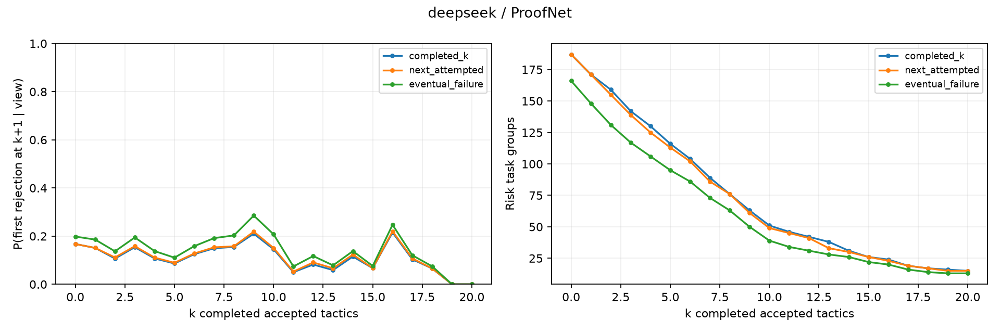

[CSV](assets/5a182e118c95_summary.csv) · Полные метрики (полный исходник на Жоресе: /beegfs/home/denis.rakhmankin/onebigjump/runs/conditional_next_error_20261111_v2/deepseek/ProofNet/metrics.json) · Распределения по точным позициям (полный исходник на Жоресе: /beegfs/home/denis.rakhmankin/onebigjump/runs/conditional_next_error_20261111_v2/deepseek/ProofNet/histograms.json)

#### deepseek / miniF2F

N=1303, G=202, verified=775, failed=528.

##### completed_k

| k | N / G | Следующая ошибка, % | Любая поздняя ошибка, % | Без ошибки, % | 95% CI следующей | Эмпирическая мода T | OOF modal / next, % | Разность, п.п. |
|---|---|---|---|---|---|---|---|---|
| 0 | 1303 / 202 | 3.70 | 44.27 | 52.03 | — | без ошибки | 52.03 / 3.70 | 48.33 |
| 1 | 1263 / 198 | 3.88 | 42.09 | 54.03 | — | без ошибки | 54.03 / 3.88 | 50.15 |
| 2 | 1224 / 196 | 4.51 | 39.28 | 56.21 | [2.60; 6.78] | без ошибки | 56.21 / 4.51 | 51.70 |
| 3 | 1000 / 179 | 4.95 | 42.47 | 52.58 | [3.04; 7.13] | без ошибки | 52.58 / 4.95 | 47.62 |
| 4 | 883 / 168 | 4.09 | 43.86 | 52.05 | [2.35; 6.09] | без ошибки | 52.05 / 4.09 | 47.96 |
| 5 | 789 / 159 | 3.40 | 45.21 | 51.39 | — | без ошибки | 51.39 / 3.40 | 47.99 |
| 6 | 709 / 150 | 6.07 | 44.04 | 49.89 | [3.32; 9.37] | без ошибки | 49.89 / 6.07 | 43.82 |
| 7 | 644 / 139 | 4.65 | 44.23 | 51.12 | — | без ошибки | 51.12 / 4.65 | 46.47 |
| 8 | 591 / 131 | 5.51 | 42.79 | 51.71 | [3.54; 7.76] | без ошибки | 51.71 / 5.51 | 46.20 |
| 9 | 517 / 124 | 3.91 | 44.22 | 51.87 | — | без ошибки | 51.87 / 3.91 | 47.96 |
| 10 | 454 / 117 | 4.16 | 45.34 | 50.49 | — | без ошибки | 50.49 / 4.16 | 46.33 |

##### next_attempted

| k | N / G | Следующая ошибка, % | Любая поздняя ошибка, % | Без ошибки, % | 95% CI следующей | Эмпирическая мода T | OOF modal / next, % | Разность, п.п. |
|---|---|---|---|---|---|---|---|---|
| 0 | 1303 / 202 | 3.70 | 44.27 | 52.03 | — | без ошибки | 52.03 / 3.70 | 48.33 |
| 1 | 1263 / 198 | 3.88 | 42.09 | 54.03 | — | без ошибки | 54.03 / 3.88 | 50.15 |
| 2 | 1048 / 183 | 5.17 | 44.97 | 49.86 | [2.99; 7.73] | без ошибки | 49.86 / 5.17 | 44.70 |
| 3 | 932 / 172 | 5.30 | 45.41 | 49.29 | [3.26; 7.63] | без ошибки | 49.29 / 5.30 | 44.00 |
| 4 | 822 / 162 | 4.33 | 46.50 | 49.16 | [2.50; 6.46] | без ошибки | 49.16 / 4.33 | 44.83 |
| 5 | 729 / 154 | 3.63 | 48.29 | 48.08 | — | без ошибки | 48.08 / 3.63 | 44.45 |
| 6 | 676 / 145 | 6.31 | 45.79 | 47.90 | [3.45; 9.72] | без ошибки | 47.90 / 6.31 | 41.58 |
| 7 | 615 / 134 | 4.83 | 45.96 | 49.21 | — | без ошибки | 49.21 / 4.83 | 44.38 |
| 8 | 552 / 126 | 5.83 | 45.32 | 48.85 | [3.77; 8.18] | без ошибки | 48.85 / 5.83 | 43.01 |
| 9 | 475 / 119 | 4.19 | 47.43 | 48.38 | — | без ошибки | 48.38 / 4.19 | 44.18 |
| 10 | 413 / 115 | 4.50 | 48.99 | 46.51 | — | без ошибки | 46.51 / 4.50 | 42.02 |

##### eventual_failure

| k | N / G | Следующая ошибка, % | Любая поздняя ошибка, % | Без ошибки, % | 95% CI следующей | Эмпирическая мода T | OOF modal / next, % | Разность, п.п. |
|---|---|---|---|---|---|---|---|---|
| 0 | 528 / 122 | 7.71 | 92.29 | 0.00 | — | 3 | 5.12 / 7.71 | -2.60 |
| 1 | 488 / 115 | 8.44 | 91.56 | 0.00 | — | 3 | 8.03 / 8.44 | -0.42 |
| 2 | 449 / 112 | 10.30 | 89.70 | 0.00 | [6.13; 15.10] | 3 | 8.77 / 10.30 | -1.53 |
| 3 | 401 / 107 | 10.45 | 89.55 | 0.00 | [6.51; 14.95] | 4 | 8.94 / 10.45 | -1.51 |
| 4 | 352 / 100 | 8.53 | 91.47 | 0.00 | [5.04; 12.52] | 7 | 10.31 / 8.53 | 1.78 |
| 5 | 319 / 95 | 6.99 | 93.01 | 0.00 | — | 7 | 11.27 / 6.99 | 4.27 |
| 6 | 299 / 90 | 12.11 | 87.89 | 0.00 | [6.83; 18.42] | 7 | 12.11 / 12.11 | 0.00 |
| 7 | 267 / 79 | 9.51 | 90.49 | 0.00 | — | 9 | 7.27 / 9.51 | -2.25 |
| 8 | 243 / 75 | 11.40 | 88.60 | 0.00 | [7.54; 15.95] | 9 | 9.47 / 11.40 | -1.93 |
| 9 | 208 / 70 | 8.12 | 91.88 | 0.00 | — | 12 | 8.15 / 8.12 | 0.02 |
| 10 | 187 / 67 | 8.41 | 91.59 | 0.00 | — | 12 | 8.87 / 8.41 | 0.46 |

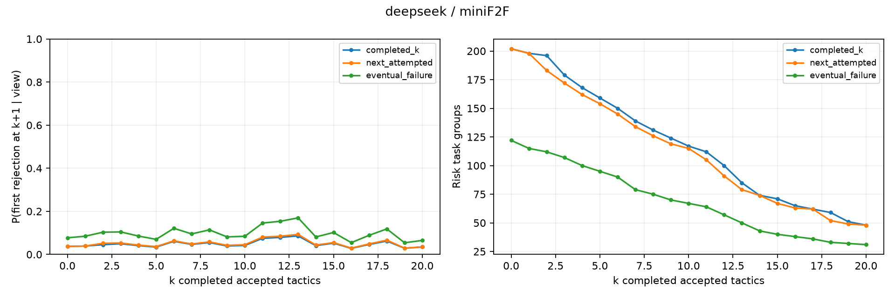

[CSV](assets/64b47224f088_summary.csv) · Полные метрики (полный исходник на Жоресе: /beegfs/home/denis.rakhmankin/onebigjump/runs/conditional_next_error_20261111_v2/deepseek/miniF2F/metrics.json) · Распределения по точным позициям (полный исходник на Жоресе: /beegfs/home/denis.rakhmankin/onebigjump/runs/conditional_next_error_20261111_v2/deepseek/miniF2F/histograms.json)

#### deepseek / Putnam

N=118, G=58, verified=0, failed=118.

##### completed_k

| k | N / G | Следующая ошибка, % | Любая поздняя ошибка, % | Без ошибки, % | 95% CI следующей | Эмпирическая мода T | OOF modal / next, % | Разность, п.п. |
|---|---|---|---|---|---|---|---|---|
| 0 | 118 / 58 | 9.48 | 90.52 | 0.00 | — | 3 | 12.36 / 9.48 | 2.87 |
| 1 | 107 / 56 | 6.67 | 93.33 | 0.00 | — | 3 | 13.65 / 6.67 | 6.98 |
| 2 | 100 / 55 | 14.63 | 85.37 | 0.00 | — | 3 | 14.63 / 14.63 | 0.00 |
| 3 | 85 / 50 | 11.35 | 88.65 | 0.00 | — | 4 | 5.78 / 11.35 | -5.58 |
| 4 | 73 / 46 | 11.46 | 88.54 | 0.00 | — | 5 | 6.07 / 11.46 | -5.39 |
| 5 | 65 / 42 | 10.15 | 89.85 | 0.00 | — | 9 | 7.11 / 10.15 | -3.05 |
| 6 | 58 / 40 | 6.78 | 93.22 | 0.00 | — | 9 | 7.91 / 6.78 | 1.13 |
| 7 | 54 / 38 | 1.82 | 98.18 | 0.00 | — | 9 | 8.48 / 1.82 | 6.67 |
| 8 | 53 / 37 | 15.43 | 84.57 | 0.00 | — | 9 | 8.64 / 15.43 | -6.79 |
| 9 | 45 / 31 | 12.41 | 87.59 | 0.00 | — | 13 | 0.00 / 12.41 | -12.41 |
| 10 | 40 / 29 | 10.00 | 90.00 | 0.00 | — | 13 | 1.25 / 10.00 | -8.75 |

##### next_attempted

| k | N / G | Следующая ошибка, % | Любая поздняя ошибка, % | Без ошибки, % | 95% CI следующей | Эмпирическая мода T | OOF modal / next, % | Разность, п.п. |
|---|---|---|---|---|---|---|---|---|
| 0 | 118 / 58 | 9.48 | 90.52 | 0.00 | — | 3 | 12.36 / 9.48 | 2.87 |
| 1 | 107 / 56 | 6.67 | 93.33 | 0.00 | — | 3 | 13.65 / 6.67 | 6.98 |
| 2 | 100 / 55 | 14.63 | 85.37 | 0.00 | — | 3 | 14.63 / 14.63 | 0.00 |
| 3 | 85 / 50 | 11.35 | 88.65 | 0.00 | — | 4 | 5.78 / 11.35 | -5.58 |
| 4 | 73 / 46 | 11.46 | 88.54 | 0.00 | — | 5 | 6.07 / 11.46 | -5.39 |
| 5 | 65 / 42 | 10.15 | 89.85 | 0.00 | — | 9 | 7.11 / 10.15 | -3.05 |
| 6 | 58 / 40 | 6.78 | 93.22 | 0.00 | — | 9 | 7.91 / 6.78 | 1.13 |
| 7 | 54 / 38 | 1.82 | 98.18 | 0.00 | — | 9 | 8.48 / 1.82 | 6.67 |
| 8 | 53 / 37 | 15.43 | 84.57 | 0.00 | — | 9 | 8.64 / 15.43 | -6.79 |
| 9 | 45 / 31 | 12.41 | 87.59 | 0.00 | — | 13 | 0.00 / 12.41 | -12.41 |
| 10 | 40 / 29 | 10.00 | 90.00 | 0.00 | — | 13 | 1.25 / 10.00 | -8.75 |

##### eventual_failure

| k | N / G | Следующая ошибка, % | Любая поздняя ошибка, % | Без ошибки, % | 95% CI следующей | Эмпирическая мода T | OOF modal / next, % | Разность, п.п. |
|---|---|---|---|---|---|---|---|---|
| 0 | 118 / 58 | 9.48 | 90.52 | 0.00 | — | 3 | 12.36 / 9.48 | 2.87 |
| 1 | 107 / 56 | 6.67 | 93.33 | 0.00 | — | 3 | 13.65 / 6.67 | 6.98 |
| 2 | 100 / 55 | 14.63 | 85.37 | 0.00 | — | 3 | 14.63 / 14.63 | 0.00 |
| 3 | 85 / 50 | 11.35 | 88.65 | 0.00 | — | 4 | 5.78 / 11.35 | -5.58 |
| 4 | 73 / 46 | 11.46 | 88.54 | 0.00 | — | 5 | 6.07 / 11.46 | -5.39 |
| 5 | 65 / 42 | 10.15 | 89.85 | 0.00 | — | 9 | 7.11 / 10.15 | -3.05 |
| 6 | 58 / 40 | 6.78 | 93.22 | 0.00 | — | 9 | 7.91 / 6.78 | 1.13 |
| 7 | 54 / 38 | 1.82 | 98.18 | 0.00 | — | 9 | 8.48 / 1.82 | 6.67 |
| 8 | 53 / 37 | 15.43 | 84.57 | 0.00 | — | 9 | 8.64 / 15.43 | -6.79 |
| 9 | 45 / 31 | 12.41 | 87.59 | 0.00 | — | 13 | 0.00 / 12.41 | -12.41 |
| 10 | 40 / 29 | 10.00 | 90.00 | 0.00 | — | 13 | 1.25 / 10.00 | -8.75 |

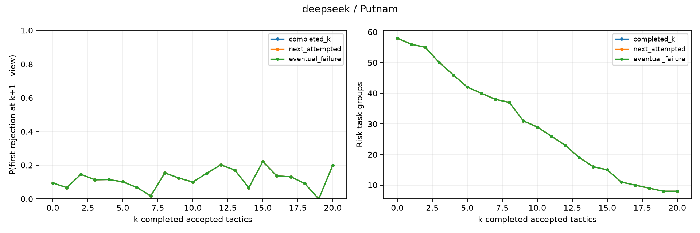

[CSV](assets/18f99f4668df_summary.csv) · Полные метрики (полный исходник на Жоресе: /beegfs/home/denis.rakhmankin/onebigjump/runs/conditional_next_error_20261111_v2/deepseek/Putnam/metrics.json) · Распределения по точным позициям (полный исходник на Жоресе: /beegfs/home/denis.rakhmankin/onebigjump/runs/conditional_next_error_20261111_v2/deepseek/Putnam/histograms.json)

#### goedel / ProofNet

N=338, G=144, verified=79, failed=259.

##### completed_k

| k | N / G | Следующая ошибка, % | Любая поздняя ошибка, % | Без ошибки, % | 95% CI следующей | Эмпирическая мода T | OOF modal / next, % | Разность, п.п. |
|---|---|---|---|---|---|---|---|---|
| 0 | 338 / 144 | 24.73 | 60.56 | 14.71 | [18.58; 31.10] | 1 | 24.73 / 24.73 | 0.00 |
| 1 | 255 / 121 | 13.64 | 66.82 | 19.54 | [8.52; 19.34] | без ошибки | 19.54 / 13.64 | 5.90 |
| 2 | 222 / 108 | 14.76 | 62.61 | 22.63 | [8.95; 21.33] | без ошибки | 22.63 / 14.76 | 7.87 |
| 3 | 171 / 92 | 17.14 | 61.58 | 21.28 | [10.27; 24.88] | без ошибки | 17.03 / 17.14 | -0.11 |
| 4 | 131 / 75 | 14.82 | 65.11 | 20.07 | — | без ошибки | 20.07 / 14.82 | 5.25 |
| 5 | 113 / 63 | 15.86 | 61.37 | 22.77 | — | без ошибки | 22.77 / 15.86 | 6.92 |
| 6 | 91 / 51 | 11.58 | 64.80 | 23.62 | — | без ошибки | 23.62 / 11.58 | 12.04 |
| 7 | 81 / 44 | 8.21 | 66.71 | 25.08 | — | без ошибки | 25.08 / 8.21 | 16.87 |
| 8 | 65 / 39 | 9.91 | 68.48 | 21.61 | — | без ошибки | 10.82 / 9.91 | 0.92 |
| 9 | 58 / 35 | 15.31 | 62.91 | 21.78 | — | без ошибки | 10.46 / 15.31 | -4.85 |
| 10 | 50 / 31 | 16.82 | 58.87 | 24.31 | — | без ошибки | 11.90 / 16.82 | -4.92 |

##### next_attempted

| k | N / G | Следующая ошибка, % | Любая поздняя ошибка, % | Без ошибки, % | 95% CI следующей | Эмпирическая мода T | OOF modal / next, % | Разность, п.п. |
|---|---|---|---|---|---|---|---|---|
| 0 | 338 / 144 | 24.73 | 60.56 | 14.71 | [18.58; 31.10] | 1 | 24.73 / 24.73 | 0.00 |
| 1 | 255 / 121 | 13.64 | 66.82 | 19.54 | [8.52; 19.34] | без ошибки | 19.54 / 13.64 | 5.90 |
| 2 | 200 / 104 | 15.65 | 66.40 | 17.95 | [9.55; 22.52] | без ошибки | 14.36 / 15.65 | -1.29 |
| 3 | 157 / 86 | 18.20 | 65.38 | 16.42 | [10.95; 26.28] | 4 | 15.47 / 18.20 | -2.73 |
| 4 | 129 / 75 | 14.95 | 65.68 | 19.37 | — | без ошибки | 19.37 / 14.95 | 4.42 |
| 5 | 106 / 60 | 16.48 | 63.79 | 19.73 | — | без ошибки | 14.71 / 16.48 | -1.77 |
| 6 | 88 / 50 | 11.81 | 66.07 | 22.12 | — | без ошибки | 22.12 / 11.81 | 10.31 |
| 7 | 74 / 42 | 8.80 | 71.49 | 19.71 | — | без ошибки | 9.87 / 8.80 | 1.07 |
| 8 | 62 / 38 | 10.17 | 70.27 | 19.56 | — | без ошибки | 9.40 / 10.17 | -0.77 |
| 9 | 56 / 35 | 15.56 | 63.91 | 20.53 | — | без ошибки | 10.05 / 15.56 | -5.51 |
| 10 | 49 / 30 | 17.23 | 60.32 | 22.45 | — | без ошибки | 3.69 / 17.23 | -13.54 |

##### eventual_failure

| k | N / G | Следующая ошибка, % | Любая поздняя ошибка, % | Без ошибки, % | 95% CI следующей | Эмпирическая мода T | OOF modal / next, % | Разность, п.п. |
|---|---|---|---|---|---|---|---|---|
| 0 | 259 / 133 | 29.00 | 71.00 | 0.00 | [21.97; 36.27] | 1 | 29.00 / 29.00 | 0.00 |
| 1 | 176 / 105 | 16.95 | 83.05 | 0.00 | [10.66; 23.98] | 2 | 12.27 / 16.95 | -4.68 |
| 2 | 143 / 90 | 19.08 | 80.92 | 0.00 | [11.74; 27.27] | 3 | 14.59 / 19.08 | -4.49 |
| 3 | 114 / 76 | 21.78 | 78.22 | 0.00 | [13.14; 31.36] | 4 | 21.78 / 21.78 | 0.00 |
| 4 | 88 / 63 | 18.54 | 81.46 | 0.00 | — | 5 | 8.18 / 18.54 | -10.36 |
| 5 | 72 / 50 | 20.53 | 79.47 | 0.00 | — | 6 | 20.53 / 20.53 | 0.00 |
| 6 | 57 / 41 | 15.16 | 84.84 | 0.00 | — | 7 | 11.79 / 15.16 | -3.37 |
| 7 | 50 / 35 | 10.96 | 89.04 | 0.00 | — | 10 | 7.94 / 10.96 | -3.02 |
| 8 | 41 / 30 | 12.64 | 87.36 | 0.00 | — | 10 | 8.92 / 12.64 | -3.72 |
| 9 | 37 / 27 | 19.57 | 80.43 | 0.00 | — | 10 | 10.21 / 19.57 | -9.36 |
| 10 | 31 / 23 | 22.22 | 77.78 | 0.00 | — | 11 | 6.35 / 22.22 | -15.87 |

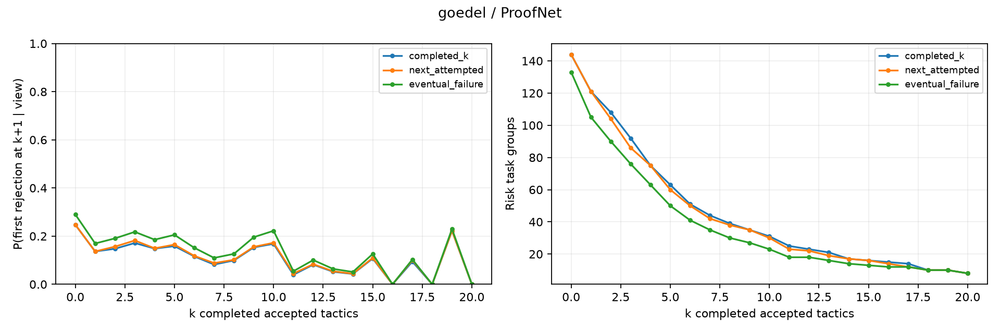

[CSV](assets/6607987f7747_summary.csv) · Полные метрики (полный исходник на Жоресе: /beegfs/home/denis.rakhmankin/onebigjump/runs/conditional_next_error_20261111_v2/goedel/ProofNet/metrics.json) · Распределения по точным позициям (полный исходник на Жоресе: /beegfs/home/denis.rakhmankin/onebigjump/runs/conditional_next_error_20261111_v2/goedel/ProofNet/histograms.json)

#### goedel / miniF2F

N=1256, G=200, verified=808, failed=448.

##### completed_k

| k | N / G | Следующая ошибка, % | Любая поздняя ошибка, % | Без ошибки, % | 95% CI следующей | Эмпирическая мода T | OOF modal / next, % | Разность, п.п. |
|---|---|---|---|---|---|---|---|---|
| 0 | 1256 / 200 | 3.18 | 40.82 | 56.00 | — | без ошибки | 56.00 / 3.18 | 52.82 |
| 1 | 1227 / 198 | 2.93 | 39.23 | 57.84 | — | без ошибки | 57.84 / 2.93 | 54.91 |
| 2 | 1194 / 194 | 4.14 | 36.27 | 59.59 | [2.34; 6.22] | без ошибки | 59.59 / 4.14 | 55.44 |
| 3 | 996 / 182 | 3.97 | 39.18 | 56.85 | [2.26; 5.95] | без ошибки | 56.85 / 3.97 | 52.89 |
| 4 | 892 / 174 | 3.69 | 39.51 | 56.80 | [2.05; 5.61] | без ошибки | 56.80 / 3.69 | 53.11 |
| 5 | 817 / 163 | 2.79 | 39.95 | 57.26 | — | без ошибки | 57.26 / 2.79 | 54.47 |
| 6 | 749 / 158 | 2.17 | 41.00 | 56.84 | — | без ошибки | 56.84 / 2.17 | 54.67 |
| 7 | 689 / 156 | 4.39 | 39.58 | 56.03 | — | без ошибки | 56.03 / 4.39 | 51.65 |
| 8 | 621 / 145 | 3.58 | 40.34 | 56.09 | — | без ошибки | 56.09 / 3.58 | 52.51 |
| 9 | 552 / 135 | 6.10 | 38.61 | 55.29 | — | без ошибки | 55.29 / 6.10 | 49.20 |
| 10 | 493 / 127 | 4.48 | 39.15 | 56.36 | — | без ошибки | 56.36 / 4.48 | 51.88 |

##### next_attempted

| k | N / G | Следующая ошибка, % | Любая поздняя ошибка, % | Без ошибки, % | 95% CI следующей | Эмпирическая мода T | OOF modal / next, % | Разность, п.п. |
|---|---|---|---|---|---|---|---|---|
| 0 | 1256 / 200 | 3.18 | 40.82 | 56.00 | — | без ошибки | 56.00 / 3.18 | 52.82 |
| 1 | 1227 / 198 | 2.93 | 39.23 | 57.84 | — | без ошибки | 57.84 / 2.93 | 54.91 |
| 2 | 1036 / 183 | 4.70 | 41.12 | 54.18 | [2.66; 7.04] | без ошибки | 54.18 / 4.70 | 49.48 |
| 3 | 933 / 176 | 4.19 | 41.39 | 54.42 | [2.39; 6.27] | без ошибки | 54.42 / 4.19 | 50.23 |
| 4 | 849 / 168 | 3.84 | 41.10 | 55.06 | [2.13; 5.81] | без ошибки | 55.06 / 3.84 | 51.22 |
| 5 | 770 / 161 | 2.93 | 41.90 | 55.17 | — | без ошибки | 55.17 / 2.93 | 52.25 |
| 6 | 706 / 156 | 2.27 | 42.97 | 54.76 | — | без ошибки | 54.76 / 2.27 | 52.49 |
| 7 | 647 / 148 | 4.64 | 41.88 | 53.48 | — | без ошибки | 53.48 / 4.64 | 48.84 |
| 8 | 571 / 138 | 3.82 | 43.00 | 53.18 | — | без ошибки | 53.18 / 3.82 | 49.37 |
| 9 | 513 / 132 | 6.44 | 40.82 | 52.73 | — | без ошибки | 52.73 / 6.44 | 46.29 |
| 10 | 442 / 121 | 4.89 | 42.73 | 52.38 | — | без ошибки | 52.38 / 4.89 | 47.49 |

##### eventual_failure

| k | N / G | Следующая ошибка, % | Любая поздняя ошибка, % | Без ошибки, % | 95% CI следующей | Эмпирическая мода T | OOF modal / next, % | Разность, п.п. |
|---|---|---|---|---|---|---|---|---|
| 0 | 448 / 122 | 7.23 | 92.77 | 0.00 | — | 3 | 6.05 / 7.23 | -1.18 |
| 1 | 419 / 115 | 6.95 | 93.05 | 0.00 | — | 3 | 6.52 / 6.95 | -0.43 |
| 2 | 386 / 110 | 10.25 | 89.75 | 0.00 | [5.95; 15.13] | 3 | 7.01 / 10.25 | -3.24 |
| 3 | 346 / 104 | 9.19 | 90.81 | 0.00 | [5.32; 13.66] | 4 | 7.37 / 9.19 | -1.82 |
| 4 | 305 / 100 | 8.54 | 91.46 | 0.00 | [4.84; 12.91] | 10 | 5.45 / 8.54 | -3.10 |
| 5 | 273 / 92 | 6.53 | 93.47 | 0.00 | — | 10 | 7.82 / 6.53 | 1.30 |
| 6 | 252 / 86 | 5.02 | 94.98 | 0.00 | — | 10 | 8.37 / 5.02 | 3.35 |
| 7 | 235 / 86 | 9.98 | 90.02 | 0.00 | — | 10 | 8.81 / 9.98 | -1.17 |
| 8 | 209 / 81 | 8.15 | 91.85 | 0.00 | — | 10 | 12.52 / 8.15 | 4.37 |
| 9 | 190 / 77 | 13.63 | 86.37 | 0.00 | — | 10 | 13.63 / 13.63 | 0.00 |
| 10 | 170 / 69 | 10.27 | 89.73 | 0.00 | — | 11 | 3.33 / 10.27 | -6.94 |

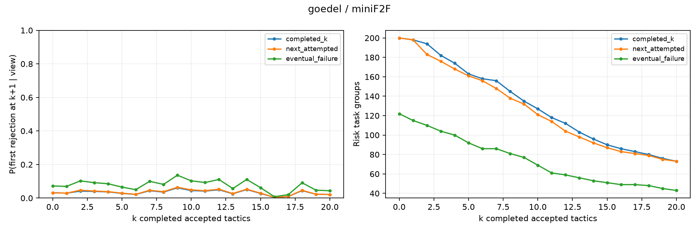

[CSV](assets/3bd2aaa133b5_summary.csv) · Полные метрики (полный исходник на Жоресе: /beegfs/home/denis.rakhmankin/onebigjump/runs/conditional_next_error_20261111_v2/goedel/miniF2F/metrics.json) · Распределения по точным позициям (полный исходник на Жоресе: /beegfs/home/denis.rakhmankin/onebigjump/runs/conditional_next_error_20261111_v2/goedel/miniF2F/histograms.json)

#### goedel / Putnam

N=48, G=35, verified=0, failed=48.

##### completed_k

| k | N / G | Следующая ошибка, % | Любая поздняя ошибка, % | Без ошибки, % | 95% CI следующей | Эмпирическая мода T | OOF modal / next, % | Разность, п.п. |
|---|---|---|---|---|---|---|---|---|
| 0 | 48 / 35 | 11.43 | 88.57 | 0.00 | — | 3 | 0.00 / 11.43 | -11.43 |
| 1 | 44 / 31 | 2.69 | 97.31 | 0.00 | — | 3 | 2.69 / 2.69 | 0.00 |
| 2 | 42 / 31 | 13.81 | 86.19 | 0.00 | — | 3 | 2.76 / 13.81 | -11.05 |
| 3 | 35 / 29 | 11.54 | 88.46 | 0.00 | — | 5 | 7.69 / 11.54 | -3.85 |
| 4 | 31 / 25 | 17.39 | 82.61 | 0.00 | — | 5 | 8.70 / 17.39 | -8.70 |
| 5 | 27 / 21 | 17.54 | 82.46 | 0.00 | — | 6 | 10.53 / 17.54 | -7.02 |
| 6 | 23 / 18 | 14.89 | 85.11 | 0.00 | — | 8, 7 | 2.13 / 14.89 | -12.77 |
| 7 | 18 / 16 | 17.50 | 82.50 | 0.00 | — | 8 | 0.00 / 17.50 | -17.50 |
| 8 | 14 / 13 | 18.18 | 81.82 | 0.00 | — | 27, 9 | 0.00 / 18.18 | -18.18 |
| 9 | 12 / 11 | 11.11 | 88.89 | 0.00 | — | 27 | 0.00 / 11.11 | -11.11 |
| 10 | 11 / 10 | 0.00 | 100.00 | 0.00 | — | 27 | 0.00 / 0.00 | 0.00 |

##### next_attempted

| k | N / G | Следующая ошибка, % | Любая поздняя ошибка, % | Без ошибки, % | 95% CI следующей | Эмпирическая мода T | OOF modal / next, % | Разность, п.п. |
|---|---|---|---|---|---|---|---|---|
| 0 | 48 / 35 | 11.43 | 88.57 | 0.00 | — | 3 | 0.00 / 11.43 | -11.43 |
| 1 | 44 / 31 | 2.69 | 97.31 | 0.00 | — | 3 | 2.69 / 2.69 | 0.00 |
| 2 | 42 / 31 | 13.81 | 86.19 | 0.00 | — | 3 | 2.76 / 13.81 | -11.05 |
| 3 | 35 / 29 | 11.54 | 88.46 | 0.00 | — | 5 | 7.69 / 11.54 | -3.85 |
| 4 | 31 / 25 | 17.39 | 82.61 | 0.00 | — | 5 | 8.70 / 17.39 | -8.70 |
| 5 | 27 / 21 | 17.54 | 82.46 | 0.00 | — | 6 | 10.53 / 17.54 | -7.02 |
| 6 | 23 / 18 | 14.89 | 85.11 | 0.00 | — | 8, 7 | 2.13 / 14.89 | -12.77 |
| 7 | 18 / 16 | 17.50 | 82.50 | 0.00 | — | 8 | 0.00 / 17.50 | -17.50 |
| 8 | 14 / 13 | 18.18 | 81.82 | 0.00 | — | 27, 9 | 0.00 / 18.18 | -18.18 |
| 9 | 12 / 11 | 11.11 | 88.89 | 0.00 | — | 27 | 0.00 / 11.11 | -11.11 |
| 10 | 11 / 10 | 0.00 | 100.00 | 0.00 | — | 27 | 0.00 / 0.00 | 0.00 |

##### eventual_failure

| k | N / G | Следующая ошибка, % | Любая поздняя ошибка, % | Без ошибки, % | 95% CI следующей | Эмпирическая мода T | OOF modal / next, % | Разность, п.п. |
|---|---|---|---|---|---|---|---|---|
| 0 | 48 / 35 | 11.43 | 88.57 | 0.00 | — | 3 | 0.00 / 11.43 | -11.43 |
| 1 | 44 / 31 | 2.69 | 97.31 | 0.00 | — | 3 | 2.69 / 2.69 | 0.00 |
| 2 | 42 / 31 | 13.81 | 86.19 | 0.00 | — | 3 | 2.76 / 13.81 | -11.05 |
| 3 | 35 / 29 | 11.54 | 88.46 | 0.00 | — | 5 | 7.69 / 11.54 | -3.85 |
| 4 | 31 / 25 | 17.39 | 82.61 | 0.00 | — | 5 | 8.70 / 17.39 | -8.70 |
| 5 | 27 / 21 | 17.54 | 82.46 | 0.00 | — | 6 | 10.53 / 17.54 | -7.02 |
| 6 | 23 / 18 | 14.89 | 85.11 | 0.00 | — | 8, 7 | 2.13 / 14.89 | -12.77 |
| 7 | 18 / 16 | 17.50 | 82.50 | 0.00 | — | 8 | 0.00 / 17.50 | -17.50 |
| 8 | 14 / 13 | 18.18 | 81.82 | 0.00 | — | 27, 9 | 0.00 / 18.18 | -18.18 |
| 9 | 12 / 11 | 11.11 | 88.89 | 0.00 | — | 27 | 0.00 / 11.11 | -11.11 |
| 10 | 11 / 10 | 0.00 | 100.00 | 0.00 | — | 27 | 0.00 / 0.00 | 0.00 |

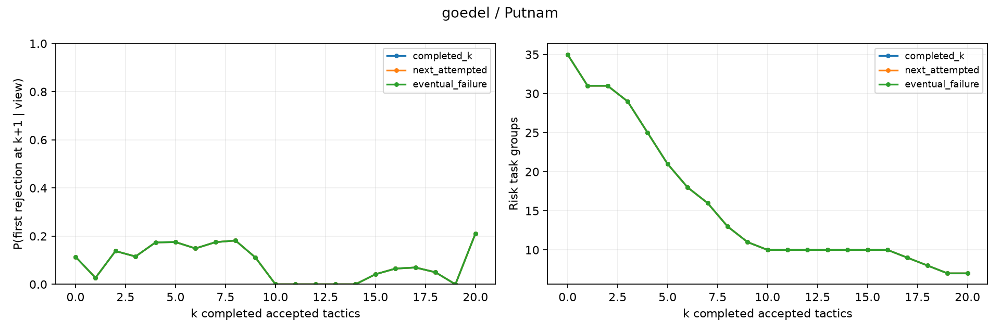

[CSV](assets/a4fd267dd8c2_summary.csv) · Полные метрики (полный исходник на Жоресе: /beegfs/home/denis.rakhmankin/onebigjump/runs/conditional_next_error_20261111_v2/goedel/Putnam/metrics.json) · Распределения по точным позициям (полный исходник на Жоресе: /beegfs/home/denis.rakhmankin/onebigjump/runs/conditional_next_error_20261111_v2/goedel/Putnam/histograms.json)

#### Как читать результат

completed_k включает корректное завершение ровно на k; next_attempted условен на попытку следующей тактики; eventual_failure дополнительно знает будущий исход и применим только как ретроспективный анализ. Высокая доля последнего не является вероятностью ошибки на всех генерациях.

Эмпирическая мода оценена на той же выборке. OOF mode выбирается только на train-группах. Для Putnam это новый исследовательский position-only CV, не frozen-перенос старого векторного детектора. Непревосходство modal над next не устанавливает универсальность next. Интервалы условны на сохранённых OOF выборах. Новые веса LLM не обучались; GPU не использовались.

## Приложение 8 Положение максимума относительно отказа

Источник: [Положение максимума относительно отказа](chapters/08_lag.md). Сервер: /beegfs/home/denis.rakhmankin/onebigjump/runs/peak_failure_lag_20261111_v1/REPORT_RU.md.

Сохранённые нормы residual-приращений. Lag = позиция глобального максимума минус позиция первого отказа Lean. Отрицательный lag означает более ранний максимум. Это ретроспективная статистика полной генерации, включая суффикс после отказа; не готовый streaming-сигнал и не метка момента неверного решения.

Основные проценты усредняются по задачам и попыткам. Uniform учитывает доступное число позиций слева/справа, но остаётся слабым контролем; ранний максимум сам по себе не устанавливает причинность. Полный исходный протокол включает обе модели и все три набора без отбора по результату.

#### all_failed

| Модель / набор | N / G | Раньше, % | На отказе, % | Позже, % | Uniform раньше, % | Раньше − uniform, п.п. [95% CI] |
|---|---|---:|---:|---:|---:|---|
| deepseek/ProofNet | 452 / 166 | 30.56 | 18.50 | 50.93 | 26.92 | 3.64 [-0.68; 7.96] |
| deepseek/miniF2F | 528 / 122 | 44.01 | 18.09 | 37.90 | 44.24 | -0.24 [-5.59; 5.28] |
| deepseek/Putnam | 118 / 58 | 42.24 | 19.83 | 37.93 | 37.11 | 5.13 [-2.67; 12.89] |
| goedel/ProofNet | 259 / 133 | 28.60 | 26.57 | 44.84 | 21.85 | 6.75 [1.43; 12.25] |
| goedel/miniF2F | 448 / 122 | 38.95 | 21.46 | 39.59 | 42.16 | -3.21 [-9.10; 2.71] |
| goedel/Putnam | 48 / 35 | 56.67 | 6.67 | 36.67 | 38.55 | 18.11 [7.47; 28.91] |

#### nonfirst_failure

| Модель / набор | N / G | Раньше, % | На отказе, % | Позже, % | Uniform раньше, % | Раньше − uniform, п.п. [95% CI] |
|---|---|---:|---:|---:|---:|---|
| deepseek/ProofNet | 353 / 148 | 36.70 | 22.03 | 41.27 | 33.55 | 3.15 [-2.23; 8.50] |
| deepseek/miniF2F | 488 / 115 | 47.68 | 18.98 | 33.34 | 47.93 | -0.25 [-6.10; 5.63] |
| deepseek/Putnam | 107 / 56 | 48.21 | 20.24 | 31.55 | 40.92 | 7.30 [-1.52; 16.02] |
| goedel/ProofNet | 176 / 105 | 38.33 | 22.70 | 38.97 | 30.41 | 7.92 [0.72; 15.20] |
| goedel/miniF2F | 419 / 115 | 42.19 | 22.07 | 35.75 | 45.67 | -3.49 [-9.69; 2.70] |
| goedel/Putnam | 44 / 31 | 63.98 | 4.30 | 31.72 | 43.53 | 20.45 [8.21; 32.42] |

#### exclude_first_candidate

| Модель / набор | N / G | Раньше, % | На отказе, % | Позже, % | Uniform раньше, % | Раньше − uniform, п.п. [95% CI] |
|---|---|---:|---:|---:|---:|---|
| deepseek/ProofNet | 353 / 148 | 36.70 | 22.03 | 41.27 | 26.57 | 10.13 [5.06; 15.18] |
| deepseek/miniF2F | 488 / 115 | 47.68 | 18.98 | 33.34 | 42.73 | 4.95 [-0.77; 10.80] |
| deepseek/Putnam | 107 / 56 | 48.21 | 20.24 | 31.55 | 36.69 | 11.53 [2.52; 20.56] |
| goedel/ProofNet | 176 / 105 | 33.57 | 26.51 | 39.92 | 23.47 | 10.10 [3.45; 16.82] |
| goedel/miniF2F | 419 / 115 | 41.75 | 22.50 | 35.75 | 40.49 | 1.26 [-4.91; 7.34] |
| goedel/Putnam | 44 / 31 | 61.83 | 6.45 | 31.72 | 39.27 | 22.56 [10.24; 34.82] |

all_failed: все пригодные ошибочные траектории. nonfirst_failure: исключены отказы первого шага, исходный максимум сохранён. exclude_first_candidate: дополнительно первый шаг исключён из поиска максимума. Это разные условные популяции.

Интервалы: 10000 bootstrap целых групп, exploratory, без поправки на множество диагностик; при недостатке групп интервалы отсутствуют. Полные signed lag и сравнения с максимумами surprisal/длины тактики — metrics.json и predictions.csv. Точное равенство позиции максимума и отказа проверяется с исходной индексацией, tie-break — самая ранняя позиция.

## Приложение 9 Позиционные контроли совпадения

Источник: [Позиционные контроли совпадения](chapters/09_position.md). Сервер: /beegfs/home/denis.rakhmankin/onebigjump/runs/peak_position_control_20261111_v1/REPORT_RU.md.

Поисковая проверка по сохранённым траекториям, без новых генераций и обучения. Анализ готового текста, включая суффикс после первого отказа.

В обычной оценке каждой задаче даётся суммарный вес 1 среди всех её ошибочных попыток. Эти веса фиксированы до условия T>1. Поэтому условная вероятность вычисляется на той же популяции; она может отличаться от прежних таблиц, заново уравнивавших веса задач после отбора.

Контроль сопоставляет каждую попытку с попытками ДРУГИХ задач ТОЧНО той же длины, отдельно для модели, набора и условия T>1. Сравнивает 1{M_i<T_i} с 1{M_j<T_i}. Фактический T_i сохраняется; M_j сохраняет эмпирическое тяготение максимумов к определённым позициям. Экспоненциальная форма не предполагается.

Вес упорядоченной пары i,j равен 1/(n_g*n_h). Это отдельная популяция сопоставленных пар: длины с большим числом доступных пар получают больший вес. Сравнивать нужно observed и null ИЗ ОДНОЙ ТАБЛИЦЫ. Полный весовой охват не означает равенство исходной и парной популяций. Общая сложность задачи и тип тактики этим контролем не устраняются.

Bootstrap: 10000 выборок целых исходных задач; повторный подсчёт парных числителей и знаменателей. При <20 групп интервалы не приводятся. ci_family12 в JSON учитывает 6 ячеек x 2 показателя для основной all_failed-проверки через Bonferroni; T>1 — чувствительность. Номинальные интервалы exploratory, не подтверждающая preregistration.

#### Исходная популяция и условие T>1

| Модель / набор | Ошибка T=1, % | M<T, % | M<T при T>1, % | Uniform при T>1, % | Разность, п.п. [95% CI] |
|---|---:|---:|---:|---:|---|
| deepseek/ProofNet | 19.81 | 30.56 | 38.11 | 33.57 | 4.54 [-0.87; 9.91] |
| deepseek/miniF2F | 8.43 | 44.01 | 48.06 | 48.31 | -0.26 [-6.13; 5.78] |
| deepseek/Putnam | 9.48 | 42.24 | 46.67 | 41.00 | 5.67 [-2.91; 14.35] |
| goedel/ProofNet | 28.66 | 28.60 | 40.08 | 30.62 | 9.46 [2.07; 16.92] |
| goedel/miniF2F | 8.94 | 38.95 | 42.78 | 46.30 | -3.52 [-9.98; 2.95] |
| goedel/Putnam | 11.43 | 56.67 | 63.98 | 43.53 | 20.45 [8.45; 32.33] |

#### Сопоставленные пары: all_failed

| Модель / набор | Попытки / группы | Охват исходного веса, % | M<T, % | Эмпирический контроль, % | Разность, п.п. [95% CI] | За 1–3 шага: разность, п.п. [95% CI] |
|---|---|---:|---:|---:|---|---|
| deepseek/ProofNet | 438 / 165 | 97.04 | 24.35 | 28.68 | -4.34 [-7.54; -1.22] | -5.32 [-9.45; -1.51] |
| deepseek/miniF2F | 513 / 121 | 97.15 | 43.95 | 46.09 | -2.15 [-8.03; 4.23] | 1.08 [-6.34; 9.19] |
| deepseek/Putnam | 100 / 53 | 84.05 | 45.88 | 54.42 | -8.54 [-17.70; -0.33] | -5.22 [-14.85; 3.39] |
| goedel/ProofNet | 229 / 117 | 85.03 | 23.38 | 27.95 | -4.57 [-10.17; 0.88] | -3.82 [-9.88; 2.04] |
| goedel/miniF2F | 423 / 117 | 92.48 | 38.24 | 45.29 | -7.04 [-12.66; -1.32] | -4.64 [-10.98; 1.56] |
| goedel/Putnam | 32 / 25 | 64.29 | 50.93 | 53.07 | -2.14 [-20.27; 16.24] | -4.09 [-26.22; 24.20] |

#### Сопоставленные пары: nonfirst_failure

| Модель / набор | Попытки / группы | Охват исходного веса, % | M<T, % | Эмпирический контроль, % | Разность, п.п. [95% CI] | За 1–3 шага: разность, п.п. [95% CI] |
|---|---|---:|---:|---:|---|---|
| deepseek/ProofNet | 339 / 147 | 96.31 | 38.18 | 43.11 | -4.93 [-9.15; -0.63] | -6.57 [-12.45; -0.82] |
| deepseek/miniF2F | 473 / 114 | 96.89 | 49.45 | 50.11 | -0.66 [-6.73; 5.94] | 3.06 [-4.74; 11.77] |
| deepseek/Putnam | 88 / 51 | 81.90 | 49.64 | 59.42 | -9.77 [-20.18; -0.13] | -6.08 [-17.29; 4.48] |
| goedel/ProofNet | 150 / 91 | 82.17 | 45.54 | 52.23 | -6.69 [-14.67; 1.60] | -4.74 [-14.20; 5.63] |
| goedel/miniF2F | 394 / 110 | 91.74 | 43.05 | 49.40 | -6.35 [-12.43; -0.01] | -5.01 [-12.17; 2.07] |
| goedel/Putnam | 28 / 21 | 59.68 | 66.45 | 66.28 | 0.16 [-19.57; 21.43] | 1.64 [-26.24; 42.00] |

## Приложение 10 Распределения максимумов ошибок и surprisal

Источник: [Распределения максимумов ошибок и surprisal](chapters/10_distributions.md). Сервер: /beegfs/home/denis.rakhmankin/onebigjump/runs/peak_error_distributions_20261111_v1/publication_v3/REPORT_RU.md.

Отчёт от 11 ноября 2026. DeepSeek-Prover-V2-7B и Goedel-Prover-V2-8B; ProofNet, miniF2F и Putnam. Дополнительный анализ архивных траекторий, выполненный на Жоресе. Все сравнения поисковые: эти наборы уже исследовались ранее.

#### Что проверялось и что получилось

Проверены пять разных вопросов: сходство распределений позиций; совпадение максимума с конкретным отказом сверх общего позиционного смещения; среднее опережение/запаздывание; распределение surprisal; различия между правильными и ошибочными попытками. Эти вопросы не взаимозаменяемы.

Универсальное утверждение «максимум в среднем раньше ошибки» не выполняется. На ProofNet средний максимум скачка позже отказа; на miniF2F среднее смещение близко к нулю; отрицательное среднее у Goedel / Putnam зависит от способа нормирования и уровня учёта множественных сравнений. Большинство максимумов до или на отказе не означает отрицательного среднего: редкие большие запаздывания могут менять его знак.

Позиционное смещение объясняет часть совпадений, но не все. Среди 12 основных сравнений после семейной поправки положительный избыток точных совпадений сохраняется для максимума скачка у Goedel / miniF2F, а для максимума surprisal — у DeepSeek / ProofNet и DeepSeek / miniF2F. Это ассоциация с местом отказа, не доказательство причинного механизма или предупреждения при генерации.

На miniF2F величина максимального скачка различает исходы даже при сопоставлении по длине между разными задачами. Его позиция значительно слабее различает исходы. Проверка разных исходов внутри одной задачи той же длины пока слишком мала; переносить вывод между задачами на эту более строгую постановку нельзя.

#### Данные и определения

| Модель / набор | Попытки | Задачи | С отказом | Проверенные правильные | Задачи с отказом / правильными |
|---|---|---|---|---|---|
| deepseek/ProofNet | 563 | 187 | 452 | 111 | 166 / 37 |
| deepseek/miniF2F | 1303 | 202 | 528 | 775 | 122 / 126 |
| deepseek/Putnam | 118 | 58 | 118 | 0 | 58 / 0 |
| goedel/ProofNet | 338 | 144 | 259 | 79 | 133 / 30 |
| goedel/miniF2F | 1256 | 200 | 448 | 808 | 122 / 137 |
| goedel/Putnam | 48 | 35 | 48 | 0 | 35 / 0 |


Модели заморожены; новые генерации, обучение и GPU не использовались. Слои считывания — архивные 14 для DeepSeek и 17 для Goedel. Входы — проверенная полная feature-cohort предыдущего исследования наличия ошибки; не все исходно сгенерированные попытки. Неполные, неоднозначно размеченные и ограниченные ресурсами попытки отфильтрованы исходным протоколом; они не считаются правильными.

В Putnam нет подтверждённых правильных попыток в данной выборке. Поэтому на Putnam можно изучать место отказа, но нельзя оценивать различение правильного и ошибочного доказательства.

Для тактики с номером $t$ берётся скрытое состояние $X_t$ на последнем её токене:


$$
\Delta_t=X_t-X_{t-1},\qquad
W_t=\left\|\Sigma^{-1/2}(\Delta_t-\mu)\right\|_2.
$$


Whitening зафиксирован по отдельной исходной калибровочной выборке. $Q_t$ — средняя отрицательная логарифмическая вероятность токенов тактики:


$$
Q_t=-\frac{1}{n_t}\sum_{j\in s_t}\log p_\theta(x_j\mid x_{<j}).
$$


Единица $Q_t$ — нат на токен. Это surprisal выбранного текста; не вероятность логической ошибки и не энтропия по всем возможным ответам.

Обозначения:


$$
M_W=\arg\max_{1\le t\le L}W_t,\qquad
M_Q=\arg\max_{1\le t\le L}Q_t,\qquad
T=\text{позиция первого отказа Lean}.
$$


Индексация начинается с 1; при равенстве максимумов берётся самый ранний. $T$ не определён для проверенных правильных доказательств. $L$ — длина сохранённого сгенерированного/оценённого формального текста. После первого отказа могут оставаться сгенерированные тактики; их не считаем успешно исполненными в Lean. Все глобальные максимумы в этом отчёте ретроспективны.

#### Веса, неопределённость и границы сравнения

Для локализации каждая задача имеет вес 1 среди своих ошибочных попыток, попытки внутри задачи равновесны. Для сравнения исходов вес 1 задаётся по всем попыткам задачи и фиксируется до отбора правильных/ошибочных. Гистограммы локализации в следующем разделе согласованы именно с весами локализации; гистограммы исходов используют вторую схему.

Для сопоставления по длине используется отдельная популяция пар. При весе попытки $a_i=1/n_{g(i)}$ вес упорядоченной пары равен $a_i a_j$. В основной проверке задачи разные, длина точно одинакова. Поэтому длины с большим количеством доступных пар получают больший суммарный вес. Проценты из парных таблиц нельзя напрямую сравнивать с процентами всей выборки.

Интервалы — 10 000 bootstrap-выборок целых задач. В парных оценках заново считаются числители и знаменатели. Копии одной исходной задачи не становятся разными задачами-донорами. Для пар внутри задачи блок учитывается линейно, для разных задач — произведением multiplicities. Интервалы отсутствуют при <20 групп; для сравнения исходов нужны по 20 групп в каждом классе. «—» обозначает недостаточную поддержку, а не отсутствие неопределённости.

Основное семейство: 6 сочетаний модели и набора × 2 статистики (скачок и surprisal), собственный максимум против максимума другой задачи той же длины. Показаны обычные 95% интервалы и семейные интервалы Bonferroni для этих 12 контрастов. Остальные таблицы — поисковые диагностики с точечными 95% интервалами. Поправка не превращает анализ ранее изученных данных в подтверждающее исследование.

#### Похожи ли распределения позиций максимумов и ошибок

Ниже TV — total variation, половина суммы абсолютных различий вероятностей по позициям. TV=0 для одинаковых гистограмм. Перекрытие равно 1−TV. JS — Jensen–Shannon divergence в битах. Это описательные расстояния, не тест равенства. Относительная позиция — t/L, 20 заранее фиксированных интервалов. Малые выборки сами увеличивают шум этих расстояний.

| Модель / набор | Мода T | Мода M_W | Мода M_Q | TV W,T: шаг | TV W,T: доля длины | TV Q,T: шаг | TV Q,T: доля длины |
|---|---|---|---|---|---|---|---|
| deepseek/ProofNet | 1 | 2 | 2 | 0.352 | 0.225 | 0.234 | 0.293 |
| deepseek/miniF2F | 7 | 2 | 4 | 0.259 | 0.159 | 0.215 | 0.232 |
| deepseek/Putnam | 3 | 2 | 4 | 0.375 | 0.205 | 0.277 | 0.218 |
| goedel/ProofNet | 1 | 2 | 2 | 0.308 | 0.193 | 0.316 | 0.314 |
| goedel/miniF2F | 3 | 2 | 4 | 0.259 | 0.155 | 0.278 | 0.233 |
| goedel/Putnam | 3 | 2 | 6 | 0.476 | 0.452 | 0.467 | 0.367 |


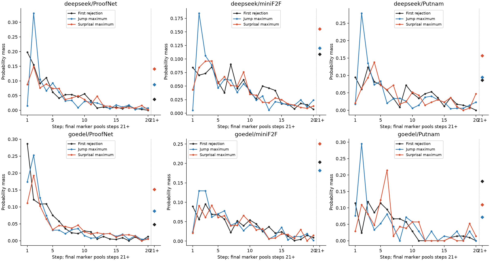

Последняя точка «21» на рисунке объединяет все позиции 21 и дальше; расчёт расстояний выше использует полную поддержку без такого объединения.

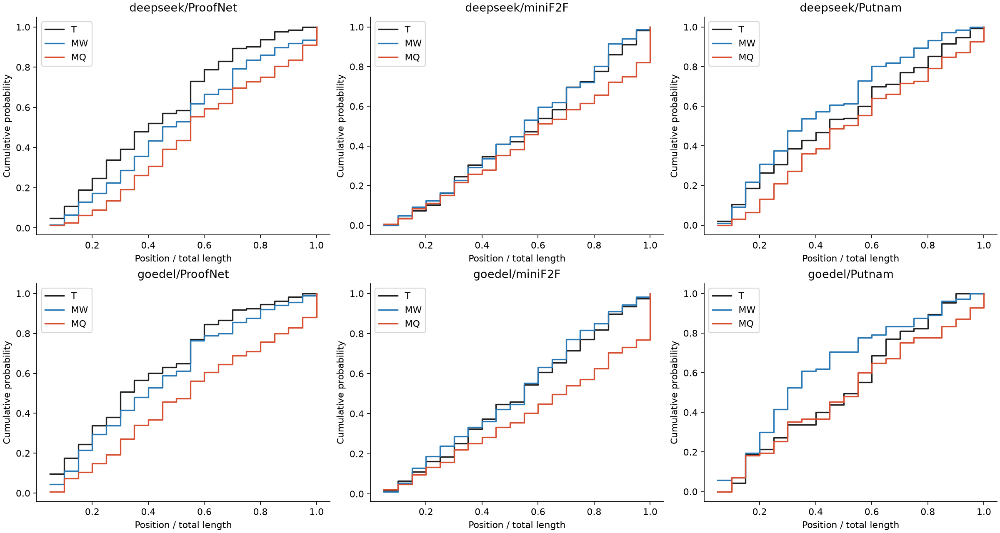

Похожесть распределений по всем доказательствам не означает совпадения на отдельных доказательствах. Две независимо выбранные позиции могут иметь одинаковые распределения и при этом редко совпадать. И наоборот, дополнительное совпадение внутри конкретной траектории возможно при различающихся маргинальных распределениях.

#### Бейзлайн, учитывающий распределения

При условной независимости позиций и фиксированной длине:


$$
P_0(M=T\mid L)=\sum_{t=1}^{L}p_M(t\mid L)\,p_T(t\mid L).
$$


При равномерном $p_M$ этот контроль равен $1/L$. Если оба распределения сосредоточены на первых шагах, совпадение может существенно превышать $1/L$ без дополнительной связи внутри попытки.

Эмпирическая проверка использует пары разных задач одинаковой длины. Сравниваются:


$$
A=\frac{\sum_{(i,j)}a_i a_j\,\mathbf{1}\{M_i=T_i\}}{\sum_{(i,j)}a_i a_j},
\qquad
A_0=\frac{\sum_{(i,j)}a_i a_j\,\mathbf{1}\{M_j=T_i\}}{\sum_{(i,j)}a_i a_j}.
$$


Настоящие позиции ошибок сохраняются. Переносится только максимум другой задачи. Это исключает самосопоставление и учитывает неравномерность позиций при точно той же длине. Однако сложность и тип конкретной задачи ещё могут создавать общие причины; для этого ниже приведена более узкая проверка внутри задачи.

##### Точное совпадение максимума скачка с отказом

| Модель / набор | Попытки / задачи | Охват веса, % | Свой максимум, % | Чужой максимум, % | Разница, п.п. [95%] | Семейный интервал |
|---|---|---|---|---|---|---|
| deepseek/ProofNet | 438 / 165 | 97.04 | 24.36 | 18.90 | 5.46 [1.55; 9.84] | [-0.17; 12.09] |
| deepseek/miniF2F | 513 / 121 | 97.15 | 23.39 | 16.34 | 7.06 [0.77; 13.39] | [-2.31; 15.93] |
| deepseek/Putnam | 100 / 53 | 84.05 | 19.55 | 13.56 | 5.99 [-3.76; 16.73] | [-8.73; 21.82] |
| goedel/ProofNet | 229 / 117 | 85.03 | 43.88 | 36.12 | 7.75 [-1.72; 16.82] | [-7.06; 21.16] |
| goedel/miniF2F | 423 / 117 | 92.48 | 27.10 | 13.64 | 13.46 [6.79; 20.83] | [3.99; 24.60] |
| goedel/Putnam | 32 / 25 | 64.29 | 5.02 | 10.97 | -5.95 [-24.42; 14.07] | [-35.99; 26.03] |


##### Точное совпадение максимума surprisal с отказом

| Модель / набор | Попытки / задачи | Охват веса, % | Свой максимум, % | Чужой максимум, % | Разница, п.п. [95%] | Семейный интервал |
|---|---|---|---|---|---|---|
| deepseek/ProofNet | 438 / 165 | 97.04 | 33.21 | 25.59 | 7.62 [2.69; 13.20] | [0.66; 15.90] |
| deepseek/miniF2F | 513 / 121 | 97.15 | 24.70 | 12.23 | 12.47 [5.72; 19.86] | [3.34; 23.91] |
| deepseek/Putnam | 100 / 53 | 84.05 | 18.07 | 11.14 | 6.93 [-7.43; 21.12] | [-15.31; 28.58] |
| goedel/ProofNet | 229 / 117 | 85.03 | 34.75 | 23.81 | 10.95 [2.34; 20.04] | [-1.49; 24.39] |
| goedel/miniF2F | 423 / 117 | 92.48 | 17.31 | 9.43 | 7.88 [2.03; 14.01] | [-0.86; 17.40] |
| goedel/Putnam | 32 / 25 | 64.29 | 18.96 | 7.81 | 11.15 [-17.53; 37.25] | [-32.67; 49.00] |


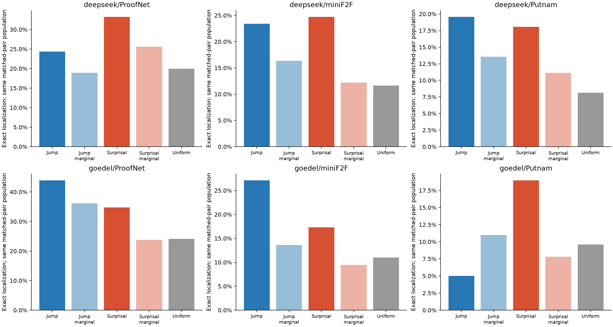

Наиболее устойчивый остаточный эффект скачка в основном семействе — Goedel / miniF2F. У DeepSeek / ProofNet и DeepSeek / miniF2F интервалы для скачка положительны при обычном 95% уровне, но включают ноль после семейной поправки. Для surprisal семейную поправку проходят DeepSeek / ProofNet и DeepSeek / miniF2F. На Putnam интервалы широки. Значит, свести абсолютно все совпадения к похожести маргинальных распределений нельзя, но и универсальной связи для всех наборов нет.

##### Более строгий контроль: другая попытка той же задачи и той же длины

| Модель / набор | Попытки / задачи | Охват веса, % | Скачок: разница, п.п. [95%] | Surprisal: разница, п.п. [95%] |
|---|---|---|---|---|
| deepseek/ProofNet | 106 / 45 | 18.47 | 3.82 [0.34; 8.36] | -1.45 [-6.48; 2.56] |
| deepseek/miniF2F | 179 / 52 | 25.17 | -5.40 [-16.36; 3.18] | 2.58 [-2.56; 8.99] |
| deepseek/Putnam | 8 / 4 | 4.31 | -21.93 — | 0.00 — |
| goedel/ProofNet | 51 / 22 | 13.53 | -2.55 [-11.51; 6.36] | 3.11 [-3.21; 10.96] |
| goedel/miniF2F | 130 / 38 | 18.99 | 4.84 [0.94; 10.46] | 2.38 [-0.65; 6.31] |
| goedel/Putnam | 4 / 2 | 4.76 | 0.00 — | 34.62 — |


У Goedel / miniF2F избыток совпадений скачка остаётся и в этой более узкой постановке. Это полезная проверка, но её охват существенно меньше основного; сравнение внутри задачи — поисковая чувствительность, не отдельный подтверждающий результат. На Putnam независимых задач для такой проверки слишком мало. Эффект surprisal при дополнительном контроле задачи ослабляется; часть его связи может относиться к общим свойствам задания.

#### Бейзлайн, который предсказывает место ошибки по распределению

Другой вопрос — превосходит ли максимум простой практический предсказатель позиции. Построен baseline, который знает только модель, набор и окончательную длину ошибочной попытки. Пять разбиений по задачам: гистограмма позиций ошибок обучается на других задачах. Сглаживание — 0,5 на каждую допустимую позицию; группы длины 1–5, 6–10, 11–20, 21–40, 41+. Если в группе меньше 20 обучающих задач, используется общая гистограмма обучающих задач. Предсказывается её мода, равенства разрешаются в пользу ранней позиции. Это фиксированный простой baseline, а не оптимально настроенный предсказатель.

| Модель / набор | Uniform, % | Всегда шаг 1, % | OOF-мода, % | Макс. скачка, % | Макс. surprisal, % | Скачок − мода, п.п. [95%] | Surprisal − мода, п.п. [95%] |
|---|---|---|---|---|---|---|---|
| deepseek/ProofNet | 12.55 | 19.81 | 22.12 | 18.50 | 21.40 | -3.62 [-10.87; 3.53] | -0.72 [-6.80; 5.52] |
| deepseek/miniF2F | 9.52 | 8.43 | 9.27 | 18.09 | 18.89 | 8.82 [2.95; 14.71] | 9.62 [3.85; 15.47] |
| deepseek/Putnam | 7.51 | 9.48 | 10.49 | 19.83 | 17.53 | 9.34 [0.29; 18.39] | 7.04 [-2.44; 16.52] |
| goedel/ProofNet | 13.15 | 28.66 | 25.31 | 26.57 | 21.27 | 1.25 [-6.27; 8.90] | -4.05 [-11.65; 3.41] |
| goedel/miniF2F | 8.44 | 8.94 | 7.36 | 21.46 | 13.15 | 14.10 [8.14; 20.18] | 5.79 [0.50; 11.12] |
| goedel/Putnam | 7.52 | 11.43 | 4.29 | 6.67 | 15.71 | 2.38 [-7.14; 11.90] | 11.43 [-1.43; 25.24] |


Это полная выборка ошибочных попыток с равным весом задач, в отличие от таблиц сопоставленных пар. На miniF2F максимум скачка превосходит данный OOF-baseline у обеих моделей. На ProofNet такого преимущества над OOF-модой нет. Связь сверх случайного переноса максимума и преимущество над хорошим предсказателем позиции — разные критерии.

Дополнительно обучена геометрическая модель положения ошибки, усечённая известной длиной:


$$
p_{\mathrm{geom}}(T=t\mid T\le L)
=\frac{p(1-p)^{t-1}}{1-(1-p)^L},\qquad t=1,\ldots,L.
$$


Параметр $p$ оценивается только на обучающих задачах максимизацией взвешенного правдоподобия. Ни окончательная длина, ни известный факт ошибки не доступны настоящему streaming-детектору; это offline-baseline локализации.

| Модель / набор | NLL геометрической модели | NLL эмпирической модели | Геометрическая − эмпирическая [95%] |
|---|---|---|---|
| deepseek/ProofNet | 2.365 | 2.405 | -0.040 [-0.100; 0.017] |
| deepseek/miniF2F | 2.701 | 2.723 | -0.022 [-0.074; 0.029] |
| deepseek/Putnam | 2.818 | 2.960 | -0.142 [-0.241; -0.046] |
| goedel/ProofNet | 2.348 | 2.427 | -0.079 [-0.187; 0.031] |
| goedel/miniF2F | 2.891 | 2.957 | -0.066 [-0.120; -0.012] |
| goedel/Putnam | 2.832 | 3.001 | -0.169 [-0.325; -0.021] |


Положительная разница NLL означает преимущество эмпирической модели, отрицательная — геометрической. По точечным оценкам геометрическая модель не хуже этого сглаженного гистограммного baseline во всех шести случаях; на части наборов обычный интервал разницы ниже нуля. Это не устанавливает геометрический закон: простая модель может выигрывать из-за меньшей дисперсии на небольшой выборке. Форма проверялась в условной популяции T≤L, а не как физический закон независимых отказов на каждом шаге.

#### Максимум в среднем раньше ошибки — верно ли это

Проверены разные величины:


$$
D=M_W-T,\qquad \mathbb{E}[D],\qquad
\mathbb{E}[D/L],\qquad P(D\le0).
$$


Отрицательное среднее означает опережение, положительное — запаздывание. Вероятность $P(D\le0)>1/2$ характеризует большинство случаев; знак среднего она не определяет.

| Модель / набор | Среднее M_W−T, шаги [95%] | Медиана M_W−T | Среднее (M_W−T)/L, % длины [95%] | M_W≤T, % [95%] | Среднее M_Q−T [95%] |
|---|---|---|---|---|---|
| deepseek/ProofNet | 2.07 [0.89; 3.34] | 1.00 | 8.04 [3.99; 12.04] | 49.07 [43.20; 54.76] | 4.28 [2.98; 5.70] |
| deepseek/miniF2F | -0.29 [-1.35; 0.73] | 0.00 | -1.46 [-5.93; 2.90] | 62.10 [55.22; 68.79] | 1.34 [0.28; 2.42] |
| deepseek/Putnam | -0.15 [-2.20; 2.18] | 0.00 | -6.53 [-13.91; 0.58] | 62.07 [52.01; 71.70] | 2.52 [0.52; 4.64] |
| goedel/ProofNet | 2.53 [0.40; 5.42] | 0.00 | 4.36 [-0.17; 9.02] | 55.16 [47.88; 62.49] | 6.54 [3.82; 9.78] |
| goedel/miniF2F | 0.51 [-1.16; 2.36] | 0.00 | -1.25 [-5.46; 2.83] | 60.41 [53.27; 67.35] | 3.10 [1.20; 5.42] |
| goedel/Putnam | -3.12 [-6.23; -0.55] | -1.00 | -9.54 [-20.13; 1.07] | 63.33 [47.62; 78.11] | -1.02 [-4.28; 1.75] |


На ProofNet точечные средние положительны у обеих моделей. На Goedel / miniF2F большинство максимумов не позже отказа, но среднее смещение положительно: хвост поздних максимумов меняет знак среднего. На Goedel / Putnam обычный 95% интервал среднего числа шагов отрицателен, однако интервал после нормирования на длину включает ноль. При консервативном расширении интервала среднего по той же формуле family12 он также включает ноль; формально это дополнительная чувствительность вне основного семейства локализации. Нельзя описывать опережение как общий установленный закон.

#### Распределение surprisal

Показаны эмпирические распределения Q_t для правильных доказательств, принятого префикса ошибочной попытки, первого отказа и сгенерированного суффикса после отказа. Каждая попытка получает свой исходный вес, равномерно распределённый между её шагами внутри рассматриваемого сегмента. Состав доступных попыток в сегментах различается; простое вычитание средних двух сегментов не заменяет парную оценку ниже.

| Модель / набор | Сегмент | Попытки / задачи | Среднее Q | Медиана Q | 90% квантиль | 99% квантиль |
|---|---|---|---|---|---|---|
| deepseek/ProofNet | verified | 111 / 37 | 0.0546 | 0.0260 | 0.1434 | 0.3911 |
| deepseek/ProofNet | failed_full | 452 / 166 | 0.0598 | 0.0398 | 0.1435 | 0.3254 |
| deepseek/ProofNet | pre | 353 / 148 | 0.0498 | 0.0294 | 0.1299 | 0.2919 |
| deepseek/ProofNet | at | 452 / 166 | 0.0877 | 0.0717 | 0.1608 | 0.3254 |
| deepseek/ProofNet | post | 452 / 166 | 0.0578 | 0.0326 | 0.1491 | 0.3409 |
| deepseek/miniF2F | verified | 775 / 126 | 0.0630 | 0.0369 | 0.1609 | 0.3467 |
| deepseek/miniF2F | failed_full | 528 / 122 | 0.0442 | 0.0217 | 0.1128 | 0.2830 |
| deepseek/miniF2F | pre | 488 / 115 | 0.0363 | 0.0197 | 0.0897 | 0.2232 |
| deepseek/miniF2F | at | 528 / 122 | 0.0702 | 0.0623 | 0.1286 | 0.2267 |
| deepseek/miniF2F | post | 528 / 122 | 0.0515 | 0.0207 | 0.1412 | 0.3790 |
| deepseek/Putnam | failed_full | 118 / 58 | 0.0485 | 0.0264 | 0.1199 | 0.2961 |
| deepseek/Putnam | pre | 107 / 56 | 0.0467 | 0.0297 | 0.1099 | 0.2467 |
| deepseek/Putnam | at | 118 / 58 | 0.0961 | 0.0763 | 0.2045 | 0.3628 |
| deepseek/Putnam | post | 118 / 58 | 0.0432 | 0.0143 | 0.1129 | 0.2873 |
| goedel/ProofNet | verified | 79 / 30 | 0.0664 | 0.0474 | 0.1516 | 0.3977 |
| goedel/ProofNet | failed_full | 259 / 133 | 0.0627 | 0.0393 | 0.1627 | 0.3367 |
| goedel/ProofNet | pre | 176 / 105 | 0.0537 | 0.0399 | 0.1265 | 0.2669 |
| goedel/ProofNet | at | 259 / 133 | 0.0966 | 0.0810 | 0.1983 | 0.4071 |
| goedel/ProofNet | post | 259 / 133 | 0.0599 | 0.0232 | 0.1710 | 0.3510 |
| goedel/miniF2F | verified | 808 / 137 | 0.0645 | 0.0342 | 0.1703 | 0.4183 |
| goedel/miniF2F | failed_full | 448 / 122 | 0.0483 | 0.0215 | 0.1292 | 0.3373 |
| goedel/miniF2F | pre | 419 / 115 | 0.0429 | 0.0198 | 0.1108 | 0.2856 |
| goedel/miniF2F | at | 448 / 122 | 0.0787 | 0.0673 | 0.1530 | 0.3163 |
| goedel/miniF2F | post | 448 / 122 | 0.0588 | 0.0239 | 0.1652 | 0.3898 |
| goedel/Putnam | failed_full | 48 / 35 | 0.0620 | 0.0350 | 0.1685 | 0.3517 |
| goedel/Putnam | pre | 44 / 31 | 0.0592 | 0.0449 | 0.1476 | 0.3517 |
| goedel/Putnam | at | 48 / 35 | 0.1031 | 0.0676 | 0.2147 | 0.2768 |
| goedel/Putnam | post | 48 / 35 | 0.0604 | 0.0253 | 0.1693 | 0.4344 |


verified — доказательство целиком проверено; failed_full — весь сохранённый текст ошибочной попытки; pre — до первого отказа; at — первый отказ; post — сгенерированный текст после отказа, не выполненный успешно в Lean. Это не сравнение «логически правильных и неправильных токенов» внутри post.

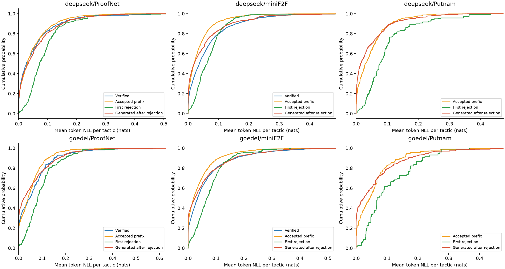

На графике точная эмпирическая CDF; масштаб горизонтальной оси выбран по 99,5% квантилям для читаемости. Табличные квантили и средние рассчитаны по всем наблюдениям. Отдельное оценивание степенного хвоста surprisal не выполнялось; форма CDF сама по себе не устанавливает тяжёлый хвост.

##### Парная проверка локального повышения surprisal

| Модель / набор | Q отказа − Q предыдущей тактики [95%] | Q отказа − среднее Q префикса [95%] | Среднее Q суффикса − Q отказа [95%] |
|---|---|---|---|
| deepseek/ProofNet | 0.0315 [0.0187; 0.0441] | 0.0420 [0.0324; 0.0527] | -0.0370 [-0.0477; -0.0268] |
| deepseek/miniF2F | 0.0259 [0.0143; 0.0372] | 0.0336 [0.0254; 0.0421] | -0.0197 [-0.0293; -0.0101] |
| deepseek/Putnam | 0.0463 [0.0262; 0.0686] | 0.0541 [0.0371; 0.0739] | -0.0569 [-0.0752; -0.0397] |
| goedel/ProofNet | 0.0467 [0.0298; 0.0644] | 0.0528 [0.0385; 0.0685] | -0.0535 [-0.0696; -0.0392] |
| goedel/miniF2F | 0.0313 [0.0200; 0.0433] | 0.0360 [0.0274; 0.0451] | -0.0205 [-0.0326; -0.0088] |
| goedel/Putnam | 0.0525 [0.0272; 0.0782] | 0.0472 [0.0242; 0.0709] | -0.0504 [-0.0785; -0.0232] |


Первые два контраста положительны во всех шести сочетаниях с положительными обычными 95% интервалами. Это относится к отказам после первого шага. Во всех шести случаях средний surprisal последующего сгенерированного суффикса ниже surprisal на отказе. Такое снижение не означает, что доказательство снова стало правильным: после отказа Lean не подтвердил эти шаги.

##### Насколько surprisal и скачок выражают одно и то же

| Модель / набор | Средняя внутри попытки Spearman(W,Q) [95%] | Spearman(W,число токенов) [95%] | Spearman(Q,число токенов) [95%] |
|---|---|---|---|
| deepseek/ProofNet | 0.211 [0.172; 0.251] | 0.193 [0.151; 0.236] | 0.218 [0.176; 0.259] |
| deepseek/miniF2F | 0.125 [0.083; 0.165] | 0.157 [0.123; 0.191] | 0.123 [0.081; 0.164] |
| deepseek/Putnam | 0.193 [0.119; 0.265] | 0.242 [0.187; 0.299] | 0.235 [0.176; 0.295] |
| goedel/ProofNet | 0.319 [0.269; 0.368] | 0.283 [0.226; 0.339] | 0.278 [0.220; 0.335] |
| goedel/miniF2F | 0.129 [0.089; 0.168] | 0.207 [0.172; 0.242] | 0.125 [0.084; 0.164] |
| goedel/Putnam | 0.264 [0.154; 0.368] | 0.227 [0.123; 0.324] | 0.299 [0.202; 0.399] |


Используются попытки хотя бы с тремя шагами и непостоянными значениями обеих величин. Корреляция W и Q положительна, но далека от единицы: это разные статистики. Положительные корреляции с длиной тактики указывают на необходимость контроля её типа и сложности; длина уже исключена как простой множитель суммы surprisal, поскольку Q усредняется по токенам.

#### Максимумы при наличии ошибки и без неё

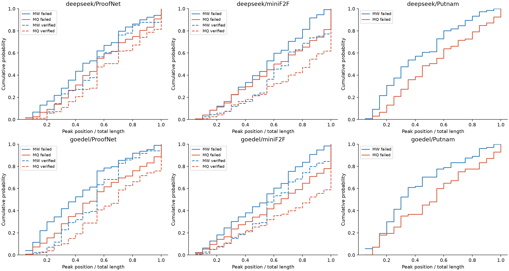

Правильные попытки в этой выборке обычно короче. Поэтому относительная позиция t/L полезна, но не устраняет все эффекты длины: например, единственная позиция короткого доказательства автоматически является последней.

| Модель / набор | Медиана длины: ошибка / правильно | Медиана max W: ошибка / правильно | Медиана max Q: ошибка / правильно |
|---|---|---|---|
| deepseek/ProofNet | 14 / 6 | 154.44 / 136.24 | 0.1892 / 0.1265 |
| deepseek/miniF2F | 16 / 6 | 118.55 / 76.30 | 0.1562 / 0.1416 |
| goedel/ProofNet | 15 / 5 | 110.87 / 98.43 | 0.1981 / 0.1195 |
| goedel/miniF2F | 21 / 8 | 77.21 / 51.51 | 0.1810 / 0.1495 |


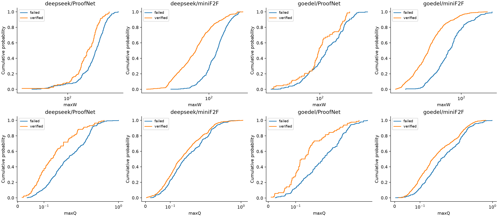

##### Сопоставление правильной и ошибочной попытки одной длины

Ниже AUC — вероятность, что значение признака в ошибочной попытке больше, чем в правильной попытке другой задачи точно той же длины; равенство даёт 0,5. Это условная парная concordance, а не AUROC произвольной смеси длин. Для позиции направление заранее фиксировано: большее t/L считается большим score; значение около 0,5 не исключает нелинейных различий формы распределений.

| Модель / набор | Задачи: ошибка / правильно | Охват веса ошибочных, % | AUC max W [95%] | AUC max Q [95%] | AUC позиции W [95%] | AUC позиции Q [95%] |
|---|---|---|---|---|---|---|
| deepseek/ProofNet | 124 / 37 | 59.30 | 0.490 [0.362; 0.629] | 0.573 [0.477; 0.676] | 0.531 [0.446; 0.614] | 0.451 [0.372; 0.533] |
| deepseek/miniF2F | 117 / 126 | 84.67 | 0.749 [0.684; 0.812] | 0.500 [0.434; 0.564] | 0.480 [0.411; 0.552] | 0.467 [0.384; 0.543] |
| goedel/ProofNet | 89 / 30 | 57.79 | 0.424 [0.303; 0.552] | 0.552 [0.420; 0.682] | 0.406 [0.308; 0.509] | 0.429 [0.311; 0.546] |
| goedel/miniF2F | 117 / 137 | 87.26 | 0.713 [0.629; 0.790] | 0.575 [0.509; 0.640] | 0.462 [0.400; 0.527] | 0.506 [0.447; 0.568] |


На miniF2F величина максимального скачка сохраняет различительную способность при одинаковой длине. На ProofNet обычные интервалы AUC max W включают 0,5. Положение максимума само по себе значительно слабее; интервалы приведённых позиционных AUC включают 0,5.

Дополнительная нормировка max W / median W не универсальна: она может менять картину в зависимости от набора. Её условные AUC приведены ниже, чтобы не выбирать нормировку после просмотра удачного результата.

| Модель / набор | AUC max W / median W при одной длине [95%] |
|---|---|
| deepseek/ProofNet | 0.621 [0.507; 0.723] |
| deepseek/miniF2F | 0.485 [0.400; 0.569] |
| goedel/ProofNet | 0.544 [0.420; 0.675] |
| goedel/miniF2F | 0.564 [0.485; 0.639] |


Для этого рисунка обе категории приводятся к одной смеси точных длин: масса длины пропорциональна минимуму исходных масс двух классов; нужны хотя бы две задачи каждого класса на длину. Это отдельная описательная популяция, а не парная оценка из предыдущей таблицы.

| Модель / набор | Охват общего веса, % | TV позиций W после стандартизации | TV позиций Q после стандартизации |
|---|---|---|---|
| deepseek/ProofNet | 54.00 | 0.218 | 0.203 |
| deepseek/miniF2F | 89.16 | 0.178 | 0.129 |
| goedel/ProofNet | 51.71 | 0.174 | 0.210 |
| goedel/miniF2F | 89.19 | 0.111 | 0.141 |


##### Правильная и ошибочная попытка одной и той же задачи

| Модель / набор | Задачи | Пары одной длины | AUC max W [95%] | AUC max Q [95%] |
|---|---|---|---|---|
| deepseek/ProofNet | 7 | 13 | 0.412 — | 0.548 — |
| deepseek/miniF2F | 19 | 46 | 0.417 — | 0.616 — |
| goedel/ProofNet | 8 | 20 | 0.465 — | 0.224 — |
| goedel/miniF2F | 17 | 44 | 0.346 — | 0.305 — |


Во всех четырёх сравнениях поддержки меньше 20 задач, поэтому интервалы не рассчитываются. Некоторые точечные значения меняют направление. Это существенное ограничение: положительная связь max W с ошибкой между задачами ещё не устанавливает аналогичную связь между попытками одной задачи. Нужны дополнительные правильные и ошибочные попытки одних и тех же задач с сопоставимыми длинами.

#### Другая объясняющая модель: неоднородные фазы доказательства и отбор по первому отказу

Ниже предложена альтернативная модель, а не установленный механизм работы этих моделей. Она объясняет, как неравномерные распределения и часть совпадений могут возникать без универсального порога нормы и без степенного хвоста.

##### 1. Убывающая гистограмма ошибок может возникать при постоянном риске

Если на каждом ещё достигнутом шаге вероятность первого отказа равна $h_t$, то


$$
P(T=t)=h_t\prod_{s<t}(1-h_s).
$$


При постоянном $h_t=p$ получаем геометрическое распределение $p(1-p)^{t-1}$. Его масса убывает, хотя условный риск следующего шага не падает. До поздних позиций просто доживает меньше попыток. При переменных $h_t$ модой может быть и третий, и другой шаг. Завершение правильного доказательства и конечная длина дополнительно меняют наблюдаемую популяцию.

Формула геометрического распределения: [официальная документация SciPy](https://docs.scipy.org/doc/scipy/reference/generated/scipy.stats.geom.html). Это математическая модель, а не вывод о точном законе наших данных.

##### 2. Разные типы шагов создают разные распределения скачков

Введём фазу $C_t$: подготовка, выбор ветви/леммы, применение тактик, завершение. Простая модель положительных отклонений:


$$
W_t=a_{C_t}+b_{C_t}|\varepsilon_t|,\qquad
\varepsilon_t\sim N(0,1).
$$


При конечном числе фаз и ограниченных параметрах это светлохвостая модель. Одни фазы могут иметь больший масштаб $b_{C_t}$ и чаще давать глобальные максимумы. Для независимых непрерывных отклонений с различными CDF $F_t$:


$$
P(M_W=t)=\int f_t(z)\prod_{s\ne t}F_s(z)\,dz.
$$


Равномерность позиции максимума гарантирована при перестановочной симметрии шагов; она не следует просто из отсутствия связи с ошибкой. Формула интеграла служит иллюстрацией при независимости; реальные шаги могут быть зависимы.

Фаза и сложность задачи могут одновременно влиять на величину скачка, surprisal и риск отказа. Тогда возникает общая причина: структурно сложный шаг меняет представление сильнее, менее предсказуем в тексте и чаще отклоняется. При этом сама большая норма не обязана вызывать ошибку. Общий whitening удаляет часть анизотропии, но не гарантирует одинаковые распределения всех типов тактик и фаз.

Работа [Massive Activations in Large Language Models](https://arxiv.org/abs/2402.17762) описывает крупные активации, связанные также с архитектурными bias-функциями. Она не доказывает объяснение наших whitened-приращений; это лишь основание не отождествлять крупную активацию с логическим отказом без дополнительных проверок.

##### 3. Иллюстрация: совпадения выше uniform при независимых процессах

В отдельной CPU-симуляции T генерируется независимо от всех W по усечённому геометрическому распределению. В первом варианте масштабы W одинаковы; во втором масштаб half-normal отклонений убывает по шагам. Параметры выбраны для иллюстрации, к экспериментальным данным они не подгонялись.

| Сценарий | Траектории | Длина | Совпадение M=T, % | Произведение маргинальных распределений, % | Uniform, % | Среднее M−T | M≤T, % |
|---|---|---|---|---|---|---|---|
| stationary | 100000 | 20 | 5.03 | 4.99 | 5.00 | 4.67 | 29.17 |
| early_scale | 100000 | 20 | 12.66 | 12.57 | 5.00 | -3.34 | 79.93 |


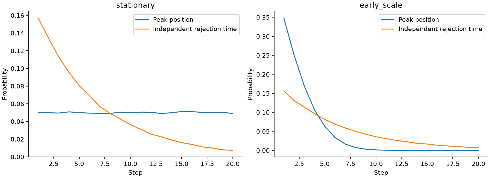

Во втором сценарии одновременно возникают превышение uniform-контроля и отрицательное среднее смещение, хотя максимум и отказ независимы. Маргинальный baseline воспроизводит частоту совпадений. Это контрпример выводу «ранний максимум обязательно обозначает неверный выбор», но не доказательство, что реальные данные устроены именно так.

##### 4. Почему surprisal может локально расти на отказе, но слабо различать исход целиком

Неожиданная лемма, сложные аргументы или нетипичная конструкция могут увеличить Q конкретной тактики. На таком шаге выше шанс неверного применения. Остальная часть ошибочного текста может оставаться очень шаблонной и вероятной. Поэтому локальное повышение Q на отказе совместимо с невысоким средним Q всего ошибочного доказательства и со слабым разделением исходов по max Q.

Это объяснение согласуется с наблюдаемой локальной формой, но конкурирует с различиями типов тактик, длины и сложности. Token surprisal измеряет вероятность выбранного текста; он не различает автоматически разные способы выразить один смысл. [Kuhn, Gal и Farquhar](https://arxiv.org/abs/2302.09664) специально разделяют лексическую и семантическую неопределённость. Их результат не переносится автоматически на Lean и не является проверкой нашей фазовой модели.

##### 5. Модель раннего неверного выбора с задержкой — отдельная гипотеза

Можно ввести скрытый момент неверного выбора $S$ и задержку обнаружения $D\ge0$:


$$
T=S+D,\qquad M_W=S+J,\qquad M_W-T=J-D.
$$


Опережение получится лишь если смещение пика $J$ в среднем меньше задержки $D$. Это не вывод из одного тяжёлого хвоста и не гарантируется моделью фаз. Исходная точная гипотеза $T=\min\{t:W_t>\tau\}$, напротив, даёт $M_W\ge T$; пик строго раньше отказа несовместим с ней для выбранной статистики.

Наблюдаемые знаки среднего смещения различаются между наборами. Поэтому задержку нельзя использовать как универсальное объяснение всех результатов. Для проверки нужны независимые метки выбора пути — например, контролируемый выбор свидетеля/ветви в Lean — и сравнение максимума с этим моментом и с последующим отказом отдельно.

#### Что проверить следующим

1. Собрать больше повторных правильных и ошибочных попыток одних задач. Это устранит главную слабость сравнения исходов: сегодня эффект между задачами нельзя уверенно перенести внутрь задачи.

2. На обучающих задачах оценить распределения W и Q с учётом номера шага, длины тактики и её типа; на новых задачах сравнить исходный максимум с максимумом условно нормированного отклонения. Если эффект преимущественно фазовый, часть совпадений должна исчезнуть после такой нормировки. Все параметры нормирования выбирать без тестовых ошибок.

3. Проверять предсказание первого отказа в следующие 1/3/5 шагов только по доступному принятому префиксу. Сравнить модель позиционного риска с той же моделью плюс прошлые скачки и surprisal при одинаковой частоте ложных тревог. Будущая длина и глобальный максимум готового текста здесь недоступны.

4. В контролируемых задачах отдельно разметить момент неверного выбора и момент его обнаружения Lean. Это позволит отличить раннюю смену стратегии от обычного позиционного смещения и от повышения сложности на самом отказе.

Эти пункты — дальнейшие проверки предложенной интерпретации, не результаты уже выполненного анализа и не поставленные этим отчётом новые обучения.

#### Воспроизводимость

Основной расчёт: Slurm job 8533481; CPU, GPU-hours=0. Построение отчёта и согласование весов гистограмм локализации: Slurm job 8533490. Базовый git commit: bf0bdbe21c00fb9bd677da5a0318eac83f1c8f98. Рабочее дерево сервера содержало изменения; вместо утверждения о чистом checkout зафиксированы SHA-256 исходных скриптов и всех входов/выходов.

Проверки: исходные manifests и хеши; допустимые индексы и длины массивов; конечность scores; отсутствие самосопоставления; контроль с постоянным максимумом даёт нулевую дополнительную связь; идеально совпадающий максимум даёт правильный эталон; нормировка гистограмм; согласование разности средних позиций с независимо рассчитанным средним парным lag; раздельные задачи в OOF; нормировка предсказанных PMF.

Публичная версия содержит текст отчёта и его графики. Полные метрики, код анализа и manifests сохранены на сервере и локально; исходные траектории остаются на сервере; идентификаторы задач и внутренние пути в публикацию не включаются. Все научные таблицы этого отчёта сформированы программно из метрик.

## Приложение 11 Поправка на длину и предсказание по распределению

Источник: [Поправка на длину и предсказание по распределению](chapters/11_length.md). Сервер: /beegfs/home/denis.rakhmankin/onebigjump/runs/length_prediction_report_20261112_v1/publication/LENGTH_AND_PREDICTION_RU.md.

Дополнение от 12 ноября 2026 к [отчёту о распределениях максимумов и ошибок](https://github.com/Kilkaintomat/Scoltech-big_jump/blob/818fe065afaa6bc9127d804aa6e2467e5f897cc8/reports/peak_error_distributions_20261111/REPORT_RU.md). DeepSeek-Prover-V2-7B и Goedel-Prover-V2-8B; ProofNet, miniF2F и Putnam.

Поправка на длину меняет форму общих распределений. Внутри одной точной длины ошибки могут концентрироваться в начале, середине или ближе к концу попытки. Сходство общих гистограмм само по себе не устанавливает информативность скачка. Проверять нужно связь внутри конкретной попытки и прибавку к предсказателю, который уже учитывает позицию, длину и другие доступные признаки.

Ниже приведены результаты анализа длины и существующих позиционных контролей. Разделы о расширенном сравнении предсказателей и фазовой модели задают следующую проверку; эти модели не выдаются за уже обученные и проверенные объяснения.

#### Данные и единицы измерения

$T$ — номер первого воспроизводимо отклонённого шага Lean; $M_W$ — позиция максимума whitened-нормы приращения скрытого состояния; $M_Q$ — позиция максимального среднего токенного surprisal. Позиции начинаются с 1.

$L$ — число сохранённых шагов разметки формального текста. Это границы выбранных AST-наблюдений: один шаг может содержать составную тактику, а число шагов не равно числу токенов. Полная попытка может включать сгенерированный суффикс после первого отказа; этот суффикс не считается успешно исполненным в Lean.

Распределения места ошибки ниже относятся только к попыткам с надёжно локализованным отказом. Для оценки наличия ошибки нужны также проверенные правильные попытки. На Putnam в этой feature-cohort правильных попыток нет.

| Модель / набор | Ошибочные попытки | Разные задачи | Точные длины |
|---|---|---|---|
| deepseek/ProofNet | 452 | 166 | 62 |
| deepseek/miniF2F | 528 | 122 | 74 |
| deepseek/Putnam | 118 | 58 | 47 |
| goedel/ProofNet | 259 | 133 | 65 |
| goedel/miniF2F | 448 | 122 | 87 |
| goedel/Putnam | 48 | 35 | 27 |

Всего 362 сочетания модели, датасета и точной длины; новые генерации и GPU не использовались.

Основные веса задаются до отбора по длине: каждой исходной задаче даётся суммарный вес 1 среди её ошибочных попыток. При фиксации $L$ эти веса сохраняются. Отдельно показана чувствительность к равным весам задач непосредственно внутри каждой длины. Интервалы объединённых оценок — 10 000 bootstrap-выборок целых задач; отдельные гистограммы точных длин описательные.

#### Как длины создают раннюю общую гистограмму

Если позиция равномерна при каждой длине, то

$$
P(M=t\mid L=\ell)=\frac{1}{\ell},
\qquad
P(M=t)=\sum_{\ell\ge t}\frac{P(L=\ell)}{\ell}.
$$

Отсюда

$$
P(M=t)-P(M=t+1)=\frac{P(L=t)}{t}\ge0.
$$

Убывающая общая гистограмма возникает даже без предпочтения ранних позиций внутри одной длины. Экспоненциальный закон длин для этого не нужен. Для первой ошибки работает та же формула смеси, но её условное распределение $P(T=t\mid L)$ не обязано быть равномерным.

| Модель / набор | Средняя длина | Медиана | 90% квантиль |
|---|---|---|---|
| deepseek/ProofNet | 18,98 | 14 | 42 |
| deepseek/miniF2F | 21,15 | 15 | 44 |
| deepseek/Putnam | 23,36 | 20 | 52 |
| goedel/ProofNet | 25,13 | 14 | 68 |
| goedel/miniF2F | 27,19 | 18 | 57 |
| goedel/Putnam | 21,60 | 15 | 44 |


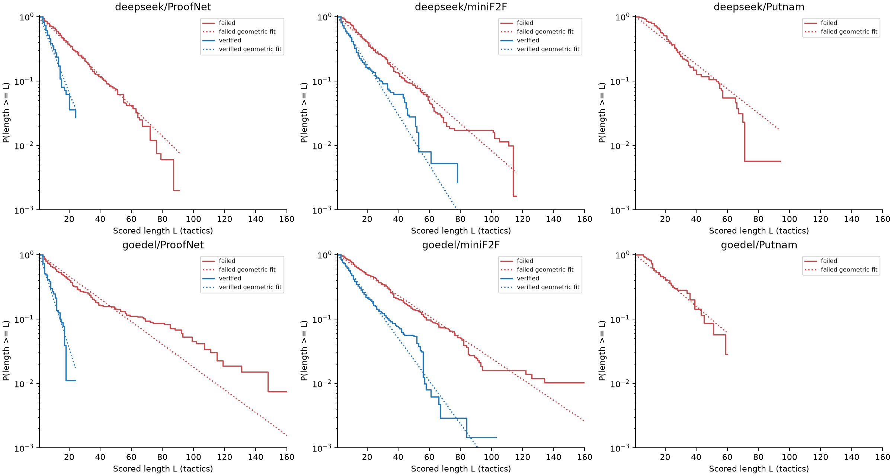

Геометрическая аппроксимация использует поддержку $L=1,2,\ldots$ и параметр $p=1/\overline L$. Это описательное сравнение: в исследуемых ошибочных попытках минимальная длина не меньше двух шагов, а на части наборов заметны дополнительные отклонения формы и хвоста. Подгонка не устанавливает единый экспоненциальный закон. Последующие контроли сохраняют фактические длины и не требуют такой гипотезы.

#### Три способа учесть длину

##### Относительное положение шага

Для среднего относительного положения удобно использовать середину интервала шага:

$$
U=\frac{T-\tfrac12}{L}.
$$

При равномерном выборе шага среднее $U$ равно $1/2$ при любой длине. Простое $T/L$ имеет нейтральное среднее $(L+1)/(2L)$, поэтому особенно на коротких попытках оно само создаёт сдвиг.

Для сопоставления дискретных сеток вероятность шага $t$ равномерно распределена по отрезку $[(t-1)/L,t/L]$. Масса пересечения с каждым интервалом гистограммы вычисляется точно; случайные числа не добавляются. Равномерное распределение шагов при любой смеси длин тогда даёт плотность 1 на отрезке от 0 до 1.

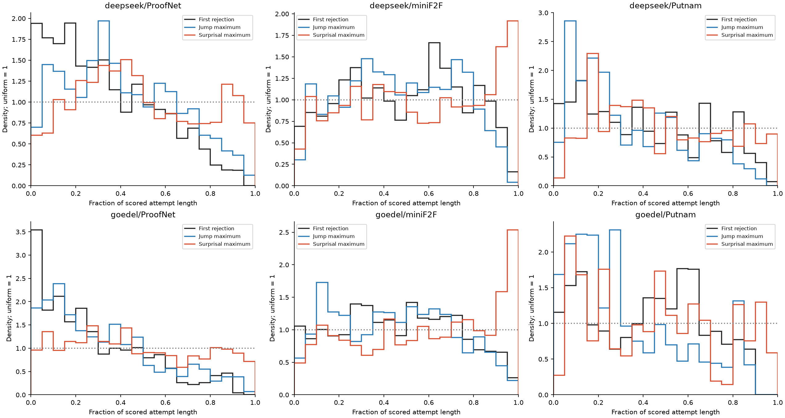

Приведение к долям длины уравнивает шкалу координат, но сохраняет исходную смесь длин. Если форма условного распределения зависит от $L$, требуется также стандартизация весов.

##### Одинаковая смесь длин

Для сравнения двух моделей выбирается общее распределение длин $q_\ell$:

$$
p_{\mathrm{std}}(t)=
\sum_\ell q_\ell\,\widehat P(T=t\mid L=\ell).
$$

Эквивалентно, исходный вес попытки длины $L_i$ умножается на $q_{L_i}/\widehat P(L=L_i)$. Меняется доля каждой длины, а условное распределение внутри неё сохраняется.

Для каждого датасета взяты общие точные длины с минимум пятью задачами у каждой модели. Вес длины пропорционален меньшей из двух исходных масс этой длины. Такой выбор ограничивает влияние редких длин. Это описательное сопоставление на области перекрытия, а не оценка по всей исходной выборке.

| Набор | Модель | Общих точных длин | Охват исходного веса, % | Средняя относительная позиция ошибки, % |
|---|---|---|---|---|
| ProofNet | deepseek | 16 | 59,66 | 35,38 |
| ProofNet | goedel | 16 | 58,72 | 31,86 |
| miniF2F | deepseek | 23 | 70,05 | 50,71 |
| miniF2F | goedel | 23 | 60,02 | 48,15 |
| Putnam | обе модели | нет общей поддержки | — | — |


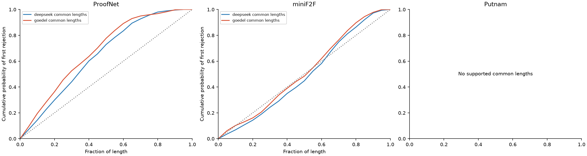

##### Отношение к контролю с теми же длинами

Для исходной общей гистограммы можно показать индекс

$$
R_T(t)=
\frac{\widehat P(T=t)}
{\sum_{\ell\ge t}\widehat P(L=\ell)/\ell}.
$$

$R_T(t)=1$ соответствует равномерному выбору позиции внутри каждой наблюдаемой длины; значения выше и ниже 1 показывают избыток и дефицит. Это индекс относительно выбранного ориентира, а не вероятностное распределение и не оценка риска следующей ошибки. Он не устраняет различия типов задач или этапов доказательства.

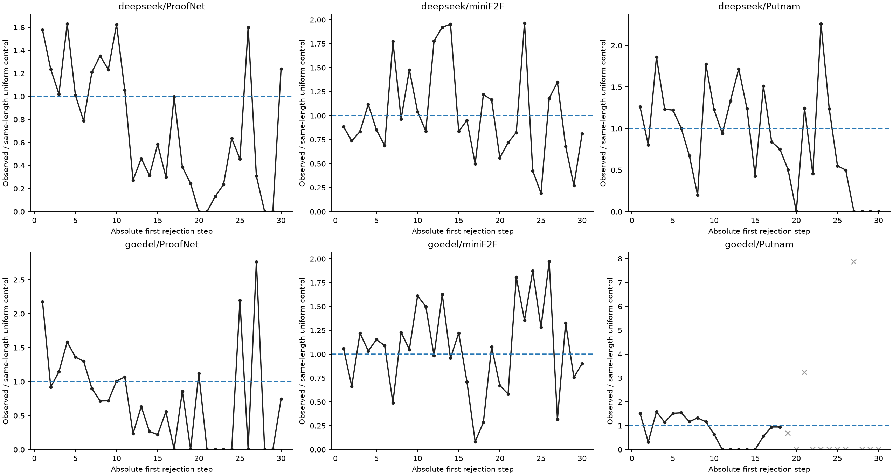

Серые крестики обозначают позиции, до которых по длине доходят менее двадцати разных задач. Даже при большем числе задач редкие события дают нестабильные точечные отношения. Равномерный ориентир требует проверки на границах: в данной выборке нет первой ошибки на последнем шаге.

#### Что сохраняется после контроля длины

Для максимума скачка проверена доля попаданий в первые два шага. Контроль сохраняет фактические длины и равномерно выбирает позицию; его ожидание равно среднему $\min(2,L)/L$.

| Модель / набор | Максимум в первых двух шагах, % | Контроль длины, % | Разница, п.п. [95%] |
|---|---|---|---|
| deepseek/ProofNet | 34,58 | 25,11 | 9,47 [5,04; 13,96] |
| deepseek/miniF2F | 18,99 | 19,04 | -0,06 [-4,45; 4,72] |
| deepseek/Putnam | 29,60 | 15,01 | 14,58 [5,21; 24,72] |
| goedel/ProofNet | 42,61 | 26,30 | 16,30 [10,37; 22,30] |
| goedel/miniF2F | 15,27 | 16,88 | -1,61 [-5,13; 2,11] |
| goedel/Putnam | 37,14 | 15,04 | 22,10 [7,95; 36,86] |


На miniF2F избытка именно первых двух позиций относительно этого контроля не видно. На ProofNet и Putnam он сохраняется. Это не утверждение о равномерности всего распределения максимумов и не проверка совпадения максимума с ошибкой конкретной попытки.

#### Распределения первой ошибки при каждой точной длине

Все наблюдаемые точные длины представлены в приложениях. Для DeepSeek на miniF2F несколько контрастных примеров выглядят так:

| Точная длина | Попыток / задач | Мода ошибки | Масса на моде, % | Во второй половине, % | Мода при равных весах задач внутри длины |
|---|---|---|---|---|---|
| 4 | 24 / 11 | 1 | 54,57 | 42,05 | 3 |
| 5 | 31 / 15 | 4 | 52,06 | 57,18 | 4 |
| 10 | 23 / 19 | 7 | 47,95 | 87,20 | 7 |
| 11 | 22 / 14 | 1 | 22,82 | 48,97 | 1 |
| 12 | 24 / 18 | 9 | 38,18 | 87,55 | 9 |
| 15 | 24 / 16 | 14 | 30,03 | 84,39 | 14 |


«Вторая половина» означает $t>L/2$. Основные проценты используют фиксированные веса исходной выборки. Мода при альтернативном взвешивании показывает чувствительность пика к повторным попыткам одной задачи. При длине 4 самая частая позиция меняется с первого шага на третий. Пики при длинах 5, 10, 11, 12 и 15 сохраняются при обоих вариантах весов.

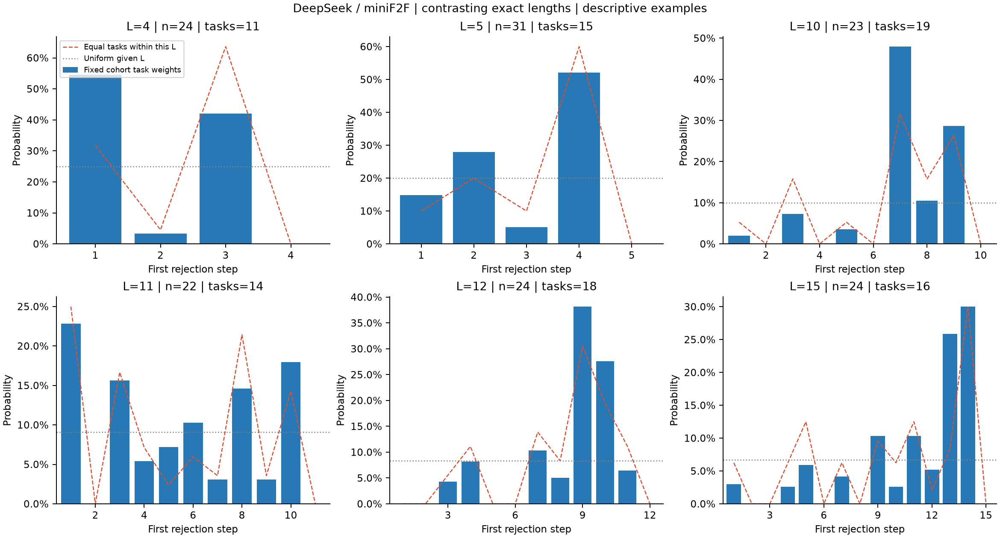

Эти гистограммы не имеют единого убывающего профиля: при некоторых длинах основная масса находится во второй половине, при других распределение шире или имеет ранний пик. Небольшие группы и выбор примеров после просмотра данных не позволяют объявить отдельные пики устойчивым законом.

| Модель / набор | Точных длин | Гистограммы |
|---|---|---|
| deepseek/ProofNet | 62 | [PDF всех точных длин](https://github.com/Kilkaintomat/Scoltech-big_jump/blob/818fe065afaa6bc9127d804aa6e2467e5f897cc8/reports/peak_error_distributions_20261111/length_distributions/deepseek_ProofNet.pdf) |
| deepseek/miniF2F | 74 | [PDF всех точных длин](https://github.com/Kilkaintomat/Scoltech-big_jump/blob/818fe065afaa6bc9127d804aa6e2467e5f897cc8/reports/peak_error_distributions_20261111/length_distributions/deepseek_miniF2F.pdf) |
| deepseek/Putnam | 47 | [PDF всех точных длин](https://github.com/Kilkaintomat/Scoltech-big_jump/blob/818fe065afaa6bc9127d804aa6e2467e5f897cc8/reports/peak_error_distributions_20261111/length_distributions/deepseek_Putnam.pdf) |
| goedel/ProofNet | 65 | [PDF всех точных длин](https://github.com/Kilkaintomat/Scoltech-big_jump/blob/818fe065afaa6bc9127d804aa6e2467e5f897cc8/reports/peak_error_distributions_20261111/length_distributions/goedel_ProofNet.pdf) |
| goedel/miniF2F | 87 | [PDF всех точных длин](https://github.com/Kilkaintomat/Scoltech-big_jump/blob/818fe065afaa6bc9127d804aa6e2467e5f897cc8/reports/peak_error_distributions_20261111/length_distributions/goedel_miniF2F.pdf) |
| goedel/Putnam | 27 | [PDF всех точных длин](https://github.com/Kilkaintomat/Scoltech-big_jump/blob/818fe065afaa6bc9127d804aa6e2467e5f897cc8/reports/peak_error_distributions_20261111/length_distributions/goedel_Putnam.pdf) |


##### Последний шаг и чувствительность нормировки

Среди 1853 ошибочных попыток в шести сочетаниях модели и датасета число первых отказов на последнем сохранённом шаге равно 0.

В просмотренных исходных текстах ProofNet заключительный шаг часто содержит команду вроде **exact h_main**, а ошибка возникает при построении самого **h_main**. Это настоящий фрагмент исходного ответа, а не добавленная нами фиктивная позиция. Из проверки этих примеров не следует, что ошибки на последнем шаге невозможны для всех доказательств. Выборка включает только определённые категории надёжно локализованных отказов.

Для чувствительности показаны обе координаты: $(T-1/2)/L$ и $(T-1/2)/(L-1)$. Вторая использует наблюдаемую поддержку ошибок, но не устанавливается как универсально правильный знаменатель. Последний шаг не удалялся из исходных данных.

| Модель / набор | Средняя позиция с L, % [95%] | Средняя позиция с L−1, % [95%] |
|---|---|---|
| deepseek/ProofNet | 33,20 [30,41; 36,02] | 38,96 [35,80; 42,15] |
| deepseek/miniF2F | 49,00 [45,09; 52,84] | 54,52 [50,20; 58,81] |
| deepseek/Putnam | 40,86 [35,16; 46,65] | 44,67 [38,45; 51,04] |
| goedel/ProofNet | 28,42 [24,96; 31,99] | 33,97 [30,02; 38,01] |
| goedel/miniF2F | 46,38 [42,67; 50,24] | 51,17 [47,03; 55,42] |
| goedel/Putnam | 42,31 [34,61; 50,26] | 45,70 [37,38; 54,22] |


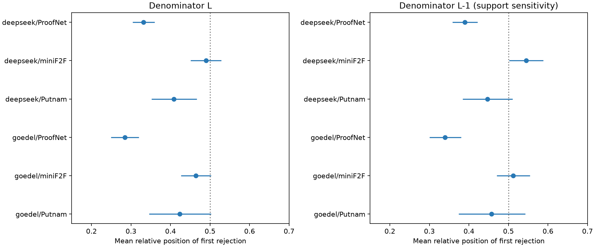

Раннее среднее положение ошибки на ProofNet сохраняется при обоих вариантах. На miniF2F средние располагаются около середины диапазона; знак небольшого сдвига зависит от нормировки. На Putnam интервалы при использовании $L-1$ включают середину. Общий тезис об универсальном раннем распределении ошибок слишком широк.

#### Как отделить информацию скачка от сходства распределений

##### Проверка связи внутри попытки

При условной независимости позиций максимума и ошибки ожидаемое совпадение равно

$$
P_0(M=T\mid L)=
\sum_{t=1}^{L}p_M(t\mid L)\,p_T(t\mid L).
$$

Оно может быть больше $1/L$, если обе позиции предпочитают одни и те же участки. Практический контроль уже реализован: истинное место ошибки сохраняется, а максимум берётся из другой задачи точно той же длины. Он сохраняет маргинальные позиционные предпочтения и разрушает индивидуальное соответствие.

| Модель / набор | Свой максимум, % | Чужой максимум той же длины, % | Разница, п.п. [95%] | Семейный интервал |
|---|---|---|---|---|
| deepseek/ProofNet | 24,36 | 18,90 | 5,46 [1,55; 9,84] | [-0,17; 12,09] |
| deepseek/miniF2F | 23,39 | 16,34 | 7,06 [0,77; 13,39] | [-2,31; 15,93] |
| deepseek/Putnam | 19,55 | 13,56 | 5,99 [-3,76; 16,73] | [-8,73; 21,82] |
| goedel/ProofNet | 43,88 | 36,12 | 7,75 [-1,72; 16,82] | [-7,06; 21,16] |
| goedel/miniF2F | 27,10 | 13,64 | 13,46 [6,79; 20,83] | [3,99; 24,60] |
| goedel/Putnam | 5,02 | 10,97 | -5,95 [-24,42; 14,07] | [-35,99; 26,03] |


Обычные интервалы и семейные интервалы для 12 сравнений приведены отдельно. Основной устойчивый избыток точных совпадений скачка остаётся у Goedel на miniF2F. Это отвечает на вопрос о связи сверх общей формы распределений и длины в исследуемой популяции пар.

Для Goedel на miniF2F перенос между разными попытками одной задачи той же длины даёт разницу 4,84 [0,94; 10,46] п.п. при обычном 95% интервале. В этом сравнении 38 разных задач и охват 18,99% исходного веса ошибочных попыток. Это более узкая поисковая проверка, а не подтверждающий результат по новой выборке.

Перенос между разными задачами одной длины не контролирует все различия сложности, типа тактики и surprisal. Небольшой охват более строгого сравнения внутри задачи также ограничивает перенос результата на всю выборку.

##### Проверка практического предсказания

В предыдущем отчёте уже есть baseline, обученный только по распределению мест ошибок на других задачах, и сравнение с выбором максимума скачка:

| Модель / набор | OOF позиционный baseline, % | Максимум скачка, % | Разница, п.п. [95%] |
|---|---|---|---|
| deepseek/ProofNet | 22,12 | 18,50 | -3,62 [-10,87; 3,53] |
| deepseek/miniF2F | 9,27 | 18,09 | 8,82 [2,95; 14,71] |
| deepseek/Putnam | 10,49 | 19,83 | 9,34 [0,29; 18,39] |
| goedel/ProofNet | 25,31 | 26,57 | 1,25 [-6,27; 8,90] |
| goedel/miniF2F | 7,36 | 21,46 | 14,10 [8,14; 20,18] |
| goedel/Putnam | 4,29 | 6,67 | 2,38 [-7,14; 11,90] |

OOF означает предсказание на задачах, не использованных для обучения соответствующего baseline. Это полная выборка ошибочных попыток с равным весом задач; её проценты нельзя напрямую сопоставлять с процентами отдельной популяции пар из предыдущей таблицы.

Это сравнение двух отдельных способов выбрать позицию. Оно не заменяет сравнения одного и того же достаточно гибкого предсказателя до и после добавления скачка.

Пусть $Y$ — выбранная цель, $B$ — базовые признаки, а $W$ — признаки скачков. Отсутствие добавочной информации означает

$$
P(Y\mid B,W)=P(Y\mid B).
$$

Следующая проверка должна сравнивать вложенные модели на одних разбиениях:

| Вариант | Признаки |
|---|---|
| Позиционный baseline | Номер шага и доступные характеристики длины |
| Расширенный baseline | Позиционные признаки, число токенов, surprisal и разрешённые структурные признаки |
| Baseline плюс величина скачка | Те же признаки и норма текущего или предыдущих приращений |
| Baseline плюс история скачков | Дополнительно текущий рекорд, число превышений порога и хвостовые характеристики префикса |
| Baseline плюс направление | Нормированный вектор приращения, проверяемый отдельно от нормы |

Норму, позицию максимума и направление вектора следует различать: выигрыш полного скрытого вектора не устанавливает полезность большого скачка как скалярной величины.

Разбиение выполняется по исходным задачам и их эквивалентным группам, а не по попыткам или шагам. Подбор гиперпараметров, нормировка, сглаживание, калибровка и пороги тревоги выполняются только на обучающей и внутренней валидационной частях. Сравниваются предсказания на отложенных задачах. Случайный эффект новой задачи нельзя оценивать по её тестовым ответам.

Основные показатели: разница NLL на уровне попыток с равным весом задач, Brier score, калибровка и чувствительность при одинаковом уровне ложных тревог. Для локализации добавляются точное попадание и заранее выбранное окно вокруг отказа. Интервал разницы строится по целым задачам; улучшение NLL отдельно разбирается на вклад правильных префиксов, ошибочного шага и редких уверенных ошибок предсказателя.

Для проверки индивидуального сигнала нужен отрицательный контроль. Для позиционного baseline можно переносить целые последовательности скачков между задачами одинаковой длины. Для расширенного baseline такой перенос может разрушить связь скачка с surprisal и типом шага. Тогда нужен перенос, сохраняющий эти условные зависимости, либо модель распределения скачков при фиксированных базовых признаках, обученная без тестовых ответов.

Принцип условной рандомизации описан в [Liu, Katsevich, Janson и Ramdas](https://lucasjanson.fas.harvard.edu/papers/Fast_And_Powerful_Conditional_Randomization_Testing_Via_Distillation-Liu_Janson-2020.pdf). Точные гарантии требуют корректного условного распределения и подходящей независимости единиц наблюдения. Приближённое сопоставление наших траекторий нельзя автоматически объявлять точным рандомизационным тестом.

##### Обнаружение ошибки и прогноз до её появления

| Цель | Допустимые признаки | Что измеряется |
|---|---|---|
| Место ошибки в готовой ошибочной попытке | Полная длина, полный текст, глобальный максимум | Ретроспективная локализация |
| Наличие ошибки в готовой попытке | Полный текст и его признаки; нужны оба класса исходов | Различение правильных и ошибочных попыток |
| Риск ошибки на следующем шаге | Только префикс до текущего шага | Прогноз до появления ошибки |

Для следующего шага целевая вероятность имеет вид

$$
P(T=t+1\mid T>t,\mathcal H_t),
$$

где $\mathcal H_t$ содержит только информацию, доступную к концу шага $t$. Признаки $W_{t+1}$, $Q_{t+1}$, будущий текст, окончательная длина и глобальный максимум ещё неизвестны. Прогноз должен учитывать возможность завершения доказательства без следующего шага либо явно оцениваться условно на продолжении.

Признак $W_t$ для определения ошибки в уже сгенерированном шаге $t$ относится к обнаружению. Полный AST доказательства также недоступен в стриминге; разрешены только признаки, вычислимые из текущего префикса.

Риск первой ошибки изучается среди ещё корректных префиксов. Сгенерированные шаги после первого отказа не являются дополнительными проверенными ошибочными тактиками. Для события «ошибка уже произошла» возможна отдельная постановка с поглощающей меткой, но она отвечает на другой вопрос.

#### Модель распределения ошибок

##### Базовая модель условного риска

Пусть $h_t$ — вероятность первой ошибки на шаге $t$ при отсутствии предыдущей ошибки. Для заданной последовательности условий получаем

$$
P(T=t)=h_t\prod_{j<t}(1-h_j).
$$

Если $h_t=p$ постоянно, возникает геометрический закон

$$
P(T=t)=p(1-p)^{t-1}.
$$

Убывающая частота первой ошибки не означает убывающего риска: до позднего шага доживает меньше безошибочных префиксов. Постоянный риск — полезный простой baseline. Связь вероятности события с выживанием и цензурированием изложена в [Stan User Guide](https://mc-stan.org/docs/stan-users-guide/survival.html).

Для уже известной ошибочной попытки фиксированной длины распределение дополнительно условно на $T\le L$. При постоянном риске это усечённая геометрическая модель. В предыдущем отчёте она сравнивалась по NLL с простым сглаженным позиционным baseline: её выигрыш на части наборов может отражать меньшую дисперсию простой модели, а не точность геометрического закона.

Смесь моделей с постоянными индивидуальными рисками также даёт невозрастающую массу по $t$, если каждая компонента имеет геометрическую форму. При фиксированной длине это верно и для смеси усечённых геометрических распределений с неотрицательными весами. Устойчивые внутренние или поздние пики потребовали бы иной структуры риска или отбора. Небольшие эмпирические пики такого вывода о популяции не устанавливают. Если окончательная длина зависит от скрытой траектории и ошибки, простое независимое усечение уже не описывает условный отбор.

##### Изменяющийся риск и этапы доказательства

Практическое расширение — дискретная модель риска с изменением по шагам. Для ретроспективного анализа:

$$
h_{i,t}=
\sigma\!\left(
a+f(t)+g(t/L_i)+b_i+\beta^\top C_{i,t}
\right),
\qquad
\sigma(x)=\frac{1}{1+e^{-x}}.
$$

$C_{i,t}$ описывает тип и размер шага и другие базовые признаки; $b_i$ отражает различия задач. Для стриминга член с окончательной длиной исключается, а все признаки ограничиваются наблюдаемым префиксом. Дискретная логистическая модель события с зависящим от времени базовым риском — стандартный подход, описанный у [Allison](https://statisticalhorizons.com/wp-content/uploads/Allison.SM82.pdf).

Более содержательная рабочая гипотеза — последовательность этапов: выбор конструкции, построение промежуточных фактов, трудный завершающий вывод и использование готового результата. Этапы могут иметь разную длительность и разный риск. Их соответствие реальным шагам требует проверки; названия этапов не считаются установленным описанием каждого доказательства.

Такая модель допускает ранний пик при выборе неверной конструкции, поздний пик при трудном завершении и малый риск в простом заключительном **exact**. Смешивание задач, длительностей этапов и длин даёт общую гистограмму, отличающуюся от условных гистограмм.

Для связи скачков с ошибками можно задать общий скрытый этап $S_t$ и трудность $D$:

$$
W_t=s(S_t,D)\,\varepsilon_t,
\qquad
P(T=t\mid T\ge t,S_t,D)=h(S_t,D).
$$

При условной независимости шума скачка и события ошибки после фиксации этапа и трудности обе величины всё равно могут быть связаны в наблюдаемых данных. Их общий источник — этап или трудность; прямого действия скачка на ошибку в этой модели нет. Это генеративная гипотеза для проверки.

Альтернативная модель добавляет собственную связь скачка:

$$
h_t^{(1)}=
\sigma\!\left(a_{S_t}+bD+\gamma\,r(W_t)\right).
$$

Её сравнивают с моделью без $r(W_t)$ по отложенным предсказаниям. Для прогноза будущего шага используются только прошлые скачки. Улучшение предсказания не превращает коэффициент $\gamma$ в причинный эффект вмешательства в скрытое состояние.

В генеративной версии завершение текста задаётся отдельно от первого отказа. Метка ошибки поглощается при $T$, но генерация может продолжаться до $L$ без обратной связи от Lean, как в наших данных. Для правильных завершённых попыток наблюдается отсутствие отказа до завершения; остановка и отбор могут зависеть от той же скрытой трудности. Их нельзя без проверки считать независимым цензурированием.

Теория тяжёлых хвостов ограничивает распределение величин приращений и экстремумов. Она сама по себе не задаёт момент первого логического отказа. Для перехода от больших скачков к месту ошибки необходима дополнительная связь между состоянием модели и верификацией.

#### Проверяемые различия между объяснениями

| Объяснение | Ожидание при проверке |
|---|---|
| Только смесь длин и позиционные предпочтения | Перенос максимумов между сопоставимыми попытками почти не меняет совпадения |
| Общие этапы или трудность | Связь может сохраняться после контроля длины, но ослабнуть после контроля типа шага, surprisal и характеристик задачи |
| Дополнительный индивидуальный сигнал нормы | Добавление скачка улучшает предсказание на новых задачах сверх расширенного baseline |
| Информация в направлении скрытого изменения | Вектор улучшает предсказание, а одна норма может не улучшать |
| Сигнал появляется только вместе с отказом | Обнаружение текущей ошибки улучшается, прогноз по предшествующему префиксу — нет |

Практический следующий шаг — сопоставить позиционный baseline, расширенный baseline и те же модели с нормой скачка на общих разбиениях задач. Отдельно проверяются готовая попытка и следующий шаг. Форму ошибок оценивают через риск и распределения при фиксированных длинах, а не только через сходство общих гистограмм.

## Приложение 12 Совместные гистограммы для каждой длины

Источник: [Совместные гистограммы для каждой длины](chapters/12_exact_length.md). Сервер: /beegfs/home/denis.rakhmankin/onebigjump/runs/exact_length_joint_positions_delivery_20261112_v1/REPORT_RU.md.

Новый файл дополняет прежние гистограммы ошибок. Все численные таблицы сформированы из сохранённых q/w и меток; новые LLM-вызовы и GPU не использовались.

#### Что на графиках

Слева для одной L наложены T, MW и MQ на одном cohort. Справа — среднее/медиана q(t), полоса 10–90% наблюдений (не CI). Surprisal — средний минус логарифм вероятности токенов текущей тактики, nat/token; не вероятность логической ошибки.

T=f+1, argmax берётся по полному набору 1..L, равенства максимумов разрешаются в пользу первого шага. Сгенерированные шаги после первого отказа не считаются исполненными. Только ошибочные попытки с надёжной локализацией.

#### Как проверяется попадание

Обычный hit = P(MW=T|L) с прежними task weights 1/n_failed_attempts, фиксированными до отбора L. Рядом показаны 1/L, тривиальный выбор шага 1, чувствительность равных task weights внутри L и описательная независимость sum_t pMW(t|L)*pT(t|L). Последняя оценивает сходство маргинальных гистограмм, а не индивидуальную связь.

Для основного контроля берутся ordered пары разных исходных задач одной точной длины с весом w_i*w_j. На ОДИНАКОВЫХ весах сравниваются I(MW_i=T_i) и I(MW_j=T_i). Поэтому парный own-hit может отличаться от обычного hit; это явно разные колонки. Нет пар одной задачи и не смешиваются длины.

10000 bootstrap целых исходных задач. В bootstrap заново взвешиваются обе стороны pair matrices. CI/p отсутствуют при <20 задач, а не заменены на ноль. Номинальные 95% CI условны на текущие данные; centered-bootstrap p скорректированы Holm по всем 362 длинам/model/dataset. Отдельное семейство W, отдельное дополнительное Q. Неподдержанные ячейки учитываются как p=1 при correction. Анализ exploratory; короткая длина сама увеличивает 1/L.

#### Состав и среднее попадание без отбора длины

| cell | попыток | задач | длин | W hit, % | Q hit, % |
| --- | --- | --- | --- | --- | --- |
| deepseek/ProofNet | 452 | 166 | 62 | 18.504 | 21.401 |
| deepseek/miniF2F | 528 | 122 | 74 | 18.090 | 18.890 |
| deepseek/Putnam | 118 | 58 | 47 | 19.828 | 17.529 |
| goedel/ProofNet | 259 | 133 | 65 | 26.566 | 21.266 |
| goedel/miniF2F | 448 | 122 | 87 | 21.461 | 13.150 |
| goedel/Putnam | 48 | 35 | 27 | 6.667 | 15.714 |

#### DeepSeek / miniF2F: ранее показанные длины

Эти длины выбраны в предыдущем отчёте, до нового анализа попадания. Высокое попадание само по себе не означает, что скачок добавил информацию сверх позиционных предпочтений.

| cell | L | n | задач | W hit, % | Q hit, % | парный W, % | чужой W, % | добавка, п.п. | 95% CI | p Holm |
| --- | --- | --- | --- | --- | --- | --- | --- | --- | --- | --- |
| deepseek/miniF2F | 4 | 24 | 11 | 27.848 | 61.885 | 29.753 | 17.989 | 11.764 | не оценён: мало задач | — |
| deepseek/miniF2F | 5 | 31 | 15 | 42.591 | 49.728 | 42.854 | 36.076 | 6.777 | не оценён: мало задач | — |
| deepseek/miniF2F | 10 | 23 | 19 | 14.310 | 19.833 | 15.439 | 12.551 | 2.889 | не оценён: мало задач | — |
| deepseek/miniF2F | 11 | 22 | 14 | 19.231 | 20.000 | 19.616 | 7.849 | 11.768 | не оценён: мало задач | — |
| deepseek/miniF2F | 12 | 24 | 18 | 18.885 | 25.174 | 19.469 | 19.674 | -0.205 | не оценён: мало задач | — |
| deepseek/miniF2F | 15 | 24 | 16 | 14.497 | 10.355 | 14.672 | 7.329 | 7.343 | не оценён: мало задач | — |

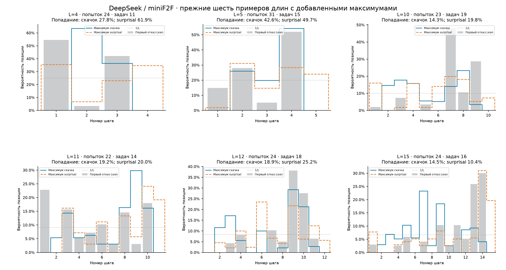

#### Самые большие описательные попадания

Ниже ранжированы только длины с не менее 10 задачами. Это просмотр результата после расчёта, а не заранее выбранная подтверждающая проверка. Все остальные длины сохранены в PDF/CSV.

| cell | L | n | задач | W hit, % | Q hit, % | парный W, % | чужой W, % | добавка, п.п. | 95% CI | p Holm |
| --- | --- | --- | --- | --- | --- | --- | --- | --- | --- | --- |
| deepseek/miniF2F | 3 | 28 | 11 | 96.084 | 44.755 | 95.723 | 80.009 | 15.714 | не оценён: мало задач | — |
| goedel/ProofNet | 2 | 22 | 13 | 94.915 | 37.288 | 94.724 | 94.724 | 0.000 | не оценён: мало задач | — |
| deepseek/ProofNet | 3 | 31 | 18 | 64.341 | 63.566 | 63.998 | 51.495 | 12.503 | не оценён: мало задач | — |
| deepseek/ProofNet | 4 | 16 | 12 | 62.319 | 58.696 | 62.008 | 43.740 | 18.267 | не оценён: мало задач | — |
| deepseek/miniF2F | 16 | 14 | 12 | 55.521 | 16.330 | 53.266 | 18.798 | 34.468 | не оценён: мало задач | — |
| goedel/ProofNet | 5 | 15 | 11 | 49.425 | 63.218 | 49.881 | 21.216 | 28.665 | не оценён: мало задач | — |
| goedel/ProofNet | 4 | 17 | 17 | 44.828 | 56.322 | 44.268 | 26.334 | 17.934 | не оценён: мало задач | — |
| goedel/ProofNet | 7 | 13 | 11 | 43.590 | 41.026 | 44.018 | 17.578 | 26.440 | не оценён: мало задач | — |
| goedel/miniF2F | 9 | 15 | 11 | 42.915 | 19.838 | 42.020 | 14.189 | 27.831 | не оценён: мало задач | — |
| deepseek/miniF2F | 5 | 31 | 15 | 42.591 | 49.728 | 42.854 | 36.076 | 6.777 | не оценён: мало задач | — |
| goedel/miniF2F | 11 | 20 | 14 | 41.514 | 11.351 | 41.273 | 9.348 | 31.926 | не оценён: мало задач | — |
| goedel/ProofNet | 3 | 20 | 14 | 41.463 | 43.089 | 41.797 | 50.058 | -8.261 | не оценён: мало задач | — |

#### Неопределённость по длинам

Ячеек с >=20 задачами: 1 из 362. С p Holm <0.05 для W-контраста: 0. Это не тест равенства эффектов между длинами: различие двух точечных оценок либо наличие CI только в одной группе не доказывает взаимодействие с длиной.

| cell | L | n | задач | W hit, % | Q hit, % | парный W, % | чужой W, % | добавка, п.п. | 95% CI | p Holm |
| --- | --- | --- | --- | --- | --- | --- | --- | --- | --- | --- |
| deepseek/ProofNet | 2 | 37 | 20 | 11.204 | 74.510 | 11.449 | 11.449 | 0.000 | [-0.0; +0.0] п.п. | 1 |

#### Файлы

- [deepseek/ProofNet: все длины](assets/c929c458562e_deepseek_ProofNet_errors_jump_surprisal_by_exact_length.pdf)
- [deepseek/miniF2F: все длины](assets/f86d699f90f0_deepseek_miniF2F_errors_jump_surprisal_by_exact_length.pdf)
- [deepseek/Putnam: все длины](assets/48e91fbad592_deepseek_Putnam_errors_jump_surprisal_by_exact_length.pdf)
- [goedel/ProofNet: все длины](assets/103413e76ee7_goedel_ProofNet_errors_jump_surprisal_by_exact_length.pdf)
- [goedel/miniF2F: все длины](assets/0257655b93bf_goedel_miniF2F_errors_jump_surprisal_by_exact_length.pdf)
- [goedel/Putnam: все длины](assets/e6d61bf20319_goedel_Putnam_errors_jump_surprisal_by_exact_length.pdf)

Полные таблицы: exact_length_metrics.csv, position_distributions.csv, surprisal_profiles.csv, metrics.json. Исходные гистограммы T численно воспроизведены во всех ячейках; тесты и хеши источников в manifest.json. Исходные отчёты и текущие задания не изменены.

#### Почему даже очень высокий hit иногда ничего не добавляет

deepseek/ProofNet: при L=2 первая ошибка всегда на шаге 1 в этом выбранном cohort. Свой и чужой максимум имеют одинаковое парное попадание (11.4%). Нулевая парная разность отражает это свойство сохранённых данных, а не универсальную эквивалентность методов.

goedel/ProofNet: при L=2 первая ошибка всегда на шаге 1 в этом выбранном cohort. Свой и чужой максимум имеют одинаковое парное попадание (94.7%). Нулевая парная разность отражает это свойство сохранённых данных, а не универсальную эквивалентность методов.

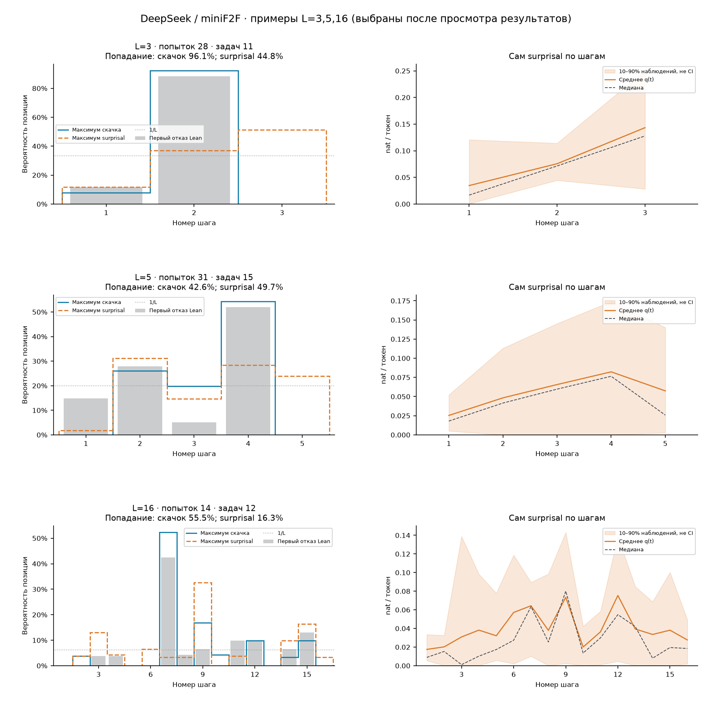

## Приложение 13 Направление и величина приращения

Источник: [Направление и величина приращения](chapters/13_direction.md). Сервер: /beegfs/home/denis.rakhmankin/onebigjump/runs/negative_results_diagnostics_20261111_v1/direction_summary/REPORT_RU.md.

Обучены только probes на исходной E14 feature-cohort. ProofNet — исходные nested group CV; Putnam — замороженный перенос. Для всех методов одинаковы выборка, разбиения и процедура выбора регуляризации.

| Модель | Набор | Метод | NLL | Exact при цели FPR10% | Реальный FPR | Ранняя тревога | Пропуск |
|---|---|---|---:|---:|---:|---:|---:|
| deepseek | ProofNet | HD | 0.4452 | 0.1462 | 0.1562 | 0.0323 | 0.8215 |
| deepseek | ProofNet | HD_R | 0.4433 | 0.1380 | 0.1562 | 0.0293 | 0.8327 |
| deepseek | ProofNet | HD_U | 0.4219 | 0.1807 | 0.0938 | 0.0100 | 0.8092 |
| deepseek | ProofNet | HD_RU | 0.4219 | 0.1807 | 0.0938 | 0.0100 | 0.8092 |
| deepseek | ProofNet | HD_Z | 0.4269 | 0.1682 | 0.1562 | 0.0115 | 0.8203 |
| deepseek | ProofNet | HDW | 0.4434 | 0.1359 | 0.1562 | 0.0293 | 0.8347 |
| deepseek | Putnam | HD | 0.3544 | 0.0862 | — | 0.0000 | 0.9138 |
| deepseek | Putnam | HD_R | 0.3512 | 0.0690 | — | 0.0086 | 0.9224 |
| deepseek | Putnam | HD_U | 0.4003 | 0.1106 | — | 0.0000 | 0.8894 |
| deepseek | Putnam | HD_RU | 0.4001 | 0.1106 | — | 0.0000 | 0.8894 |
| deepseek | Putnam | HD_Z | 0.4010 | 0.0603 | — | 0.0086 | 0.9310 |
| deepseek | Putnam | HDW | 0.3516 | 0.0776 | — | 0.0086 | 0.9138 |
| goedel | ProofNet | HD | 0.3947 | 0.0833 | 0.0439 | 0.0075 | 0.9091 |
| goedel | ProofNet | HD_R | 0.3861 | 0.0946 | 0.0263 | 0.0169 | 0.8885 |
| goedel | ProofNet | HD_U | 0.4357 | 0.1187 | 0.0789 | 0.0000 | 0.8813 |
| goedel | ProofNet | HD_RU | 0.4346 | 0.1187 | 0.0789 | 0.0000 | 0.8813 |
| goedel | ProofNet | HD_Z | 0.4293 | 0.1406 | 0.0789 | 0.0100 | 0.8494 |
| goedel | ProofNet | HDW | 0.3872 | 0.0896 | 0.0439 | 0.0169 | 0.8935 |
| goedel | Putnam | HD | 0.3218 | 0.0429 | — | 0.0000 | 0.9571 |
| goedel | Putnam | HD_R | 0.3263 | 0.0952 | — | 0.0000 | 0.9048 |
| goedel | Putnam | HD_U | 0.4850 | 0.0429 | — | 0.0286 | 0.9286 |
| goedel | Putnam | HD_RU | 0.4856 | 0.0429 | — | 0.0286 | 0.9286 |
| goedel | Putnam | HD_Z | 0.4836 | 0.1095 | — | 0.0286 | 0.8619 |
| goedel | Putnam | HDW | 0.3263 | 0.0810 | — | 0.0000 | 0.9190 |

R — log1p нормы whitened increment; U — направление того же вектора; RU — оба блока аддитивно; Z — полный whitened vector, сохраняющий произведение нормы и направления; HDW — исходные текущие/исторические norm-признаки. HD и HDW проверены на совпадение с исходным E14. Разный размер блоков учитывается регуляризацией и held-out оценкой, но не делает семейства предикторов одинаковыми по выразительности.

Точечные task-bootstrap интервалы и все пороги — metrics.json. Основные NLL-контрасты U−R и RU−R имеют Holm8 в primary_tests.json. Отсутствие выигрыша не означает отсутствия всей информации; успешный probe не идентифицирует причинный механизм. Putnam не содержит корректных доказательств и не даёт FPR.

## Приложение 14 Разложение выигрыша NLL

Источник: [Разложение выигрыша NLL](chapters/14_nll.md). Сервер: /beegfs/home/denis.rakhmankin/onebigjump/runs/negative_results_nll_20261111_v2/nll/REPORT_RU.md.

Точные исходные предсказания E14, без изменения коэффициентов или порогов. NLL разлагается с весами всей исходной выборки; показатели тревог воспроизводят исходное усреднение E14 отдельно среди ошибочных/корректных доказательств. Версия v2 уточняет это различие и проверяет совпадение агрегированных показателей тревог; значения NLL не меняются. Положительный вклад означает снижение NLL. Три категории суммируются в общий выигрыш с исходными весами задач, попыток и шагов.

| Модель / набор | Метод | Общий выигрыш | Первый отказ | Принятый префикс ошибочного | Проверенное доказательство |
|---|---|---:|---:|---:|---:|
| deepseek/ProofNet | HDW | 0.001788 | 0.000810 | 0.000334 | 0.000644 |
| deepseek/ProofNet | HD_state | 0.099219 | 0.037053 | 0.064154 | -0.001988 |
| deepseek/ProofNet | HD_increment | 0.058460 | 0.000090 | 0.054630 | 0.003741 |
| deepseek/Putnam | HDW | 0.002735 | -0.000722 | 0.003457 | 0.000000 |
| deepseek/Putnam | HD_state | 0.033478 | 0.000747 | 0.032732 | 0.000000 |
| deepseek/Putnam | HD_increment | -0.017852 | -0.036960 | 0.019108 | 0.000000 |
| goedel/ProofNet | HDW | 0.007524 | 0.003062 | 0.002920 | 0.001542 |
| goedel/ProofNet | HD_state | 0.020635 | -0.017744 | 0.035961 | 0.002418 |
| goedel/ProofNet | HD_increment | -0.013115 | -0.055971 | 0.032745 | 0.010111 |
| goedel/Putnam | HDW | -0.004561 | -0.018447 | 0.013886 | 0.000000 |
| goedel/Putnam | HD_state | -0.027273 | -0.060022 | 0.032750 | 0.000000 |
| goedel/Putnam | HD_increment | -0.102183 | -0.129176 | 0.026993 | 0.000000 |

Интервалы и условные NLL — в metrics.json. Переходы ранняя/точная/пропуск и расстояния до исходных порогов — trace_transitions.csv каждого набора; калибровка по фиксированным бинам — calibration.csv. Putnam не содержит корректных доказательств. Этот аудит показывает источники изменения метрики, но не доказывает причинный механизм.

## Приложение 15 Строгий аудит отбора гибкий baseline и одинаковые префиксы

Источник: [Строгий аудит отбора гибкий baseline и одинаковые префиксы](chapters/15_priority.md). Сервер: /beegfs/home/denis.rakhmankin/onebigjump/runs/priority_checks_20261112_v1/delivery/REPORT_RU.md.

Дата сборки UTC: 2026-11-12T01:31:11.709804+00:00

**Итоговая сборка завершённых A–D.**

#### 1. Что проверяется

Две замороженные LLM: DeepSeek-Prover-V2-7B и Goedel-Prover-V2-8B. Состояния имеют 4096 координат и снимаются после блоков 14 и 17 (нумерация с нуля), на конце завершённой AST-тактики. X0 — вход в формальную часть после неформального вступления. Обучаются только пробники.

Отдельно рассматриваются локализация первого отказа в готовой ошибочной попытке, наличие отказа во всей попытке, обнаружение по префиксу и прогноз будущего отказа при ещё принятом префиксе. Предотвращение ошибки не проверяется. Метка относится к Lean-rejection, а не к первому ошибочному математическому замыслу.

#### 2. Аудит отбора и verified

| модель | все попытки | strict verified | whole_ok | sorryAx среди предполагаемых недостающих | локализованные отказы | покрытие nonverified, % |
| --- | --- | --- | --- | --- | --- | --- |
| deepseek | 840 | 111 | 155 | 44 | 452 | 62.0027 |
| goedel | 840 | 79 | 167 | 88 | 259 | 34.0342 |

Поле whole_proof_ok означает успешность определённого этапа elaboration и само по себе не гарантирует отсутствие дыр в доказательстве. Все предполагаемые недостающие verified-попытки имеют зависимость от sorryAx; их replay не подтверждает корректность. Их нельзя добавлять как отрицательные примеры ошибки. Все действительно verified-попытки уже имеют состояния. Восстановление дополнительных verified-состояний и refit расширенного v2 в этой популяции не требуются: допустимое множество не расширилось.

Предложенная замена покрытия на 66,0% / 38,5% не применяется. Знаменатель nonverified равен всем evaluation-попыткам минус строго verified. Существующие примерно 62% / 34% согласуются с этим определением. Технические pilot-попытки не подмешиваются в evaluation.

В population_manifest сохранены исходные и строгие метки, SHA исходных записей, причины исключения и пересекающиеся флаги. AST и токеновые длины при отсутствии корректного измерения остаются пропусками. Состав тактик рассчитывается по AST, с отдельными весами по тактикам и по задачам/попыткам.

#### 3. Воспроизведение исходных пробников

| model | dataset | arm | hit | nll |
| --- | --- | --- | --- | --- |
| deepseek | ProofNet | MD | 0.3939 | 1.7797 |
| deepseek | ProofNet | MDW | 0.4220 | 1.7705 |
| deepseek | ProofNet | MD_increment | 0.4682 | 1.7875 |
| deepseek | ProofNet | MD_state | 0.4764 | 1.6291 |
| goedel | ProofNet | MD | 0.5732 | 1.5706 |
| goedel | ProofNet | MDW | 0.5569 | 1.6262 |
| goedel | ProofNet | MD_increment | 0.5149 | 1.7415 |
| goedel | ProofNet | MD_state | 0.5033 | 1.6739 |

NLL и Hit@1 получены заново из сохранённых предсказаний, с равными весами задач и попыток внутри задачи. На проверенном outer-fold вероятности state/increment пробников воспроизведены точно, максимальное расхождение равно нулю. Эта проверка сверяет саму подготовку признаков и состояния, а не только округлённые таблицы.

#### 4. Новые сравнения B

B — прежний сильный ретроспективный MD-baseline: splines позиции, доли пройденного готового текста, длины тактики и surprisal; first/last, тип тактики, изменение surprisal и его модуль. Сравнения добавляют Xprev, dX, X, пары (Xprev,dX)/(Xprev,X). B+Xprev не является прогнозом до тактики: baseline уже видит текущую тактику и длину готового доказательства.

Для приращения сохраняется независимое историческое whitening rho=0.1. z — преобразованный вектор, r=norm(z), u=z/r при r>1e-12, иначе u=0. Сравниваются log1p(r), u, их аддитивная комбинация и z. Для уровня состояния используется отдельное train-центрирование X: a=norm(X-mu_X), e=(X-mu_X)/a при a>1e-12, иначе e=0. Ковариация приращений к X не применяется.

Гибкий baseline содержит линейный skip и один GELU-слой ширины 32/64. Вложенный подбор weight decay, три фиксированных seed; для обеих ветвей усредняются вероятности всех seed. Ветка состояния линейная. Early stopping использует только inner-validation; outer-test не управляет остановкой.

Сохранены прежние 5 outer × 3 inner групповых разбиения. Все scaler, vocabulary и spline knots обучаются внутри train. 108 новых линейных единиц и 24 единицы гибкого baseline включают OOF и source-only refit. В чувствительности T>1 первая позиция остаётся среди кандидатов; прежний E11 с её удалением — отдельный oracle-протокол.

Основной знак эффекта: delta NLL = NLL(base)-NLL(new), delta Hit = Hit(new)-Hit(base) в процентных пунктах. 10000 bootstrap-повторов по задачам; неопределённость условна на уже обученные модели. Для четырёх основных DeepSeek-сравнений на двух evaluation-domain применяется Holm по восьми контрастам. Goedel — дополнительная репликация.

##### Основные контрасты

| model | dataset | new | reference | delta | ci95 | ci_family_bonferroni8 | p_holm8 | tasks | attempts |
| --- | --- | --- | --- | --- | --- | --- | --- | --- | --- |
| deepseek | ProofNet | state | B | 0.1506 | [0.04799286663216905, 0.2575663514037345] | [0.005851002605364031, 0.2995439003912403] | 0.0132 | 166 | 452 |
| deepseek | ProofNet | state | prev | 0.4376 | [0.3279184803076688, 0.5528436778282877] | [0.2831124411090857, 0.5966197193779877] | 0.0008 | 166 | 452 |
| deepseek | ProofNet | u | r | -0.1163 | [-0.2157201741239891, -0.014133622884932355] | [-0.2537787071145294, 0.026553459767423092] | 0.0308 | 166 | 452 |
| deepseek | ProofNet | flexstate | flex | 0.2127 | [0.09624044986934976, 0.33351289933367007] | [0.04641859664838299, 0.3799109967059259] | 0.0025 | 166 | 452 |
| deepseek | Putnam | state | B | 0.2154 | [0.04659399156957907, 0.39738332314671393] | [-0.017435543967651585, 0.47188540745534874] | 0.0308 | 58 | 118 |
| deepseek | Putnam | state | prev | 0.8469 | [0.7005439958841752, 0.9893754857999078] | [0.6452556102088225, 1.049738976411883] | 0.0008 | 58 | 118 |
| deepseek | Putnam | u | r | -0.2735 | [-0.4396609075071856, -0.09962691650222019] | [-0.49402563511031455, -0.028452030957810688] | 0.0048 | 58 | 118 |
| deepseek | Putnam | flexstate | flex | 0.4244 | [0.24214041441084763, 0.605253153444099] | [0.1675602986401478, 0.6794160331611098] | 0.0008 | 58 | 118 |

#### 5. Matched-prefix C

Старый обработчик поддерживал только верхний уровень AST и оставлял по 11 задач. До генерации зафиксирована поправка C-1: поддержка вложенных контекстов при сохранении точного токенового префикса, Lean header, целей и локального контекста. Доступны 165/114 исходных задач; feasibility pilot — по 40 задач и 8 альтернатив. Задачи пилота исключаются из основного анализа.

Проверяется первая завершённая AST-тактика, а не первая строка. Accepted, включая завершение доказательства, даёт Y=0; надёжное семантическое отклонение — Y=1. Parse, timeout, resource, sorry, несовпадение контекста и неполная токеновая граница не превращаются в семантические ошибки. Все дубликаты и исключения сохраняются.

Для каждой группы альтернатив используется одна форма padded-forward и каноническое измерение префикса. Xprev должен совпадать побитно, previous-q общий. Замороженные B/BH/BD детекторы взяты из соответствующего OOF-fold исходной задачи. BH содержит текущее состояние и среднее по уже наблюдённому префиксу; отдельно показывается только векторный вклад ретроспективного state-probe. Полный ретроспективный score с неизвестными L/last не применяется.

Within-prefix AUC усредняется по независимым задачам; ties дают 0.5. Основной контраст — BH-B. При числе mixed-задач меньше 20 доверительный интервал не выводится. Основной M и K фиксируются из пилотной дисперсии, частоты mixed-групп и профиля ресурсов. Верхние пределы: 400 задач/модель, K=16, всего 60 новых GPU-часов и 1200 Lean CPU-часов. Сбор не продолжается до значимости.

| model | phase | score | metric | value | ci95 | ci95_MC_seed2 | independent_mixed_tasks | bootstrap_replicates | primary | CI_halfwidth | precision_halfwidth_target | precision_target_met | CI_missing_reason |
| --- | --- | --- | --- | --- | --- | --- | --- | --- | --- | --- | --- | --- | --- |
| deepseek | pilot | BH-B | paired_delta_AUC | 0.0000 | — | — | 2 | 10000 | False | — | 0.1000 | False | fewer_than_20_groups |
| deepseek | pilot | BD-B | paired_delta_AUC | 0.0000 | — | — | 2 | 10000 | False | — | 0.1000 | False | fewer_than_20_groups |
| deepseek | main | BH-B | paired_delta_AUC | 0.1144 | — | — | 9 | 10000 | True | — | 0.1000 | False | fewer_than_20_groups |
| deepseek | main | BD-B | paired_delta_AUC | 0.0911 | — | — | 9 | 10000 | False | — | 0.1000 | False | fewer_than_20_groups |
| goedel | pilot | BH-B | paired_delta_AUC | 0.0357 | — | — | 4 | 10000 | False | — | 0.1000 | False | fewer_than_20_groups |
| goedel | pilot | BD-B | paired_delta_AUC | 0.0000 | — | — | 4 | 10000 | False | — | 0.1000 | False | fewer_than_20_groups |
| goedel | main | BH-B | paired_delta_AUC | 0.0380 | — | — | 10 | 10000 | True | — | 0.1000 | False | fewer_than_20_groups |
| goedel | main | BD-B | paired_delta_AUC | -0.0076 | — | — | 10 | 10000 | False | — | 0.1000 | False | fewer_than_20_groups |

#### 6. Presence/forecast D

Предыдущая серия завершена: 144/144 fit-единиц и 24/24 summaries. Проверены хеши сохранённых предсказаний и конечные градиенты оптимизации. Заново обучать её не потребовалось. Новые diagnostics пересчитывают рабочие точки из тех же предсказаний.

Offline, present, future1/future3/future5 и future_end имеют разные метки и множества допустимых префиксов. В causal-ветвях нет будущего L, t/L, last или AST-типов, определённых будущим суффиксом. Синтетические проверки подтверждают неизменность признаков раннего префикса при изменении/удалении суффикса.

Порог выбирается по source inner-OOF и затем замораживается. Номинальная частота ложных тревог не подменяет фактическую. В streaming_operating_points.csv разделены prefix FPR, any-alarm FPR на полностью корректных попытках, ранняя/точная/поздняя тревога, пропуск, задержка и тревоги на принятых префиксах ошибочных попыток.

На Putnam в текущем измеримом cohort нет полностью verified-попыток. Поэтому offline AUROC/AP как discrimination и whole-proof FPR не определены; это не нулевой FPR. Для prefix-задач проверяется наличие обоих классов отдельно. Старые интервалы имеют 2000 bootstrap-повторов; дополнительные интервалы first-alarm — 10000.

##### NLL: обучение на ProofNet, OOF или замороженный перенос

| model | evaluation | target | B | BD | BH | BW |
| --- | --- | --- | --- | --- | --- | --- |
| deepseek | ProofNet | future1 | 0.6056 | 0.6077 | 0.5710 | 0.6073 |
| deepseek | ProofNet | future3 | 0.6596 | 0.6573 | 0.6392 | 0.6589 |
| deepseek | ProofNet | future5 | 0.6010 | 0.5850 | 0.5745 | 0.6019 |
| deepseek | ProofNet | future_end | 0.4299 | 0.3505 | 0.2942 | 0.4288 |
| deepseek | ProofNet | offline | 0.3223 | 0.3562 | 0.3364 | 0.3153 |
| deepseek | ProofNet | present | 0.4745 | 0.4725 | 0.4249 | 0.4720 |
| deepseek | Putnam | future1 | 0.5621 | 0.5705 | 0.5263 | 0.5621 |
| deepseek | Putnam | future3 | 0.6779 | 0.7011 | 0.7030 | 0.6776 |
| deepseek | Putnam | future5 | 0.6089 | 0.6295 | 0.6513 | 0.6090 |
| deepseek | Putnam | future_end | 0.1900 | 0.1115 | 0.0525 | 0.1801 |
| deepseek | Putnam | offline | 0.0858 | 0.0442 | 0.0221 | 0.0879 |
| deepseek | Putnam | present | 0.4352 | 0.4022 | 0.3711 | 0.4297 |
| goedel | ProofNet | future1 | 0.6269 | 0.6767 | 0.6011 | 0.6238 |
| goedel | ProofNet | future3 | 0.6257 | 0.6338 | 0.5869 | 0.6269 |
| goedel | ProofNet | future5 | 0.5568 | 0.5289 | 0.4997 | 0.5536 |
| goedel | ProofNet | future_end | 0.4156 | 0.3305 | 0.2630 | 0.4122 |
| goedel | ProofNet | offline | 0.3614 | 0.3539 | 0.3246 | 0.3469 |
| goedel | ProofNet | present | 0.4595 | 0.4297 | 0.4129 | 0.4522 |
| goedel | Putnam | future1 | 0.5686 | 0.5883 | 0.5732 | 0.5658 |
| goedel | Putnam | future3 | 0.6824 | 0.7850 | 0.7312 | 0.6835 |
| goedel | Putnam | future5 | 0.5775 | 0.6396 | 0.6444 | 0.5773 |
| goedel | Putnam | future_end | 0.1734 | 0.1178 | 0.0669 | 0.1727 |
| goedel | Putnam | offline | 0.1025 | 0.0297 | 0.0133 | 0.1006 |
| goedel | Putnam | present | 0.5327 | 0.5079 | 0.4091 | 0.5087 |

##### Present: фактические рабочие точки при source-номинале 10%

| model | arm | exact | prefix_fpr | trajectory_fpr |
| --- | --- | --- | --- | --- |
| deepseek | B | 0.0617 | 0.0295 | 0.0901 |
| deepseek | BD | 0.0956 | 0.0262 | 0.1554 |
| deepseek | BH | 0.0956 | 0.0166 | 0.0473 |
| deepseek | BW | 0.0879 | 0.0373 | 0.1014 |
| goedel | B | 0.0457 | 0.0291 | 0.1000 |
| goedel | BD | 0.1190 | 0.0116 | 0.0722 |
| goedel | BH | 0.0789 | 0.0125 | 0.0556 |
| goedel | BW | 0.0865 | 0.0239 | 0.1111 |

#### 7. Состояние выполнения и воспроизводимость

Завершено 161 из 162 контролируемых этапов. Это число включает инфраструктурные и агрегирующие этапы, а не число независимых научных экспериментов.

Блокировки: {}

Контроллер сохраняет checkpoints и атомарные результаты, уважает QOS, запускает не более 6 управляемых CPU и 3 GPU-заданий. На научной ошибке останавливается соответствующая зависимая ветвь; исправные задания продолжаются. Учёт бюджета включает резерв для активных GPU-заданий. Самопроизвольного увеличения лимита и перезапуска всего старого каталога нет.

Рабочая ветка сервера была dirty до начала работы. Исходный diff и статус сохранены; для воспроизводимости приложены хеши новых файлов, зависимостей, split manifests, версий моделей/tokenizer и Lean/mathlib. Старые outputs не изменяются. ProofNet OOF и ProofNet→Putnam — исторические/исследовательские результаты; новые продолжения прежних задач не объявляются новым независимым test.

#### 8. Что можно и нельзя утверждать

Аудит отвечает на вопрос о якобы потерянных verified: потерянной корректной подвыборки не обнаружено, причина — неоднозначность поля whole_proof_ok. Это не отменяет selection bias остальных технических исключений; для них представлены длины, AST-состав и доступность измерений.

Сильнейший вид векторной информации, устойчивость к Xprev/гибкому baseline и разделение нормы/направления оцениваются только по завершённой сводке B. Для C вывод зависит от paired AUC и числа mixed-задач. Если точность недостаточна, результат остаётся неопределённым. Успех локализации или обнаружения не является свидетельством предотвращения ошибок или доказательством тяжёлохвостого причинного механизма.

#### 9. Команды наблюдения

```bash
ssh zhores "squeue -u denis.rakhmankin"
ssh zhores "tail -30 /beegfs/home/denis.rakhmankin/onebigjump/runs/priority_checks_20261112_v1/controller.log"
ssh zhores "cat /beegfs/home/denis.rakhmankin/onebigjump/runs/priority_checks_20261112_v1/controller_state.json"
# Возобновление dispatcher безопасно при уже работающем экземпляре (flock):
ssh zhores "cd /beegfs/home/denis.rakhmankin/onebigjump && nohup python3 -u /beegfs/home/denis.rakhmankin/onebigjump/experiments/priority_checks_20261112_v1/controller.py >> /beegfs/home/denis.rakhmankin/onebigjump/runs/priority_checks_20261112_v1/controller.log 2>&1 < /dev/null &"
```

Финальный отчёт автоматически собирается в /beegfs/home/denis.rakhmankin/onebigjump/runs/priority_checks_20261112_v1/delivery. Публичная публикация и сообщения рецензентам не выполнялись.

#### 10. Дополнительные таблицы аудита и технический статус

Числа ниже получены из selection_final после восстановления формальных токеновых границ и AST корректных попыток. Первичная классификация использует согласованную архивную причину исключения. В failed-элаборации Lean может сам вставлять recovery-hole: наличие sorryAx там не тождественно явно сгенерированному sorry. В спорных whole_ok-попытках отдельно подтверждено именно сгенерированное sorry. initial selection/ и selection_extra/ сохранены для аудита изменений, но заменены selection_v2/selection_extra_v2/selection_final.

Таблица категорий: attempt-weighted квантили, доступность каждого измерения в отдельных колонках; task-weighted длины и парные интервалы разностей приведены в selection_comparisons.csv. Included означает cohort локализации, excluded включает и строго verified.

| model | category | attempts | groups | formal_tokens_measurable | ast_tactics_measurable | truncation_fraction |
| --- | --- | --- | --- | --- | --- | --- |
| deepseek | accepted_but_unsolved | 22 | 21 | 22 | 22 | 0.0000 |
| deepseek | ambiguous_localization | 50 | 37 | 50 | 50 | 0.0000 |
| deepseek | context_mismatch | 9 | 7 | 0 | 0 | 0.0000 |
| deepseek | generation_truncation | 55 | 41 | 1 | 0 | 1.0000 |
| deepseek | included_reproducible_rejection | 452 | 166 | 452 | 452 | 0.0000 |
| deepseek | parse_error | 38 | 19 | 38 | 0 | 0.0000 |
| deepseek | resource_or_internal | 54 | 34 | 54 | 0 | 0.0000 |
| deepseek | sorry_invalid | 1 | 1 | 1 | 0 | 0.0000 |
| deepseek | sorry_invalid_proof | 44 | 37 | 41 | 0 | 0.7500 |
| deepseek | token_boundary_incomplete | 4 | 4 | 4 | 4 | 0.0000 |
| deepseek | verified | 111 | 37 | 111 | 111 | 0.0000 |
| goedel | accepted_but_unsolved | 14 | 10 | 14 | 14 | 0.0000 |
| goedel | ambiguous_localization | 48 | 36 | 48 | 48 | 0.0000 |
| goedel | context_mismatch | 7 | 4 | 0 | 0 | 0.0000 |
| goedel | generation_truncation | 294 | 136 | 2 | 0 | 1.0000 |
| goedel | included_reproducible_rejection | 259 | 133 | 259 | 259 | 0.0000 |
| goedel | parse_error | 32 | 21 | 32 | 0 | 0.0000 |
| goedel | resource_or_internal | 16 | 14 | 16 | 0 | 0.0000 |
| goedel | sorry_invalid_proof | 88 | 63 | 84 | 0 | 0.9659 |
| goedel | token_boundary_incomplete | 3 | 3 | 3 | 3 | 0.0000 |
| goedel | verified | 79 | 30 | 79 | 79 | 0.0000 |

Compound: сегмент с несколькими AST-узлами или вложенными AST-потомками; правило не подобрано по исходу. Указываются pooled tactic-weight и равные веса задач/попыток.

| model | selection | attempts | measurable_attempts | measurable_groups | compound_tactic_pooled_fraction | compound_equal_task_attempt_fraction | ci95_equal_task | bootstrap_replicates |
| --- | --- | --- | --- | --- | --- | --- | --- | --- |
| deepseek | included | 452 | 452 | 166 | 0.1170 | 0.1862 | [0.1676495041449319, 0.2061655600040611] | 10000 |
| deepseek | excluded | 388 | 187 | 88 | 0.1389 | 0.2013 | [0.1731740237597137, 0.23186562941544617] | 10000 |
| goedel | included | 259 | 259 | 133 | 0.1093 | 0.2044 | [0.17917145020887126, 0.23055122813373247] | 10000 |
| goedel | excluded | 581 | 144 | 73 | 0.1374 | 0.2314 | [0.1957256200208707, 0.26915309401821147] | 10000 |

##### Завершённые новые arms B

Полная сводка B собрана; основные контрасты выше, seed-level значения в flexible_seed_metrics.csv и размеры/регуляризация в fit_diagnostics.csv.

##### Matched-prefix: готовность данных

| model | pilot_generation_complete | pilot_label_shards_complete | pilot_measured_alternatives | pilot_measured_prefixes | main_generation_complete | main_label_shards_complete | main_measured_alternatives | main_measured_prefixes |
| --- | --- | --- | --- | --- | --- | --- | --- | --- |
| deepseek | True | 4 | 172 | 27 | True | 4 | 1167 | 94 |
| goedel | True | 4 | 148 | 25 | True | 4 | 517 | 52 |

Технический GPU smoke завершён: 4 альтернатив на 2 префиксах. Все проверки общего prefix-state прошли побитно. Это проверка измерения, не оценка научного эффекта.

##### Зафиксированный основной объём

| model | pilot_tasks | mixed_tasks | mixed_tasks_required_power80 | M | K | draws | projected_gpu_hours_upper | precision_target_feasible_by_conservative_planning |
| --- | --- | --- | --- | --- | --- | --- | --- | --- |
| deepseek | 40 | 2 | 50 | 125 | 16 | 2000 | 6.6667 | False |
| goedel | 40 | 4 | 50 | 74 | 16 | 1184 | 3.9467 | False |

Power/precision simulation сохраняет независимость на уровне задач; число bad-good пар не увеличивает sample size. Нижняя Wilson-оценка mixed-rate и floor дисперсии дают консервативную sensitivity; ориентир мощности не является обещанием достижимой точности.

##### Объём сохранённых состояний

| model | pilot_state_files | pilot_state_bytes | mean_bytes_per_measured_alternative | main_state_bytes_if_all_draws_measured | scope |
| --- | --- | --- | --- | --- | --- |
| deepseek | 172 | 12413562 | 72171.8721 | 144343744.1860 | compressed previous/current/canonical prefix arrays; excludes generation text, Lean detail archives, and repeated checkpoint storage |
| goedel | 148 | 9838181 | 66474.1959 | 78705448.0000 | compressed previous/current/canonical prefix arrays; excludes generation text, Lean detail archives, and repeated checkpoint storage |

##### Фактические online рабочие точки с неопределённостью

Present-пороги калиброваны именно по max score на корректной source inner-OOF траектории (worker.thresholds), затем заморожены. В таблице доли, не проценты. CI условны на фиксированные fits, 10000 resampling по задачам. Числа групп/попыток для FPR относятся только к strictly verified; exact — к надёжно локализованным отказам.

| model | arm | metric | value | ci95 | groups | attempts |
| --- | --- | --- | --- | --- | --- | --- |
| deepseek | B | trajectory_fpr | 0.0901 | [0.018018018018018018, 0.17117117117117117] | 37.0000 | 111.0000 |
| deepseek | B | exact | 0.0617 | [0.03614457831325301, 0.09186746987951808] | 166.0000 | 452.0000 |
| deepseek | BW | trajectory_fpr | 0.1014 | [0.03153153153153153, 0.1891891891891892] | 37.0000 | 111.0000 |
| deepseek | BW | exact | 0.0879 | [0.056224899598393566, 0.12399598393574296] | 166.0000 | 452.0000 |
| deepseek | BH | trajectory_fpr | 0.0473 | [0.006756756756756757, 0.10135135135135134] | 37.0000 | 111.0000 |
| deepseek | BH | exact | 0.0956 | [0.06325301204819277, 0.13102660642570277] | 166.0000 | 452.0000 |
| deepseek | BD | trajectory_fpr | 0.1554 | [0.060810810810810814, 0.2635135135135135] | 37.0000 | 111.0000 |
| deepseek | BD | exact | 0.0956 | [0.06224899598393573, 0.13353413654618473] | 166.0000 | 452.0000 |
| goedel | B | trajectory_fpr | 0.1000 | [0.02222222222222222, 0.19999999999999998] | 30.0000 | 79.0000 |
| goedel | B | exact | 0.0457 | [0.018170426065162906, 0.07769423558897244] | 133.0000 | 259.0000 |
| goedel | BW | trajectory_fpr | 0.1111 | [0.027777777777777776, 0.2222222222222222] | 30.0000 | 79.0000 |
| goedel | BW | exact | 0.0865 | [0.04887218045112782, 0.12781954887218044] | 133.0000 | 259.0000 |
| goedel | BH | trajectory_fpr | 0.0556 | [0.0, 0.12222222222222222] | 30.0000 | 79.0000 |
| goedel | BH | exact | 0.0789 | [0.041979949874686714, 0.12030075187969924] | 133.0000 | 259.0000 |
| goedel | BD | trajectory_fpr | 0.0722 | [0.016666666666666666, 0.13333333333333333] | 30.0000 | 79.0000 |
| goedel | BD | exact | 0.1190 | [0.07644110275689223, 0.16604010025062657] | 133.0000 | 259.0000 |

BH использует текущее X и среднее X наблюдённого префикса; BD — соответствующие приращения. Они не равны чистому scalar-jump detector. Для старого E14 отдельно приложен воспроизведённый рост exact одновременно с ростом FPR; это другой cohort корректных попыток.

##### Незавершённые результаты

Полный пофайловый список — pending_outputs.csv / pending_outputs.json. Число ожидаемых единиц: 0. Финальные probe_* таблицы, matched_prefix_* таблицы и delivery/REPORT_RU.md появляются только после завершения соответствующих зависимостей.

Точный commit не описывает dirty-дерево целиком: initial_worktree.diff фиксирует состояние до работы, source_dependencies.csv и per-run manifests — конкретные файлы. Добавлены sealed Lean runtime manifest и registry primary_contrasts.yaml, экспортированный из уже зафиксированного протокола.

#### 11. Графики

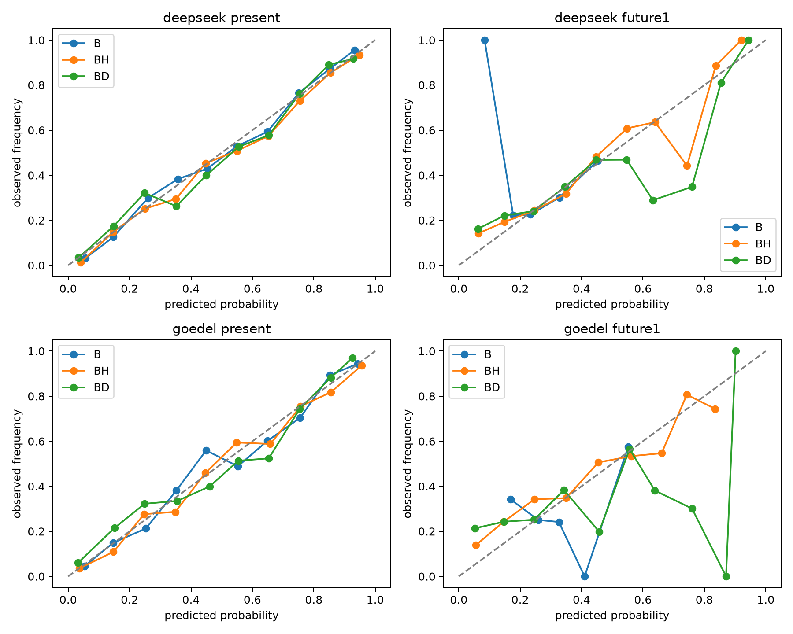

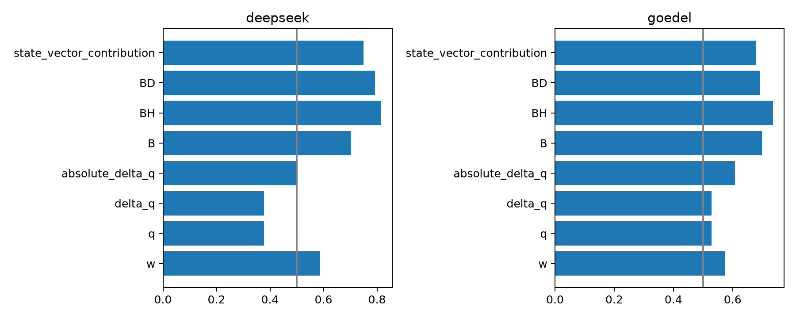

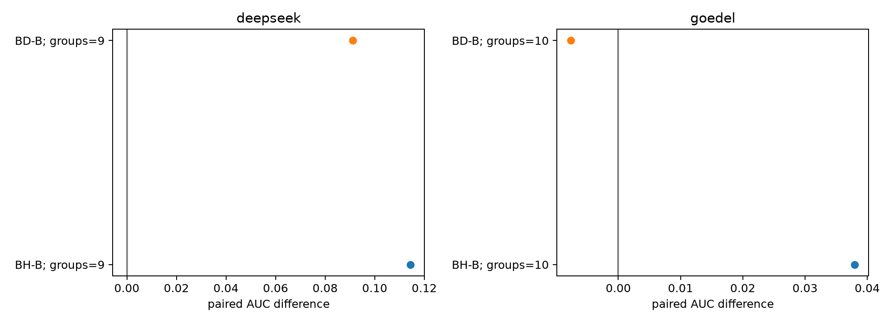

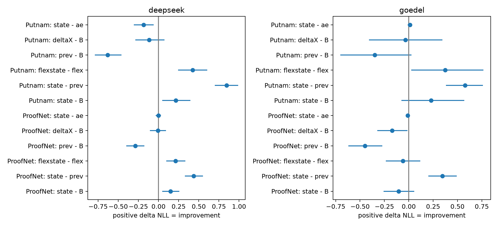

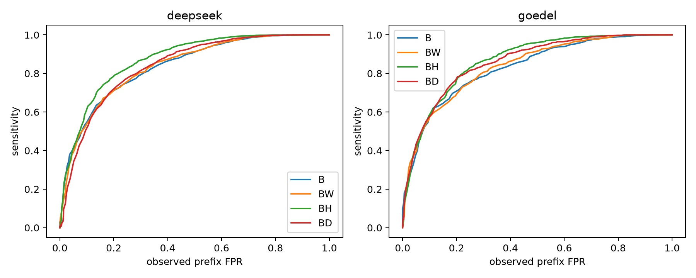

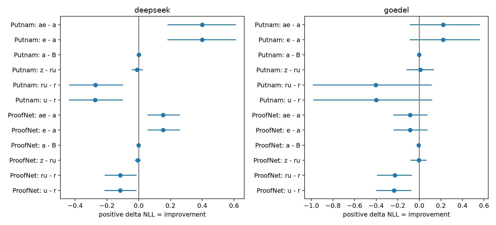

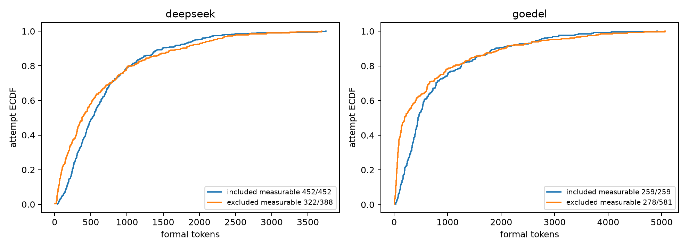

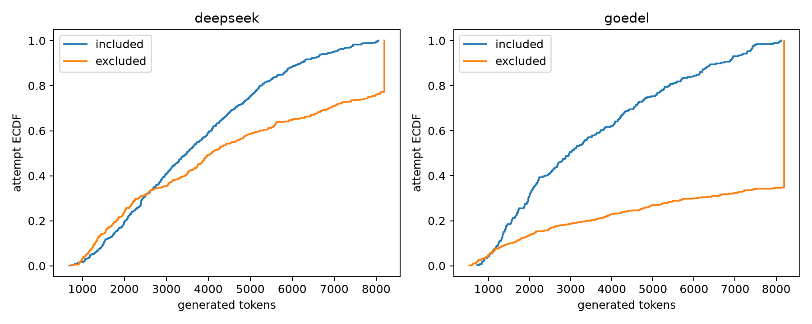

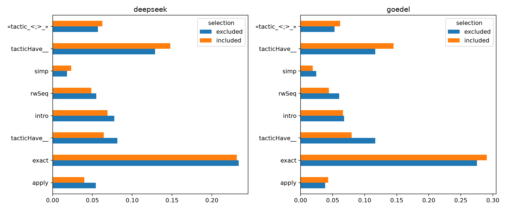

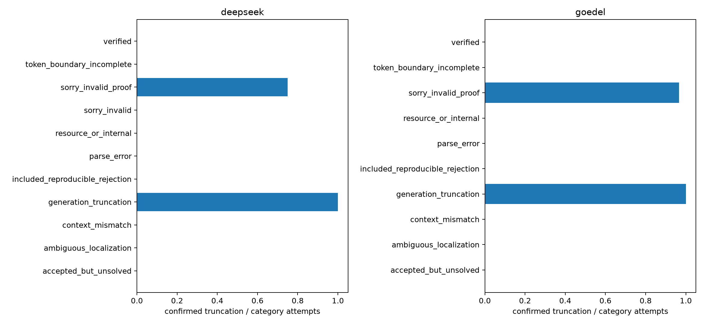

## Приложение 16 Кестен хвосты и обычный пошаговый риск

Источник: [Кестен хвосты и обычный пошаговый риск](chapters/16_kesten.md). Сервер: /beegfs/home/denis.rakhmankin/onebigjump/runs/reviewer_kesten_response_delivery_20261112_v1/REPORT_RU.md.

#### Ответ на вопрос рецензента

По имеющимся данным нельзя выделить суррогат Кестена как установленное объяснение ошибок. Локализация максимумом, сходство распределений позиций и экспоненциальная зависимость успешности от длины этого не делают. Результаты сравнения хвостов также не выделяют степенной хвост.

Более узкий вопрос проверяем: содержит ли величина скачка информацию о первом отказе сверх позиции, длины тактики и surprisal? Для него выполнен новый анализ сохранённых трасс DeepSeek и Goedel. Основные сравнения не дали результата, выдерживающего поправку на множественные проверки. Есть отдельный положительный результат переноса на выбранную популяцию неудачных Putnam-доказательств; он не устанавливает механизм Кестена. Все численные таблицы ниже сформированы из файлов метрик.

Вопрос рецензента состоит из трёх разных требований:

| Требование | Ответ по имеющимся данным |
| --- | --- |
| Нужен ли тяжёлый степенной хвост для самой локализации? | Нет. Рассматриваемая теорема допускает также быстро меняющиеся хвосты. |
| Даёт ли скачок информацию сверх обычного риска ошибки? | Это проверяемая предсказательная гипотеза; результаты зависят от модели, данных и момента наблюдения. |
| Обусловлен ли сигнал именно динамикой Кестена? | Сейчас нет эмпирической идентификации такого механизма. Проверка одного хвоста недостаточна. |

#### Почему экспонента по длине не различает объяснения

Обозначим через $T$ номер первой отвергнутой Lean тактики, через $W_t$ норму whitened приращения скрытого состояния, а через $L$ горизонт наблюдения. Первая ошибка Lean не обязательно совпадает с первым математически неверным замыслом.

При независимой постоянной вероятности ошибки $p$ на каждом шаге:

$$
\Pr(T>L)=(1-p)^L.
$$

Это точная дискретная экспонента по $L$. Равенство $(1-p)^L\approx e^{-pL}$ требует малого $p$, но сама экспоненциальная форма не требует этого приближения.

Теперь возьмём независимые $W_t$ с любым распределением и определим ошибку первым превышением фиксированного порога:

$$
T=\min\{t:W_t>\tau\},\qquad p=\Pr(W_t>\tau).
$$

Получится та же формула $\Pr(T>L)=(1-p)^L$. Она верна как для Pareto, так и для exponential, lognormal и ограниченных распределений. По одним меткам и длинам эти примеры неразличимы. Нужна совместная информация о скачке и метке.

Более того, любая модель времени первой ошибки допускает представление через условный риск:

$$
h_t=\Pr(T=t\mid T\ge t),\qquad
\Pr(T>L)=\prod_{t=1}^{L}(1-h_t).
$$

При обусловливании на дополнительных доступных признаках аналогично определяется риск в соответствующей информационной истории. Поэтому «coupling с экстремумом» и «ошибки на каждом шаге» не являются непересекающимися классами моделей. Различие возникает, только если обычной модели явно запретить дополнительную зависимость от residual-признаков.

Наконец, геометрическое распределение имеет максимум на первом шаге, но это не означает большой вероятности ошибки на первом шаге. Например, его мода остаётся первой и при малом $p$. В редком режиме $Lp\ll1$ распределение $T$, условное на $T\le L$, приближается к равномерному; за пределами этого режима такой вывод не следует. Наблюдаемая финальная длина генерации сама зависит от процесса и исхода, поэтому группировка по ней является ретроспективной диагностикой, а не заменой контроля длины эксперимента.

#### Что именно отличает степенной хвост и механизм Кестена

Для степенного регулярно меняющегося хвоста:

$$
\frac{\Pr(W>uy)}{\Pr(W>u)}\longrightarrow y^{-\alpha},\qquad y>1.
$$

Для быстро меняющегося хвоста это отношение стремится к нулю. Проверяемое различие — устойчивость относительных превышений при повышении порога, а также предсказательное качество хвостовых моделей на отложенных задачах. Прямая линия на коротком участке log–log графика и положительный Hill недостаточны. Lognormal тоже быстро меняется в этом смысле, хотя его часто относят к тяжёлым хвостам в другой классификации; здесь обсуждается именно отличие от степенного хвоста.

Суррогат Кестена задаёт более сильную структуру:

$$
E_t=a_tE_{t-1}+B_t,\qquad
\mathbb E[\log a_t]<0,\qquad
\Pr(a_t>1)>0.
$$

При дополнительных условиях на независимость, моменты, невырожденность и неарифметичность хвостовой показатель связан с множителем:

$$
\mathbb E[a_t^\alpha]=1.
$$

Это теорема о заданной случайной рекурсии, а не обратная теорема «увидели тяжёлый хвост — значит Кестен». Классические условия и ограничения сформулированы, например, у [Kevei](https://arxiv.org/abs/1512.07262); методы сравнения степенного хвоста с альтернативами обсуждают [Clauset, Shalizi и Newman](https://arxiv.org/abs/0706.1062).

В нашей постановке $E_t$ — отклонение от предполагаемой корректной динамики. Оно не равно автоматически наблюдаемому residual-вектору $X_t$, его центрированной версии или норме $W_t$. Подстановка отношения соседних норм вместо $a_t$ не измеряет коэффициент Кестена: она смешивает аддитивную часть, направление, позиционные эффекты и ошибку выбора самого состояния.

##### Что уже показало сравнение хвостов

Историческая проверка E9 обучала хвостовые модели только на тренировочных задачах. Основной порог — 95-й процентиль train; сравнивается условная плотность превышений. Для подгонки требовались не менее 80 train-превышений и 20 train-групп. Ниже DeepSeek, ProofNet, принятые шаги до первого отказа.

| Семейство | NLL | Test превышений | Test задач | Фолдов |
| --- | --- | --- | --- | --- |
| pareto | 3.37756 | 116 | 49 | 5 |
| exponential | 3.37030 | 116 | 49 | 5 |
| lognormal | 3.36675 | 116 | 49 | 5 |
| gpd | 3.36679 | 116 | 49 | 5 |

Меньшая NLL лучше. Для exponential минус Pareto в обозначении выигрыша NLL:

Выигрыш exponential = **0.00726**, 95% CI [-0.00006; 0.01455].

Поэтому здесь нет преимущества Pareto. Различие между альтернативами также не следует объявлять установленным только по порядку точечных оценок.

| Оценка на train в пяти фолдах | Минимум | Максимум |
| --- | --- | --- |
| Hill | 0.05962 | 0.06445 |
| Moment | -0.13998 | -0.03937 |
| GPD shape | -0.16888 | -0.06486 |

У Goedel и для первых отказов E9 не набрал заранее требуемого хвостового покрытия. Это недостаток данных, а не измеренный нулевой эффект. Отрицательные signed moment/GPD на доступном диапазоне не выделяют положительный индекс Кестена; они также не доказывают точный асимптотический закон ограниченного хвоста.

Симуляция рекурсии Кестена проверяет следствия выбранной модели. Она не является эмпирическим свидетельством того, что prover реализует эту рекурсию.

##### Что уже показала проверка фиксированного порога

Сильная гипотеза статьи имеет вид:

$$
v_t=\mathbf 1\{W_t\le\tau\}
$$

до первой ошибки включительно. Она требует, чтобы первое превышение совпадало с отказом, а на полностью корректной траектории превышений не было. Это существенно сильнее небольшой статистической корреляции.

В архивной A1 пороги получены на отдельных verified calibration задачах. Ниже один заранее исследованный уровень — 99-й процентиль. $F$ означает первое превышение, $M=\max_tW_t$. Это исторические популяции с ограниченным набором корректных трасс, а не новая расширенная выборка.

| Выборка | Failed | Verified | M выше порога на failed | M выше порога на verified | F совпал с T среди failed с превышением |
| --- | --- | --- | --- | --- | --- |
| miniF2F/deepseek | 528 | 172 | 9.66% | 8.14% | 1.96% |
| miniF2F/goedel | 448 | 231 | 18.97% | 10.82% | 11.76% |
| ProofNet/deepseek | 456 | 35 | 52.63% | 22.86% | 20.83% |
| ProofNet/goedel | 262 | 40 | 65.65% | 35.00% | 31.98% |

Пороги плохо реализуют строгую связь с валидностью. Доля $M>\tau$ на failed использует полный сгенерированный текст, включая суффикс после отказа; поэтому сама по себе она не измеряет своевременное обнаружение. Для этого в таблице отдельно приведено совпадение первого превышения с ошибкой. Эти результаты не опровергают существование любого возможного порога, статистики или readout, но не поддерживают испытанные варианты точного coupling.

#### Новая проверка на существующих трассах

Выполнен отдельный CPU-анализ; исходные LLM, состояния, метки и текущие обучения не менялись. Проверены DeepSeek-Prover-V2-7B и Goedel-Prover-V2-8B. Для ProofNet и miniF2F использованы прежние пять внешних разбиений по задачам и три внутренних. Полные source-fits также перенесены без перенастройки на Putnam.

Включены строгие verified доказательства и попытки с надёжно локализованным первым отказом. Технически неразмеченные, обрезанные и неразбираемые случаи не превращаются в корректные. Все выводы условны на этом покрытии архива.

**Текущий шаг:** наблюдаем законченную тактику и её $W_t$, оцениваем, является ли она первым отказом, при условии корректного предшествующего префикса.

**Следующий шаг:** наблюдаем только непустой принятый префикс до $t$, оцениваем отказ на реально наблюдаемой следующей тактике $t+1$. Завершившиеся корректные доказательства без следующего шага не входят в этот risk set. Формальный старт без законченных тактик здесь отдельно не оценивался.

В обоих случаях отсутствуют будущая длина, относительная позиция $t/L$, будущие скачки и surprisal, результат verifier и метаданные тактики из полного AST. Риск прекращается при первом отказе. Текущий скачок при обнаружении уже наблюдается; при прогнозировании следующего шага его будущий скачок недоступен.

| Модель | Признаки |
| --- | --- |
| Constant | Постоянный риск, оценённый на train. |
| Position | Номер доступного шага, логарифм, квадрат и фиксированные сгибы зависимости. |
| B | Position, текущий и предыдущий surprisal, их изменение, история surprisal и длины тактик в токенах. |
| BW | B плюс текущая/предыдущая величина скачка, среднее, максимум, разброс и изменение по уже наблюдаемому префиксу. |
| BWT | BW плюс превышения 95-го и 99-го процентилей, хвостовой ранг и история превышений. |

Для BWT распределение нормы оценивается только на принятых train-шагах, отдельно в позиционных группах 1, 2, 3–5, 6–10, 11+. При недостаточном количестве наблюдений используется общий train-reference. Таким образом «большой скачок» сравнивается с типичными скачками похожей позиции. Это лишь позиционная нормировка; она не является полным условным распределением по всем признакам B и не означает подгонку Кестена.

Регуляризацию выбирали по внутренней NLL, без выбора на test. Каждая задача имеет одинаковый вес, её попытки — одинаковый вес внутри задачи, шаги — внутри попытки. Основная метрика — бинарная NLL, дополнительно сохранён Brier. Интервалы — 20 000 bootstrap целых задач при фиксированных обученных моделях. Они не включают неопределённость повторного обучения; статистика исследовательская.

##### Основные результаты

«Текущий» и «следующий» имеют разные risk sets, поэтому их абсолютные NLL нельзя сравнивать как качество одной задачи.

| Модель | Данные | Ошибка | Задач | Попыток | Шагов | Constant | Position | B | BW | BWT |
| --- | --- | --- | --- | --- | --- | --- | --- | --- | --- | --- |
| deepseek | ProofNet | текущий | 187 | 563 | 3216 | 0.63099 | 0.60444 | 0.48568 | 0.48180 | 0.48159 |
| deepseek | ProofNet | следующий | 171 | 464 | 2653 | 0.61647 | 0.59769 | 0.60500 | 0.60334 | 0.60230 |
| deepseek | miniF2F | текущий | 202 | 1303 | 12237 | 0.35048 | 0.35074 | 0.28210 | 0.26993 | 0.27038 |
| deepseek | miniF2F | следующий | 198 | 1263 | 10934 | 0.35498 | 0.35385 | 0.34653 | 0.33781 | 0.33426 |
| goedel | ProofNet | текущий | 144 | 338 | 1838 | 0.67296 | 0.62395 | 0.46616 | 0.44184 | 0.45156 |
| goedel | ProofNet | следующий | 121 | 255 | 1500 | 0.63081 | 0.62324 | 0.62624 | 0.62596 | 0.62434 |
| goedel | miniF2F | текущий | 200 | 1256 | 14144 | 0.31814 | 0.31555 | 0.25352 | 0.23796 | 0.24212 |
| goedel | miniF2F | следующий | 198 | 1227 | 12888 | 0.33544 | 0.33983 | 0.31705 | 0.31038 | 0.30339 |

Далее положительная $\Delta\mathrm{NLL}$ означает выигрыш: loss исходной модели минус loss дополненной.

| Модель | Данные | Ошибка | Сравнение | Δ NLL | 95% CI | p Holm |
| --- | --- | --- | --- | --- | --- | --- |
| deepseek | ProofNet | current | BW против B | +0.00388 | [-0.00330; 0.01072] | 1.0000 |
| deepseek | ProofNet | current | BWT против BW | +0.00021 | [-0.00821; 0.00864] | 1.0000 |
| deepseek | ProofNet | next | BW против B | +0.00167 | [-0.00400; 0.00748] | 1.0000 |
| deepseek | ProofNet | next | BWT против BW | +0.00104 | [-0.00255; 0.00474] | 1.0000 |
| deepseek | miniF2F | current | BW против B | +0.01217 | [0.00270; 0.02178] | 0.1837 |
| deepseek | miniF2F | current | BWT против BW | -0.00044 | [-0.00317; 0.00205] | 1.0000 |
| deepseek | miniF2F | next | BW против B | +0.00872 | [0.00022; 0.01810] | 0.6171 |
| deepseek | miniF2F | next | BWT против BW | +0.00355 | [-0.00334; 0.01058] | 1.0000 |
| goedel | ProofNet | current | BW против B | +0.02432 | [0.00039; 0.04801] | 0.5460 |
| goedel | ProofNet | current | BWT против BW | -0.00972 | [-0.02197; 0.00132] | 0.8950 |
| goedel | ProofNet | next | BW против B | +0.00028 | [-0.00167; 0.00233] | 1.0000 |
| goedel | ProofNet | next | BWT против BW | +0.00162 | [-0.00066; 0.00375] | 1.0000 |
| goedel | miniF2F | current | BW против B | +0.01555 | [0.00297; 0.02968] | 0.3297 |
| goedel | miniF2F | current | BWT против BW | -0.00416 | [-0.00737; -0.00109] | 0.1488 |
| goedel | miniF2F | next | BW против B | +0.00667 | [-0.00048; 0.01464] | 0.8335 |
| goedel | miniF2F | next | BWT против BW | +0.00700 | [0.00099; 0.01408] | 0.4816 |

Из 16 основных контрастов 0 показывают положительный эффект при p Holm < 0,05. Это не доказывает отсутствие эффекта: часть номинальных интервалов положительна, но после учёта всего семейства проверок убедительной общей прибавки не получено. Специальные хвостовые признаки также не дают устойчивого преимущества сверх BW.


Полные Brier, все модели и переносы: [model_metrics.csv](assets/185503bc4d31_model_metrics.csv). Все контрасты и интервалы: [contrasts.csv](assets/03ebe7cf4f3f_contrasts.csv).

Важно сравнивать также с Position: более подробная B не обязана лучше обобщаться при конечной выборке. Например, на ProofNet в прогнозе следующего шага её преимущество не установлено самим включением дополнительных признаков. Таблица сохраняет более простой контроль, чтобы улучшение относительно B не выдавалось автоматически за победу над всеми обычными моделями.

##### Перенос на Putnam

| Модель | Обучение | Ошибка | Сравнение | Δ NLL | 95% CI | p Holm |
| --- | --- | --- | --- | --- | --- | --- |
| deepseek | ProofNet | current | BW против B | +0.00476 | [-0.00688; 0.01576] | 1.0000 |
| deepseek | ProofNet | current | BWT против BW | +0.00119 | [-0.01071; 0.01335] | 1.0000 |
| deepseek | ProofNet | next | BW против B | -0.00289 | [-0.00986; 0.00387] | 1.0000 |
| deepseek | ProofNet | next | BWT против BW | -0.00209 | [-0.00754; 0.00125] | 1.0000 |
| deepseek | miniF2F | current | BW против B | +0.07319 | [0.02780; 0.12485] | 0.0581 |
| deepseek | miniF2F | current | BWT против BW | -0.00807 | [-0.01825; 0.00113] | 1.0000 |
| deepseek | miniF2F | next | BW против B | +0.07120 | [0.03010; 0.11746] | 0.0304 |
| deepseek | miniF2F | next | BWT против BW | -0.03025 | [-0.08966; 0.01639] | 1.0000 |
| goedel | ProofNet | current | BW против B | +0.01194 | [-0.01780; 0.04178] | 1.0000 |
| goedel | ProofNet | current | BWT против BW | -0.02585 | [-0.04188; -0.00876] | 0.0304 |
| goedel | ProofNet | next | BW против B | -0.00169 | [-0.00353; 0.00012] | 0.9470 |
| goedel | ProofNet | next | BWT против BW | +0.00019 | [-0.00160; 0.00235] | 1.0000 |
| goedel | miniF2F | current | BW против B | +0.03524 | [-0.05720; 0.15810] | 1.0000 |
| goedel | miniF2F | current | BWT против BW | +0.00575 | [-0.01364; 0.02324] | 1.0000 |
| goedel | miniF2F | next | BW против B | +0.03313 | [-0.01065; 0.08291] | 1.0000 |
| goedel | miniF2F | next | BWT против BW | -0.04623 | [-0.10563; 0.00566] | 1.0000 |

Отдельный положительный контраст — DeepSeek, miniF2F → Putnam, следующий шаг: NLL B **0.67143 → BW 0.60023**, Δ = 0.07120, 95% CI [0.03010; 0.11746], p Holm = 0.0304. Position имеет NLL 0.62330; преимущество BW над Position здесь описательное, отдельным основным тестом не было. BWT имеет NLL 0.63048, то есть добавление хвостовых признаков ухудшило точечную оценку относительно BW. Это аргумент в пользу ограниченной предсказательной ценности scalar-history в конкретном переносе, а не специфического экстремального закона. В переносе Goedel с ProofNet хвостовое дополнение ухудшает обнаружение текущего отказа; отрицательные результаты сохранены в той же таблице.

Putnam здесь содержит только попытки с отказом. Внутри них есть принятые и отвергнутые шаги, поэтому шаговую NLL вычислить можно; частоту ошибок в общей популяции, качество распознавания полностью корректных доказательств и их false-positive rate по этому срезу оценить нельзя.

Ранее найденные улучшения при использовании полного скрытого вектора относятся к другой гипотезе: вектор может кодировать содержание и тип тактики, а его норма — нет. Предсказательная ценность направления или состояния сама по себе не подтверждает хвостовой механизм.

#### Какой результат различал бы гипотезы

Операциональная нулевая гипотеза должна быть сформулирована явно. Для текущего законченного шага:

$$
H_0:\quad
\Pr(T=t\mid T\ge t,B_t,W_{1:t})
=
\Pr(T=t\mid T\ge t,B_t).
$$

Альтернатива утверждает, что residual-история улучшает оценку риска после учёта доступных обычных признаков. Проверка — прирост отложенной NLL/Brier, калибровки и, отдельно, качества тревог при сопоставимой false-positive rate. Для предварительного прогноза слева должны стоять только $B_{t-1},W_{1:t-1}$; данные ошибочной тактики использовать нельзя.

Положительный результат отвергает только этот ограниченный вариант отсутствия добавочной предсказательной информации. Он не исключает более гибкую обычную модель с неучтённой сложностью шага и не устанавливает, что скачок причинно создаёт ошибку.

Для более сильной версии «важны именно экстремумы» полезны дополнительные различия:

1. **Хвост сверх обычной величины.** Превышения и их история улучшают прогноз сверх гладких признаков нормы. BWT против BW — ограниченная реализованная проверка; она не охватывает все возможные функции распределения.
2. **Сохранение эффекта при одинаковом префиксе.** Из одного Lean состояния генерируются разные следующие тактики; исход, surprisal и скачок сравниваются внутри задачи и состояния. Такая серия уже идёт отдельно. Она уменьшает смешение по сложности задачи, но разные тексты тактик всё ещё не являются случайным вмешательством только в hidden state.
3. **Независимое предсказание хвостового масштаба и кластеров.** Параметры динамики, оценённые без подгонки к тестовым отказам, должны предсказывать overshoot, серии превышений и смещение первого превышения относительно максимума на новых задачах. Само наличие кластеров не уникально для Кестена.
4. **Вмешательство.** При одинаковом префиксе контролированно менять амплитуду/направление возмущения и измерять следующую валидность при одинаковом бюджете генерации. Сравнивать со случайными направлениями и состояниями той же нормы. Это проверка причинного влияния выбранного вмешательства, а не автоматическое доказательство естественного механизма.

Сходные гистограммы позиций $T$ и максимума могут объяснять часть попаданий. Уже выполненный контроль с максимумом другой задачи той же длины сохраняет эти маргинальные предпочтения и проверяет дополнительное совпадение внутри траектории. Но даже остаточная связь в таком тесте не определяет закон хвоста и механизм генерации.

#### Что потребуется для специфической проверки Кестена

Одних дополнительных прогонов того же локализатора недостаточно. Нужно сначала связать переменные теории с наблюдаемой динамикой.

**Определить измеряемое отклонение $E_t$.** Например, получить обоснованную корректную reference-динамику на сопоставимых состояниях. Простое вычитание среднего hidden state — лишь выбранная proxy, а не расстояние до множества корректных рассуждений. Эту разницу нужно сохранить в формулировке вывода.

**Оценить динамику на train и сравнить альтернативы на новых задачах.** Для независимого скалярного $a_t$ и центрированного независимого шума $B_t$, условно на $E_{t-1}=e$, модель даёт:

$$
\mathbb E[E_t\mid E_{t-1}=e]=\mathbb E[a_t]e,
$$

$$
\mathrm{Cov}(E_t\mid E_{t-1}=e)
=
\mathrm{Var}(a_t)\,ee^\top+\Sigma_B.
$$

Это конкретное предсказание мультипликативной динамики: компонент условной дисперсии растёт квадратично с величиной состояния и направлен вдоль него. Постоянное сжатие с независимым аддитивным шумом такого компонента не имеет. Однако другая модель с зависимой от состояния дисперсией тоже способна его воспроизвести, поэтому нужны сравнение нескольких альтернатив и совместные предсказания, а не один тест.

**Связать отдельно оценённые множители с хвостом.** Проверить среднее логарифмическое сжатие, наличие расширений, адекватность предположений о независимости/стационарности и согласие корня $\mathbb E[a^\alpha]=1$ с хвостовой оценкой на отдельной выборке. Не оценивать $a_t$ из отношения тех же экстремальных норм, на которых затем подтверждается показатель.

**Набрать хвостовые события на независимых задачах.** В нынешнем E9 часть важных ячеек не прошла минимальные пороги покрытия. Точное число новых генераций следует выбирать через предварительную оценку мощности для различения заданных альтернатив и заданного диапазона порогов. Увеличивать бюджет до появления нужного знака нельзя. Короткие, позиционно неоднородные proof traces не превращаются в длинную стационарную траекторию при склеивании.

Пока эти связи не определены, корректная роль Кестена в статье — математический пример механизма, способного порождать тяжёлые хвосты. Новый анализ закрывает более узкую проверку добавочной предсказательной информации на существующем архиве; он не заменяет идентификацию динамики.

#### Короткий ответ рецензенту

The current experiments do not specifically identify the Kesten heavy-tail surrogate. Localization is compatible with rapidly varying tails, and an exponential success–length curve also follows from independent per-step errors. In our held-out tail comparison, the Pareto model did not outperform exponential, lognormal or GPD alternatives; several model/event strata lacked sufficient tail coverage. We therefore treat Kesten dynamics as an illustrative mechanism rather than an empirically identified explanation.

A discriminating observable is incremental failure-risk prediction from residual statistics conditional on step position and output-based covariates. We tested this on archived traces using task-disjoint nested cross-validation, separating current-step detection from next-step prediction and excluding post-failure risk rows and future features. None of the 16 primary norm/tail-feature contrasts remained positive at Holm-adjusted p < .05. A secondary DeepSeek miniF2F-to-Putnam next-step contrast improved NLL by 0.0712 (95% CI [0.0301; 0.1175]), but that Putnam cohort contains failed proofs only, and adding dedicated tail features did not improve it. This is a limited predictive result, not identification of heavy tails or Kesten dynamics.

An unrestricted per-step hazard can itself depend on residual extremes, so the two descriptions are not mutually exclusive. Identifying Kesten dynamics would additionally require a justified observable deviation state, independently estimated multipliers, and held-out predictions linking those multipliers to tail exponents and dependence structure. Those requirements are not satisfied by the existing localization results.

#### Воспроизводимость

Завершены 48 единиц обучения, 240 итоговых моделей и 80 строк метрик. Отдельная проверка восстановила 326330 вероятностей из сохранённых коэффициентов; максимальное расхождение 0. Независимый пересчёт task-weighted NLL отличается не более чем на 2.22e-16. Выполнено 380 дополнительных проверок инвариантности к будущему суффиксу. Основной Slurm job: 8534406; CPU, без GPU. Job проверки и отчёта: 8534407.

Точный протокол: PROTOCOL.txt (полный исходник на Жоресе: /beegfs/home/denis.rakhmankin/onebigjump/runs/reviewer_kesten_response_delivery_20261112_v1/PROTOCOL.txt). Исходный анализ: analyze.py (исходный путь: analyze.py). Проверка и сборка отчёта: audit_report.py (исходный путь: audit_report.py). Численные результаты: metrics.json (полный исходник на Жоресе: /beegfs/home/denis.rakhmankin/onebigjump/runs/reviewer_kesten_response_delivery_20261112_v1/metrics.json). Исторические источники E9 и A1 скопированы в evidence вместе с их манифестами; хеши входов и выходов находятся в manifest.json (полный исходник на Жоресе: /beegfs/home/denis.rakhmankin/onebigjump/runs/reviewer_kesten_response_delivery_20261112_v1/manifest.json).

Исходный репозиторий содержал незакоммиченные изменения. Для этой работы зафиксированы фактические SHA-256 исходников и входов, commit и состояние дерева; чистый checkout не заявляется. Статья и её старая спецификация различаются в деталях протокола: здесь использованы проверенные formal-entry состояния и строгие метки текущего архива, а не старые правила для timeout/unsolved-goals.

Текущие генерации альтернативных продолжений и другие задания не останавливались и не изменялись. Настоящий отчёт относится к завершённому анализу сохранённых данных; новые результаты продолжающихся серий в него не приписаны.

## Приложение 17 Полная матрица состояния и приращения

Источник: [Полная матрица состояния и приращения](chapters/17_state_matrix.md). Сервер: /beegfs/home/denis.rakhmankin/onebigjump/runs/localizer_state_matrix_20261113_v2/FULL_AD_REPORT_RU.md.

Для состава strictly verified применяется исправленный аудит из сводки. Старые промежуточные проценты расширенного покрытия не заменяют этот аудит.

Дата сборки UTC: 2026-11-12T01:31:11.709804+00:00

**Итоговая сборка завершённых A–D.**

#### 1. Что проверяется

Две замороженные LLM: DeepSeek-Prover-V2-7B и Goedel-Prover-V2-8B. Состояния имеют 4096 координат и снимаются после блоков 14 и 17 (нумерация с нуля), на конце завершённой AST-тактики. X0 — вход в формальную часть после неформального вступления. Обучаются только пробники.

Отдельно рассматриваются локализация первого отказа в готовой ошибочной попытке, наличие отказа во всей попытке, обнаружение по префиксу и прогноз будущего отказа при ещё принятом префиксе. Предотвращение ошибки не проверяется. Метка относится к Lean-rejection, а не к первому ошибочному математическому замыслу.

#### 2. Аудит отбора и verified

| модель | все попытки | strict verified | whole_ok | sorryAx среди предполагаемых недостающих | локализованные отказы | покрытие nonverified, % |
| --- | --- | --- | --- | --- | --- | --- |
| deepseek | 840 | 111 | 155 | 44 | 452 | 62.0027 |
| goedel | 840 | 79 | 167 | 88 | 259 | 34.0342 |

Поле whole_proof_ok означает успешность определённого этапа elaboration и само по себе не гарантирует отсутствие дыр в доказательстве. Все предполагаемые недостающие verified-попытки имеют зависимость от sorryAx; их replay не подтверждает корректность. Их нельзя добавлять как отрицательные примеры ошибки. Все действительно verified-попытки уже имеют состояния. Восстановление дополнительных verified-состояний и refit расширенного v2 в этой популяции не требуются: допустимое множество не расширилось.

Предложенная замена покрытия на 66,0% / 38,5% не применяется. Знаменатель nonverified равен всем evaluation-попыткам минус строго verified. Существующие примерно 62% / 34% согласуются с этим определением. Технические pilot-попытки не подмешиваются в evaluation.

В population_manifest сохранены исходные и строгие метки, SHA исходных записей, причины исключения и пересекающиеся флаги. AST и токеновые длины при отсутствии корректного измерения остаются пропусками. Состав тактик рассчитывается по AST, с отдельными весами по тактикам и по задачам/попыткам.

#### 3. Воспроизведение исходных пробников

| model | dataset | arm | hit | nll |
| --- | --- | --- | --- | --- |
| deepseek | ProofNet | MD | 0.3939 | 1.7797 |
| deepseek | ProofNet | MDW | 0.4220 | 1.7705 |
| deepseek | ProofNet | MD_increment | 0.4682 | 1.7875 |
| deepseek | ProofNet | MD_state | 0.4764 | 1.6291 |
| goedel | ProofNet | MD | 0.5732 | 1.5706 |
| goedel | ProofNet | MDW | 0.5569 | 1.6262 |
| goedel | ProofNet | MD_increment | 0.5149 | 1.7415 |
| goedel | ProofNet | MD_state | 0.5033 | 1.6739 |

NLL и Hit@1 получены заново из сохранённых предсказаний, с равными весами задач и попыток внутри задачи. На проверенном outer-fold вероятности state/increment пробников воспроизведены точно, максимальное расхождение равно нулю. Эта проверка сверяет саму подготовку признаков и состояния, а не только округлённые таблицы.

#### 4. Новые сравнения B

B — прежний сильный ретроспективный MD-baseline: splines позиции, доли пройденного готового текста, длины тактики и surprisal; first/last, тип тактики, изменение surprisal и его модуль. Сравнения добавляют Xprev, dX, X, пары (Xprev,dX)/(Xprev,X). B+Xprev не является прогнозом до тактики: baseline уже видит текущую тактику и длину готового доказательства.

Для приращения сохраняется независимое историческое whitening rho=0.1. z — преобразованный вектор, r=norm(z), u=z/r при r>1e-12, иначе u=0. Сравниваются log1p(r), u, их аддитивная комбинация и z. Для уровня состояния используется отдельное train-центрирование X: a=norm(X-mu_X), e=(X-mu_X)/a при a>1e-12, иначе e=0. Ковариация приращений к X не применяется.

Гибкий baseline содержит линейный skip и один GELU-слой ширины 32/64. Вложенный подбор weight decay, три фиксированных seed; для обеих ветвей усредняются вероятности всех seed. Ветка состояния линейная. Early stopping использует только inner-validation; outer-test не управляет остановкой.

Сохранены прежние 5 outer × 3 inner групповых разбиения. Все scaler, vocabulary и spline knots обучаются внутри train. 108 новых линейных единиц и 24 единицы гибкого baseline включают OOF и source-only refit. В чувствительности T>1 первая позиция остаётся среди кандидатов; прежний E11 с её удалением — отдельный oracle-протокол.

Основной знак эффекта: delta NLL = NLL(base)-NLL(new), delta Hit = Hit(new)-Hit(base) в процентных пунктах. 10000 bootstrap-повторов по задачам; неопределённость условна на уже обученные модели. Для четырёх основных DeepSeek-сравнений на двух evaluation-domain применяется Holm по восьми контрастам. Goedel — дополнительная репликация.

##### Основные контрасты

| model | dataset | new | reference | delta | ci95 | ci_family_bonferroni8 | p_holm8 | tasks | attempts |
| --- | --- | --- | --- | --- | --- | --- | --- | --- | --- |
| deepseek | ProofNet | state | B | 0.1506 | [0.04799286663216905, 0.2575663514037345] | [0.005851002605364031, 0.2995439003912403] | 0.0132 | 166 | 452 |
| deepseek | ProofNet | state | prev | 0.4376 | [0.3279184803076688, 0.5528436778282877] | [0.2831124411090857, 0.5966197193779877] | 0.0008 | 166 | 452 |
| deepseek | ProofNet | u | r | -0.1163 | [-0.2157201741239891, -0.014133622884932355] | [-0.2537787071145294, 0.026553459767423092] | 0.0308 | 166 | 452 |
| deepseek | ProofNet | flexstate | flex | 0.2127 | [0.09624044986934976, 0.33351289933367007] | [0.04641859664838299, 0.3799109967059259] | 0.0025 | 166 | 452 |
| deepseek | Putnam | state | B | 0.2154 | [0.04659399156957907, 0.39738332314671393] | [-0.017435543967651585, 0.47188540745534874] | 0.0308 | 58 | 118 |
| deepseek | Putnam | state | prev | 0.8469 | [0.7005439958841752, 0.9893754857999078] | [0.6452556102088225, 1.049738976411883] | 0.0008 | 58 | 118 |
| deepseek | Putnam | u | r | -0.2735 | [-0.4396609075071856, -0.09962691650222019] | [-0.49402563511031455, -0.028452030957810688] | 0.0048 | 58 | 118 |
| deepseek | Putnam | flexstate | flex | 0.4244 | [0.24214041441084763, 0.605253153444099] | [0.1675602986401478, 0.6794160331611098] | 0.0008 | 58 | 118 |

#### 5. Matched-prefix C

Старый обработчик поддерживал только верхний уровень AST и оставлял по 11 задач. До генерации зафиксирована поправка C-1: поддержка вложенных контекстов при сохранении точного токенового префикса, Lean header, целей и локального контекста. Доступны 165/114 исходных задач; feasibility pilot — по 40 задач и 8 альтернатив. Задачи пилота исключаются из основного анализа.

Проверяется первая завершённая AST-тактика, а не первая строка. Accepted, включая завершение доказательства, даёт Y=0; надёжное семантическое отклонение — Y=1. Parse, timeout, resource, sorry, несовпадение контекста и неполная токеновая граница не превращаются в семантические ошибки. Все дубликаты и исключения сохраняются.

Для каждой группы альтернатив используется одна форма padded-forward и каноническое измерение префикса. Xprev должен совпадать побитно, previous-q общий. Замороженные B/BH/BD детекторы взяты из соответствующего OOF-fold исходной задачи. BH содержит текущее состояние и среднее по уже наблюдённому префиксу; отдельно показывается только векторный вклад ретроспективного state-probe. Полный ретроспективный score с неизвестными L/last не применяется.

Within-prefix AUC усредняется по независимым задачам; ties дают 0.5. Основной контраст — BH-B. При числе mixed-задач меньше 20 доверительный интервал не выводится. Основной M и K фиксируются из пилотной дисперсии, частоты mixed-групп и профиля ресурсов. Верхние пределы: 400 задач/модель, K=16, всего 60 новых GPU-часов и 1200 Lean CPU-часов. Сбор не продолжается до значимости.

| model | phase | score | metric | value | ci95 | ci95_MC_seed2 | independent_mixed_tasks | bootstrap_replicates | primary | CI_halfwidth | precision_halfwidth_target | precision_target_met | CI_missing_reason |
| --- | --- | --- | --- | --- | --- | --- | --- | --- | --- | --- | --- | --- | --- |
| deepseek | pilot | BH-B | paired_delta_AUC | 0.0000 | — | — | 2 | 10000 | False | — | 0.1000 | False | fewer_than_20_groups |
| deepseek | pilot | BD-B | paired_delta_AUC | 0.0000 | — | — | 2 | 10000 | False | — | 0.1000 | False | fewer_than_20_groups |
| deepseek | main | BH-B | paired_delta_AUC | 0.1144 | — | — | 9 | 10000 | True | — | 0.1000 | False | fewer_than_20_groups |
| deepseek | main | BD-B | paired_delta_AUC | 0.0911 | — | — | 9 | 10000 | False | — | 0.1000 | False | fewer_than_20_groups |
| goedel | pilot | BH-B | paired_delta_AUC | 0.0357 | — | — | 4 | 10000 | False | — | 0.1000 | False | fewer_than_20_groups |
| goedel | pilot | BD-B | paired_delta_AUC | 0.0000 | — | — | 4 | 10000 | False | — | 0.1000 | False | fewer_than_20_groups |
| goedel | main | BH-B | paired_delta_AUC | 0.0380 | — | — | 10 | 10000 | True | — | 0.1000 | False | fewer_than_20_groups |
| goedel | main | BD-B | paired_delta_AUC | -0.0076 | — | — | 10 | 10000 | False | — | 0.1000 | False | fewer_than_20_groups |

#### 6. Presence/forecast D

Предыдущая серия завершена: 144/144 fit-единиц и 24/24 summaries. Проверены хеши сохранённых предсказаний и конечные градиенты оптимизации. Заново обучать её не потребовалось. Новые diagnostics пересчитывают рабочие точки из тех же предсказаний.

Offline, present, future1/future3/future5 и future_end имеют разные метки и множества допустимых префиксов. В causal-ветвях нет будущего L, t/L, last или AST-типов, определённых будущим суффиксом. Синтетические проверки подтверждают неизменность признаков раннего префикса при изменении/удалении суффикса.

Порог выбирается по source inner-OOF и затем замораживается. Номинальная частота ложных тревог не подменяет фактическую. В streaming_operating_points.csv разделены prefix FPR, any-alarm FPR на полностью корректных попытках, ранняя/точная/поздняя тревога, пропуск, задержка и тревоги на принятых префиксах ошибочных попыток.

На Putnam в текущем измеримом cohort нет полностью verified-попыток. Поэтому offline AUROC/AP как discrimination и whole-proof FPR не определены; это не нулевой FPR. Для prefix-задач проверяется наличие обоих классов отдельно. Старые интервалы имеют 2000 bootstrap-повторов; дополнительные интервалы first-alarm — 10000.

##### NLL: обучение на ProofNet, OOF или замороженный перенос

| model | evaluation | target | B | BD | BH | BW |
| --- | --- | --- | --- | --- | --- | --- |
| deepseek | ProofNet | future1 | 0.6056 | 0.6077 | 0.5710 | 0.6073 |
| deepseek | ProofNet | future3 | 0.6596 | 0.6573 | 0.6392 | 0.6589 |
| deepseek | ProofNet | future5 | 0.6010 | 0.5850 | 0.5745 | 0.6019 |
| deepseek | ProofNet | future_end | 0.4299 | 0.3505 | 0.2942 | 0.4288 |
| deepseek | ProofNet | offline | 0.3223 | 0.3562 | 0.3364 | 0.3153 |
| deepseek | ProofNet | present | 0.4745 | 0.4725 | 0.4249 | 0.4720 |
| deepseek | Putnam | future1 | 0.5621 | 0.5705 | 0.5263 | 0.5621 |
| deepseek | Putnam | future3 | 0.6779 | 0.7011 | 0.7030 | 0.6776 |
| deepseek | Putnam | future5 | 0.6089 | 0.6295 | 0.6513 | 0.6090 |
| deepseek | Putnam | future_end | 0.1900 | 0.1115 | 0.0525 | 0.1801 |
| deepseek | Putnam | offline | 0.0858 | 0.0442 | 0.0221 | 0.0879 |
| deepseek | Putnam | present | 0.4352 | 0.4022 | 0.3711 | 0.4297 |
| goedel | ProofNet | future1 | 0.6269 | 0.6767 | 0.6011 | 0.6238 |
| goedel | ProofNet | future3 | 0.6257 | 0.6338 | 0.5869 | 0.6269 |
| goedel | ProofNet | future5 | 0.5568 | 0.5289 | 0.4997 | 0.5536 |
| goedel | ProofNet | future_end | 0.4156 | 0.3305 | 0.2630 | 0.4122 |
| goedel | ProofNet | offline | 0.3614 | 0.3539 | 0.3246 | 0.3469 |
| goedel | ProofNet | present | 0.4595 | 0.4297 | 0.4129 | 0.4522 |
| goedel | Putnam | future1 | 0.5686 | 0.5883 | 0.5732 | 0.5658 |
| goedel | Putnam | future3 | 0.6824 | 0.7850 | 0.7312 | 0.6835 |
| goedel | Putnam | future5 | 0.5775 | 0.6396 | 0.6444 | 0.5773 |
| goedel | Putnam | future_end | 0.1734 | 0.1178 | 0.0669 | 0.1727 |
| goedel | Putnam | offline | 0.1025 | 0.0297 | 0.0133 | 0.1006 |
| goedel | Putnam | present | 0.5327 | 0.5079 | 0.4091 | 0.5087 |

##### Present: фактические рабочие точки при source-номинале 10%

| model | arm | exact | prefix_fpr | trajectory_fpr |
| --- | --- | --- | --- | --- |
| deepseek | B | 0.0617 | 0.0295 | 0.0901 |
| deepseek | BD | 0.0956 | 0.0262 | 0.1554 |
| deepseek | BH | 0.0956 | 0.0166 | 0.0473 |
| deepseek | BW | 0.0879 | 0.0373 | 0.1014 |
| goedel | B | 0.0457 | 0.0291 | 0.1000 |
| goedel | BD | 0.1190 | 0.0116 | 0.0722 |
| goedel | BH | 0.0789 | 0.0125 | 0.0556 |
| goedel | BW | 0.0865 | 0.0239 | 0.1111 |

#### 7. Состояние выполнения и воспроизводимость

Завершено 161 из 162 контролируемых этапов. Это число включает инфраструктурные и агрегирующие этапы, а не число независимых научных экспериментов.

Блокировки: {}

Контроллер сохраняет checkpoints и атомарные результаты, уважает QOS, запускает не более 6 управляемых CPU и 3 GPU-заданий. На научной ошибке останавливается соответствующая зависимая ветвь; исправные задания продолжаются. Учёт бюджета включает резерв для активных GPU-заданий. Самопроизвольного увеличения лимита и перезапуска всего старого каталога нет.

Рабочая ветка сервера была dirty до начала работы. Исходный diff и статус сохранены; для воспроизводимости приложены хеши новых файлов, зависимостей, split manifests, версий моделей/tokenizer и Lean/mathlib. Старые outputs не изменяются. ProofNet OOF и ProofNet→Putnam — исторические/исследовательские результаты; новые продолжения прежних задач не объявляются новым независимым test.

#### 8. Что можно и нельзя утверждать

Аудит отвечает на вопрос о якобы потерянных verified: потерянной корректной подвыборки не обнаружено, причина — неоднозначность поля whole_proof_ok. Это не отменяет selection bias остальных технических исключений; для них представлены длины, AST-состав и доступность измерений.

Сильнейший вид векторной информации, устойчивость к Xprev/гибкому baseline и разделение нормы/направления оцениваются только по завершённой сводке B. Для C вывод зависит от paired AUC и числа mixed-задач. Если точность недостаточна, результат остаётся неопределённым. Успех локализации или обнаружения не является свидетельством предотвращения ошибок или доказательством тяжёлохвостого причинного механизма.

#### 9. Команды наблюдения

```bash
ssh zhores "squeue -u denis.rakhmankin"
ssh zhores "tail -30 /beegfs/home/denis.rakhmankin/onebigjump/runs/priority_checks_20261112_v1/controller.log"
ssh zhores "cat /beegfs/home/denis.rakhmankin/onebigjump/runs/priority_checks_20261112_v1/controller_state.json"
# Возобновление dispatcher безопасно при уже работающем экземпляре (flock):
ssh zhores "cd /beegfs/home/denis.rakhmankin/onebigjump && nohup python3 -u /beegfs/home/denis.rakhmankin/onebigjump/experiments/priority_checks_20261112_v1/controller.py >> /beegfs/home/denis.rakhmankin/onebigjump/runs/priority_checks_20261112_v1/controller.log 2>&1 < /dev/null &"
```

Финальный отчёт автоматически собирается в /beegfs/home/denis.rakhmankin/onebigjump/runs/priority_checks_20261112_v1/delivery. Публичная публикация и сообщения рецензентам не выполнялись.

#### 10. Дополнительные таблицы аудита и технический статус

Числа ниже получены из selection_final после восстановления формальных токеновых границ и AST корректных попыток. Первичная классификация использует согласованную архивную причину исключения. В failed-элаборации Lean может сам вставлять recovery-hole: наличие sorryAx там не тождественно явно сгенерированному sorry. В спорных whole_ok-попытках отдельно подтверждено именно сгенерированное sorry. initial selection/ и selection_extra/ сохранены для аудита изменений, но заменены selection_v2/selection_extra_v2/selection_final.

Таблица категорий: attempt-weighted квантили, доступность каждого измерения в отдельных колонках; task-weighted длины и парные интервалы разностей приведены в selection_comparisons.csv. Included означает cohort локализации, excluded включает и строго verified.

| model | category | attempts | groups | formal_tokens_measurable | ast_tactics_measurable | truncation_fraction |
| --- | --- | --- | --- | --- | --- | --- |
| deepseek | accepted_but_unsolved | 22 | 21 | 22 | 22 | 0.0000 |
| deepseek | ambiguous_localization | 50 | 37 | 50 | 50 | 0.0000 |
| deepseek | context_mismatch | 9 | 7 | 0 | 0 | 0.0000 |
| deepseek | generation_truncation | 55 | 41 | 1 | 0 | 1.0000 |
| deepseek | included_reproducible_rejection | 452 | 166 | 452 | 452 | 0.0000 |
| deepseek | parse_error | 38 | 19 | 38 | 0 | 0.0000 |
| deepseek | resource_or_internal | 54 | 34 | 54 | 0 | 0.0000 |
| deepseek | sorry_invalid | 1 | 1 | 1 | 0 | 0.0000 |
| deepseek | sorry_invalid_proof | 44 | 37 | 41 | 0 | 0.7500 |
| deepseek | token_boundary_incomplete | 4 | 4 | 4 | 4 | 0.0000 |
| deepseek | verified | 111 | 37 | 111 | 111 | 0.0000 |
| goedel | accepted_but_unsolved | 14 | 10 | 14 | 14 | 0.0000 |
| goedel | ambiguous_localization | 48 | 36 | 48 | 48 | 0.0000 |
| goedel | context_mismatch | 7 | 4 | 0 | 0 | 0.0000 |
| goedel | generation_truncation | 294 | 136 | 2 | 0 | 1.0000 |
| goedel | included_reproducible_rejection | 259 | 133 | 259 | 259 | 0.0000 |
| goedel | parse_error | 32 | 21 | 32 | 0 | 0.0000 |
| goedel | resource_or_internal | 16 | 14 | 16 | 0 | 0.0000 |
| goedel | sorry_invalid_proof | 88 | 63 | 84 | 0 | 0.9659 |
| goedel | token_boundary_incomplete | 3 | 3 | 3 | 3 | 0.0000 |
| goedel | verified | 79 | 30 | 79 | 79 | 0.0000 |

Compound: сегмент с несколькими AST-узлами или вложенными AST-потомками; правило не подобрано по исходу. Указываются pooled tactic-weight и равные веса задач/попыток.

| model | selection | attempts | measurable_attempts | measurable_groups | compound_tactic_pooled_fraction | compound_equal_task_attempt_fraction | ci95_equal_task | bootstrap_replicates |
| --- | --- | --- | --- | --- | --- | --- | --- | --- |
| deepseek | included | 452 | 452 | 166 | 0.1170 | 0.1862 | [0.1676495041449319, 0.2061655600040611] | 10000 |
| deepseek | excluded | 388 | 187 | 88 | 0.1389 | 0.2013 | [0.1731740237597137, 0.23186562941544617] | 10000 |
| goedel | included | 259 | 259 | 133 | 0.1093 | 0.2044 | [0.17917145020887126, 0.23055122813373247] | 10000 |
| goedel | excluded | 581 | 144 | 73 | 0.1374 | 0.2314 | [0.1957256200208707, 0.26915309401821147] | 10000 |

##### Завершённые новые arms B

Полная сводка B собрана; основные контрасты выше, seed-level значения в flexible_seed_metrics.csv и размеры/регуляризация в fit_diagnostics.csv.

##### Matched-prefix: готовность данных

| model | pilot_generation_complete | pilot_label_shards_complete | pilot_measured_alternatives | pilot_measured_prefixes | main_generation_complete | main_label_shards_complete | main_measured_alternatives | main_measured_prefixes |
| --- | --- | --- | --- | --- | --- | --- | --- | --- |
| deepseek | True | 4 | 172 | 27 | True | 4 | 1167 | 94 |
| goedel | True | 4 | 148 | 25 | True | 4 | 517 | 52 |

Технический GPU smoke завершён: 4 альтернатив на 2 префиксах. Все проверки общего prefix-state прошли побитно. Это проверка измерения, не оценка научного эффекта.

##### Зафиксированный основной объём

| model | pilot_tasks | mixed_tasks | mixed_tasks_required_power80 | M | K | draws | projected_gpu_hours_upper | precision_target_feasible_by_conservative_planning |
| --- | --- | --- | --- | --- | --- | --- | --- | --- |
| deepseek | 40 | 2 | 50 | 125 | 16 | 2000 | 6.6667 | False |
| goedel | 40 | 4 | 50 | 74 | 16 | 1184 | 3.9467 | False |

Power/precision simulation сохраняет независимость на уровне задач; число bad-good пар не увеличивает sample size. Нижняя Wilson-оценка mixed-rate и floor дисперсии дают консервативную sensitivity; ориентир мощности не является обещанием достижимой точности.

##### Объём сохранённых состояний

| model | pilot_state_files | pilot_state_bytes | mean_bytes_per_measured_alternative | main_state_bytes_if_all_draws_measured | scope |
| --- | --- | --- | --- | --- | --- |
| deepseek | 172 | 12413562 | 72171.8721 | 144343744.1860 | compressed previous/current/canonical prefix arrays; excludes generation text, Lean detail archives, and repeated checkpoint storage |
| goedel | 148 | 9838181 | 66474.1959 | 78705448.0000 | compressed previous/current/canonical prefix arrays; excludes generation text, Lean detail archives, and repeated checkpoint storage |

##### Фактические online рабочие точки с неопределённостью

Present-пороги калиброваны именно по max score на корректной source inner-OOF траектории (worker.thresholds), затем заморожены. В таблице доли, не проценты. CI условны на фиксированные fits, 10000 resampling по задачам. Числа групп/попыток для FPR относятся только к strictly verified; exact — к надёжно локализованным отказам.

| model | arm | metric | value | ci95 | groups | attempts |
| --- | --- | --- | --- | --- | --- | --- |
| deepseek | B | trajectory_fpr | 0.0901 | [0.018018018018018018, 0.17117117117117117] | 37.0000 | 111.0000 |
| deepseek | B | exact | 0.0617 | [0.03614457831325301, 0.09186746987951808] | 166.0000 | 452.0000 |
| deepseek | BW | trajectory_fpr | 0.1014 | [0.03153153153153153, 0.1891891891891892] | 37.0000 | 111.0000 |
| deepseek | BW | exact | 0.0879 | [0.056224899598393566, 0.12399598393574296] | 166.0000 | 452.0000 |
| deepseek | BH | trajectory_fpr | 0.0473 | [0.006756756756756757, 0.10135135135135134] | 37.0000 | 111.0000 |
| deepseek | BH | exact | 0.0956 | [0.06325301204819277, 0.13102660642570277] | 166.0000 | 452.0000 |
| deepseek | BD | trajectory_fpr | 0.1554 | [0.060810810810810814, 0.2635135135135135] | 37.0000 | 111.0000 |
| deepseek | BD | exact | 0.0956 | [0.06224899598393573, 0.13353413654618473] | 166.0000 | 452.0000 |
| goedel | B | trajectory_fpr | 0.1000 | [0.02222222222222222, 0.19999999999999998] | 30.0000 | 79.0000 |
| goedel | B | exact | 0.0457 | [0.018170426065162906, 0.07769423558897244] | 133.0000 | 259.0000 |
| goedel | BW | trajectory_fpr | 0.1111 | [0.027777777777777776, 0.2222222222222222] | 30.0000 | 79.0000 |
| goedel | BW | exact | 0.0865 | [0.04887218045112782, 0.12781954887218044] | 133.0000 | 259.0000 |
| goedel | BH | trajectory_fpr | 0.0556 | [0.0, 0.12222222222222222] | 30.0000 | 79.0000 |
| goedel | BH | exact | 0.0789 | [0.041979949874686714, 0.12030075187969924] | 133.0000 | 259.0000 |
| goedel | BD | trajectory_fpr | 0.0722 | [0.016666666666666666, 0.13333333333333333] | 30.0000 | 79.0000 |
| goedel | BD | exact | 0.1190 | [0.07644110275689223, 0.16604010025062657] | 133.0000 | 259.0000 |

BH использует текущее X и среднее X наблюдённого префикса; BD — соответствующие приращения. Они не равны чистому scalar-jump detector. Для старого E14 отдельно приложен воспроизведённый рост exact одновременно с ростом FPR; это другой cohort корректных попыток.

##### Незавершённые результаты

Полный пофайловый список — pending_outputs.csv / pending_outputs.json. Число ожидаемых единиц: 0. Финальные probe_* таблицы, matched_prefix_* таблицы и delivery/REPORT_RU.md появляются только после завершения соответствующих зависимостей.

Точный commit не описывает dirty-дерево целиком: initial_worktree.diff фиксирует состояние до работы, source_dependencies.csv и per-run manifests — конкретные файлы. Добавлены sealed Lean runtime manifest и registry primary_contrasts.yaml, экспортированный из уже зафиксированного протокола.

#### 11. Графики

calibration_presence_forecast (исходный путь: figures/calibration_presence_forecast.png)

matched_prefix_AUC (исходный путь: figures/matched_prefix_AUC.png)

matched_prefix_paired_effects (исходный путь: figures/matched_prefix_paired_effects.png)

probe_effects (исходный путь: figures/probe_effects.png)

quality_vs_actual_FPR (исходный путь: figures/quality_vs_actual_FPR.png)

radial_directional (исходный путь: figures/radial_directional.png)

selection_formal_ECDF_availability (исходный путь: figures/selection_formal_ECDF_availability.png)

selection_length_ecdf (исходный путь: figures/selection_length_ecdf.png)

selection_tactic_composition (исходный путь: figures/selection_tactic_composition.png)

truncation_by_category (исходный путь: figures/truncation_by_category.png)

## Приложение 18 Абляции позиции типа длины и surprisal

Источник: [Абляции позиции типа длины и surprisal](chapters/18_ablation.md). Сервер: /beegfs/home/denis.rakhmankin/onebigjump/runs/localizer_feature_ablation_20261113_v1/delivery/REPORT_RU.md.

Новая серия на сохранённых трассах DeepSeek-Prover-V2-7B и Goedel-Prover-V2-8B. Все локализаторы переобучены отдельно. Генерации LLM и GPU не использовались. Это исследовательские сравнения после изучения того же архива, а не независимая подтверждающая выборка.

P — только номер и относительная позиция тактики, первый/последний шаг; S — только средний token surprisal текущей тактики; C — тип и длина тактики. W — скаляр log(1+норма whitened-приращения). PSC — исходный baseline статьи, PSCW — его расширение. MD дополнительно использует соседнюю разность surprisal и её модуль. В S нет разности, индикатора первого шага, типа или длины тактики. U — равномерное распределение с ожидаемой точностью 1/L.

Полное готовое доказательство доступно; исход — первая Lean-отвергнутая тактика среди ошибочных доказательств. Softmax нормирует вероятности по доступным кандидатам, поэтому S не является стриминговым локализатором. Это не доля решённых задач и не тест наличия ошибки.

#### Проверка и протокол

Сохранены прежние 5 внешних и 3 внутренних group-fold, сетка регуляризации и conditional softmax. Сплайны, масштабы, категории и lambda определены только на train. Putnam — замороженный перенос с ProofNet без настройки на Putnam. Во всех 10 внешних фолдах воспроизведены исходные M0/M0W/MD/MDW вероятности с ошибкой <1e-6. Проверены независимость P от прочих признаков и отсутствие прямой позиции в S, сходимость и нормировка вероятностей. Все вычисления выполнены через Slurm.

Основные веса равны по задачам и затем по попыткам внутри задачи. Интервалы — 20000 bootstrap задач при фиксированных предсказаниях, без переобучения. Holm80 корректирует 80 заранее перечисленных сравнений Hit/NLL; дополнительные срезы и Shapley остаются описательными. Полный протокол: [PROTOCOL.md](https://github.com/Kilkaintomat/Scoltech-big_jump/blob/818fe065afaa6bc9127d804aa6e2467e5f897cc8/reports/localizer_daily_20261113/scalar_protocol.md).

#### Основная матрица

В ячейке: Hit, % / NLL. Больше Hit и меньше NLL — лучше.

| Признаки | deepseek / ProofNet | deepseek / Putnam | goedel / ProofNet | goedel / Putnam |
| --- | --- | --- | --- | --- |
| U | 12.55 / 2.5426 | 7.51 / 2.8979 | 13.15 / 2.6047 | 7.52 / 2.8246 |
| P | 19.31 / 2.2760 | 16.67 / 2.8224 | 27.53 / 2.2274 | 11.43 / 2.9017 |
| S | 20.47 / 2.2340 | 16.95 / 2.4613 | 24.06 / 2.2802 | 20.48 / 2.4485 |
| C | 34.33 / 2.0937 | 34.05 / 2.2023 | 47.37 / 1.8925 | 42.38 / 2.2477 |
| PS | 32.49 / 2.0277 | 13.51 / 2.4216 | 36.64 / 1.9989 | 16.67 / 2.5403 |
| PC | 38.87 / 1.8812 | 33.33 / 2.1385 | 54.50 / 1.6376 | 38.57 / 2.3032 |
| SC | 36.80 / 1.9514 | 32.33 / 1.9701 | 47.87 / 1.7840 | 35.24 / 2.0350 |
| PSC | 40.85 / 1.7747 | 34.05 / 1.9328 | 57.82 / 1.5617 | 45.71 / 2.0895 |
| W | 18.50 / 2.4587 | 19.83 / 2.7744 | 26.57 / 2.3975 | 6.67 / 2.8764 |
| PW | 24.92 / 2.2538 | 17.39 / 2.7657 | 31.67 / 2.1592 | 12.86 / 2.9049 |
| SW | 27.92 / 2.1950 | 21.41 / 2.4094 | 26.90 / 2.2212 | 12.86 / 2.5046 |
| CW | 36.46 / 2.0518 | 27.73 / 2.1548 | 46.43 / 1.8393 | 40.95 / 2.2704 |
| PSW | 33.26 / 2.0185 | 16.67 / 2.3912 | 38.37 / 1.9828 | 19.52 / 2.5640 |
| PCW | 41.53 / 1.8639 | 31.75 / 2.1091 | 54.81 / 1.6189 | 35.71 / 2.3316 |
| SCW | 38.72 / 1.9323 | 32.47 / 1.9504 | 46.68 / 1.7576 | 42.38 / 2.0765 |
| PSCW | 43.51 / 1.7659 | 34.20 / 1.9172 | 57.13 / 1.6179 | 40.00 / 2.1247 |
| MD | 39.39 / 1.7797 | 33.48 / 1.9359 | 57.32 / 1.5706 | 45.71 / 2.0755 |
| MDW | 42.20 / 1.7705 | 34.20 / 1.9202 | 55.69 / 1.6262 | 45.71 / 2.1098 |

#### Добавочная полезность групп признаков

ΔHit — процентные пункты; выигрыш NLL = NLL(base)-NLL(new). Положительное значение означает улучшение.

| Модель / данные | Сравнение | ΔHit [95%] | выигрыш NLL [95%] | Holm p Hit / NLL |
| --- | --- | --- | --- | --- |
| deepseek / ProofNet | PS − S | +12.01 [7.37; 16.85] | +0.2062 [0.1437; 0.2669] | 0.0040 / 0.0040 |
| deepseek / ProofNet | PS − P | +13.18 [8.58; 18.07] | +0.2483 [0.1863; 0.3059] | 0.0040 / 0.0040 |
| deepseek / ProofNet | PSC − PS | +8.36 [2.73; 13.83] | +0.2531 [0.1684; 0.3363] | 0.1764 / 0.0040 |
| deepseek / ProofNet | PSC − SC | +4.05 [0.06; 8.01] | +0.1767 [0.1110; 0.2419] | 1.0000 / 0.0040 |
| deepseek / ProofNet | PSC − PC | +1.98 [-0.50; 4.59] | +0.1065 [0.0589; 0.1511] | 1.0000 / 0.0040 |
| deepseek / ProofNet | PW − P | +5.61 [1.29; 10.06] | +0.0223 [0.0007; 0.0426] | 0.6200 / 1.0000 |
| deepseek / ProofNet | SW − S | +7.45 [2.31; 12.65] | +0.0390 [0.0120; 0.0643] | 0.2464 / 0.2145 |
| deepseek / ProofNet | PSW − PS | +0.78 [-2.37; 3.97] | +0.0092 [-0.0045; 0.0222] | 1.0000 / 1.0000 |
| deepseek / ProofNet | PSCW − PSC | +2.66 [0.50; 5.17] | +0.0088 [-0.0043; 0.0218] | 1.0000 / 1.0000 |
| deepseek / ProofNet | MDW − MD | +2.81 [0.95; 5.02] | +0.0092 [-0.0040; 0.0224] | 0.4212 / 1.0000 |
| deepseek / Putnam | PS − S | -3.45 [-11.78; 4.89] | +0.0397 [-0.0831; 0.1622] | 1.0000 / 1.0000 |
| deepseek / Putnam | PS − P | -3.16 [-11.49; 4.31] | +0.4009 [0.2794; 0.5139] | 1.0000 / 0.0040 |
| deepseek / Putnam | PSC − PS | +20.55 [11.21; 30.17] | +0.4888 [0.3374; 0.6414] | 0.0040 / 0.0040 |
| deepseek / Putnam | PSC − SC | +1.72 [-5.46; 9.34] | +0.0373 [-0.0696; 0.1447] | 1.0000 / 1.0000 |
| deepseek / Putnam | PSC − PC | +0.72 [-1.87; 3.59] | +0.2057 [0.1148; 0.2914] | 1.0000 / 0.0040 |
| deepseek / Putnam | PW − P | +0.72 [-8.76; 10.20] | +0.0567 [0.0184; 0.0949] | 1.0000 / 0.2145 |
| deepseek / Putnam | SW − S | +4.45 [-4.17; 13.22] | +0.0519 [0.0080; 0.0967] | 1.0000 / 0.9423 |
| deepseek / Putnam | PSW − PS | +3.16 [-0.57; 7.18] | +0.0303 [0.0041; 0.0561] | 1.0000 / 1.0000 |
| deepseek / Putnam | PSCW − PSC | +0.14 [-2.16; 2.30] | +0.0156 [-0.0108; 0.0409] | 1.0000 / 1.0000 |
| deepseek / Putnam | MDW − MD | +0.72 [-1.72; 3.16] | +0.0156 [-0.0108; 0.0408] | 1.0000 / 1.0000 |
| goedel / ProofNet | PS − S | +12.58 [4.82; 20.40] | +0.2813 [0.1815; 0.3820] | 0.0944 / 0.0040 |
| goedel / ProofNet | PS − P | +9.11 [4.94; 13.81] | +0.2285 [0.1353; 0.3132] | 0.0094 / 0.0064 |
| goedel / ProofNet | PSC − PS | +21.18 [13.85; 28.57] | +0.4372 [0.2998; 0.5702] | 0.0040 / 0.0040 |
| goedel / ProofNet | PSC − SC | +9.95 [4.80; 15.35] | +0.2223 [0.1202; 0.3260] | 0.0279 / 0.0040 |
| goedel / ProofNet | PSC − PC | +3.32 [0.19; 6.89] | +0.0759 [0.0136; 0.1346] | 1.0000 / 0.6624 |
| goedel / ProofNet | PW − P | +4.14 [-0.44; 9.02] | +0.0682 [0.0139; 0.1203] | 1.0000 / 0.6043 |
| goedel / ProofNet | SW − S | +2.84 [-3.27; 8.96] | +0.0590 [-0.0166; 0.1263] | 1.0000 / 1.0000 |
| goedel / ProofNet | PSW − PS | +1.73 [-1.57; 5.26] | +0.0160 [-0.0190; 0.0492] | 1.0000 / 1.0000 |
| goedel / ProofNet | PSCW − PSC | -0.69 [-3.13; 1.57] | -0.0562 [-0.0921; -0.0225] | 1.0000 / 0.0944 |
| goedel / ProofNet | MDW − MD | -1.63 [-4.32; 0.63] | -0.0556 [-0.0924; -0.0206] | 1.0000 / 0.1425 |
| goedel / Putnam | PS − S | -3.81 [-18.10; 11.43] | -0.0918 [-0.2955; 0.0958] | 1.0000 / 1.0000 |
| goedel / Putnam | PS − P | +5.24 [0.00; 12.38] | +0.3614 [0.2098; 0.4976] | 1.0000 / 0.0040 |
| goedel / Putnam | PSC − PS | +29.05 [12.86; 45.71] | +0.4508 [0.0927; 0.7951] | 0.0510 / 0.6200 |
| goedel / Putnam | PSC − SC | +10.48 [-3.33; 25.71] | -0.0544 [-0.2485; 0.1318] | 1.0000 / 1.0000 |
| goedel / Putnam | PSC − PC | +7.14 [0.00; 15.71] | +0.2137 [0.1058; 0.3359] | 1.0000 / 0.0396 |
| goedel / Putnam | PW − P | +1.43 [0.00; 4.29] | -0.0031 [-0.1013; 0.0965] | 1.0000 / 1.0000 |
| goedel / Putnam | SW − S | -7.62 [-22.38; 6.19] | -0.0561 [-0.1531; 0.0404] | 1.0000 / 1.0000 |
| goedel / Putnam | PSW − PS | +2.86 [0.00; 7.14] | -0.0237 [-0.0867; 0.0394] | 1.0000 / 1.0000 |
| goedel / Putnam | PSCW − PSC | -5.71 [-14.29; 0.00] | -0.0352 [-0.0775; 0.0072] | 1.0000 / 1.0000 |
| goedel / Putnam | MDW − MD | +0.00 [0.00; 0.00] | -0.0343 [-0.0771; 0.0083] | 1.0000 / 1.0000 |

#### Откуда берётся NLL-выигрыш baseline

Shapley по всем порядкам добавления P/S/C, каждый набор отдельно переобучен. Вклад измерен в снижении held-out NLL; сумма трёх вкладов точно равна NLL(U)-NLL(PSC). Это характеристика предсказания выбранного алгоритма, не причинность и не прочтение смысла нейронов.

| Модель / данные | Группа | Вклад [95%] |
| --- | --- | --- |
| deepseek / Putnam | P | 0.0548 [-0.0623; 0.1704] |
| deepseek / Putnam | S | 0.3196 [0.2214; 0.4052] |
| deepseek / Putnam | C | 0.5906 [0.4217; 0.7564] |
| deepseek / ProofNet | P | 0.2176 [0.1536; 0.2790] |
| deepseek / ProofNet | S | 0.2035 [0.1487; 0.2535] |
| deepseek / ProofNet | C | 0.3469 [0.2560; 0.4349] |
| goedel / Putnam | P | -0.0684 [-0.2796; 0.1289] |
| goedel / Putnam | S | 0.2923 [0.1662; 0.4088] |
| goedel / Putnam | C | 0.5112 [0.1202; 0.8822] |
| goedel / ProofNet | P | 0.2893 [0.1865; 0.3924] |
| goedel / ProofNet | S | 0.1896 [0.1086; 0.2632] |
| goedel / ProofNet | C | 0.5641 [0.4179; 0.7025] |

#### Поведение предсказаний

Доли с равными весами задач, %. Совпадение с PSC не доказывает достаточности группы; важны качество и переобучаемые абляции выше.

| Модель / данные | Признаки | Выбран первый | Выбран последний | Совпадает с PSC |
| --- | --- | --- | --- | --- |
| deepseek / Putnam | P | 32.33 | 0.00 | 18.82 |
| deepseek / Putnam | S | 3.88 | 2.87 | 22.70 |
| deepseek / Putnam | C | 8.62 | 0.00 | 57.76 |
| deepseek / Putnam | PS | 26.58 | 0.00 | 26.87 |
| deepseek / Putnam | PSC | 13.36 | 0.00 | 100.00 |
| deepseek / ProofNet | P | 39.80 | 0.00 | 21.55 |
| deepseek / ProofNet | S | 13.30 | 6.50 | 25.28 |
| deepseek / ProofNet | C | 19.13 | 0.20 | 56.17 |
| deepseek / ProofNet | PS | 35.91 | 0.00 | 41.30 |
| deepseek / ProofNet | PSC | 22.09 | 0.00 | 100.00 |
| goedel / Putnam | P | 100.00 | 0.00 | 24.29 |
| goedel / Putnam | S | 2.86 | 0.00 | 19.05 |
| goedel / Putnam | C | 22.86 | 0.00 | 52.86 |
| goedel / Putnam | PS | 39.05 | 0.00 | 24.76 |
| goedel / Putnam | PSC | 24.29 | 0.00 | 100.00 |
| goedel / ProofNet | P | 97.37 | 0.00 | 33.71 |
| goedel / ProofNet | S | 13.10 | 8.71 | 25.65 |
| goedel / ProofNet | C | 21.80 | 0.75 | 60.20 |
| goedel / ProofNet | PS | 55.34 | 0.00 | 43.88 |
| goedel / ProofNet | PSC | 35.21 | 0.00 | 100.00 |

#### Ограничения интерпретации

Высокий результат P означает, что позиционный паттерн предсказывает метку в выбранной популяции; высокий результат S — что достаточно вероятностей токенов для части локализаций. Ни то ни другое само по себе не устанавливает математическую причину ошибки. Surprisal и тип тактики могут коррелировать с позицией даже без прямого позиционного признака. Модели генерировали разные доказательства; состав локализуемых ошибок и исключений различается.

Улучшение от вектора состояния или приращения нельзя автоматически приписывать его норме: направление, содержание и тип шага могут содержать другую информацию. Даже положительный W-контраст не выбирает Kesten среди альтернативных механизмов. Отсутствие выигрышного W-контраста не доказывает отсутствие любой информации в скрытом состоянии.

[strata.csv](https://github.com/Kilkaintomat/Scoltech-big_jump/blob/818fe065afaa6bc9127d804aa6e2467e5f897cc8/reports/localizer_daily_20261113/strata.csv) содержит первый/непервый отказ и срезы по длине. Для непервых ошибок сохраняются все кандидаты и уже обученные модели. [margin_contributions.csv](assets/831d2ae7f7ca_margin_contributions.csv) содержит точное аддитивное разложение PSC-logit margin между настоящим отказом и самым сильным неверным кандидатом; [fit_diagnostics.csv](https://github.com/Kilkaintomat/Scoltech-big_jump/blob/818fe065afaa6bc9127d804aa6e2467e5f897cc8/reports/localizer_daily_20261113/fit_diagnostics.csv) — сходимость, размер и lambda каждого outer/frozen fit.

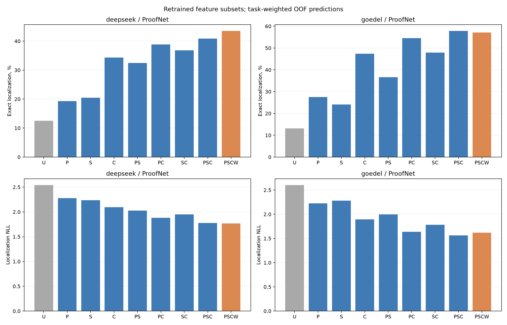

## Приложение 19 Ничьи при выборе позиции ошибки

Источник: [Ничьи при выборе позиции ошибки](chapters/19_ties.md). Сервер: /beegfs/home/denis.rakhmankin/onebigjump/runs/localizer_feature_ablation_20261113_v1/tie_audit/REPORT_RU.md.

Без переобучения, по тем же OOF/frozen scores. При точном равенстве максимальных scores историческая реализация выбирает самый ранний шаг. Для признака только типа тактики повторения одного типа создают такие равенства. Здесь также рассчитана ожидаемая точность равномерного выбора среди максимальных кандидатов. NLL от разрешения равенств не зависит. P — позиция, S — surprisal, T — тип тактики, N — её длина в токенах; C=T+N. Проценты с равными весами задач. Отдельные совпадения близких, но не равных scores не объединяются.

| Модель / данные | Признаки | Hit: первый при равенстве | Hit: случайный при равенстве | Доля с равенством | Среднее число максимумов |
| --- | --- | --- | --- | --- | --- |
| deepseek / ProofNet | P | 19.31 | 19.31 | 0.00 | 1.00 |
| deepseek / ProofNet | S | 20.47 | 20.47 | 0.00 | 1.00 |
| deepseek / ProofNet | C | 34.33 | 33.43 | 5.49 | 1.07 |
| deepseek / ProofNet | PSC | 40.85 | 40.85 | 0.00 | 1.00 |
| deepseek / ProofNet | PSCW | 43.51 | 43.51 | 0.00 | 1.00 |
| deepseek / ProofNet | T | 34.27 | 28.67 | 39.80 | 1.91 |
| deepseek / ProofNet | N | 32.43 | 31.65 | 5.56 | 1.06 |
| deepseek / ProofNet | PST | 38.80 | 38.80 | 0.00 | 1.00 |
| deepseek / ProofNet | PSN | 35.45 | 35.45 | 0.00 | 1.00 |
| deepseek / Putnam | P | 16.67 | 16.67 | 0.00 | 1.00 |
| deepseek / Putnam | S | 16.95 | 16.95 | 0.00 | 1.00 |
| deepseek / Putnam | C | 34.05 | 34.20 | 5.32 | 1.05 |
| deepseek / Putnam | PSC | 34.05 | 34.05 | 0.00 | 1.00 |
| deepseek / Putnam | PSCW | 34.20 | 34.20 | 0.00 | 1.00 |
| deepseek / Putnam | T | 30.46 | 27.34 | 48.13 | 2.36 |
| deepseek / Putnam | N | 28.74 | 28.74 | 1.72 | 1.02 |
| deepseek / Putnam | PST | 30.46 | 30.46 | 0.00 | 1.00 |
| deepseek / Putnam | PSN | 26.01 | 26.01 | 0.00 | 1.00 |
| goedel / ProofNet | P | 27.53 | 27.53 | 0.00 | 1.00 |
| goedel / ProofNet | S | 24.06 | 24.06 | 0.00 | 1.00 |
| goedel / ProofNet | C | 47.37 | 46.87 | 3.76 | 1.04 |
| goedel / ProofNet | PSC | 57.82 | 57.82 | 0.00 | 1.00 |
| goedel / ProofNet | PSCW | 57.13 | 57.13 | 0.00 | 1.00 |
| goedel / ProofNet | T | 37.83 | 31.94 | 44.10 | 2.25 |
| goedel / ProofNet | N | 42.67 | 42.00 | 5.64 | 1.07 |
| goedel / ProofNet | PST | 50.43 | 50.43 | 0.00 | 1.00 |
| goedel / ProofNet | PSN | 44.76 | 44.76 | 0.00 | 1.00 |
| goedel / Putnam | P | 11.43 | 11.43 | 0.00 | 1.00 |
| goedel / Putnam | S | 20.48 | 20.48 | 0.00 | 1.00 |
| goedel / Putnam | C | 42.38 | 42.38 | 0.00 | 1.00 |
| goedel / Putnam | PSC | 45.71 | 45.71 | 0.00 | 1.00 |
| goedel / Putnam | PSCW | 40.00 | 40.00 | 0.00 | 1.00 |
| goedel / Putnam | T | 30.00 | 23.14 | 37.62 | 1.88 |
| goedel / Putnam | N | 45.24 | 45.24 | 1.43 | 1.01 |
| goedel / Putnam | PST | 43.33 | 43.33 | 0.00 | 1.00 |
| goedel / Putnam | PSN | 32.86 | 32.86 | 0.00 | 1.00 |

## Приложение 20 Устойчивость различий DeepSeek и Goedel

Источник: [Устойчивость различий DeepSeek и Goedel](chapters/20_goedel.md). Сервер: /beegfs/home/denis.rakhmankin/onebigjump/runs/goedel_heterogeneity_20261113_v1/REPORT_RU.md.

Исследовательский разбор сохранённых предсказаний, 13 ноября 2026. Новых fits и LLM-запусков нет. Положительная delta NLL=loss baseline-loss state; delta Hit=Hit state-Hit baseline в п.п. Равные веса задач и попыток внутри задачи. 20000 task-bootstrap фиксированных предсказаний; нет refit и поправки на все исследовательские срезы. Фолды не являются независимыми повторениями обучения.

#### Эффект по внешним фолдам ProofNet

| model | new | fold | tasks | base Hit | new Hit | delta Hit | delta NLL |
| --- | --- | --- | --- | --- | --- | --- | --- |
| deepseek | state | 0 | 35 | 44.1905 | 50.2857 | 6.0952 | 0.2914 |
| deepseek | state | 1 | 33 | 48.9899 | 48.9899 | -0.0000 | -0.0599 |
| deepseek | state | 2 | 33 | 38.3838 | 52.2727 | 13.8889 | 0.0108 |
| deepseek | state | 3 | 33 | 36.1111 | 50.7576 | 14.6465 | 0.3535 |
| deepseek | state | 4 | 32 | 28.6607 | 35.3497 | 6.6890 | 0.1487 |
| deepseek | flexstate | 0 | 35 | 44.4286 | 49.5714 | 5.1429 | 0.3511 |
| deepseek | flexstate | 1 | 33 | 52.5253 | 51.7677 | -0.7576 | -0.0930 |
| deepseek | flexstate | 2 | 33 | 37.3737 | 54.0404 | 16.6667 | 0.1113 |
| deepseek | flexstate | 3 | 33 | 35.8586 | 58.8384 | 22.9798 | 0.3982 |
| deepseek | flexstate | 4 | 32 | 31.6295 | 39.1071 | 7.4777 | 0.2896 |
| goedel | state | 0 | 24 | 60.0694 | 51.7361 | -8.3333 | 0.0611 |
| goedel | state | 1 | 28 | 61.3095 | 56.5476 | -4.7619 | -0.1137 |
| goedel | state | 2 | 31 | 54.0323 | 36.8280 | -17.2043 | -0.0313 |
| goedel | state | 3 | 26 | 58.3333 | 55.4487 | -2.8846 | -0.1025 |
| goedel | state | 4 | 24 | 53.0556 | 53.5417 | 0.4861 | -0.3496 |
| goedel | flexstate | 0 | 24 | 60.4167 | 49.6528 | -10.7639 | 0.1912 |
| goedel | flexstate | 1 | 28 | 57.7381 | 52.9762 | -4.7619 | -0.1802 |
| goedel | flexstate | 2 | 31 | 54.3011 | 41.9355 | -12.3656 | -0.0428 |
| goedel | flexstate | 3 | 26 | 53.5256 | 49.6795 | -3.8462 | -0.1772 |
| goedel | flexstate | 4 | 24 | 55.8333 | 57.0833 | 1.2500 | -0.0670 |

#### Чувствительность к исключению одной задачи

Это диагностический пересчёт оценок, без переобучения. Значения min/max не являются доверительным интервалом.

| model | dataset | new | metric | delta | leave-one-task min | leave-one-task max |
| --- | --- | --- | --- | --- | --- | --- |
| deepseek | ProofNet | state | hit | 8.247274813539875 | 7.691197691197693 | 8.903318903318905 |
| deepseek | ProofNet | state | nll | 0.15060742853755593 | 0.13580950186739724 | 0.165475489799713 |
| deepseek | ProofNet | flexstate | hit | 10.256741250717155 | 9.712842712842713 | 10.924963924963926 |
| deepseek | ProofNet | flexstate | nll | 0.21267181947415734 | 0.1965975910285626 | 0.22827343354456298 |
| deepseek | Putnam | state | hit | 15.948275862068966 | 14.473684210526315 | 17.982456140350877 |
| deepseek | Putnam | state | nll | 0.21535638172717336 | 0.16751502358030204 | 0.24003235077169027 |
| deepseek | Putnam | flexstate | hit | 17.097701149425287 | 15.643274853801168 | 19.152046783625728 |
| deepseek | Putnam | flexstate | nll | 0.42435081775650674 | 0.397922897908273 | 0.4593230613880085 |
| goedel | ProofNet | state | hit | -6.992481203007519 | -7.803030303030303 | -6.287878787878788 |
| goedel | ProofNet | state | nll | -0.10332383598475482 | -0.1314074392167823 | -0.07937685041817062 |
| goedel | ProofNet | flexstate | hit | -6.353383458646617 | -7.159090909090909 | -5.643939393939394 |
| goedel | ProofNet | flexstate | nll | -0.06012234027355339 | -0.09401972348166399 | -0.032883912956565356 |
| goedel | Putnam | state | hit | 5.238095238095238 | 2.450980392156863 | 8.333333333333334 |
| goedel | Putnam | state | nll | 0.2295580154511765 | 0.14184414597959538 | 0.26999292452209445 |
| goedel | Putnam | flexstate | hit | 2.857142857142857 | 0.0 | 5.882352941176471 |
| goedel | Putnam | flexstate | nll | 0.37502279258193694 | 0.2527149095180485 | 0.4443725238476586 |

#### Сравнение на общих задачах

Сопоставлены задачи, но разные модели генерировали разные доказательства. Это не контроль идентичного текста, не повторная генерация и не устранение отбора по локализуемости.

| dataset | metric | tasks | DS gain | Go gain | DS-Go | 95% CI |
| --- | --- | --- | --- | --- | --- | --- |
| ProofNet | hit | 118 | 5.881759483454399 | -6.045197740112994 | 11.926957223567392 | [2.2073244552058116, 21.587974172719935] |
| ProofNet | nll | 118 | 0.05999067212584034 | -0.1328442034796166 | 0.1928348756054569 | [-0.007126572300069767, 0.3945764562811712] |
| Putnam | hit | 30 | 13.611111111111112 | 11.111111111111112 | 2.5 | [-22.5, 27.777777777777782] |
| Putnam | nll | 30 | 0.13115094560112445 | 0.27834643194504183 | -0.14719548634391735 | [-0.5247571948804, 0.22694702842522094] |

#### Исправления и испорченные попадания

| model | dataset | new | corrected pp | broken pp |
| --- | --- | --- | --- | --- |
| deepseek | ProofNet | state | 18.6144578313253 | 10.367183017785427 |
| deepseek | ProofNet | flexstate | 18.831038439472174 | 8.57429718875502 |
| deepseek | Putnam | state | 23.419540229885055 | 7.471264367816091 |
| deepseek | Putnam | flexstate | 21.982758620689655 | 4.885057471264368 |
| goedel | ProofNet | state | 9.385964912280702 | 16.37844611528822 |
| goedel | ProofNet | flexstate | 10.112781954887218 | 16.466165413533833 |
| goedel | Putnam | state | 15.238095238095237 | 10.0 |
| goedel | Putnam | flexstate | 13.809523809523808 | 10.95238095238095 |

Полные срезы по длине и первой ошибке: strata.csv. Они выбраны для диагностики после наблюдения основных результатов, не для нового подтверждающего теста. Нулевая разность или интервал через ноль не доказывают равенство методов. Сравнения разных моделей условны на разных доступных популяциях.

## Приложение 21 Тип и длина тактики у Goedel

Источник: [Тип и длина тактики у Goedel](chapters/21_type_length.md). Сервер: /beegfs/home/denis.rakhmankin/onebigjump/runs/goedel_type_length_shape_20261113_v1/REPORT_RU.md.

Восстановление сохранённых моделей, без нового обучения. Основные кривые — финальная модель на всём ProofNet для переноса на Putnam; тонкие линии — пять outer-fold моделей. Scores не являются абсолютными вероятностями ошибки. Вероятности нормируются softmax по кандидатам одного доказательства.

Тип — категория AST-узла статического разбора; объединённые категории разделены вертикальной чертой. Длина — token_end-token_start+1 в исходной токенизации. Измеряется выделенный фрагмент, включая попавшие в него комментарии, вложенные блоки и разделители. Это не число токенов одного слова-команды.

N: s=g(log(1+n)). T: s=a_type. C: s=g(log(1+n))+a_type. Сплайн кубический, train-only узлы и масштабы. В C нет взаимодействия типа и длины: одна общая кривая и разные вертикальные смещения. Редкие типы объединены в OTHER.

#### Сравнение с правилом максимальной длины

| Данные | Модель | Hit % | Выбран максимум длины % | Совпадение с первым максимумом % |
| --- | --- | --- | --- | --- |
| ProofNet | N | 42.67 | 100.00 | 100.00 |
| ProofNet | T | 37.83 | 35.24 | 35.24 |
| ProofNet | C | 47.37 | 64.50 | 64.50 |
| Putnam | N | 45.24 | 100.00 | 100.00 |
| Putnam | T | 30.00 | 34.76 | 34.76 |
| Putnam | C | 42.38 | 54.29 | 54.29 |

#### Кривая

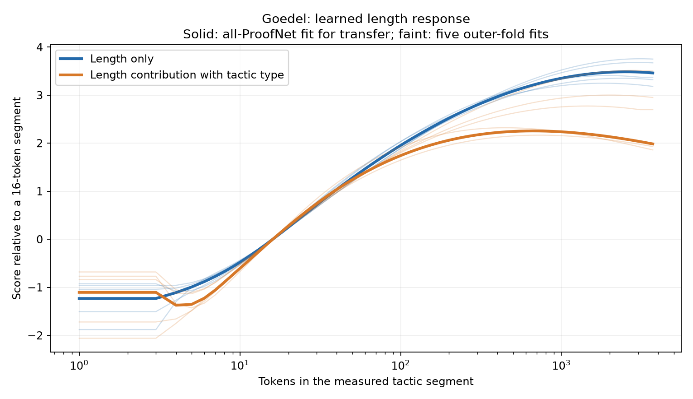

| Токены | Score N относительно 16 | Вес N относительно 16 | Score C относительно 16 | Вес C относительно 16 |
| --- | --- | --- | --- | --- |
| 2 | -1.2325 | 0.2916 | -1.1050 | 0.3312 |
| 4 | -1.1104 | 0.3294 | -1.3725 | 0.2535 |
| 8 | -0.6725 | 0.5104 | -0.8938 | 0.4091 |
| 16 | 0.0000 | 1.0000 | 0.0000 | 1.0000 |
| 32 | 0.7893 | 2.2018 | 0.8120 | 2.2524 |
| 64 | 1.5296 | 4.6162 | 1.4408 | 4.2240 |
| 128 | 2.1692 | 8.7509 | 1.8751 | 6.5213 |
| 256 | 2.6940 | 14.7904 | 2.1350 | 8.4573 |
| 512 | 3.0931 | 22.0461 | 2.2457 | 9.4469 |
| 1024 | 3.3573 | 28.7106 | 2.2341 | 9.3379 |
| 2048 | 3.4777 | 32.3855 | 2.1281 | 8.3989 |
| 4096 | 3.4606 | 31.8351 | 1.9842 | 7.2729 |

Вес — exp(score(n)-score(16)); это отношение вероятностей двух кандидатов, для C при одинаковом типе. Вне крайних train-узлов сплайн продолжается константой.

#### Эффекты типов

| Тип AST | Train groups | Score T относительно OTHER | Score C относительно OTHER |
| --- | --- | --- | --- |
| Lean.Parser.Tactic.classical | 12 | 4.5736 | 3.3849 |
| Mathlib.Tactic.useSyntax | 14 | 1.4242 | 1.4444 |
| Lean.Parser.Tactic.simpa | 48 | 1.3797 | 1.6540 |
| Lean.Parser.Tactic.apply | 67 | 1.3187 | 1.3281 |
| Lean.Parser.Tactic.«tactic_<;>_» | 89 | 1.1868 | 0.8137 |
| Lean.Parser.Tactic.tacticHave__&#124;Lean.Parser.Tactic.«tactic_<;>_» | 51 | 1.0377 | 0.4489 |
| Mathlib.Tactic.linarith | 16 | 0.4061 | 1.6784 |
| Lean.Parser.Tactic.simp | 36 | 0.3912 | 0.6670 |
| Lean.Parser.Tactic.rwSeq | 69 | 0.2946 | 0.7529 |
| OTHER | 0 | 0.0000 | 0.0000 |
| Lean.Parser.Tactic.obtain | 42 | -0.0938 | 0.3393 |
| Mathlib.Tactic.normNum | 11 | -0.4054 | 0.0027 |
| Lean.Parser.Tactic.exact | 133 | -0.4405 | 0.9639 |
| Lean.Parser.Tactic.refine' | 36 | -0.4733 | -0.0634 |
| Lean.Parser.Tactic.tacticHave__ | 91 | -1.0415 | -0.7212 |
| Lean.Parser.Tactic.exact&#124;Lean.Parser.Tactic.tacticHave__ | 108 | -1.0713 | 0.1917 |
| Lean.Parser.Tactic.intro | 80 | -1.3453 | -0.8587 |
| «tacticBy_cases_:_» | 17 | -1.8444 | -1.4770 |
| Lean.Parser.Tactic.rcases | 17 | -1.8471 | -1.1444 |
| Lean.Parser.Tactic.constructor | 28 | -1.8515 | -0.9960 |
| Lean.Parser.Tactic.simpAll | 14 | -1.8620 | -1.0472 |
| Batteries.Tactic.byContra | 36 | -1.9371 | -1.6305 |
| Lean.Parser.Tactic.contradiction | 16 | -1.9602 | -0.9829 |
| Lean.Parser.Tactic.tacticExfalso | 16 | -2.0887 | -1.6194 |
| Lean.Parser.Tactic.omega | 11 | -2.0898 | -1.4014 |

Типовые оценки условны на отобранных ошибочных доказательствах; это не частота неправильности команды во всех доказательствах. Равные scores разрешаются выбором первого кандидата; предыдущая tie-абляция измеряет этот эффект.

#### Представление деревом

Исходная модель — аддитивный spline-score с softmax. Дерево можно построить как приближение кривой либо обучить отдельно на тех же групповых разбиениях. Если g строго возрастает на кандидатах, argmax совпадает с максимумом длины. Возможные изгибы проверяются по коэффициентам; плато вне train-диапазона создаёт равные scores. В C более короткая тактика может победить из-за смещения её типа.

В исходной ProofNet-таблице 5460 шагов; 21.01% сегментов содержат маркер комментария, 7.20% имеют объединённый AST-тип. Это описательные доли шагов; доля токенов комментария здесь не измерялась. В examples.json сохранены реальные примеры. Все вероятности восстановлены с ошибкой <1e-10.

## Приложение 22 Раздельное обучение на Putnam и полная стриминговая матрица

Источник: [Раздельное обучение на Putnam и полная стриминговая матрица](chapters/22_daily.md). Сервер: /beegfs/home/denis.rakhmankin/onebigjump/runs/localizer_putnam_stream_20261113_v1/publications/scope_extension_v2/REPORT_RU.md.

Сводный отчёт о сегодняшних переобучениях и разборах сохранённых экспериментов с DeepSeek-Prover-V2-7B и Goedel-Prover-V2-8B. Он объединяет разложение baseline на признаки, полную матрицу скрытых состояний и приращений, разбор различий Goedel, тип и длину тактики, а также новые серии обучения на Putnam и стримингового обнаружения.

Дата относится к часовому поясу Europe/Moscow. Момент снимка вычислений приведён ниже в UTC. Модели генерации доказательств заморожены; сегодня обучаются локализаторы, а не сами LLM. Сборка матрицы прежних векторных экспериментов и аудит сохранённых предсказаний отдельно отмечены и не считаются новой генерацией.

#### Что означает режим оценки

| Режим | Что доступно при решении | Выход | Какие числа к нему относятся |
| --- | --- | --- | --- |
| Ретроспективная локализация | Готовое доказательство, его длина и все шаги, включая текст после отказа | Один наиболее вероятный первый отказ | Прежние матрицы Hit@1/NLL, сегодняшние абляции P/S/T/N и анализ длины |
| Стриминговое обнаружение | Признаки текущего и предыдущих завершённых шагов | Первая тревога при превышении фиксированного порога | Новая полная матрица streaming ниже; прежние отдельные streaming-серии относятся к своим baseline и cohort |
| Прогноз до следующего шага | Только уже принятый префикс, без текущего будущего шага | Риск будущего отказа | Отдельная задача; текущая новая матрица её не подменяет |

Стриминговый эксперимент здесь — causal replay сохранённых состояний при заданных границах завершённых AST-фрагментов. Численные признаки проверены на независимость от будущих шагов. Самостоятельный онлайн-парсер, который устанавливает эти границы без полного текста, отдельно не проверен. Поэтому результаты не обозначаются как end-to-end система остановки генерации.

#### Что означают разность, норма и нормировка

Состояние X_t — вектор из 4096 координат после завершения шага t; X_0 взят на входе в формальное доказательство. Слои readout: 14 у DeepSeek и 17 у Goedel, нумерация с нуля.

Исходный вектор изменения:

$$
\Delta X_t=X_t-X_{t-1}.
$$

Его обычная евклидова норма:

$$
\rho_t=\|\Delta X_t\|_2.
$$

В основной матрице скачок измеряется после whitening — центрирования и линейного изменения масштаба направлений по отдельной исходной calibration-выборке:

$$
z_t=\Sigma^{-1/2}(\Delta X_t-\mu),\qquad
r_t=\|z_t\|_2,\qquad
u_t=\frac{z_t}{r_t}.
$$

При нулевой норме направление задаётся нулём. В таблицах W или r означает скалярный признак log(1+r_t), а u — все координаты единичного вектора. Поэтому:

| Признак | Размерность | Какая информация сохраняется |
| --- | --- | --- |
| raw deltaX | 4096 | Исходное изменение, включая направление и величину |
| z | 4096 | Изменение после фиксированного whitening, включая величину |
| r, или W после log1p | 1 | Только величина whitened-изменения |
| u | 4096 | Только направление whitened-изменения |
| r + u | 4097 | Величина и направление как отдельные входы |
| X | 4096 | Текущее состояние, а не изменение |

Например, для вектора (3,4) норма равна 5, а единичное направление — (0.6,0.8). Вектор (30,40) имеет то же направление, но норму 50. Локализатор по норме не различит (3,4) и (-3,-4), а локализатор по направлению различит.

После построения признаков координаты дополнительно стандартизируются по train mean/std. Эта общая для выборки стандартизация не делит каждый отдельный вектор на его собственную норму и не удаляет его амплитуду.

Хотя z=r*u, линейная модель с отдельными r и u не эквивалентна линейной модели по z: для восстановления произведения нужны взаимодействия. Добавление скрытого состояния означает добавление обучаемой линейной проекции его координат к оценке baseline; это отдельный probe, а не дообучение LLM.

#### Как обучаются локализаторы

В ретроспективном случае каждый шаг получает оценку s_t. Вероятности нормируются по всем шагам доказательства:

$$
p_t=\frac{\exp(s_t)}{\sum_{j=1}^{L}\exp(s_j)},\qquad
\widehat t=\arg\max_t p_t.
$$

Loss одной ошибочной попытки — -log p_f, где f — первый Lean-отказ. Наличие вероятности, нормированной по всем кандидатам, само по себе делает такую оценку ретроспективной, даже если отдельный score использует только surprisal текущего шага.

Для новой стриминговой версии используется sigmoid:

$$
h_t=\frac{1}{1+\exp(-s_t)},\qquad
\widehat t=\min\{t:h_t>c\}.
$$

Обучение использует только шаги до первого отказа включительно; последующие не превращаются в отрицательные примеры. y_t=1 только на отказе, y_t=0 на предшествовавших принятых шагах и всех шагах строго verified-попыток. BCE шага:

$$
\ell_t=-y_t\log h_t-(1-y_t)\log(1-h_t).
$$

Порог c выбирается на внутренних out-of-fold прогнозах. В тесте он фиксирован, тревога не отзывается после просмотра будущего текста. Из позиционных признаков удалены t/L и индикатор последнего шага. Это обнаружение после текущей тактики, не предсказание её отказа до генерации.

Exact означает, что первая тревога пришлась точно на первый отказ; Early — тревога раньше отказа; Miss — отсутствие тревоги до отказа включительно. FPR по verified означает хотя бы одну тревогу за всё корректное доказательство.

NLL ретроспективной локализации и средняя BCE стримингового детектора относятся к разным исходам и разным нормировкам. Их численные значения нельзя сравнивать напрямую.

#### Обучение непосредственно на Putnam

В прежних таблицах Putnam был только внешней проверкой: все параметры локализатора выбраны на ProofNet. Новая серия обучает и подбирает параметры на части задач Putnam и проверяет на других задачах Putnam: пять внешних групповых фолдов, по три внутренних для настройки. Все попытки одной группы задачи находятся в одном фолде.

В доступном Putnam-архиве нет полностью verified-доказательств. Ретроспективная локализация на ошибочных попытках остаётся определённой. Для streaming имеются отрицательные шаги до первого отказа, но нет отрицательных целых доказательств. Порог Putnam-trained моделей калибруется по максимумам на принятых префиксах тренировочных попыток; его контроль относится к преждевременной тревоге, не к ложной тревоге на корректных доказательствах.

Таким образом, Putnam-trained streaming описывает условную популяцию доступных ошибочных попыток. Его нельзя использовать как оценку общей вероятности ошибки среди всех генерируемых доказательств. Для такой оценки нужны также достоверно корректные попытки Putnam. В замороженном переносе ProofNet -> Putnam используется исходный ProofNet-порог, без перенастройки по Putnam.

Размер train у Putnam меньше, чем у ProofNet, и это также меняет сравнение переноса с обучением внутри датасета. Разница результатов не изолирует только эффект совпадения домена.

#### Какие работы объединены

| Работа | Что выполнено |
| --- | --- |
| Полная матрица состояний и приращений | Сборка завершённых прежних fits: X, Xprev, raw deltaX, whitening, величина, направление, гибкие baseline |
| Разбор Goedel | Внешние фолды, исключение одной задачи, общие задачи двух моделей, исправленные и испорченные попадания; без нового обучения |
| Абляция P/S/C/W | 18 заново обученных скалярных вариантов на ProofNet и перенос на Putnam |
| Разделение типа и длины | 8 новых вариантов T/N и комбинаций с P/S плюс воспроизведение 4 исходных контролей |
| Равенство scores | Пересчёт выбора первого против случайного выбора среди равных максимумов; без переобучения |
| Кривая длины Goedel | Восстановление коэффициентов, сравнение каждого прогноза с самым длинным фрагментом, аудит токеновых span |
| Новая полная серия | 39 вариантов для двух LLM: Putnam-trained retrospective; ProofNet-trained streaming OOF; Putnam-trained streaming OOF; ProofNet -> Putnam streaming |

Ниже приведены полные таблицы. Все значения берутся из сохранённых результатов; незавершённые сравнения явно оставлены без результата.

#### Статус новой серии на момент отчёта

Снимок UTC: 2026-11-12T23:04:36.982324+00:00. Завершено 1136 из 1248 внешних/frozen fits. Полностью собраны 268 из 312 сочетаний режима, LLM и варианта локализатора. Один внешний fit включает внутренний подбор параметров; это не число новых генераций LLM.

[Подробный протокол новой серии](https://github.com/Kilkaintomat/Scoltech-big_jump/blob/818fe065afaa6bc9127d804aa6e2467e5f897cc8/reports/localizer_daily_20261113/new_protocol.md). [Все готовые новые метрики](https://github.com/Kilkaintomat/Scoltech-big_jump/blob/818fe065afaa6bc9127d804aa6e2467e5f897cc8/reports/localizer_daily_20261113/new_metrics.csv). [Парные сравнения](https://github.com/Kilkaintomat/Scoltech-big_jump/blob/818fe065afaa6bc9127d804aa6e2467e5f897cc8/reports/localizer_daily_20261113/new_contrasts.csv). [Незавершённые ячейки](https://github.com/Kilkaintomat/Scoltech-big_jump/blob/818fe065afaa6bc9127d804aa6e2467e5f897cc8/reports/localizer_daily_20261113/pending.csv).

##### Состав новой выборки

| LLM | Датасет | Попытки | Группы задач | Отказы | Verified |
| --- | --- | --- | --- | --- | --- |
| deepseek | ProofNet | 563 | 187 | 452 | 111 |
| deepseek | Putnam | 118 | 58 | 118 | 0 |
| goedel | ProofNet | 338 | 144 | 259 | 79 |
| goedel | Putnam | 48 | 35 | 48 | 0 |

##### Добавка скачка при обучении на Putnam

Только модели с завершёнными всеми внешними фолдами. Δ в процентных пунктах, 95% bootstrap задач при фиксированных прогнозах.

| LLM | Baseline | Без скачка, Hit % | Со скачком, Hit % | Δ [95% CI] | NLL без / со скачком |
| --- | --- | --- | --- | --- | --- |
| deepseek | PSC | 28.30 | 32.76 | +4.45 [-2.01; 11.49] | 2.1522 / 2.1327 |
| deepseek | MD | 28.30 | 32.47 | +4.17 [-2.01; 10.78] | 2.1515 / 2.1328 |
| goedel | PSC | 32.86 | 32.86 | +0.00 [0.00; 0.00] | 2.1065 / 2.1099 |
| goedel | MD | 28.57 | 31.43 | +2.86 [0.00; 8.57] | 2.0966 / 2.1006 |

Таблица описывает точечные оценки и неопределённость. Полная поправка Holm для зарегистрированных сравнений приведена в разделе новой серии. Нулевой размах bootstrap, если у двух моделей совпали все попадания, не означает доказанного равенства обучающих процедур.

#### Что использует локализатор: позиция, surprisal, тип тактики и скачок

Новая серия на сохранённых трассах DeepSeek-Prover-V2-7B и Goedel-Prover-V2-8B. Все локализаторы переобучены отдельно. Генерации LLM и GPU не использовались. Это исследовательские сравнения после изучения того же архива, а не независимая подтверждающая выборка.

P — только номер и относительная позиция тактики, первый/последний шаг; S — только средний token surprisal текущей тактики; C — тип и длина тактики. W — скаляр log(1+норма whitened-приращения). PSC — исходный baseline статьи, PSCW — его расширение. MD дополнительно использует соседнюю разность surprisal и её модуль. В S нет разности, индикатора первого шага, типа или длины тактики. U — равномерное распределение с ожидаемой точностью 1/L.

Полное готовое доказательство доступно; исход — первая Lean-отвергнутая тактика среди ошибочных доказательств. Softmax нормирует вероятности по доступным кандидатам, поэтому S не является стриминговым локализатором. Это не доля решённых задач и не тест наличия ошибки.

##### Проверка и протокол

Сохранены прежние 5 внешних и 3 внутренних group-fold, сетка регуляризации и conditional softmax. Сплайны, масштабы, категории и lambda определены только на train. Putnam — замороженный перенос с ProofNet без настройки на Putnam. Во всех 10 внешних фолдах воспроизведены исходные M0/M0W/MD/MDW вероятности с ошибкой <1e-6. Проверены независимость P от прочих признаков и отсутствие прямой позиции в S, сходимость и нормировка вероятностей. Все вычисления выполнены через Slurm.

Основные веса равны по задачам и затем по попыткам внутри задачи. Интервалы — 20000 bootstrap задач при фиксированных предсказаниях, без переобучения. Holm80 корректирует 80 заранее перечисленных сравнений Hit/NLL; дополнительные срезы и Shapley остаются описательными. Полный протокол: [протокол абляции](https://github.com/Kilkaintomat/Scoltech-big_jump/blob/818fe065afaa6bc9127d804aa6e2467e5f897cc8/reports/localizer_daily_20261113/scalar_protocol.md).

##### Основная матрица

В ячейке: Hit, % / NLL. Больше Hit и меньше NLL — лучше.

| Признаки | deepseek / ProofNet | deepseek / Putnam | goedel / ProofNet | goedel / Putnam |
| --- | --- | --- | --- | --- |
| U | 12.55 / 2.5426 | 7.51 / 2.8979 | 13.15 / 2.6047 | 7.52 / 2.8246 |
| P | 19.31 / 2.2760 | 16.67 / 2.8224 | 27.53 / 2.2274 | 11.43 / 2.9017 |
| S | 20.47 / 2.2340 | 16.95 / 2.4613 | 24.06 / 2.2802 | 20.48 / 2.4485 |
| C | 34.33 / 2.0937 | 34.05 / 2.2023 | 47.37 / 1.8925 | 42.38 / 2.2477 |
| PS | 32.49 / 2.0277 | 13.51 / 2.4216 | 36.64 / 1.9989 | 16.67 / 2.5403 |
| PC | 38.87 / 1.8812 | 33.33 / 2.1385 | 54.50 / 1.6376 | 38.57 / 2.3032 |
| SC | 36.80 / 1.9514 | 32.33 / 1.9701 | 47.87 / 1.7840 | 35.24 / 2.0350 |
| PSC | 40.85 / 1.7747 | 34.05 / 1.9328 | 57.82 / 1.5617 | 45.71 / 2.0895 |
| W | 18.50 / 2.4587 | 19.83 / 2.7744 | 26.57 / 2.3975 | 6.67 / 2.8764 |
| PW | 24.92 / 2.2538 | 17.39 / 2.7657 | 31.67 / 2.1592 | 12.86 / 2.9049 |
| SW | 27.92 / 2.1950 | 21.41 / 2.4094 | 26.90 / 2.2212 | 12.86 / 2.5046 |
| CW | 36.46 / 2.0518 | 27.73 / 2.1548 | 46.43 / 1.8393 | 40.95 / 2.2704 |
| PSW | 33.26 / 2.0185 | 16.67 / 2.3912 | 38.37 / 1.9828 | 19.52 / 2.5640 |
| PCW | 41.53 / 1.8639 | 31.75 / 2.1091 | 54.81 / 1.6189 | 35.71 / 2.3316 |
| SCW | 38.72 / 1.9323 | 32.47 / 1.9504 | 46.68 / 1.7576 | 42.38 / 2.0765 |
| PSCW | 43.51 / 1.7659 | 34.20 / 1.9172 | 57.13 / 1.6179 | 40.00 / 2.1247 |
| MD | 39.39 / 1.7797 | 33.48 / 1.9359 | 57.32 / 1.5706 | 45.71 / 2.0755 |
| MDW | 42.20 / 1.7705 | 34.20 / 1.9202 | 55.69 / 1.6262 | 45.71 / 2.1098 |

##### Добавочная полезность групп признаков

ΔHit — процентные пункты; выигрыш NLL = NLL(base)-NLL(new). Положительное значение означает улучшение.

| Модель / данные | Сравнение | ΔHit [95%] | выигрыш NLL [95%] | Holm p Hit / NLL |
| --- | --- | --- | --- | --- |
| deepseek / ProofNet | PS − S | +12.01 [7.37; 16.85] | +0.2062 [0.1437; 0.2669] | 0.0040 / 0.0040 |
| deepseek / ProofNet | PS − P | +13.18 [8.58; 18.07] | +0.2483 [0.1863; 0.3059] | 0.0040 / 0.0040 |
| deepseek / ProofNet | PSC − PS | +8.36 [2.73; 13.83] | +0.2531 [0.1684; 0.3363] | 0.1764 / 0.0040 |
| deepseek / ProofNet | PSC − SC | +4.05 [0.06; 8.01] | +0.1767 [0.1110; 0.2419] | 1.0000 / 0.0040 |
| deepseek / ProofNet | PSC − PC | +1.98 [-0.50; 4.59] | +0.1065 [0.0589; 0.1511] | 1.0000 / 0.0040 |
| deepseek / ProofNet | PW − P | +5.61 [1.29; 10.06] | +0.0223 [0.0007; 0.0426] | 0.6200 / 1.0000 |
| deepseek / ProofNet | SW − S | +7.45 [2.31; 12.65] | +0.0390 [0.0120; 0.0643] | 0.2464 / 0.2145 |
| deepseek / ProofNet | PSW − PS | +0.78 [-2.37; 3.97] | +0.0092 [-0.0045; 0.0222] | 1.0000 / 1.0000 |
| deepseek / ProofNet | PSCW − PSC | +2.66 [0.50; 5.17] | +0.0088 [-0.0043; 0.0218] | 1.0000 / 1.0000 |
| deepseek / ProofNet | MDW − MD | +2.81 [0.95; 5.02] | +0.0092 [-0.0040; 0.0224] | 0.4212 / 1.0000 |
| deepseek / Putnam | PS − S | -3.45 [-11.78; 4.89] | +0.0397 [-0.0831; 0.1622] | 1.0000 / 1.0000 |
| deepseek / Putnam | PS − P | -3.16 [-11.49; 4.31] | +0.4009 [0.2794; 0.5139] | 1.0000 / 0.0040 |
| deepseek / Putnam | PSC − PS | +20.55 [11.21; 30.17] | +0.4888 [0.3374; 0.6414] | 0.0040 / 0.0040 |
| deepseek / Putnam | PSC − SC | +1.72 [-5.46; 9.34] | +0.0373 [-0.0696; 0.1447] | 1.0000 / 1.0000 |
| deepseek / Putnam | PSC − PC | +0.72 [-1.87; 3.59] | +0.2057 [0.1148; 0.2914] | 1.0000 / 0.0040 |
| deepseek / Putnam | PW − P | +0.72 [-8.76; 10.20] | +0.0567 [0.0184; 0.0949] | 1.0000 / 0.2145 |
| deepseek / Putnam | SW − S | +4.45 [-4.17; 13.22] | +0.0519 [0.0080; 0.0967] | 1.0000 / 0.9423 |
| deepseek / Putnam | PSW − PS | +3.16 [-0.57; 7.18] | +0.0303 [0.0041; 0.0561] | 1.0000 / 1.0000 |
| deepseek / Putnam | PSCW − PSC | +0.14 [-2.16; 2.30] | +0.0156 [-0.0108; 0.0409] | 1.0000 / 1.0000 |
| deepseek / Putnam | MDW − MD | +0.72 [-1.72; 3.16] | +0.0156 [-0.0108; 0.0408] | 1.0000 / 1.0000 |
| goedel / ProofNet | PS − S | +12.58 [4.82; 20.40] | +0.2813 [0.1815; 0.3820] | 0.0944 / 0.0040 |
| goedel / ProofNet | PS − P | +9.11 [4.94; 13.81] | +0.2285 [0.1353; 0.3132] | 0.0094 / 0.0064 |
| goedel / ProofNet | PSC − PS | +21.18 [13.85; 28.57] | +0.4372 [0.2998; 0.5702] | 0.0040 / 0.0040 |
| goedel / ProofNet | PSC − SC | +9.95 [4.80; 15.35] | +0.2223 [0.1202; 0.3260] | 0.0279 / 0.0040 |
| goedel / ProofNet | PSC − PC | +3.32 [0.19; 6.89] | +0.0759 [0.0136; 0.1346] | 1.0000 / 0.6624 |
| goedel / ProofNet | PW − P | +4.14 [-0.44; 9.02] | +0.0682 [0.0139; 0.1203] | 1.0000 / 0.6043 |
| goedel / ProofNet | SW − S | +2.84 [-3.27; 8.96] | +0.0590 [-0.0166; 0.1263] | 1.0000 / 1.0000 |
| goedel / ProofNet | PSW − PS | +1.73 [-1.57; 5.26] | +0.0160 [-0.0190; 0.0492] | 1.0000 / 1.0000 |
| goedel / ProofNet | PSCW − PSC | -0.69 [-3.13; 1.57] | -0.0562 [-0.0921; -0.0225] | 1.0000 / 0.0944 |
| goedel / ProofNet | MDW − MD | -1.63 [-4.32; 0.63] | -0.0556 [-0.0924; -0.0206] | 1.0000 / 0.1425 |
| goedel / Putnam | PS − S | -3.81 [-18.10; 11.43] | -0.0918 [-0.2955; 0.0958] | 1.0000 / 1.0000 |
| goedel / Putnam | PS − P | +5.24 [0.00; 12.38] | +0.3614 [0.2098; 0.4976] | 1.0000 / 0.0040 |
| goedel / Putnam | PSC − PS | +29.05 [12.86; 45.71] | +0.4508 [0.0927; 0.7951] | 0.0510 / 0.6200 |
| goedel / Putnam | PSC − SC | +10.48 [-3.33; 25.71] | -0.0544 [-0.2485; 0.1318] | 1.0000 / 1.0000 |
| goedel / Putnam | PSC − PC | +7.14 [0.00; 15.71] | +0.2137 [0.1058; 0.3359] | 1.0000 / 0.0396 |
| goedel / Putnam | PW − P | +1.43 [0.00; 4.29] | -0.0031 [-0.1013; 0.0965] | 1.0000 / 1.0000 |
| goedel / Putnam | SW − S | -7.62 [-22.38; 6.19] | -0.0561 [-0.1531; 0.0404] | 1.0000 / 1.0000 |
| goedel / Putnam | PSW − PS | +2.86 [0.00; 7.14] | -0.0237 [-0.0867; 0.0394] | 1.0000 / 1.0000 |
| goedel / Putnam | PSCW − PSC | -5.71 [-14.29; 0.00] | -0.0352 [-0.0775; 0.0072] | 1.0000 / 1.0000 |
| goedel / Putnam | MDW − MD | +0.00 [0.00; 0.00] | -0.0343 [-0.0771; 0.0083] | 1.0000 / 1.0000 |

##### Откуда берётся NLL-выигрыш baseline

Shapley по всем порядкам добавления P/S/C, каждый набор отдельно переобучен. Вклад измерен в снижении held-out NLL; сумма трёх вкладов точно равна NLL(U)-NLL(PSC). Это характеристика предсказания выбранного алгоритма, не причинность и не прочтение смысла нейронов.

| Модель / данные | Группа | Вклад [95%] |
| --- | --- | --- |
| deepseek / Putnam | P | 0.0548 [-0.0623; 0.1704] |
| deepseek / Putnam | S | 0.3196 [0.2214; 0.4052] |
| deepseek / Putnam | C | 0.5906 [0.4217; 0.7564] |
| deepseek / ProofNet | P | 0.2176 [0.1536; 0.2790] |
| deepseek / ProofNet | S | 0.2035 [0.1487; 0.2535] |
| deepseek / ProofNet | C | 0.3469 [0.2560; 0.4349] |
| goedel / Putnam | P | -0.0684 [-0.2796; 0.1289] |
| goedel / Putnam | S | 0.2923 [0.1662; 0.4088] |
| goedel / Putnam | C | 0.5112 [0.1202; 0.8822] |
| goedel / ProofNet | P | 0.2893 [0.1865; 0.3924] |
| goedel / ProofNet | S | 0.1896 [0.1086; 0.2632] |
| goedel / ProofNet | C | 0.5641 [0.4179; 0.7025] |

##### Поведение предсказаний

Доли с равными весами задач, %. Совпадение с PSC не доказывает достаточности группы; важны качество и переобучаемые абляции выше.

| Модель / данные | Признаки | Выбран первый | Выбран последний | Совпадает с PSC |
| --- | --- | --- | --- | --- |
| deepseek / Putnam | P | 32.33 | 0.00 | 18.82 |
| deepseek / Putnam | S | 3.88 | 2.87 | 22.70 |
| deepseek / Putnam | C | 8.62 | 0.00 | 57.76 |
| deepseek / Putnam | PS | 26.58 | 0.00 | 26.87 |
| deepseek / Putnam | PSC | 13.36 | 0.00 | 100.00 |
| deepseek / ProofNet | P | 39.80 | 0.00 | 21.55 |
| deepseek / ProofNet | S | 13.30 | 6.50 | 25.28 |
| deepseek / ProofNet | C | 19.13 | 0.20 | 56.17 |
| deepseek / ProofNet | PS | 35.91 | 0.00 | 41.30 |
| deepseek / ProofNet | PSC | 22.09 | 0.00 | 100.00 |
| goedel / Putnam | P | 100.00 | 0.00 | 24.29 |
| goedel / Putnam | S | 2.86 | 0.00 | 19.05 |
| goedel / Putnam | C | 22.86 | 0.00 | 52.86 |
| goedel / Putnam | PS | 39.05 | 0.00 | 24.76 |
| goedel / Putnam | PSC | 24.29 | 0.00 | 100.00 |
| goedel / ProofNet | P | 97.37 | 0.00 | 33.71 |
| goedel / ProofNet | S | 13.10 | 8.71 | 25.65 |
| goedel / ProofNet | C | 21.80 | 0.75 | 60.20 |
| goedel / ProofNet | PS | 55.34 | 0.00 | 43.88 |
| goedel / ProofNet | PSC | 35.21 | 0.00 | 100.00 |

##### Ограничения интерпретации

Высокий результат P означает, что позиционный паттерн предсказывает метку в выбранной популяции; высокий результат S — что достаточно вероятностей токенов для части локализаций. Ни то ни другое само по себе не устанавливает математическую причину ошибки. Surprisal и тип тактики могут коррелировать с позицией даже без прямого позиционного признака. Модели генерировали разные доказательства; состав локализуемых ошибок и исключений различается.

Улучшение от вектора состояния или приращения нельзя автоматически приписывать его норме: направление, содержание и тип шага могут содержать другую информацию. Даже положительный W-контраст не выбирает Kesten среди альтернативных механизмов. Отсутствие выигрышного W-контраста не доказывает отсутствие любой информации в скрытом состоянии.

[strata.csv](https://github.com/Kilkaintomat/Scoltech-big_jump/blob/818fe065afaa6bc9127d804aa6e2467e5f897cc8/reports/localizer_daily_20261113/strata.csv) содержит первый/непервый отказ и срезы по длине. Для непервых ошибок сохраняются все кандидаты и уже обученные модели. сохранённый на сервере margin_contributions.csv содержит точное аддитивное разложение PSC-logit margin между настоящим отказом и самым сильным неверным кандидатом; [fit_diagnostics.csv](https://github.com/Kilkaintomat/Scoltech-big_jump/blob/818fe065afaa6bc9127d804aa6e2467e5f897cc8/reports/localizer_daily_20261113/fit_diagnostics.csv) — сходимость, размер и lambda каждого outer/frozen fit.


#### Уточнение: тип тактики отдельно от её длины

Дополнительная исследовательская абляция после получения основной матрицы. Те же популяции, outer/inner folds, регуляризация и замороженный перенос. T — только категория тактики; N — только сплайн log(1+число токенов); P/S — позиция/surprisal. PSC — полная исходная модель: P+S+T+N. Все варианты переобучены. Ни один столбец не содержит сам текст тактики или сообщение Lean. Последующие шаги не считаются корректными.

В ячейке Hit, % / NLL. Тип тактики может косвенно кодировать позицию, длину и стиль доказательства. Эта абляция измеряет предсказательную полезность, а не причину ошибки. Типовой локализатор может давать одинаковые scores повторяющимся типам внутри доказательства; при равенстве сохраняется историческое правило выбора первого кандидата. Поэтому T не является полностью свободным от позиционного эффекта в tie-breaking; NLL учитывает всю распределённую вероятность.

| Признаки | deepseek / ProofNet | deepseek / Putnam | goedel / ProofNet | goedel / Putnam |
| --- | --- | --- | --- | --- |
| T | 34.27 / 2.2632 | 30.46 / 2.3676 | 37.83 / 2.2589 | 30.00 / 2.3350 |
| N | 32.43 / 2.2216 | 28.74 / 2.4619 | 42.67 / 2.0523 | 45.24 / 2.3727 |
| PT | 34.85 / 1.9834 | 25.00 / 2.2634 | 47.92 / 1.8335 | 32.86 / 2.4042 |
| PN | 35.68 / 2.0715 | 27.30 / 2.4448 | 45.26 / 1.8799 | 27.14 / 2.4713 |
| ST | 33.41 / 2.0644 | 31.75 / 2.1103 | 39.56 / 2.0559 | 32.86 / 2.1253 |
| SN | 34.00 / 2.0564 | 29.17 / 2.1763 | 43.63 / 1.9028 | 36.67 / 2.1392 |
| PST | 38.80 / 1.8281 | 30.46 / 2.0317 | 50.43 / 1.7115 | 43.33 / 2.1763 |
| PSN | 35.45 / 1.9307 | 26.01 / 2.1720 | 44.76 / 1.7419 | 32.86 / 2.2353 |
| PSC | 40.85 / 1.7747 | 34.05 / 1.9328 | 57.82 / 1.5617 | 45.71 / 2.0895 |
| PSCW | 43.51 / 1.7659 | 34.20 / 1.9172 | 57.13 / 1.6179 | 40.00 / 2.1247 |
| MD | 39.39 / 1.7797 | 33.48 / 1.9359 | 57.32 / 1.5706 | 45.71 / 2.0755 |
| MDW | 42.20 / 1.7705 | 34.20 / 1.9202 | 55.69 / 1.6262 | 45.71 / 2.1098 |

##### Парные сравнения

ΔHit, п.п., и выигрыш NLL=old-new. Bootstrap задач 20000 при фиксированных OOF/frozen предсказаниях. Holm48 применён внутри этой дополнительной семьи; это не единая корректировка всех исторических исследований.

| Модель / данные | Сравнение | Метрика | Δ [95%] | Holm p |
| --- | --- | --- | --- | --- |
| deepseek / ProofNet | PT − T | hit | +0.5766 [-3.0479; 4.2470] | 1.0000 |
| deepseek / ProofNet | PT − T | nll | +0.2798 [0.2027; 0.3558] | 0.0024 |
| deepseek / ProofNet | PN − N | hit | +3.2487 [-0.5164; 6.9854] | 1.0000 |
| deepseek / ProofNet | PN − N | nll | +0.1501 [0.0840; 0.2135] | 0.0040 |
| deepseek / ProofNet | PST − PT | hit | +3.9515 [0.2510; 7.6883] | 0.9500 |
| deepseek / ProofNet | PST − PT | nll | +0.1553 [0.1010; 0.2064] | 0.0024 |
| deepseek / ProofNet | PSN − PN | hit | -0.2309 [-3.5643; 3.0326] | 1.0000 |
| deepseek / ProofNet | PSN − PN | nll | +0.1408 [0.0897; 0.1889] | 0.0024 |
| deepseek / ProofNet | PSC − PST | hit | +2.0482 [-2.2593; 6.3454] | 1.0000 |
| deepseek / ProofNet | PSC − PST | nll | +0.0534 [0.0107; 0.0950] | 0.3668 |
| deepseek / ProofNet | PSC − PSN | hit | +5.4002 [1.5419; 9.3445] | 0.1798 |
| deepseek / ProofNet | PSC − PSN | nll | +0.1560 [0.0950; 0.2156] | 0.0024 |
| deepseek / Putnam | PT − T | hit | -5.4598 [-13.5057; 2.8736] | 1.0000 |
| deepseek / Putnam | PT − T | nll | +0.1042 [-0.0479; 0.2535] | 1.0000 |
| deepseek / Putnam | PN − N | hit | -1.4368 [-9.9138; 7.0402] | 1.0000 |
| deepseek / Putnam | PN − N | nll | +0.0172 [-0.1020; 0.1351] | 1.0000 |
| deepseek / Putnam | PST − PT | hit | +5.4598 [-1.1494; 12.6437] | 1.0000 |
| deepseek / Putnam | PST − PT | nll | +0.2316 [0.1309; 0.3205] | 0.0024 |
| deepseek / Putnam | PSN − PN | hit | -1.2931 [-6.4655; 3.4483] | 1.0000 |
| deepseek / Putnam | PSN − PN | nll | +0.2728 [0.1790; 0.3598] | 0.0024 |
| deepseek / Putnam | PSC − PST | hit | +3.5920 [-4.0230; 11.2069] | 1.0000 |
| deepseek / Putnam | PSC − PST | nll | +0.0989 [0.0135; 0.1815] | 0.6196 |
| deepseek / Putnam | PSC − PSN | hit | +8.0460 [0.5747; 15.9483] | 0.9500 |
| deepseek / Putnam | PSC − PSN | nll | +0.2392 [0.1549; 0.3197] | 0.0024 |
| goedel / ProofNet | PT − T | hit | +10.0877 [4.6992; 15.7895] | 0.0297 |
| goedel / ProofNet | PT − T | nll | +0.4254 [0.2794; 0.5697] | 0.0024 |
| goedel / ProofNet | PN − N | hit | +2.5940 [-1.7299; 6.9925] | 1.0000 |
| goedel / ProofNet | PN − N | nll | +0.1724 [0.0828; 0.2616] | 0.0076 |
| goedel / ProofNet | PST − PT | hit | +2.5063 [-1.1278; 6.3910] | 1.0000 |
| goedel / ProofNet | PST − PT | nll | +0.1221 [0.0443; 0.1932] | 0.0620 |
| goedel / ProofNet | PSN − PN | hit | -0.5013 [-5.3885; 4.3233] | 1.0000 |
| goedel / ProofNet | PSN − PN | nll | +0.1380 [0.0648; 0.2089] | 0.0126 |
| goedel / ProofNet | PSC − PST | hit | +7.3935 [2.4420; 12.5940] | 0.1605 |
| goedel / ProofNet | PSC − PST | nll | +0.1498 [0.0805; 0.2247] | 0.0040 |
| goedel / ProofNet | PSC − PSN | hit | +13.0576 [6.5789; 19.8246] | 0.0153 |
| goedel / ProofNet | PSC − PSN | nll | +0.1802 [0.0834; 0.2753] | 0.0126 |
| goedel / Putnam | PT − T | hit | +2.8571 [-10.0000; 15.7143] | 1.0000 |
| goedel / Putnam | PT − T | nll | -0.0692 [-0.3600; 0.2073] | 1.0000 |
| goedel / Putnam | PN − N | hit | -18.0952 [-35.2381; -0.9524] | 0.9500 |
| goedel / Putnam | PN − N | nll | -0.0986 [-0.3135; 0.0990] | 1.0000 |
| goedel / Putnam | PST − PT | hit | +10.4762 [1.4286; 21.4286] | 0.9500 |
| goedel / Putnam | PST − PT | nll | +0.2280 [0.1141; 0.3398] | 0.0076 |
| goedel / Putnam | PSN − PN | hit | +5.7143 [-5.7143; 17.1429] | 1.0000 |
| goedel / Putnam | PSN − PN | nll | +0.2360 [0.0897; 0.3833] | 0.0448 |
| goedel / Putnam | PSC − PST | hit | +2.3810 [-7.1429; 11.9048] | 1.0000 |
| goedel / Putnam | PSC − PST | nll | +0.0868 [-0.0883; 0.2604] | 1.0000 |
| goedel / Putnam | PSC − PSN | hit | +12.8571 [2.8571; 24.7619] | 0.6196 |
| goedel / Putnam | PSC − PSN | nll | +0.1458 [-0.0428; 0.3287] | 1.0000 |

#### Равенство оценок кандидатов и скрытый эффект выбора первого

Без переобучения, по тем же OOF/frozen scores. При точном равенстве максимальных scores историческая реализация выбирает самый ранний шаг. Для признака только типа тактики повторения одного типа создают такие равенства. Здесь также рассчитана ожидаемая точность равномерного выбора среди максимальных кандидатов. NLL от разрешения равенств не зависит. P — позиция, S — surprisal, T — тип тактики, N — её длина в токенах; C=T+N. Проценты с равными весами задач. Отдельные совпадения близких, но не равных scores не объединяются.

| Модель / данные | Признаки | Hit: первый при равенстве | Hit: случайный при равенстве | Доля с равенством | Среднее число максимумов |
| --- | --- | --- | --- | --- | --- |
| deepseek / ProofNet | P | 19.31 | 19.31 | 0.00 | 1.00 |
| deepseek / ProofNet | S | 20.47 | 20.47 | 0.00 | 1.00 |
| deepseek / ProofNet | C | 34.33 | 33.43 | 5.49 | 1.07 |
| deepseek / ProofNet | PSC | 40.85 | 40.85 | 0.00 | 1.00 |
| deepseek / ProofNet | PSCW | 43.51 | 43.51 | 0.00 | 1.00 |
| deepseek / ProofNet | T | 34.27 | 28.67 | 39.80 | 1.91 |
| deepseek / ProofNet | N | 32.43 | 31.65 | 5.56 | 1.06 |
| deepseek / ProofNet | PST | 38.80 | 38.80 | 0.00 | 1.00 |
| deepseek / ProofNet | PSN | 35.45 | 35.45 | 0.00 | 1.00 |
| deepseek / Putnam | P | 16.67 | 16.67 | 0.00 | 1.00 |
| deepseek / Putnam | S | 16.95 | 16.95 | 0.00 | 1.00 |
| deepseek / Putnam | C | 34.05 | 34.20 | 5.32 | 1.05 |
| deepseek / Putnam | PSC | 34.05 | 34.05 | 0.00 | 1.00 |
| deepseek / Putnam | PSCW | 34.20 | 34.20 | 0.00 | 1.00 |
| deepseek / Putnam | T | 30.46 | 27.34 | 48.13 | 2.36 |
| deepseek / Putnam | N | 28.74 | 28.74 | 1.72 | 1.02 |
| deepseek / Putnam | PST | 30.46 | 30.46 | 0.00 | 1.00 |
| deepseek / Putnam | PSN | 26.01 | 26.01 | 0.00 | 1.00 |
| goedel / ProofNet | P | 27.53 | 27.53 | 0.00 | 1.00 |
| goedel / ProofNet | S | 24.06 | 24.06 | 0.00 | 1.00 |
| goedel / ProofNet | C | 47.37 | 46.87 | 3.76 | 1.04 |
| goedel / ProofNet | PSC | 57.82 | 57.82 | 0.00 | 1.00 |
| goedel / ProofNet | PSCW | 57.13 | 57.13 | 0.00 | 1.00 |
| goedel / ProofNet | T | 37.83 | 31.94 | 44.10 | 2.25 |
| goedel / ProofNet | N | 42.67 | 42.00 | 5.64 | 1.07 |
| goedel / ProofNet | PST | 50.43 | 50.43 | 0.00 | 1.00 |
| goedel / ProofNet | PSN | 44.76 | 44.76 | 0.00 | 1.00 |
| goedel / Putnam | P | 11.43 | 11.43 | 0.00 | 1.00 |
| goedel / Putnam | S | 20.48 | 20.48 | 0.00 | 1.00 |
| goedel / Putnam | C | 42.38 | 42.38 | 0.00 | 1.00 |
| goedel / Putnam | PSC | 45.71 | 45.71 | 0.00 | 1.00 |
| goedel / Putnam | PSCW | 40.00 | 40.00 | 0.00 | 1.00 |
| goedel / Putnam | T | 30.00 | 23.14 | 37.62 | 1.88 |
| goedel / Putnam | N | 45.24 | 45.24 | 1.43 | 1.01 |
| goedel / Putnam | PST | 43.33 | 43.33 | 0.00 | 1.00 |
| goedel / Putnam | PSN | 32.86 | 32.86 | 0.00 | 1.00 |

#### Localization matrix all

Each cell: Hit@1 percent / NLL. Higher Hit and lower NLL are better. All original candidates retained. ProofNet task-group OOF; Putnam frozen transfer from ProofNet. Equal tasks then attempts. Failed proofs only.

| Variant | DeepSeek ProofNet | DeepSeek Putnam | Goedel ProofNet | Goedel Putnam |
| --- | --- | --- | --- | --- |
| B | 39.39 / 1.780 | 33.48 / 1.936 | 57.32 / 1.571 | 45.71 / 2.075 |
| B + r | 42.20 / 1.770 | 34.20 / 1.920 | 55.69 / 1.626 | 45.71 / 2.110 |
| B + Xprev | 39.46 / 2.067 | 21.98 / 2.567 | 38.08 / 2.021 | 20.48 / 2.425 |
| B + raw deltaX | 46.82 / 1.787 | 35.06 / 2.051 | 51.49 / 1.741 | 36.19 / 2.110 |
| B + X | 47.64 / 1.629 | 49.43 / 1.721 | 50.33 / 1.674 | 50.95 / 1.846 |
| B + Xprev + deltaX | 50.59 / 1.714 | 41.67 / 1.977 | 49.79 / 1.686 | 28.57 / 2.025 |
| B + Xprev + X | 52.53 / 1.622 | 45.55 / 1.785 | 49.67 / 1.603 | 39.05 / 1.875 |
| B + u | 45.67 / 1.887 | 41.09 / 2.194 | 49.99 / 1.859 | 30.48 / 2.509 |
| B + r + u | 45.87 / 1.886 | 41.09 / 2.192 | 49.80 / 1.854 | 30.48 / 2.514 |
| B + z | 45.24 / 1.892 | 43.39 / 2.202 | 51.87 / 1.859 | 26.19 / 2.505 |
| B + a | 39.79 / 1.782 | 33.48 / 1.936 | 56.88 / 1.578 | 45.71 / 2.078 |
| B + e | 46.00 / 1.628 | 45.55 / 1.537 | 49.51 / 1.663 | 48.10 / 1.857 |
| B + a + e | 46.00 / 1.628 | 45.55 / 1.537 | 49.51 / 1.663 | 48.10 / 1.857 |
| Flexible B | 40.46 / 1.790 | 33.48 / 1.940 | 56.25 / 1.552 | 48.10 / 2.067 |
| Flexible B + X | 50.72 / 1.577 | 50.57 / 1.515 | 49.90 / 1.612 | 50.95 / 1.692 |

##### Hit and delta versus B

Hit percent / delta percentage points.

| Variant | DeepSeek ProofNet | DeepSeek Putnam | Goedel ProofNet | Goedel Putnam |
| --- | --- | --- | --- | --- |
| B | 39.39 / +0.00 | 33.48 / +0.00 | 57.32 / +0.00 | 45.71 / +0.00 |
| B + r | 42.20 / +2.81 | 34.20 / +0.72 | 55.69 / -1.63 | 45.71 / +0.00 |
| B + Xprev | 39.46 / +0.07 | 21.98 / -11.49 | 38.08 / -19.24 | 20.48 / -25.24 |
| B + raw deltaX | 46.82 / +7.43 | 35.06 / +1.58 | 51.49 / -5.83 | 36.19 / -9.52 |
| B + X | 47.64 / +8.25 | 49.43 / +15.95 | 50.33 / -6.99 | 50.95 / +5.24 |
| B + Xprev + deltaX | 50.59 / +11.20 | 41.67 / +8.19 | 49.79 / -7.53 | 28.57 / -17.14 |
| B + Xprev + X | 52.53 / +13.14 | 45.55 / +12.07 | 49.67 / -7.64 | 39.05 / -6.67 |
| B + u | 45.67 / +6.28 | 41.09 / +7.61 | 49.99 / -7.33 | 30.48 / -15.24 |
| B + r + u | 45.87 / +6.48 | 41.09 / +7.61 | 49.80 / -7.52 | 30.48 / -15.24 |
| B + z | 45.24 / +5.85 | 43.39 / +9.91 | 51.87 / -5.45 | 26.19 / -19.52 |
| B + a | 39.79 / +0.40 | 33.48 / +0.00 | 56.88 / -0.44 | 45.71 / +0.00 |
| B + e | 46.00 / +6.61 | 45.55 / +12.07 | 49.51 / -7.81 | 48.10 / +2.38 |
| B + a + e | 46.00 / +6.61 | 45.55 / +12.07 | 49.51 / -7.81 | 48.10 / +2.38 |
| Flexible B | 40.46 / +1.07 | 33.48 / +0.00 | 56.25 / -1.07 | 48.10 / +2.38 |
| Flexible B + X | 50.72 / +11.33 | 50.57 / +17.10 | 49.90 / -7.42 | 50.95 / +5.24 |

##### NLL and improvement versus B

NLL / NLL(B)-NLL(arm).

| Variant | DeepSeek ProofNet | DeepSeek Putnam | Goedel ProofNet | Goedel Putnam |
| --- | --- | --- | --- | --- |
| B | 1.7797 / +0.0000 | 1.9359 / +0.0000 | 1.5706 / +0.0000 | 2.0755 / +0.0000 |
| B + r | 1.7705 / +0.0092 | 1.9202 / +0.0156 | 1.6262 / -0.0556 | 2.1098 / -0.0343 |
| B + Xprev | 2.0667 / -0.2870 | 2.5674 / -0.6315 | 2.0206 / -0.4500 | 2.4245 / -0.3490 |
| B + raw deltaX | 1.7875 / -0.0078 | 2.0507 / -0.1149 | 1.7415 / -0.1709 | 2.1105 / -0.0350 |
| B + X | 1.6291 / +0.1506 | 1.7205 / +0.2154 | 1.6739 / -0.1033 | 1.8459 / +0.2296 |
| B + Xprev + deltaX | 1.7139 / +0.0657 | 1.9771 / -0.0413 | 1.6859 / -0.1153 | 2.0254 / +0.0501 |
| B + Xprev + X | 1.6219 / +0.1578 | 1.7853 / +0.1506 | 1.6033 / -0.0327 | 1.8747 / +0.2008 |
| B + u | 1.8868 / -0.1071 | 2.1938 / -0.2579 | 1.8595 / -0.2889 | 2.5087 / -0.4332 |
| B + r + u | 1.8859 / -0.1062 | 2.1921 / -0.2562 | 1.8538 / -0.2832 | 2.5136 / -0.4381 |
| B + z | 1.8918 / -0.1121 | 2.2019 / -0.2660 | 1.8585 / -0.2879 | 2.5051 / -0.4296 |
| B + a | 1.7815 / -0.0018 | 1.9355 / +0.0003 | 1.5778 / -0.0072 | 2.0775 / -0.0020 |
| B + e | 1.6281 / +0.1516 | 1.5365 / +0.3993 | 1.6630 / -0.0923 | 1.8574 / +0.2181 |
| B + a + e | 1.6280 / +0.1516 | 1.5367 / +0.3991 | 1.6630 / -0.0924 | 1.8574 / +0.2181 |
| Flexible B | 1.7899 / -0.0102 | 1.9398 / -0.0040 | 1.5523 / +0.0184 | 2.0666 / +0.0089 |
| Flexible B + X | 1.5773 / +0.2024 | 1.5155 / +0.4204 | 1.6124 / -0.0418 | 1.6915 / +0.3840 |

X: current full state. Xprev: previous state. raw deltaX=X-Xprev: no whitening or vector-length normalization. z: independently whitened deltaX, r=norm(z), u=z/r. r feature is log1p(r). a=norm(X-train_mean_X), e=(X-train_mean_X)/a. Zero directions mapped to zero. All vector coordinates subsequently use train-only coordinate standardization; this retains amplitude information and is distinct from dividing each vector by its norm. Flexible baseline is a one-hidden-layer GELU with linear skip, three-seed probability ensemble; X branch remains linear.

#### Goedel и устойчивость добавки скрытого состояния

Исследовательский разбор сохранённых предсказаний, 13 ноября 2026. Новых fits и LLM-запусков нет. Положительная delta NLL=loss baseline-loss state; delta Hit=Hit state-Hit baseline в п.п. Равные веса задач и попыток внутри задачи. 20000 task-bootstrap фиксированных предсказаний; нет refit и поправки на все исследовательские срезы. Фолды не являются независимыми повторениями обучения.

##### Эффект по внешним фолдам ProofNet

| model | new | fold | tasks | base Hit | new Hit | delta Hit | delta NLL |
| --- | --- | --- | --- | --- | --- | --- | --- |
| deepseek | state | 0 | 35 | 44.1905 | 50.2857 | 6.0952 | 0.2914 |
| deepseek | state | 1 | 33 | 48.9899 | 48.9899 | -0.0000 | -0.0599 |
| deepseek | state | 2 | 33 | 38.3838 | 52.2727 | 13.8889 | 0.0108 |
| deepseek | state | 3 | 33 | 36.1111 | 50.7576 | 14.6465 | 0.3535 |
| deepseek | state | 4 | 32 | 28.6607 | 35.3497 | 6.6890 | 0.1487 |
| deepseek | flexstate | 0 | 35 | 44.4286 | 49.5714 | 5.1429 | 0.3511 |
| deepseek | flexstate | 1 | 33 | 52.5253 | 51.7677 | -0.7576 | -0.0930 |
| deepseek | flexstate | 2 | 33 | 37.3737 | 54.0404 | 16.6667 | 0.1113 |
| deepseek | flexstate | 3 | 33 | 35.8586 | 58.8384 | 22.9798 | 0.3982 |
| deepseek | flexstate | 4 | 32 | 31.6295 | 39.1071 | 7.4777 | 0.2896 |
| goedel | state | 0 | 24 | 60.0694 | 51.7361 | -8.3333 | 0.0611 |
| goedel | state | 1 | 28 | 61.3095 | 56.5476 | -4.7619 | -0.1137 |
| goedel | state | 2 | 31 | 54.0323 | 36.8280 | -17.2043 | -0.0313 |
| goedel | state | 3 | 26 | 58.3333 | 55.4487 | -2.8846 | -0.1025 |
| goedel | state | 4 | 24 | 53.0556 | 53.5417 | 0.4861 | -0.3496 |
| goedel | flexstate | 0 | 24 | 60.4167 | 49.6528 | -10.7639 | 0.1912 |
| goedel | flexstate | 1 | 28 | 57.7381 | 52.9762 | -4.7619 | -0.1802 |
| goedel | flexstate | 2 | 31 | 54.3011 | 41.9355 | -12.3656 | -0.0428 |
| goedel | flexstate | 3 | 26 | 53.5256 | 49.6795 | -3.8462 | -0.1772 |
| goedel | flexstate | 4 | 24 | 55.8333 | 57.0833 | 1.2500 | -0.0670 |

##### Чувствительность к исключению одной задачи

Это диагностический пересчёт оценок, без переобучения. Значения min/max не являются доверительным интервалом.

| model | dataset | new | metric | delta | leave-one-task min | leave-one-task max |
| --- | --- | --- | --- | --- | --- | --- |
| deepseek | ProofNet | state | hit | 8.247274813539875 | 7.691197691197693 | 8.903318903318905 |
| deepseek | ProofNet | state | nll | 0.15060742853755593 | 0.13580950186739724 | 0.165475489799713 |
| deepseek | ProofNet | flexstate | hit | 10.256741250717155 | 9.712842712842713 | 10.924963924963926 |
| deepseek | ProofNet | flexstate | nll | 0.21267181947415734 | 0.1965975910285626 | 0.22827343354456298 |
| deepseek | Putnam | state | hit | 15.948275862068966 | 14.473684210526315 | 17.982456140350877 |
| deepseek | Putnam | state | nll | 0.21535638172717336 | 0.16751502358030204 | 0.24003235077169027 |
| deepseek | Putnam | flexstate | hit | 17.097701149425287 | 15.643274853801168 | 19.152046783625728 |
| deepseek | Putnam | flexstate | nll | 0.42435081775650674 | 0.397922897908273 | 0.4593230613880085 |
| goedel | ProofNet | state | hit | -6.992481203007519 | -7.803030303030303 | -6.287878787878788 |
| goedel | ProofNet | state | nll | -0.10332383598475482 | -0.1314074392167823 | -0.07937685041817062 |
| goedel | ProofNet | flexstate | hit | -6.353383458646617 | -7.159090909090909 | -5.643939393939394 |
| goedel | ProofNet | flexstate | nll | -0.06012234027355339 | -0.09401972348166399 | -0.032883912956565356 |
| goedel | Putnam | state | hit | 5.238095238095238 | 2.450980392156863 | 8.333333333333334 |
| goedel | Putnam | state | nll | 0.2295580154511765 | 0.14184414597959538 | 0.26999292452209445 |
| goedel | Putnam | flexstate | hit | 2.857142857142857 | 0.0 | 5.882352941176471 |
| goedel | Putnam | flexstate | nll | 0.37502279258193694 | 0.2527149095180485 | 0.4443725238476586 |

##### Сравнение на общих задачах

Сопоставлены задачи, но разные модели генерировали разные доказательства. Это не контроль идентичного текста, не повторная генерация и не устранение отбора по локализуемости.

| dataset | metric | tasks | DS gain | Go gain | DS-Go | 95% CI |
| --- | --- | --- | --- | --- | --- | --- |
| ProofNet | hit | 118 | 5.881759483454399 | -6.045197740112994 | 11.926957223567392 | [2.2073244552058116, 21.587974172719935] |
| ProofNet | nll | 118 | 0.05999067212584034 | -0.1328442034796166 | 0.1928348756054569 | [-0.007126572300069767, 0.3945764562811712] |
| Putnam | hit | 30 | 13.611111111111112 | 11.111111111111112 | 2.5 | [-22.5, 27.777777777777782] |
| Putnam | nll | 30 | 0.13115094560112445 | 0.27834643194504183 | -0.14719548634391735 | [-0.5247571948804, 0.22694702842522094] |

##### Исправления и испорченные попадания

| model | dataset | new | corrected pp | broken pp |
| --- | --- | --- | --- | --- |
| deepseek | ProofNet | state | 18.6144578313253 | 10.367183017785427 |
| deepseek | ProofNet | flexstate | 18.831038439472174 | 8.57429718875502 |
| deepseek | Putnam | state | 23.419540229885055 | 7.471264367816091 |
| deepseek | Putnam | flexstate | 21.982758620689655 | 4.885057471264368 |
| goedel | ProofNet | state | 9.385964912280702 | 16.37844611528822 |
| goedel | ProofNet | flexstate | 10.112781954887218 | 16.466165413533833 |
| goedel | Putnam | state | 15.238095238095237 | 10.0 |
| goedel | Putnam | flexstate | 13.809523809523808 | 10.95238095238095 |

Полные срезы по длине и первой ошибке: strata.csv. Они выбраны для диагностики после наблюдения основных результатов, не для нового подтверждающего теста. Нулевая разность или интервал через ноль не доказывают равенство методов. Сравнения разных моделей условны на разных доступных популяциях.

#### Goedel: тип и длина тактики в локализаторе

Восстановление сохранённых моделей, без нового обучения. Основные кривые — финальная модель на всём ProofNet для переноса на Putnam; тонкие линии — пять outer-fold моделей. Scores не являются абсолютными вероятностями ошибки. Вероятности нормируются softmax по кандидатам одного доказательства.

Тип — категория AST-узла статического разбора; объединённые категории разделены вертикальной чертой. Длина — token_end-token_start+1 в исходной токенизации. Измеряется выделенный фрагмент, включая попавшие в него комментарии, вложенные блоки и разделители. Это не число токенов одного слова-команды.

N: s=g(log(1+n)). T: s=a_type. C: s=g(log(1+n))+a_type. Сплайн кубический, train-only узлы и масштабы. В C нет взаимодействия типа и длины: одна общая кривая и разные вертикальные смещения. Редкие типы объединены в OTHER.

##### Сравнение с правилом максимальной длины

| Данные | Модель | Hit % | Выбран максимум длины % | Совпадение с первым максимумом % |
| --- | --- | --- | --- | --- |
| ProofNet | N | 42.67 | 100.00 | 100.00 |
| ProofNet | T | 37.83 | 35.24 | 35.24 |
| ProofNet | C | 47.37 | 64.50 | 64.50 |
| Putnam | N | 45.24 | 100.00 | 100.00 |
| Putnam | T | 30.00 | 34.76 | 34.76 |
| Putnam | C | 42.38 | 54.29 | 54.29 |

##### Кривая


| Токены | Score N относительно 16 | Вес N относительно 16 | Score C относительно 16 | Вес C относительно 16 |
| --- | --- | --- | --- | --- |
| 2 | -1.2325 | 0.2916 | -1.1050 | 0.3312 |
| 4 | -1.1104 | 0.3294 | -1.3725 | 0.2535 |
| 8 | -0.6725 | 0.5104 | -0.8938 | 0.4091 |
| 16 | 0.0000 | 1.0000 | 0.0000 | 1.0000 |
| 32 | 0.7893 | 2.2018 | 0.8120 | 2.2524 |
| 64 | 1.5296 | 4.6162 | 1.4408 | 4.2240 |
| 128 | 2.1692 | 8.7509 | 1.8751 | 6.5213 |
| 256 | 2.6940 | 14.7904 | 2.1350 | 8.4573 |
| 512 | 3.0931 | 22.0461 | 2.2457 | 9.4469 |
| 1024 | 3.3573 | 28.7106 | 2.2341 | 9.3379 |
| 2048 | 3.4777 | 32.3855 | 2.1281 | 8.3989 |
| 4096 | 3.4606 | 31.8351 | 1.9842 | 7.2729 |

Вес — exp(score(n)-score(16)); это отношение вероятностей двух кандидатов, для C при одинаковом типе. Вне крайних train-узлов сплайн продолжается константой.

##### Эффекты типов

| Тип AST | Train groups | Score T относительно OTHER | Score C относительно OTHER |
| --- | --- | --- | --- |
| Lean.Parser.Tactic.classical | 12 | 4.5736 | 3.3849 |
| Mathlib.Tactic.useSyntax | 14 | 1.4242 | 1.4444 |
| Lean.Parser.Tactic.simpa | 48 | 1.3797 | 1.6540 |
| Lean.Parser.Tactic.apply | 67 | 1.3187 | 1.3281 |
| Lean.Parser.Tactic.«tactic_<;>_» | 89 | 1.1868 | 0.8137 |
| Lean.Parser.Tactic.tacticHave__&#124;Lean.Parser.Tactic.«tactic_<;>_» | 51 | 1.0377 | 0.4489 |
| Mathlib.Tactic.linarith | 16 | 0.4061 | 1.6784 |
| Lean.Parser.Tactic.simp | 36 | 0.3912 | 0.6670 |
| Lean.Parser.Tactic.rwSeq | 69 | 0.2946 | 0.7529 |
| OTHER | 0 | 0.0000 | 0.0000 |
| Lean.Parser.Tactic.obtain | 42 | -0.0938 | 0.3393 |
| Mathlib.Tactic.normNum | 11 | -0.4054 | 0.0027 |
| Lean.Parser.Tactic.exact | 133 | -0.4405 | 0.9639 |
| Lean.Parser.Tactic.refine' | 36 | -0.4733 | -0.0634 |
| Lean.Parser.Tactic.tacticHave__ | 91 | -1.0415 | -0.7212 |
| Lean.Parser.Tactic.exact&#124;Lean.Parser.Tactic.tacticHave__ | 108 | -1.0713 | 0.1917 |
| Lean.Parser.Tactic.intro | 80 | -1.3453 | -0.8587 |
| «tacticBy_cases_:_» | 17 | -1.8444 | -1.4770 |
| Lean.Parser.Tactic.rcases | 17 | -1.8471 | -1.1444 |
| Lean.Parser.Tactic.constructor | 28 | -1.8515 | -0.9960 |
| Lean.Parser.Tactic.simpAll | 14 | -1.8620 | -1.0472 |
| Batteries.Tactic.byContra | 36 | -1.9371 | -1.6305 |
| Lean.Parser.Tactic.contradiction | 16 | -1.9602 | -0.9829 |
| Lean.Parser.Tactic.tacticExfalso | 16 | -2.0887 | -1.6194 |
| Lean.Parser.Tactic.omega | 11 | -2.0898 | -1.4014 |

Типовые оценки условны на отобранных ошибочных доказательствах; это не частота неправильности команды во всех доказательствах. Равные scores разрешаются выбором первого кандидата; предыдущая tie-абляция измеряет этот эффект.

##### Представление деревом

Исходная модель — аддитивный spline-score с softmax. Дерево можно построить как приближение кривой либо обучить отдельно на тех же групповых разбиениях. Если g строго возрастает на кандидатах, argmax совпадает с максимумом длины. Возможные изгибы проверяются по коэффициентам; плато вне train-диапазона создаёт равные scores. В C более короткая тактика может победить из-за смещения её типа.

В исходной ProofNet-таблице 5460 шагов; 21.01% сегментов содержат маркер комментария, 7.20% имеют объединённый AST-тип. Это описательные доли шагов; доля токенов комментария здесь не измерялась. В examples.json сохранены реальные примеры. Все вероятности восстановлены с ошибкой <1e-10.

#### Новые локализаторы Putnam и streaming

Снимок: 2026-11-12T23:04:36.982324+00:00. Завершены 1136 из 1248 внешних/frozen fits; полные ячейки 268 из 312. Учитываются только модели со всеми требуемыми внешними фолдами; незавершённые ячейки не усредняются.

В streaming решение использует текущий префикс при заданных архивных AST-границах. End-to-end incremental parser не проверен. В Putnam нет verified-попыток, поэтому verified FPR отсутствует. Для Putnam-trained cutoff калиброван по принятым префиксам до отказа; ProofNet-trained cutoff — по verified траекториям.

##### deepseek / Putnam trained, retrospective OOF

| Вариант | Hit, % | NLL |
| --- | --- | --- |
| U | 7.51 | 2.8979 |
| P | 7.47 | 2.8041 |
| S | 16.67 | 2.4603 |
| C | 25.86 | 2.3937 |
| PS | 17.67 | 2.3868 |
| PC | 30.17 | 2.2450 |
| SC | 28.74 | 2.1935 |
| PSC | 28.30 | 2.1522 |
| W | 19.83 | 2.7755 |
| PW | 14.37 | 2.7121 |
| SW | 19.40 | 2.4081 |
| CW | 26.15 | 2.2946 |
| PSW | 23.85 | 2.3363 |
| PCW | 33.76 | 2.2140 |
| SCW | 30.46 | 2.1712 |
| PSCW | 32.76 | 2.1327 |
| MD | 28.30 | 2.1515 |
| MDW | 32.47 | 2.1328 |
| N | 30.46 | 2.5194 |
| T | 31.75 | 2.4745 |
| PN | 22.99 | 2.5130 |
| PT | 33.48 | 2.3457 |
| SN | 29.74 | 2.2067 |
| ST | 34.20 | 2.2949 |
| PSN | 23.71 | 2.2252 |
| PST | 36.06 | 2.1818 |
| prev | 18.82 | 2.7314 |
| deltaX | 38.36 | 2.1123 |
| state | 42.24 | 1.8273 |
| prev_delta | 36.93 | 2.2166 |
| prev_state | 37.50 | 2.0171 |
| u | 40.80 | 2.2824 |
| ru | 41.38 | 2.2793 |
| z | 40.37 | 2.3237 |
| a | 29.17 | 2.1480 |
| e | 43.25 | 1.8455 |
| ae | 42.67 | 1.8454 |
| flex | 32.76 | 1.9858 |
| flexstate | 42.10 | 1.8048 |

##### goedel / Putnam trained, retrospective OOF

| Вариант | Hit, % | NLL |
| --- | --- | --- |
| U | 7.52 | 2.8246 |
| P | 1.43 | 3.1567 |
| S | 15.71 | 2.4974 |
| C | 41.43 | 2.2439 |
| PS | 15.24 | 2.4638 |
| PC | 42.86 | 2.2828 |
| SC | 31.43 | 2.1075 |
| PSC | 32.86 | 2.1065 |
| W | 6.67 | 2.8134 |
| PW | 3.81 | 3.1358 |
| SW | 12.38 | 2.5263 |
| CW | 38.57 | 2.2465 |
| PSW | 12.38 | 2.4882 |
| PCW | 40.00 | 2.2408 |
| SCW | 32.86 | 2.1108 |
| PSCW | 32.86 | 2.1099 |
| MD | 28.57 | 2.0966 |
| MDW | 31.43 | 2.1006 |
| N | 40.95 | 4.2161 |
| T | 33.81 | 2.3610 |
| PN | 39.52 | 2.4895 |
| PT | 27.14 | 2.2803 |
| SN | 30.95 | 2.2980 |
| ST | 26.67 | 2.2260 |
| PSN | 30.95 | 2.2968 |
| PST | 34.29 | 2.1164 |
| prev | 24.76 | 2.6801 |
| deltaX | 39.05 | 2.4020 |
| state | 43.81 | 1.9773 |
| prev_delta | 29.52 | 2.4266 |
| prev_state | 35.24 | 2.1540 |
| u | 23.81 | 2.5368 |
| ru | 23.81 | 2.5368 |
| z | 26.67 | 2.5793 |
| a | 28.57 | 2.1116 |
| e | 42.38 | 1.9504 |
| ae | 42.38 | 1.9506 |
| flex | 27.14 | 2.1067 |
| flexstate | 42.38 | 2.1921 |

##### deepseek / ProofNet trained, streaming OOF

Номинальная калибровка 10%; ниже фактические результаты на отложенных задачах. Exact/early/miss считаются среди отказов, FPR — среди verified. Pre-error alarm — среди отказов с хотя бы одним принятым шагом.

| Вариант | Exact, % | Early, % | Miss, % | Verified FPR, % | Pre-error alarm, % | BCE |
| --- | --- | --- | --- | --- | --- | --- |
| U | 0.00 | 0.00 | 100.00 | 0.00 | 0.00 | 0.6310 |
| P | 0.00 | 0.00 | 100.00 | 0.00 | 0.00 | 0.6032 |
| S | 0.00 | 0.00 | 100.00 | 0.00 | 0.00 | 0.5518 |
| C | 10.74 | 2.11 | 87.15 | 7.88 | 2.36 | 0.4824 |
| PS | 5.38 | 4.69 | 89.93 | 10.36 | 6.70 | 0.5039 |
| PC | 13.35 | 1.86 | 84.79 | 6.53 | 2.08 | 0.4778 |
| SC | 11.70 | 1.91 | 86.40 | 9.23 | 2.14 | 0.4494 |
| PSC | 11.06 | 2.53 | 86.41 | 6.31 | 3.60 | 0.4408 |
| W | 0.00 | 0.00 | 100.00 | 0.00 | 0.00 | 0.6310 |
| PW | 1.17 | 5.97 | 92.85 | 9.23 | 7.04 | 0.6020 |
| SW | 1.96 | 3.92 | 94.13 | 7.66 | 5.18 | 0.5515 |
| CW | 9.84 | 2.11 | 88.05 | 7.88 | 2.36 | 0.4774 |
| PSW | 5.08 | 4.44 | 90.48 | 14.19 | 6.48 | 0.5025 |
| PCW | 13.30 | 2.78 | 83.92 | 6.53 | 3.66 | 0.4703 |
| SCW | 9.89 | 2.51 | 87.60 | 8.33 | 2.82 | 0.4488 |
| PSCW | 12.97 | 3.63 | 83.39 | 9.23 | 4.84 | 0.4371 |
| MD | 11.16 | 2.53 | 86.31 | 7.66 | 3.60 | 0.4416 |
| MDW | 12.22 | 3.63 | 84.15 | 9.23 | 4.84 | 0.4378 |
| N | 14.16 | 4.07 | 81.78 | 7.21 | 4.62 | 0.5229 |
| T | 6.33 | 1.41 | 92.27 | 0.68 | 1.58 | 0.5473 |
| PN | 12.40 | 3.94 | 83.66 | 12.16 | 5.01 | 0.5177 |
| PT | 9.01 | 2.03 | 88.97 | 11.26 | 2.39 | 0.5189 |
| SN | 13.91 | 2.96 | 83.13 | 9.46 | 3.38 | 0.4785 |
| ST | 7.50 | 1.10 | 91.40 | 15.77 | 1.24 | 0.4965 |
| PSN | 11.37 | 5.39 | 83.24 | 11.49 | 6.98 | 0.4653 |
| PST | 8.57 | 2.13 | 89.30 | 9.46 | 3.27 | 0.4667 |
| prev | 9.79 | 7.35 | 82.86 | 9.91 | 8.98 | 0.5086 |
| deltaX | 12.12 | 1.41 | 86.48 | 12.39 | 1.69 | 0.4087 |
| state | 12.44 | 0.80 | 86.76 | 12.39 | 0.90 | 0.3790 |
| prev_delta | 11.30 | 1.46 | 87.25 | 12.16 | 1.63 | 0.3889 |
| prev_state | 12.44 | 0.90 | 86.66 | 12.16 | 1.01 | 0.3689 |
| u | 15.89 | 2.01 | 82.10 | 13.29 | 2.36 | 0.4362 |
| ru | 15.89 | 2.01 | 82.10 | 13.29 | 2.36 | 0.4361 |
| z | 14.87 | 2.33 | 82.80 | 10.81 | 2.73 | 0.4379 |
| a | 11.62 | 2.68 | 85.70 | 8.56 | 3.77 | 0.4414 |
| e | 7.97 | 0.80 | 91.22 | 11.04 | 0.90 | 0.3799 |
| ae | 7.82 | 0.80 | 91.38 | 11.04 | 0.90 | 0.3799 |
| flex | 10.88 | 3.38 | 85.73 | 7.43 | 4.45 | 0.4390 |
| flexstate | 12.29 | 1.10 | 86.61 | 12.39 | 1.24 | 0.3822 |

##### goedel / ProofNet trained, streaming OOF

Номинальная калибровка 10%; ниже фактические результаты на отложенных задачах. Exact/early/miss считаются среди отказов, FPR — среди verified. Pre-error alarm — среди отказов с хотя бы одним принятым шагом.

| Вариант | Exact, % | Early, % | Miss, % | Verified FPR, % | Pre-error alarm, % | BCE |
| --- | --- | --- | --- | --- | --- | --- |
| U | 0.00 | 0.00 | 100.00 | 0.00 | 0.00 | 0.6730 |
| P | 0.00 | 0.00 | 100.00 | 0.00 | 0.00 | 0.6193 |
| S | 0.00 | 0.00 | 100.00 | 0.00 | 0.00 | 0.5784 |
| C | 12.72 | 0.75 | 86.53 | 7.78 | 1.43 | 0.4490 |
| PS | 7.02 | 5.39 | 87.59 | 7.22 | 8.89 | 0.5175 |
| PC | 13.16 | 2.01 | 84.84 | 12.50 | 3.17 | 0.4277 |
| SC | 13.60 | 1.38 | 85.03 | 10.56 | 2.22 | 0.4215 |
| PSC | 11.59 | 0.81 | 87.59 | 13.06 | 1.90 | 0.4006 |
| W | 2.76 | 2.07 | 95.18 | 1.94 | 2.86 | 0.6603 |
| PW | 4.20 | 2.32 | 93.48 | 10.28 | 3.17 | 0.6122 |
| SW | 0.88 | 4.20 | 94.92 | 9.17 | 6.03 | 0.5742 |
| CW | 13.66 | 1.00 | 85.34 | 12.78 | 1.90 | 0.4369 |
| PSW | 5.70 | 5.39 | 88.91 | 7.22 | 8.73 | 0.5140 |
| PCW | 13.60 | 2.63 | 83.77 | 6.11 | 4.29 | 0.4173 |
| SCW | 10.90 | 1.00 | 88.10 | 15.00 | 1.90 | 0.4158 |
| PSCW | 12.47 | 0.94 | 86.59 | 10.83 | 1.90 | 0.3950 |
| MD | 10.96 | 0.81 | 88.22 | 9.72 | 1.90 | 0.4033 |
| MDW | 12.97 | 0.94 | 86.09 | 5.56 | 1.90 | 0.3985 |
| N | 17.61 | 2.01 | 80.39 | 10.00 | 3.17 | 0.5243 |
| T | 0.50 | 0.00 | 99.50 | 0.00 | 0.00 | 0.5840 |
| PN | 15.35 | 2.82 | 81.83 | 6.94 | 4.29 | 0.5144 |
| PT | 6.70 | 4.51 | 88.78 | 11.39 | 5.87 | 0.5010 |
| SN | 13.28 | 1.13 | 85.59 | 10.56 | 1.90 | 0.4718 |
| ST | 2.51 | 2.57 | 94.92 | 12.22 | 3.57 | 0.5166 |
| PSN | 13.53 | 2.19 | 84.27 | 9.72 | 3.17 | 0.4480 |
| PST | 9.99 | 4.82 | 85.19 | 8.33 | 7.30 | 0.4526 |
| prev | 17.63 | 10.28 | 72.09 | 9.17 | 15.40 | 0.5179 |
| deltaX | 21.08 | 2.26 | 76.67 | 12.78 | 2.86 | 0.4146 |
| state | 9.39 | 0.75 | 89.86 | 8.06 | 0.95 | 0.3878 |
| prev_delta | 18.55 | 2.13 | 79.32 | 4.44 | 2.70 | 0.3985 |
| prev_state | 14.60 | 1.19 | 84.21 | 5.56 | 1.75 | 0.3746 |
| u | 26.99 | 2.13 | 70.88 | 15.83 | 2.86 | 0.4439 |
| ru | 26.99 | 2.13 | 70.88 | 15.83 | 2.86 | 0.4426 |
| z | 20.76 | 1.75 | 77.48 | 15.00 | 2.38 | 0.4394 |
| a | 10.21 | 0.81 | 88.97 | 8.06 | 1.90 | 0.4048 |
| e | 13.81 | 0.75 | 85.44 | 7.22 | 0.95 | 0.3797 |
| ae | 13.81 | 0.75 | 85.44 | 7.22 | 0.95 | 0.3797 |
| flex | 16.04 | 4.70 | 79.26 | 9.72 | 6.83 | 0.3927 |
| flexstate | 18.41 | 1.69 | 79.90 | 10.56 | 2.38 | 0.3993 |

##### deepseek / Putnam trained, streaming OOF

Номинальная калибровка 10%; ниже фактические результаты на отложенных задачах. Exact/early/miss считаются среди отказов, FPR — среди verified. Pre-error alarm — среди отказов с хотя бы одним принятым шагом.

| Вариант | Exact, % | Early, % | Miss, % | Verified FPR, % | Pre-error alarm, % | BCE |
| --- | --- | --- | --- | --- | --- | --- |
| U | 0.00 | 0.00 | 100.00 | NA | 0.00 | 0.5756 |
| P | 0.00 | 0.00 | 100.00 | NA | 0.00 | 0.5767 |
| S | 5.17 | 5.46 | 89.37 | NA | 5.65 | 0.5072 |
| C | 9.34 | 11.78 | 78.88 | NA | 15.48 | 0.4538 |
| PS | 1.72 | 6.03 | 92.24 | NA | 6.25 | 0.4770 |
| PC | 10.20 | 10.63 | 79.17 | NA | 14.29 | 0.4589 |
| SC | 8.76 | 5.75 | 85.49 | NA | 8.04 | 0.4044 |
| PSC | 10.34 | 5.46 | 84.20 | NA | 8.04 | 0.4010 |
| W | 0.00 | 2.30 | 97.70 | NA | 2.38 | 0.5827 |
| PW | 0.00 | 0.57 | 99.43 | NA | 0.60 | 0.5697 |
| SW | 6.03 | 6.03 | 87.93 | NA | 6.25 | 0.5129 |
| CW | 11.64 | 8.62 | 79.74 | NA | 10.42 | 0.4530 |
| PSW | 2.59 | 7.47 | 89.94 | NA | 7.74 | 0.4792 |
| PCW | 8.76 | 7.76 | 83.48 | NA | 9.82 | 0.4567 |
| SCW | 10.20 | 4.89 | 84.91 | NA | 7.14 | 0.4068 |
| PSCW | 10.92 | 6.03 | 83.05 | NA | 8.63 | 0.4015 |
| MD | 9.48 | 5.46 | 85.06 | NA | 8.04 | 0.4023 |
| MDW | 9.77 | 6.03 | 84.20 | NA | 8.63 | 0.4031 |
| N | 13.94 | 7.47 | 78.59 | NA | 9.23 | 0.4991 |
| T | 6.90 | 14.94 | 78.16 | NA | 18.75 | 0.5107 |
| PN | 13.94 | 9.20 | 76.87 | NA | 11.01 | 0.5048 |
| PT | 7.04 | 12.64 | 80.32 | NA | 16.96 | 0.4881 |
| SN | 10.63 | 11.21 | 78.16 | NA | 11.61 | 0.4364 |
| ST | 4.74 | 11.06 | 84.20 | NA | 12.05 | 0.4614 |
| PSN | 12.50 | 7.47 | 80.03 | NA | 8.33 | 0.4285 |
| PST | 6.18 | 4.74 | 89.08 | NA | 5.80 | 0.4365 |
| flex | 7.33 | 6.32 | 86.35 | NA | 8.93 | 0.4081 |
| flexstate | 29.60 | 11.64 | 58.76 | NA | 12.35 | 0.3937 |

##### goedel / Putnam trained, streaming OOF

Номинальная калибровка 10%; ниже фактические результаты на отложенных задачах. Exact/early/miss считаются среди отказов, FPR — среди verified. Pre-error alarm — среди отказов с хотя бы одним принятым шагом.

| Вариант | Exact, % | Early, % | Miss, % | Verified FPR, % | Pre-error alarm, % | BCE |
| --- | --- | --- | --- | --- | --- | --- |
| U | 0.00 | 0.00 | 100.00 | NA | 0.00 | 0.5958 |
| P | 0.00 | 0.00 | 100.00 | NA | 0.00 | 0.5984 |
| S | 1.43 | 10.00 | 88.57 | NA | 11.29 | 0.5529 |
| C | 24.29 | 8.57 | 67.14 | NA | 9.68 | 0.4499 |
| PS | 2.86 | 12.86 | 84.29 | NA | 14.52 | 0.5852 |
| PC | 17.62 | 2.86 | 79.52 | NA | 3.23 | 0.4550 |
| SC | 18.57 | 5.71 | 75.71 | NA | 6.45 | 0.4174 |
| PSC | 14.76 | 2.86 | 82.38 | NA | 3.23 | 0.4603 |
| W | 0.00 | 0.00 | 100.00 | NA | 0.00 | 0.5957 |
| PW | 0.00 | 0.00 | 100.00 | NA | 0.00 | 0.6026 |
| SW | 2.86 | 10.00 | 87.14 | NA | 11.29 | 0.5749 |
| CW | 21.43 | 11.43 | 67.14 | NA | 12.90 | 0.4351 |
| PSW | 2.86 | 15.71 | 81.43 | NA | 17.74 | 0.5956 |
| PCW | 12.38 | 2.86 | 84.76 | NA | 3.23 | 0.4816 |
| SCW | 21.43 | 5.71 | 72.86 | NA | 6.45 | 0.4171 |
| PSCW | 14.76 | 2.86 | 82.38 | NA | 3.23 | 0.4613 |
| MD | 14.76 | 0.00 | 85.24 | NA | 0.00 | 0.4615 |
| MDW | 14.76 | 0.00 | 85.24 | NA | 0.00 | 0.4624 |
| N | 20.95 | 7.14 | 71.90 | NA | 8.06 | 0.4827 |
| T | 8.57 | 7.62 | 83.81 | NA | 8.60 | 0.4863 |
| PN | 10.95 | 7.14 | 81.90 | NA | 8.06 | 0.4971 |
| PT | 7.14 | 2.86 | 90.00 | NA | 3.23 | 0.5126 |
| SN | 20.00 | 7.14 | 72.86 | NA | 8.06 | 0.4514 |
| ST | 10.00 | 7.62 | 82.38 | NA | 8.60 | 0.4623 |
| PSN | 8.10 | 5.71 | 86.19 | NA | 6.45 | 0.4979 |
| PST | 10.95 | 4.29 | 84.76 | NA | 4.84 | 0.4739 |
| flex | 21.43 | 12.86 | 65.71 | NA | 14.52 | 0.4078 |
| flexstate | 13.33 | 13.33 | 73.33 | NA | 15.05 | 0.4493 |

##### deepseek / ProofNet trained, streaming -> Putnam frozen

Номинальная калибровка 10%; ниже фактические результаты на отложенных задачах. Exact/early/miss считаются среди отказов, FPR — среди verified. Pre-error alarm — среди отказов с хотя бы одним принятым шагом.

| Вариант | Exact, % | Early, % | Miss, % | Verified FPR, % | Pre-error alarm, % | BCE |
| --- | --- | --- | --- | --- | --- | --- |
| U | 0.00 | 0.00 | 100.00 | NA | 0.00 | 0.5772 |
| P | 0.00 | 0.00 | 100.00 | NA | 0.00 | 0.5568 |
| S | 0.00 | 0.00 | 100.00 | NA | 0.00 | 0.5062 |
| C | 16.38 | 1.44 | 82.18 | NA | 1.49 | 0.4198 |
| PS | 2.87 | 11.49 | 85.63 | NA | 12.50 | 0.4672 |
| PC | 9.48 | 0.86 | 89.66 | NA | 0.89 | 0.4151 |
| SC | 13.36 | 0.57 | 86.06 | NA | 0.89 | 0.3681 |
| PSC | 5.32 | 1.15 | 93.53 | NA | 1.79 | 0.3583 |
| W | 0.00 | 0.00 | 100.00 | NA | 0.00 | 0.5772 |
| PW | 0.00 | 0.00 | 100.00 | NA | 0.00 | 0.5542 |
| SW | 0.00 | 0.86 | 99.14 | NA | 0.89 | 0.5070 |
| CW | 16.95 | 1.44 | 81.61 | NA | 1.49 | 0.4155 |
| PSW | 2.30 | 2.30 | 95.40 | NA | 2.38 | 0.4644 |
| PCW | 12.07 | 1.72 | 86.21 | NA | 1.79 | 0.4081 |
| SCW | 14.80 | 0.57 | 84.63 | NA | 0.89 | 0.3690 |
| PSCW | 6.18 | 1.44 | 92.39 | NA | 1.79 | 0.3561 |
| MD | 5.32 | 1.15 | 93.53 | NA | 1.79 | 0.3592 |
| MDW | 5.32 | 1.44 | 93.25 | NA | 1.79 | 0.3569 |
| N | 14.80 | 10.63 | 74.57 | NA | 12.80 | 0.4914 |
| T | 5.32 | 0.43 | 94.25 | NA | 0.45 | 0.4399 |
| PN | 11.06 | 6.61 | 82.33 | NA | 7.44 | 0.4911 |
| PT | 4.17 | 0.43 | 95.40 | NA | 0.45 | 0.4227 |
| SN | 15.37 | 8.91 | 75.72 | NA | 9.52 | 0.4248 |
| ST | 5.32 | 0.43 | 94.25 | NA | 0.45 | 0.3915 |
| PSN | 4.45 | 4.60 | 90.95 | NA | 5.36 | 0.4161 |
| PST | 4.45 | 1.01 | 94.54 | NA | 1.34 | 0.3687 |
| flex | 5.32 | 2.01 | 92.67 | NA | 2.68 | 0.3618 |
| flexstate | 14.66 | 2.30 | 83.05 | NA | 2.68 | 0.3304 |

##### goedel / ProofNet trained, streaming -> Putnam frozen

Номинальная калибровка 10%; ниже фактические результаты на отложенных задачах. Exact/early/miss считаются среди отказов, FPR — среди verified. Pre-error alarm — среди отказов с хотя бы одним принятым шагом.

| Вариант | Exact, % | Early, % | Miss, % | Verified FPR, % | Pre-error alarm, % | BCE |
| --- | --- | --- | --- | --- | --- | --- |
| U | 0.00 | 0.00 | 100.00 | NA | 0.00 | 0.6123 |
| P | 0.00 | 0.00 | 100.00 | NA | 0.00 | 0.5596 |
| S | 0.00 | 0.00 | 100.00 | NA | 0.00 | 0.5286 |
| C | 20.00 | 3.81 | 76.19 | NA | 4.30 | 0.3685 |
| PS | 2.86 | 5.71 | 91.43 | NA | 6.45 | 0.4635 |
| PC | 9.52 | 0.00 | 90.48 | NA | 0.00 | 0.3561 |
| SC | 18.57 | 4.29 | 77.14 | NA | 4.84 | 0.3336 |
| PSC | 15.24 | 0.00 | 84.76 | NA | 0.00 | 0.3209 |
| W | 0.00 | 0.00 | 100.00 | NA | 0.00 | 0.6034 |
| PW | 0.00 | 2.86 | 97.14 | NA | 3.23 | 0.5601 |
| SW | 1.43 | 4.29 | 94.29 | NA | 4.84 | 0.5247 |
| CW | 11.90 | 2.38 | 85.71 | NA | 2.69 | 0.3714 |
| PSW | 0.00 | 0.00 | 100.00 | NA | 0.00 | 0.4644 |
| PCW | 10.95 | 0.00 | 89.05 | NA | 0.00 | 0.3601 |
| SCW | 14.76 | 1.43 | 83.81 | NA | 1.61 | 0.3378 |
| PSCW | 13.81 | 0.00 | 86.19 | NA | 0.00 | 0.3267 |
| MD | 15.24 | 0.00 | 84.76 | NA | 0.00 | 0.3222 |
| MDW | 16.67 | 0.00 | 83.33 | NA | 0.00 | 0.3286 |
| N | 6.67 | 5.71 | 87.62 | NA | 6.45 | 0.4992 |
| T | 0.00 | 0.00 | 100.00 | NA | 0.00 | 0.4369 |
| PN | 8.57 | 0.00 | 91.43 | NA | 0.00 | 0.4695 |
| PT | 5.71 | 0.00 | 94.29 | NA | 0.00 | 0.3733 |
| SN | 15.24 | 0.00 | 84.76 | NA | 0.00 | 0.4399 |
| ST | 1.43 | 1.43 | 97.14 | NA | 1.61 | 0.3699 |
| PSN | 4.29 | 0.00 | 95.71 | NA | 0.00 | 0.4017 |
| PST | 5.71 | 1.43 | 92.86 | NA | 1.61 | 0.3402 |
| flex | 10.95 | 0.00 | 89.05 | NA | 0.00 | 0.3095 |
| flexstate | 13.33 | 2.86 | 83.81 | NA | 3.23 | 0.3480 |

##### Добавка нормы скачка

ΔHit/Exact = new-base, выигрыш NLL = base-new. 10000 bootstrap задач, фиксированные fits; интервалы не включают повторное обучение. Holm учитывает всю запланированную семью из 16 сравнений отдельно для NLL и локализации; отсутствующие результаты консервативно считаются p=1.

| Режим | Модель | Сравнение | Метрика | Δ | 95% CI | Holm p |
| --- | --- | --- | --- | --- | --- | --- |
| Putnam trained, retrospective OOF | deepseek | PSCW-PSC | nll | 0.0195 | [-0.0063; 0.0444] | 1.0 |
| Putnam trained, retrospective OOF | deepseek | PSCW-PSC | hit | 4.4540 | [-2.0115; 11.4943] | 1.0 |
| Putnam trained, retrospective OOF | deepseek | MDW-MD | nll | 0.0186 | [-0.0067; 0.0430] | 1.0 |
| Putnam trained, retrospective OOF | deepseek | MDW-MD | hit | 4.1667 | [-2.0115; 10.7759] | 1.0 |
| Putnam trained, retrospective OOF | goedel | PSCW-PSC | nll | -0.0034 | [-0.0080; 0.0009] | 1.0 |
| Putnam trained, retrospective OOF | goedel | PSCW-PSC | hit | 0.0000 | [0.0000; 0.0000] | 1.0 |
| Putnam trained, retrospective OOF | goedel | MDW-MD | nll | -0.0039 | [-0.0093; 0.0011] | 1.0 |
| Putnam trained, retrospective OOF | goedel | MDW-MD | hit | 2.8571 | [0.0000; 8.5714] | 1.0 |
| ProofNet trained, streaming OOF | deepseek | PSCW-PSC | nll | 0.0037 | [-0.0075; 0.0117] | 1.0 |
| ProofNet trained, streaming OOF | deepseek | PSCW-PSC | exact | 1.9076 | [0.2008; 3.9157] | 0.7903209679032097 |
| ProofNet trained, streaming OOF | deepseek | MDW-MD | nll | 0.0038 | [-0.0072; 0.0115] | 1.0 |
| ProofNet trained, streaming OOF | deepseek | MDW-MD | exact | 1.0542 | [-0.6024; 2.9618] | 1.0 |
| ProofNet trained, streaming OOF | goedel | PSCW-PSC | nll | 0.0056 | [-0.0064; 0.0169] | 1.0 |
| ProofNet trained, streaming OOF | goedel | PSCW-PSC | exact | 0.8772 | [-2.5063; 4.5113] | 1.0 |
| ProofNet trained, streaming OOF | goedel | MDW-MD | nll | 0.0048 | [-0.0070; 0.0157] | 1.0 |
| ProofNet trained, streaming OOF | goedel | MDW-MD | exact | 2.0050 | [-1.5038; 5.5138] | 1.0 |
| Putnam trained, streaming OOF | deepseek | PSCW-PSC | nll | -0.0005 | [-0.0036; 0.0023] | 1.0 |
| Putnam trained, streaming OOF | deepseek | PSCW-PSC | exact | 0.5747 | [0.0000; 1.7241] | 1.0 |
| Putnam trained, streaming OOF | deepseek | MDW-MD | nll | -0.0007 | [-0.0035; 0.0018] | 1.0 |
| Putnam trained, streaming OOF | deepseek | MDW-MD | exact | 0.2874 | [-2.8736; 3.1609] | 1.0 |
| Putnam trained, streaming OOF | goedel | PSCW-PSC | nll | -0.0009 | [-0.0049; 0.0036] | 1.0 |
| Putnam trained, streaming OOF | goedel | PSCW-PSC | exact | 0.0000 | [0.0000; 0.0000] | 1.0 |
| Putnam trained, streaming OOF | goedel | MDW-MD | nll | -0.0009 | [-0.0046; 0.0033] | 1.0 |
| Putnam trained, streaming OOF | goedel | MDW-MD | exact | 0.0000 | [0.0000; 0.0000] | 1.0 |
| ProofNet trained, streaming -> Putnam frozen | deepseek | PSCW-PSC | nll | 0.0022 | [-0.0104; 0.0147] | 1.0 |
| ProofNet trained, streaming -> Putnam frozen | deepseek | PSCW-PSC | exact | 0.8621 | [0.0000; 2.5862] | 1.0 |
| ProofNet trained, streaming -> Putnam frozen | deepseek | MDW-MD | nll | 0.0023 | [-0.0104; 0.0151] | 1.0 |
| ProofNet trained, streaming -> Putnam frozen | deepseek | MDW-MD | exact | 0.0000 | [0.0000; 0.0000] | 1.0 |
| ProofNet trained, streaming -> Putnam frozen | goedel | PSCW-PSC | nll | -0.0058 | [-0.0214; 0.0090] | 1.0 |
| ProofNet trained, streaming -> Putnam frozen | goedel | PSCW-PSC | exact | -1.4286 | [-8.5714; 4.2857] | 1.0 |
| ProofNet trained, streaming -> Putnam frozen | goedel | MDW-MD | nll | -0.0064 | [-0.0218; 0.0084] | 1.0 |
| ProofNet trained, streaming -> Putnam frozen | goedel | MDW-MD | exact | 1.4286 | [0.0000; 4.2857] | 1.0 |

Полный план и незавершённые ячейки сохраняются в pending.json; статус ошибки выполнения не заменяется численным результатом.

#### Проверка выполнения и воспроизводимость

Пройдены проверки всех 39 схем признаков на инвариантность к изменению будущего и усечению префикса, разделения групп, полного покрытия отложенных задач, градиентов обеих функций потерь и тождеств векторов. Прежние PSC/PSCW/MD/MDW матрицы признаков воспроизведены с максимальной абсолютной погрешностью 7.82e-14. Проверены forward, optimizer step и совпадение torch loss с независимой реализацией.

Repository make test/test-all: test: unavailable; test-all: unavailable. Эти проверки не обозначаются пройденными при отсутствии инструмента make в контейнере.

Исходное дерево Zhores имеет незакоммиченные изменения; один git commit не описывает его целиком. По каждому запуску сохраняются SHA исходных файлов, входов и выходов, версии пакетов, узел и Slurm job. Исходные сохранённые попытки и старые fits не изменялись.

Первый запуск GPU-пула завершился до обучения из-за имени служебного файла array.py, совпавшего с модулем Python. Файл переименован, добавлена проверка шага оптимизатора, затем пул отправлен повторно; готовые результаты не перезаписывались. CPU-прогоны продолжались. План очереди использует 8 CPU-работников и 2 GPU-работника, checkpoints и продолжения двухчасовых заданий.

Подробное математическое описание исходного локализатора: предыдущий отчёт (исходный путь: ../localizer_explained_20261113/REPORT_RU.md).

## Приложение 23 Goedel после удаления длины тактики

Источник: [Goedel после удаления длины тактики](chapters/23_no_length.md). Сервер: /beegfs/home/denis.rakhmankin/onebigjump/runs/goedel_no_tactic_length_20261113_v1/publications/scope_extension_v2/no_length_report.md.

Удалена только длина тактики в токенах; тип, позиция и surprisal сохранены. Все варианты переобучены. PST = позиция + surprisal + тип; MD_noN добавляет знаковое и абсолютное соседнее изменение surprisal. W — log1p нормы whitened-приращения; deltaX — исходный 4096-мерный вектор изменения; u — единичное направление whitened-приращения. Удаление явного признака длины не исключает косвенную информацию о ней в типе или скрытых состояниях.

Снимок 2026-11-12T23:04:23.008468+00:00: 176/176 внешних/frozen fits, 48/48 полных ячеек. Частичные фолды не усредняются. [Протокол](https://github.com/Kilkaintomat/Scoltech-big_jump/blob/818fe065afaa6bc9127d804aa6e2467e5f897cc8/reports/localizer_daily_20261113/no_length_protocol.md), [все метрики](https://github.com/Kilkaintomat/Scoltech-big_jump/blob/818fe065afaa6bc9127d804aa6e2467e5f897cc8/reports/localizer_daily_20261113/no_length_metrics.csv), [парные сравнения и интервалы](https://github.com/Kilkaintomat/Scoltech-big_jump/blob/818fe065afaa6bc9127d804aa6e2467e5f897cc8/reports/localizer_daily_20261113/no_length_contrasts.csv), [оставшиеся ячейки](https://github.com/Kilkaintomat/Scoltech-big_jump/blob/818fe065afaa6bc9127d804aa6e2467e5f897cc8/reports/localizer_daily_20261113/no_length_pending.csv).

#### ретроспектива / ProofNet OOF

| Вариант | Hit, % | Δ к своему baseline, п.п. | NLL |
| --- | ---: | ---: | ---: |
| PST | 50.43 | 0.00 | 1.7115 |
| PSTW | 50.93 | 0.50 | 1.6976 |
| PST_deltaX | 51.37 | 0.94 | 1.7566 |
| PST_u | 48.30 | -2.13 | 1.8833 |
| MD_noN | 50.39 | 0.00 | 1.7183 |
| MD_noNW | 51.05 | 0.66 | 1.7038 |
| MD_noN_deltaX | 51.37 | 0.98 | 1.7559 |
| MD_noN_u | 49.05 | -1.34 | 1.8835 |

#### ретроспектива / Putnam OOF

| Вариант | Hit, % | Δ к своему baseline, п.п. | NLL |
| --- | ---: | ---: | ---: |
| PST | 34.29 | 0.00 | 2.1164 |
| PSTW | 34.29 | 0.00 | 2.1569 |
| PST_deltaX | 39.05 | 4.76 | 2.4118 |
| PST_u | 23.81 | -10.48 | 2.5660 |
| MD_noN | 32.86 | 0.00 | 2.1338 |
| MD_noNW | 30.00 | -2.86 | 2.2164 |
| MD_noN_deltaX | 39.05 | 6.19 | 2.4089 |
| MD_noN_u | 23.81 | -9.05 | 2.5622 |

#### ретроспектива / ProofNet -> Putnam frozen

| Вариант | Hit, % | Δ к своему baseline, п.п. | NLL |
| --- | ---: | ---: | ---: |
| PST | 43.33 | 0.00 | 2.1763 |
| PSTW | 40.00 | -3.33 | 2.2000 |
| PST_deltaX | 33.33 | -10.00 | 2.1276 |
| PST_u | 27.62 | -15.71 | 2.5613 |
| MD_noN | 46.19 | 0.00 | 2.1612 |
| MD_noNW | 45.71 | -0.48 | 2.1841 |
| MD_noN_deltaX | 33.33 | -12.86 | 2.1258 |
| MD_noN_u | 27.62 | -18.57 | 2.5589 |

#### streaming / ProofNet OOF

Номинальная калибровка 10%; на ProofNet по verified-траекториям, на Putnam по принятым префиксам. Это обнаружение текущего отказа при заданных архивных границах тактик.

| Вариант | Exact, % | Δ, п.п. | Early, % | Miss, % | Verified FPR, % | BCE |
| --- | ---: | ---: | ---: | ---: | ---: | ---: |
| PST | 9.99 | 0.00 | 4.82 | 85.19 | 8.33 | 0.4526 |
| PSTW | 10.55 | 0.56 | 6.20 | 83.25 | 8.33 | 0.4494 |
| PST_deltaX | 18.95 | 8.96 | 2.26 | 78.80 | 12.78 | 0.4175 |
| PST_u | 25.05 | 15.06 | 2.13 | 72.82 | 15.83 | 0.4486 |
| MD_noN | 9.99 | 0.00 | 4.82 | 85.19 | 8.33 | 0.4527 |
| MD_noNW | 11.49 | 1.50 | 5.95 | 82.56 | 7.22 | 0.4492 |
| MD_noN_deltaX | 20.08 | 10.09 | 2.26 | 77.67 | 12.78 | 0.4174 |
| MD_noN_u | 25.05 | 15.06 | 2.13 | 72.82 | 15.83 | 0.4486 |

#### streaming / Putnam OOF

Номинальная калибровка 10%; на ProofNet по verified-траекториям, на Putnam по принятым префиксам. Это обнаружение текущего отказа при заданных архивных границах тактик.

| Вариант | Exact, % | Δ, п.п. | Early, % | Miss, % | Verified FPR, % | BCE |
| --- | ---: | ---: | ---: | ---: | ---: | ---: |
| PST | 10.95 | 0.00 | 4.29 | 84.76 | NA | 0.4739 |
| PSTW | 10.00 | -0.95 | 1.43 | 88.57 | NA | 0.5007 |
| PST_deltaX | 11.43 | 0.48 | 11.90 | 76.67 | NA | 0.5330 |
| PST_u | 1.43 | -9.52 | 5.71 | 92.86 | NA | 0.5976 |
| MD_noN | 6.67 | 0.00 | 5.71 | 87.62 | NA | 0.4775 |
| MD_noNW | 7.14 | 0.48 | 6.67 | 86.19 | NA | 0.5038 |
| MD_noN_deltaX | 11.43 | 4.76 | 11.90 | 76.67 | NA | 0.5330 |
| MD_noN_u | 1.43 | -5.24 | 5.71 | 92.86 | NA | 0.5976 |

#### streaming / ProofNet -> Putnam frozen

Номинальная калибровка 10%; на ProofNet по verified-траекториям, на Putnam по принятым префиксам. Это обнаружение текущего отказа при заданных архивных границах тактик.

| Вариант | Exact, % | Δ, п.п. | Early, % | Miss, % | Verified FPR, % | BCE |
| --- | ---: | ---: | ---: | ---: | ---: | ---: |
| PST | 5.71 | 0.00 | 1.43 | 92.86 | NA | 0.3402 |
| PSTW | 5.71 | 0.00 | 0.00 | 94.29 | NA | 0.3428 |
| PST_deltaX | 9.52 | 3.81 | 2.86 | 87.62 | NA | 0.4420 |
| PST_u | 7.14 | 1.43 | 2.86 | 90.00 | NA | 0.5078 |
| MD_noN | 5.71 | 0.00 | 1.43 | 92.86 | NA | 0.3382 |
| MD_noNW | 5.71 | 0.00 | 0.00 | 94.29 | NA | 0.3407 |
| MD_noN_deltaX | 9.52 | 3.81 | 2.86 | 87.62 | NA | 0.4413 |
| MD_noN_u | 7.14 | 1.43 | 2.86 | 90.00 | NA | 0.5072 |

#### Парные изменения

Δ попадания = новый вариант минус baseline; выигрыш NLL = baseline минус новый вариант. Интервалы: 10000 bootstrap задач при фиксированных моделях; минимум 20 групп. Holm24 применяется к двум основным добавкам W и deltaX, двум baseline и шести условиям отдельно для NLL и попадания; u — дополнительный вариант без этой поправки.

| Условие | Сравнение | Метрика | Δ | 95% CI | Holm24 p |
| --- | --- | --- | ---: | --- | ---: |
| ретроспектива / ProofNet OOF | PSTW-PST | nll | 0.0138 | [-0.0159; 0.0432] | 1.0000 |
| ретроспектива / ProofNet OOF | PSTW-PST | hit | 0.5013 | [-2.3825; 3.6967] | 1.0000 |
| ретроспектива / ProofNet OOF | PST_deltaX-PST | nll | -0.0452 | [-0.1961; 0.1077] | 1.0000 |
| ретроспектива / ProofNet OOF | PST_deltaX-PST | hit | 0.9398 | [-5.4511; 7.4561] | 1.0000 |
| ретроспектива / ProofNet OOF | PST_u-PST | nll | -0.1718 | [-0.3518; 0.0051] | NA |
| ретроспектива / ProofNet OOF | PST_u-PST | hit | -2.1303 | [-9.1479; 4.7619] | NA |
| ретроспектива / ProofNet OOF | MD_noNW-MD_noN | nll | 0.0145 | [-0.0151; 0.0441] | 1.0000 |
| ретроспектива / ProofNet OOF | MD_noNW-MD_noN | hit | 0.6642 | [-2.3308; 3.9850] | 1.0000 |
| ретроспектива / ProofNet OOF | MD_noN_deltaX-MD_noN | nll | -0.0376 | [-0.1922; 0.1185] | 1.0000 |
| ретроспектива / ProofNet OOF | MD_noN_deltaX-MD_noN | hit | 0.9774 | [-5.4762; 7.5066] | 1.0000 |
| ретроспектива / ProofNet OOF | MD_noN_u-MD_noN | nll | -0.1652 | [-0.3472; 0.0156] | NA |
| ретроспектива / ProofNet OOF | MD_noN_u-MD_noN | hit | -1.3409 | [-8.3584; 5.5764] | NA |
| ретроспектива / Putnam OOF | PSTW-PST | nll | -0.0405 | [-0.0724; -0.0141] | 0.1701 |
| ретроспектива / Putnam OOF | PSTW-PST | hit | 0.0000 | [0.0000; 0.0000] | 1.0000 |
| ретроспектива / Putnam OOF | PST_deltaX-PST | nll | -0.2954 | [-0.6734; 0.0753] | 1.0000 |
| ретроспектива / Putnam OOF | PST_deltaX-PST | hit | 4.7619 | [-10.0000; 20.0000] | 1.0000 |
| ретроспектива / Putnam OOF | PST_u-PST | nll | -0.4496 | [-0.7355; -0.1537] | NA |
| ретроспектива / Putnam OOF | PST_u-PST | hit | -10.4762 | [-24.2857; 2.8571] | NA |
| ретроспектива / Putnam OOF | MD_noNW-MD_noN | nll | -0.0826 | [-0.1419; -0.0316] | 0.0897 |
| ретроспектива / Putnam OOF | MD_noNW-MD_noN | hit | -2.8571 | [-8.5714; 0.0000] | 1.0000 |
| ретроспектива / Putnam OOF | MD_noN_deltaX-MD_noN | nll | -0.2751 | [-0.6573; 0.0901] | 1.0000 |
| ретроспектива / Putnam OOF | MD_noN_deltaX-MD_noN | hit | 6.1905 | [-9.0476; 21.9048] | 1.0000 |
| ретроспектива / Putnam OOF | MD_noN_u-MD_noN | nll | -0.4284 | [-0.7040; -0.1506] | NA |
| ретроспектива / Putnam OOF | MD_noN_u-MD_noN | hit | -9.0476 | [-23.3333; 4.7619] | NA |
| ретроспектива / ProofNet -> Putnam frozen | PSTW-PST | nll | -0.0237 | [-0.0759; 0.0258] | 1.0000 |
| ретроспектива / ProofNet -> Putnam frozen | PSTW-PST | hit | -3.3333 | [-12.8571; 4.2857] | 1.0000 |
| ретроспектива / ProofNet -> Putnam frozen | PST_deltaX-PST | nll | 0.0487 | [-0.3045; 0.4231] | 1.0000 |
| ретроспектива / ProofNet -> Putnam frozen | PST_deltaX-PST | hit | -10.0000 | [-28.5714; 8.5714] | 1.0000 |
| ретроспектива / ProofNet -> Putnam frozen | PST_u-PST | nll | -0.3851 | [-0.9613; 0.1665] | NA |
| ретроспектива / ProofNet -> Putnam frozen | PST_u-PST | hit | -15.7143 | [-35.7143; 4.2857] | NA |
| ретроспектива / ProofNet -> Putnam frozen | MD_noNW-MD_noN | nll | -0.0229 | [-0.0755; 0.0268] | 1.0000 |
| ретроспектива / ProofNet -> Putnam frozen | MD_noNW-MD_noN | hit | -0.4762 | [-7.6190; 5.2381] | 1.0000 |
| ретроспектива / ProofNet -> Putnam frozen | MD_noN_deltaX-MD_noN | nll | 0.0354 | [-0.3142; 0.4021] | 1.0000 |
| ретроспектива / ProofNet -> Putnam frozen | MD_noN_deltaX-MD_noN | hit | -12.8571 | [-31.4286; 5.7143] | 1.0000 |
| ретроспектива / ProofNet -> Putnam frozen | MD_noN_u-MD_noN | nll | -0.3977 | [-0.9686; 0.1494] | NA |
| ретроспектива / ProofNet -> Putnam frozen | MD_noN_u-MD_noN | hit | -18.5714 | [-38.5714; 2.8571] | NA |
| streaming / ProofNet OOF | PSTW-PST | nll | 0.0032 | [-0.0065; 0.0122] | 1.0000 |
| streaming / ProofNet OOF | PSTW-PST | exact | 0.5639 | [-2.9449; 4.2607] | 1.0000 |
| streaming / ProofNet OOF | PST_deltaX-PST | nll | 0.0351 | [-0.0162; 0.0863] | 1.0000 |
| streaming / ProofNet OOF | PST_deltaX-PST | exact | 8.9599 | [2.8822; 15.1629] | 0.1288 |
| streaming / ProofNet OOF | PST_u-PST | nll | 0.0039 | [-0.0561; 0.0610] | NA |
| streaming / ProofNet OOF | PST_u-PST | exact | 15.0627 | [8.0827; 22.2431] | NA |
| streaming / ProofNet OOF | MD_noNW-MD_noN | nll | 0.0035 | [-0.0063; 0.0127] | 1.0000 |
| streaming / ProofNet OOF | MD_noNW-MD_noN | exact | 1.5038 | [-2.3183; 5.5138] | 1.0000 |
| streaming / ProofNet OOF | MD_noN_deltaX-MD_noN | nll | 0.0353 | [-0.0158; 0.0863] | 1.0000 |
| streaming / ProofNet OOF | MD_noN_deltaX-MD_noN | exact | 10.0877 | [3.8221; 16.6040] | 0.0528 |
| streaming / ProofNet OOF | MD_noN_u-MD_noN | nll | 0.0041 | [-0.0566; 0.0617] | NA |
| streaming / ProofNet OOF | MD_noN_u-MD_noN | exact | 15.0627 | [8.0827; 22.2431] | NA |
| streaming / Putnam OOF | PSTW-PST | nll | -0.0268 | [-0.0455; -0.0099] | 0.0864 |
| streaming / Putnam OOF | PSTW-PST | exact | -0.9524 | [-2.8571; 0.0000] | 1.0000 |
| streaming / Putnam OOF | PST_deltaX-PST | nll | -0.0592 | [-0.1414; 0.0097] | 1.0000 |
| streaming / Putnam OOF | PST_deltaX-PST | exact | 0.4762 | [-14.2857; 14.7619] | 1.0000 |
| streaming / Putnam OOF | PST_u-PST | nll | -0.1237 | [-0.2288; -0.0335] | NA |
| streaming / Putnam OOF | PST_u-PST | exact | -9.5238 | [-20.4762; 0.0000] | NA |
| streaming / Putnam OOF | MD_noNW-MD_noN | nll | -0.0262 | [-0.0449; -0.0094] | 0.1056 |
| streaming / Putnam OOF | MD_noNW-MD_noN | exact | 0.4762 | [-2.8571; 4.2857] | 1.0000 |
| streaming / Putnam OOF | MD_noN_deltaX-MD_noN | nll | -0.0554 | [-0.1384; 0.0136] | 1.0000 |
| streaming / Putnam OOF | MD_noN_deltaX-MD_noN | exact | 4.7619 | [-8.5714; 18.0952] | 1.0000 |
| streaming / Putnam OOF | MD_noN_u-MD_noN | nll | -0.1200 | [-0.2258; -0.0295] | NA |
| streaming / Putnam OOF | MD_noN_u-MD_noN | exact | -5.2381 | [-14.7619; 1.9048] | NA |
| streaming / ProofNet -> Putnam frozen | PSTW-PST | nll | -0.0026 | [-0.0158; 0.0095] | 1.0000 |
| streaming / ProofNet -> Putnam frozen | PSTW-PST | exact | 0.0000 | [0.0000; 0.0000] | 1.0000 |
| streaming / ProofNet -> Putnam frozen | PST_deltaX-PST | nll | -0.1018 | [-0.2029; -0.0119] | 0.7010 |
| streaming / ProofNet -> Putnam frozen | PST_deltaX-PST | exact | 3.8095 | [-8.5714; 17.1429] | 1.0000 |
| streaming / ProofNet -> Putnam frozen | PST_u-PST | nll | -0.1676 | [-0.2956; -0.0538] | NA |
| streaming / ProofNet -> Putnam frozen | PST_u-PST | exact | 1.4286 | [-10.0000; 12.8571] | NA |
| streaming / ProofNet -> Putnam frozen | MD_noNW-MD_noN | nll | -0.0025 | [-0.0155; 0.0096] | 1.0000 |
| streaming / ProofNet -> Putnam frozen | MD_noNW-MD_noN | exact | 0.0000 | [0.0000; 0.0000] | 1.0000 |
| streaming / ProofNet -> Putnam frozen | MD_noN_deltaX-MD_noN | nll | -0.1030 | [-0.2034; -0.0130] | 0.6939 |
| streaming / ProofNet -> Putnam frozen | MD_noN_deltaX-MD_noN | exact | 3.8095 | [-8.5714; 17.1429] | 1.0000 |
| streaming / ProofNet -> Putnam frozen | MD_noN_u-MD_noN | nll | -0.1690 | [-0.2983; -0.0544] | NA |
| streaming / ProofNet -> Putnam frozen | MD_noN_u-MD_noN | exact | 1.4286 | [-10.0000; 12.8571] | NA |

Входы и признаки прошли проверку независимости от длины тактики при переобучении preprocessing и при предсказании; streaming проверен на усечение и изменение будущего. Исторический PST воспроизведён по сохранённым коэффициентам с максимальным отклонением 6.66e-16.

## Приложение 24 Полная таблица наличия ошибки и прогнозов

Источник: [Полная таблица наличия ошибки и прогнозов](chapters/24_presence_full.md). Сервер: /beegfs/home/denis.rakhmankin/onebigjump/runs/goedel_no_tactic_length_20261113_v1/presence_delivery_v2/presence_all_results.md.

Это отдельная завершённая серия, начатая 11 ноября: 19 вариантов × 6 целей × 2 модели × 2 обучающих корпуса × 3 тестовых корпуса = 1368 полных ячеек. Все 144 обучающих unit и 24 сборки результатов присутствуют. Она дополняет матрицу локализации из 39 вариантов; эти две матрицы различаются целями, признаками и регуляризацией. Результаты этой серии не означают, что все 39 новых локализаторов уже проверены на всех шести целях.

| Цель | Положительный ответ | Доступная информация |
| --- | --- | --- |
| offline | В готовом доказательстве есть надёжно локализованный отказ Lean | Полное доказательство |
| present | Первый отказ уже содержится в доступном префиксе | Только текущий префикс; после отказа метка остаётся положительной |
| future1 / future3 / future5 | Отказ произойдёт в следующие 1 / 3 / 5 тактик | Только принятый префикс, до будущего шага |
| future_end | В продолжении до его завершения будет отказ | Только принятый префикс |

Обучение — nested 5×3 cross-validation по задачам внутри ProofNet или miniF2F. OOF означает проверку на отложенных задачах того же корпуса. Перенос на два других корпуса frozen: параметры и пороги не подбираются на них. На Putnam в этих данных нет verified-попыток: для offline и future_end отсутствует отрицательный класс, поэтому AUROC/AP и FPR не определены. Низкий NLL на таких данных не измеряет различение правильных и ошибочных доказательств. Для present и ограниченных future-горизонтов отрицательные префиксы могут существовать и в ошибочной попытке.

Present отличается от hazard-локализатора: метка present остаётся единицей после первого отказа, а hazard обучается только до первого отказа включительно и отмечает именно текущий первый отказ. Отказ Lean — операциональная метка, а не гарантированно самая ранняя математическая ошибка.

В этой серии из причинных present/future-признаков полностью исключены типы полного AST. Сохранённые границы завершённых тактик по-прежнему заданы; самостоятельный потоковый парсер не проверен. Новая 39-вариантная серия и абляция без длины сохраняют архивный тип, поэтому их следует называть replay при заданных границах и типах.

| Обозначение | Признаки |
| --- | --- |
| Constant | Обученная распространённость положительной метки |
| Length | Доступные длина/позиция и агрегаты длины; без будущей длины в streaming |
| Q, DQ | Surprisal и соседние изменения surprisal, текущие и накопленные показатели |
| W | Текущая величина whitened-скачка и скалярная история скачков |
| MaxW, RelativeW, MaxQ | Максимальный скачок, относительный максимум, максимальный surprisal |
| Metadata | Длина и тип в offline; только Length в present/future |
| B | Length + Q + DQ; типы добавлены только в offline |
| H, D | Текущий полный вектор состояния/приращения и средний вектор доступного префикса |
| BW, BH, BD, BHD и QW/DQW/LengthW | Объединение указанных блоков |

Регуляризованная логистическая модель; preprocessing и lambda выбираются только на train/inner validation. Каждый task имеет равный вес, попытки и префиксы взвешены внутри него. Это обучаемые probes сохранённых векторов, не дообучение prover-моделей.

Во всех таблицах AUROC, AP, NLL и Brier записаны как «значение / разница относительно B»; знак дельты всегда method−B, так что отрицательная дельта NLL/Brier означает меньшую ошибку. Recall и FPR — фактические значения на тесте при номинальной калибровке 10%; для present порог калибруется по максимуму на verified-траектории, но столбец FPR этой таблицы относится к строкам-префиксам. Траекторные ложные тревоги и первое срабатывание вынесены в отдельный CSV.

95% интервалы из bootstrap 2000 задач и остальные метрики: [полные метрики](https://github.com/Kilkaintomat/Scoltech-big_jump/blob/818fe065afaa6bc9127d804aa6e2467e5f897cc8/reports/localizer_daily_20261113/presence_metrics.csv), [парные сравнения](https://github.com/Kilkaintomat/Scoltech-big_jump/blob/818fe065afaa6bc9127d804aa6e2467e5f897cc8/reports/localizer_daily_20261113/presence_contrasts.csv), [все пороги](https://github.com/Kilkaintomat/Scoltech-big_jump/blob/818fe065afaa6bc9127d804aa6e2467e5f897cc8/reports/localizer_daily_20261113/presence_operating_points.csv), [первые тревоги](https://github.com/Kilkaintomat/Scoltech-big_jump/blob/818fe065afaa6bc9127d804aa6e2467e5f897cc8/reports/localizer_daily_20261113/presence_streaming.csv), [фиксированные позиции префикса](https://github.com/Kilkaintomat/Scoltech-big_jump/blob/818fe065afaa6bc9127d804aa6e2467e5f897cc8/reports/localizer_daily_20261113/presence_landmarks.csv), [страты длины](https://github.com/Kilkaintomat/Scoltech-big_jump/blob/818fe065afaa6bc9127d804aa6e2467e5f897cc8/reports/localizer_daily_20261113/presence_length_strata.csv), [калибровка вероятностей](https://github.com/Kilkaintomat/Scoltech-big_jump/blob/818fe065afaa6bc9127d804aa6e2467e5f897cc8/reports/localizer_daily_20261113/presence_calibration.csv), [необученные максимумы](https://github.com/Kilkaintomat/Scoltech-big_jump/blob/818fe065afaa6bc9127d804aa6e2467e5f897cc8/reports/localizer_daily_20261113/presence_raw_rank_metrics.csv), [внутри задач со смешанными исходами](https://github.com/Kilkaintomat/Scoltech-big_jump/blob/818fe065afaa6bc9127d804aa6e2467e5f897cc8/reports/localizer_daily_20261113/presence_mixed_task_auc.csv), [состав выборок](https://github.com/Kilkaintomat/Scoltech-big_jump/blob/818fe065afaa6bc9127d804aa6e2467e5f897cc8/reports/localizer_daily_20261113/presence_coverage.csv), [исходный протокол](https://github.com/Kilkaintomat/Scoltech-big_jump/blob/818fe065afaa6bc9127d804aa6e2467e5f897cc8/reports/localizer_daily_20261113/presence_protocol.txt). Интервалы условны на обученных моделях; для двухклассовых интервалов требуется не менее 20 положительных и 20 отрицательных групп.

#### offline

##### deepseek / ProofNet → ProofNet OOF

Строк: 563; попыток: 563; групп: 187; групп с положительными/отрицательными строками: 166/37. Положительная доля по весам: 84.44%.

| Вариант | AUROC / Δ | AP / Δ | NLL / Δ | Brier / Δ | Recall, % | FPR строк, % | F1 |
| --- | ---: | ---: | ---: | ---: | ---: | ---: | ---: |
| Constant | 0.4707 / -0.3742 | 0.8342 / -0.1333 | 0.4327 / +0.1104 | 0.1315 / +0.0307 | 0.00 | 0.00 | 0.0000 |
| Length | 0.8152 / -0.0297 | 0.9570 / -0.0105 | 0.3433 / +0.0210 | 0.1061 / +0.0053 | 51.45 | 7.73 | 0.6731 |
| Q | 0.6498 / -0.1951 | 0.8854 / -0.0820 | 0.4261 / +0.1037 | 0.1274 / +0.0266 | 26.27 | 13.46 | 0.4081 |
| DQ | 0.6652 / -0.1797 | 0.9131 / -0.0543 | 0.4125 / +0.0901 | 0.1267 / +0.0259 | 21.98 | 5.44 | 0.3574 |
| W | 0.6761 / -0.1688 | 0.9210 / -0.0465 | 0.4040 / +0.0816 | 0.1242 / +0.0234 | 24.56 | 7.16 | 0.3902 |
| MaxW | 0.6534 / -0.1915 | 0.9097 / -0.0577 | 0.4147 / +0.0924 | 0.1272 / +0.0264 | 27.08 | 8.92 | 0.4207 |
| RelativeW | 0.6794 / -0.1655 | 0.9105 / -0.0570 | 0.4064 / +0.0841 | 0.1244 / +0.0236 | 28.14 | 9.66 | 0.4332 |
| MaxQ | 0.6798 / -0.1651 | 0.8976 / -0.0699 | 0.4049 / +0.0826 | 0.1228 / +0.0220 | 26.12 | 10.60 | 0.4079 |
| Metadata | 0.8303 / -0.0146 | 0.9637 / -0.0038 | 0.3385 / +0.0162 | 0.1055 / +0.0047 | 53.09 | 5.44 | 0.6891 |
| QW | 0.7140 / -0.1309 | 0.9173 / -0.0501 | 0.4053 / +0.0830 | 0.1233 / +0.0225 | 30.27 | 11.17 | 0.4574 |
| DQW | 0.6949 / -0.1500 | 0.9252 / -0.0423 | 0.4044 / +0.0821 | 0.1255 / +0.0247 | 31.63 | 7.45 | 0.4756 |
| LengthW | 0.8282 / -0.0167 | 0.9569 / -0.0106 | 0.3379 / +0.0156 | 0.1051 / +0.0043 | 58.84 | 10.03 | 0.7324 |
| B | 0.8449 / +0.0000 | 0.9675 / +0.0000 | 0.3223 / +0.0000 | 0.1008 / +0.0000 | 52.64 | 7.16 | 0.6838 |
| BW | 0.8538 / +0.0089 | 0.9689 / +0.0014 | 0.3153 / -0.0070 | 0.0989 / -0.0019 | 49.32 | 7.45 | 0.6545 |
| H | 0.8402 / -0.0047 | 0.9632 / -0.0042 | 0.3405 / +0.0182 | 0.0993 / -0.0014 | 60.79 | 16.90 | 0.7418 |
| D | 0.7892 / -0.0558 | 0.9480 / -0.0195 | 0.3687 / +0.0464 | 0.1090 / +0.0082 | 47.07 | 12.03 | 0.6306 |
| BH | 0.8445 / -0.0005 | 0.9645 / -0.0030 | 0.3364 / +0.0141 | 0.0982 / -0.0025 | 62.06 | 18.62 | 0.7500 |
| BD | 0.8091 / -0.0358 | 0.9524 / -0.0151 | 0.3562 / +0.0339 | 0.1061 / +0.0053 | 51.79 | 9.37 | 0.6747 |
| BHD | 0.8449 / -0.0000 | 0.9607 / -0.0068 | 0.3497 / +0.0274 | 0.0983 / -0.0025 | 65.91 | 14.61 | 0.7819 |

##### deepseek / ProofNet → miniF2F frozen

Строк: 1303; попыток: 1303; групп: 202; групп с положительными/отрицательными строками: 122/126. Положительная доля по весам: 47.97%.

| Вариант | AUROC / Δ | AP / Δ | NLL / Δ | Brier / Δ | Recall, % | FPR строк, % | F1 |
| --- | ---: | ---: | ---: | ---: | ---: | ---: | ---: |
| Constant | 0.5000 / -0.2934 | 0.4797 / -0.2839 | 1.0492 / +0.1471 | 0.3826 / +0.0808 | 0.00 | 0.00 | 0.0000 |
| Length | 0.8170 / +0.0236 | 0.8009 / +0.0373 | 0.8932 / -0.0090 | 0.3080 / +0.0061 | 66.06 | 17.42 | 0.7143 |
| Q | 0.5756 / -0.2178 | 0.5704 / -0.1932 | 0.9937 / +0.0915 | 0.3581 / +0.0562 | 14.13 | 7.23 | 0.2316 |
| DQ | 0.6178 / -0.1756 | 0.6054 / -0.1582 | 0.9774 / +0.0752 | 0.3534 / +0.0515 | 12.58 | 5.00 | 0.2132 |
| W | 0.7221 / -0.0714 | 0.6764 / -0.0871 | 0.8712 / -0.0310 | 0.3151 / +0.0133 | 19.81 | 6.38 | 0.3126 |
| MaxW | 0.4600 / -0.3335 | 0.5060 / -0.2575 | 0.9369 / +0.0347 | 0.3480 / +0.0462 | 7.67 | 2.87 | 0.1385 |
| RelativeW | 0.7002 / -0.0932 | 0.6180 / -0.1456 | 0.9812 / +0.0790 | 0.3429 / +0.0410 | 34.08 | 16.52 | 0.4484 |
| MaxQ | 0.5615 / -0.2319 | 0.5317 / -0.2319 | 1.0146 / +0.1124 | 0.3634 / +0.0616 | 20.78 | 16.09 | 0.3006 |
| Metadata | 0.8301 / +0.0367 | 0.7827 / +0.0191 | 0.9517 / +0.0495 | 0.3156 / +0.0138 | 71.67 | 20.50 | 0.7393 |
| QW | 0.6078 / -0.1856 | 0.6006 / -0.1629 | 0.9450 / +0.0428 | 0.3371 / +0.0353 | 14.71 | 5.08 | 0.2447 |
| DQW | 0.6728 / -0.1207 | 0.6408 / -0.1228 | 0.9113 / +0.0091 | 0.3265 / +0.0247 | 16.32 | 5.77 | 0.2663 |
| LengthW | 0.8212 / +0.0278 | 0.8046 / +0.0410 | 0.7423 / -0.1599 | 0.2537 / -0.0481 | 59.59 | 13.88 | 0.6824 |
| B | 0.7934 / +0.0000 | 0.7636 / +0.0000 | 0.9022 / +0.0000 | 0.3018 / +0.0000 | 56.12 | 13.30 | 0.6582 |
| BW | 0.8244 / +0.0310 | 0.7896 / +0.0260 | 0.7117 / -0.1904 | 0.2342 / -0.0677 | 50.12 | 9.65 | 0.6242 |
| H | 0.8954 / +0.1020 | 0.8660 / +0.1025 | 0.7311 / -0.1711 | 0.2226 / -0.0792 | 68.15 | 11.27 | 0.7556 |
| D | 0.8579 / +0.0645 | 0.8371 / +0.0735 | 0.8196 / -0.0825 | 0.2704 / -0.0314 | 54.65 | 7.58 | 0.6711 |
| BH | 0.8953 / +0.1019 | 0.8655 / +0.1019 | 0.7246 / -0.1776 | 0.2215 / -0.0803 | 67.82 | 10.95 | 0.7548 |
| BD | 0.8554 / +0.0620 | 0.8359 / +0.0723 | 0.8194 / -0.0827 | 0.2709 / -0.0310 | 59.03 | 11.36 | 0.6890 |
| BHD | 0.8877 / +0.0943 | 0.8651 / +0.1016 | 0.8198 / -0.0824 | 0.2476 / -0.0543 | 69.06 | 14.57 | 0.7471 |

##### deepseek / ProofNet → Putnam frozen

Строк: 118; попыток: 118; групп: 58; групп с положительными/отрицательными строками: 58/0. Положительная доля по весам: 100.00%.

| Вариант | AUROC / Δ | AP / Δ | NLL / Δ | Brier / Δ | Recall, % | FPR строк, % | F1 |
| --- | ---: | ---: | ---: | ---: | ---: | ---: | ---: |
| Constant | NA / NA | NA / NA | 0.1691 / +0.0832 | 0.0242 / +0.0072 | 0.00 | NA | 0.0000 |
| Length | NA / NA | NA / NA | 0.0910 / +0.0052 | 0.0141 / -0.0029 | 70.69 | NA | 0.8283 |
| Q | NA / NA | NA / NA | 0.1726 / +0.0868 | 0.0338 / +0.0168 | 22.27 | NA | 0.3643 |
| DQ | NA / NA | NA / NA | 0.1553 / +0.0694 | 0.0247 / +0.0077 | 22.70 | NA | 0.3700 |
| W | NA / NA | NA / NA | 0.1395 / +0.0537 | 0.0214 / +0.0044 | 43.68 | NA | 0.6080 |
| MaxW | NA / NA | NA / NA | 0.1759 / +0.0901 | 0.0282 / +0.0112 | 29.17 | NA | 0.4516 |
| RelativeW | NA / NA | NA / NA | 0.1324 / +0.0465 | 0.0200 / +0.0030 | 40.66 | NA | 0.5781 |
| MaxQ | NA / NA | NA / NA | 0.1637 / +0.0779 | 0.0262 / +0.0092 | 27.73 | NA | 0.4342 |
| Metadata | NA / NA | NA / NA | 0.0685 / -0.0173 | 0.0094 / -0.0076 | 77.01 | NA | 0.8701 |
| QW | NA / NA | NA / NA | 0.1687 / +0.0828 | 0.0375 / +0.0205 | 38.22 | NA | 0.5530 |
| DQW | NA / NA | NA / NA | 0.1454 / +0.0595 | 0.0250 / +0.0080 | 35.78 | NA | 0.5270 |
| LengthW | NA / NA | NA / NA | 0.1006 / +0.0148 | 0.0188 / +0.0018 | 71.12 | NA | 0.8312 |
| B | NA / NA | NA / NA | 0.0858 / +0.0000 | 0.0170 / +0.0000 | 69.11 | NA | 0.8173 |
| BW | NA / NA | NA / NA | 0.0879 / +0.0020 | 0.0178 / +0.0008 | 69.97 | NA | 0.8233 |
| H | NA / NA | NA / NA | 0.0216 / -0.0642 | 0.0015 / -0.0155 | 86.93 | NA | 0.9301 |
| D | NA / NA | NA / NA | 0.0450 / -0.0408 | 0.0042 / -0.0128 | 75.72 | NA | 0.8618 |
| BH | NA / NA | NA / NA | 0.0221 / -0.0637 | 0.0016 / -0.0154 | 86.93 | NA | 0.9301 |
| BD | NA / NA | NA / NA | 0.0442 / -0.0416 | 0.0040 / -0.0130 | 79.31 | NA | 0.8846 |
| BHD | NA / NA | NA / NA | 0.0160 / -0.0698 | 0.0008 / -0.0162 | 87.36 | NA | 0.9325 |

##### deepseek / miniF2F → miniF2F OOF

Строк: 1303; попыток: 1303; групп: 202; групп с положительными/отрицательными строками: 122/126. Положительная доля по весам: 47.97%.

| Вариант | AUROC / Δ | AP / Δ | NLL / Δ | Brier / Δ | Recall, % | FPR строк, % | F1 |
| --- | ---: | ---: | ---: | ---: | ---: | ---: | ---: |
| Constant | 0.4848 / -0.3546 | 0.4704 / -0.3235 | 0.6925 / +0.1950 | 0.2497 / +0.0892 | 0.00 | 0.00 | 0.0000 |
| Length | 0.8324 / -0.0071 | 0.8074 / +0.0134 | 0.5089 / +0.0114 | 0.1663 / +0.0058 | 54.73 | 10.02 | 0.6610 |
| Q | 0.7459 / -0.0935 | 0.7046 / -0.0894 | 0.5972 / +0.0997 | 0.2047 / +0.0442 | 34.46 | 9.36 | 0.4765 |
| DQ | 0.7060 / -0.1335 | 0.6655 / -0.1285 | 0.6322 / +0.1346 | 0.2190 / +0.0585 | 34.72 | 10.68 | 0.4746 |
| W | 0.8411 / +0.0017 | 0.7896 / -0.0044 | 0.4860 / -0.0115 | 0.1582 / -0.0023 | 50.36 | 10.45 | 0.6229 |
| MaxW | 0.7973 / -0.0421 | 0.7047 / -0.0893 | 0.5189 / +0.0214 | 0.1736 / +0.0131 | 32.15 | 12.57 | 0.4410 |
| RelativeW | 0.6955 / -0.1439 | 0.6285 / -0.1655 | 0.6304 / +0.1329 | 0.2191 / +0.0585 | 24.88 | 13.64 | 0.3563 |
| MaxQ | 0.5474 / -0.2920 | 0.5287 / -0.2653 | 0.6878 / +0.1903 | 0.2474 / +0.0869 | 9.79 | 7.27 | 0.1664 |
| Metadata | 0.8398 / +0.0003 | 0.7854 / -0.0086 | 0.4960 / -0.0015 | 0.1599 / -0.0006 | 52.66 | 11.82 | 0.6364 |
| QW | 0.8489 / +0.0095 | 0.7927 / -0.0012 | 0.4794 / -0.0181 | 0.1558 / -0.0047 | 53.78 | 10.17 | 0.6527 |
| DQW | 0.8390 / -0.0005 | 0.7687 / -0.0252 | 0.4915 / -0.0060 | 0.1593 / -0.0012 | 48.68 | 10.43 | 0.6085 |
| LengthW | 0.8686 / +0.0292 | 0.8335 / +0.0395 | 0.4511 / -0.0465 | 0.1443 / -0.0162 | 56.76 | 9.96 | 0.6774 |
| B | 0.8394 / +0.0000 | 0.7940 / +0.0000 | 0.4975 / +0.0000 | 0.1605 / +0.0000 | 49.90 | 10.13 | 0.6203 |
| BW | 0.8642 / +0.0248 | 0.8136 / +0.0197 | 0.4743 / -0.0233 | 0.1508 / -0.0097 | 56.72 | 9.66 | 0.6785 |
| H | 0.9043 / +0.0648 | 0.8787 / +0.0847 | 0.4029 / -0.0946 | 0.1202 / -0.0403 | 67.68 | 9.79 | 0.7591 |
| D | 0.8836 / +0.0442 | 0.8401 / +0.0462 | 0.4369 / -0.0607 | 0.1344 / -0.0262 | 63.42 | 10.25 | 0.7267 |
| BH | 0.9049 / +0.0655 | 0.8798 / +0.0859 | 0.4023 / -0.0953 | 0.1201 / -0.0404 | 67.38 | 9.75 | 0.7573 |
| BD | 0.8851 / +0.0457 | 0.8435 / +0.0495 | 0.4321 / -0.0654 | 0.1332 / -0.0274 | 64.77 | 10.05 | 0.7374 |
| BHD | 0.9010 / +0.0615 | 0.8667 / +0.0727 | 0.4206 / -0.0770 | 0.1233 / -0.0372 | 69.57 | 10.04 | 0.7710 |

##### deepseek / miniF2F → ProofNet frozen

Строк: 563; попыток: 563; групп: 187; групп с положительными/отрицательными строками: 166/37. Положительная доля по весам: 84.44%.

| Вариант | AUROC / Δ | AP / Δ | NLL / Δ | Brier / Δ | Recall, % | FPR строк, % | F1 |
| --- | ---: | ---: | ---: | ---: | ---: | ---: | ---: |
| Constant | 0.5000 / -0.2499 | 0.8444 / -0.0975 | 0.7220 / +0.0812 | 0.2644 / +0.0466 | 0.00 | 0.00 | 0.0000 |
| Length | 0.8186 / +0.0687 | 0.9583 / +0.0164 | 0.6508 / +0.0101 | 0.2293 / +0.0115 | 40.22 | 4.30 | 0.5705 |
| Q | 0.6062 / -0.1437 | 0.8853 / -0.0566 | 0.7350 / +0.0943 | 0.2631 / +0.0453 | 24.97 | 20.26 | 0.3880 |
| DQ | 0.6777 / -0.0722 | 0.9194 / -0.0225 | 0.6727 / +0.0320 | 0.2398 / +0.0220 | 27.09 | 8.31 | 0.4212 |
| W | 0.5711 / -0.1787 | 0.8698 / -0.0721 | 0.4615 / -0.1792 | 0.1446 / -0.0732 | 80.24 | 62.64 | 0.8368 |
| MaxW | 0.4233 / -0.3265 | 0.8145 / -0.1274 | 0.5195 / -0.1213 | 0.1661 / -0.0517 | 27.86 | 36.53 | 0.4140 |
| RelativeW | 0.7034 / -0.0464 | 0.9188 / -0.0231 | 0.6642 / +0.0234 | 0.2314 / +0.0136 | 15.92 | 3.07 | 0.2733 |
| MaxQ | 0.6877 / -0.0622 | 0.9088 / -0.0331 | 0.7066 / +0.0658 | 0.2567 / +0.0389 | 13.09 | 6.88 | 0.2289 |
| Metadata | 0.7483 / -0.0016 | 0.9398 / -0.0021 | 0.6595 / +0.0187 | 0.2261 / +0.0083 | 39.72 | 3.15 | 0.5662 |
| QW | 0.5803 / -0.1695 | 0.8679 / -0.0740 | 0.4619 / -0.1789 | 0.1445 / -0.0733 | 80.14 | 64.93 | 0.8343 |
| DQW | 0.5875 / -0.1623 | 0.8802 / -0.0617 | 0.4568 / -0.1840 | 0.1430 / -0.0748 | 77.66 | 64.93 | 0.8191 |
| LengthW | 0.7732 / +0.0234 | 0.9499 / +0.0080 | 0.4333 / -0.2075 | 0.1370 / -0.0808 | 63.70 | 16.33 | 0.7642 |
| B | 0.7499 / +0.0000 | 0.9419 / +0.0000 | 0.6408 / +0.0000 | 0.2178 / +0.0000 | 36.72 | 5.73 | 0.5330 |
| BW | 0.8006 / +0.0508 | 0.9583 / +0.0164 | 0.4664 / -0.1743 | 0.1460 / -0.0718 | 69.15 | 25.50 | 0.7955 |
| H | 0.8876 / +0.1378 | 0.9789 / +0.0370 | 0.3075 / -0.3333 | 0.0995 / -0.1183 | 75.52 | 12.65 | 0.8493 |
| D | 0.8020 / +0.0522 | 0.9592 / +0.0173 | 0.5096 / -0.1311 | 0.1617 / -0.0560 | 61.70 | 11.60 | 0.7532 |
| BH | 0.8886 / +0.1388 | 0.9791 / +0.0371 | 0.3073 / -0.3334 | 0.0994 / -0.1184 | 75.63 | 12.65 | 0.8500 |
| BD | 0.8113 / +0.0615 | 0.9616 / +0.0197 | 0.5089 / -0.1318 | 0.1616 / -0.0562 | 59.48 | 8.66 | 0.7385 |
| BHD | 0.8631 / +0.1133 | 0.9736 / +0.0317 | 0.3653 / -0.2755 | 0.1175 / -0.1003 | 74.26 | 16.14 | 0.8380 |

##### deepseek / miniF2F → Putnam frozen

Строк: 118; попыток: 118; групп: 58; групп с положительными/отрицательными строками: 58/0. Положительная доля по весам: 100.00%.

| Вариант | AUROC / Δ | AP / Δ | NLL / Δ | Brier / Δ | Recall, % | FPR строк, % | F1 |
| --- | ---: | ---: | ---: | ---: | ---: | ---: | ---: |
| Constant | NA / NA | NA / NA | 0.7346 / +0.3696 | 0.2707 / +0.1607 | 0.00 | NA | 0.0000 |
| Length | NA / NA | NA / NA | 0.4710 / +0.1059 | 0.1546 / +0.0446 | 59.20 | NA | 0.7437 |
| Q | NA / NA | NA / NA | 0.5549 / +0.1899 | 0.1852 / +0.0753 | 34.48 | NA | 0.5128 |
| DQ | NA / NA | NA / NA | 0.6117 / +0.2467 | 0.2113 / +0.1014 | 33.05 | NA | 0.4968 |
| W | NA / NA | NA / NA | 0.2295 / -0.1356 | 0.0456 / -0.0643 | 88.51 | NA | 0.9390 |
| MaxW | NA / NA | NA / NA | 0.3105 / -0.0545 | 0.0735 / -0.0365 | 41.95 | NA | 0.5911 |
| RelativeW | NA / NA | NA / NA | 0.5792 / +0.2142 | 0.1916 / +0.0816 | 22.13 | NA | 0.3624 |
| MaxQ | NA / NA | NA / NA | 0.7190 / +0.3540 | 0.2629 / +0.1529 | 12.93 | NA | 0.2290 |
| Metadata | NA / NA | NA / NA | 0.3874 / +0.0224 | 0.1191 / +0.0091 | 55.46 | NA | 0.7135 |
| QW | NA / NA | NA / NA | 0.2211 / -0.1440 | 0.0437 / -0.0663 | 87.07 | NA | 0.9309 |
| DQW | NA / NA | NA / NA | 0.2202 / -0.1449 | 0.0427 / -0.0672 | 85.78 | NA | 0.9234 |
| LengthW | NA / NA | NA / NA | 0.2449 / -0.1201 | 0.0585 / -0.0515 | 75.43 | NA | 0.8600 |
| B | NA / NA | NA / NA | 0.3650 / +0.0000 | 0.1100 / +0.0000 | 60.06 | NA | 0.7504 |
| BW | NA / NA | NA / NA | 0.3086 / -0.0565 | 0.0756 / -0.0344 | 83.91 | NA | 0.9125 |
| H | NA / NA | NA / NA | 0.0584 / -0.3067 | 0.0077 / -0.1022 | 96.84 | NA | 0.9839 |
| D | NA / NA | NA / NA | 0.1727 / -0.1923 | 0.0355 / -0.0744 | 90.23 | NA | 0.9486 |
| BH | NA / NA | NA / NA | 0.0579 / -0.3071 | 0.0075 / -0.1024 | 96.26 | NA | 0.9810 |
| BD | NA / NA | NA / NA | 0.1712 / -0.1938 | 0.0351 / -0.0749 | 87.36 | NA | 0.9325 |
| BHD | NA / NA | NA / NA | 0.0624 / -0.3026 | 0.0094 / -0.1006 | 96.84 | NA | 0.9839 |

##### goedel / ProofNet → ProofNet OOF

Строк: 338; попыток: 338; групп: 144; групп с положительными/отрицательными строками: 133/30. Положительная доля по весам: 85.29%.

| Вариант | AUROC / Δ | AP / Δ | NLL / Δ | Brier / Δ | Recall, % | FPR строк, % | F1 |
| --- | ---: | ---: | ---: | ---: | ---: | ---: | ---: |
| Constant | 0.4821 / -0.3165 | 0.8480 / -0.1016 | 0.4178 / +0.0564 | 0.1255 / +0.0161 | 0.00 | 0.00 | 0.0000 |
| Length | 0.8271 / +0.0285 | 0.9650 / +0.0154 | 0.3398 / -0.0216 | 0.1040 / -0.0053 | 49.94 | 12.87 | 0.6564 |
| Q | 0.6459 / -0.1527 | 0.9175 / -0.0322 | 0.4035 / +0.0421 | 0.1231 / +0.0138 | 28.83 | 12.59 | 0.4401 |
| DQ | 0.7041 / -0.0944 | 0.9270 / -0.0226 | 0.3907 / +0.0293 | 0.1196 / +0.0103 | 35.41 | 8.66 | 0.5173 |
| W | 0.7283 / -0.0702 | 0.9341 / -0.0156 | 0.3862 / +0.0249 | 0.1171 / +0.0077 | 28.02 | 7.48 | 0.4334 |
| MaxW | 0.5570 / -0.2415 | 0.8731 / -0.0765 | 0.4163 / +0.0550 | 0.1250 / +0.0157 | 7.26 | 5.51 | 0.1342 |
| RelativeW | 0.7241 / -0.0744 | 0.9229 / -0.0268 | 0.3827 / +0.0214 | 0.1162 / +0.0069 | 32.13 | 10.91 | 0.4795 |
| MaxQ | 0.6706 / -0.1279 | 0.9089 / -0.0407 | 0.4014 / +0.0401 | 0.1219 / +0.0126 | 21.52 | 9.64 | 0.3493 |
| Metadata | 0.7957 / -0.0028 | 0.9536 / +0.0039 | 0.3560 / -0.0053 | 0.1090 / -0.0004 | 48.41 | 15.23 | 0.6410 |
| QW | 0.7319 / -0.0666 | 0.9382 / -0.0115 | 0.3806 / +0.0193 | 0.1169 / +0.0076 | 35.96 | 11.02 | 0.5217 |
| DQW | 0.7518 / -0.0467 | 0.9449 / -0.0047 | 0.3806 / +0.0193 | 0.1161 / +0.0068 | 36.91 | 12.20 | 0.5310 |
| LengthW | 0.8181 / +0.0195 | 0.9593 / +0.0096 | 0.3590 / -0.0024 | 0.1092 / -0.0002 | 45.63 | 9.33 | 0.6198 |
| B | 0.7985 / +0.0000 | 0.9497 / +0.0000 | 0.3614 / +0.0000 | 0.1094 / +0.0000 | 46.27 | 9.33 | 0.6258 |
| BW | 0.8134 / +0.0148 | 0.9598 / +0.0102 | 0.3469 / -0.0145 | 0.1060 / -0.0033 | 51.09 | 8.66 | 0.6697 |
| H | 0.8507 / +0.0521 | 0.9681 / +0.0185 | 0.3279 / -0.0335 | 0.0971 / -0.0123 | 56.52 | 7.87 | 0.7160 |
| D | 0.7949 / -0.0036 | 0.9488 / -0.0009 | 0.3569 / -0.0044 | 0.1002 / -0.0091 | 29.24 | 5.51 | 0.4492 |
| BH | 0.8535 / +0.0549 | 0.9691 / +0.0194 | 0.3246 / -0.0368 | 0.0960 / -0.0133 | 57.33 | 8.54 | 0.7220 |
| BD | 0.7989 / +0.0003 | 0.9513 / +0.0016 | 0.3539 / -0.0074 | 0.0995 / -0.0098 | 30.67 | 7.87 | 0.4646 |
| BHD | 0.8394 / +0.0409 | 0.9646 / +0.0150 | 0.3561 / -0.0053 | 0.0997 / -0.0096 | 54.21 | 7.87 | 0.6969 |

##### goedel / ProofNet → miniF2F frozen

Строк: 1256; попыток: 1256; групп: 200; групп с положительными/отрицательными строками: 122/137. Положительная доля по весам: 44.00%.

| Вариант | AUROC / Δ | AP / Δ | NLL / Δ | Brier / Δ | Recall, % | FPR строк, % | F1 |
| --- | ---: | ---: | ---: | ---: | ---: | ---: | ---: |
| Constant | 0.5000 / -0.2795 | 0.4400 / -0.2786 | 1.1434 / +0.0970 | 0.4169 / +0.0356 | 0.00 | 0.00 | 0.0000 |
| Length | 0.7958 / +0.0163 | 0.7150 / -0.0036 | 1.0859 / +0.0394 | 0.3681 / -0.0132 | 61.03 | 17.21 | 0.6672 |
| Q | 0.6718 / -0.1077 | 0.5870 / -0.1316 | 1.0995 / +0.0531 | 0.3951 / +0.0138 | 26.41 | 12.64 | 0.3707 |
| DQ | 0.6315 / -0.1480 | 0.5731 / -0.1455 | 1.1263 / +0.0798 | 0.4104 / +0.0291 | 16.59 | 6.97 | 0.2644 |
| W | 0.7913 / +0.0117 | 0.7187 / +0.0001 | 0.9538 / -0.0926 | 0.3403 / -0.0410 | 45.77 | 10.41 | 0.5756 |
| MaxW | 0.8017 / +0.0222 | 0.7325 / +0.0139 | 1.0336 / -0.0129 | 0.3862 / +0.0048 | 5.06 | 0.37 | 0.0959 |
| RelativeW | 0.7338 / -0.0457 | 0.6684 / -0.0502 | 1.0351 / -0.0113 | 0.3754 / -0.0060 | 28.82 | 8.70 | 0.4120 |
| MaxQ | 0.5936 / -0.1860 | 0.4988 / -0.2198 | 1.1306 / +0.0842 | 0.4043 / +0.0230 | 21.26 | 15.29 | 0.3021 |
| Metadata | 0.7329 / -0.0466 | 0.6923 / -0.0263 | 1.0595 / +0.0131 | 0.3615 / -0.0198 | 47.49 | 13.63 | 0.5762 |
| QW | 0.7570 / -0.0225 | 0.6894 / -0.0292 | 1.0531 / +0.0066 | 0.3870 / +0.0057 | 33.58 | 9.83 | 0.4597 |
| DQW | 0.7663 / -0.0133 | 0.6976 / -0.0209 | 1.0664 / +0.0200 | 0.3911 / +0.0097 | 39.32 | 10.08 | 0.5169 |
| LengthW | 0.8186 / +0.0391 | 0.7555 / +0.0369 | 0.9682 / -0.0782 | 0.3545 / -0.0268 | 60.37 | 15.91 | 0.6685 |
| B | 0.7795 / +0.0000 | 0.7186 / +0.0000 | 1.0465 / +0.0000 | 0.3813 / +0.0000 | 40.22 | 9.25 | 0.5292 |
| BW | 0.8055 / +0.0259 | 0.7517 / +0.0331 | 0.9534 / -0.0930 | 0.3498 / -0.0315 | 46.72 | 10.44 | 0.5840 |
| H | 0.8400 / +0.0605 | 0.7745 / +0.0559 | 0.7835 / -0.2629 | 0.2403 / -0.1411 | 21.77 | 3.19 | 0.3460 |
| D | 0.7910 / +0.0115 | 0.6894 / -0.0292 | 1.0091 / -0.0374 | 0.2983 / -0.0831 | 27.54 | 8.44 | 0.3984 |
| BH | 0.8383 / +0.0588 | 0.7732 / +0.0546 | 0.7886 / -0.2579 | 0.2417 / -0.1397 | 24.10 | 3.41 | 0.3753 |
| BD | 0.7963 / +0.0168 | 0.7033 / -0.0153 | 0.9975 / -0.0489 | 0.2957 / -0.0856 | 27.14 | 7.54 | 0.3970 |
| BHD | 0.8305 / +0.0510 | 0.7648 / +0.0462 | 0.8536 / -0.1929 | 0.2496 / -0.1317 | 20.15 | 3.10 | 0.3248 |

##### goedel / ProofNet → Putnam frozen

Строк: 48; попыток: 48; групп: 35; групп с положительными/отрицательными строками: 35/0. Положительная доля по весам: 100.00%.

| Вариант | AUROC / Δ | AP / Δ | NLL / Δ | Brier / Δ | Recall, % | FPR строк, % | F1 |
| --- | ---: | ---: | ---: | ---: | ---: | ---: | ---: |
| Constant | NA / NA | NA / NA | 0.1591 / +0.0566 | 0.0216 / +0.0114 | 0.00 | NA | 0.0000 |
| Length | NA / NA | NA / NA | 0.0719 / -0.0307 | 0.0067 / -0.0035 | 61.43 | NA | 0.7611 |
| Q | NA / NA | NA / NA | 0.1246 / +0.0221 | 0.0151 / +0.0050 | 35.24 | NA | 0.5211 |
| DQ | NA / NA | NA / NA | 0.1412 / +0.0387 | 0.0177 / +0.0075 | 23.81 | NA | 0.3846 |
| W | NA / NA | NA / NA | 0.1071 / +0.0046 | 0.0129 / +0.0028 | 54.29 | NA | 0.7037 |
| MaxW | NA / NA | NA / NA | 0.1619 / +0.0594 | 0.0224 / +0.0122 | 10.00 | NA | 0.1818 |
| RelativeW | NA / NA | NA / NA | 0.1217 / +0.0192 | 0.0152 / +0.0050 | 40.95 | NA | 0.5811 |
| MaxQ | NA / NA | NA / NA | 0.1340 / +0.0314 | 0.0170 / +0.0069 | 23.81 | NA | 0.3846 |
| Metadata | NA / NA | NA / NA | 0.1038 / +0.0013 | 0.0171 / +0.0069 | 52.86 | NA | 0.6916 |
| QW | NA / NA | NA / NA | 0.1219 / +0.0193 | 0.0137 / +0.0035 | 37.14 | NA | 0.5417 |
| DQW | NA / NA | NA / NA | 0.1212 / +0.0187 | 0.0136 / +0.0034 | 38.10 | NA | 0.5517 |
| LengthW | NA / NA | NA / NA | 0.1054 / +0.0029 | 0.0110 / +0.0008 | 71.90 | NA | 0.8366 |
| B | NA / NA | NA / NA | 0.1025 / +0.0000 | 0.0102 / +0.0000 | 41.43 | NA | 0.5859 |
| BW | NA / NA | NA / NA | 0.1006 / -0.0020 | 0.0102 / -0.0000 | 61.90 | NA | 0.7647 |
| H | NA / NA | NA / NA | 0.0136 / -0.0889 | 0.0005 / -0.0097 | 76.67 | NA | 0.8679 |
| D | NA / NA | NA / NA | 0.0315 / -0.0710 | 0.0027 / -0.0075 | 60.48 | NA | 0.7537 |
| BH | NA / NA | NA / NA | 0.0133 / -0.0892 | 0.0005 / -0.0097 | 76.67 | NA | 0.8679 |
| BD | NA / NA | NA / NA | 0.0297 / -0.0728 | 0.0025 / -0.0077 | 60.48 | NA | 0.7537 |
| BHD | NA / NA | NA / NA | 0.0102 / -0.0924 | 0.0004 / -0.0098 | 70.00 | NA | 0.8235 |

##### goedel / miniF2F → miniF2F OOF

Строк: 1256; попыток: 1256; групп: 200; групп с положительными/отрицательными строками: 122/137. Положительная доля по весам: 44.00%.

| Вариант | AUROC / Δ | AP / Δ | NLL / Δ | Brier / Δ | Recall, % | FPR строк, % | F1 |
| --- | ---: | ---: | ---: | ---: | ---: | ---: | ---: |
| Constant | 0.4624 / -0.3967 | 0.4191 / -0.4008 | 0.6874 / +0.2210 | 0.2471 / +0.0968 | 0.00 | 0.00 | 0.0000 |
| Length | 0.8071 / -0.0521 | 0.7395 / -0.0804 | 0.5328 / +0.0664 | 0.1771 / +0.0269 | 47.13 | 9.67 | 0.5912 |
| Q | 0.6972 / -0.1620 | 0.6266 / -0.1933 | 0.6274 / +0.1610 | 0.2185 / +0.0683 | 28.94 | 8.51 | 0.4141 |
| DQ | 0.6878 / -0.1713 | 0.5856 / -0.2343 | 0.6421 / +0.1757 | 0.2240 / +0.0738 | 21.04 | 9.61 | 0.3157 |
| W | 0.8025 / -0.0566 | 0.7046 / -0.1154 | 0.5334 / +0.0670 | 0.1791 / +0.0288 | 42.89 | 9.73 | 0.5525 |
| MaxW | 0.7956 / -0.0636 | 0.7043 / -0.1156 | 0.5399 / +0.0735 | 0.1812 / +0.0309 | 42.43 | 10.74 | 0.5437 |
| RelativeW | 0.7239 / -0.1352 | 0.6401 / -0.1798 | 0.6112 / +0.1448 | 0.2108 / +0.0606 | 33.23 | 9.24 | 0.4584 |
| MaxQ | 0.5753 / -0.2838 | 0.5004 / -0.3195 | 0.6770 / +0.2106 | 0.2420 / +0.0918 | 7.80 | 6.08 | 0.1350 |
| Metadata | 0.8578 / -0.0013 | 0.8067 / -0.0132 | 0.4690 / +0.0026 | 0.1510 / +0.0007 | 58.44 | 10.92 | 0.6782 |
| QW | 0.8098 / -0.0494 | 0.7352 / -0.0847 | 0.5256 / +0.0592 | 0.1764 / +0.0261 | 41.35 | 9.44 | 0.5393 |
| DQW | 0.8015 / -0.0576 | 0.7140 / -0.1059 | 0.5351 / +0.0687 | 0.1799 / +0.0297 | 39.74 | 9.39 | 0.5240 |
| LengthW | 0.8380 / -0.0212 | 0.7812 / -0.0387 | 0.4916 / +0.0252 | 0.1626 / +0.0124 | 47.79 | 9.90 | 0.5959 |
| B | 0.8591 / +0.0000 | 0.8199 / +0.0000 | 0.4664 / +0.0000 | 0.1503 / +0.0000 | 57.37 | 8.93 | 0.6800 |
| BW | 0.8747 / +0.0156 | 0.8370 / +0.0171 | 0.4405 / -0.0259 | 0.1421 / -0.0081 | 58.24 | 9.64 | 0.6831 |
| H | 0.9224 / +0.0632 | 0.8951 / +0.0752 | 0.3516 / -0.1148 | 0.1103 / -0.0399 | 72.64 | 8.82 | 0.7902 |
| D | 0.8788 / +0.0196 | 0.8374 / +0.0175 | 0.4391 / -0.0273 | 0.1395 / -0.0107 | 62.13 | 9.40 | 0.7138 |
| BH | 0.9224 / +0.0633 | 0.8950 / +0.0751 | 0.3513 / -0.1151 | 0.1104 / -0.0399 | 72.78 | 8.93 | 0.7904 |
| BD | 0.8850 / +0.0259 | 0.8471 / +0.0272 | 0.4270 / -0.0394 | 0.1356 / -0.0147 | 63.10 | 9.20 | 0.7219 |
| BHD | 0.9144 / +0.0553 | 0.8884 / +0.0685 | 0.3732 / -0.0933 | 0.1181 / -0.0321 | 67.73 | 8.11 | 0.7607 |

##### goedel / miniF2F → ProofNet frozen

Строк: 338; попыток: 338; групп: 144; групп с положительными/отрицательными строками: 133/30. Положительная доля по весам: 85.29%.

| Вариант | AUROC / Δ | AP / Δ | NLL / Δ | Brier / Δ | Recall, % | FPR строк, % | F1 |
| --- | ---: | ---: | ---: | ---: | ---: | ---: | ---: |
| Constant | 0.5000 / -0.3225 | 0.8529 / -0.1097 | 0.7855 / -0.0621 | 0.2960 / +0.0198 | 0.00 | 0.00 | 0.0000 |
| Length | 0.7939 / -0.0286 | 0.9570 / -0.0056 | 0.8865 / +0.0389 | 0.2988 / +0.0226 | 34.71 | 5.12 | 0.5120 |
| Q | 0.6555 / -0.1670 | 0.9155 / -0.0471 | 0.7410 / -0.1066 | 0.2691 / -0.0071 | 24.24 | 8.26 | 0.3857 |
| DQ | 0.7378 / -0.0847 | 0.9442 / -0.0184 | 0.7565 / -0.0911 | 0.2764 / +0.0002 | 20.25 | 1.18 | 0.3362 |
| W | 0.6920 / -0.1305 | 0.9233 / -0.0394 | 0.4941 / -0.3535 | 0.1584 / -0.1178 | 61.57 | 34.12 | 0.7354 |
| MaxW | 0.5720 / -0.2505 | 0.8808 / -0.0818 | 0.4625 / -0.3851 | 0.1444 / -0.1318 | 76.86 | 76.78 | 0.8086 |
| RelativeW | 0.7579 / -0.0646 | 0.9455 / -0.0171 | 0.7100 / -0.1376 | 0.2429 / -0.0333 | 41.33 | 9.72 | 0.5780 |
| MaxQ | 0.6806 / -0.1419 | 0.9164 / -0.0463 | 0.7598 / -0.0878 | 0.2816 / +0.0054 | 5.56 | 2.36 | 0.1050 |
| Metadata | 0.8233 / +0.0008 | 0.9631 / +0.0005 | 0.8858 / +0.0382 | 0.2932 / +0.0170 | 35.92 | 3.54 | 0.5262 |
| QW | 0.6885 / -0.1340 | 0.9255 / -0.0372 | 0.4747 / -0.3730 | 0.1517 / -0.1245 | 67.62 | 43.73 | 0.7721 |
| DQW | 0.7142 / -0.1083 | 0.9363 / -0.0263 | 0.4850 / -0.3626 | 0.1553 / -0.1209 | 65.69 | 35.30 | 0.7648 |
| LengthW | 0.7853 / -0.0372 | 0.9554 / -0.0072 | 0.5456 / -0.3020 | 0.1812 / -0.0949 | 59.26 | 13.77 | 0.7333 |
| B | 0.8225 / +0.0000 | 0.9626 / +0.0000 | 0.8476 / +0.0000 | 0.2762 / +0.0000 | 36.69 | 4.72 | 0.5336 |
| BW | 0.8131 / -0.0094 | 0.9611 / -0.0015 | 0.5975 / -0.2502 | 0.1965 / -0.0797 | 51.85 | 8.26 | 0.6766 |
| H | 0.8913 / +0.0688 | 0.9782 / +0.0155 | 0.3886 / -0.4590 | 0.1212 / -0.1550 | 72.17 | 14.73 | 0.8262 |
| D | 0.8686 / +0.0461 | 0.9748 / +0.0121 | 0.4719 / -0.3758 | 0.1489 / -0.1273 | 57.89 | 4.33 | 0.7298 |
| BH | 0.8948 / +0.0723 | 0.9790 / +0.0164 | 0.3935 / -0.4541 | 0.1230 / -0.1532 | 71.96 | 14.73 | 0.8248 |
| BD | 0.8828 / +0.0603 | 0.9780 / +0.0154 | 0.4690 / -0.3786 | 0.1491 / -0.1271 | 62.30 | 4.33 | 0.7642 |
| BHD | 0.8913 / +0.0688 | 0.9791 / +0.0164 | 0.3765 / -0.4711 | 0.1197 / -0.1565 | 76.54 | 17.09 | 0.8529 |

##### goedel / miniF2F → Putnam frozen

Строк: 48; попыток: 48; групп: 35; групп с положительными/отрицательными строками: 35/0. Положительная доля по весам: 100.00%.

| Вариант | AUROC / Δ | AP / Δ | NLL / Δ | Brier / Δ | Recall, % | FPR строк, % | F1 |
| --- | ---: | ---: | ---: | ---: | ---: | ---: | ---: |
| Constant | NA / NA | NA / NA | 0.8210 / +0.4495 | 0.3136 / +0.2033 | 0.00 | NA | 0.0000 |
| Length | NA / NA | NA / NA | 0.4706 / +0.0991 | 0.1493 / +0.0390 | 48.57 | NA | 0.6538 |
| Q | NA / NA | NA / NA | 0.6112 / +0.2397 | 0.2110 / +0.1007 | 33.81 | NA | 0.5053 |
| DQ | NA / NA | NA / NA | 0.6933 / +0.3217 | 0.2497 / +0.1394 | 18.57 | NA | 0.3133 |
| W | NA / NA | NA / NA | 0.3437 / -0.0278 | 0.0898 / -0.0205 | 75.24 | NA | 0.8587 |
| MaxW | NA / NA | NA / NA | 0.3119 / -0.0597 | 0.0767 / -0.0336 | 79.05 | NA | 0.8830 |
| RelativeW | NA / NA | NA / NA | 0.5948 / +0.2232 | 0.2027 / +0.0924 | 43.33 | NA | 0.6047 |
| MaxQ | NA / NA | NA / NA | 0.7208 / +0.3493 | 0.2641 / +0.1538 | 10.00 | NA | 0.1818 |
| Metadata | NA / NA | NA / NA | 0.4454 / +0.0738 | 0.1396 / +0.0293 | 56.19 | NA | 0.7195 |
| QW | NA / NA | NA / NA | 0.2670 / -0.1045 | 0.0611 / -0.0492 | 83.81 | NA | 0.9119 |
| DQW | NA / NA | NA / NA | 0.3078 / -0.0637 | 0.0764 / -0.0339 | 83.81 | NA | 0.9119 |
| LengthW | NA / NA | NA / NA | 0.2651 / -0.1064 | 0.0614 / -0.0489 | 82.86 | NA | 0.9062 |
| B | NA / NA | NA / NA | 0.3715 / +0.0000 | 0.1103 / +0.0000 | 63.81 | NA | 0.7791 |
| BW | NA / NA | NA / NA | 0.2428 / -0.1287 | 0.0581 / -0.0522 | 78.57 | NA | 0.8800 |
| H | NA / NA | NA / NA | 0.0999 / -0.2717 | 0.0146 / -0.0957 | 99.05 | NA | 0.9952 |
| D | NA / NA | NA / NA | 0.2362 / -0.1353 | 0.0549 / -0.0554 | 80.48 | NA | 0.8918 |
| BH | NA / NA | NA / NA | 0.0997 / -0.2719 | 0.0145 / -0.0958 | 99.05 | NA | 0.9952 |
| BD | NA / NA | NA / NA | 0.2207 / -0.1508 | 0.0490 / -0.0613 | 86.19 | NA | 0.9258 |
| BHD | NA / NA | NA / NA | 0.0987 / -0.2728 | 0.0144 / -0.0959 | 99.05 | NA | 0.9952 |

#### present

##### deepseek / ProofNet → ProofNet OOF

Строк: 8893; попыток: 563; групп: 187; групп с положительными/отрицательными строками: 166/171. Положительная доля по весам: 61.74%.

| Вариант | AUROC / Δ | AP / Δ | NLL / Δ | Brier / Δ | Recall, % | FPR строк, % | F1 |
| --- | ---: | ---: | ---: | ---: | ---: | ---: | ---: |
| Constant | 0.4906 / -0.3474 | 0.6121 / -0.2725 | 0.6654 / +0.1909 | 0.2363 / +0.0796 | 0.00 | 0.00 | 0.0000 |
| Length | 0.8152 / -0.0227 | 0.8704 / -0.0142 | 0.5072 / +0.0327 | 0.1680 / +0.0113 | 25.71 | 3.21 | 0.4026 |
| Q | 0.7644 / -0.0735 | 0.8180 / -0.0666 | 0.5388 / +0.0643 | 0.1816 / +0.0250 | 16.61 | 2.62 | 0.2809 |
| DQ | 0.7210 / -0.1169 | 0.8044 / -0.0802 | 0.5873 / +0.1128 | 0.2017 / +0.0451 | 19.75 | 3.28 | 0.3243 |
| W | 0.7401 / -0.0978 | 0.8004 / -0.0842 | 0.5905 / +0.1160 | 0.1987 / +0.0421 | 10.06 | 1.52 | 0.1812 |
| MaxW | 0.6810 / -0.1570 | 0.7461 / -0.1385 | 0.6256 / +0.1511 | 0.2159 / +0.0592 | 22.43 | 8.12 | 0.3519 |
| RelativeW | 0.7035 / -0.1344 | 0.7846 / -0.1000 | 0.6043 / +0.1298 | 0.2088 / +0.0521 | 18.41 | 4.68 | 0.3035 |
| MaxQ | 0.7333 / -0.1046 | 0.7702 / -0.1144 | 0.5573 / +0.0828 | 0.1890 / +0.0324 | 22.49 | 7.77 | 0.3533 |
| Metadata | 0.8152 / -0.0227 | 0.8704 / -0.0142 | 0.5072 / +0.0327 | 0.1680 / +0.0113 | 25.71 | 3.21 | 0.4026 |
| QW | 0.7850 / -0.0529 | 0.8294 / -0.0553 | 0.5322 / +0.0577 | 0.1775 / +0.0208 | 14.88 | 2.97 | 0.2550 |
| DQW | 0.7635 / -0.0745 | 0.8209 / -0.0637 | 0.5629 / +0.0884 | 0.1893 / +0.0326 | 13.67 | 2.17 | 0.2377 |
| LengthW | 0.8209 / -0.0170 | 0.8622 / -0.0225 | 0.5009 / +0.0264 | 0.1647 / +0.0080 | 31.87 | 4.26 | 0.4738 |
| B | 0.8379 / +0.0000 | 0.8846 / +0.0000 | 0.4745 / +0.0000 | 0.1566 / +0.0000 | 31.60 | 2.95 | 0.4737 |
| BW | 0.8390 / +0.0010 | 0.8821 / -0.0025 | 0.4720 / -0.0025 | 0.1553 / -0.0013 | 33.73 | 3.73 | 0.4959 |
| H | 0.8629 / +0.0250 | 0.8898 / +0.0051 | 0.4406 / -0.0339 | 0.1403 / -0.0164 | 19.11 | 1.63 | 0.3183 |
| D | 0.8182 / -0.0197 | 0.8410 / -0.0436 | 0.4977 / +0.0232 | 0.1624 / +0.0058 | 7.49 | 2.25 | 0.1376 |
| BH | 0.8730 / +0.0350 | 0.8994 / +0.0147 | 0.4249 / -0.0496 | 0.1358 / -0.0208 | 23.51 | 1.66 | 0.3775 |
| BD | 0.8397 / +0.0017 | 0.8649 / -0.0197 | 0.4725 / -0.0019 | 0.1536 / -0.0030 | 17.09 | 2.62 | 0.2879 |
| BHD | 0.8704 / +0.0325 | 0.8959 / +0.0113 | 0.4295 / -0.0450 | 0.1377 / -0.0190 | 24.61 | 2.22 | 0.3906 |

##### deepseek / ProofNet → miniF2F frozen

Строк: 18201; попыток: 1303; групп: 202; групп с положительными/отрицательными строками: 122/198. Положительная доля по весам: 27.06%.

| Вариант | AUROC / Δ | AP / Δ | NLL / Δ | Brier / Δ | Recall, % | FPR строк, % | F1 |
| --- | ---: | ---: | ---: | ---: | ---: | ---: | ---: |
| Constant | 0.5000 / -0.3079 | 0.2706 / -0.3553 | 0.8312 / +0.1883 | 0.3176 / +0.0924 | 0.00 | 0.00 | 0.0000 |
| Length | 0.8167 / +0.0088 | 0.6467 / +0.0209 | 0.7144 / +0.0715 | 0.2486 / +0.0234 | 31.00 | 3.46 | 0.4418 |
| Q | 0.7036 / -0.1043 | 0.4721 / -0.1538 | 0.7036 / +0.0607 | 0.2540 / +0.0288 | 14.46 | 3.01 | 0.2360 |
| DQ | 0.7260 / -0.0820 | 0.4807 / -0.1451 | 0.7174 / +0.0745 | 0.2547 / +0.0295 | 16.40 | 3.57 | 0.2603 |
| W | 0.3867 / -0.4212 | 0.2111 / -0.4148 | 1.2663 / +0.6234 | 0.4591 / +0.2339 | 7.97 | 18.40 | 0.1011 |
| MaxW | 0.3483 / -0.4596 | 0.1990 / -0.4269 | 0.9574 / +0.3144 | 0.3582 / +0.1330 | 7.29 | 28.71 | 0.0789 |
| RelativeW | 0.7220 / -0.0859 | 0.4398 / -0.1860 | 0.7876 / +0.1447 | 0.2814 / +0.0562 | 21.40 | 8.13 | 0.2986 |
| MaxQ | 0.6881 / -0.1198 | 0.3937 / -0.2322 | 0.7179 / +0.0750 | 0.2641 / +0.0389 | 10.70 | 5.46 | 0.1707 |
| Metadata | 0.8167 / +0.0088 | 0.6467 / +0.0209 | 0.7144 / +0.0715 | 0.2486 / +0.0234 | 31.00 | 3.46 | 0.4418 |
| QW | 0.5242 / -0.2837 | 0.2674 / -0.3585 | 1.0577 / +0.4147 | 0.3826 / +0.1574 | 11.64 | 18.46 | 0.1442 |
| DQW | 0.4334 / -0.3745 | 0.2240 / -0.4018 | 1.2795 / +0.6366 | 0.4517 / +0.2265 | 20.41 | 38.05 | 0.1830 |
| LengthW | 0.7063 / -0.1016 | 0.5074 / -0.1184 | 0.8878 / +0.2449 | 0.3242 / +0.0990 | 33.87 | 9.29 | 0.4263 |
| B | 0.8079 / +0.0000 | 0.6259 / +0.0000 | 0.6429 / +0.0000 | 0.2252 / +0.0000 | 32.41 | 4.78 | 0.4462 |
| BW | 0.7138 / -0.0941 | 0.5131 / -0.1128 | 0.7979 / +0.1549 | 0.2876 / +0.0624 | 28.60 | 7.13 | 0.3870 |
| H | 0.8386 / +0.0307 | 0.6260 / +0.0001 | 0.6476 / +0.0047 | 0.2231 / -0.0020 | 14.84 | 1.61 | 0.2490 |
| D | 0.8121 / +0.0042 | 0.6004 / -0.0255 | 0.6231 / -0.0198 | 0.2224 / -0.0027 | 2.34 | 0.19 | 0.0455 |
| BH | 0.8479 / +0.0400 | 0.6564 / +0.0305 | 0.5880 / -0.0549 | 0.2012 / -0.0240 | 15.53 | 1.48 | 0.2599 |
| BD | 0.8330 / +0.0251 | 0.6499 / +0.0240 | 0.5203 / -0.1227 | 0.1731 / -0.0521 | 13.63 | 0.95 | 0.2346 |
| BHD | 0.8572 / +0.0493 | 0.6879 / +0.0620 | 0.5389 / -0.1041 | 0.1838 / -0.0414 | 13.72 | 0.71 | 0.2373 |

##### deepseek / ProofNet → Putnam frozen

Строк: 2715; попыток: 118; групп: 58; групп с положительными/отрицательными строками: 58/56. Положительная доля по весам: 62.89%.

| Вариант | AUROC / Δ | AP / Δ | NLL / Δ | Brier / Δ | Recall, % | FPR строк, % | F1 |
| --- | ---: | ---: | ---: | ---: | ---: | ---: | ---: |
| Constant | 0.5000 / -0.3756 | 0.6289 / -0.2976 | 0.6598 / +0.2246 | 0.2335 / +0.0903 | 0.00 | 0.00 | 0.0000 |
| Length | 0.8584 / -0.0172 | 0.9137 / -0.0128 | 0.4663 / +0.0311 | 0.1546 / +0.0114 | 36.40 | 2.14 | 0.5288 |
| Q | 0.7812 / -0.0944 | 0.8567 / -0.0698 | 0.5212 / +0.0861 | 0.1772 / +0.0340 | 22.18 | 1.75 | 0.3600 |
| DQ | 0.7766 / -0.0990 | 0.8588 / -0.0677 | 0.5456 / +0.1104 | 0.1848 / +0.0417 | 18.70 | 0.49 | 0.3143 |
| W | 0.7699 / -0.1057 | 0.8271 / -0.0994 | 0.5586 / +0.1235 | 0.1882 / +0.0450 | 10.52 | 2.18 | 0.1881 |
| MaxW | 0.7054 / -0.1702 | 0.8020 / -0.1245 | 0.6043 / +0.1691 | 0.2085 / +0.0653 | 21.97 | 4.10 | 0.3532 |
| RelativeW | 0.7619 / -0.1137 | 0.8106 / -0.1159 | 0.5736 / +0.1384 | 0.1944 / +0.0512 | 22.30 | 3.88 | 0.3580 |
| MaxQ | 0.7591 / -0.1165 | 0.8280 / -0.0985 | 0.5449 / +0.1097 | 0.1847 / +0.0415 | 17.74 | 1.89 | 0.2985 |
| Metadata | 0.8584 / -0.0172 | 0.9137 / -0.0128 | 0.4663 / +0.0311 | 0.1546 / +0.0114 | 36.40 | 2.14 | 0.5288 |
| QW | 0.7983 / -0.0773 | 0.8579 / -0.0686 | 0.5110 / +0.0758 | 0.1706 / +0.0275 | 19.21 | 2.75 | 0.3180 |
| DQW | 0.8008 / -0.0748 | 0.8554 / -0.0711 | 0.5251 / +0.0900 | 0.1743 / +0.0311 | 22.17 | 2.63 | 0.3584 |
| LengthW | 0.8655 / -0.0101 | 0.9122 / -0.0143 | 0.4597 / +0.0245 | 0.1502 / +0.0070 | 45.39 | 2.92 | 0.6171 |
| B | 0.8756 / +0.0000 | 0.9265 / +0.0000 | 0.4352 / +0.0000 | 0.1432 / +0.0000 | 48.22 | 3.17 | 0.6425 |
| BW | 0.8765 / +0.0010 | 0.9242 / -0.0023 | 0.4297 / -0.0054 | 0.1405 / -0.0027 | 46.57 | 2.81 | 0.6283 |
| H | 0.9027 / +0.0272 | 0.9421 / +0.0156 | 0.3924 / -0.0427 | 0.1265 / -0.0167 | 24.49 | 0.14 | 0.3932 |
| D | 0.8651 / -0.0105 | 0.9117 / -0.0148 | 0.4638 / +0.0286 | 0.1509 / +0.0077 | 7.16 | 0.13 | 0.1335 |
| BH | 0.9154 / +0.0398 | 0.9505 / +0.0240 | 0.3711 / -0.0641 | 0.1183 / -0.0249 | 27.41 | 0.00 | 0.4302 |
| BD | 0.8978 / +0.0222 | 0.9367 / +0.0102 | 0.4022 / -0.0330 | 0.1254 / -0.0178 | 24.10 | 0.34 | 0.3878 |
| BHD | 0.9191 / +0.0435 | 0.9528 / +0.0263 | 0.3669 / -0.0683 | 0.1169 / -0.0263 | 27.08 | 0.23 | 0.4258 |

##### deepseek / miniF2F → miniF2F OOF

Строк: 18201; попыток: 1303; групп: 202; групп с положительными/отрицательными строками: 122/198. Положительная доля по весам: 27.06%.

| Вариант | AUROC / Δ | AP / Δ | NLL / Δ | Brier / Δ | Recall, % | FPR строк, % | F1 |
| --- | ---: | ---: | ---: | ---: | ---: | ---: | ---: |
| Constant | 0.4818 / -0.3421 | 0.2624 / -0.4000 | 0.5841 / +0.1453 | 0.1975 / +0.0573 | 0.00 | 0.00 | 0.0000 |
| Length | 0.8254 / +0.0015 | 0.6694 / +0.0071 | 0.4366 / -0.0022 | 0.1391 / -0.0011 | 15.01 | 0.83 | 0.2560 |
| Q | 0.7500 / -0.0739 | 0.5015 / -0.1609 | 0.5065 / +0.0677 | 0.1678 / +0.0276 | 12.77 | 2.67 | 0.2129 |
| DQ | 0.7416 / -0.0823 | 0.5034 / -0.1589 | 0.5116 / +0.0728 | 0.1690 / +0.0288 | 12.07 | 2.35 | 0.2039 |
| W | 0.7948 / -0.0291 | 0.5341 / -0.1283 | 0.4721 / +0.0333 | 0.1555 / +0.0153 | 15.22 | 3.19 | 0.2458 |
| MaxW | 0.7598 / -0.0641 | 0.4698 / -0.1926 | 0.4880 / +0.0492 | 0.1637 / +0.0235 | 16.38 | 6.81 | 0.2431 |
| RelativeW | 0.7162 / -0.1077 | 0.4407 / -0.2217 | 0.5271 / +0.0883 | 0.1752 / +0.0350 | 4.72 | 1.30 | 0.0872 |
| MaxQ | 0.6815 / -0.1424 | 0.3867 / -0.2757 | 0.5325 / +0.0937 | 0.1808 / +0.0406 | 5.03 | 2.46 | 0.0901 |
| Metadata | 0.8254 / +0.0015 | 0.6694 / +0.0071 | 0.4366 / -0.0022 | 0.1391 / -0.0011 | 15.01 | 0.83 | 0.2560 |
| QW | 0.8051 / -0.0188 | 0.5579 / -0.1044 | 0.4607 / +0.0219 | 0.1525 / +0.0123 | 13.07 | 2.33 | 0.2190 |
| DQW | 0.8017 / -0.0222 | 0.5555 / -0.1069 | 0.4652 / +0.0265 | 0.1531 / +0.0129 | 13.97 | 2.36 | 0.2321 |
| LengthW | 0.8476 / +0.0237 | 0.6831 / +0.0207 | 0.4161 / -0.0227 | 0.1331 / -0.0071 | 17.38 | 1.28 | 0.2876 |
| B | 0.8239 / +0.0000 | 0.6624 / +0.0000 | 0.4388 / +0.0000 | 0.1402 / +0.0000 | 13.01 | 0.81 | 0.2259 |
| BW | 0.8481 / +0.0242 | 0.6746 / +0.0123 | 0.4162 / -0.0226 | 0.1336 / -0.0066 | 13.47 | 0.99 | 0.2320 |
| H | 0.9005 / +0.0766 | 0.7608 / +0.0985 | 0.3522 / -0.0866 | 0.1100 / -0.0302 | 17.75 | 1.08 | 0.2943 |
| D | 0.8648 / +0.0409 | 0.6670 / +0.0047 | 0.4238 / -0.0150 | 0.1294 / -0.0108 | 8.95 | 1.03 | 0.1603 |
| BH | 0.9049 / +0.0811 | 0.7681 / +0.1058 | 0.3452 / -0.0936 | 0.1075 / -0.0327 | 18.60 | 1.11 | 0.3059 |
| BD | 0.8827 / +0.0588 | 0.7067 / +0.0444 | 0.3881 / -0.0507 | 0.1190 / -0.0212 | 9.03 | 0.93 | 0.1620 |
| BHD | 0.9026 / +0.0788 | 0.7685 / +0.1061 | 0.3475 / -0.0913 | 0.1067 / -0.0335 | 18.60 | 0.98 | 0.3068 |

##### deepseek / miniF2F → ProofNet frozen

Строк: 8893; попыток: 563; групп: 187; групп с положительными/отрицательными строками: 166/171. Положительная доля по весам: 61.74%.

| Вариант | AUROC / Δ | AP / Δ | NLL / Δ | Brier / Δ | Recall, % | FPR строк, % | F1 |
| --- | ---: | ---: | ---: | ---: | ---: | ---: | ---: |
| Constant | 0.5000 / -0.3200 | 0.6174 / -0.2517 | 0.9277 / +0.1633 | 0.3565 / +0.0856 | 0.00 | 0.00 | 0.0000 |
| Length | 0.8125 / -0.0075 | 0.8650 / -0.0041 | 0.7928 / +0.0284 | 0.2808 / +0.0100 | 10.62 | 0.79 | 0.1911 |
| Q | 0.7382 / -0.0817 | 0.8164 / -0.0527 | 0.8249 / +0.0605 | 0.3019 / +0.0310 | 7.66 | 0.34 | 0.1420 |
| DQ | 0.7184 / -0.1016 | 0.8043 / -0.0648 | 0.8603 / +0.0959 | 0.3076 / +0.0368 | 8.55 | 0.59 | 0.1569 |
| W | 0.6712 / -0.1488 | 0.7634 / -0.1057 | 0.7633 / -0.0011 | 0.2722 / +0.0013 | 9.17 | 1.99 | 0.1661 |
| MaxW | 0.5537 / -0.2663 | 0.6451 / -0.2240 | 0.7371 / -0.0272 | 0.2637 / -0.0072 | 57.97 | 50.69 | 0.6122 |
| RelativeW | 0.7101 / -0.1099 | 0.7864 / -0.0827 | 0.8651 / +0.1007 | 0.3134 / +0.0426 | 3.58 | 0.64 | 0.0689 |
| MaxQ | 0.7368 / -0.0832 | 0.7814 / -0.0877 | 0.7729 / +0.0086 | 0.2904 / +0.0195 | 11.28 | 4.17 | 0.1981 |
| Metadata | 0.8125 / -0.0075 | 0.8650 / -0.0041 | 0.7928 / +0.0284 | 0.2808 / +0.0100 | 10.62 | 0.79 | 0.1911 |
| QW | 0.7211 / -0.0989 | 0.7929 / -0.0761 | 0.6726 / -0.0918 | 0.2382 / -0.0327 | 8.11 | 1.43 | 0.1488 |
| DQW | 0.7094 / -0.1106 | 0.7963 / -0.0728 | 0.7185 / -0.0459 | 0.2511 / -0.0197 | 10.34 | 1.74 | 0.1856 |
| LengthW | 0.7924 / -0.0275 | 0.8516 / -0.0175 | 0.6737 / -0.0907 | 0.2372 / -0.0336 | 12.42 | 1.02 | 0.2198 |
| B | 0.8200 / +0.0000 | 0.8691 / +0.0000 | 0.7644 / +0.0000 | 0.2709 / +0.0000 | 7.40 | 0.44 | 0.1374 |
| BW | 0.8075 / -0.0125 | 0.8592 / -0.0099 | 0.6311 / -0.1332 | 0.2210 / -0.0498 | 12.99 | 1.20 | 0.2284 |
| H | 0.8500 / +0.0300 | 0.8974 / +0.0283 | 0.5245 / -0.2399 | 0.1692 / -0.1017 | 33.25 | 2.53 | 0.4932 |
| D | 0.8019 / -0.0181 | 0.8421 / -0.0269 | 0.6691 / -0.0953 | 0.2176 / -0.0533 | 10.57 | 1.42 | 0.1897 |
| BH | 0.8590 / +0.0390 | 0.9057 / +0.0366 | 0.5152 / -0.2492 | 0.1662 / -0.1047 | 37.25 | 3.24 | 0.5349 |
| BD | 0.8215 / +0.0015 | 0.8682 / -0.0009 | 0.6633 / -0.1011 | 0.2193 / -0.0515 | 10.27 | 0.77 | 0.1854 |
| BHD | 0.8457 / +0.0258 | 0.8963 / +0.0273 | 0.6113 / -0.1531 | 0.1855 / -0.0853 | 39.12 | 3.44 | 0.5539 |

##### deepseek / miniF2F → Putnam frozen

Строк: 2715; попыток: 118; групп: 58; групп с положительными/отрицательными строками: 58/56. Положительная доля по весам: 62.89%.

| Вариант | AUROC / Δ | AP / Δ | NLL / Δ | Brier / Δ | Recall, % | FPR строк, % | F1 |
| --- | ---: | ---: | ---: | ---: | ---: | ---: | ---: |
| Constant | 0.5000 / -0.3691 | 0.6289 / -0.2918 | 0.9391 / +0.3382 | 0.3618 / +0.1570 | 0.00 | 0.00 | 0.0000 |
| Length | 0.8620 / -0.0072 | 0.9157 / -0.0050 | 0.6174 / +0.0165 | 0.2114 / +0.0067 | 20.75 | 0.28 | 0.3432 |
| Q | 0.7507 / -0.1184 | 0.8307 / -0.0900 | 0.7519 / +0.1510 | 0.2749 / +0.0701 | 13.44 | 1.33 | 0.2353 |
| DQ | 0.7564 / -0.1127 | 0.8390 / -0.0817 | 0.7635 / +0.1625 | 0.2770 / +0.0722 | 14.06 | 0.85 | 0.2455 |
| W | 0.7491 / -0.1200 | 0.8320 / -0.0887 | 0.6461 / +0.0452 | 0.2264 / +0.0216 | 14.01 | 1.71 | 0.2436 |
| MaxW | 0.5462 / -0.3230 | 0.6329 / -0.2878 | 0.6914 / +0.0905 | 0.2483 / +0.0435 | 62.09 | 55.33 | 0.6377 |
| RelativeW | 0.7664 / -0.1027 | 0.8352 / -0.0855 | 0.7652 / +0.1642 | 0.2792 / +0.0745 | 6.81 | 0.80 | 0.1269 |
| MaxQ | 0.7591 / -0.1100 | 0.8254 / -0.0953 | 0.7827 / +0.1818 | 0.2938 / +0.0891 | 11.57 | 1.31 | 0.2060 |
| Metadata | 0.8620 / -0.0072 | 0.9157 / -0.0050 | 0.6174 / +0.0165 | 0.2114 / +0.0067 | 20.75 | 0.28 | 0.3432 |
| QW | 0.7752 / -0.0939 | 0.8531 / -0.0676 | 0.5907 / -0.0102 | 0.2037 / -0.0010 | 13.20 | 0.68 | 0.2323 |
| DQW | 0.7713 / -0.0979 | 0.8540 / -0.0667 | 0.6292 / +0.0282 | 0.2187 / +0.0139 | 14.58 | 0.47 | 0.2539 |
| LengthW | 0.8605 / -0.0086 | 0.9133 / -0.0074 | 0.5383 / -0.0626 | 0.1796 / -0.0251 | 24.46 | 1.53 | 0.3903 |
| B | 0.8691 / +0.0000 | 0.9207 / +0.0000 | 0.6009 / +0.0000 | 0.2047 / +0.0000 | 15.05 | 0.07 | 0.2615 |
| BW | 0.8735 / +0.0044 | 0.9207 / -0.0000 | 0.5123 / -0.0886 | 0.1694 / -0.0354 | 23.69 | 1.30 | 0.3806 |
| H | 0.9013 / +0.0322 | 0.9371 / +0.0164 | 0.3855 / -0.2154 | 0.1228 / -0.0819 | 44.92 | 2.38 | 0.6140 |
| D | 0.8470 / -0.0221 | 0.8890 / -0.0317 | 0.5012 / -0.0998 | 0.1635 / -0.0412 | 18.46 | 1.89 | 0.3088 |
| BH | 0.9142 / +0.0451 | 0.9453 / +0.0246 | 0.3615 / -0.2394 | 0.1141 / -0.0907 | 50.28 | 2.55 | 0.6625 |
| BD | 0.8911 / +0.0220 | 0.9273 / +0.0066 | 0.4513 / -0.1496 | 0.1442 / -0.0606 | 20.18 | 0.58 | 0.3349 |
| BHD | 0.9065 / +0.0373 | 0.9417 / +0.0210 | 0.3825 / -0.2184 | 0.1202 / -0.0846 | 55.56 | 4.38 | 0.7026 |

##### goedel / ProofNet → ProofNet OOF

Строк: 5958; попыток: 338; групп: 144; групп с положительными/отрицательными строками: 133/121. Положительная доля по весам: 67.26%.

| Вариант | AUROC / Δ | AP / Δ | NLL / Δ | Brier / Δ | Recall, % | FPR строк, % | F1 |
| --- | ---: | ---: | ---: | ---: | ---: | ---: | ---: |
| Constant | 0.4525 / -0.3803 | 0.6480 / -0.2596 | 0.6341 / +0.1745 | 0.2210 / +0.0695 | 0.00 | 0.00 | 0.0000 |
| Length | 0.8216 / -0.0112 | 0.9015 / -0.0061 | 0.4865 / +0.0270 | 0.1584 / +0.0070 | 31.15 | 2.83 | 0.4700 |
| Q | 0.7319 / -0.1009 | 0.8409 / -0.0667 | 0.5381 / +0.0785 | 0.1821 / +0.0307 | 17.01 | 2.93 | 0.2872 |
| DQ | 0.7068 / -0.1260 | 0.8338 / -0.0738 | 0.5680 / +0.1085 | 0.1945 / +0.0431 | 22.74 | 5.63 | 0.3624 |
| W | 0.7028 / -0.1300 | 0.8133 / -0.0943 | 0.5797 / +0.1202 | 0.1970 / +0.0456 | 15.69 | 3.68 | 0.2671 |
| MaxW | 0.5924 / -0.2403 | 0.7458 / -0.1618 | 0.6191 / +0.1596 | 0.2145 / +0.0631 | 12.96 | 5.62 | 0.2240 |
| RelativeW | 0.7102 / -0.1226 | 0.8338 / -0.0738 | 0.5668 / +0.1073 | 0.1938 / +0.0424 | 26.25 | 5.04 | 0.4079 |
| MaxQ | 0.7044 / -0.1283 | 0.8234 / -0.0842 | 0.5517 / +0.0922 | 0.1874 / +0.0359 | 13.13 | 2.03 | 0.2301 |
| Metadata | 0.8216 / -0.0112 | 0.9015 / -0.0061 | 0.4865 / +0.0270 | 0.1584 / +0.0070 | 31.15 | 2.83 | 0.4700 |
| QW | 0.7533 / -0.0795 | 0.8498 / -0.0578 | 0.5283 / +0.0688 | 0.1770 / +0.0256 | 17.85 | 2.82 | 0.2995 |
| DQW | 0.7332 / -0.0995 | 0.8359 / -0.0717 | 0.5607 / +0.1012 | 0.1893 / +0.0379 | 20.53 | 3.49 | 0.3360 |
| LengthW | 0.8240 / -0.0088 | 0.8966 / -0.0110 | 0.4740 / +0.0145 | 0.1557 / +0.0042 | 31.78 | 2.88 | 0.4773 |
| B | 0.8328 / +0.0000 | 0.9076 / +0.0000 | 0.4595 / +0.0000 | 0.1514 / +0.0000 | 29.48 | 2.91 | 0.4504 |
| BW | 0.8384 / +0.0056 | 0.9063 / -0.0013 | 0.4522 / -0.0074 | 0.1480 / -0.0034 | 34.15 | 2.39 | 0.5047 |
| H | 0.8544 / +0.0216 | 0.9062 / -0.0014 | 0.4325 / -0.0270 | 0.1362 / -0.0153 | 17.48 | 1.34 | 0.2959 |
| D | 0.8362 / +0.0035 | 0.8984 / -0.0092 | 0.4564 / -0.0032 | 0.1480 / -0.0034 | 7.09 | 0.84 | 0.1319 |
| BH | 0.8669 / +0.0341 | 0.9158 / +0.0082 | 0.4129 / -0.0467 | 0.1299 / -0.0216 | 19.34 | 1.25 | 0.3224 |
| BD | 0.8604 / +0.0276 | 0.9178 / +0.0102 | 0.4297 / -0.0298 | 0.1383 / -0.0131 | 18.84 | 1.16 | 0.3156 |
| BHD | 0.8723 / +0.0395 | 0.9217 / +0.0141 | 0.4117 / -0.0479 | 0.1309 / -0.0205 | 21.68 | 1.37 | 0.3544 |

##### goedel / ProofNet → miniF2F frozen

Строк: 20688; попыток: 1256; групп: 200; групп с положительными/отрицательными строками: 122/198. Положительная доля по весам: 25.17%.

| Вариант | AUROC / Δ | AP / Δ | NLL / Δ | Brier / Δ | Recall, % | FPR строк, % | F1 |
| --- | ---: | ---: | ---: | ---: | ---: | ---: | ---: |
| Constant | 0.5000 / -0.2989 | 0.2517 / -0.3126 | 0.9353 / +0.1676 | 0.3655 / +0.0938 | 0.00 | 0.00 | 0.0000 |
| Length | 0.7988 / -0.0001 | 0.5619 / -0.0024 | 0.8519 / +0.0842 | 0.3067 / +0.0350 | 36.93 | 7.06 | 0.4677 |
| Q | 0.7367 / -0.0622 | 0.4697 / -0.0947 | 0.8384 / +0.0707 | 0.3032 / +0.0315 | 16.71 | 4.28 | 0.2582 |
| DQ | 0.7545 / -0.0444 | 0.4787 / -0.0857 | 0.8683 / +0.1006 | 0.3148 / +0.0431 | 22.36 | 5.73 | 0.3209 |
| W | 0.7669 / -0.0320 | 0.5150 / -0.0493 | 0.8420 / +0.0743 | 0.3122 / +0.0406 | 15.59 | 2.99 | 0.2505 |
| MaxW | 0.7266 / -0.0724 | 0.4590 / -0.1054 | 0.5947 / -0.1731 | 0.2122 / -0.0595 | 3.51 | 0.46 | 0.0670 |
| RelativeW | 0.7517 / -0.0473 | 0.5039 / -0.0604 | 0.8455 / +0.0778 | 0.3123 / +0.0406 | 23.54 | 5.73 | 0.3349 |
| MaxQ | 0.7082 / -0.0907 | 0.4010 / -0.1634 | 0.8439 / +0.0762 | 0.3089 / +0.0372 | 13.40 | 6.48 | 0.2021 |
| Metadata | 0.7988 / -0.0001 | 0.5619 / -0.0024 | 0.8519 / +0.0842 | 0.3067 / +0.0350 | 36.93 | 7.06 | 0.4677 |
| QW | 0.7816 / -0.0173 | 0.5303 / -0.0340 | 0.7294 / -0.0384 | 0.2613 / -0.0104 | 17.12 | 3.19 | 0.2704 |
| DQW | 0.7691 / -0.0298 | 0.5108 / -0.0536 | 0.8522 / +0.0845 | 0.3119 / +0.0403 | 21.58 | 4.75 | 0.3181 |
| LengthW | 0.8286 / +0.0297 | 0.6060 / +0.0416 | 0.5704 / -0.1973 | 0.1945 / -0.0771 | 22.96 | 2.94 | 0.3487 |
| B | 0.7989 / +0.0000 | 0.5644 / +0.0000 | 0.7677 / +0.0000 | 0.2717 / +0.0000 | 25.44 | 3.92 | 0.3712 |
| BW | 0.8336 / +0.0347 | 0.6111 / +0.0468 | 0.5131 / -0.2546 | 0.1716 / -0.1001 | 15.22 | 1.75 | 0.2529 |
| H | 0.8019 / +0.0030 | 0.5641 / -0.0002 | 0.5492 / -0.2185 | 0.1869 / -0.0848 | 4.64 | 0.34 | 0.0879 |
| D | 0.8101 / +0.0112 | 0.5610 / -0.0034 | 0.6677 / -0.1000 | 0.2408 / -0.0309 | 2.50 | 0.30 | 0.0484 |
| BH | 0.8085 / +0.0096 | 0.5852 / +0.0208 | 0.5268 / -0.2409 | 0.1788 / -0.0929 | 5.63 | 0.31 | 0.1057 |
| BD | 0.8262 / +0.0272 | 0.6017 / +0.0374 | 0.6294 / -0.1384 | 0.2244 / -0.0472 | 12.28 | 1.45 | 0.2106 |
| BHD | 0.8217 / +0.0228 | 0.6067 / +0.0424 | 0.5025 / -0.2652 | 0.1716 / -0.1001 | 13.17 | 0.98 | 0.2268 |

##### goedel / ProofNet → Putnam frozen

Строк: 1017; попыток: 48; групп: 35; групп с положительными/отрицательными строками: 35/31. Положительная доля по весам: 61.45%.

| Вариант | AUROC / Δ | AP / Δ | NLL / Δ | Brier / Δ | Recall, % | FPR строк, % | F1 |
| --- | ---: | ---: | ---: | ---: | ---: | ---: | ---: |
| Constant | 0.5000 / -0.3110 | 0.6145 / -0.2059 | 0.6742 / +0.1415 | 0.2403 / +0.0728 | 0.00 | 0.00 | 0.0000 |
| Length | 0.7949 / -0.0160 | 0.8477 / +0.0273 | 0.5564 / +0.0237 | 0.1863 / +0.0188 | 38.09 | 9.73 | 0.5283 |
| Q | 0.7579 / -0.0531 | 0.7870 / -0.0334 | 0.5868 / +0.0541 | 0.1953 / +0.0279 | 17.18 | 6.93 | 0.2828 |
| DQ | 0.7415 / -0.0694 | 0.7724 / -0.0481 | 0.6501 / +0.1175 | 0.2114 / +0.0439 | 24.68 | 9.96 | 0.3770 |
| W | 0.7193 / -0.0916 | 0.8019 / -0.0185 | 0.6168 / +0.0841 | 0.2146 / +0.0471 | 17.65 | 3.03 | 0.2953 |
| MaxW | 0.6206 / -0.1903 | 0.7254 / -0.0950 | 0.6506 / +0.1179 | 0.2296 / +0.0622 | 9.04 | 2.42 | 0.1635 |
| RelativeW | 0.6895 / -0.1214 | 0.7795 / -0.0409 | 0.6370 / +0.1044 | 0.2217 / +0.0542 | 27.89 | 11.77 | 0.4123 |
| MaxQ | 0.7448 / -0.0662 | 0.7565 / -0.0639 | 0.5962 / +0.0635 | 0.2003 / +0.0328 | 14.07 | 7.00 | 0.2375 |
| Metadata | 0.7949 / -0.0160 | 0.8477 / +0.0273 | 0.5564 / +0.0237 | 0.1863 / +0.0188 | 38.09 | 9.73 | 0.5283 |
| QW | 0.7572 / -0.0538 | 0.7937 / -0.0267 | 0.5773 / +0.0447 | 0.1919 / +0.0245 | 23.93 | 7.59 | 0.3719 |
| DQW | 0.7342 / -0.0768 | 0.7756 / -0.0448 | 0.6218 / +0.0892 | 0.2086 / +0.0412 | 23.88 | 8.33 | 0.3699 |
| LengthW | 0.8005 / -0.0105 | 0.8645 / +0.0441 | 0.5372 / +0.0045 | 0.1804 / +0.0130 | 37.29 | 4.89 | 0.5313 |
| B | 0.8110 / +0.0000 | 0.8204 / +0.0000 | 0.5327 / +0.0000 | 0.1674 / +0.0000 | 35.37 | 11.95 | 0.4951 |
| BW | 0.8211 / +0.0102 | 0.8357 / +0.0153 | 0.5087 / -0.0239 | 0.1590 / -0.0084 | 28.97 | 8.46 | 0.4315 |
| H | 0.8931 / +0.0821 | 0.9284 / +0.1080 | 0.4226 / -0.1101 | 0.1385 / -0.0290 | 15.01 | 0.30 | 0.2605 |
| D | 0.8203 / +0.0094 | 0.8662 / +0.0458 | 0.5233 / -0.0093 | 0.1755 / +0.0080 | 7.84 | 0.49 | 0.1450 |
| BH | 0.9033 / +0.0923 | 0.9370 / +0.1166 | 0.4091 / -0.1236 | 0.1339 / -0.0335 | 21.14 | 0.15 | 0.3488 |
| BD | 0.8220 / +0.0111 | 0.8489 / +0.0285 | 0.5079 / -0.0248 | 0.1676 / +0.0002 | 24.39 | 5.08 | 0.3824 |
| BHD | 0.9035 / +0.0925 | 0.9397 / +0.1193 | 0.4135 / -0.1192 | 0.1367 / -0.0307 | 45.38 | 1.66 | 0.6198 |

##### goedel / miniF2F → miniF2F OOF

Строк: 20688; попыток: 1256; групп: 200; групп с положительными/отрицательными строками: 122/198. Положительная доля по весам: 25.17%.

| Вариант | AUROC / Δ | AP / Δ | NLL / Δ | Brier / Δ | Recall, % | FPR строк, % | F1 |
| --- | ---: | ---: | ---: | ---: | ---: | ---: | ---: |
| Constant | 0.4534 / -0.3564 | 0.2332 / -0.3567 | 0.5659 / +0.1246 | 0.1890 / +0.0460 | 0.00 | 0.00 | 0.0000 |
| Length | 0.8039 / -0.0059 | 0.5898 / -0.0001 | 0.4451 / +0.0038 | 0.1442 / +0.0012 | 10.19 | 1.07 | 0.1798 |
| Q | 0.7312 / -0.0786 | 0.4396 / -0.1503 | 0.5005 / +0.0592 | 0.1666 / +0.0237 | 9.27 | 2.71 | 0.1580 |
| DQ | 0.7346 / -0.0753 | 0.4446 / -0.1453 | 0.5023 / +0.0610 | 0.1661 / +0.0232 | 9.76 | 2.50 | 0.1665 |
| W | 0.7971 / -0.0127 | 0.5555 / -0.0344 | 0.4536 / +0.0123 | 0.1482 / +0.0052 | 20.62 | 3.31 | 0.3161 |
| MaxW | 0.7831 / -0.0267 | 0.5187 / -0.0712 | 0.4661 / +0.0248 | 0.1527 / +0.0097 | 27.05 | 6.07 | 0.3729 |
| RelativeW | 0.7419 / -0.0680 | 0.4830 / -0.1069 | 0.4942 / +0.0528 | 0.1624 / +0.0194 | 15.26 | 3.64 | 0.2421 |
| MaxQ | 0.6973 / -0.1125 | 0.3749 / -0.2150 | 0.5111 / +0.0698 | 0.1713 / +0.0283 | 6.62 | 3.45 | 0.1133 |
| Metadata | 0.8039 / -0.0059 | 0.5898 / -0.0001 | 0.4451 / +0.0038 | 0.1442 / +0.0012 | 10.19 | 1.07 | 0.1798 |
| QW | 0.8069 / -0.0029 | 0.5762 / -0.0137 | 0.4442 / +0.0029 | 0.1450 / +0.0020 | 18.98 | 2.96 | 0.2971 |
| DQW | 0.8031 / -0.0067 | 0.5736 / -0.0163 | 0.4477 / +0.0064 | 0.1458 / +0.0028 | 19.69 | 2.62 | 0.3090 |
| LengthW | 0.8294 / +0.0196 | 0.6206 / +0.0306 | 0.4235 / -0.0179 | 0.1371 / -0.0059 | 16.29 | 1.54 | 0.2695 |
| B | 0.8098 / +0.0000 | 0.5899 / +0.0000 | 0.4413 / +0.0000 | 0.1430 / +0.0000 | 8.75 | 0.96 | 0.1568 |
| BW | 0.8361 / +0.0263 | 0.6329 / +0.0430 | 0.4167 / -0.0247 | 0.1349 / -0.0081 | 15.73 | 1.34 | 0.2627 |
| H | 0.8811 / +0.0713 | 0.6942 / +0.1043 | 0.3680 / -0.0734 | 0.1184 / -0.0246 | 14.44 | 0.97 | 0.2462 |
| D | 0.8396 / +0.0298 | 0.6130 / +0.0231 | 0.4258 / -0.0155 | 0.1357 / -0.0073 | 4.91 | 0.46 | 0.0924 |
| BH | 0.8860 / +0.0762 | 0.7094 / +0.1195 | 0.3611 / -0.0802 | 0.1160 / -0.0270 | 15.51 | 0.85 | 0.2629 |
| BD | 0.8510 / +0.0412 | 0.6395 / +0.0496 | 0.4089 / -0.0324 | 0.1304 / -0.0126 | 7.23 | 0.44 | 0.1333 |
| BHD | 0.8846 / +0.0748 | 0.7221 / +0.1322 | 0.3618 / -0.0796 | 0.1146 / -0.0283 | 15.95 | 0.91 | 0.2688 |

##### goedel / miniF2F → ProofNet frozen

Строк: 5958; попыток: 338; групп: 144; групп с положительными/отрицательными строками: 133/121. Положительная доля по весам: 67.26%.

| Вариант | AUROC / Δ | AP / Δ | NLL / Δ | Brier / Δ | Recall, % | FPR строк, % | F1 |
| --- | ---: | ---: | ---: | ---: | ---: | ---: | ---: |
| Constant | 0.5000 / -0.3100 | 0.6726 / -0.2230 | 1.0227 / +0.1537 | 0.3973 / +0.0997 | 0.00 | 0.00 | 0.0000 |
| Length | 0.7955 / -0.0145 | 0.8858 / -0.0097 | 0.9789 / +0.1099 | 0.3345 / +0.0369 | 7.96 | 0.09 | 0.1474 |
| Q | 0.7369 / -0.0731 | 0.8467 / -0.0488 | 0.9343 / +0.0653 | 0.3422 / +0.0446 | 7.33 | 0.31 | 0.1364 |
| DQ | 0.7128 / -0.0972 | 0.8333 / -0.0622 | 1.0154 / +0.1464 | 0.3600 / +0.0624 | 7.80 | 0.99 | 0.1440 |
| W | 0.7133 / -0.0967 | 0.8476 / -0.0479 | 0.7870 / -0.0820 | 0.2800 / -0.0176 | 22.06 | 2.55 | 0.3579 |
| MaxW | 0.6200 / -0.1900 | 0.7745 / -0.1210 | 0.6759 / -0.1931 | 0.2398 / -0.0578 | 65.83 | 50.41 | 0.6916 |
| RelativeW | 0.7248 / -0.0852 | 0.8419 / -0.0537 | 0.9823 / +0.1133 | 0.3375 / +0.0398 | 16.81 | 2.96 | 0.2843 |
| MaxQ | 0.7232 / -0.0868 | 0.8327 / -0.0628 | 0.8944 / +0.0255 | 0.3358 / +0.0382 | 9.25 | 1.53 | 0.1681 |
| Metadata | 0.7955 / -0.0145 | 0.8858 / -0.0097 | 0.9789 / +0.1099 | 0.3345 / +0.0369 | 7.96 | 0.09 | 0.1474 |
| QW | 0.7485 / -0.0615 | 0.8638 / -0.0317 | 0.6999 / -0.1690 | 0.2468 / -0.0509 | 23.57 | 2.52 | 0.3778 |
| DQW | 0.7273 / -0.0827 | 0.8549 / -0.0406 | 0.7604 / -0.1085 | 0.2668 / -0.0309 | 29.19 | 4.14 | 0.4449 |
| LengthW | 0.8063 / -0.0037 | 0.8928 / -0.0028 | 0.6937 / -0.1753 | 0.2445 / -0.0532 | 19.55 | 1.02 | 0.3257 |
| B | 0.8100 / +0.0000 | 0.8955 / +0.0000 | 0.8689 / +0.0000 | 0.2976 / +0.0000 | 8.09 | 0.06 | 0.1496 |
| BW | 0.8192 / +0.0092 | 0.8993 / +0.0038 | 0.6395 / -0.2295 | 0.2232 / -0.0745 | 20.79 | 1.06 | 0.3428 |
| H | 0.8777 / +0.0677 | 0.9267 / +0.0311 | 0.5656 / -0.3033 | 0.1942 / -0.1034 | 12.69 | 0.65 | 0.2246 |
| D | 0.8171 / +0.0071 | 0.8818 / -0.0137 | 0.6551 / -0.2139 | 0.2148 / -0.0829 | 13.14 | 2.22 | 0.2300 |
| BH | 0.8796 / +0.0696 | 0.9278 / +0.0322 | 0.5702 / -0.2988 | 0.1966 / -0.1010 | 13.47 | 0.66 | 0.2367 |
| BD | 0.8414 / +0.0314 | 0.9011 / +0.0056 | 0.6034 / -0.2656 | 0.1994 / -0.0983 | 14.41 | 1.65 | 0.2502 |
| BHD | 0.8501 / +0.0401 | 0.9158 / +0.0203 | 0.6488 / -0.2201 | 0.2131 / -0.0845 | 19.70 | 0.97 | 0.3279 |

##### goedel / miniF2F → Putnam frozen

Строк: 1017; попыток: 48; групп: 35; групп с положительными/отрицательными строками: 35/31. Положительная доля по весам: 61.45%.

| Вариант | AUROC / Δ | AP / Δ | NLL / Δ | Brier / Δ | Recall, % | FPR строк, % | F1 |
| --- | ---: | ---: | ---: | ---: | ---: | ---: | ---: |
| Constant | 0.5000 / -0.2626 | 0.6145 / -0.1699 | 0.9594 / +0.2817 | 0.3685 / +0.1279 | 0.00 | 0.00 | 0.0000 |
| Length | 0.7503 / -0.0123 | 0.7950 / +0.0106 | 0.7771 / +0.0995 | 0.2745 / +0.0340 | 3.73 | 0.25 | 0.0717 |
| Q | 0.7334 / -0.0293 | 0.7855 / +0.0011 | 0.7855 / +0.1079 | 0.2920 / +0.0514 | 4.98 | 0.58 | 0.0946 |
| DQ | 0.7318 / -0.0309 | 0.7997 / +0.0153 | 0.7956 / +0.1179 | 0.2929 / +0.0524 | 7.68 | 0.64 | 0.1421 |
| W | 0.6889 / -0.0737 | 0.7722 / -0.0122 | 0.6866 / +0.0090 | 0.2449 / +0.0043 | 22.34 | 8.11 | 0.3506 |
| MaxW | 0.6320 / -0.1306 | 0.7320 / -0.0524 | 0.6798 / +0.0022 | 0.2415 / +0.0010 | 65.49 | 45.78 | 0.6744 |
| RelativeW | 0.6895 / -0.0731 | 0.7795 / -0.0048 | 0.7991 / +0.1215 | 0.2890 / +0.0484 | 16.18 | 2.40 | 0.2750 |
| MaxQ | 0.7447 / -0.0179 | 0.7549 / -0.0294 | 0.7639 / +0.0862 | 0.2871 / +0.0466 | 9.88 | 6.81 | 0.1731 |
| Metadata | 0.7503 / -0.0123 | 0.7950 / +0.0106 | 0.7771 / +0.0995 | 0.2745 / +0.0340 | 3.73 | 0.25 | 0.0717 |
| QW | 0.7353 / -0.0273 | 0.7834 / -0.0010 | 0.6127 / -0.0650 | 0.2133 / -0.0273 | 26.14 | 11.23 | 0.3925 |
| DQW | 0.7274 / -0.0353 | 0.7934 / +0.0090 | 0.6504 / -0.0273 | 0.2273 / -0.0133 | 30.83 | 10.94 | 0.4478 |
| LengthW | 0.7580 / -0.0046 | 0.8193 / +0.0349 | 0.6242 / -0.0535 | 0.2181 / -0.0224 | 19.96 | 3.21 | 0.3274 |
| B | 0.7626 / +0.0000 | 0.7844 / +0.0000 | 0.6777 / +0.0000 | 0.2406 / +0.0000 | 7.59 | 2.04 | 0.1394 |
| BW | 0.7870 / +0.0244 | 0.8294 / +0.0451 | 0.5643 / -0.1134 | 0.1936 / -0.0470 | 23.31 | 5.40 | 0.3679 |
| H | 0.8585 / +0.0959 | 0.9000 / +0.1157 | 0.4844 / -0.1932 | 0.1575 / -0.0831 | 29.75 | 3.75 | 0.4504 |
| D | 0.8146 / +0.0520 | 0.8678 / +0.0834 | 0.5766 / -0.1010 | 0.1937 / -0.0468 | 15.32 | 2.10 | 0.2627 |
| BH | 0.8696 / +0.1070 | 0.9133 / +0.1289 | 0.4683 / -0.2094 | 0.1511 / -0.0895 | 29.86 | 0.74 | 0.4582 |
| BD | 0.8154 / +0.0528 | 0.8617 / +0.0774 | 0.5412 / -0.1365 | 0.1820 / -0.0585 | 14.81 | 1.88 | 0.2553 |
| BHD | 0.8737 / +0.1111 | 0.9179 / +0.1335 | 0.4637 / -0.2140 | 0.1473 / -0.0933 | 39.75 | 1.40 | 0.5654 |

#### future1

##### deepseek / ProofNet → ProofNet OOF

Строк: 3216; попыток: 563; групп: 187; групп с положительными/отрицательными строками: 166/171. Положительная доля по весам: 32.41%.

| Вариант | AUROC / Δ | AP / Δ | NLL / Δ | Brier / Δ | Recall, % | FPR строк, % | F1 |
| --- | ---: | ---: | ---: | ---: | ---: | ---: | ---: |
| Constant | 0.4636 / -0.1606 | 0.3064 / -0.0999 | 0.6310 / +0.0254 | 0.2195 / +0.0110 | 0.00 | 0.00 | 0.0000 |
| Length | 0.6279 / +0.0036 | 0.4057 / -0.0006 | 0.6036 / -0.0021 | 0.2078 / -0.0008 | 42.71 | 21.84 | 0.4537 |
| Q | 0.6131 / -0.0111 | 0.3990 / -0.0073 | 0.6101 / +0.0045 | 0.2104 / +0.0019 | 0.00 | 0.03 | 0.0000 |
| DQ | 0.5961 / -0.0282 | 0.3774 / -0.0290 | 0.6097 / +0.0040 | 0.2104 / +0.0019 | 0.00 | 0.00 | 0.0000 |
| W | 0.6189 / -0.0053 | 0.4034 / -0.0030 | 0.6066 / +0.0010 | 0.2085 / -0.0000 | 34.61 | 15.29 | 0.4158 |
| MaxW | 0.6206 / -0.0036 | 0.4033 / -0.0030 | 0.6066 / +0.0010 | 0.2089 / +0.0004 | 42.71 | 21.84 | 0.4537 |
| RelativeW | 0.6218 / -0.0024 | 0.4025 / -0.0039 | 0.6058 / +0.0002 | 0.2086 / +0.0001 | 42.71 | 21.84 | 0.4537 |
| MaxQ | 0.6098 / -0.0144 | 0.3971 / -0.0092 | 0.6089 / +0.0033 | 0.2099 / +0.0014 | 8.09 | 6.55 | 0.1329 |
| Metadata | 0.6279 / +0.0036 | 0.4057 / -0.0006 | 0.6036 / -0.0021 | 0.2078 / -0.0008 | 42.71 | 21.84 | 0.4537 |
| QW | 0.6137 / -0.0105 | 0.4013 / -0.0051 | 0.6090 / +0.0034 | 0.2095 / +0.0010 | 31.33 | 17.10 | 0.3752 |
| DQW | 0.6198 / -0.0044 | 0.4036 / -0.0028 | 0.6043 / -0.0013 | 0.2079 / -0.0006 | 34.61 | 15.29 | 0.4158 |
| LengthW | 0.6217 / -0.0025 | 0.4043 / -0.0021 | 0.6052 / -0.0005 | 0.2082 / -0.0003 | 42.71 | 21.84 | 0.4537 |
| B | 0.6242 / +0.0000 | 0.4064 / +0.0000 | 0.6056 / +0.0000 | 0.2085 / +0.0000 | 42.71 | 21.84 | 0.4537 |
| BW | 0.6170 / -0.0073 | 0.4021 / -0.0042 | 0.6073 / +0.0017 | 0.2090 / +0.0005 | 31.33 | 17.10 | 0.3752 |
| H | 0.7156 / +0.0914 | 0.5450 / +0.1386 | 0.5702 / -0.0355 | 0.1918 / -0.0168 | 37.27 | 12.03 | 0.4592 |
| D | 0.6278 / +0.0036 | 0.4229 / +0.0165 | 0.6199 / +0.0143 | 0.2112 / +0.0027 | 7.71 | 4.39 | 0.1320 |
| BH | 0.7150 / +0.0908 | 0.5440 / +0.1377 | 0.5710 / -0.0346 | 0.1920 / -0.0165 | 37.13 | 11.93 | 0.4584 |
| BD | 0.6477 / +0.0234 | 0.4345 / +0.0282 | 0.6077 / +0.0021 | 0.2068 / -0.0017 | 5.16 | 2.10 | 0.0941 |
| BHD | 0.7123 / +0.0881 | 0.5405 / +0.1342 | 0.5880 / -0.0176 | 0.1946 / -0.0139 | 39.54 | 11.43 | 0.4840 |

##### deepseek / ProofNet → miniF2F frozen

Строк: 12237; попыток: 1303; групп: 202; групп с положительными/отрицательными строками: 122/198. Положительная доля по весам: 11.11%.

| Вариант | AUROC / Δ | AP / Δ | NLL / Δ | Brier / Δ | Recall, % | FPR строк, % | F1 |
| --- | ---: | ---: | ---: | ---: | ---: | ---: | ---: |
| Constant | 0.5000 / -0.0728 | 0.1111 / -0.0291 | 0.4733 / +0.0254 | 0.1441 / +0.0081 | 0.00 | 0.00 | 0.0000 |
| Length | 0.5736 / +0.0008 | 0.1398 / -0.0005 | 0.4432 / -0.0048 | 0.1349 / -0.0010 | 0.00 | 0.00 | 0.0000 |
| Q | 0.5719 / -0.0009 | 0.1390 / -0.0013 | 0.4468 / -0.0011 | 0.1359 / -0.0001 | 0.00 | 0.00 | 0.0000 |
| DQ | 0.5355 / -0.0373 | 0.1243 / -0.0159 | 0.4589 / +0.0109 | 0.1410 / +0.0050 | 0.00 | 0.00 | 0.0000 |
| W | 0.5322 / -0.0406 | 0.1318 / -0.0084 | 0.4655 / +0.0175 | 0.1427 / +0.0068 | 0.00 | 0.00 | 0.0000 |
| MaxW | 0.5119 / -0.0609 | 0.1268 / -0.0134 | 0.4996 / +0.0516 | 0.1575 / +0.0216 | 0.00 | 0.00 | 0.0000 |
| RelativeW | 0.5622 / -0.0106 | 0.1360 / -0.0042 | 0.4460 / -0.0019 | 0.1352 / -0.0008 | 0.00 | 0.00 | 0.0000 |
| MaxQ | 0.5866 / +0.0138 | 0.1436 / +0.0034 | 0.4471 / -0.0009 | 0.1350 / -0.0010 | 0.00 | 0.00 | 0.0000 |
| Metadata | 0.5736 / +0.0008 | 0.1398 / -0.0005 | 0.4432 / -0.0048 | 0.1349 / -0.0010 | 0.00 | 0.00 | 0.0000 |
| QW | 0.5367 / -0.0360 | 0.1328 / -0.0075 | 0.4617 / +0.0137 | 0.1413 / +0.0054 | 0.00 | 0.00 | 0.0000 |
| DQW | 0.5341 / -0.0387 | 0.1321 / -0.0081 | 0.4638 / +0.0159 | 0.1424 / +0.0064 | 0.00 | 0.00 | 0.0000 |
| LengthW | 0.5496 / -0.0232 | 0.1346 / -0.0057 | 0.4568 / +0.0089 | 0.1395 / +0.0036 | 0.00 | 0.00 | 0.0000 |
| B | 0.5728 / +0.0000 | 0.1402 / +0.0000 | 0.4480 / +0.0000 | 0.1360 / +0.0000 | 0.00 | 0.00 | 0.0000 |
| BW | 0.5467 / -0.0261 | 0.1340 / -0.0062 | 0.4561 / +0.0081 | 0.1395 / +0.0035 | 0.00 | 0.00 | 0.0000 |
| H | 0.6936 / +0.1208 | 0.2045 / +0.0643 | 0.3424 / -0.1055 | 0.1005 / -0.0355 | 3.61 | 1.83 | 0.0611 |
| D | 0.5922 / +0.0195 | 0.1543 / +0.0141 | 0.4199 / -0.0280 | 0.1280 / -0.0080 | 4.86 | 2.37 | 0.0785 |
| BH | 0.6931 / +0.1204 | 0.2037 / +0.0634 | 0.3419 / -0.1061 | 0.1004 / -0.0356 | 3.61 | 1.75 | 0.0614 |
| BD | 0.6130 / +0.0402 | 0.1597 / +0.0194 | 0.4014 / -0.0465 | 0.1226 / -0.0134 | 1.89 | 0.65 | 0.0353 |
| BHD | 0.6634 / +0.0907 | 0.1937 / +0.0535 | 0.3447 / -0.1033 | 0.1006 / -0.0353 | 3.04 | 1.59 | 0.0524 |

##### deepseek / ProofNet → Putnam frozen

Строк: 1068; попыток: 118; групп: 58; групп с положительными/отрицательными строками: 58/56. Положительная доля по весам: 25.24%.

| Вариант | AUROC / Δ | AP / Δ | NLL / Δ | Brier / Δ | Recall, % | FPR строк, % | F1 |
| --- | ---: | ---: | ---: | ---: | ---: | ---: | ---: |
| Constant | 0.5000 / -0.0834 | 0.2524 / -0.0671 | 0.5772 / +0.0150 | 0.1938 / +0.0060 | 0.00 | 0.00 | 0.0000 |
| Length | 0.6063 / +0.0229 | 0.3302 / +0.0107 | 0.5561 / -0.0060 | 0.1857 / -0.0021 | 0.00 | 0.00 | 0.0000 |
| Q | 0.5735 / -0.0100 | 0.3152 / -0.0042 | 0.5639 / +0.0018 | 0.1887 / +0.0008 | 0.00 | 0.00 | 0.0000 |
| DQ | 0.5240 / -0.0595 | 0.2791 / -0.0403 | 0.5756 / +0.0135 | 0.1934 / +0.0056 | 0.00 | 0.00 | 0.0000 |
| W | 0.5772 / -0.0062 | 0.3180 / -0.0014 | 0.5610 / -0.0012 | 0.1873 / -0.0005 | 0.00 | 0.00 | 0.0000 |
| MaxW | 0.5667 / -0.0168 | 0.3143 / -0.0052 | 0.5623 / +0.0002 | 0.1878 / +0.0000 | 0.00 | 0.00 | 0.0000 |
| RelativeW | 0.5863 / +0.0029 | 0.3179 / -0.0015 | 0.5587 / -0.0035 | 0.1864 / -0.0014 | 0.00 | 0.00 | 0.0000 |
| MaxQ | 0.5740 / -0.0095 | 0.3132 / -0.0062 | 0.5647 / +0.0026 | 0.1889 / +0.0011 | 0.00 | 0.00 | 0.0000 |
| Metadata | 0.6063 / +0.0229 | 0.3302 / +0.0107 | 0.5561 / -0.0060 | 0.1857 / -0.0021 | 0.00 | 0.00 | 0.0000 |
| QW | 0.5726 / -0.0108 | 0.3157 / -0.0038 | 0.5620 / -0.0001 | 0.1878 / -0.0001 | 0.00 | 0.00 | 0.0000 |
| DQW | 0.5573 / -0.0262 | 0.3117 / -0.0077 | 0.5638 / +0.0016 | 0.1884 / +0.0006 | 0.00 | 0.00 | 0.0000 |
| LengthW | 0.5954 / +0.0120 | 0.3244 / +0.0049 | 0.5594 / -0.0027 | 0.1868 / -0.0010 | 0.00 | 0.00 | 0.0000 |
| B | 0.5834 / +0.0000 | 0.3195 / +0.0000 | 0.5621 / +0.0000 | 0.1878 / +0.0000 | 0.00 | 0.00 | 0.0000 |
| BW | 0.5838 / +0.0003 | 0.3196 / +0.0002 | 0.5621 / -0.0000 | 0.1879 / +0.0000 | 0.00 | 0.00 | 0.0000 |
| H | 0.6804 / +0.0970 | 0.4365 / +0.1171 | 0.5257 / -0.0364 | 0.1739 / -0.0140 | 12.66 | 2.90 | 0.2088 |
| D | 0.5758 / -0.0076 | 0.3267 / +0.0072 | 0.5876 / +0.0255 | 0.1937 / +0.0059 | 5.06 | 3.61 | 0.0874 |
| BH | 0.6796 / +0.0961 | 0.4326 / +0.1132 | 0.5263 / -0.0358 | 0.1741 / -0.0137 | 12.66 | 3.25 | 0.2070 |
| BD | 0.6068 / +0.0234 | 0.3456 / +0.0261 | 0.5705 / +0.0084 | 0.1884 / +0.0006 | 2.28 | 0.35 | 0.0441 |
| BHD | 0.6618 / +0.0783 | 0.4043 / +0.0849 | 0.5461 / -0.0160 | 0.1787 / -0.0091 | 11.39 | 3.12 | 0.1888 |

##### deepseek / miniF2F → miniF2F OOF

Строк: 12237; попыток: 1303; групп: 202; групп с положительными/отрицательными строками: 122/198. Положительная доля по весам: 11.11%.

| Вариант | AUROC / Δ | AP / Δ | NLL / Δ | Brier / Δ | Recall, % | FPR строк, % | F1 |
| --- | ---: | ---: | ---: | ---: | ---: | ---: | ---: |
| Constant | 0.4352 / -0.1546 | 0.0980 / -0.0395 | 0.3505 / +0.0053 | 0.0991 / +0.0008 | 0.00 | 0.00 | 0.0000 |
| Length | 0.5829 / -0.0069 | 0.1324 / -0.0051 | 0.3455 / +0.0004 | 0.0984 / +0.0002 | 8.81 | 7.58 | 0.1039 |
| Q | 0.5313 / -0.0585 | 0.1186 / -0.0189 | 0.3510 / +0.0059 | 0.0992 / +0.0010 | 9.93 | 13.06 | 0.0926 |
| DQ | 0.5065 / -0.0833 | 0.1095 / -0.0281 | 0.3503 / +0.0052 | 0.0991 / +0.0008 | 0.00 | 0.00 | 0.0000 |
| W | 0.5980 / +0.0082 | 0.1308 / -0.0067 | 0.3432 / -0.0020 | 0.0982 / -0.0000 | 5.68 | 8.38 | 0.0657 |
| MaxW | 0.5468 / -0.0430 | 0.1193 / -0.0182 | 0.3488 / +0.0037 | 0.0991 / +0.0008 | 5.44 | 8.35 | 0.0631 |
| RelativeW | 0.4807 / -0.1091 | 0.1074 / -0.0301 | 0.3519 / +0.0068 | 0.0995 / +0.0012 | 8.49 | 12.56 | 0.0813 |
| MaxQ | 0.5480 / -0.0418 | 0.1221 / -0.0154 | 0.3493 / +0.0042 | 0.0990 / +0.0007 | 9.93 | 13.26 | 0.0919 |
| Metadata | 0.5829 / -0.0069 | 0.1324 / -0.0051 | 0.3455 / +0.0004 | 0.0984 / +0.0002 | 8.81 | 7.58 | 0.1039 |
| QW | 0.6006 / +0.0108 | 0.1383 / +0.0008 | 0.3435 / -0.0016 | 0.0981 / -0.0001 | 6.57 | 7.79 | 0.0778 |
| DQW | 0.5933 / +0.0035 | 0.1314 / -0.0061 | 0.3440 / -0.0012 | 0.0983 / -0.0000 | 4.81 | 7.37 | 0.0587 |
| LengthW | 0.6371 / +0.0473 | 0.1574 / +0.0199 | 0.3356 / -0.0096 | 0.0969 / -0.0014 | 13.61 | 6.22 | 0.1667 |
| B | 0.5898 / +0.0000 | 0.1375 / +0.0000 | 0.3451 / +0.0000 | 0.0983 / +0.0000 | 7.10 | 6.86 | 0.0877 |
| BW | 0.6230 / +0.0332 | 0.1563 / +0.0188 | 0.3383 / -0.0068 | 0.0971 / -0.0011 | 14.61 | 9.59 | 0.1527 |
| H | 0.7792 / +0.1894 | 0.2753 / +0.1378 | 0.3031 / -0.0420 | 0.0903 / -0.0080 | 41.18 | 10.95 | 0.3600 |
| D | 0.6598 / +0.0700 | 0.2065 / +0.0690 | 0.3298 / -0.0153 | 0.0951 / -0.0032 | 23.79 | 9.46 | 0.2385 |
| BH | 0.7785 / +0.1887 | 0.2741 / +0.1365 | 0.3034 / -0.0417 | 0.0903 / -0.0079 | 41.25 | 11.05 | 0.3592 |
| BD | 0.6802 / +0.0904 | 0.2097 / +0.0722 | 0.3268 / -0.0184 | 0.0947 / -0.0036 | 17.33 | 4.93 | 0.2210 |
| BHD | 0.7612 / +0.1714 | 0.2657 / +0.1281 | 0.3121 / -0.0330 | 0.0918 / -0.0065 | 39.43 | 11.38 | 0.3421 |

##### deepseek / miniF2F → ProofNet frozen

Строк: 3216; попыток: 563; групп: 187; групп с положительными/отрицательными строками: 166/171. Положительная доля по весам: 32.41%.

| Вариант | AUROC / Δ | AP / Δ | NLL / Δ | Brier / Δ | Recall, % | FPR строк, % | F1 |
| --- | ---: | ---: | ---: | ---: | ---: | ---: | ---: |
| Constant | 0.5000 / -0.1139 | 0.3241 / -0.0860 | 0.7917 / +0.0381 | 0.2644 / +0.0101 | 0.00 | 0.00 | 0.0000 |
| Length | 0.5958 / -0.0181 | 0.3970 / -0.0131 | 0.7537 / +0.0001 | 0.2535 / -0.0008 | 4.10 | 3.70 | 0.0733 |
| Q | 0.6263 / +0.0124 | 0.4229 / +0.0127 | 0.7708 / +0.0172 | 0.2597 / +0.0054 | 54.24 | 32.53 | 0.4884 |
| DQ | 0.6144 / +0.0005 | 0.4004 / -0.0097 | 0.7800 / +0.0264 | 0.2619 / +0.0076 | 0.00 | 0.00 | 0.0000 |
| W | 0.5750 / -0.0389 | 0.3662 / -0.0439 | 0.7206 / -0.0330 | 0.2471 / -0.0072 | 9.81 | 12.40 | 0.1446 |
| MaxW | 0.6322 / +0.0183 | 0.4266 / +0.0165 | 0.7361 / -0.0175 | 0.2515 / -0.0028 | 0.00 | 0.00 | 0.0000 |
| RelativeW | 0.6408 / +0.0269 | 0.4266 / +0.0165 | 0.7795 / +0.0259 | 0.2618 / +0.0075 | 51.65 | 28.40 | 0.4898 |
| MaxQ | 0.6271 / +0.0132 | 0.4228 / +0.0127 | 0.7595 / +0.0059 | 0.2567 / +0.0024 | 55.37 | 33.92 | 0.4897 |
| Metadata | 0.5958 / -0.0181 | 0.3970 / -0.0131 | 0.7537 / +0.0001 | 0.2535 / -0.0008 | 4.10 | 3.70 | 0.0733 |
| QW | 0.5876 / -0.0263 | 0.3809 / -0.0292 | 0.7239 / -0.0297 | 0.2486 / -0.0057 | 14.37 | 15.40 | 0.1962 |
| DQW | 0.5653 / -0.0486 | 0.3642 / -0.0459 | 0.7308 / -0.0228 | 0.2489 / -0.0054 | 9.46 | 11.87 | 0.1410 |
| LengthW | 0.5389 / -0.0750 | 0.3505 / -0.0596 | 0.7198 / -0.0338 | 0.2469 / -0.0075 | 15.35 | 19.16 | 0.1976 |
| B | 0.6139 / +0.0000 | 0.4101 / +0.0000 | 0.7536 / +0.0000 | 0.2544 / +0.0000 | 2.52 | 2.75 | 0.0466 |
| BW | 0.5460 / -0.0679 | 0.3505 / -0.0596 | 0.7220 / -0.0316 | 0.2479 / -0.0065 | 14.54 | 16.51 | 0.1952 |
| H | 0.6254 / +0.0115 | 0.4221 / +0.0120 | 0.7472 / -0.0064 | 0.2466 / -0.0078 | 30.17 | 22.28 | 0.3416 |
| D | 0.5947 / -0.0192 | 0.4091 / -0.0010 | 0.7858 / +0.0322 | 0.2557 / +0.0014 | 18.34 | 15.15 | 0.2446 |
| BH | 0.6245 / +0.0106 | 0.4202 / +0.0101 | 0.7481 / -0.0055 | 0.2468 / -0.0076 | 29.84 | 22.29 | 0.3385 |
| BD | 0.6249 / +0.0110 | 0.4296 / +0.0195 | 0.7661 / +0.0125 | 0.2509 / -0.0034 | 11.83 | 8.44 | 0.1828 |
| BHD | 0.6319 / +0.0180 | 0.4283 / +0.0182 | 0.7810 / +0.0275 | 0.2493 / -0.0050 | 35.46 | 23.57 | 0.3841 |

##### deepseek / miniF2F → Putnam frozen

Строк: 1068; попыток: 118; групп: 58; групп с положительными/отрицательными строками: 58/56. Положительная доля по весам: 25.24%.

| Вариант | AUROC / Δ | AP / Δ | NLL / Δ | Brier / Δ | Recall, % | FPR строк, % | F1 |
| --- | ---: | ---: | ---: | ---: | ---: | ---: | ---: |
| Constant | 0.5000 / -0.0681 | 0.2524 / -0.0568 | 0.6426 / +0.0068 | 0.2086 / +0.0030 | 0.00 | 0.00 | 0.0000 |
| Length | 0.5710 / +0.0030 | 0.3054 / -0.0037 | 0.6443 / +0.0085 | 0.2065 / +0.0009 | 1.71 | 3.86 | 0.0302 |
| Q | 0.5574 / -0.0106 | 0.3083 / -0.0008 | 0.6381 / +0.0023 | 0.2074 / +0.0018 | 37.58 | 24.76 | 0.3563 |
| DQ | 0.5606 / -0.0074 | 0.2895 / -0.0197 | 0.6409 / +0.0050 | 0.2082 / +0.0026 | 0.00 | 0.00 | 0.0000 |
| W | 0.5532 / -0.0149 | 0.2997 / -0.0095 | 0.6130 / -0.0228 | 0.2013 / -0.0043 | 7.57 | 10.40 | 0.1094 |
| MaxW | 0.5873 / +0.0192 | 0.3237 / +0.0145 | 0.6131 / -0.0227 | 0.2018 / -0.0038 | 0.00 | 0.00 | 0.0000 |
| RelativeW | 0.5863 / +0.0183 | 0.3179 / +0.0088 | 0.6374 / +0.0016 | 0.2075 / +0.0019 | 37.58 | 21.07 | 0.3758 |
| MaxQ | 0.5740 / +0.0059 | 0.3132 / +0.0041 | 0.6360 / +0.0002 | 0.2066 / +0.0010 | 39.29 | 26.10 | 0.3627 |
| Metadata | 0.5710 / +0.0030 | 0.3054 / -0.0037 | 0.6443 / +0.0085 | 0.2065 / +0.0009 | 1.71 | 3.86 | 0.0302 |
| QW | 0.5709 / +0.0028 | 0.2912 / -0.0179 | 0.6062 / -0.0296 | 0.2003 / -0.0053 | 12.72 | 13.71 | 0.1658 |
| DQW | 0.5538 / -0.0143 | 0.3072 / -0.0019 | 0.6127 / -0.0231 | 0.2006 / -0.0050 | 10.15 | 9.15 | 0.1479 |
| LengthW | 0.5714 / +0.0034 | 0.2924 / -0.0167 | 0.6137 / -0.0221 | 0.2013 / -0.0043 | 7.88 | 11.36 | 0.1113 |
| B | 0.5681 / +0.0000 | 0.3092 / +0.0000 | 0.6358 / +0.0000 | 0.2056 / +0.0000 | 0.00 | 3.07 | 0.0000 |
| BW | 0.5644 / -0.0036 | 0.2936 / -0.0155 | 0.6081 / -0.0277 | 0.2004 / -0.0052 | 9.87 | 9.83 | 0.1420 |
| H | 0.6482 / +0.0801 | 0.4110 / +0.1018 | 0.5668 / -0.0690 | 0.1847 / -0.0209 | 58.99 | 39.05 | 0.4295 |
| D | 0.5801 / +0.0120 | 0.2941 / -0.0151 | 0.6228 / -0.0130 | 0.2036 / -0.0020 | 27.53 | 23.46 | 0.2794 |
| BH | 0.6486 / +0.0805 | 0.4125 / +0.1033 | 0.5662 / -0.0697 | 0.1844 / -0.0212 | 59.41 | 39.36 | 0.4305 |
| BD | 0.6025 / +0.0345 | 0.3089 / -0.0002 | 0.6155 / -0.0203 | 0.2015 / -0.0042 | 18.74 | 14.11 | 0.2335 |
| BHD | 0.6410 / +0.0729 | 0.3824 / +0.0733 | 0.5779 / -0.0580 | 0.1873 / -0.0183 | 57.82 | 39.93 | 0.4188 |

##### goedel / ProofNet → ProofNet OOF

Строк: 1838; попыток: 338; групп: 144; групп с положительными/отрицательными строками: 133/121. Положительная доля по весам: 39.17%.

| Вариант | AUROC / Δ | AP / Δ | NLL / Δ | Brier / Δ | Recall, % | FPR строк, % | F1 |
| --- | ---: | ---: | ---: | ---: | ---: | ---: | ---: |
| Constant | 0.4360 / -0.2079 | 0.3590 / -0.1397 | 0.6730 / +0.0461 | 0.2399 / +0.0223 | 0.00 | 0.00 | 0.0000 |
| Length | 0.6601 / +0.0162 | 0.5043 / +0.0056 | 0.6190 / -0.0078 | 0.2147 / -0.0029 | 0.00 | 0.00 | 0.0000 |
| Q | 0.6125 / -0.0314 | 0.4753 / -0.0234 | 0.6529 / +0.0261 | 0.2277 / +0.0101 | 0.00 | 0.00 | 0.0000 |
| DQ | 0.5834 / -0.0605 | 0.4336 / -0.0650 | 0.6469 / +0.0201 | 0.2278 / +0.0102 | 0.00 | 0.00 | 0.0000 |
| W | 0.6492 / +0.0053 | 0.5039 / +0.0052 | 0.6228 / -0.0041 | 0.2161 / -0.0015 | 13.89 | 6.09 | 0.2252 |
| MaxW | 0.6399 / -0.0040 | 0.4962 / -0.0024 | 0.6233 / -0.0036 | 0.2162 / -0.0014 | 0.00 | 0.00 | 0.0000 |
| RelativeW | 0.6331 / -0.0108 | 0.4936 / -0.0051 | 0.6215 / -0.0054 | 0.2155 / -0.0021 | 13.89 | 6.09 | 0.2252 |
| MaxQ | 0.6190 / -0.0250 | 0.4788 / -0.0198 | 0.6371 / +0.0102 | 0.2222 / +0.0046 | 0.00 | 0.00 | 0.0000 |
| Metadata | 0.6601 / +0.0162 | 0.5043 / +0.0056 | 0.6190 / -0.0078 | 0.2147 / -0.0029 | 0.00 | 0.00 | 0.0000 |
| QW | 0.6375 / -0.0065 | 0.4957 / -0.0029 | 0.6283 / +0.0014 | 0.2182 / +0.0006 | 13.89 | 6.09 | 0.2252 |
| DQW | 0.6411 / -0.0028 | 0.4970 / -0.0016 | 0.6247 / -0.0021 | 0.2169 / -0.0007 | 13.89 | 6.09 | 0.2252 |
| LengthW | 0.6566 / +0.0127 | 0.5025 / +0.0038 | 0.6216 / -0.0052 | 0.2158 / -0.0018 | 13.89 | 6.09 | 0.2252 |
| B | 0.6439 / +0.0000 | 0.4987 / +0.0000 | 0.6269 / +0.0000 | 0.2176 / +0.0000 | 13.89 | 6.09 | 0.2252 |
| BW | 0.6432 / -0.0007 | 0.4979 / -0.0008 | 0.6238 / -0.0030 | 0.2164 / -0.0012 | 13.89 | 6.09 | 0.2252 |
| H | 0.7417 / +0.0978 | 0.6355 / +0.1368 | 0.5996 / -0.0273 | 0.2012 / -0.0164 | 35.35 | 7.83 | 0.4793 |
| D | 0.6268 / -0.0172 | 0.4750 / -0.0236 | 0.7000 / +0.0731 | 0.2335 / +0.0159 | 3.97 | 4.36 | 0.0717 |
| BH | 0.7411 / +0.0972 | 0.6368 / +0.1381 | 0.6011 / -0.0258 | 0.2015 / -0.0160 | 35.35 | 7.99 | 0.4785 |
| BD | 0.6486 / +0.0047 | 0.4920 / -0.0067 | 0.6767 / +0.0498 | 0.2255 / +0.0079 | 1.63 | 2.55 | 0.0308 |
| BHD | 0.7394 / +0.0955 | 0.6329 / +0.1342 | 0.6355 / +0.0087 | 0.2058 / -0.0118 | 35.97 | 9.77 | 0.4760 |

##### goedel / ProofNet → miniF2F frozen

Строк: 14144; попыток: 1256; групп: 200; групп с положительными/отрицательными строками: 122/198. Положительная доля по весам: 9.49%.

| Вариант | AUROC / Δ | AP / Δ | NLL / Δ | Brier / Δ | Recall, % | FPR строк, % | F1 |
| --- | ---: | ---: | ---: | ---: | ---: | ---: | ---: |
| Constant | 0.5000 / -0.0684 | 0.0949 / -0.0277 | 0.5389 / +0.0692 | 0.1740 / +0.0279 | 0.00 | 0.00 | 0.0000 |
| Length | 0.5496 / -0.0189 | 0.1185 / -0.0041 | 0.4657 / -0.0039 | 0.1463 / +0.0002 | 0.00 | 0.00 | 0.0000 |
| Q | 0.5802 / +0.0117 | 0.1277 / +0.0051 | 0.4816 / +0.0120 | 0.1495 / +0.0035 | 0.00 | 0.00 | 0.0000 |
| DQ | 0.5725 / +0.0040 | 0.1141 / -0.0085 | 0.4956 / +0.0260 | 0.1561 / +0.0100 | 0.00 | 0.00 | 0.0000 |
| W | 0.5448 / -0.0236 | 0.1192 / -0.0034 | 0.4984 / +0.0288 | 0.1577 / +0.0117 | 0.00 | 0.00 | 0.0000 |
| MaxW | 0.6266 / +0.0582 | 0.1357 / +0.0131 | 0.4432 / -0.0265 | 0.1383 / -0.0078 | 0.00 | 0.00 | 0.0000 |
| RelativeW | 0.5733 / +0.0049 | 0.1234 / +0.0008 | 0.4700 / +0.0004 | 0.1461 / +0.0000 | 0.00 | 0.00 | 0.0000 |
| MaxQ | 0.5749 / +0.0064 | 0.1248 / +0.0022 | 0.4709 / +0.0013 | 0.1465 / +0.0005 | 0.00 | 0.00 | 0.0000 |
| Metadata | 0.5496 / -0.0189 | 0.1185 / -0.0041 | 0.4657 / -0.0039 | 0.1463 / +0.0002 | 0.00 | 0.00 | 0.0000 |
| QW | 0.5579 / -0.0105 | 0.1217 / -0.0009 | 0.4918 / +0.0222 | 0.1550 / +0.0090 | 0.00 | 0.00 | 0.0000 |
| DQW | 0.5570 / -0.0114 | 0.1210 / -0.0016 | 0.4948 / +0.0251 | 0.1564 / +0.0104 | 0.00 | 0.00 | 0.0000 |
| LengthW | 0.5422 / -0.0262 | 0.1175 / -0.0051 | 0.4847 / +0.0151 | 0.1524 / +0.0063 | 0.00 | 0.00 | 0.0000 |
| B | 0.5684 / +0.0000 | 0.1226 / +0.0000 | 0.4696 / +0.0000 | 0.1461 / +0.0000 | 0.00 | 0.00 | 0.0000 |
| BW | 0.5552 / -0.0132 | 0.1197 / -0.0029 | 0.4819 / +0.0122 | 0.1514 / +0.0053 | 0.00 | 0.00 | 0.0000 |
| H | 0.6952 / +0.1267 | 0.1988 / +0.0762 | 0.3097 / -0.1599 | 0.0886 / -0.0575 | 4.35 | 0.15 | 0.0823 |
| D | 0.5769 / +0.0085 | 0.1193 / -0.0033 | 0.4613 / -0.0083 | 0.1471 / +0.0010 | 1.34 | 2.87 | 0.0208 |
| BH | 0.6951 / +0.1266 | 0.1996 / +0.0770 | 0.3086 / -0.1610 | 0.0881 / -0.0580 | 4.13 | 0.15 | 0.0783 |
| BD | 0.6168 / +0.0483 | 0.1352 / +0.0126 | 0.4086 / -0.0610 | 0.1281 / -0.0180 | 0.36 | 0.13 | 0.0070 |
| BHD | 0.6639 / +0.0954 | 0.1778 / +0.0552 | 0.3123 / -0.1573 | 0.0882 / -0.0579 | 0.90 | 0.17 | 0.0177 |

##### goedel / ProofNet → Putnam frozen

Строк: 479; попыток: 48; групп: 35; групп с положительными/отрицательными строками: 35/31. Положительная доля по весам: 26.18%.

| Вариант | AUROC / Δ | AP / Δ | NLL / Δ | Brier / Δ | Recall, % | FPR строк, % | F1 |
| --- | ---: | ---: | ---: | ---: | ---: | ---: | ---: |
| Constant | 0.5000 / -0.1250 | 0.2618 / -0.1026 | 0.6123 / +0.0438 | 0.2101 / +0.0191 | 0.00 | 0.00 | 0.0000 |
| Length | 0.6536 / +0.0286 | 0.3799 / +0.0155 | 0.5577 / -0.0108 | 0.1875 / -0.0036 | 0.00 | 0.00 | 0.0000 |
| Q | 0.5735 / -0.0515 | 0.3399 / -0.0245 | 0.5856 / +0.0170 | 0.1982 / +0.0071 | 0.00 | 0.00 | 0.0000 |
| DQ | 0.5731 / -0.0519 | 0.3015 / -0.0629 | 0.5945 / +0.0260 | 0.2027 / +0.0117 | 0.00 | 0.00 | 0.0000 |
| W | 0.6089 / -0.0161 | 0.3638 / -0.0006 | 0.5686 / +0.0001 | 0.1909 / -0.0002 | 0.00 | 0.00 | 0.0000 |
| MaxW | 0.5944 / -0.0306 | 0.3554 / -0.0090 | 0.5686 / +0.0001 | 0.1912 / +0.0001 | 0.00 | 0.00 | 0.0000 |
| RelativeW | 0.6131 / -0.0119 | 0.3579 / -0.0065 | 0.5634 / -0.0052 | 0.1889 / -0.0022 | 0.00 | 0.00 | 0.0000 |
| MaxQ | 0.5730 / -0.0520 | 0.3400 / -0.0244 | 0.5749 / +0.0063 | 0.1938 / +0.0027 | 0.00 | 0.00 | 0.0000 |
| Metadata | 0.6536 / +0.0286 | 0.3799 / +0.0155 | 0.5577 / -0.0108 | 0.1875 / -0.0036 | 0.00 | 0.00 | 0.0000 |
| QW | 0.5939 / -0.0311 | 0.3560 / -0.0084 | 0.5706 / +0.0020 | 0.1917 / +0.0007 | 0.00 | 0.00 | 0.0000 |
| DQW | 0.6069 / -0.0181 | 0.3608 / -0.0036 | 0.5700 / +0.0015 | 0.1916 / +0.0005 | 0.00 | 0.00 | 0.0000 |
| LengthW | 0.6340 / +0.0090 | 0.3700 / +0.0056 | 0.5640 / -0.0045 | 0.1892 / -0.0018 | 0.00 | 0.00 | 0.0000 |
| B | 0.6250 / +0.0000 | 0.3644 / +0.0000 | 0.5686 / +0.0000 | 0.1911 / +0.0000 | 0.00 | 0.00 | 0.0000 |
| BW | 0.6269 / +0.0019 | 0.3661 / +0.0017 | 0.5658 / -0.0027 | 0.1900 / -0.0010 | 0.00 | 0.00 | 0.0000 |
| H | 0.6466 / +0.0215 | 0.4449 / +0.0805 | 0.5718 / +0.0033 | 0.1898 / -0.0013 | 10.91 | 6.05 | 0.1706 |
| D | 0.5859 / -0.0391 | 0.3429 / -0.0215 | 0.6300 / +0.0614 | 0.2086 / +0.0176 | 4.30 | 5.04 | 0.0726 |
| BH | 0.6487 / +0.0236 | 0.4446 / +0.0802 | 0.5732 / +0.0047 | 0.1903 / -0.0007 | 10.91 | 6.05 | 0.1706 |
| BD | 0.6297 / +0.0046 | 0.3854 / +0.0210 | 0.5883 / +0.0198 | 0.1934 / +0.0023 | 1.82 | 0.00 | 0.0357 |
| BHD | 0.6613 / +0.0363 | 0.4525 / +0.0881 | 0.5824 / +0.0138 | 0.1873 / -0.0037 | 12.73 | 5.38 | 0.1991 |

##### goedel / miniF2F → miniF2F OOF

Строк: 14144; попыток: 1256; групп: 200; групп с положительными/отрицательными строками: 122/198. Положительная доля по весам: 9.49%.

| Вариант | AUROC / Δ | AP / Δ | NLL / Δ | Brier / Δ | Recall, % | FPR строк, % | F1 |
| --- | ---: | ---: | ---: | ---: | ---: | ---: | ---: |
| Constant | 0.3939 / -0.2522 | 0.0784 / -0.0783 | 0.3181 / +0.0160 | 0.0866 / +0.0026 | 0.00 | 0.00 | 0.0000 |
| Length | 0.6210 / -0.0251 | 0.1424 / -0.0143 | 0.3100 / +0.0078 | 0.0848 / +0.0008 | 10.77 | 4.18 | 0.1430 |
| Q | 0.5866 / -0.0595 | 0.1149 / -0.0418 | 0.3134 / +0.0112 | 0.0862 / +0.0022 | 3.57 | 2.61 | 0.0556 |
| DQ | 0.4802 / -0.1659 | 0.0895 / -0.0672 | 0.3174 / +0.0152 | 0.0866 / +0.0026 | 0.22 | 0.02 | 0.0044 |
| W | 0.5697 / -0.0764 | 0.1115 / -0.0452 | 0.3124 / +0.0102 | 0.0860 / +0.0020 | 1.47 | 1.65 | 0.0251 |
| MaxW | 0.5430 / -0.1031 | 0.1057 / -0.0510 | 0.3123 / +0.0101 | 0.0859 / +0.0019 | 14.23 | 10.09 | 0.1353 |
| RelativeW | 0.4728 / -0.1733 | 0.0966 / -0.0601 | 0.3159 / +0.0137 | 0.0863 / +0.0023 | 8.25 | 6.61 | 0.0963 |
| MaxQ | 0.5367 / -0.1094 | 0.1038 / -0.0529 | 0.3148 / +0.0126 | 0.0862 / +0.0022 | 8.21 | 7.28 | 0.0925 |
| Metadata | 0.6210 / -0.0251 | 0.1424 / -0.0143 | 0.3100 / +0.0078 | 0.0848 / +0.0008 | 10.77 | 4.18 | 0.1430 |
| QW | 0.6307 / -0.0154 | 0.1518 / -0.0049 | 0.3046 / +0.0024 | 0.0843 / +0.0003 | 7.39 | 3.35 | 0.1060 |
| DQW | 0.5942 / -0.0519 | 0.1246 / -0.0321 | 0.3112 / +0.0091 | 0.0854 / +0.0015 | 4.98 | 2.42 | 0.0778 |
| LengthW | 0.6519 / +0.0058 | 0.1522 / -0.0045 | 0.3013 / -0.0009 | 0.0841 / +0.0002 | 10.31 | 4.81 | 0.1320 |
| B | 0.6461 / +0.0000 | 0.1567 / +0.0000 | 0.3022 / +0.0000 | 0.0840 / +0.0000 | 11.85 | 4.29 | 0.1552 |
| BW | 0.6763 / +0.0302 | 0.1800 / +0.0233 | 0.2941 / -0.0081 | 0.0826 / -0.0014 | 13.51 | 5.22 | 0.1654 |
| H | 0.8233 / +0.1772 | 0.3115 / +0.1548 | 0.2557 / -0.0465 | 0.0752 / -0.0088 | 51.01 | 11.60 | 0.3900 |
| D | 0.6746 / +0.0285 | 0.1981 / +0.0414 | 0.2942 / -0.0080 | 0.0820 / -0.0019 | 25.16 | 9.41 | 0.2342 |
| BH | 0.8232 / +0.1771 | 0.3121 / +0.1554 | 0.2556 / -0.0466 | 0.0752 / -0.0088 | 51.21 | 11.59 | 0.3913 |
| BD | 0.7009 / +0.0548 | 0.2088 / +0.0521 | 0.2887 / -0.0135 | 0.0811 / -0.0029 | 16.42 | 4.64 | 0.2044 |
| BHD | 0.8014 / +0.1553 | 0.3088 / +0.1520 | 0.2633 / -0.0389 | 0.0761 / -0.0079 | 52.41 | 11.17 | 0.4049 |

##### goedel / miniF2F → ProofNet frozen

Строк: 1838; попыток: 338; групп: 144; групп с положительными/отрицательными строками: 133/121. Положительная доля по весам: 39.17%.

| Вариант | AUROC / Δ | AP / Δ | NLL / Δ | Brier / Δ | Recall, % | FPR строк, % | F1 |
| --- | ---: | ---: | ---: | ---: | ---: | ---: | ---: |
| Constant | 0.5000 / -0.0956 | 0.3917 / -0.0768 | 0.9830 / +0.0587 | 0.3263 / +0.0184 | 0.00 | 0.00 | 0.0000 |
| Length | 0.5948 / -0.0008 | 0.4666 / -0.0019 | 0.9164 / -0.0078 | 0.3073 / -0.0007 | 5.00 | 11.29 | 0.0816 |
| Q | 0.6024 / +0.0068 | 0.4771 / +0.0086 | 0.9006 / -0.0236 | 0.3072 / -0.0008 | 6.49 | 9.96 | 0.1064 |
| DQ | 0.6190 / +0.0234 | 0.4755 / +0.0071 | 0.9342 / +0.0099 | 0.3166 / +0.0086 | 0.94 | 0.75 | 0.0183 |
| W | 0.5687 / -0.0270 | 0.4401 / -0.0284 | 0.8534 / -0.0709 | 0.2982 / -0.0098 | 13.05 | 21.47 | 0.1783 |
| MaxW | 0.6772 / +0.0815 | 0.5358 / +0.0674 | 0.8764 / -0.0478 | 0.3036 / -0.0044 | 63.15 | 30.10 | 0.6017 |
| RelativeW | 0.6689 / +0.0733 | 0.5287 / +0.0602 | 0.9109 / -0.0134 | 0.3111 / +0.0031 | 63.15 | 30.10 | 0.6017 |
| MaxQ | 0.6424 / +0.0468 | 0.5150 / +0.0465 | 0.9017 / -0.0226 | 0.3071 / -0.0009 | 66.03 | 36.38 | 0.5934 |
| Metadata | 0.5948 / -0.0008 | 0.4666 / -0.0019 | 0.9164 / -0.0078 | 0.3073 / -0.0007 | 5.00 | 11.29 | 0.0816 |
| QW | 0.6047 / +0.0090 | 0.4762 / +0.0077 | 0.8682 / -0.0561 | 0.3003 / -0.0076 | 9.09 | 13.20 | 0.1403 |
| DQW | 0.5814 / -0.0142 | 0.4530 / -0.0155 | 0.8597 / -0.0646 | 0.2990 / -0.0089 | 10.05 | 17.37 | 0.1467 |
| LengthW | 0.5453 / -0.0503 | 0.4307 / -0.0378 | 0.8833 / -0.0410 | 0.3034 / -0.0046 | 12.65 | 21.98 | 0.1724 |
| B | 0.5956 / +0.0000 | 0.4685 / +0.0000 | 0.9243 / +0.0000 | 0.3080 / +0.0000 | 6.60 | 11.64 | 0.1058 |
| BW | 0.5563 / -0.0393 | 0.4393 / -0.0292 | 0.8996 / -0.0247 | 0.3058 / -0.0021 | 11.21 | 20.57 | 0.1567 |
| H | 0.6864 / +0.0907 | 0.5478 / +0.0794 | 0.7499 / -0.1743 | 0.2594 / -0.0486 | 68.68 | 39.33 | 0.5978 |
| D | 0.5844 / -0.0112 | 0.4569 / -0.0116 | 0.9608 / +0.0366 | 0.3186 / +0.0107 | 14.44 | 17.50 | 0.2040 |
| BH | 0.6859 / +0.0903 | 0.5468 / +0.0783 | 0.7504 / -0.1738 | 0.2597 / -0.0483 | 68.91 | 38.83 | 0.6013 |
| BD | 0.6345 / +0.0388 | 0.4884 / +0.0199 | 0.9072 / -0.0171 | 0.3075 / -0.0005 | 11.00 | 13.27 | 0.1672 |
| BHD | 0.6805 / +0.0849 | 0.5359 / +0.0674 | 0.7739 / -0.1504 | 0.2632 / -0.0447 | 71.95 | 41.18 | 0.6100 |

##### goedel / miniF2F → Putnam frozen

Строк: 479; попыток: 48; групп: 35; групп с положительными/отрицательными строками: 35/31. Положительная доля по весам: 26.18%.

| Вариант | AUROC / Δ | AP / Δ | NLL / Δ | Brier / Δ | Recall, % | FPR строк, % | F1 |
| --- | ---: | ---: | ---: | ---: | ---: | ---: | ---: |
| Constant | 0.5000 / -0.0406 | 0.2618 / -0.0543 | 0.6901 / -0.0222 | 0.2211 / +0.0011 | 0.00 | 0.00 | 0.0000 |
| Length | 0.5668 / +0.0262 | 0.3266 / +0.0105 | 0.6995 / -0.0129 | 0.2183 / -0.0017 | 1.82 | 7.12 | 0.0298 |
| Q | 0.5357 / -0.0050 | 0.2941 / -0.0220 | 0.6808 / -0.0315 | 0.2179 / -0.0021 | 6.18 | 12.44 | 0.0876 |
| DQ | 0.5039 / -0.0367 | 0.2756 / -0.0405 | 0.6910 / -0.0213 | 0.2206 / +0.0005 | 1.82 | 3.30 | 0.0327 |
| W | 0.5160 / -0.0246 | 0.2857 / -0.0304 | 0.6535 / -0.0588 | 0.2129 / -0.0072 | 9.03 | 19.27 | 0.1106 |
| MaxW | 0.5936 / +0.0529 | 0.3564 / +0.0403 | 0.6504 / -0.0619 | 0.2123 / -0.0077 | 43.65 | 19.99 | 0.4365 |
| RelativeW | 0.5579 / +0.0173 | 0.3433 / +0.0272 | 0.6662 / -0.0461 | 0.2157 / -0.0043 | 43.65 | 19.99 | 0.4365 |
| MaxQ | 0.5333 / -0.0074 | 0.3300 / +0.0139 | 0.6839 / -0.0285 | 0.2175 / -0.0025 | 43.65 | 24.29 | 0.4116 |
| Metadata | 0.5668 / +0.0262 | 0.3266 / +0.0105 | 0.6995 / -0.0129 | 0.2183 / -0.0017 | 1.82 | 7.12 | 0.0298 |
| QW | 0.4891 / -0.0515 | 0.2717 / -0.0444 | 0.6755 / -0.0369 | 0.2175 / -0.0025 | 9.52 | 19.04 | 0.1167 |
| DQW | 0.4647 / -0.0759 | 0.2684 / -0.0477 | 0.6732 / -0.0391 | 0.2172 / -0.0028 | 10.06 | 18.30 | 0.1245 |
| LengthW | 0.5325 / -0.0081 | 0.2930 / -0.0231 | 0.6853 / -0.0270 | 0.2197 / -0.0003 | 11.58 | 15.74 | 0.1485 |
| B | 0.5406 / +0.0000 | 0.3161 / +0.0000 | 0.7123 / +0.0000 | 0.2200 / +0.0000 | 6.18 | 11.55 | 0.0891 |
| BW | 0.4966 / -0.0440 | 0.2833 / -0.0328 | 0.7105 / -0.0018 | 0.2240 / +0.0039 | 7.40 | 18.42 | 0.0928 |
| H | 0.6734 / +0.1327 | 0.5222 / +0.2061 | 0.5412 / -0.1711 | 0.1762 / -0.0438 | 57.00 | 40.24 | 0.4215 |
| D | 0.5800 / +0.0394 | 0.3260 / +0.0099 | 0.6721 / -0.0402 | 0.2145 / -0.0055 | 20.38 | 18.65 | 0.2356 |
| BH | 0.6693 / +0.1286 | 0.5226 / +0.2064 | 0.5440 / -0.1683 | 0.1768 / -0.0433 | 57.00 | 38.39 | 0.4298 |
| BD | 0.6109 / +0.0702 | 0.3558 / +0.0397 | 0.6599 / -0.0525 | 0.2112 / -0.0089 | 13.92 | 13.74 | 0.1823 |
| BHD | 0.6723 / +0.1317 | 0.5063 / +0.1901 | 0.5552 / -0.1571 | 0.1781 / -0.0420 | 58.92 | 37.69 | 0.4444 |

#### future3

##### deepseek / ProofNet → ProofNet OOF

Строк: 3216; попыток: 563; групп: 187; групп с положительными/отрицательными строками: 166/146. Положительная доля по весам: 57.46%.

| Вариант | AUROC / Δ | AP / Δ | NLL / Δ | Brier / Δ | Recall, % | FPR строк, % | F1 |
| --- | ---: | ---: | ---: | ---: | ---: | ---: | ---: |
| Constant | 0.4779 / -0.1389 | 0.5601 / -0.0970 | 0.6825 / +0.0229 | 0.2447 / +0.0111 | 0.00 | 0.00 | 0.0000 |
| Length | 0.6219 / +0.0052 | 0.6599 / +0.0029 | 0.6566 / -0.0030 | 0.2321 / -0.0014 | 24.95 | 14.94 | 0.3669 |
| Q | 0.6140 / -0.0027 | 0.6546 / -0.0025 | 0.6601 / +0.0005 | 0.2338 / +0.0003 | 25.24 | 15.28 | 0.3696 |
| DQ | 0.5925 / -0.0242 | 0.6303 / -0.0267 | 0.6632 / +0.0037 | 0.2353 / +0.0017 | 0.00 | 0.00 | 0.0000 |
| W | 0.6218 / +0.0051 | 0.6638 / +0.0068 | 0.6603 / +0.0007 | 0.2339 / +0.0003 | 25.07 | 15.10 | 0.3680 |
| MaxW | 0.6002 / -0.0166 | 0.6505 / -0.0065 | 0.6621 / +0.0026 | 0.2349 / +0.0013 | 24.95 | 14.94 | 0.3669 |
| RelativeW | 0.6081 / -0.0087 | 0.6536 / -0.0035 | 0.6605 / +0.0010 | 0.2341 / +0.0005 | 24.95 | 14.94 | 0.3669 |
| MaxQ | 0.5938 / -0.0229 | 0.6484 / -0.0087 | 0.6623 / +0.0027 | 0.2349 / +0.0014 | 25.10 | 15.13 | 0.3683 |
| Metadata | 0.6219 / +0.0052 | 0.6599 / +0.0029 | 0.6566 / -0.0030 | 0.2321 / -0.0014 | 24.95 | 14.94 | 0.3669 |
| QW | 0.6046 / -0.0122 | 0.6522 / -0.0048 | 0.6616 / +0.0021 | 0.2346 / +0.0010 | 24.95 | 14.94 | 0.3669 |
| DQW | 0.6180 / +0.0012 | 0.6614 / +0.0043 | 0.6613 / +0.0018 | 0.2344 / +0.0008 | 25.39 | 15.49 | 0.3711 |
| LengthW | 0.6131 / -0.0037 | 0.6575 / +0.0004 | 0.6613 / +0.0017 | 0.2343 / +0.0008 | 24.95 | 14.94 | 0.3669 |
| B | 0.6168 / +0.0000 | 0.6571 / +0.0000 | 0.6596 / +0.0000 | 0.2336 / +0.0000 | 24.95 | 14.94 | 0.3669 |
| BW | 0.6137 / -0.0031 | 0.6560 / -0.0010 | 0.6589 / -0.0006 | 0.2333 / -0.0003 | 24.95 | 14.94 | 0.3669 |
| H | 0.6871 / +0.0703 | 0.7215 / +0.0645 | 0.6388 / -0.0208 | 0.2221 / -0.0115 | 20.96 | 8.46 | 0.3295 |
| D | 0.6216 / +0.0048 | 0.6575 / +0.0004 | 0.6700 / +0.0105 | 0.2365 / +0.0030 | 10.24 | 7.29 | 0.1771 |
| BH | 0.6864 / +0.0697 | 0.7205 / +0.0634 | 0.6392 / -0.0204 | 0.2222 / -0.0113 | 20.80 | 8.01 | 0.3282 |
| BD | 0.6418 / +0.0251 | 0.6752 / +0.0181 | 0.6573 / -0.0023 | 0.2312 / -0.0024 | 7.27 | 3.94 | 0.1320 |
| BHD | 0.6841 / +0.0674 | 0.7175 / +0.0605 | 0.6515 / -0.0081 | 0.2260 / -0.0076 | 22.18 | 8.54 | 0.3452 |

##### deepseek / ProofNet → miniF2F frozen

Строк: 12237; попыток: 1303; групп: 202; групп с положительными/отрицательными строками: 122/192. Положительная доля по весам: 24.05%.

| Вариант | AUROC / Δ | AP / Δ | NLL / Δ | Brier / Δ | Recall, % | FPR строк, % | F1 |
| --- | ---: | ---: | ---: | ---: | ---: | ---: | ---: |
| Constant | 0.5000 / -0.0400 | 0.2405 / -0.0309 | 0.7824 / +0.0393 | 0.2943 / +0.0213 | 0.00 | 0.00 | 0.0000 |
| Length | 0.5479 / +0.0079 | 0.2731 / +0.0016 | 0.7466 / +0.0035 | 0.2746 / +0.0017 | 28.94 | 20.92 | 0.2968 |
| Q | 0.5459 / +0.0059 | 0.2752 / +0.0037 | 0.7384 / -0.0047 | 0.2706 / -0.0023 | 29.53 | 21.12 | 0.3010 |
| DQ | 0.5192 / -0.0208 | 0.2548 / -0.0167 | 0.7635 / +0.0204 | 0.2835 / +0.0106 | 0.00 | 0.00 | 0.0000 |
| W | 0.5855 / +0.0455 | 0.2915 / +0.0200 | 0.7094 / -0.0336 | 0.2564 / -0.0166 | 28.94 | 20.92 | 0.2968 |
| MaxW | 0.4814 / -0.0586 | 0.2499 / -0.0216 | 0.8204 / +0.0773 | 0.3111 / +0.0382 | 28.94 | 20.92 | 0.2968 |
| RelativeW | 0.5390 / -0.0010 | 0.2684 / -0.0031 | 0.7496 / +0.0065 | 0.2765 / +0.0036 | 28.94 | 20.92 | 0.2968 |
| MaxQ | 0.5721 / +0.0321 | 0.2852 / +0.0137 | 0.7465 / +0.0034 | 0.2751 / +0.0022 | 28.94 | 20.92 | 0.2968 |
| Metadata | 0.5479 / +0.0079 | 0.2731 / +0.0016 | 0.7466 / +0.0035 | 0.2746 / +0.0017 | 28.94 | 20.92 | 0.2968 |
| QW | 0.5158 / -0.0242 | 0.2632 / -0.0083 | 0.7667 / +0.0236 | 0.2849 / +0.0120 | 28.94 | 20.92 | 0.2968 |
| DQW | 0.5065 / -0.0335 | 0.2595 / -0.0120 | 0.7720 / +0.0289 | 0.2875 / +0.0146 | 28.94 | 20.92 | 0.2968 |
| LengthW | 0.5252 / -0.0148 | 0.2644 / -0.0071 | 0.7617 / +0.0186 | 0.2823 / +0.0094 | 28.94 | 20.92 | 0.2968 |
| B | 0.5400 / +0.0000 | 0.2715 / +0.0000 | 0.7431 / +0.0000 | 0.2729 / +0.0000 | 28.94 | 20.92 | 0.2968 |
| BW | 0.5248 / -0.0152 | 0.2651 / -0.0064 | 0.7585 / +0.0154 | 0.2807 / +0.0077 | 28.94 | 20.92 | 0.2968 |
| H | 0.7059 / +0.1659 | 0.3946 / +0.1232 | 0.5800 / -0.1631 | 0.1992 / -0.0737 | 3.21 | 0.89 | 0.0605 |
| D | 0.6063 / +0.0663 | 0.3033 / +0.0318 | 0.6602 / -0.0829 | 0.2385 / -0.0345 | 5.47 | 3.16 | 0.0947 |
| BH | 0.7042 / +0.1642 | 0.3947 / +0.1232 | 0.5771 / -0.1659 | 0.1980 / -0.0749 | 3.31 | 0.89 | 0.0624 |
| BD | 0.6297 / +0.0897 | 0.3215 / +0.0501 | 0.6408 / -0.1022 | 0.2282 / -0.0447 | 2.46 | 0.48 | 0.0473 |
| BHD | 0.6882 / +0.1482 | 0.3882 / +0.1167 | 0.5637 / -0.1794 | 0.1928 / -0.0801 | 3.50 | 1.15 | 0.0654 |

##### deepseek / ProofNet → Putnam frozen

Строк: 1068; попыток: 118; групп: 58; групп с положительными/отрицательными строками: 58/50. Положительная доля по весам: 53.72%.

| Вариант | AUROC / Δ | AP / Δ | NLL / Δ | Brier / Δ | Recall, % | FPR строк, % | F1 |
| --- | ---: | ---: | ---: | ---: | ---: | ---: | ---: |
| Constant | 0.5000 / -0.0942 | 0.5372 / -0.0773 | 0.6932 / +0.0153 | 0.2500 / +0.0076 | 0.00 | 0.00 | 0.0000 |
| Length | 0.6049 / +0.0108 | 0.6222 / +0.0077 | 0.6756 / -0.0024 | 0.2412 / -0.0012 | 30.93 | 18.62 | 0.4209 |
| Q | 0.5689 / -0.0253 | 0.5990 / -0.0155 | 0.6920 / +0.0140 | 0.2491 / +0.0067 | 31.15 | 20.47 | 0.4187 |
| DQ | 0.5820 / -0.0122 | 0.6013 / -0.0132 | 0.6800 / +0.0020 | 0.2434 / +0.0010 | 0.00 | 0.00 | 0.0000 |
| W | 0.5778 / -0.0164 | 0.6112 / -0.0033 | 0.6848 / +0.0069 | 0.2458 / +0.0033 | 30.93 | 18.62 | 0.4209 |
| MaxW | 0.5746 / -0.0196 | 0.6048 / -0.0097 | 0.6813 / +0.0034 | 0.2441 / +0.0017 | 30.93 | 18.62 | 0.4209 |
| RelativeW | 0.5888 / -0.0054 | 0.6111 / -0.0034 | 0.6793 / +0.0013 | 0.2431 / +0.0007 | 30.93 | 18.62 | 0.4209 |
| MaxQ | 0.5416 / -0.0526 | 0.5868 / -0.0277 | 0.6861 / +0.0081 | 0.2464 / +0.0040 | 30.93 | 19.98 | 0.4176 |
| Metadata | 0.6049 / +0.0108 | 0.6222 / +0.0077 | 0.6756 / -0.0024 | 0.2412 / -0.0012 | 30.93 | 18.62 | 0.4209 |
| QW | 0.5807 / -0.0135 | 0.6081 / -0.0064 | 0.6794 / +0.0015 | 0.2432 / +0.0007 | 30.93 | 18.62 | 0.4209 |
| DQW | 0.5889 / -0.0053 | 0.6130 / -0.0015 | 0.6778 / -0.0001 | 0.2424 / -0.0000 | 30.93 | 18.62 | 0.4209 |
| LengthW | 0.5970 / +0.0028 | 0.6175 / +0.0031 | 0.6772 / -0.0007 | 0.2421 / -0.0003 | 30.93 | 18.62 | 0.4209 |
| B | 0.5942 / +0.0000 | 0.6145 / +0.0000 | 0.6779 / +0.0000 | 0.2424 / +0.0000 | 30.93 | 18.62 | 0.4209 |
| BW | 0.5958 / +0.0016 | 0.6146 / +0.0001 | 0.6776 / -0.0003 | 0.2423 / -0.0002 | 30.93 | 18.62 | 0.4209 |
| H | 0.5767 / -0.0175 | 0.6136 / -0.0009 | 0.7036 / +0.0257 | 0.2531 / +0.0107 | 7.45 | 3.44 | 0.1349 |
| D | 0.5506 / -0.0435 | 0.5905 / -0.0240 | 0.7231 / +0.0452 | 0.2618 / +0.0193 | 10.06 | 7.58 | 0.1726 |
| BH | 0.5771 / -0.0171 | 0.6169 / +0.0024 | 0.7030 / +0.0251 | 0.2529 / +0.0105 | 7.94 | 3.58 | 0.1430 |
| BD | 0.5745 / -0.0197 | 0.6095 / -0.0050 | 0.7011 / +0.0231 | 0.2520 / +0.0096 | 5.22 | 3.78 | 0.0962 |
| BHD | 0.5711 / -0.0230 | 0.6191 / +0.0046 | 0.7196 / +0.0417 | 0.2583 / +0.0159 | 8.63 | 4.27 | 0.1538 |

##### deepseek / miniF2F → miniF2F OOF

Строк: 12237; попыток: 1303; групп: 202; групп с положительными/отрицательными строками: 122/192. Положительная доля по весам: 24.05%.

| Вариант | AUROC / Δ | AP / Δ | NLL / Δ | Brier / Δ | Recall, % | FPR строк, % | F1 |
| --- | ---: | ---: | ---: | ---: | ---: | ---: | ---: |
| Constant | 0.4546 / -0.1421 | 0.2220 / -0.0779 | 0.5530 / +0.0116 | 0.1832 / +0.0039 | 0.00 | 0.00 | 0.0000 |
| Length | 0.6013 / +0.0046 | 0.3138 / +0.0139 | 0.5398 / -0.0016 | 0.1784 / -0.0008 | 13.71 | 6.00 | 0.2067 |
| Q | 0.5663 / -0.0304 | 0.2680 / -0.0320 | 0.5491 / +0.0076 | 0.1817 / +0.0025 | 13.69 | 10.01 | 0.1884 |
| DQ | 0.5232 / -0.0735 | 0.2432 / -0.0567 | 0.5516 / +0.0102 | 0.1827 / +0.0034 | 0.00 | 0.00 | 0.0000 |
| W | 0.6280 / +0.0312 | 0.3102 / +0.0103 | 0.5297 / -0.0117 | 0.1762 / -0.0031 | 15.87 | 7.90 | 0.2254 |
| MaxW | 0.5743 / -0.0224 | 0.2645 / -0.0354 | 0.5386 / -0.0028 | 0.1788 / -0.0004 | 8.18 | 8.52 | 0.1211 |
| RelativeW | 0.5098 / -0.0869 | 0.2504 / -0.0495 | 0.5520 / +0.0105 | 0.1828 / +0.0036 | 14.44 | 13.08 | 0.1854 |
| MaxQ | 0.5654 / -0.0314 | 0.2699 / -0.0300 | 0.5490 / +0.0076 | 0.1818 / +0.0026 | 6.51 | 4.19 | 0.1087 |
| Metadata | 0.6013 / +0.0046 | 0.3138 / +0.0139 | 0.5398 / -0.0016 | 0.1784 / -0.0008 | 13.71 | 6.00 | 0.2067 |
| QW | 0.6265 / +0.0297 | 0.3135 / +0.0136 | 0.5289 / -0.0125 | 0.1758 / -0.0034 | 13.46 | 7.36 | 0.1970 |
| DQW | 0.6311 / +0.0344 | 0.3100 / +0.0101 | 0.5292 / -0.0122 | 0.1758 / -0.0034 | 15.31 | 7.77 | 0.2189 |
| LengthW | 0.6534 / +0.0567 | 0.3546 / +0.0546 | 0.5183 / -0.0231 | 0.1717 / -0.0076 | 21.11 | 7.98 | 0.2886 |
| B | 0.5967 / +0.0000 | 0.2999 / +0.0000 | 0.5414 / +0.0000 | 0.1792 / +0.0000 | 12.98 | 6.96 | 0.1923 |
| BW | 0.6470 / +0.0503 | 0.3442 / +0.0443 | 0.5226 / -0.0188 | 0.1732 / -0.0060 | 18.55 | 8.17 | 0.2570 |
| H | 0.8127 / +0.2160 | 0.5744 / +0.2745 | 0.4308 / -0.1106 | 0.1402 / -0.0390 | 45.44 | 10.62 | 0.5078 |
| D | 0.7162 / +0.1194 | 0.4502 / +0.1503 | 0.4846 / -0.0568 | 0.1604 / -0.0188 | 29.89 | 9.99 | 0.3703 |
| BH | 0.8122 / +0.2155 | 0.5733 / +0.2734 | 0.4312 / -0.1102 | 0.1403 / -0.0389 | 45.32 | 10.80 | 0.5051 |
| BD | 0.7215 / +0.1248 | 0.4511 / +0.1512 | 0.4826 / -0.0588 | 0.1598 / -0.0195 | 25.76 | 7.39 | 0.3456 |
| BHD | 0.8048 / +0.2081 | 0.5621 / +0.2622 | 0.4368 / -0.1046 | 0.1423 / -0.0369 | 43.67 | 10.88 | 0.4907 |

##### deepseek / miniF2F → ProofNet frozen

Строк: 3216; попыток: 563; групп: 187; групп с положительными/отрицательными строками: 166/146. Положительная доля по весам: 57.46%.

| Вариант | AUROC / Δ | AP / Δ | NLL / Δ | Brier / Δ | Recall, % | FPR строк, % | F1 |
| --- | ---: | ---: | ---: | ---: | ---: | ---: | ---: |
| Constant | 0.5000 / -0.0720 | 0.5746 / -0.0569 | 0.9358 / +0.0333 | 0.3560 / +0.0160 | 0.00 | 0.00 | 0.0000 |
| Length | 0.5610 / -0.0110 | 0.6200 / -0.0116 | 0.9086 / +0.0061 | 0.3399 / -0.0001 | 6.67 | 9.24 | 0.1175 |
| Q | 0.6057 / +0.0338 | 0.6620 / +0.0305 | 0.9038 / +0.0013 | 0.3417 / +0.0017 | 48.45 | 28.88 | 0.5706 |
| DQ | 0.5937 / +0.0218 | 0.6427 / +0.0111 | 0.9242 / +0.0217 | 0.3515 / +0.0115 | 0.00 | 0.00 | 0.0000 |
| W | 0.5393 / -0.0327 | 0.6072 / -0.0243 | 0.8244 / -0.0781 | 0.3104 / -0.0296 | 22.82 | 22.73 | 0.3268 |
| MaxW | 0.6111 / +0.0392 | 0.6647 / +0.0332 | 0.8619 / -0.0406 | 0.3270 / -0.0130 | 0.00 | 0.00 | 0.0000 |
| RelativeW | 0.5918 / +0.0199 | 0.6577 / +0.0262 | 0.9056 / +0.0032 | 0.3437 / +0.0038 | 44.45 | 24.43 | 0.5470 |
| MaxQ | 0.6113 / +0.0393 | 0.6652 / +0.0337 | 0.8984 / -0.0041 | 0.3402 / +0.0002 | 51.76 | 30.89 | 0.5928 |
| Metadata | 0.5610 / -0.0110 | 0.6200 / -0.0116 | 0.9086 / +0.0061 | 0.3399 / -0.0001 | 6.67 | 9.24 | 0.1175 |
| QW | 0.5366 / -0.0353 | 0.6023 / -0.0292 | 0.8375 / -0.0650 | 0.3151 / -0.0249 | 21.36 | 23.69 | 0.3075 |
| DQW | 0.5218 / -0.0501 | 0.5943 / -0.0373 | 0.8385 / -0.0640 | 0.3157 / -0.0243 | 23.45 | 26.36 | 0.3280 |
| LengthW | 0.5140 / -0.0579 | 0.5872 / -0.0444 | 0.8249 / -0.0776 | 0.3102 / -0.0298 | 28.18 | 32.28 | 0.3706 |
| B | 0.5720 / +0.0000 | 0.6315 / +0.0000 | 0.9025 / +0.0000 | 0.3400 / +0.0000 | 4.12 | 4.86 | 0.0765 |
| BW | 0.5148 / -0.0571 | 0.5917 / -0.0398 | 0.8377 / -0.0648 | 0.3146 / -0.0254 | 24.49 | 28.86 | 0.3358 |
| H | 0.6362 / +0.0642 | 0.6686 / +0.0371 | 0.8350 / -0.0675 | 0.3013 / -0.0387 | 38.63 | 24.98 | 0.4918 |
| D | 0.5848 / +0.0128 | 0.6323 / +0.0008 | 0.8928 / -0.0096 | 0.3301 / -0.0099 | 25.69 | 23.81 | 0.3585 |
| BH | 0.6352 / +0.0632 | 0.6679 / +0.0363 | 0.8368 / -0.0657 | 0.3019 / -0.0381 | 38.64 | 24.95 | 0.4919 |
| BD | 0.6090 / +0.0370 | 0.6460 / +0.0145 | 0.8770 / -0.0255 | 0.3234 / -0.0166 | 21.09 | 17.60 | 0.3145 |
| BHD | 0.6304 / +0.0584 | 0.6625 / +0.0310 | 0.8692 / -0.0333 | 0.3077 / -0.0323 | 37.84 | 24.71 | 0.4847 |

##### deepseek / miniF2F → Putnam frozen

Строк: 1068; попыток: 118; групп: 58; групп с положительными/отрицательными строками: 58/50. Положительная доля по весам: 53.72%.

| Вариант | AUROC / Δ | AP / Δ | NLL / Δ | Brier / Δ | Recall, % | FPR строк, % | F1 |
| --- | ---: | ---: | ---: | ---: | ---: | ---: | ---: |
| Constant | 0.5000 / -0.0167 | 0.5372 / -0.0186 | 0.8928 / -0.0142 | 0.3366 / -0.0013 | 0.00 | 0.00 | 0.0000 |
| Length | 0.5450 / +0.0283 | 0.5712 / +0.0154 | 0.9310 / +0.0240 | 0.3426 / +0.0046 | 4.76 | 6.67 | 0.0862 |
| Q | 0.5331 / +0.0163 | 0.5773 / +0.0215 | 0.8920 / -0.0151 | 0.3342 / -0.0038 | 32.18 | 25.20 | 0.4183 |
| DQ | 0.5813 / +0.0645 | 0.6014 / +0.0456 | 0.8900 / -0.0170 | 0.3353 / -0.0027 | 0.00 | 0.00 | 0.0000 |
| W | 0.5664 / +0.0497 | 0.6012 / +0.0454 | 0.8007 / -0.1063 | 0.2989 / -0.0391 | 20.15 | 17.07 | 0.2988 |
| MaxW | 0.5869 / +0.0702 | 0.6138 / +0.0580 | 0.8320 / -0.0750 | 0.3128 / -0.0252 | 0.00 | 0.00 | 0.0000 |
| RelativeW | 0.5381 / +0.0214 | 0.5917 / +0.0359 | 0.8823 / -0.0247 | 0.3320 / -0.0060 | 30.93 | 18.62 | 0.4209 |
| MaxQ | 0.5627 / +0.0460 | 0.5942 / +0.0384 | 0.8872 / -0.0199 | 0.3329 / -0.0051 | 35.61 | 25.97 | 0.4508 |
| Metadata | 0.5450 / +0.0283 | 0.5712 / +0.0154 | 0.9310 / +0.0240 | 0.3426 / +0.0046 | 4.76 | 6.67 | 0.0862 |
| QW | 0.5354 / +0.0187 | 0.5564 / +0.0006 | 0.8267 / -0.0804 | 0.3085 / -0.0295 | 20.74 | 19.49 | 0.3016 |
| DQW | 0.5535 / +0.0368 | 0.5935 / +0.0376 | 0.8112 / -0.0958 | 0.3023 / -0.0356 | 23.64 | 19.87 | 0.3360 |
| LengthW | 0.5493 / +0.0326 | 0.5626 / +0.0068 | 0.8238 / -0.0832 | 0.3075 / -0.0305 | 21.19 | 20.69 | 0.3049 |
| B | 0.5167 / +0.0000 | 0.5558 / +0.0000 | 0.9070 / +0.0000 | 0.3380 / +0.0000 | 1.74 | 4.50 | 0.0329 |
| BW | 0.5256 / +0.0089 | 0.5510 / -0.0048 | 0.8433 / -0.0637 | 0.3137 / -0.0243 | 18.92 | 19.53 | 0.2787 |
| H | 0.6119 / +0.0951 | 0.6345 / +0.0787 | 0.7614 / -0.1456 | 0.2693 / -0.0687 | 56.68 | 40.58 | 0.5916 |
| D | 0.5366 / +0.0199 | 0.5797 / +0.0239 | 0.8379 / -0.0691 | 0.3071 / -0.0308 | 38.17 | 35.05 | 0.4535 |
| BH | 0.6114 / +0.0947 | 0.6343 / +0.0785 | 0.7621 / -0.1450 | 0.2694 / -0.0686 | 57.22 | 40.69 | 0.5952 |
| BD | 0.5633 / +0.0465 | 0.5955 / +0.0397 | 0.8306 / -0.0764 | 0.3039 / -0.0341 | 30.46 | 25.45 | 0.3997 |
| BHD | 0.6103 / +0.0936 | 0.6349 / +0.0791 | 0.7816 / -0.1254 | 0.2707 / -0.0672 | 59.73 | 41.41 | 0.6114 |

##### goedel / ProofNet → ProofNet OOF

Строк: 1838; попыток: 338; групп: 144; групп с положительными/отрицательными строками: 133/96. Положительная доля по весам: 62.91%.

| Вариант | AUROC / Δ | AP / Δ | NLL / Δ | Brier / Δ | Recall, % | FPR строк, % | F1 |
| --- | ---: | ---: | ---: | ---: | ---: | ---: | ---: |
| Constant | 0.4216 / -0.2152 | 0.5845 / -0.1332 | 0.6652 / +0.0394 | 0.2360 / +0.0182 | 0.00 | 0.00 | 0.0000 |
| Length | 0.6366 / -0.0002 | 0.7150 / -0.0026 | 0.6280 / +0.0023 | 0.2188 / +0.0010 | 9.11 | 7.05 | 0.1608 |
| Q | 0.6208 / -0.0161 | 0.7027 / -0.0150 | 0.6332 / +0.0075 | 0.2211 / +0.0033 | 0.09 | 0.00 | 0.0018 |
| DQ | 0.5888 / -0.0481 | 0.6715 / -0.0461 | 0.6385 / +0.0128 | 0.2232 / +0.0055 | 0.00 | 0.03 | 0.0000 |
| W | 0.6421 / +0.0052 | 0.7196 / +0.0019 | 0.6267 / +0.0010 | 0.2181 / +0.0004 | 9.11 | 7.13 | 0.1608 |
| MaxW | 0.6355 / -0.0014 | 0.7140 / -0.0037 | 0.6307 / +0.0050 | 0.2200 / +0.0022 | 9.11 | 7.05 | 0.1608 |
| RelativeW | 0.6264 / -0.0105 | 0.7135 / -0.0041 | 0.6322 / +0.0065 | 0.2209 / +0.0031 | 9.11 | 7.05 | 0.1608 |
| MaxQ | 0.6049 / -0.0319 | 0.7005 / -0.0171 | 0.6432 / +0.0174 | 0.2260 / +0.0082 | 0.00 | 0.00 | 0.0000 |
| Metadata | 0.6366 / -0.0002 | 0.7150 / -0.0026 | 0.6280 / +0.0023 | 0.2188 / +0.0010 | 9.11 | 7.05 | 0.1608 |
| QW | 0.6387 / +0.0019 | 0.7143 / -0.0034 | 0.6275 / +0.0018 | 0.2184 / +0.0006 | 9.11 | 7.40 | 0.1605 |
| DQW | 0.6405 / +0.0036 | 0.7190 / +0.0013 | 0.6267 / +0.0009 | 0.2181 / +0.0003 | 9.20 | 7.36 | 0.1620 |
| LengthW | 0.6409 / +0.0040 | 0.7173 / -0.0004 | 0.6257 / -0.0000 | 0.2176 / -0.0002 | 9.11 | 7.16 | 0.1607 |
| B | 0.6369 / +0.0000 | 0.7177 / +0.0000 | 0.6257 / +0.0000 | 0.2178 / +0.0000 | 9.11 | 7.05 | 0.1608 |
| BW | 0.6374 / +0.0006 | 0.7119 / -0.0058 | 0.6269 / +0.0012 | 0.2182 / +0.0004 | 9.20 | 7.40 | 0.1620 |
| H | 0.7319 / +0.0951 | 0.7888 / +0.0711 | 0.5863 / -0.0394 | 0.1992 / -0.0185 | 28.34 | 7.78 | 0.4264 |
| D | 0.6174 / -0.0194 | 0.6866 / -0.0311 | 0.6570 / +0.0313 | 0.2272 / +0.0094 | 7.96 | 8.72 | 0.1408 |
| BH | 0.7315 / +0.0947 | 0.7879 / +0.0702 | 0.5869 / -0.0388 | 0.1995 / -0.0183 | 28.37 | 7.42 | 0.4274 |
| BD | 0.6541 / +0.0172 | 0.7120 / -0.0057 | 0.6338 / +0.0081 | 0.2178 / +0.0000 | 6.32 | 5.07 | 0.1157 |
| BHD | 0.7216 / +0.0847 | 0.7829 / +0.0652 | 0.6094 / -0.0164 | 0.2073 / -0.0105 | 23.60 | 7.02 | 0.3695 |

##### goedel / ProofNet → miniF2F frozen

Строк: 14144; попыток: 1256; групп: 200; групп с положительными/отрицательными строками: 122/193. Положительная доля по весам: 20.70%.

| Вариант | AUROC / Δ | AP / Δ | NLL / Δ | Brier / Δ | Recall, % | FPR строк, % | F1 |
| --- | ---: | ---: | ---: | ---: | ---: | ---: | ---: |
| Constant | 0.5000 / -0.0653 | 0.2070 / -0.0394 | 0.8824 / +0.0882 | 0.3423 / +0.0460 | 0.00 | 0.00 | 0.0000 |
| Length | 0.5576 / -0.0077 | 0.2422 / -0.0041 | 0.7830 / -0.0112 | 0.2899 / -0.0064 | 0.00 | 0.00 | 0.0000 |
| Q | 0.5918 / +0.0265 | 0.2616 / +0.0153 | 0.7802 / -0.0140 | 0.2896 / -0.0066 | 0.00 | 0.00 | 0.0000 |
| DQ | 0.5577 / -0.0076 | 0.2353 / -0.0110 | 0.8152 / +0.0210 | 0.3068 / +0.0106 | 0.00 | 0.00 | 0.0000 |
| W | 0.5274 / -0.0379 | 0.2352 / -0.0111 | 0.8681 / +0.0739 | 0.3322 / +0.0360 | 0.00 | 0.00 | 0.0000 |
| MaxW | 0.5834 / +0.0181 | 0.2550 / +0.0087 | 0.8425 / +0.0483 | 0.3188 / +0.0226 | 0.00 | 0.00 | 0.0000 |
| RelativeW | 0.5549 / -0.0104 | 0.2433 / -0.0030 | 0.7940 / -0.0002 | 0.2949 / -0.0014 | 0.00 | 0.00 | 0.0000 |
| MaxQ | 0.5648 / -0.0005 | 0.2531 / +0.0067 | 0.8090 / +0.0148 | 0.3043 / +0.0080 | 0.00 | 0.00 | 0.0000 |
| Metadata | 0.5576 / -0.0077 | 0.2422 / -0.0041 | 0.7830 / -0.0112 | 0.2899 / -0.0064 | 0.00 | 0.00 | 0.0000 |
| QW | 0.5388 / -0.0265 | 0.2391 / -0.0072 | 0.8567 / +0.0625 | 0.3266 / +0.0303 | 0.00 | 0.00 | 0.0000 |
| DQW | 0.5347 / -0.0307 | 0.2376 / -0.0087 | 0.8622 / +0.0681 | 0.3291 / +0.0329 | 0.00 | 0.00 | 0.0000 |
| LengthW | 0.5362 / -0.0291 | 0.2363 / -0.0100 | 0.8459 / +0.0517 | 0.3210 / +0.0247 | 0.00 | 0.00 | 0.0000 |
| B | 0.5653 / +0.0000 | 0.2463 / +0.0000 | 0.7942 / +0.0000 | 0.2963 / +0.0000 | 0.00 | 0.00 | 0.0000 |
| BW | 0.5441 / -0.0212 | 0.2389 / -0.0074 | 0.8391 / +0.0449 | 0.3175 / +0.0212 | 0.00 | 0.00 | 0.0000 |
| H | 0.6860 / +0.1207 | 0.3283 / +0.0819 | 0.5129 / -0.2813 | 0.1714 / -0.1249 | 1.87 | 0.70 | 0.0358 |
| D | 0.5966 / +0.0313 | 0.2508 / +0.0045 | 0.7012 / -0.0930 | 0.2546 / -0.0416 | 3.63 | 3.31 | 0.0625 |
| BH | 0.6866 / +0.1213 | 0.3292 / +0.0828 | 0.5123 / -0.2819 | 0.1711 / -0.1251 | 1.86 | 0.69 | 0.0356 |
| BD | 0.6370 / +0.0716 | 0.2816 / +0.0353 | 0.6340 / -0.1602 | 0.2247 / -0.0716 | 1.57 | 0.38 | 0.0305 |
| BHD | 0.6736 / +0.1083 | 0.3248 / +0.0785 | 0.5155 / -0.2787 | 0.1701 / -0.1261 | 1.62 | 0.54 | 0.0313 |

##### goedel / ProofNet → Putnam frozen

Строк: 479; попыток: 48; групп: 35; групп с положительными/отрицательными строками: 35/29. Положительная доля по весам: 54.50%.

| Вариант | AUROC / Δ | AP / Δ | NLL / Δ | Brier / Δ | Recall, % | FPR строк, % | F1 |
| --- | ---: | ---: | ---: | ---: | ---: | ---: | ---: |
| Constant | 0.5000 / -0.1099 | 0.5450 / -0.0701 | 0.7039 / +0.0215 | 0.2550 / +0.0111 | 0.00 | 0.00 | 0.0000 |
| Length | 0.6045 / -0.0054 | 0.6122 / -0.0029 | 0.6759 / -0.0064 | 0.2405 / -0.0034 | 0.00 | 0.00 | 0.0000 |
| Q | 0.5953 / -0.0147 | 0.6128 / -0.0022 | 0.6856 / +0.0032 | 0.2455 / +0.0016 | 0.00 | 0.00 | 0.0000 |
| DQ | 0.5690 / -0.0410 | 0.5888 / -0.0263 | 0.6929 / +0.0105 | 0.2492 / +0.0053 | 0.00 | 0.00 | 0.0000 |
| W | 0.5711 / -0.0388 | 0.6005 / -0.0146 | 0.6919 / +0.0096 | 0.2487 / +0.0048 | 0.00 | 0.00 | 0.0000 |
| MaxW | 0.5460 / -0.0639 | 0.5906 / -0.0245 | 0.7030 / +0.0207 | 0.2536 / +0.0097 | 0.00 | 0.00 | 0.0000 |
| RelativeW | 0.5889 / -0.0210 | 0.6022 / -0.0128 | 0.6886 / +0.0062 | 0.2466 / +0.0027 | 0.00 | 0.00 | 0.0000 |
| MaxQ | 0.5468 / -0.0631 | 0.5898 / -0.0253 | 0.6971 / +0.0147 | 0.2513 / +0.0074 | 0.00 | 0.00 | 0.0000 |
| Metadata | 0.6045 / -0.0054 | 0.6122 / -0.0029 | 0.6759 / -0.0064 | 0.2405 / -0.0034 | 0.00 | 0.00 | 0.0000 |
| QW | 0.5823 / -0.0277 | 0.6045 / -0.0105 | 0.6900 / +0.0076 | 0.2477 / +0.0038 | 0.00 | 0.00 | 0.0000 |
| DQW | 0.5817 / -0.0283 | 0.6041 / -0.0109 | 0.6901 / +0.0077 | 0.2477 / +0.0038 | 0.00 | 0.00 | 0.0000 |
| LengthW | 0.5978 / -0.0122 | 0.6088 / -0.0062 | 0.6864 / +0.0041 | 0.2458 / +0.0019 | 0.00 | 0.00 | 0.0000 |
| B | 0.6099 / +0.0000 | 0.6150 / +0.0000 | 0.6824 / +0.0000 | 0.2439 / +0.0000 | 0.00 | 0.00 | 0.0000 |
| BW | 0.6031 / -0.0069 | 0.6120 / -0.0031 | 0.6835 / +0.0011 | 0.2443 / +0.0004 | 0.00 | 0.00 | 0.0000 |
| H | 0.5900 / -0.0199 | 0.6519 / +0.0369 | 0.7317 / +0.0493 | 0.2606 / +0.0167 | 6.29 | 2.22 | 0.1163 |
| D | 0.4584 / -0.1515 | 0.5305 / -0.0845 | 0.8360 / +0.1536 | 0.3012 / +0.0573 | 7.16 | 11.51 | 0.1227 |
| BH | 0.5897 / -0.0202 | 0.6522 / +0.0371 | 0.7312 / +0.0488 | 0.2605 / +0.0166 | 6.29 | 2.40 | 0.1162 |
| BD | 0.5218 / -0.0881 | 0.5716 / -0.0434 | 0.7850 / +0.1026 | 0.2802 / +0.0363 | 1.05 | 5.61 | 0.0198 |
| BHD | 0.5803 / -0.0297 | 0.6430 / +0.0279 | 0.7758 / +0.0934 | 0.2718 / +0.0279 | 7.17 | 3.47 | 0.1302 |

##### goedel / miniF2F → miniF2F OOF

Строк: 14144; попыток: 1256; групп: 200; групп с положительными/отрицательными строками: 122/193. Положительная доля по весам: 20.70%.

| Вариант | AUROC / Δ | AP / Δ | NLL / Δ | Brier / Δ | Recall, % | FPR строк, % | F1 |
| --- | ---: | ---: | ---: | ---: | ---: | ---: | ---: |
| Constant | 0.4108 / -0.2147 | 0.1790 / -0.1189 | 0.5154 / +0.0203 | 0.1659 / +0.0064 | 0.00 | 0.00 | 0.0000 |
| Length | 0.6171 / -0.0084 | 0.2991 / +0.0013 | 0.4970 / +0.0019 | 0.1597 / +0.0003 | 17.32 | 5.80 | 0.2483 |
| Q | 0.5476 / -0.0779 | 0.2276 / -0.0703 | 0.5141 / +0.0190 | 0.1659 / +0.0064 | 3.39 | 2.65 | 0.0598 |
| DQ | 0.4481 / -0.1774 | 0.1847 / -0.1132 | 0.5189 / +0.0238 | 0.1672 / +0.0078 | 0.09 | 0.48 | 0.0018 |
| W | 0.5806 / -0.0449 | 0.2420 / -0.0559 | 0.5056 / +0.0105 | 0.1634 / +0.0039 | 8.45 | 4.13 | 0.1360 |
| MaxW | 0.5393 / -0.0862 | 0.2156 / -0.0822 | 0.5102 / +0.0151 | 0.1648 / +0.0053 | 10.68 | 10.43 | 0.1418 |
| RelativeW | 0.4374 / -0.1881 | 0.1861 / -0.1118 | 0.5156 / +0.0205 | 0.1661 / +0.0066 | 10.81 | 11.06 | 0.1411 |
| MaxQ | 0.5366 / -0.0889 | 0.2174 / -0.0805 | 0.5179 / +0.0228 | 0.1671 / +0.0077 | 11.96 | 12.15 | 0.1509 |
| Metadata | 0.6171 / -0.0084 | 0.2991 / +0.0013 | 0.4970 / +0.0019 | 0.1597 / +0.0003 | 17.32 | 5.80 | 0.2483 |
| QW | 0.5957 / -0.0298 | 0.2551 / -0.0427 | 0.5026 / +0.0075 | 0.1625 / +0.0031 | 7.94 | 3.36 | 0.1314 |
| DQW | 0.5784 / -0.0471 | 0.2356 / -0.0622 | 0.5102 / +0.0151 | 0.1650 / +0.0056 | 5.12 | 4.28 | 0.0843 |
| LengthW | 0.6543 / +0.0289 | 0.3001 / +0.0022 | 0.4852 / -0.0099 | 0.1578 / -0.0016 | 16.41 | 7.26 | 0.2276 |
| B | 0.6255 / +0.0000 | 0.2979 / +0.0000 | 0.4951 / +0.0000 | 0.1594 / +0.0000 | 18.91 | 6.34 | 0.2641 |
| BW | 0.6536 / +0.0281 | 0.3011 / +0.0032 | 0.4856 / -0.0095 | 0.1579 / -0.0016 | 17.37 | 7.54 | 0.2375 |
| H | 0.8028 / +0.1773 | 0.4689 / +0.1711 | 0.4124 / -0.0827 | 0.1353 / -0.0242 | 37.77 | 10.30 | 0.4262 |
| D | 0.7069 / +0.0814 | 0.3991 / +0.1012 | 0.4543 / -0.0408 | 0.1471 / -0.0123 | 30.08 | 9.78 | 0.3591 |
| BH | 0.8026 / +0.1772 | 0.4685 / +0.1706 | 0.4125 / -0.0826 | 0.1353 / -0.0241 | 38.44 | 10.29 | 0.4322 |
| BD | 0.7149 / +0.0894 | 0.3956 / +0.0977 | 0.4530 / -0.0421 | 0.1470 / -0.0125 | 24.01 | 6.54 | 0.3221 |
| BHD | 0.8001 / +0.1746 | 0.4732 / +0.1753 | 0.4150 / -0.0801 | 0.1364 / -0.0231 | 38.91 | 10.30 | 0.4363 |

##### goedel / miniF2F → ProofNet frozen

Строк: 1838; попыток: 338; групп: 144; групп с положительными/отрицательными строками: 133/96. Положительная доля по весам: 62.91%.

| Вариант | AUROC / Δ | AP / Δ | NLL / Δ | Brier / Δ | Recall, % | FPR строк, % | F1 |
| --- | ---: | ---: | ---: | ---: | ---: | ---: | ---: |
| Constant | 0.5000 / -0.0886 | 0.6291 / -0.0518 | 1.0769 / +0.0484 | 0.4115 / +0.0320 | 0.00 | 0.00 | 0.0000 |
| Length | 0.5785 / -0.0101 | 0.6769 / -0.0040 | 1.0282 / -0.0004 | 0.3814 / +0.0019 | 12.14 | 15.67 | 0.2000 |
| Q | 0.6089 / +0.0203 | 0.7068 / +0.0259 | 0.9902 / -0.0384 | 0.3766 / -0.0030 | 9.16 | 9.14 | 0.1599 |
| DQ | 0.6160 / +0.0274 | 0.6995 / +0.0186 | 1.0267 / -0.0019 | 0.3932 / +0.0136 | 0.83 | 0.81 | 0.0163 |
| W | 0.5882 / -0.0004 | 0.6894 / +0.0086 | 0.9017 / -0.1269 | 0.3443 / -0.0352 | 25.73 | 25.26 | 0.3660 |
| MaxW | 0.6521 / +0.0635 | 0.7351 / +0.0542 | 0.9603 / -0.0683 | 0.3692 / -0.0103 | 52.56 | 26.90 | 0.6242 |
| RelativeW | 0.6478 / +0.0592 | 0.7288 / +0.0479 | 1.0138 / -0.0147 | 0.3878 / +0.0082 | 52.56 | 26.90 | 0.6242 |
| MaxQ | 0.6279 / +0.0393 | 0.7215 / +0.0407 | 1.0053 / -0.0233 | 0.3834 / +0.0038 | 57.41 | 32.01 | 0.6514 |
| Metadata | 0.5785 / -0.0101 | 0.6769 / -0.0040 | 1.0282 / -0.0004 | 0.3814 / +0.0019 | 12.14 | 15.67 | 0.2000 |
| QW | 0.5956 / +0.0070 | 0.6886 / +0.0078 | 0.9123 / -0.1163 | 0.3482 / -0.0314 | 20.83 | 23.13 | 0.3098 |
| DQW | 0.5886 / -0.0000 | 0.6897 / +0.0088 | 0.9060 / -0.1225 | 0.3457 / -0.0339 | 25.62 | 26.39 | 0.3629 |
| LengthW | 0.5273 / -0.0613 | 0.6494 / -0.0315 | 0.9279 / -0.1007 | 0.3513 / -0.0283 | 24.05 | 32.51 | 0.3358 |
| B | 0.5886 / +0.0000 | 0.6809 / +0.0000 | 1.0286 / +0.0000 | 0.3796 / +0.0000 | 14.04 | 15.62 | 0.2279 |
| BW | 0.5517 / -0.0370 | 0.6602 / -0.0207 | 0.9353 / -0.0933 | 0.3528 / -0.0268 | 23.54 | 29.13 | 0.3346 |
| H | 0.6945 / +0.1059 | 0.7707 / +0.0898 | 0.7048 / -0.3238 | 0.2503 / -0.1293 | 71.66 | 40.23 | 0.7336 |
| D | 0.6021 / +0.0134 | 0.7035 / +0.0226 | 0.9586 / -0.0700 | 0.3633 / -0.0162 | 28.16 | 22.92 | 0.3976 |
| BH | 0.6949 / +0.1063 | 0.7708 / +0.0899 | 0.7045 / -0.3241 | 0.2502 / -0.1293 | 71.59 | 40.56 | 0.7324 |
| BD | 0.6429 / +0.0543 | 0.7200 / +0.0391 | 0.9069 / -0.1216 | 0.3439 / -0.0357 | 27.42 | 22.91 | 0.3892 |
| BHD | 0.6949 / +0.1063 | 0.7703 / +0.0895 | 0.7164 / -0.3122 | 0.2534 / -0.1262 | 71.14 | 39.68 | 0.7314 |

##### goedel / miniF2F → Putnam frozen

Строк: 479; попыток: 48; групп: 35; групп с положительными/отрицательными строками: 35/29. Положительная доля по весам: 54.50%.

| Вариант | AUROC / Δ | AP / Δ | NLL / Δ | Brier / Δ | Recall, % | FPR строк, % | F1 |
| --- | ---: | ---: | ---: | ---: | ---: | ---: | ---: |
| Constant | 0.5000 / -0.0383 | 0.5450 / -0.0474 | 0.9640 / -0.0439 | 0.3622 / +0.0031 | 0.00 | 0.00 | 0.0000 |
| Length | 0.5150 / -0.0233 | 0.5658 / -0.0266 | 1.0076 / -0.0003 | 0.3657 / +0.0066 | 7.09 | 10.21 | 0.1227 |
| Q | 0.5727 / +0.0344 | 0.6285 / +0.0362 | 0.9245 / -0.0834 | 0.3430 / -0.0161 | 17.32 | 8.04 | 0.2792 |
| DQ | 0.5180 / -0.0203 | 0.5624 / -0.0300 | 0.9606 / -0.0473 | 0.3598 / +0.0007 | 2.97 | 3.37 | 0.0562 |
| W | 0.5355 / -0.0028 | 0.5516 / -0.0408 | 0.8620 / -0.1459 | 0.3239 / -0.0352 | 21.32 | 24.39 | 0.3009 |
| MaxW | 0.5483 / +0.0100 | 0.5917 / -0.0006 | 0.8996 / -0.1083 | 0.3389 / -0.0203 | 30.44 | 21.09 | 0.4112 |
| RelativeW | 0.5301 / -0.0082 | 0.5803 / -0.0121 | 0.9525 / -0.0554 | 0.3569 / -0.0022 | 30.44 | 21.09 | 0.4112 |
| MaxQ | 0.4995 / -0.0388 | 0.5721 / -0.0202 | 0.9584 / -0.0495 | 0.3576 / -0.0015 | 32.33 | 25.80 | 0.4202 |
| Metadata | 0.5150 / -0.0233 | 0.5658 / -0.0266 | 1.0076 / -0.0003 | 0.3657 / +0.0066 | 7.09 | 10.21 | 0.1227 |
| QW | 0.5243 / -0.0139 | 0.5779 / -0.0145 | 0.8627 / -0.1452 | 0.3216 / -0.0375 | 25.88 | 28.48 | 0.3459 |
| DQW | 0.4956 / -0.0427 | 0.5419 / -0.0505 | 0.8740 / -0.1339 | 0.3277 / -0.0314 | 25.60 | 29.97 | 0.3399 |
| LengthW | 0.5006 / -0.0377 | 0.5422 / -0.0502 | 0.9096 / -0.0983 | 0.3393 / -0.0199 | 20.14 | 26.91 | 0.2824 |
| B | 0.5383 / +0.0000 | 0.5924 / +0.0000 | 1.0079 / +0.0000 | 0.3591 / +0.0000 | 15.10 | 9.62 | 0.2453 |
| BW | 0.5034 / -0.0349 | 0.5637 / -0.0286 | 0.9203 / -0.0876 | 0.3377 / -0.0214 | 22.43 | 24.84 | 0.3134 |
| H | 0.5908 / +0.0525 | 0.6458 / +0.0534 | 0.7485 / -0.2594 | 0.2717 / -0.0874 | 58.33 | 43.72 | 0.5988 |
| D | 0.5279 / -0.0104 | 0.5986 / +0.0063 | 0.8687 / -0.1392 | 0.3208 / -0.0384 | 38.86 | 31.70 | 0.4701 |
| BH | 0.5827 / +0.0444 | 0.6446 / +0.0523 | 0.7511 / -0.2568 | 0.2726 / -0.0865 | 57.34 | 45.39 | 0.5874 |
| BD | 0.5668 / +0.0285 | 0.6126 / +0.0202 | 0.8514 / -0.1565 | 0.3141 / -0.0450 | 34.95 | 31.54 | 0.4334 |
| BHD | 0.5865 / +0.0483 | 0.6502 / +0.0578 | 0.7624 / -0.2455 | 0.2760 / -0.0832 | 57.36 | 42.47 | 0.5950 |

#### future5

##### deepseek / ProofNet → ProofNet OOF

Строк: 3216; попыток: 563; групп: 187; групп с положительными/отрицательными строками: 166/128. Положительная доля по весам: 68.87%.

| Вариант | AUROC / Δ | AP / Δ | NLL / Δ | Brier / Δ | Recall, % | FPR строк, % | F1 |
| --- | ---: | ---: | ---: | ---: | ---: | ---: | ---: |
| Constant | 0.4822 / -0.1305 | 0.6788 / -0.0824 | 0.6204 / +0.0194 | 0.2145 / +0.0082 | 0.00 | 0.00 | 0.0000 |
| Length | 0.6126 / -0.0002 | 0.7594 / -0.0018 | 0.6008 / -0.0002 | 0.2063 / -0.0001 | 17.38 | 9.61 | 0.2855 |
| Q | 0.6069 / -0.0059 | 0.7561 / -0.0051 | 0.6036 / +0.0026 | 0.2074 / +0.0011 | 0.00 | 0.03 | 0.0000 |
| DQ | 0.5766 / -0.0362 | 0.7300 / -0.0312 | 0.6091 / +0.0081 | 0.2097 / +0.0033 | 0.02 | 0.08 | 0.0004 |
| W | 0.6215 / +0.0087 | 0.7650 / +0.0038 | 0.6012 / +0.0002 | 0.2065 / +0.0002 | 17.55 | 9.61 | 0.2880 |
| MaxW | 0.5791 / -0.0337 | 0.7468 / -0.0144 | 0.6038 / +0.0028 | 0.2077 / +0.0014 | 17.38 | 9.61 | 0.2855 |
| RelativeW | 0.6011 / -0.0117 | 0.7536 / -0.0076 | 0.6030 / +0.0020 | 0.2073 / +0.0009 | 17.38 | 9.61 | 0.2855 |
| MaxQ | 0.5921 / -0.0207 | 0.7512 / -0.0099 | 0.6051 / +0.0041 | 0.2082 / +0.0018 | 9.53 | 4.38 | 0.1710 |
| Metadata | 0.6126 / -0.0002 | 0.7594 / -0.0018 | 0.6008 / -0.0002 | 0.2063 / -0.0001 | 17.38 | 9.61 | 0.2855 |
| QW | 0.5985 / -0.0142 | 0.7542 / -0.0070 | 0.6055 / +0.0045 | 0.2084 / +0.0021 | 17.38 | 9.61 | 0.2855 |
| DQW | 0.6149 / +0.0021 | 0.7626 / +0.0015 | 0.6029 / +0.0019 | 0.2073 / +0.0010 | 17.40 | 9.65 | 0.2858 |
| LengthW | 0.6078 / -0.0050 | 0.7580 / -0.0031 | 0.6030 / +0.0020 | 0.2074 / +0.0010 | 17.38 | 9.61 | 0.2855 |
| B | 0.6128 / +0.0000 | 0.7612 / +0.0000 | 0.6010 / +0.0000 | 0.2063 / +0.0000 | 17.38 | 9.61 | 0.2855 |
| BW | 0.6071 / -0.0057 | 0.7572 / -0.0040 | 0.6019 / +0.0009 | 0.2068 / +0.0005 | 17.38 | 9.61 | 0.2855 |
| H | 0.6917 / +0.0789 | 0.7983 / +0.0371 | 0.5743 / -0.0267 | 0.1926 / -0.0137 | 20.57 | 8.64 | 0.3305 |
| D | 0.6394 / +0.0266 | 0.7658 / +0.0046 | 0.5942 / -0.0068 | 0.2020 / -0.0043 | 10.29 | 6.85 | 0.1815 |
| BH | 0.6913 / +0.0786 | 0.7978 / +0.0366 | 0.5745 / -0.0265 | 0.1926 / -0.0137 | 19.51 | 8.54 | 0.3162 |
| BD | 0.6563 / +0.0436 | 0.7762 / +0.0150 | 0.5850 / -0.0160 | 0.1983 / -0.0081 | 8.95 | 5.26 | 0.1609 |
| BHD | 0.6893 / +0.0765 | 0.7977 / +0.0365 | 0.5830 / -0.0179 | 0.1954 / -0.0109 | 18.32 | 9.47 | 0.2988 |

##### deepseek / ProofNet → miniF2F frozen

Строк: 12237; попыток: 1303; групп: 202; групп с положительными/отрицательными строками: 122/185. Положительная доля по весам: 31.40%.

| Вариант | AUROC / Δ | AP / Δ | NLL / Δ | Brier / Δ | Recall, % | FPR строк, % | F1 |
| --- | ---: | ---: | ---: | ---: | ---: | ---: | ---: |
| Constant | 0.5000 / -0.0225 | 0.3140 / -0.0243 | 0.9177 / +0.0315 | 0.3558 / +0.0173 | 0.00 | 0.00 | 0.0000 |
| Length | 0.5257 / +0.0032 | 0.3367 / -0.0016 | 0.8850 / -0.0012 | 0.3365 / -0.0021 | 26.96 | 20.97 | 0.3121 |
| Q | 0.5348 / +0.0123 | 0.3441 / +0.0058 | 0.8796 / -0.0066 | 0.3349 / -0.0036 | 26.96 | 20.97 | 0.3121 |
| DQ | 0.5015 / -0.0210 | 0.3182 / -0.0201 | 0.9019 / +0.0157 | 0.3460 / +0.0075 | 0.14 | 0.04 | 0.0028 |
| W | 0.4821 / -0.0404 | 0.3205 / -0.0177 | 0.9080 / +0.0218 | 0.3488 / +0.0103 | 26.96 | 20.97 | 0.3121 |
| MaxW | 0.4557 / -0.0668 | 0.3101 / -0.0282 | 0.9383 / +0.0521 | 0.3617 / +0.0232 | 26.96 | 20.97 | 0.3121 |
| RelativeW | 0.5184 / -0.0041 | 0.3323 / -0.0060 | 0.8874 / +0.0012 | 0.3388 / +0.0003 | 26.96 | 20.97 | 0.3121 |
| MaxQ | 0.5596 / +0.0371 | 0.3547 / +0.0164 | 0.8825 / -0.0037 | 0.3372 / -0.0013 | 26.96 | 20.97 | 0.3121 |
| Metadata | 0.5257 / +0.0032 | 0.3367 / -0.0016 | 0.8850 / -0.0012 | 0.3365 / -0.0021 | 26.96 | 20.97 | 0.3121 |
| QW | 0.4985 / -0.0240 | 0.3284 / -0.0099 | 0.8989 / +0.0127 | 0.3444 / +0.0059 | 26.96 | 20.97 | 0.3121 |
| DQW | 0.4852 / -0.0373 | 0.3220 / -0.0163 | 0.9062 / +0.0200 | 0.3478 / +0.0092 | 26.96 | 20.97 | 0.3121 |
| LengthW | 0.5049 / -0.0176 | 0.3278 / -0.0105 | 0.8939 / +0.0076 | 0.3417 / +0.0032 | 26.96 | 20.97 | 0.3121 |
| B | 0.5225 / +0.0000 | 0.3383 / +0.0000 | 0.8862 / +0.0000 | 0.3385 / +0.0000 | 26.96 | 20.97 | 0.3121 |
| BW | 0.5085 / -0.0140 | 0.3317 / -0.0066 | 0.8898 / +0.0036 | 0.3396 / +0.0011 | 26.96 | 20.97 | 0.3121 |
| H | 0.7392 / +0.2167 | 0.4891 / +0.1508 | 0.6620 / -0.2243 | 0.2338 / -0.1047 | 2.47 | 1.01 | 0.0471 |
| D | 0.6283 / +0.1058 | 0.3815 / +0.0432 | 0.7548 / -0.1314 | 0.2781 / -0.0604 | 5.68 | 3.85 | 0.0996 |
| BH | 0.7385 / +0.2160 | 0.4907 / +0.1524 | 0.6576 / -0.2287 | 0.2321 / -0.1064 | 2.44 | 0.93 | 0.0467 |
| BD | 0.6485 / +0.1260 | 0.3974 / +0.0591 | 0.7388 / -0.1474 | 0.2694 / -0.0691 | 2.72 | 1.12 | 0.0517 |
| BHD | 0.7224 / +0.1999 | 0.4820 / +0.1437 | 0.6449 / -0.2413 | 0.2282 / -0.1103 | 2.54 | 0.90 | 0.0486 |

##### deepseek / ProofNet → Putnam frozen

Строк: 1068; попыток: 118; групп: 58; групп с положительными/отрицательными строками: 58/42. Положительная доля по весам: 68.91%.

| Вариант | AUROC / Δ | AP / Δ | NLL / Δ | Brier / Δ | Recall, % | FPR строк, % | F1 |
| --- | ---: | ---: | ---: | ---: | ---: | ---: | ---: |
| Constant | 0.5000 / -0.1008 | 0.6891 / -0.0668 | 0.6198 / +0.0110 | 0.2142 / +0.0045 | 0.00 | 0.00 | 0.0000 |
| Length | 0.5951 / -0.0057 | 0.7573 / +0.0014 | 0.6101 / +0.0013 | 0.2104 / +0.0007 | 29.21 | 16.42 | 0.4277 |
| Q | 0.5755 / -0.0253 | 0.7435 / -0.0124 | 0.6139 / +0.0050 | 0.2119 / +0.0022 | 29.35 | 18.12 | 0.4269 |
| DQ | 0.6077 / +0.0068 | 0.7531 / -0.0028 | 0.6069 / -0.0020 | 0.2087 / -0.0010 | 0.00 | 0.00 | 0.0000 |
| W | 0.5692 / -0.0316 | 0.7471 / -0.0088 | 0.6095 / +0.0006 | 0.2100 / +0.0003 | 29.21 | 16.42 | 0.4277 |
| MaxW | 0.5652 / -0.0356 | 0.7431 / -0.0128 | 0.6112 / +0.0023 | 0.2108 / +0.0011 | 29.21 | 16.42 | 0.4277 |
| RelativeW | 0.5786 / -0.0222 | 0.7495 / -0.0064 | 0.6114 / +0.0025 | 0.2110 / +0.0012 | 29.21 | 16.42 | 0.4277 |
| MaxQ | 0.5402 / -0.0606 | 0.7304 / -0.0255 | 0.6162 / +0.0074 | 0.2129 / +0.0032 | 29.35 | 18.12 | 0.4269 |
| Metadata | 0.5951 / -0.0057 | 0.7573 / +0.0014 | 0.6101 / +0.0013 | 0.2104 / +0.0007 | 29.21 | 16.42 | 0.4277 |
| QW | 0.5730 / -0.0278 | 0.7476 / -0.0082 | 0.6107 / +0.0018 | 0.2106 / +0.0008 | 29.21 | 16.42 | 0.4277 |
| DQW | 0.5939 / -0.0069 | 0.7561 / +0.0002 | 0.6082 / -0.0006 | 0.2095 / -0.0003 | 29.21 | 16.42 | 0.4277 |
| LengthW | 0.5869 / -0.0139 | 0.7548 / -0.0011 | 0.6092 / +0.0003 | 0.2099 / +0.0002 | 29.21 | 16.42 | 0.4277 |
| B | 0.6008 / +0.0000 | 0.7559 / +0.0000 | 0.6089 / +0.0000 | 0.2097 / +0.0000 | 29.21 | 16.42 | 0.4277 |
| BW | 0.5979 / -0.0029 | 0.7563 / +0.0004 | 0.6090 / +0.0001 | 0.2098 / +0.0001 | 29.21 | 16.42 | 0.4277 |
| H | 0.5512 / -0.0496 | 0.7363 / -0.0196 | 0.6521 / +0.0432 | 0.2280 / +0.0183 | 6.62 | 6.35 | 0.1210 |
| D | 0.5442 / -0.0567 | 0.7307 / -0.0251 | 0.6410 / +0.0321 | 0.2240 / +0.0143 | 11.19 | 8.61 | 0.1945 |
| BH | 0.5528 / -0.0481 | 0.7369 / -0.0190 | 0.6513 / +0.0424 | 0.2277 / +0.0180 | 6.85 | 5.68 | 0.1253 |
| BD | 0.5790 / -0.0218 | 0.7546 / -0.0013 | 0.6295 / +0.0207 | 0.2194 / +0.0097 | 7.01 | 3.58 | 0.1291 |
| BHD | 0.5601 / -0.0407 | 0.7414 / -0.0145 | 0.6563 / +0.0475 | 0.2293 / +0.0196 | 7.49 | 5.60 | 0.1362 |

##### deepseek / miniF2F → miniF2F OOF

Строк: 12237; попыток: 1303; групп: 202; групп с положительными/отрицательными строками: 122/185. Положительная доля по весам: 31.40%.

| Вариант | AUROC / Δ | AP / Δ | NLL / Δ | Brier / Δ | Recall, % | FPR строк, % | F1 |
| --- | ---: | ---: | ---: | ---: | ---: | ---: | ---: |
| Constant | 0.4708 / -0.1214 | 0.2997 / -0.0903 | 0.6229 / +0.0158 | 0.2157 / +0.0063 | 0.00 | 0.00 | 0.0000 |
| Length | 0.5952 / +0.0030 | 0.3866 / -0.0034 | 0.6106 / +0.0035 | 0.2106 / +0.0012 | 13.18 | 5.95 | 0.2089 |
| Q | 0.5713 / -0.0209 | 0.3550 / -0.0350 | 0.6174 / +0.0103 | 0.2132 / +0.0037 | 4.31 | 3.10 | 0.0775 |
| DQ | 0.5127 / -0.0795 | 0.3180 / -0.0721 | 0.6240 / +0.0169 | 0.2161 / +0.0067 | 2.46 | 2.28 | 0.0458 |
| W | 0.6357 / +0.0435 | 0.3954 / +0.0054 | 0.5919 / -0.0152 | 0.2044 / -0.0051 | 17.22 | 10.50 | 0.2457 |
| MaxW | 0.5872 / -0.0050 | 0.3611 / -0.0289 | 0.6008 / -0.0063 | 0.2077 / -0.0017 | 4.69 | 2.95 | 0.0845 |
| RelativeW | 0.5167 / -0.0755 | 0.3315 / -0.0585 | 0.6224 / +0.0153 | 0.2154 / +0.0060 | 4.91 | 4.10 | 0.0863 |
| MaxQ | 0.5491 / -0.0431 | 0.3441 / -0.0460 | 0.6200 / +0.0128 | 0.2144 / +0.0050 | 5.23 | 3.73 | 0.0922 |
| Metadata | 0.5952 / +0.0030 | 0.3866 / -0.0034 | 0.6106 / +0.0035 | 0.2106 / +0.0012 | 13.18 | 5.95 | 0.2089 |
| QW | 0.6376 / +0.0454 | 0.4070 / +0.0170 | 0.5910 / -0.0161 | 0.2040 / -0.0054 | 18.85 | 10.25 | 0.2669 |
| DQW | 0.6390 / +0.0468 | 0.4034 / +0.0134 | 0.5911 / -0.0160 | 0.2039 / -0.0055 | 17.93 | 10.97 | 0.2527 |
| LengthW | 0.6533 / +0.0611 | 0.4313 / +0.0412 | 0.5810 / -0.0261 | 0.2001 / -0.0093 | 21.74 | 10.60 | 0.3000 |
| B | 0.5922 / +0.0000 | 0.3900 / +0.0000 | 0.6071 / +0.0000 | 0.2094 / +0.0000 | 12.95 | 7.09 | 0.2016 |
| BW | 0.6516 / +0.0594 | 0.4206 / +0.0306 | 0.5845 / -0.0226 | 0.2014 / -0.0080 | 20.13 | 10.46 | 0.2816 |
| H | 0.8242 / +0.2320 | 0.6562 / +0.2662 | 0.4671 / -0.1400 | 0.1553 / -0.0541 | 47.69 | 10.79 | 0.5569 |
| D | 0.7437 / +0.1515 | 0.5584 / +0.1684 | 0.5263 / -0.0808 | 0.1797 / -0.0297 | 33.41 | 10.30 | 0.4286 |
| BH | 0.8237 / +0.2315 | 0.6547 / +0.2647 | 0.4678 / -0.1393 | 0.1555 / -0.0539 | 47.78 | 10.71 | 0.5582 |
| BD | 0.7423 / +0.1501 | 0.5544 / +0.1643 | 0.5258 / -0.0813 | 0.1796 / -0.0298 | 31.49 | 9.57 | 0.4133 |
| BHD | 0.8232 / +0.2310 | 0.6563 / +0.2663 | 0.4678 / -0.1393 | 0.1557 / -0.0537 | 45.80 | 10.64 | 0.5419 |

##### deepseek / miniF2F → ProofNet frozen

Строк: 3216; попыток: 563; групп: 187; групп с положительными/отрицательными строками: 166/128. Положительная доля по весам: 68.87%.

| Вариант | AUROC / Δ | AP / Δ | NLL / Δ | Brier / Δ | Recall, % | FPR строк, % | F1 |
| --- | ---: | ---: | ---: | ---: | ---: | ---: | ---: |
| Constant | 0.5000 / -0.0534 | 0.6887 / -0.0309 | 0.9151 / +0.0188 | 0.3548 / +0.0113 | 0.00 | 0.00 | 0.0000 |
| Length | 0.5419 / -0.0115 | 0.7160 / -0.0037 | 0.8959 / -0.0004 | 0.3413 / -0.0022 | 8.86 | 12.96 | 0.1545 |
| Q | 0.5909 / +0.0375 | 0.7505 / +0.0309 | 0.8963 / +0.0000 | 0.3445 / +0.0011 | 1.67 | 2.23 | 0.0326 |
| DQ | 0.5428 / -0.0106 | 0.7143 / -0.0053 | 0.9158 / +0.0195 | 0.3547 / +0.0112 | 3.04 | 5.39 | 0.0577 |
| W | 0.4543 / -0.0991 | 0.6809 / -0.0387 | 0.7862 / -0.1102 | 0.2952 / -0.0483 | 30.53 | 39.21 | 0.4119 |
| MaxW | 0.4705 / -0.0829 | 0.6867 / -0.0330 | 0.8275 / -0.0688 | 0.3153 / -0.0281 | 0.00 | 0.00 | 0.0000 |
| RelativeW | 0.5784 / +0.0249 | 0.7528 / +0.0331 | 0.8924 / -0.0039 | 0.3440 / +0.0006 | 41.98 | 22.55 | 0.5518 |
| MaxQ | 0.6090 / +0.0556 | 0.7640 / +0.0444 | 0.8848 / -0.0115 | 0.3404 / -0.0031 | 47.52 | 28.02 | 0.5933 |
| Metadata | 0.5419 / -0.0115 | 0.7160 / -0.0037 | 0.8959 / -0.0004 | 0.3413 / -0.0022 | 8.86 | 12.96 | 0.1545 |
| QW | 0.4835 / -0.0699 | 0.6856 / -0.0341 | 0.8043 / -0.0920 | 0.3033 / -0.0402 | 25.72 | 31.83 | 0.3671 |
| DQW | 0.4648 / -0.0886 | 0.6756 / -0.0440 | 0.8027 / -0.0936 | 0.3027 / -0.0407 | 26.33 | 34.28 | 0.3713 |
| LengthW | 0.4730 / -0.0804 | 0.6736 / -0.0460 | 0.7848 / -0.1115 | 0.2943 / -0.0491 | 34.34 | 42.26 | 0.4476 |
| B | 0.5534 / +0.0000 | 0.7197 / +0.0000 | 0.8963 / +0.0000 | 0.3435 / +0.0000 | 6.03 | 9.35 | 0.1093 |
| BW | 0.4730 / -0.0804 | 0.6762 / -0.0435 | 0.8026 / -0.0938 | 0.3022 / -0.0412 | 27.61 | 35.05 | 0.3849 |
| H | 0.6720 / +0.1186 | 0.7880 / +0.0684 | 0.7584 / -0.1379 | 0.2718 / -0.0716 | 41.93 | 23.59 | 0.5496 |
| D | 0.6178 / +0.0644 | 0.7522 / +0.0325 | 0.8303 / -0.0660 | 0.3113 / -0.0322 | 29.83 | 23.22 | 0.4252 |
| BH | 0.6714 / +0.1179 | 0.7874 / +0.0678 | 0.7601 / -0.1362 | 0.2725 / -0.0709 | 41.17 | 23.59 | 0.5423 |
| BD | 0.6295 / +0.0761 | 0.7573 / +0.0377 | 0.8211 / -0.0752 | 0.3070 / -0.0365 | 29.46 | 22.52 | 0.4220 |
| BHD | 0.6657 / +0.1123 | 0.7827 / +0.0631 | 0.7833 / -0.1130 | 0.2785 / -0.0650 | 40.36 | 24.50 | 0.5331 |

##### deepseek / miniF2F → Putnam frozen

Строк: 1068; попыток: 118; групп: 58; групп с положительными/отрицательными строками: 58/42. Положительная доля по весам: 68.91%.

| Вариант | AUROC / Δ | AP / Δ | NLL / Δ | Brier / Δ | Recall, % | FPR строк, % | F1 |
| --- | ---: | ---: | ---: | ---: | ---: | ---: | ---: |
| Constant | 0.5000 / +0.0281 | 0.6891 / +0.0139 | 0.9154 / -0.0315 | 0.3549 / -0.0088 | 0.00 | 0.00 | 0.0000 |
| Length | 0.5261 / +0.0541 | 0.7048 / +0.0296 | 0.9621 / +0.0152 | 0.3654 / +0.0017 | 6.85 | 11.09 | 0.1224 |
| Q | 0.4931 / +0.0212 | 0.7032 / +0.0280 | 0.9272 / -0.0198 | 0.3577 / -0.0060 | 1.79 | 3.47 | 0.0347 |
| DQ | 0.5212 / +0.0493 | 0.7067 / +0.0315 | 0.9207 / -0.0262 | 0.3568 / -0.0069 | 3.72 | 6.73 | 0.0697 |
| W | 0.5029 / +0.0310 | 0.7068 / +0.0316 | 0.7796 / -0.1673 | 0.2920 / -0.0718 | 29.11 | 28.85 | 0.4097 |
| MaxW | 0.4638 / -0.0081 | 0.6832 / +0.0080 | 0.8237 / -0.1232 | 0.3136 / -0.0502 | 0.00 | 0.00 | 0.0000 |
| RelativeW | 0.5440 / +0.0721 | 0.7372 / +0.0620 | 0.9061 / -0.0409 | 0.3502 / -0.0136 | 29.21 | 16.42 | 0.4277 |
| MaxQ | 0.5481 / +0.0762 | 0.7318 / +0.0566 | 0.9139 / -0.0331 | 0.3530 / -0.0107 | 33.07 | 24.11 | 0.4595 |
| Metadata | 0.5261 / +0.0541 | 0.7048 / +0.0296 | 0.9621 / +0.0152 | 0.3654 / +0.0017 | 6.85 | 11.09 | 0.1224 |
| QW | 0.4664 / -0.0055 | 0.6831 / +0.0079 | 0.8174 / -0.1295 | 0.3092 / -0.0546 | 24.56 | 30.88 | 0.3547 |
| DQW | 0.4981 / +0.0261 | 0.7114 / +0.0362 | 0.7960 / -0.1509 | 0.2994 / -0.0643 | 29.15 | 28.25 | 0.4108 |
| LengthW | 0.4857 / +0.0137 | 0.6817 / +0.0065 | 0.8069 / -0.1401 | 0.3036 / -0.0601 | 27.17 | 30.15 | 0.3860 |
| B | 0.4719 / +0.0000 | 0.6752 / +0.0000 | 0.9469 / +0.0000 | 0.3637 / +0.0000 | 4.71 | 10.45 | 0.0860 |
| BW | 0.4710 / -0.0010 | 0.6699 / -0.0053 | 0.8351 / -0.1118 | 0.3155 / -0.0482 | 23.35 | 29.26 | 0.3420 |
| H | 0.5912 / +0.1193 | 0.7516 / +0.0764 | 0.7134 / -0.2335 | 0.2548 / -0.1089 | 55.95 | 44.96 | 0.6350 |
| D | 0.5073 / +0.0353 | 0.7141 / +0.0389 | 0.7982 / -0.1487 | 0.2982 / -0.0655 | 41.66 | 43.37 | 0.5168 |
| BH | 0.5905 / +0.1185 | 0.7524 / +0.0772 | 0.7149 / -0.2320 | 0.2553 / -0.1084 | 55.87 | 45.01 | 0.6343 |
| BD | 0.5275 / +0.0555 | 0.7213 / +0.0461 | 0.7952 / -0.1518 | 0.2967 / -0.0670 | 41.81 | 42.33 | 0.5197 |
| BHD | 0.5949 / +0.1230 | 0.7526 / +0.0774 | 0.7163 / -0.2306 | 0.2532 / -0.1106 | 56.56 | 46.46 | 0.6372 |

##### goedel / ProofNet → ProofNet OOF

Строк: 1838; попыток: 338; групп: 144; групп с положительными/отрицательными строками: 133/75. Положительная доля по весам: 72.90%.

| Вариант | AUROC / Δ | AP / Δ | NLL / Δ | Brier / Δ | Recall, % | FPR строк, % | F1 |
| --- | ---: | ---: | ---: | ---: | ---: | ---: | ---: |
| Constant | 0.4243 / -0.2086 | 0.6896 / -0.1064 | 0.5897 / +0.0329 | 0.1997 / +0.0134 | 0.00 | 0.00 | 0.0000 |
| Length | 0.6323 / -0.0006 | 0.7969 / +0.0009 | 0.5586 / +0.0017 | 0.1872 / +0.0009 | 8.48 | 6.94 | 0.1527 |
| Q | 0.6300 / -0.0029 | 0.7923 / -0.0036 | 0.5584 / +0.0016 | 0.1867 / +0.0004 | 0.08 | 0.47 | 0.0016 |
| DQ | 0.5915 / -0.0413 | 0.7625 / -0.0335 | 0.5668 / +0.0100 | 0.1902 / +0.0039 | 0.00 | 0.00 | 0.0000 |
| W | 0.6431 / +0.0102 | 0.8003 / +0.0043 | 0.5563 / -0.0005 | 0.1862 / -0.0001 | 0.00 | 0.00 | 0.0000 |
| MaxW | 0.6331 / +0.0002 | 0.8004 / +0.0044 | 0.5586 / +0.0018 | 0.1877 / +0.0014 | 8.48 | 6.94 | 0.1527 |
| RelativeW | 0.6324 / -0.0005 | 0.7959 / -0.0000 | 0.5602 / +0.0034 | 0.1880 / +0.0017 | 8.48 | 6.94 | 0.1527 |
| MaxQ | 0.6079 / -0.0250 | 0.7877 / -0.0083 | 0.5683 / +0.0115 | 0.1918 / +0.0055 | 0.00 | 0.00 | 0.0000 |
| Metadata | 0.6323 / -0.0006 | 0.7969 / +0.0009 | 0.5586 / +0.0017 | 0.1872 / +0.0009 | 8.48 | 6.94 | 0.1527 |
| QW | 0.6483 / +0.0154 | 0.8010 / +0.0050 | 0.5522 / -0.0046 | 0.1842 / -0.0021 | 8.56 | 7.16 | 0.1540 |
| DQW | 0.6405 / +0.0076 | 0.7996 / +0.0036 | 0.5558 / -0.0010 | 0.1861 / -0.0002 | 8.56 | 6.94 | 0.1541 |
| LengthW | 0.6415 / +0.0086 | 0.7991 / +0.0031 | 0.5552 / -0.0016 | 0.1857 / -0.0006 | 8.48 | 6.94 | 0.1527 |
| B | 0.6329 / +0.0000 | 0.7960 / +0.0000 | 0.5568 / +0.0000 | 0.1863 / +0.0000 | 9.22 | 6.19 | 0.1654 |
| BW | 0.6437 / +0.0108 | 0.8002 / +0.0043 | 0.5536 / -0.0032 | 0.1852 / -0.0011 | 8.56 | 7.16 | 0.1540 |
| H | 0.7576 / +0.1247 | 0.8660 / +0.0701 | 0.4996 / -0.0572 | 0.1621 / -0.0242 | 29.99 | 8.60 | 0.4503 |
| D | 0.6540 / +0.0212 | 0.7950 / -0.0010 | 0.5519 / -0.0049 | 0.1809 / -0.0054 | 12.08 | 8.70 | 0.2095 |
| BH | 0.7575 / +0.1246 | 0.8660 / +0.0700 | 0.4997 / -0.0571 | 0.1622 / -0.0242 | 29.85 | 8.52 | 0.4488 |
| BD | 0.6904 / +0.0575 | 0.8137 / +0.0177 | 0.5289 / -0.0279 | 0.1724 / -0.0139 | 9.79 | 5.88 | 0.1748 |
| BHD | 0.7520 / +0.1191 | 0.8563 / +0.0604 | 0.5134 / -0.0434 | 0.1660 / -0.0204 | 26.27 | 8.63 | 0.4058 |

##### goedel / ProofNet → miniF2F frozen

Строк: 14144; попыток: 1256; групп: 200; групп с положительными/отрицательными строками: 122/189. Положительная доля по весам: 27.10%.

| Вариант | AUROC / Δ | AP / Δ | NLL / Δ | Brier / Δ | Recall, % | FPR строк, % | F1 |
| --- | ---: | ---: | ---: | ---: | ---: | ---: | ---: |
| Constant | 0.5000 / -0.0582 | 0.2710 / -0.0424 | 1.0374 / +0.0952 | 0.4073 / +0.0469 | 0.00 | 0.00 | 0.0000 |
| Length | 0.5507 / -0.0075 | 0.3070 / -0.0065 | 0.9289 / -0.0133 | 0.3513 / -0.0091 | 26.61 | 18.60 | 0.3013 |
| Q | 0.5714 / +0.0132 | 0.3230 / +0.0095 | 0.9273 / -0.0149 | 0.3532 / -0.0073 | 0.00 | 0.00 | 0.0000 |
| DQ | 0.5368 / -0.0214 | 0.2926 / -0.0208 | 0.9712 / +0.0289 | 0.3723 / +0.0118 | 0.00 | 0.00 | 0.0000 |
| W | 0.5075 / -0.0507 | 0.2929 / -0.0206 | 1.0194 / +0.0772 | 0.3947 / +0.0343 | 26.61 | 18.60 | 0.3013 |
| MaxW | 0.5856 / +0.0274 | 0.3238 / +0.0104 | 0.9742 / +0.0320 | 0.3723 / +0.0119 | 26.61 | 18.60 | 0.3013 |
| RelativeW | 0.5326 / -0.0256 | 0.3007 / -0.0127 | 0.9599 / +0.0177 | 0.3686 / +0.0082 | 26.61 | 18.60 | 0.3013 |
| MaxQ | 0.5487 / -0.0095 | 0.3138 / +0.0004 | 0.9621 / +0.0198 | 0.3710 / +0.0106 | 0.00 | 0.00 | 0.0000 |
| Metadata | 0.5507 / -0.0075 | 0.3070 / -0.0065 | 0.9289 / -0.0133 | 0.3513 / -0.0091 | 26.61 | 18.60 | 0.3013 |
| QW | 0.5352 / -0.0230 | 0.3081 / -0.0053 | 1.0162 / +0.0740 | 0.3886 / +0.0282 | 1.06 | 0.52 | 0.0208 |
| DQW | 0.5150 / -0.0432 | 0.2956 / -0.0178 | 1.0134 / +0.0712 | 0.3914 / +0.0310 | 26.61 | 18.60 | 0.3013 |
| LengthW | 0.5259 / -0.0323 | 0.2990 / -0.0144 | 0.9926 / +0.0504 | 0.3820 / +0.0216 | 26.61 | 18.60 | 0.3013 |
| B | 0.5582 / +0.0000 | 0.3134 / +0.0000 | 0.9422 / +0.0000 | 0.3604 / +0.0000 | 26.61 | 18.60 | 0.3013 |
| BW | 0.5343 / -0.0239 | 0.3021 / -0.0113 | 0.9837 / +0.0415 | 0.3776 / +0.0172 | 26.61 | 18.60 | 0.3013 |
| H | 0.7226 / +0.1644 | 0.4597 / +0.1463 | 0.5833 / -0.3589 | 0.2019 / -0.1586 | 3.81 | 0.77 | 0.0720 |
| D | 0.6043 / +0.0461 | 0.3251 / +0.0117 | 0.8036 / -0.1386 | 0.2956 / -0.0648 | 3.68 | 3.54 | 0.0650 |
| BH | 0.7246 / +0.1664 | 0.4611 / +0.1477 | 0.5828 / -0.3594 | 0.2016 / -0.1589 | 4.12 | 0.81 | 0.0775 |
| BD | 0.6373 / +0.0791 | 0.3517 / +0.0382 | 0.7368 / -0.2054 | 0.2647 / -0.0958 | 0.88 | 0.47 | 0.0173 |
| BHD | 0.7155 / +0.1573 | 0.4724 / +0.1590 | 0.5735 / -0.3688 | 0.1966 / -0.1639 | 3.23 | 0.66 | 0.0614 |

##### goedel / ProofNet → Putnam frozen

Строк: 479; попыток: 48; групп: 35; групп с положительными/отрицательными строками: 35/21. Положительная доля по весам: 71.54%.

| Вариант | AUROC / Δ | AP / Δ | NLL / Δ | Brier / Δ | Recall, % | FPR строк, % | F1 |
| --- | ---: | ---: | ---: | ---: | ---: | ---: | ---: |
| Constant | 0.5000 / -0.1640 | 0.7154 / -0.0795 | 0.5977 / +0.0201 | 0.2038 / +0.0089 | 0.00 | 0.00 | 0.0000 |
| Length | 0.6591 / -0.0049 | 0.7925 / -0.0024 | 0.5686 / -0.0090 | 0.1901 / -0.0047 | 29.38 | 18.15 | 0.4301 |
| Q | 0.6408 / -0.0232 | 0.7898 / -0.0051 | 0.5807 / +0.0031 | 0.1966 / +0.0018 | 0.00 | 0.00 | 0.0000 |
| DQ | 0.6268 / -0.0372 | 0.7788 / -0.0161 | 0.5810 / +0.0034 | 0.1966 / +0.0018 | 0.00 | 0.00 | 0.0000 |
| W | 0.6178 / -0.0462 | 0.7825 / -0.0124 | 0.5850 / +0.0075 | 0.1986 / +0.0037 | 29.38 | 18.15 | 0.4301 |
| MaxW | 0.5862 / -0.0778 | 0.7718 / -0.0231 | 0.5950 / +0.0174 | 0.2030 / +0.0082 | 29.38 | 18.15 | 0.4301 |
| RelativeW | 0.6333 / -0.0306 | 0.7841 / -0.0108 | 0.5839 / +0.0063 | 0.1978 / +0.0030 | 29.38 | 18.15 | 0.4301 |
| MaxQ | 0.6212 / -0.0427 | 0.7816 / -0.0133 | 0.5863 / +0.0087 | 0.1991 / +0.0042 | 0.00 | 0.00 | 0.0000 |
| Metadata | 0.6591 / -0.0049 | 0.7925 / -0.0024 | 0.5686 / -0.0090 | 0.1901 / -0.0047 | 29.38 | 18.15 | 0.4301 |
| QW | 0.6299 / -0.0340 | 0.7863 / -0.0086 | 0.5825 / +0.0049 | 0.1977 / +0.0028 | 0.00 | 0.00 | 0.0000 |
| DQW | 0.6353 / -0.0287 | 0.7864 / -0.0085 | 0.5821 / +0.0045 | 0.1971 / +0.0023 | 29.38 | 18.15 | 0.4301 |
| LengthW | 0.6554 / -0.0086 | 0.7925 / -0.0024 | 0.5798 / +0.0022 | 0.1959 / +0.0010 | 29.38 | 18.15 | 0.4301 |
| B | 0.6640 / +0.0000 | 0.7949 / +0.0000 | 0.5775 / +0.0000 | 0.1948 / +0.0000 | 29.38 | 18.15 | 0.4301 |
| BW | 0.6589 / -0.0050 | 0.7937 / -0.0012 | 0.5773 / -0.0002 | 0.1947 / -0.0001 | 29.38 | 18.15 | 0.4301 |
| H | 0.6087 / -0.0552 | 0.7776 / -0.0173 | 0.6455 / +0.0680 | 0.2190 / +0.0242 | 19.05 | 13.00 | 0.3067 |
| D | 0.4619 / -0.2021 | 0.7151 / -0.0798 | 0.6968 / +0.1193 | 0.2428 / +0.0479 | 12.04 | 15.33 | 0.2039 |
| BH | 0.6081 / -0.0559 | 0.7774 / -0.0175 | 0.6444 / +0.0669 | 0.2186 / +0.0238 | 19.85 | 13.00 | 0.3175 |
| BD | 0.5804 / -0.0836 | 0.7700 / -0.0249 | 0.6396 / +0.0620 | 0.2197 / +0.0248 | 5.79 | 3.64 | 0.1080 |
| BHD | 0.6048 / -0.0591 | 0.7732 / -0.0217 | 0.6662 / +0.0886 | 0.2251 / +0.0303 | 22.11 | 14.09 | 0.3462 |

##### goedel / miniF2F → miniF2F OOF

Строк: 14144; попыток: 1256; групп: 200; групп с положительными/отрицательными строками: 122/189. Положительная доля по весам: 27.10%.

| Вариант | AUROC / Δ | AP / Δ | NLL / Δ | Brier / Δ | Recall, % | FPR строк, % | F1 |
| --- | ---: | ---: | ---: | ---: | ---: | ---: | ---: |
| Constant | 0.4357 / -0.1793 | 0.2442 / -0.1138 | 0.5874 / +0.0200 | 0.1988 / +0.0074 | 0.00 | 0.00 | 0.0000 |
| Length | 0.6178 / +0.0028 | 0.3894 / +0.0314 | 0.5666 / -0.0007 | 0.1901 / -0.0013 | 19.41 | 7.26 | 0.2794 |
| Q | 0.5434 / -0.0715 | 0.2928 / -0.0652 | 0.5870 / +0.0197 | 0.1989 / +0.0075 | 4.21 | 2.98 | 0.0750 |
| DQ | 0.4321 / -0.1829 | 0.2387 / -0.1193 | 0.5931 / +0.0257 | 0.2011 / +0.0097 | 0.53 | 1.09 | 0.0103 |
| W | 0.5945 / -0.0205 | 0.3190 / -0.0390 | 0.5743 / +0.0069 | 0.1948 / +0.0034 | 9.26 | 5.58 | 0.1490 |
| MaxW | 0.5569 / -0.0581 | 0.2885 / -0.0695 | 0.5784 / +0.0110 | 0.1959 / +0.0046 | 1.68 | 2.77 | 0.0308 |
| RelativeW | 0.4783 / -0.1367 | 0.2616 / -0.0964 | 0.5878 / +0.0205 | 0.1990 / +0.0077 | 5.21 | 4.34 | 0.0892 |
| MaxQ | 0.5330 / -0.0819 | 0.2811 / -0.0769 | 0.5905 / +0.0231 | 0.2002 / +0.0089 | 8.70 | 7.44 | 0.1351 |
| Metadata | 0.6178 / +0.0028 | 0.3894 / +0.0314 | 0.5666 / -0.0007 | 0.1901 / -0.0013 | 19.41 | 7.26 | 0.2794 |
| QW | 0.6044 / -0.0106 | 0.3312 / -0.0268 | 0.5709 / +0.0035 | 0.1933 / +0.0020 | 9.84 | 5.10 | 0.1593 |
| DQW | 0.5865 / -0.0284 | 0.3111 / -0.0469 | 0.5769 / +0.0095 | 0.1957 / +0.0043 | 9.01 | 5.72 | 0.1448 |
| LengthW | 0.6642 / +0.0492 | 0.3890 / +0.0310 | 0.5481 / -0.0193 | 0.1857 / -0.0057 | 21.47 | 9.02 | 0.2946 |
| B | 0.6150 / +0.0000 | 0.3580 / +0.0000 | 0.5674 / +0.0000 | 0.1914 / +0.0000 | 16.82 | 7.75 | 0.2444 |
| BW | 0.6613 / +0.0463 | 0.3887 / +0.0307 | 0.5484 / -0.0190 | 0.1857 / -0.0057 | 20.72 | 8.87 | 0.2866 |
| H | 0.8283 / +0.2133 | 0.5878 / +0.2298 | 0.4415 / -0.1259 | 0.1484 / -0.0430 | 40.96 | 10.62 | 0.4833 |
| D | 0.7364 / +0.1214 | 0.5043 / +0.1463 | 0.5015 / -0.0658 | 0.1688 / -0.0226 | 33.88 | 9.80 | 0.4229 |
| BH | 0.8284 / +0.2134 | 0.5882 / +0.2302 | 0.4414 / -0.1260 | 0.1483 / -0.0431 | 40.62 | 10.60 | 0.4804 |
| BD | 0.7381 / +0.1231 | 0.4985 / +0.1405 | 0.5018 / -0.0656 | 0.1691 / -0.0223 | 30.03 | 7.91 | 0.3969 |
| BHD | 0.8270 / +0.2120 | 0.5863 / +0.2282 | 0.4435 / -0.1238 | 0.1498 / -0.0415 | 39.64 | 10.81 | 0.4699 |

##### goedel / miniF2F → ProofNet frozen

Строк: 1838; попыток: 338; групп: 144; групп с положительными/отрицательными строками: 133/75. Положительная доля по весам: 72.90%.

| Вариант | AUROC / Δ | AP / Δ | NLL / Δ | Brier / Δ | Recall, % | FPR строк, % | F1 |
| --- | ---: | ---: | ---: | ---: | ---: | ---: | ---: |
| Constant | 0.5000 / -0.0838 | 0.7290 / -0.0422 | 1.0375 / +0.0634 | 0.4073 / +0.0384 | 0.00 | 0.00 | 0.0000 |
| Length | 0.5767 / -0.0070 | 0.7647 / -0.0065 | 0.9931 / +0.0190 | 0.3758 / +0.0069 | 13.00 | 16.84 | 0.2180 |
| Q | 0.6272 / +0.0434 | 0.8058 / +0.0346 | 0.9609 / -0.0132 | 0.3732 / +0.0043 | 6.49 | 4.08 | 0.1202 |
| DQ | 0.6233 / +0.0396 | 0.7907 / +0.0195 | 1.0118 / +0.0378 | 0.3968 / +0.0279 | 0.32 | 0.00 | 0.0063 |
| W | 0.5437 / -0.0400 | 0.7752 / +0.0040 | 0.8489 / -0.1252 | 0.3245 / -0.0444 | 27.30 | 31.50 | 0.3928 |
| MaxW | 0.6375 / +0.0537 | 0.8121 / +0.0409 | 0.9086 / -0.0655 | 0.3529 / -0.0160 | 0.00 | 0.00 | 0.0000 |
| RelativeW | 0.6006 / +0.0168 | 0.7999 / +0.0287 | 0.9862 / +0.0121 | 0.3849 / +0.0160 | 50.02 | 24.29 | 0.6290 |
| MaxQ | 0.6268 / +0.0431 | 0.8053 / +0.0341 | 0.9736 / -0.0004 | 0.3787 / +0.0098 | 56.12 | 30.09 | 0.6709 |
| Metadata | 0.5767 / -0.0070 | 0.7647 / -0.0065 | 0.9931 / +0.0190 | 0.3758 / +0.0069 | 13.00 | 16.84 | 0.2180 |
| QW | 0.5797 / -0.0041 | 0.7727 / +0.0015 | 0.8567 / -0.1174 | 0.3279 / -0.0410 | 25.77 | 28.24 | 0.3782 |
| DQW | 0.5530 / -0.0307 | 0.7779 / +0.0067 | 0.8510 / -0.1230 | 0.3254 / -0.0436 | 28.94 | 33.06 | 0.4098 |
| LengthW | 0.5152 / -0.0686 | 0.7423 / -0.0289 | 0.8673 / -0.1068 | 0.3303 / -0.0386 | 27.72 | 35.46 | 0.3934 |
| B | 0.5838 / +0.0000 | 0.7712 / +0.0000 | 0.9741 / +0.0000 | 0.3689 / +0.0000 | 16.07 | 18.90 | 0.2611 |
| BW | 0.5362 / -0.0475 | 0.7495 / -0.0217 | 0.8713 / -0.1028 | 0.3310 / -0.0379 | 27.80 | 32.97 | 0.3969 |
| H | 0.7223 / +0.1385 | 0.8591 / +0.0879 | 0.6500 / -0.3241 | 0.2270 / -0.1419 | 62.97 | 32.09 | 0.7201 |
| D | 0.6423 / +0.0585 | 0.8047 / +0.0335 | 0.8944 / -0.0797 | 0.3427 / -0.0262 | 29.91 | 21.04 | 0.4343 |
| BH | 0.7231 / +0.1393 | 0.8593 / +0.0881 | 0.6485 / -0.3255 | 0.2264 / -0.1425 | 63.18 | 32.37 | 0.7212 |
| BD | 0.6764 / +0.0927 | 0.8168 / +0.0456 | 0.8518 / -0.1223 | 0.3242 / -0.0448 | 30.56 | 20.89 | 0.4419 |
| BHD | 0.7273 / +0.1436 | 0.8612 / +0.0900 | 0.6664 / -0.3076 | 0.2318 / -0.1371 | 63.15 | 30.29 | 0.7242 |

##### goedel / miniF2F → Putnam frozen

Строк: 479; попыток: 48; групп: 35; групп с положительными/отрицательными строками: 35/21. Положительная доля по весам: 71.54%.

| Вариант | AUROC / Δ | AP / Δ | NLL / Δ | Brier / Δ | Recall, % | FPR строк, % | F1 |
| --- | ---: | ---: | ---: | ---: | ---: | ---: | ---: |
| Constant | 0.5000 / -0.0272 | 0.7154 / -0.0343 | 1.0240 / -0.0363 | 0.4011 / +0.0023 | 0.00 | 0.00 | 0.0000 |
| Length | 0.5434 / +0.0162 | 0.7484 / -0.0013 | 1.0641 / +0.0038 | 0.4024 / +0.0036 | 9.84 | 10.68 | 0.1725 |
| Q | 0.5316 / +0.0045 | 0.7530 / +0.0033 | 0.9911 / -0.0692 | 0.3845 / -0.0144 | 8.29 | 6.07 | 0.1497 |
| DQ | 0.5557 / +0.0285 | 0.7540 / +0.0043 | 1.0184 / -0.0419 | 0.3986 / -0.0003 | 0.80 | 1.15 | 0.0158 |
| W | 0.6110 / +0.0838 | 0.7911 / +0.0413 | 0.8456 / -0.2147 | 0.3226 / -0.0763 | 30.78 | 23.80 | 0.4389 |
| MaxW | 0.5388 / +0.0116 | 0.7553 / +0.0056 | 0.9176 / -0.1428 | 0.3561 / -0.0428 | 0.00 | 0.00 | 0.0000 |
| RelativeW | 0.4789 / -0.0483 | 0.7316 / -0.0181 | 1.0126 / -0.0477 | 0.3952 / -0.0036 | 29.38 | 18.15 | 0.4301 |
| MaxQ | 0.5124 / -0.0148 | 0.7468 / -0.0029 | 1.0106 / -0.0497 | 0.3932 / -0.0057 | 33.22 | 22.86 | 0.4669 |
| Metadata | 0.5434 / +0.0162 | 0.7484 / -0.0013 | 1.0641 / +0.0038 | 0.4024 / +0.0036 | 9.84 | 10.68 | 0.1725 |
| QW | 0.5355 / +0.0084 | 0.7575 / +0.0078 | 0.8536 / -0.2067 | 0.3246 / -0.0743 | 33.03 | 33.31 | 0.4516 |
| DQW | 0.5507 / +0.0235 | 0.7564 / +0.0067 | 0.8573 / -0.2030 | 0.3272 / -0.0717 | 35.13 | 31.46 | 0.4758 |
| LengthW | 0.5673 / +0.0402 | 0.7501 / +0.0004 | 0.8831 / -0.1772 | 0.3361 / -0.0627 | 24.23 | 24.76 | 0.3614 |
| B | 0.5272 / +0.0000 | 0.7497 / +0.0000 | 1.0603 / +0.0000 | 0.3989 / +0.0000 | 13.33 | 10.38 | 0.2270 |
| BW | 0.5106 / -0.0166 | 0.7391 / -0.0106 | 0.9044 / -0.1559 | 0.3421 / -0.0568 | 26.11 | 26.62 | 0.3820 |
| H | 0.5844 / +0.0573 | 0.7736 / +0.0239 | 0.7398 / -0.3206 | 0.2672 / -0.1317 | 53.37 | 35.92 | 0.6366 |
| D | 0.5314 / +0.0042 | 0.7582 / +0.0084 | 0.8832 / -0.1772 | 0.3351 / -0.0638 | 38.82 | 31.98 | 0.5124 |
| BH | 0.5716 / +0.0445 | 0.7689 / +0.0192 | 0.7422 / -0.3181 | 0.2684 / -0.1305 | 53.42 | 41.84 | 0.6283 |
| BD | 0.5817 / +0.0545 | 0.7740 / +0.0242 | 0.8639 / -0.1964 | 0.3267 / -0.0722 | 38.32 | 32.51 | 0.5068 |
| BHD | 0.5698 / +0.0426 | 0.7760 / +0.0263 | 0.7681 / -0.2923 | 0.2770 / -0.1218 | 53.23 | 41.76 | 0.6268 |

#### future_end

##### deepseek / ProofNet → ProofNet OOF

Строк: 3216; попыток: 563; групп: 187; групп с положительными/отрицательными строками: 166/37. Положительная доля по весам: 84.44%.

| Вариант | AUROC / Δ | AP / Δ | NLL / Δ | Brier / Δ | Recall, % | FPR строк, % | F1 |
| --- | ---: | ---: | ---: | ---: | ---: | ---: | ---: |
| Constant | 0.4707 / -0.0894 | 0.8342 / -0.0393 | 0.4327 / +0.0028 | 0.1315 / +0.0004 | 0.00 | 0.00 | 0.0000 |
| Length | 0.5655 / +0.0054 | 0.8756 / +0.0021 | 0.4257 / -0.0041 | 0.1296 / -0.0014 | 16.00 | 10.67 | 0.2713 |
| Q | 0.5383 / -0.0218 | 0.8669 / -0.0066 | 0.4323 / +0.0024 | 0.1316 / +0.0006 | 16.51 | 7.94 | 0.2798 |
| DQ | 0.5268 / -0.0333 | 0.8565 / -0.0170 | 0.4315 / +0.0016 | 0.1312 / +0.0001 | 0.00 | 0.00 | 0.0000 |
| W | 0.5860 / +0.0260 | 0.8764 / +0.0029 | 0.4246 / -0.0053 | 0.1292 / -0.0018 | 16.56 | 8.43 | 0.2805 |
| MaxW | 0.5552 / -0.0049 | 0.8696 / -0.0039 | 0.4270 / -0.0028 | 0.1301 / -0.0010 | 15.84 | 8.25 | 0.2700 |
| RelativeW | 0.5478 / -0.0123 | 0.8687 / -0.0048 | 0.4300 / +0.0002 | 0.1312 / +0.0002 | 8.58 | 4.27 | 0.1569 |
| MaxQ | 0.5687 / +0.0086 | 0.8731 / -0.0004 | 0.4267 / -0.0031 | 0.1300 / -0.0010 | 23.51 | 13.88 | 0.3730 |
| Metadata | 0.5655 / +0.0054 | 0.8756 / +0.0021 | 0.4257 / -0.0041 | 0.1296 / -0.0014 | 16.00 | 10.67 | 0.2713 |
| QW | 0.5357 / -0.0244 | 0.8649 / -0.0086 | 0.4307 / +0.0009 | 0.1311 / +0.0001 | 15.84 | 8.25 | 0.2700 |
| DQW | 0.5401 / -0.0200 | 0.8681 / -0.0054 | 0.4291 / -0.0008 | 0.1307 / -0.0003 | 8.58 | 4.27 | 0.1569 |
| LengthW | 0.5662 / +0.0061 | 0.8719 / -0.0016 | 0.4250 / -0.0048 | 0.1294 / -0.0017 | 17.04 | 9.17 | 0.2870 |
| B | 0.5601 / +0.0000 | 0.8735 / +0.0000 | 0.4299 / +0.0000 | 0.1310 / +0.0000 | 9.37 | 5.33 | 0.1698 |
| BW | 0.5292 / -0.0309 | 0.8640 / -0.0095 | 0.4288 / -0.0010 | 0.1307 / -0.0004 | 15.84 | 8.25 | 0.2700 |
| H | 0.8724 / +0.3123 | 0.9694 / +0.0959 | 0.2941 / -0.1357 | 0.0889 / -0.0422 | 55.24 | 8.27 | 0.7048 |
| D | 0.7913 / +0.2313 | 0.9426 / +0.0691 | 0.3429 / -0.0870 | 0.1016 / -0.0294 | 32.19 | 6.59 | 0.4826 |
| BH | 0.8726 / +0.3125 | 0.9695 / +0.0960 | 0.2942 / -0.1357 | 0.0889 / -0.0422 | 55.17 | 8.71 | 0.7038 |
| BD | 0.7899 / +0.2298 | 0.9417 / +0.0682 | 0.3505 / -0.0794 | 0.1008 / -0.0302 | 29.44 | 5.40 | 0.4514 |
| BHD | 0.8783 / +0.3182 | 0.9703 / +0.0968 | 0.2875 / -0.1423 | 0.0868 / -0.0442 | 57.58 | 8.50 | 0.7236 |

##### deepseek / ProofNet → miniF2F frozen

Строк: 12237; попыток: 1303; групп: 202; групп с положительными/отрицательными строками: 122/126. Положительная доля по весам: 47.97%.

| Вариант | AUROC / Δ | AP / Δ | NLL / Δ | Brier / Δ | Recall, % | FPR строк, % | F1 |
| --- | ---: | ---: | ---: | ---: | ---: | ---: | ---: |
| Constant | 0.5000 / -0.0319 | 0.4797 / -0.0175 | 1.0492 / +0.0335 | 0.3826 / +0.0169 | 0.00 | 0.00 | 0.0000 |
| Length | 0.5220 / -0.0099 | 0.4888 / -0.0085 | 1.0315 / +0.0158 | 0.3726 / +0.0068 | 23.24 | 22.83 | 0.3141 |
| Q | 0.5286 / -0.0033 | 0.4963 / -0.0010 | 1.0227 / +0.0069 | 0.3726 / +0.0068 | 23.16 | 22.56 | 0.3137 |
| DQ | 0.4786 / -0.0534 | 0.4601 / -0.0371 | 1.0458 / +0.0301 | 0.3813 / +0.0155 | 0.00 | 0.00 | 0.0000 |
| W | 0.6115 / +0.0795 | 0.5276 / +0.0304 | 0.8481 / -0.1676 | 0.2973 / -0.0684 | 0.77 | 1.66 | 0.0150 |
| MaxW | 0.3868 / -0.1451 | 0.4327 / -0.0645 | 1.0694 / +0.0537 | 0.3862 / +0.0205 | 23.16 | 22.56 | 0.3137 |
| RelativeW | 0.4674 / -0.0645 | 0.4638 / -0.0334 | 1.0332 / +0.0175 | 0.3761 / +0.0103 | 23.16 | 22.56 | 0.3137 |
| MaxQ | 0.5324 / +0.0005 | 0.4975 / +0.0003 | 1.0251 / +0.0093 | 0.3739 / +0.0082 | 0.00 | 0.00 | 0.0000 |
| Metadata | 0.5220 / -0.0099 | 0.4888 / -0.0085 | 1.0315 / +0.0158 | 0.3726 / +0.0068 | 23.24 | 22.83 | 0.3141 |
| QW | 0.4349 / -0.0970 | 0.4549 / -0.0424 | 1.0465 / +0.0308 | 0.3803 / +0.0145 | 23.16 | 22.56 | 0.3137 |
| DQW | 0.4158 / -0.1162 | 0.4448 / -0.0524 | 1.0535 / +0.0378 | 0.3824 / +0.0167 | 23.16 | 22.56 | 0.3137 |
| LengthW | 0.6073 / +0.0754 | 0.5280 / +0.0308 | 0.8661 / -0.1496 | 0.3023 / -0.0635 | 3.19 | 3.16 | 0.0599 |
| B | 0.5319 / +0.0000 | 0.4972 / +0.0000 | 1.0157 / +0.0000 | 0.3657 / +0.0000 | 1.33 | 0.99 | 0.0259 |
| BW | 0.4328 / -0.0991 | 0.4532 / -0.0440 | 1.0416 / +0.0259 | 0.3785 / +0.0127 | 23.16 | 22.56 | 0.3137 |
| H | 0.8698 / +0.3378 | 0.8293 / +0.3321 | 0.7893 / -0.2265 | 0.2551 / -0.1106 | 68.89 | 14.24 | 0.7474 |
| D | 0.7778 / +0.2459 | 0.7193 / +0.2221 | 0.8330 / -0.1827 | 0.2845 / -0.0813 | 40.74 | 10.63 | 0.5351 |
| BH | 0.8698 / +0.3379 | 0.8296 / +0.3324 | 0.7869 / -0.2289 | 0.2546 / -0.1112 | 69.00 | 14.18 | 0.7485 |
| BD | 0.7571 / +0.2252 | 0.6981 / +0.2009 | 0.8266 / -0.1891 | 0.2818 / -0.0839 | 32.57 | 8.16 | 0.4606 |
| BHD | 0.8728 / +0.3408 | 0.8329 / +0.3357 | 0.7831 / -0.2327 | 0.2503 / -0.1155 | 70.83 | 14.90 | 0.7576 |

##### deepseek / ProofNet → Putnam frozen

Строк: 1068; попыток: 118; групп: 58; групп с положительными/отрицательными строками: 58/0. Положительная доля по весам: 100.00%.

| Вариант | AUROC / Δ | AP / Δ | NLL / Δ | Brier / Δ | Recall, % | FPR строк, % | F1 |
| --- | ---: | ---: | ---: | ---: | ---: | ---: | ---: |
| Constant | NA / NA | NA / NA | 0.1691 / -0.0209 | 0.0242 / -0.0102 | 0.00 | NA | 0.0000 |
| Length | NA / NA | NA / NA | 0.1853 / -0.0047 | 0.0311 / -0.0032 | 26.36 | NA | 0.4172 |
| Q | NA / NA | NA / NA | 0.1807 / -0.0094 | 0.0284 / -0.0059 | 25.86 | NA | 0.4110 |
| DQ | NA / NA | NA / NA | 0.1745 / -0.0155 | 0.0258 / -0.0085 | 0.00 | NA | 0.0000 |
| W | NA / NA | NA / NA | 0.1754 / -0.0146 | 0.0294 / -0.0050 | 0.64 | NA | 0.0126 |
| MaxW | NA / NA | NA / NA | 0.1794 / -0.0106 | 0.0278 / -0.0065 | 25.24 | NA | 0.4030 |
| RelativeW | NA / NA | NA / NA | 0.1806 / -0.0095 | 0.0282 / -0.0062 | 25.24 | NA | 0.4030 |
| MaxQ | NA / NA | NA / NA | 0.1804 / -0.0096 | 0.0282 / -0.0062 | 0.00 | NA | 0.0000 |
| Metadata | NA / NA | NA / NA | 0.1853 / -0.0047 | 0.0311 / -0.0032 | 26.36 | NA | 0.4172 |
| QW | NA / NA | NA / NA | 0.1794 / -0.0106 | 0.0277 / -0.0066 | 25.24 | NA | 0.4030 |
| DQW | NA / NA | NA / NA | 0.1790 / -0.0110 | 0.0275 / -0.0068 | 25.24 | NA | 0.4030 |
| LengthW | NA / NA | NA / NA | 0.1792 / -0.0108 | 0.0328 / -0.0015 | 11.92 | NA | 0.2130 |
| B | NA / NA | NA / NA | 0.1900 / +0.0000 | 0.0344 / +0.0000 | 2.50 | NA | 0.0488 |
| BW | NA / NA | NA / NA | 0.1801 / -0.0100 | 0.0281 / -0.0063 | 25.24 | NA | 0.4030 |
| H | NA / NA | NA / NA | 0.0525 / -0.1375 | 0.0068 / -0.0276 | 80.87 | NA | 0.8943 |
| D | NA / NA | NA / NA | 0.1065 / -0.0835 | 0.0134 / -0.0210 | 49.79 | NA | 0.6648 |
| BH | NA / NA | NA / NA | 0.0525 / -0.1375 | 0.0068 / -0.0276 | 81.19 | NA | 0.8962 |
| BD | NA / NA | NA / NA | 0.1115 / -0.0785 | 0.0148 / -0.0196 | 40.66 | NA | 0.5781 |
| BHD | NA / NA | NA / NA | 0.0458 / -0.1443 | 0.0055 / -0.0289 | 84.03 | NA | 0.9132 |

##### deepseek / miniF2F → miniF2F OOF

Строк: 12237; попыток: 1303; групп: 202; групп с положительными/отрицательными строками: 122/126. Положительная доля по весам: 47.97%.

| Вариант | AUROC / Δ | AP / Δ | NLL / Δ | Brier / Δ | Recall, % | FPR строк, % | F1 |
| --- | ---: | ---: | ---: | ---: | ---: | ---: | ---: |
| Constant | 0.4848 / -0.1255 | 0.4704 / -0.0925 | 0.6925 / +0.0261 | 0.2497 / +0.0122 | 0.00 | 0.00 | 0.0000 |
| Length | 0.6058 / -0.0046 | 0.5555 / -0.0074 | 0.6726 / +0.0062 | 0.2402 / +0.0027 | 15.10 | 8.29 | 0.2433 |
| Q | 0.5827 / -0.0276 | 0.5392 / -0.0238 | 0.6803 / +0.0139 | 0.2435 / +0.0060 | 13.45 | 8.50 | 0.2193 |
| DQ | 0.5247 / -0.0856 | 0.4973 / -0.0656 | 0.6935 / +0.0271 | 0.2501 / +0.0126 | 5.55 | 4.38 | 0.1006 |
| W | 0.6950 / +0.0846 | 0.6331 / +0.0702 | 0.6232 / -0.0433 | 0.2176 / -0.0199 | 23.88 | 10.90 | 0.3520 |
| MaxW | 0.6530 / +0.0427 | 0.5718 / +0.0089 | 0.6453 / -0.0211 | 0.2281 / -0.0094 | 22.53 | 11.70 | 0.3333 |
| RelativeW | 0.5294 / -0.0810 | 0.4985 / -0.0644 | 0.6919 / +0.0255 | 0.2494 / +0.0119 | 8.64 | 7.78 | 0.1475 |
| MaxQ | 0.5233 / -0.0871 | 0.4894 / -0.0735 | 0.6928 / +0.0264 | 0.2498 / +0.0123 | 1.66 | 1.83 | 0.0319 |
| Metadata | 0.6058 / -0.0046 | 0.5555 / -0.0074 | 0.6726 / +0.0062 | 0.2402 / +0.0027 | 15.10 | 8.29 | 0.2433 |
| QW | 0.7039 / +0.0935 | 0.6458 / +0.0829 | 0.6169 / -0.0495 | 0.2152 / -0.0223 | 25.45 | 9.90 | 0.3738 |
| DQW | 0.6949 / +0.0846 | 0.6331 / +0.0702 | 0.6216 / -0.0449 | 0.2172 / -0.0203 | 24.47 | 10.60 | 0.3599 |
| LengthW | 0.7197 / +0.1094 | 0.6544 / +0.0915 | 0.6059 / -0.0605 | 0.2105 / -0.0270 | 26.12 | 10.32 | 0.3804 |
| B | 0.6103 / +0.0000 | 0.5629 / +0.0000 | 0.6664 / +0.0000 | 0.2375 / +0.0000 | 15.35 | 8.95 | 0.2455 |
| BW | 0.7165 / +0.1062 | 0.6580 / +0.0951 | 0.6064 / -0.0600 | 0.2108 / -0.0267 | 27.09 | 9.94 | 0.3930 |
| H | 0.8937 / +0.2834 | 0.8452 / +0.2823 | 0.4039 / -0.2625 | 0.1270 / -0.1105 | 66.69 | 11.77 | 0.7432 |
| D | 0.8528 / +0.2425 | 0.8209 / +0.2580 | 0.4690 / -0.1974 | 0.1536 / -0.0840 | 57.45 | 10.72 | 0.6796 |
| BH | 0.8936 / +0.2832 | 0.8451 / +0.2822 | 0.4042 / -0.2622 | 0.1271 / -0.1104 | 66.56 | 11.84 | 0.7420 |
| BD | 0.8491 / +0.2388 | 0.8173 / +0.2544 | 0.4729 / -0.1935 | 0.1552 / -0.0823 | 56.96 | 10.91 | 0.6749 |
| BHD | 0.8965 / +0.2862 | 0.8549 / +0.2919 | 0.3974 / -0.2691 | 0.1253 / -0.1123 | 67.24 | 11.78 | 0.7471 |

##### deepseek / miniF2F → ProofNet frozen

Строк: 3216; попыток: 563; групп: 187; групп с положительными/отрицательными строками: 166/37. Положительная доля по весам: 84.44%.

| Вариант | AUROC / Δ | AP / Δ | NLL / Δ | Brier / Δ | Recall, % | FPR строк, % | F1 |
| --- | ---: | ---: | ---: | ---: | ---: | ---: | ---: |
| Constant | 0.5000 / +0.0070 | 0.8444 / +0.0093 | 0.7220 / -0.0142 | 0.2644 / -0.0052 | 0.00 | 0.00 | 0.0000 |
| Length | 0.5105 / +0.0174 | 0.8482 / +0.0131 | 0.7329 / -0.0032 | 0.2670 / -0.0026 | 9.21 | 9.48 | 0.1660 |
| Q | 0.4994 / +0.0064 | 0.8400 / +0.0048 | 0.7347 / -0.0014 | 0.2698 / +0.0002 | 4.93 | 9.05 | 0.0925 |
| DQ | 0.4358 / -0.0572 | 0.8218 / -0.0134 | 0.7454 / +0.0093 | 0.2760 / +0.0064 | 2.99 | 4.08 | 0.0576 |
| W | 0.4216 / -0.0714 | 0.8296 / -0.0056 | 0.5895 / -0.1466 | 0.2012 / -0.0684 | 45.99 | 59.65 | 0.5860 |
| MaxW | 0.4310 / -0.0621 | 0.8259 / -0.0093 | 0.6222 / -0.1140 | 0.2154 / -0.0542 | 34.44 | 41.75 | 0.4847 |
| RelativeW | 0.4871 / -0.0059 | 0.8346 / -0.0006 | 0.7310 / -0.0051 | 0.2687 / -0.0009 | 6.10 | 10.85 | 0.1129 |
| MaxQ | 0.5805 / +0.0875 | 0.8661 / +0.0309 | 0.7113 / -0.0249 | 0.2590 / -0.0106 | 6.57 | 10.77 | 0.1210 |
| Metadata | 0.5105 / +0.0174 | 0.8482 / +0.0131 | 0.7329 / -0.0032 | 0.2670 / -0.0026 | 9.21 | 9.48 | 0.1660 |
| QW | 0.4329 / -0.0602 | 0.8323 / -0.0029 | 0.6061 / -0.1301 | 0.2090 / -0.0606 | 34.02 | 40.75 | 0.4807 |
| DQW | 0.4186 / -0.0744 | 0.8245 / -0.0107 | 0.5999 / -0.1362 | 0.2057 / -0.0639 | 37.92 | 51.44 | 0.5145 |
| LengthW | 0.4453 / -0.0477 | 0.8249 / -0.0103 | 0.5945 / -0.1417 | 0.2025 / -0.0671 | 43.43 | 52.46 | 0.5673 |
| B | 0.4930 / +0.0000 | 0.8352 / +0.0000 | 0.7362 / +0.0000 | 0.2696 / +0.0000 | 6.82 | 9.54 | 0.1257 |
| BW | 0.4499 / -0.0431 | 0.8288 / -0.0064 | 0.6057 / -0.1304 | 0.2080 / -0.0616 | 37.43 | 46.49 | 0.5127 |
| H | 0.8662 / +0.3732 | 0.9700 / +0.1348 | 0.3802 / -0.3559 | 0.1169 / -0.1527 | 65.39 | 12.43 | 0.7799 |
| D | 0.7680 / +0.2750 | 0.9396 / +0.1044 | 0.4960 / -0.2401 | 0.1653 / -0.1043 | 50.54 | 19.24 | 0.6560 |
| BH | 0.8659 / +0.3729 | 0.9699 / +0.1347 | 0.3811 / -0.3551 | 0.1172 / -0.1524 | 65.22 | 12.48 | 0.7786 |
| BD | 0.7654 / +0.2724 | 0.9396 / +0.1044 | 0.5040 / -0.2321 | 0.1694 / -0.1002 | 49.77 | 18.14 | 0.6501 |
| BHD | 0.8722 / +0.3792 | 0.9715 / +0.1363 | 0.3653 / -0.3708 | 0.1119 / -0.1577 | 68.72 | 13.73 | 0.8026 |

##### deepseek / miniF2F → Putnam frozen

Строк: 1068; попыток: 118; групп: 58; групп с положительными/отрицательными строками: 58/0. Положительная доля по весам: 100.00%.

| Вариант | AUROC / Δ | AP / Δ | NLL / Δ | Brier / Δ | Recall, % | FPR строк, % | F1 |
| --- | ---: | ---: | ---: | ---: | ---: | ---: | ---: |
| Constant | NA / NA | NA / NA | 0.7346 / -0.0284 | 0.2707 / -0.0106 | 0.00 | NA | 0.0000 |
| Length | NA / NA | NA / NA | 0.7715 / +0.0085 | 0.2826 / +0.0013 | 8.74 | NA | 0.1608 |
| Q | NA / NA | NA / NA | 0.7473 / -0.0157 | 0.2758 / -0.0055 | 9.81 | NA | 0.1787 |
| DQ | NA / NA | NA / NA | 0.7422 / -0.0208 | 0.2744 / -0.0069 | 5.55 | NA | 0.1051 |
| W | NA / NA | NA / NA | 0.4592 / -0.3038 | 0.1406 / -0.1407 | 48.37 | NA | 0.6520 |
| MaxW | NA / NA | NA / NA | 0.5312 / -0.2318 | 0.1711 / -0.1102 | 45.78 | NA | 0.6281 |
| RelativeW | NA / NA | NA / NA | 0.7329 / -0.0301 | 0.2695 / -0.0118 | 10.81 | NA | 0.1951 |
| MaxQ | NA / NA | NA / NA | 0.7371 / -0.0259 | 0.2719 / -0.0094 | 6.90 | NA | 0.1290 |
| Metadata | NA / NA | NA / NA | 0.7715 / +0.0085 | 0.2826 / +0.0013 | 8.74 | NA | 0.1608 |
| QW | NA / NA | NA / NA | 0.4917 / -0.2713 | 0.1570 / -0.1243 | 34.03 | NA | 0.5078 |
| DQW | NA / NA | NA / NA | 0.4736 / -0.2894 | 0.1474 / -0.1340 | 38.65 | NA | 0.5575 |
| LengthW | NA / NA | NA / NA | 0.4732 / -0.2897 | 0.1494 / -0.1319 | 40.05 | NA | 0.5719 |
| B | NA / NA | NA / NA | 0.7630 / +0.0000 | 0.2813 / +0.0000 | 8.10 | NA | 0.1498 |
| BW | NA / NA | NA / NA | 0.4971 / -0.2659 | 0.1603 / -0.1210 | 36.07 | NA | 0.5302 |
| H | NA / NA | NA / NA | 0.1932 / -0.5698 | 0.0431 / -0.2382 | 82.50 | NA | 0.9041 |
| D | NA / NA | NA / NA | 0.2985 / -0.4645 | 0.0929 / -0.1884 | 69.09 | NA | 0.8172 |
| BH | NA / NA | NA / NA | 0.1937 / -0.5693 | 0.0433 / -0.2380 | 82.02 | NA | 0.9012 |
| BD | NA / NA | NA / NA | 0.3020 / -0.4610 | 0.0946 / -0.1867 | 68.64 | NA | 0.8141 |
| BHD | NA / NA | NA / NA | 0.1596 / -0.6034 | 0.0325 / -0.2488 | 86.91 | NA | 0.9300 |

##### goedel / ProofNet → ProofNet OOF

Строк: 1838; попыток: 338; групп: 144; групп с положительными/отрицательными строками: 133/30. Положительная доля по весам: 85.29%.

| Вариант | AUROC / Δ | AP / Δ | NLL / Δ | Brier / Δ | Recall, % | FPR строк, % | F1 |
| --- | ---: | ---: | ---: | ---: | ---: | ---: | ---: |
| Constant | 0.4821 / -0.0611 | 0.8480 / -0.0273 | 0.4178 / +0.0022 | 0.1255 / +0.0001 | 0.00 | 0.00 | 0.0000 |
| Length | 0.5502 / +0.0070 | 0.8796 / +0.0042 | 0.4129 / -0.0027 | 0.1245 / -0.0009 | 18.53 | 11.43 | 0.3076 |
| Q | 0.5621 / +0.0189 | 0.8820 / +0.0066 | 0.4147 / -0.0009 | 0.1250 / -0.0004 | 0.00 | 0.00 | 0.0000 |
| DQ | 0.5102 / -0.0330 | 0.8563 / -0.0191 | 0.4177 / +0.0021 | 0.1255 / +0.0001 | 0.00 | 0.00 | 0.0000 |
| W | 0.5788 / +0.0356 | 0.8833 / +0.0079 | 0.4122 / -0.0034 | 0.1243 / -0.0011 | 19.40 | 13.28 | 0.3188 |
| MaxW | 0.6050 / +0.0618 | 0.8876 / +0.0122 | 0.4074 / -0.0082 | 0.1230 / -0.0024 | 18.53 | 11.43 | 0.3076 |
| RelativeW | 0.5560 / +0.0128 | 0.8735 / -0.0018 | 0.4143 / -0.0014 | 0.1247 / -0.0007 | 19.46 | 13.93 | 0.3193 |
| MaxQ | 0.5608 / +0.0176 | 0.8770 / +0.0017 | 0.4121 / -0.0035 | 0.1242 / -0.0012 | 0.00 | 0.00 | 0.0000 |
| Metadata | 0.5502 / +0.0070 | 0.8796 / +0.0042 | 0.4129 / -0.0027 | 0.1245 / -0.0009 | 18.53 | 11.43 | 0.3076 |
| QW | 0.5699 / +0.0267 | 0.8806 / +0.0053 | 0.4115 / -0.0041 | 0.1241 / -0.0013 | 19.23 | 12.48 | 0.3168 |
| DQW | 0.5731 / +0.0299 | 0.8859 / +0.0106 | 0.4119 / -0.0037 | 0.1242 / -0.0012 | 19.33 | 13.17 | 0.3179 |
| LengthW | 0.5613 / +0.0181 | 0.8766 / +0.0012 | 0.4112 / -0.0044 | 0.1240 / -0.0014 | 9.35 | 8.09 | 0.1688 |
| B | 0.5432 / +0.0000 | 0.8754 / +0.0000 | 0.4156 / +0.0000 | 0.1254 / +0.0000 | 18.53 | 11.43 | 0.3076 |
| BW | 0.5566 / +0.0134 | 0.8779 / +0.0025 | 0.4122 / -0.0034 | 0.1243 / -0.0010 | 18.53 | 11.43 | 0.3076 |
| H | 0.8862 / +0.3430 | 0.9741 / +0.0987 | 0.2623 / -0.1533 | 0.0771 / -0.0483 | 59.57 | 9.57 | 0.7390 |
| D | 0.7806 / +0.2374 | 0.9403 / +0.0649 | 0.3277 / -0.0879 | 0.0931 / -0.0323 | 30.19 | 6.97 | 0.4595 |
| BH | 0.8853 / +0.3421 | 0.9739 / +0.0985 | 0.2630 / -0.1527 | 0.0773 / -0.0481 | 59.47 | 9.58 | 0.7382 |
| BD | 0.7644 / +0.2212 | 0.9360 / +0.0607 | 0.3305 / -0.0851 | 0.0937 / -0.0317 | 26.50 | 6.27 | 0.4154 |
| BHD | 0.8893 / +0.3461 | 0.9748 / +0.0995 | 0.2589 / -0.1567 | 0.0761 / -0.0492 | 61.52 | 8.76 | 0.7547 |

##### goedel / ProofNet → miniF2F frozen

Строк: 14144; попыток: 1256; групп: 200; групп с положительными/отрицательными строками: 122/137. Положительная доля по весам: 44.00%.

| Вариант | AUROC / Δ | AP / Δ | NLL / Δ | Brier / Δ | Recall, % | FPR строк, % | F1 |
| --- | ---: | ---: | ---: | ---: | ---: | ---: | ---: |
| Constant | 0.5000 / -0.0270 | 0.4400 / -0.0184 | 1.1434 / +0.0379 | 0.4169 / +0.0122 | 0.00 | 0.00 | 0.0000 |
| Length | 0.4917 / -0.0353 | 0.4444 / -0.0139 | 1.1079 / +0.0024 | 0.4058 / +0.0011 | 0.00 | 0.00 | 0.0000 |
| Q | 0.5207 / -0.0063 | 0.4583 / -0.0001 | 1.1106 / +0.0051 | 0.4074 / +0.0027 | 0.00 | 0.00 | 0.0000 |
| DQ | 0.4782 / -0.0488 | 0.4241 / -0.0343 | 1.1268 / +0.0213 | 0.4121 / +0.0074 | 0.00 | 0.00 | 0.0000 |
| W | 0.3981 / -0.1289 | 0.4024 / -0.0560 | 1.1591 / +0.0536 | 0.4196 / +0.0148 | 0.00 | 0.00 | 0.0000 |
| MaxW | 0.3955 / -0.1315 | 0.3995 / -0.0589 | 1.1997 / +0.0942 | 0.4286 / +0.0238 | 0.00 | 0.00 | 0.0000 |
| RelativeW | 0.5517 / +0.0247 | 0.4680 / +0.0097 | 1.1216 / +0.0161 | 0.4109 / +0.0062 | 0.00 | 0.00 | 0.0000 |
| MaxQ | 0.5529 / +0.0260 | 0.4700 / +0.0116 | 1.0936 / -0.0119 | 0.4012 / -0.0035 | 0.00 | 0.00 | 0.0000 |
| Metadata | 0.4917 / -0.0353 | 0.4444 / -0.0139 | 1.1079 / +0.0024 | 0.4058 / +0.0011 | 0.00 | 0.00 | 0.0000 |
| QW | 0.4128 / -0.1142 | 0.4112 / -0.0472 | 1.1508 / +0.0453 | 0.4173 / +0.0125 | 0.00 | 0.00 | 0.0000 |
| DQW | 0.3990 / -0.1279 | 0.4028 / -0.0556 | 1.1595 / +0.0540 | 0.4196 / +0.0149 | 0.00 | 0.00 | 0.0000 |
| LengthW | 0.3813 / -0.1457 | 0.3966 / -0.0618 | 1.1483 / +0.0428 | 0.4163 / +0.0116 | 0.00 | 0.00 | 0.0000 |
| B | 0.5270 / +0.0000 | 0.4584 / +0.0000 | 1.1055 / +0.0000 | 0.4047 / +0.0000 | 0.00 | 0.00 | 0.0000 |
| BW | 0.4076 / -0.1193 | 0.4087 / -0.0497 | 1.1458 / +0.0403 | 0.4155 / +0.0108 | 0.00 | 0.00 | 0.0000 |
| H | 0.8621 / +0.3352 | 0.8090 / +0.3507 | 0.6758 / -0.4297 | 0.2180 / -0.1868 | 44.55 | 7.15 | 0.5799 |
| D | 0.7082 / +0.1813 | 0.6063 / +0.1480 | 0.8561 / -0.2494 | 0.2944 / -0.1104 | 20.55 | 7.29 | 0.3166 |
| BH | 0.8623 / +0.3353 | 0.8088 / +0.3505 | 0.6756 / -0.4299 | 0.2178 / -0.1869 | 44.26 | 6.88 | 0.5785 |
| BD | 0.7085 / +0.1815 | 0.6022 / +0.1438 | 0.8347 / -0.2708 | 0.2875 / -0.1172 | 12.30 | 3.45 | 0.2108 |
| BHD | 0.8667 / +0.3397 | 0.8123 / +0.3539 | 0.6494 / -0.4561 | 0.2107 / -0.1941 | 39.64 | 5.30 | 0.5415 |

##### goedel / ProofNet → Putnam frozen

Строк: 479; попыток: 48; групп: 35; групп с положительными/отрицательными строками: 35/0. Положительная доля по весам: 100.00%.

| Вариант | AUROC / Δ | AP / Δ | NLL / Δ | Brier / Δ | Recall, % | FPR строк, % | F1 |
| --- | ---: | ---: | ---: | ---: | ---: | ---: | ---: |
| Constant | NA / NA | NA / NA | 0.1591 / -0.0143 | 0.0216 / -0.0046 | 0.00 | NA | 0.0000 |
| Length | NA / NA | NA / NA | 0.1723 / -0.0011 | 0.0258 / -0.0005 | 0.00 | NA | 0.0000 |
| Q | NA / NA | NA / NA | 0.1701 / -0.0033 | 0.0249 / -0.0013 | 0.00 | NA | 0.0000 |
| DQ | NA / NA | NA / NA | 0.1673 / -0.0062 | 0.0239 / -0.0023 | 0.00 | NA | 0.0000 |
| W | NA / NA | NA / NA | 0.1723 / -0.0012 | 0.0259 / -0.0004 | 0.00 | NA | 0.0000 |
| MaxW | NA / NA | NA / NA | 0.1752 / +0.0018 | 0.0271 / +0.0008 | 0.00 | NA | 0.0000 |
| RelativeW | NA / NA | NA / NA | 0.1652 / -0.0083 | 0.0234 / -0.0029 | 0.00 | NA | 0.0000 |
| MaxQ | NA / NA | NA / NA | 0.1724 / -0.0010 | 0.0261 / -0.0002 | 0.00 | NA | 0.0000 |
| Metadata | NA / NA | NA / NA | 0.1723 / -0.0011 | 0.0258 / -0.0005 | 0.00 | NA | 0.0000 |
| QW | NA / NA | NA / NA | 0.1728 / -0.0006 | 0.0261 / -0.0002 | 0.00 | NA | 0.0000 |
| DQW | NA / NA | NA / NA | 0.1721 / -0.0014 | 0.0258 / -0.0004 | 0.00 | NA | 0.0000 |
| LengthW | NA / NA | NA / NA | 0.1734 / -0.0001 | 0.0264 / +0.0001 | 0.00 | NA | 0.0000 |
| B | NA / NA | NA / NA | 0.1734 / +0.0000 | 0.0263 / +0.0000 | 0.00 | NA | 0.0000 |
| BW | NA / NA | NA / NA | 0.1727 / -0.0008 | 0.0262 / -0.0000 | 0.00 | NA | 0.0000 |
| H | NA / NA | NA / NA | 0.0671 / -0.1064 | 0.0101 / -0.0161 | 64.47 | NA | 0.7839 |
| D | NA / NA | NA / NA | 0.1138 / -0.0596 | 0.0156 / -0.0107 | 40.06 | NA | 0.5721 |
| BH | NA / NA | NA / NA | 0.0669 / -0.1065 | 0.0101 / -0.0161 | 64.75 | NA | 0.7860 |
| BD | NA / NA | NA / NA | 0.1178 / -0.0556 | 0.0165 / -0.0097 | 27.91 | NA | 0.4364 |
| BHD | NA / NA | NA / NA | 0.0605 / -0.1129 | 0.0088 / -0.0174 | 66.30 | NA | 0.7973 |

##### goedel / miniF2F → miniF2F OOF

Строк: 14144; попыток: 1256; групп: 200; групп с положительными/отрицательными строками: 122/137. Положительная доля по весам: 44.00%.

| Вариант | AUROC / Δ | AP / Δ | NLL / Δ | Brier / Δ | Recall, % | FPR строк, % | F1 |
| --- | ---: | ---: | ---: | ---: | ---: | ---: | ---: |
| Constant | 0.4624 / -0.1646 | 0.4191 / -0.1374 | 0.6874 / +0.0275 | 0.2471 / +0.0131 | 0.00 | 0.00 | 0.0000 |
| Length | 0.6204 / -0.0067 | 0.5800 / +0.0236 | 0.6614 / +0.0016 | 0.2343 / +0.0003 | 24.16 | 9.90 | 0.3534 |
| Q | 0.5208 / -0.1062 | 0.4560 / -0.1005 | 0.6853 / +0.0255 | 0.2462 / +0.0122 | 7.95 | 5.19 | 0.1388 |
| DQ | 0.4328 / -0.1942 | 0.3972 / -0.1593 | 0.6926 / +0.0328 | 0.2497 / +0.0157 | 1.33 | 1.96 | 0.0255 |
| W | 0.6537 / +0.0266 | 0.5749 / +0.0184 | 0.6444 / -0.0154 | 0.2270 / -0.0070 | 25.11 | 9.42 | 0.3663 |
| MaxW | 0.6390 / +0.0120 | 0.5508 / -0.0057 | 0.6517 / -0.0082 | 0.2305 / -0.0034 | 25.42 | 9.99 | 0.3680 |
| RelativeW | 0.5038 / -0.1232 | 0.4444 / -0.1120 | 0.6890 / +0.0291 | 0.2479 / +0.0139 | 8.30 | 5.91 | 0.1432 |
| MaxQ | 0.5127 / -0.1144 | 0.4401 / -0.1163 | 0.6904 / +0.0305 | 0.2485 / +0.0145 | 2.21 | 3.26 | 0.0415 |
| Metadata | 0.6204 / -0.0067 | 0.5800 / +0.0236 | 0.6614 / +0.0016 | 0.2343 / +0.0003 | 24.16 | 9.90 | 0.3534 |
| QW | 0.6626 / +0.0355 | 0.5827 / +0.0262 | 0.6385 / -0.0214 | 0.2243 / -0.0096 | 26.57 | 9.22 | 0.3842 |
| DQW | 0.6532 / +0.0261 | 0.5773 / +0.0209 | 0.6449 / -0.0149 | 0.2271 / -0.0069 | 27.02 | 9.67 | 0.3878 |
| LengthW | 0.7126 / +0.0856 | 0.6408 / +0.0843 | 0.6095 / -0.0504 | 0.2111 / -0.0228 | 34.12 | 9.33 | 0.4675 |
| B | 0.6271 / +0.0000 | 0.5565 / +0.0000 | 0.6598 / +0.0000 | 0.2340 / +0.0000 | 24.74 | 9.99 | 0.3600 |
| BW | 0.7144 / +0.0873 | 0.6371 / +0.0807 | 0.6088 / -0.0511 | 0.2108 / -0.0231 | 34.54 | 9.78 | 0.4700 |
| H | 0.9202 / +0.2931 | 0.8830 / +0.3266 | 0.3582 / -0.3016 | 0.1122 / -0.1218 | 73.27 | 10.70 | 0.7841 |
| D | 0.8680 / +0.2409 | 0.8293 / +0.2728 | 0.4576 / -0.2023 | 0.1466 / -0.0874 | 61.58 | 9.80 | 0.7076 |
| BH | 0.9206 / +0.2935 | 0.8830 / +0.3266 | 0.3575 / -0.3024 | 0.1119 / -0.1221 | 73.21 | 10.66 | 0.7839 |
| BD | 0.8621 / +0.2351 | 0.8252 / +0.2687 | 0.4597 / -0.2001 | 0.1481 / -0.0858 | 61.33 | 9.70 | 0.7062 |
| BHD | 0.9247 / +0.2976 | 0.8897 / +0.3332 | 0.3487 / -0.3112 | 0.1085 / -0.1254 | 74.04 | 10.23 | 0.7916 |

##### goedel / miniF2F → ProofNet frozen

Строк: 1838; попыток: 338; групп: 144; групп с положительными/отрицательными строками: 133/30. Положительная доля по весам: 85.29%.

| Вариант | AUROC / Δ | AP / Δ | NLL / Δ | Brier / Δ | Recall, % | FPR строк, % | F1 |
| --- | ---: | ---: | ---: | ---: | ---: | ---: | ---: |
| Constant | 0.5000 / -0.0259 | 0.8529 / -0.0028 | 0.7855 / -0.0081 | 0.2960 / +0.0026 | 0.00 | 0.00 | 0.0000 |
| Length | 0.5149 / -0.0110 | 0.8484 / -0.0074 | 0.8115 / +0.0179 | 0.3010 / +0.0076 | 16.36 | 23.63 | 0.2717 |
| Q | 0.5787 / +0.0528 | 0.8758 / +0.0201 | 0.7707 / -0.0230 | 0.2870 / -0.0064 | 9.26 | 8.19 | 0.1674 |
| DQ | 0.4464 / -0.0795 | 0.8370 / -0.0187 | 0.7950 / +0.0013 | 0.3006 / +0.0072 | 0.00 | 0.34 | 0.0000 |
| W | 0.4049 / -0.1210 | 0.8294 / -0.0264 | 0.6299 / -0.1637 | 0.2206 / -0.0728 | 49.61 | 66.17 | 0.6162 |
| MaxW | 0.3853 / -0.1406 | 0.8187 / -0.0370 | 0.6626 / -0.1310 | 0.2356 / -0.0578 | 39.60 | 58.10 | 0.5293 |
| RelativeW | 0.5817 / +0.0558 | 0.8797 / +0.0239 | 0.7860 / -0.0076 | 0.2960 / +0.0026 | 6.47 | 6.05 | 0.1204 |
| MaxQ | 0.5928 / +0.0669 | 0.8855 / +0.0298 | 0.7551 / -0.0386 | 0.2805 / -0.0129 | 4.01 | 3.09 | 0.0767 |
| Metadata | 0.5149 / -0.0110 | 0.8484 / -0.0074 | 0.8115 / +0.0179 | 0.3010 / +0.0076 | 16.36 | 23.63 | 0.2717 |
| QW | 0.4258 / -0.1001 | 0.8391 / -0.0166 | 0.6308 / -0.1628 | 0.2211 / -0.0723 | 47.07 | 62.76 | 0.5962 |
| DQW | 0.4002 / -0.1258 | 0.8306 / -0.0252 | 0.6312 / -0.1625 | 0.2213 / -0.0721 | 48.50 | 66.46 | 0.6064 |
| LengthW | 0.4191 / -0.1069 | 0.8264 / -0.0294 | 0.6634 / -0.1303 | 0.2309 / -0.0625 | 43.98 | 55.85 | 0.5726 |
| B | 0.5259 / +0.0000 | 0.8557 / +0.0000 | 0.7937 / +0.0000 | 0.2934 / +0.0000 | 15.07 | 21.15 | 0.2539 |
| BW | 0.4349 / -0.0910 | 0.8316 / -0.0241 | 0.6636 / -0.1300 | 0.2315 / -0.0619 | 42.32 | 55.73 | 0.5571 |
| H | 0.8710 / +0.3451 | 0.9710 / +0.1153 | 0.3142 / -0.4795 | 0.0942 / -0.1992 | 89.99 | 35.92 | 0.9174 |
| D | 0.7052 / +0.1793 | 0.9323 / +0.0766 | 0.5191 / -0.2746 | 0.1811 / -0.1123 | 49.03 | 31.06 | 0.6352 |
| BH | 0.8710 / +0.3451 | 0.9711 / +0.1154 | 0.3129 / -0.4808 | 0.0938 / -0.1996 | 90.36 | 36.09 | 0.9193 |
| BD | 0.7030 / +0.1771 | 0.9317 / +0.0760 | 0.5244 / -0.2692 | 0.1838 / -0.1096 | 49.71 | 32.75 | 0.6400 |
| BHD | 0.8804 / +0.3544 | 0.9746 / +0.1188 | 0.2949 / -0.4988 | 0.0890 / -0.2044 | 91.90 | 39.32 | 0.9251 |

##### goedel / miniF2F → Putnam frozen

Строк: 479; попыток: 48; групп: 35; групп с положительными/отрицательными строками: 35/0. Положительная доля по весам: 100.00%.

| Вариант | AUROC / Δ | AP / Δ | NLL / Δ | Brier / Δ | Recall, % | FPR строк, % | F1 |
| --- | ---: | ---: | ---: | ---: | ---: | ---: | ---: |
| Constant | NA / NA | NA / NA | 0.8210 / -0.0769 | 0.3136 / -0.0263 | 0.00 | NA | 0.0000 |
| Length | NA / NA | NA / NA | 0.8884 / -0.0094 | 0.3372 / -0.0028 | 13.26 | NA | 0.2341 |
| Q | NA / NA | NA / NA | 0.8326 / -0.0652 | 0.3139 / -0.0260 | 10.65 | NA | 0.1926 |
| DQ | NA / NA | NA / NA | 0.8221 / -0.0758 | 0.3141 / -0.0258 | 0.16 | NA | 0.0033 |
| W | NA / NA | NA / NA | 0.4796 / -0.4182 | 0.1522 / -0.1877 | 63.34 | NA | 0.7755 |
| MaxW | NA / NA | NA / NA | 0.5695 / -0.3283 | 0.1907 / -0.1492 | 51.71 | NA | 0.6817 |
| RelativeW | NA / NA | NA / NA | 0.8118 / -0.0860 | 0.3088 / -0.0312 | 16.81 | NA | 0.2878 |
| MaxQ | NA / NA | NA / NA | 0.8206 / -0.0772 | 0.3112 / -0.0287 | 4.73 | NA | 0.0904 |
| Metadata | NA / NA | NA / NA | 0.8884 / -0.0094 | 0.3372 / -0.0028 | 13.26 | NA | 0.2341 |
| QW | NA / NA | NA / NA | 0.4994 / -0.3985 | 0.1627 / -0.1772 | 57.73 | NA | 0.7320 |
| DQW | NA / NA | NA / NA | 0.4993 / -0.3985 | 0.1613 / -0.1786 | 61.55 | NA | 0.7620 |
| LengthW | NA / NA | NA / NA | 0.5056 / -0.3923 | 0.1674 / -0.1726 | 52.04 | NA | 0.6845 |
| B | NA / NA | NA / NA | 0.8978 / +0.0000 | 0.3399 / +0.0000 | 14.46 | NA | 0.2527 |
| BW | NA / NA | NA / NA | 0.5288 / -0.3691 | 0.1781 / -0.1619 | 49.74 | NA | 0.6644 |
| H | NA / NA | NA / NA | 0.1822 / -0.7156 | 0.0399 / -0.3000 | 94.64 | NA | 0.9725 |
| D | NA / NA | NA / NA | 0.3614 / -0.5365 | 0.1205 / -0.2195 | 68.41 | NA | 0.8125 |
| BH | NA / NA | NA / NA | 0.1821 / -0.7157 | 0.0402 / -0.2998 | 94.34 | NA | 0.9709 |
| BD | NA / NA | NA / NA | 0.3691 / -0.5288 | 0.1244 / -0.2156 | 67.79 | NA | 0.8080 |
| BHD | NA / NA | NA / NA | 0.1598 / -0.7381 | 0.0345 / -0.3055 | 94.88 | NA | 0.9737 |

Номинальный Constant может иметь OOF AUROC, отличный от 0.5: на разных внешних фолдах обучена разная распространённость. Необученные MaxW/MaxQ сравнения отдельно сохранены; их ранжирование не следует отождествлять с обученной логистической калибровкой максимума.

## Приложение 25 Длины тактик и проверка новых границ

Источник: [Длины тактик и проверка новых границ](chapters/25_granularity_pilot.md). Сервер: /beegfs/home/denis.rakhmankin/onebigjump/runs/tactic_granularity_20261113_v1/report_v2/REPORT_RU.md.

Данные получены на Жоресе 13 ноября 2026 года (Москва). Исследование относится к DeepSeek-Prover-V2-7B и Goedel-Prover-V2-8B, к сохранённым формальным доказательствам и их исходным token IDs. Новая генерация и обучение языковых моделей не выполнялись.

#### Что именно измеряется

Для каждой попытки i выбран максимум длины по её текущим фрагментам: M_i = max_j length(fragment_ij). В таблицах усредняются M_i. Это не средняя длина всех тактик и не средняя общая длина доказательства.

Текущий фрагмент — участок исходного текста между выбранными границами наблюдений. В него могут входить несколько тактик, заголовки вложенных утверждений, комментарии и пробелы. Поэтому термин «максимальная тактика» здесь точнее читать как «максимальный измеряемый фрагмент». Доказательства за пределами пригодного корпуса (truncation, неоднозначная локализация, отсутствующие признаки) не представлены.

#### Сравнение исходных длин

Для каждого доказательства сначала выбран самый длинный измеряемый фрагмент, затем усреднены его длины. Это максимум по доказательству, а не средняя длина всех тактик. Native tokens — исходная токенизация каждой модели. В таблице ниже только надёжно локализованные ошибочные попытки, использованные локализаторами; полный код после первого отказа сохранён.

| Корпус | DeepSeek, попытки | Goedel, попытки | DeepSeek, средний максимум | Goedel, средний максимум | Goedel / DeepSeek |
| --- | ---: | ---: | ---: | ---: | ---: |
| ProofNet | 452 | 259 | 220.99 | 266.89 | 1.208 |
| Putnam | 118 | 48 | 296.43 | 250.33 | 0.844 |
| miniF2F | 528 | 448 | 238.81 | 179.47 | 0.752 |

#### Одни и те же группы задач

Сначала усреднены попытки внутри каждой общей группы, затем группы с равными весами. Интервал отношения средних — парный bootstrap 10000 групп, минимум 20 групп.

| Корпус | Общих групп | DeepSeek | Goedel | Отношение | 95% CI |
| --- | ---: | ---: | ---: | ---: | --- |
| ProofNet | 118 | 205.30 | 283.27 | 1.380 | [1.0431574520109188, 1.8040833521017456] |
| Putnam | 30 | 293.34 | 262.92 | 0.896 | [0.5685784632466493, 1.42779703826413] |
| miniF2F | 103 | 239.27 | 190.89 | 0.798 | [0.6934563528856718, 0.9152034484999013] |

#### Общая единица длины на ProofNet

Одинаковый tokenizer DeepSeek применяется заново только для измерения текста фрагментов; исходные token IDs, доказательства и модели не меняются. Для code-only измерения комментарии замаскированы, пустые строки и хвостовые пробелы убраны; это диагностический подсчёт, не новое доказательство. Эти величины отличаются от исходных токеновых span.

| Измерение | DeepSeek | Goedel | Goedel / DeepSeek |
| --- | ---: | ---: | ---: |
| max_common_tokens | 220.99 | 306.71 | 1.388 |
| max_code_common_tokens | 173.56 | 227.54 | 1.311 |
| max_characters | 609.27 | 1010.70 | 1.659 |

Все выборки, медианы, p90, результаты только до первого отказа, verified-попытки и равные веса задач сохранены в length_summary.csv и length_comparisons.csv. Различия длины на отобранных корректно размеченных попытках не описывают автоматически все генерации; truncation, неоднозначная разметка и отсутствующие признаки остаются за пределами этих популяций.

#### Все корпуса в общей единице длины

Во всех строках сначала максимум внутри доказательства, затем среднее максимумов по попыткам. Только те ошибочные попытки, которые вошли в текущие локализаторы. Одинаковый tokenizer DeepSeek применяется к исходным текстам фрагментов для диагностического измерения; исходные token IDs и доказательства не меняются.

| Корпус | Единица | N DeepSeek / Goedel | DeepSeek | Goedel | Goedel / DeepSeek |
| --- | --- | ---: | ---: | ---: | ---: |
| ProofNet | max_common_tokens | 452 / 259 | 220.99 | 306.71 | 1.388 |
| ProofNet | max_code_common_tokens | 452 / 259 | 173.56 | 227.54 | 1.311 |
| ProofNet | max_characters | 452 / 259 | 609.27 | 1010.70 | 1.659 |
| Putnam | max_common_tokens | 118 / 48 | 296.43 | 298.06 | 1.005 |
| Putnam | max_code_common_tokens | 118 / 48 | 265.36 | 247.38 | 0.932 |
| Putnam | max_characters | 118 / 48 | 747.54 | 915.52 | 1.225 |
| miniF2F | max_common_tokens | 528 / 448 | 238.81 | 209.45 | 0.877 |
| miniF2F | max_code_common_tokens | 528 / 448 | 230.24 | 198.70 | 0.863 |
| miniF2F | max_characters | 528 / 448 | 566.51 | 481.48 | 0.850 |

Отношения на общих группах и их парные bootstrap-интервалы сохранены в common_length_comparisons.csv.

#### Насколько среднее зависит от редких крупных фрагментов на ProofNet

| Модель | Выборка | Попыток | Средний максимум | Медиана максимума | p90 | Доля максимумов >1024 native tokens |
| --- | --- | ---: | ---: | ---: | ---: | ---: |
| deepseek | failed_full | 452 | 220.99 | 118.00 | 512.00 | 1.77% |
| goedel | failed_full | 259 | 266.89 | 113.00 | 547.40 | 6.18% |
| deepseek | verified | 111 | 94.86 | 57.00 | 190.00 | 0.00% |
| goedel | verified | 79 | 91.70 | 53.00 | 190.00 | 0.00% |

Native tokens у моделей различаются: tokenizer.json имеют разные SHA256, config.model_type — llama и qwen3. Для сравнения объёма текста в отчёте дополнительно приведены общая токенизация и символы. Само различие токенизаторов не объясняет всю разницу длины на ProofNet.

#### Общие задачи и общая единица длины: ProofNet

Внутри каждой общей группы усреднены все её пригодные попытки, затем одинаковый вес дан каждой группе. Групповой парный bootstrap: 10000 повторов. Это контроль состава задач, а не парность конкретных сгенерированных попыток.

| Единица | Групп | DeepSeek | Goedel | Goedel / DeepSeek | 95% CI отношения |
| --- | ---: | ---: | ---: | ---: | --- |
| max_common_tokens | 118 | 205.30 | 325.08 | 1.583 | [1.201; 2.067] |
| max_code_common_tokens | 118 | 157.20 | 239.48 | 1.523 | [1.212; 1.919] |
| max_characters | 118 | 589.44 | 1082.72 | 1.837 | [1.288; 2.558] |

#### Что можно сделать мельче

Нынешний AST-разбор уже раскрывает многие have, cases и calc. Дополнительный конкретный источник укрупнения — classical: его AST-узел охватывает область действия со всеми вложенными тактиками, а прежняя консервативная политика сохраняла его атомарным. Изолированное новое правило добавляет classical к раскрываемым областям; старые границы сохраняются.

В исходных сохранённых AST максимальных примеров есть блоки classical на тысячи токенов. Это особенность выбора границ наблюдения; количество токенов такого блока не равно числу токенов одной элементарной операции Lean.

##### Статическое покрытие

Проверены сохранённые AST всех локализованных ошибочных попыток двух моделей. Новые границы выбираются без использования меток ошибки; исходный текст и старые границы сохранены. Это статическое разбиение: Lean-вердикты новых шагов здесь не проверены. Длины в общей токенизации DeepSeek, каждый фрагмент измерен отдельно.

| Модель | Попыток | Получили новые границы | Все новые границы совпали с исходными токенами без будущего кода | Средний максимум до | Средний максимум после (статически) |
| --- | ---: | ---: | ---: | ---: | ---: |
| deepseek | 452 | 25 (5.5%) | 25/25 | 220.99 | 199.49 |
| goedel | 259 | 21 (8.1%) | 20/21 | 306.71 | 249.42 |

Последняя колонка не является результатом повторно обученного локализатора и не подтверждает формальную пригодность всех новых границ. Динамический Lean-пилот хранится отдельно. При полном расширении нужны повторная разметка, отчёт об исключениях и paired comparison на общей популяции.


##### Динамическая проверка Lean

Проверяется только дополнительное раскрытие classical. Вложенные have, cases, calc уже раскрывались прежним правилом. first, try, <;> и другие поисковые/многоконтекстные комбинаторы сохраняют прежние границы. Исходные доказательства, token IDs и текущие эксперименты не изменены.

Синтетические проверки: 20/20. Проверены точный отказ, вложенный контекст, успешный backtracking, несколько целей, терминальные незакрытые цели, восстановление classical и отсутствие утечки classical вне исходной области; оба токенизатора.

Реальные примеры: 6, выбраны три самых длинных максимума каждой модели в локализованной ошибочной выборке ProofNet. Это целевой стресс-тест, не случайная оценка всей выборки.

| Модель | Старых точек | Новых точек | Максимум native tokens до | Максимум native tokens после | Формальный отказ воспроизведён с префиксом |
| --- | ---: | ---: | ---: | ---: | --- |
| deepseek | 2 | 67 | 2708 | 353 | True |
| deepseek | 2 | 21 | 2191 | 1681 | False |
| deepseek | 2 | 55 | 2074 | 282 | True |
| goedel | 5 | 88 | 3701 | 968 | True |
| goedel | 2 | 61 | 3073 | 326 | True |
| goedel | 24 | 38 | 2721 | 1752 | True |

qualified требует совпадения целого вердикта, воспроизведения конкретного отказа и всех предшествующих выбранных тактик в сохранённых контекстах Lean, отсутствия отклонённых токеновых границ, неизменного sample и вложенности нового места отказа в старое.

Первая версия проверки ожидала от прежнего линейного верификатора точную категорию даже для scoped classical. Он возвращал unsupported_segmentation при успешном целом доказательстве и localized_tactic_failure для терминальных незакрытых целей. Во второй версии проверяется независимый whole_proof_ok и собственно новый целевой контракт: не создавать ошибку внутри успешного поиска и не назначать точный отказ незакрытой цели. Исходные неуспешные проверки сохранены в lean_pilot.

Дополнительный контроль v2 выявил, что сохранённая цель Lean не сохраняет регистрацию Classical.propDecidable из области classical. В v3 replay оборачивается в classical только если у конкретного AST-узла есть такой предок в исходном тексте. Это восстановление исходной области в проверочном запросе; сгенерированный текст не меняется. Контроли без classical и после выхода из его области проверяют отсутствие утечки.

Новые числа после разбиения — только длины фрагментов; качество локализатора ещё не пересчитано. Для этого нужны hidden states на новых границах и повторное обучение с теми же группами задач. Независимый replay локальных контекстов не означает новый последовательный replay обрезанных строк. Шаги после отказа остаются поглощающими, а не отрицательными примерами.

Источник семантики classical: [Lean Tactic Reference](https://lean-lang.org/doc/reference/latest/Tactic-Proofs/Tactic-Reference/#classical-logic). В реализации использована закреплённая среда Lean v4.34.0-rc2.

Проверка неизменности использует совпадение полного input identity и пяти сохранённых хешей: completion, completion token IDs, prompt token IDs, source и header. Поле legacy_sample_row_hash_matches_embedded_item описывает отдельно старый provenance-тег; оно не подменяет прямое сравнение старого и нового текста и token IDs. Первоначальная проверка этого legacy-тега не использовалась как свидетельство изменения sample.

Шестой реальный случай повторён с теми же настройками Lean: первоначально разметка вычислилась, но запись глубокого дерева наблюдений превысила лимит Python. Для записи результата увеличен только локальный лимит рекурсии Python до 8000; правила разбиения и меток не менялись.


Из шести целевых реальных примеров строгий контракт новой локализации выполнился в 5. Результаты каждого случая и причины исключения сохранены в pilot_summary.json. Числа после разбиения для исключённых случаев — диагностические; они не означают готовую обучающую разметку.

#### Как сузился формальный участок отказа

| Модель | Символов в старом участке отказа | Символов в новом участке отказа | Тактика нового участка |
| --- | ---: | ---: | --- |
| deepseek | 5631 | 7 | Lean.Parser.Tactic.intro |
| deepseek | 4838 | 21 | Mathlib.Tactic.Choose.tacticChoose!___Using_ |
| goedel | 14152 | 80 | Mathlib.Tactic.useSyntax |
| goedel | 10021 | 517 | Mathlib.Tactic.useSyntax |
| goedel | 14743 | 10687 | Lean.Parser.Tactic.exact |

Это ширина синтаксического участка с воспроизведённым отказом, а не длина максимального фрагмента во всём доказательстве. Точная позиция хранится в исходных символьных координатах в pilot_summary.json.

#### Границы применимости и следующий шаг

Произвольные окна по 32/64 токена не всегда заканчиваются синтаксически законченной тактикой. Можно чаще измерять скрытое состояние внутри длинного фрагмента, но его формальную ошибку тогда следует сохранять как интервал, а не создавать искусственную бинарную метку на каждом окне.

first/try могут пробовать неудачные ветви при успешном целом доказательстве; <;> и all_goals могут выполнять один участок текста в нескольких целях. В этом расширении они сохраняют прежнюю атомарность. Внутренние шаги simp/aesop также не являются новыми позициями в сгенерированном тексте.

Для сравнения качества локализаторов нужна отдельная полная версия корпуса: проверить новые границы Lean, выделить общую пригодную популяцию старой и новой разметок, извлечь скрытые состояния теми же моделями на новых позициях исходных токенов и повторить прежние train/validation/test-разбиения по задачам. Оценивать следует и точное попадание в новый шаг, и ошибку в исходных токеновых/символьных координатах. Изменение процента попаданий при смене размера шага само по себе не равно улучшению детектора.

Старые результаты, текущие модели и ранее выполненные эксперименты сохранены. Представленный пилот устанавливает пригодность конкретного способа детализации на проверенных случаях; всей выборке новые формальные метки пока не назначены.

#### Файлы и воспроизводимость

[Общая токенизация всех корпусов](assets/c9f61257570a_common_length_comparisons.csv), [исходные длины](assets/8ae1d4fc1944_length_summary.csv), [сопоставления и интервалы](assets/c6d92a40b3a2_length_comparisons.csv), [статическое покрытие](assets/28ce7a77e36c_static_summary.csv), пилот Lean (полный исходник на Жоресе: /beegfs/home/denis.rakhmankin/onebigjump/runs/tactic_granularity_20261113_v1/report_v2/pilot_summary.json), синтетические проверки (полный исходник на Жоресе: /beegfs/home/denis.rakhmankin/onebigjump/runs/tactic_granularity_20261113_v1/report_v2/pilot_fixture_summary.json).

Manifest-файлы содержат SHA256 входов, исходных скриптов и выходов, идентификаторы Slurm, версии библиотек и git state. Серверная рабочая копия dirty; точное состояние новых файлов зафиксировано хешами. Полные исходные доказательства остаются на сервере. Все расчёты и Lean выполнены на CPU через Slurm; GPU не использовались.

Каталог кода на сервере: experiments/tactic_granularity_20261113_v1. Каталог результатов: runs/tactic_granularity_20261113_v1. Задания: 8537570 (длины), 8537572 (статический аудит), 8537571 (первоначальные fixture expectations), 8537573 (контроль полноты контекста), 8537575 (Lean-пилот с восстановлением исходной области classical), 8537576 (общие единицы всех корпусов), 8537579 (повтор записи одного результата), 8537580 (финальная проверка целостности), 8537581 (итоговый отчёт).

## Приложение 26 Полная матрица старых и уточнённых границ

Источник: [Полная матрица старых и уточнённых границ](chapters/26_granularity.md). Сервер: /beegfs/home/denis.rakhmankin/onebigjump/runs/tactic_granularity_full_20261113_v1/report/REPORT_RU.md.

{"planned_fits": 4224, "finished": 4224, "pending_cells": 0, "verification": [{"model": "deepseek", "dataset": "ProofNet", "changed": 31, "eligible": 28}, {"model": "deepseek", "dataset": "Putnam", "changed": 6, "eligible": 5}, {"model": "deepseek", "dataset": "miniF2F", "changed": 1, "eligible": 1}, {"model": "goedel", "dataset": "ProofNet", "changed": 22, "eligible": 18}, {"model": "goedel", "dataset": "Putnam", "changed": 0, "eligible": 0}, {"model": "goedel", "dataset": "miniF2F", "changed": 0, "eligible": 0}], "schedule": {"cpu": {"suite": "tactic_granularity_full_20261113_v1", "kind": "cpu", "wave": 2, "planned": 4048, "complete": 4048, "failed": 0, "remaining": 0, "progress": 91872, "archived_items": 0, "controller_job": "8544131", "utc": "2026-11-14T02:54:09.996635Z", "terminal": "complete", "reason": "all_done"}, "gpu": {"suite": "tactic_granularity_full_20261113_v1", "kind": "gpu", "wave": 0, "planned": 176, "complete": 176, "failed": 0, "remaining": 0, "progress": 43048, "archived_items": 0, "controller_job": "8544087", "utc": "2026-11-14T00:58:03.883847Z", "terminal": "complete", "reason": "all_done"}}}

Сравнение на одних и тех же допустимых траекториях и групповых разбиениях. Hit на собственных фрагментах, попадание после отображения в старую разметку, пересечение с формальным исходным интервалом и ширина выбранного фрагмента приведены отдельно. Пересечение с длинным фрагментом само по себе не означает точной локализации.

В streaming используются только доступные значения префикса на архивных AST-границах; работа инкрементального парсера не проверяется. После первого отказа шаги исключены из обучения hazard. Putnam не содержит verified-контролей, его cutoff калибруется по принятым префиксам, а не по корректным доказательствам.

| Разметка | Модель | Режим | Обучение / оценка | Вариант | NLL | Hit или Exact@10%, % |
| --- | --- | --- | --- | --- | --- | --- |
| old | deepseek | offline | ProofNet / ProofNet oof | U | 2.55929 | 12.23 |
| old | deepseek | offline | ProofNet / ProofNet oof | P | 2.29042 | 19.36 |
| old | deepseek | offline | ProofNet / ProofNet oof | S | 2.25217 | 19.45 |
| old | deepseek | offline | ProofNet / ProofNet oof | C | 2.10810 | 34.03 |
| old | deepseek | offline | ProofNet / ProofNet oof | PS | 2.04539 | 32.39 |
| old | deepseek | offline | ProofNet / ProofNet oof | PC | 1.89216 | 38.75 |
| old | deepseek | offline | ProofNet / ProofNet oof | SC | 1.96382 | 36.62 |
| old | deepseek | offline | ProofNet / ProofNet oof | PSC | 1.78425 | 41.35 |
| old | deepseek | offline | ProofNet / ProofNet oof | W | 2.47515 | 18.62 |
| old | deepseek | offline | ProofNet / ProofNet oof | PW | 2.27402 | 23.76 |
| old | deepseek | offline | ProofNet / ProofNet oof | SW | 2.21346 | 27.38 |
| old | deepseek | offline | ProofNet / ProofNet oof | CW | 2.06516 | 35.98 |
| old | deepseek | offline | ProofNet / ProofNet oof | PSW | 2.03661 | 32.76 |
| old | deepseek | offline | ProofNet / ProofNet oof | PCW | 1.87487 | 40.35 |
| old | deepseek | offline | ProofNet / ProofNet oof | SCW | 1.94420 | 38.60 |
| old | deepseek | offline | ProofNet / ProofNet oof | PSCW | 1.77547 | 43.37 |
| old | deepseek | offline | ProofNet / ProofNet oof | MD | 1.78910 | 40.49 |
| old | deepseek | offline | ProofNet / ProofNet oof | MDW | 1.77988 | 41.60 |
| old | deepseek | offline | ProofNet / ProofNet oof | N | 2.24570 | 31.61 |
| old | deepseek | offline | ProofNet / ProofNet oof | T | 2.27867 | 33.55 |
| old | deepseek | offline | ProofNet / ProofNet oof | PN | 2.09444 | 34.83 |
| old | deepseek | offline | ProofNet / ProofNet oof | PT | 1.99272 | 34.38 |
| old | deepseek | offline | ProofNet / ProofNet oof | SN | 2.07665 | 33.40 |
| old | deepseek | offline | ProofNet / ProofNet oof | ST | 2.07783 | 32.81 |
| old | deepseek | offline | ProofNet / ProofNet oof | PSN | 1.95142 | 34.70 |
| old | deepseek | offline | ProofNet / ProofNet oof | PST | 1.83569 | 38.68 |
| old | deepseek | offline | ProofNet / ProofNet oof | prev | 2.07795 | 38.84 |
| old | deepseek | offline | ProofNet / ProofNet oof | deltaX | 1.79575 | 46.68 |
| old | deepseek | offline | ProofNet / ProofNet oof | state | 1.62971 | 47.29 |
| old | deepseek | offline | ProofNet / ProofNet oof | prev_delta | 1.71856 | 49.69 |
| old | deepseek | offline | ProofNet / ProofNet oof | prev_state | 1.62388 | 52.80 |
| old | deepseek | offline | ProofNet / ProofNet oof | u | 1.89761 | 45.59 |
| old | deepseek | offline | ProofNet / ProofNet oof | ru | 1.89681 | 45.59 |
| old | deepseek | offline | ProofNet / ProofNet oof | z | 1.90271 | 44.63 |
| old | deepseek | offline | ProofNet / ProofNet oof | a | 1.79081 | 40.69 |
| old | deepseek | offline | ProofNet / ProofNet oof | e | 1.63374 | 46.16 |
| old | deepseek | offline | ProofNet / ProofNet oof | ae | 1.63373 | 46.16 |
| old | deepseek | offline | ProofNet / ProofNet oof | flex | 1.80611 | 39.51 |
| old | deepseek | offline | ProofNet / ProofNet oof | flexstate | 1.58610 | 49.98 |
| old | deepseek | offline | ProofNet / ProofNet oof | MD_noN | 1.83956 | 37.89 |
| old | deepseek | offline | ProofNet / ProofNet oof | MD_noNW | 1.82886 | 38.67 |
| old | deepseek | offline | ProofNet / ProofNet oof | MD_noN_deltaX | 1.80423 | 46.24 |
| old | deepseek | offline | ProofNet / ProofNet oof | MD_noN_u | 1.91726 | 44.94 |
| old | deepseek | offline | ProofNet / ProofNet oof | MD_noN_state | 1.63616 | 46.78 |
| old | deepseek | offline | ProofNet / ProofNet oof | MD_noN_ru | 1.91643 | 45.29 |
| old | deepseek | offline | ProofNet / ProofNet oof | R | 2.45785 | 23.94 |
| old | deepseek | offline | ProofNet / ProofNet oof | PSCR | 1.78339 | 42.56 |
| old | deepseek | offline | ProofNet / ProofNet oof | MDR | 1.78806 | 41.30 |
| old | deepseek | offline | Putnam / Putnam oof | U | 2.90475 | 7.38 |
| old | deepseek | offline | Putnam / Putnam oof | P | 2.81247 | 7.18 |
| old | deepseek | offline | Putnam / Putnam oof | S | 2.46719 | 16.67 |
| old | deepseek | offline | Putnam / Putnam oof | C | 2.39839 | 25.57 |
| old | deepseek | offline | Putnam / Putnam oof | PS | 2.39344 | 16.81 |
| old | deepseek | offline | Putnam / Putnam oof | PC | 2.25041 | 29.89 |
| old | deepseek | offline | Putnam / Putnam oof | SC | 2.19785 | 30.46 |
| old | deepseek | offline | Putnam / Putnam oof | PSC | 2.15660 | 28.88 |
| old | deepseek | offline | Putnam / Putnam oof | W | 2.78336 | 19.54 |
| old | deepseek | offline | Putnam / Putnam oof | PW | 2.72135 | 14.08 |
| old | deepseek | offline | Putnam / Putnam oof | SW | 2.41555 | 18.25 |
| old | deepseek | offline | Putnam / Putnam oof | CW | 2.29953 | 26.44 |
| old | deepseek | offline | Putnam / Putnam oof | PSW | 2.34388 | 23.56 |
| old | deepseek | offline | Putnam / Putnam oof | PCW | 2.21954 | 33.48 |
| old | deepseek | offline | Putnam / Putnam oof | SCW | 2.17569 | 30.46 |
| old | deepseek | offline | Putnam / Putnam oof | PSCW | 2.13719 | 33.33 |
| old | deepseek | offline | Putnam / Putnam oof | MD | 2.15517 | 28.30 |
| old | deepseek | offline | Putnam / Putnam oof | MDW | 2.13660 | 32.47 |
| old | deepseek | offline | Putnam / Putnam oof | N | 2.52613 | 30.17 |
| old | deepseek | offline | Putnam / Putnam oof | T | 2.47919 | 31.47 |
| old | deepseek | offline | Putnam / Putnam oof | PN | 2.51960 | 22.13 |
| old | deepseek | offline | Putnam / Putnam oof | PT | 2.35155 | 33.19 |
| old | deepseek | offline | Putnam / Putnam oof | SN | 2.21091 | 29.74 |
| old | deepseek | offline | Putnam / Putnam oof | ST | 2.29955 | 33.76 |
| old | deepseek | offline | Putnam / Putnam oof | PSN | 2.22950 | 23.71 |
| old | deepseek | offline | Putnam / Putnam oof | PST | 2.18652 | 35.78 |
| old | deepseek | offline | Putnam / Putnam oof | prev | 2.73540 | 18.68 |
| old | deepseek | offline | Putnam / Putnam oof | deltaX | 2.11731 | 38.07 |
| old | deepseek | offline | Putnam / Putnam oof | state | 1.83188 | 41.95 |
| old | deepseek | offline | Putnam / Putnam oof | prev_delta | 2.22191 | 36.06 |
| old | deepseek | offline | Putnam / Putnam oof | prev_state | 2.02211 | 37.21 |
| old | deepseek | offline | Putnam / Putnam oof | u | 2.29066 | 40.52 |
| old | deepseek | offline | Putnam / Putnam oof | ru | 2.28753 | 41.09 |
| old | deepseek | offline | Putnam / Putnam oof | z | 2.33229 | 39.22 |
| old | deepseek | offline | Putnam / Putnam oof | a | 2.15166 | 29.17 |
| old | deepseek | offline | Putnam / Putnam oof | e | 1.85171 | 42.96 |
| old | deepseek | offline | Putnam / Putnam oof | ae | 1.85166 | 42.96 |
| old | deepseek | offline | Putnam / Putnam oof | flex | 1.99073 | 33.62 |
| old | deepseek | offline | Putnam / Putnam oof | flexstate | 1.80858 | 41.38 |
| old | deepseek | offline | Putnam / Putnam oof | MD_noN | 2.25867 | 35.34 |
| old | deepseek | offline | Putnam / Putnam oof | MD_noNW | 2.16848 | 33.91 |
| old | deepseek | offline | Putnam / Putnam oof | MD_noN_deltaX | 2.12129 | 37.50 |
| old | deepseek | offline | Putnam / Putnam oof | MD_noN_u | 2.31090 | 38.79 |
| old | deepseek | offline | Putnam / Putnam oof | MD_noN_state | 1.83587 | 42.39 |
| old | deepseek | offline | Putnam / Putnam oof | MD_noN_ru | 2.30743 | 39.37 |
| old | deepseek | offline | Putnam / Putnam oof | R | 2.75278 | 17.10 |
| old | deepseek | offline | Putnam / Putnam oof | PSCR | 2.15364 | 29.74 |
| old | deepseek | offline | Putnam / Putnam oof | MDR | 2.15256 | 28.30 |
| old | deepseek | offline | ProofNet / Putnam frozen | U | 2.90475 | 7.38 |
| old | deepseek | offline | ProofNet / Putnam frozen | P | 2.82927 | 9.91 |
| old | deepseek | offline | ProofNet / Putnam frozen | S | 2.46937 | 15.09 |
| old | deepseek | offline | ProofNet / Putnam frozen | C | 2.20456 | 32.90 |
| old | deepseek | offline | ProofNet / Putnam frozen | PS | 2.41591 | 12.79 |
| old | deepseek | offline | ProofNet / Putnam frozen | PC | 2.14382 | 33.62 |
| old | deepseek | offline | ProofNet / Putnam frozen | SC | 1.97189 | 34.05 |
| old | deepseek | offline | ProofNet / Putnam frozen | PSC | 1.93808 | 34.34 |
| old | deepseek | offline | ProofNet / Putnam frozen | W | 2.78210 | 19.54 |
| old | deepseek | offline | ProofNet / Putnam frozen | PW | 2.76548 | 15.52 |
| old | deepseek | offline | ProofNet / Putnam frozen | SW | 2.41790 | 21.12 |
| old | deepseek | offline | ProofNet / Putnam frozen | CW | 2.15704 | 28.74 |
| old | deepseek | offline | ProofNet / Putnam frozen | PSW | 2.38209 | 15.52 |
| old | deepseek | offline | ProofNet / Putnam frozen | PCW | 2.11471 | 33.19 |
| old | deepseek | offline | ProofNet / Putnam frozen | SCW | 1.95242 | 32.18 |
| old | deepseek | offline | ProofNet / Putnam frozen | PSCW | 1.92272 | 33.05 |
| old | deepseek | offline | ProofNet / Putnam frozen | MD | 1.94131 | 33.76 |
| old | deepseek | offline | ProofNet / Putnam frozen | MDW | 1.92597 | 33.91 |
| old | deepseek | offline | ProofNet / Putnam frozen | N | 2.47920 | 28.45 |
| old | deepseek | offline | ProofNet / Putnam frozen | T | 2.37265 | 30.17 |
| old | deepseek | offline | ProofNet / Putnam frozen | PN | 2.45289 | 25.29 |
| old | deepseek | offline | ProofNet / Putnam frozen | PT | 2.23431 | 28.59 |
| old | deepseek | offline | ProofNet / Putnam frozen | SN | 2.18180 | 29.17 |
| old | deepseek | offline | ProofNet / Putnam frozen | ST | 2.11537 | 31.61 |
| old | deepseek | offline | ProofNet / Putnam frozen | PSN | 2.17924 | 25.72 |
| old | deepseek | offline | ProofNet / Putnam frozen | PST | 2.04025 | 29.60 |
| old | deepseek | offline | ProofNet / Putnam frozen | prev | 2.58031 | 21.98 |
| old | deepseek | offline | ProofNet / Putnam frozen | deltaX | 1.94719 | 41.95 |
| old | deepseek | offline | ProofNet / Putnam frozen | state | 1.51612 | 46.55 |
| old | deepseek | offline | ProofNet / Putnam frozen | prev_delta | 1.98859 | 40.23 |
| old | deepseek | offline | ProofNet / Putnam frozen | prev_state | 1.79242 | 45.83 |
| old | deepseek | offline | ProofNet / Putnam frozen | u | 2.07734 | 43.53 |
| old | deepseek | offline | ProofNet / Putnam frozen | ru | 2.07456 | 43.53 |
| old | deepseek | offline | ProofNet / Putnam frozen | z | 2.20742 | 41.81 |
| old | deepseek | offline | ProofNet / Putnam frozen | a | 1.94087 | 33.76 |
| old | deepseek | offline | ProofNet / Putnam frozen | e | 1.53401 | 44.68 |
| old | deepseek | offline | ProofNet / Putnam frozen | ae | 1.53418 | 44.68 |
| old | deepseek | offline | ProofNet / Putnam frozen | flex | 1.91188 | 35.20 |
| old | deepseek | offline | ProofNet / Putnam frozen | flexstate | 1.51427 | 46.84 |
| old | deepseek | offline | ProofNet / Putnam frozen | MD_noN | 2.04461 | 31.03 |
| old | deepseek | offline | ProofNet / Putnam frozen | MD_noNW | 2.02060 | 31.90 |
| old | deepseek | offline | ProofNet / Putnam frozen | MD_noN_deltaX | 1.95224 | 40.80 |
| old | deepseek | offline | ProofNet / Putnam frozen | MD_noN_u | 2.10272 | 42.39 |
| old | deepseek | offline | ProofNet / Putnam frozen | MD_noN_state | 1.51656 | 47.84 |
| old | deepseek | offline | ProofNet / Putnam frozen | MD_noN_ru | 2.09980 | 42.39 |
| old | deepseek | offline | ProofNet / Putnam frozen | R | 2.73610 | 17.10 |
| old | deepseek | offline | ProofNet / Putnam frozen | PSCR | 1.93340 | 33.48 |
| old | deepseek | offline | ProofNet / Putnam frozen | MDR | 1.93654 | 33.76 |
| old | deepseek | offline | ProofNet / miniF2F frozen | U | 2.70746 | 9.52 |
| old | deepseek | offline | ProofNet / miniF2F frozen | P | 2.80617 | 9.31 |
| old | deepseek | offline | ProofNet / miniF2F frozen | S | 2.30361 | 27.96 |
| old | deepseek | offline | ProofNet / miniF2F frozen | C | 2.00905 | 43.39 |
| old | deepseek | offline | ProofNet / miniF2F frozen | PS | 2.39513 | 20.93 |
| old | deepseek | offline | ProofNet / miniF2F frozen | PC | 2.10989 | 37.64 |
| old | deepseek | offline | ProofNet / miniF2F frozen | SC | 1.83533 | 44.57 |
| old | deepseek | offline | ProofNet / miniF2F frozen | PSC | 1.95088 | 41.55 |
| old | deepseek | offline | ProofNet / miniF2F frozen | W | 2.64570 | 18.09 |
| old | deepseek | offline | ProofNet / miniF2F frozen | PW | 2.72665 | 13.22 |
| old | deepseek | offline | ProofNet / miniF2F frozen | SW | 2.26481 | 27.36 |
| old | deepseek | offline | ProofNet / miniF2F frozen | CW | 1.99972 | 37.02 |
| old | deepseek | offline | ProofNet / miniF2F frozen | PSW | 2.35164 | 23.69 |
| old | deepseek | offline | ProofNet / miniF2F frozen | PCW | 2.08622 | 36.79 |
| old | deepseek | offline | ProofNet / miniF2F frozen | SCW | 1.82699 | 45.37 |
| old | deepseek | offline | ProofNet / miniF2F frozen | PSCW | 1.93398 | 42.87 |
| old | deepseek | offline | ProofNet / miniF2F frozen | MD | 1.95474 | 41.32 |
| old | deepseek | offline | ProofNet / miniF2F frozen | MDW | 1.93724 | 42.96 |
| old | deepseek | offline | ProofNet / miniF2F frozen | N | 2.12071 | 46.10 |
| old | deepseek | offline | ProofNet / miniF2F frozen | T | 2.20446 | 40.56 |
| old | deepseek | offline | ProofNet / miniF2F frozen | PN | 2.21446 | 41.72 |
| old | deepseek | offline | ProofNet / miniF2F frozen | PT | 2.32506 | 34.92 |
| old | deepseek | offline | ProofNet / miniF2F frozen | SN | 1.92089 | 45.15 |
| old | deepseek | offline | ProofNet / miniF2F frozen | ST | 1.98782 | 40.59 |
| old | deepseek | offline | ProofNet / miniF2F frozen | PSN | 2.02620 | 40.99 |
| old | deepseek | offline | ProofNet / miniF2F frozen | PST | 2.09913 | 37.16 |
| old | deepseek | offline | ProofNet / miniF2F frozen | prev | 2.40025 | 28.57 |
| old | deepseek | offline | ProofNet / miniF2F frozen | deltaX | 2.02027 | 44.83 |
| old | deepseek | offline | ProofNet / miniF2F frozen | state | 1.70824 | 41.78 |
| old | deepseek | offline | ProofNet / miniF2F frozen | prev_delta | 1.90840 | 43.57 |
| old | deepseek | offline | ProofNet / miniF2F frozen | prev_state | 1.76860 | 44.71 |
| old | deepseek | offline | ProofNet / miniF2F frozen | u | 2.13507 | 34.85 |
| old | deepseek | offline | ProofNet / miniF2F frozen | ru | 2.13164 | 34.57 |
| old | deepseek | offline | ProofNet / miniF2F frozen | z | 2.27247 | 38.73 |
| old | deepseek | offline | ProofNet / miniF2F frozen | a | 1.95503 | 41.32 |
| old | deepseek | offline | ProofNet / miniF2F frozen | e | 1.71093 | 43.18 |
| old | deepseek | offline | ProofNet / miniF2F frozen | ae | 1.71074 | 43.18 |
| old | deepseek | offline | ProofNet / miniF2F frozen | flex | 1.95294 | 44.10 |
| old | deepseek | offline | ProofNet / miniF2F frozen | flexstate | 1.73663 | 44.27 |
| old | deepseek | offline | ProofNet / miniF2F frozen | MD_noN | 2.10263 | 36.55 |
| old | deepseek | offline | ProofNet / miniF2F frozen | MD_noNW | 2.07416 | 38.62 |
| old | deepseek | offline | ProofNet / miniF2F frozen | MD_noN_deltaX | 2.04183 | 44.21 |
| old | deepseek | offline | ProofNet / miniF2F frozen | MD_noN_u | 2.20980 | 33.47 |
| old | deepseek | offline | ProofNet / miniF2F frozen | MD_noN_state | 1.71359 | 40.94 |
| old | deepseek | offline | ProofNet / miniF2F frozen | MD_noN_ru | 2.20624 | 32.73 |
| old | deepseek | offline | ProofNet / miniF2F frozen | R | 2.61884 | 14.33 |
| old | deepseek | offline | ProofNet / miniF2F frozen | PSCR | 1.95283 | 40.91 |
| old | deepseek | offline | ProofNet / miniF2F frozen | MDR | 1.95677 | 42.00 |
| old | deepseek | stream | ProofNet / ProofNet oof | U | 0.62713 | 0.00 |
| old | deepseek | stream | ProofNet / ProofNet oof | P | 0.60146 | 0.00 |
| old | deepseek | stream | ProofNet / ProofNet oof | S | 0.54954 | 0.00 |
| old | deepseek | stream | ProofNet / ProofNet oof | C | 0.48652 | 11.72 |
| old | deepseek | stream | ProofNet / ProofNet oof | PS | 0.50451 | 6.17 |
| old | deepseek | stream | ProofNet / ProofNet oof | PC | 0.48045 | 11.62 |
| old | deepseek | stream | ProofNet / ProofNet oof | SC | 0.45222 | 11.72 |
| old | deepseek | stream | ProofNet / ProofNet oof | PSC | 0.44231 | 12.09 |
| old | deepseek | stream | ProofNet / ProofNet oof | W | 0.62715 | 0.00 |
| old | deepseek | stream | ProofNet / ProofNet oof | PW | 0.60001 | 1.89 |
| old | deepseek | stream | ProofNet / ProofNet oof | SW | 0.54956 | 0.66 |
| old | deepseek | stream | ProofNet / ProofNet oof | CW | 0.48347 | 11.26 |
| old | deepseek | stream | ProofNet / ProofNet oof | PSW | 0.50292 | 5.11 |
| old | deepseek | stream | ProofNet / ProofNet oof | PCW | 0.47605 | 13.99 |
| old | deepseek | stream | ProofNet / ProofNet oof | SCW | 0.45202 | 9.60 |
| old | deepseek | stream | ProofNet / ProofNet oof | PSCW | 0.44029 | 11.89 |
| old | deepseek | stream | ProofNet / ProofNet oof | MD | 0.44318 | 11.54 |
| old | deepseek | stream | ProofNet / ProofNet oof | MDW | 0.44111 | 11.84 |
| old | deepseek | stream | ProofNet / ProofNet oof | N | 0.52579 | 13.13 |
| old | deepseek | stream | ProofNet / ProofNet oof | T | 0.54988 | 9.03 |
| old | deepseek | stream | ProofNet / ProofNet oof | PN | 0.52064 | 11.01 |
| old | deepseek | stream | ProofNet / ProofNet oof | PT | 0.52322 | 8.81 |
| old | deepseek | stream | ProofNet / ProofNet oof | SN | 0.48105 | 13.03 |
| old | deepseek | stream | ProofNet / ProofNet oof | ST | 0.49875 | 7.90 |
| old | deepseek | stream | ProofNet / ProofNet oof | PSN | 0.47018 | 10.17 |
| old | deepseek | stream | ProofNet / ProofNet oof | PST | 0.46950 | 9.10 |
| old | deepseek | stream | ProofNet / ProofNet oof | prev | 0.51074 | 8.74 |
| old | deepseek | stream | ProofNet / ProofNet oof | deltaX | 0.41014 | 11.84 |
| old | deepseek | stream | ProofNet / ProofNet oof | state | 0.38028 | 11.81 |
| old | deepseek | stream | ProofNet / ProofNet oof | prev_delta | 0.39086 | 12.47 |
| old | deepseek | stream | ProofNet / ProofNet oof | prev_state | 0.37095 | 14.15 |
| old | deepseek | stream | ProofNet / ProofNet oof | u | 0.43732 | 16.09 |
| old | deepseek | stream | ProofNet / ProofNet oof | ru | 0.43726 | 16.09 |
| old | deepseek | stream | ProofNet / ProofNet oof | z | 0.43898 | 15.67 |
| old | deepseek | stream | ProofNet / ProofNet oof | a | 0.44433 | 11.99 |
| old | deepseek | stream | ProofNet / ProofNet oof | e | 0.38116 | 9.79 |
| old | deepseek | stream | ProofNet / ProofNet oof | ae | 0.38116 | 9.79 |
| old | deepseek | stream | ProofNet / ProofNet oof | flex | 0.44334 | 11.33 |
| old | deepseek | stream | ProofNet / ProofNet oof | flexstate | 0.38122 | 13.37 |
| old | deepseek | stream | ProofNet / ProofNet oof | MD_noN | 0.47134 | 8.04 |
| old | deepseek | stream | ProofNet / ProofNet oof | MD_noNW | 0.47125 | 7.89 |
| old | deepseek | stream | ProofNet / ProofNet oof | MD_noN_deltaX | 0.41343 | 11.84 |
| old | deepseek | stream | ProofNet / ProofNet oof | MD_noN_u | 0.44337 | 15.28 |
| old | deepseek | stream | ProofNet / ProofNet oof | MD_noN_state | 0.38528 | 10.24 |
| old | deepseek | stream | ProofNet / ProofNet oof | MD_noN_ru | 0.44332 | 15.38 |
| old | deepseek | stream | ProofNet / ProofNet oof | R | 0.60743 | 3.56 |
| old | deepseek | stream | ProofNet / ProofNet oof | PSCR | 0.44231 | 12.60 |
| old | deepseek | stream | ProofNet / ProofNet oof | MDR | 0.44315 | 12.34 |
| old | deepseek | stream | Putnam / Putnam oof | U | 0.57230 | 0.00 |
| old | deepseek | stream | Putnam / Putnam oof | P | 0.57172 | 0.00 |
| old | deepseek | stream | Putnam / Putnam oof | S | 0.50459 | 6.03 |
| old | deepseek | stream | Putnam / Putnam oof | C | 0.45368 | 9.34 |
| old | deepseek | stream | Putnam / Putnam oof | PS | 0.47592 | 2.59 |
| old | deepseek | stream | Putnam / Putnam oof | PC | 0.45874 | 10.20 |
| old | deepseek | stream | Putnam / Putnam oof | SC | 0.40448 | 9.34 |
| old | deepseek | stream | Putnam / Putnam oof | PSC | 0.40119 | 10.06 |
| old | deepseek | stream | Putnam / Putnam oof | W | 0.57850 | 0.00 |
| old | deepseek | stream | Putnam / Putnam oof | PW | 0.56652 | 0.00 |
| old | deepseek | stream | Putnam / Putnam oof | SW | 0.50976 | 6.03 |
| old | deepseek | stream | Putnam / Putnam oof | CW | 0.45246 | 11.64 |
| old | deepseek | stream | Putnam / Putnam oof | PSW | 0.47773 | 3.45 |
| old | deepseek | stream | Putnam / Putnam oof | PCW | 0.45615 | 7.90 |
| old | deepseek | stream | Putnam / Putnam oof | SCW | 0.40674 | 10.20 |
| old | deepseek | stream | Putnam / Putnam oof | PSCW | 0.40163 | 10.63 |
| old | deepseek | stream | Putnam / Putnam oof | MD | 0.40253 | 9.77 |
| old | deepseek | stream | Putnam / Putnam oof | MDW | 0.40314 | 9.77 |
| old | deepseek | stream | Putnam / Putnam oof | N | 0.49961 | 13.65 |
| old | deepseek | stream | Putnam / Putnam oof | T | 0.50668 | 4.31 |
| old | deepseek | stream | Putnam / Putnam oof | PN | 0.50533 | 13.07 |
| old | deepseek | stream | Putnam / Putnam oof | PT | 0.48528 | 7.04 |
| old | deepseek | stream | Putnam / Putnam oof | SN | 0.43704 | 8.91 |
| old | deepseek | stream | Putnam / Putnam oof | ST | 0.45781 | 4.74 |
| old | deepseek | stream | Putnam / Putnam oof | PSN | 0.42924 | 10.78 |
| old | deepseek | stream | Putnam / Putnam oof | PST | 0.43417 | 6.18 |
| old | deepseek | stream | Putnam / Putnam oof | prev | 0.55767 | 0.00 |
| old | deepseek | stream | Putnam / Putnam oof | deltaX | 0.47844 | 11.21 |
| old | deepseek | stream | Putnam / Putnam oof | state | 0.41188 | 22.70 |
| old | deepseek | stream | Putnam / Putnam oof | prev_delta | 0.47669 | 7.33 |
| old | deepseek | stream | Putnam / Putnam oof | prev_state | 0.43603 | 15.66 |
| old | deepseek | stream | Putnam / Putnam oof | u | 0.52276 | 7.47 |
| old | deepseek | stream | Putnam / Putnam oof | ru | 0.52275 | 7.47 |
| old | deepseek | stream | Putnam / Putnam oof | z | 0.52641 | 7.04 |
| old | deepseek | stream | Putnam / Putnam oof | a | 0.40508 | 8.91 |
| old | deepseek | stream | Putnam / Putnam oof | e | 0.42346 | 24.86 |
| old | deepseek | stream | Putnam / Putnam oof | ae | 0.42357 | 24.86 |
| old | deepseek | stream | Putnam / Putnam oof | flex | 0.40872 | 7.90 |
| old | deepseek | stream | Putnam / Putnam oof | flexstate | 0.39943 | 29.45 |
| old | deepseek | stream | Putnam / Putnam oof | MD_noN | 0.43493 | 6.18 |
| old | deepseek | stream | Putnam / Putnam oof | MD_noNW | 0.43404 | 6.18 |
| old | deepseek | stream | Putnam / Putnam oof | MD_noN_deltaX | 0.48017 | 11.21 |
| old | deepseek | stream | Putnam / Putnam oof | MD_noN_u | 0.52620 | 5.75 |
| old | deepseek | stream | Putnam / Putnam oof | MD_noN_state | 0.43368 | 20.98 |
| old | deepseek | stream | Putnam / Putnam oof | MD_noN_ru | 0.52619 | 5.75 |
| old | deepseek | stream | Putnam / Putnam oof | R | 0.56235 | 0.00 |
| old | deepseek | stream | Putnam / Putnam oof | PSCR | 0.40248 | 10.06 |
| old | deepseek | stream | Putnam / Putnam oof | MDR | 0.40381 | 9.20 |
| old | deepseek | stream | ProofNet / Putnam frozen | U | 0.57362 | 0.00 |
| old | deepseek | stream | ProofNet / Putnam frozen | P | 0.55470 | 0.00 |
| old | deepseek | stream | ProofNet / Putnam frozen | S | 0.50346 | 0.00 |
| old | deepseek | stream | ProofNet / Putnam frozen | C | 0.42220 | 16.67 |
| old | deepseek | stream | ProofNet / Putnam frozen | PS | 0.46667 | 2.59 |
| old | deepseek | stream | ProofNet / Putnam frozen | PC | 0.41968 | 15.23 |
| old | deepseek | stream | ProofNet / Putnam frozen | SC | 0.37464 | 17.53 |
| old | deepseek | stream | ProofNet / Putnam frozen | PSC | 0.36193 | 5.89 |
| old | deepseek | stream | ProofNet / Putnam frozen | W | 0.57359 | 0.00 |
| old | deepseek | stream | ProofNet / Putnam frozen | PW | 0.55184 | 0.00 |
| old | deepseek | stream | ProofNet / Putnam frozen | SW | 0.50412 | 0.00 |
| old | deepseek | stream | ProofNet / Putnam frozen | CW | 0.42359 | 16.67 |
| old | deepseek | stream | ProofNet / Putnam frozen | PSW | 0.46379 | 2.30 |
| old | deepseek | stream | ProofNet / Putnam frozen | PCW | 0.41408 | 15.23 |
| old | deepseek | stream | ProofNet / Putnam frozen | SCW | 0.37531 | 14.66 |
| old | deepseek | stream | ProofNet / Putnam frozen | PSCW | 0.36026 | 6.18 |
| old | deepseek | stream | ProofNet / Putnam frozen | MD | 0.36271 | 5.89 |
| old | deepseek | stream | ProofNet / Putnam frozen | MDW | 0.36099 | 6.18 |
| old | deepseek | stream | ProofNet / Putnam frozen | N | 0.49246 | 14.51 |
| old | deepseek | stream | ProofNet / Putnam frozen | T | 0.45861 | 3.59 |
| old | deepseek | stream | ProofNet / Putnam frozen | PN | 0.49182 | 11.64 |
| old | deepseek | stream | ProofNet / Putnam frozen | PT | 0.43111 | 4.17 |
| old | deepseek | stream | ProofNet / Putnam frozen | SN | 0.42528 | 15.09 |
| old | deepseek | stream | ProofNet / Putnam frozen | ST | 0.40886 | 3.59 |
| old | deepseek | stream | ProofNet / Putnam frozen | PSN | 0.41662 | 4.17 |
| old | deepseek | stream | ProofNet / Putnam frozen | PST | 0.37575 | 4.17 |
| old | deepseek | stream | ProofNet / Putnam frozen | prev | 0.46083 | 4.31 |
| old | deepseek | stream | ProofNet / Putnam frozen | deltaX | 0.37453 | 4.89 |
| old | deepseek | stream | ProofNet / Putnam frozen | state | 0.32708 | 11.21 |
| old | deepseek | stream | ProofNet / Putnam frozen | prev_delta | 0.34735 | 7.33 |
| old | deepseek | stream | ProofNet / Putnam frozen | prev_state | 0.32347 | 8.62 |
| old | deepseek | stream | ProofNet / Putnam frozen | u | 0.39773 | 10.34 |
| old | deepseek | stream | ProofNet / Putnam frozen | ru | 0.39754 | 10.34 |
| old | deepseek | stream | ProofNet / Putnam frozen | z | 0.39789 | 8.62 |
| old | deepseek | stream | ProofNet / Putnam frozen | a | 0.36371 | 5.89 |
| old | deepseek | stream | ProofNet / Putnam frozen | e | 0.32702 | 11.49 |
| old | deepseek | stream | ProofNet / Putnam frozen | ae | 0.32700 | 11.49 |
| old | deepseek | stream | ProofNet / Putnam frozen | flex | 0.36752 | 4.45 |
| old | deepseek | stream | ProofNet / Putnam frozen | flexstate | 0.32024 | 12.64 |
| old | deepseek | stream | ProofNet / Putnam frozen | MD_noN | 0.37688 | 4.17 |
| old | deepseek | stream | ProofNet / Putnam frozen | MD_noNW | 0.37358 | 3.59 |
| old | deepseek | stream | ProofNet / Putnam frozen | MD_noN_deltaX | 0.37597 | 4.89 |
| old | deepseek | stream | ProofNet / Putnam frozen | MD_noN_u | 0.40224 | 8.33 |
| old | deepseek | stream | ProofNet / Putnam frozen | MD_noN_state | 0.32990 | 10.34 |
| old | deepseek | stream | ProofNet / Putnam frozen | MD_noN_ru | 0.40208 | 8.33 |
| old | deepseek | stream | ProofNet / Putnam frozen | R | 0.55456 | 1.72 |
| old | deepseek | stream | ProofNet / Putnam frozen | PSCR | 0.36212 | 5.89 |
| old | deepseek | stream | ProofNet / Putnam frozen | MDR | 0.36291 | 5.89 |
| old | deepseek | stream | ProofNet / miniF2F frozen | U | 0.46862 | 0.00 |
| old | deepseek | stream | ProofNet / miniF2F frozen | P | 0.44039 | 0.00 |
| old | deepseek | stream | ProofNet / miniF2F frozen | S | 0.41425 | 0.00 |
| old | deepseek | stream | ProofNet / miniF2F frozen | C | 0.37989 | 20.30 |
| old | deepseek | stream | ProofNet / miniF2F frozen | PS | 0.40252 | 4.03 |
| old | deepseek | stream | ProofNet / miniF2F frozen | PC | 0.38182 | 11.18 |
| old | deepseek | stream | ProofNet / miniF2F frozen | SC | 0.33841 | 20.79 |
| old | deepseek | stream | ProofNet / miniF2F frozen | PSC | 0.34813 | 2.76 |
| old | deepseek | stream | ProofNet / miniF2F frozen | W | 0.46828 | 0.00 |
| old | deepseek | stream | ProofNet / miniF2F frozen | PW | 0.40745 | 0.00 |
| old | deepseek | stream | ProofNet / miniF2F frozen | SW | 0.43335 | 0.82 |
| old | deepseek | stream | ProofNet / miniF2F frozen | CW | 0.31984 | 14.20 |
| old | deepseek | stream | ProofNet / miniF2F frozen | PSW | 0.35441 | 0.41 |
| old | deepseek | stream | ProofNet / miniF2F frozen | PCW | 0.30735 | 7.31 |
| old | deepseek | stream | ProofNet / miniF2F frozen | SCW | 0.31111 | 13.21 |
| old | deepseek | stream | ProofNet / miniF2F frozen | PSCW | 0.29405 | 1.46 |
| old | deepseek | stream | ProofNet / miniF2F frozen | MD | 0.34848 | 3.69 |
| old | deepseek | stream | ProofNet / miniF2F frozen | MDW | 0.29321 | 1.46 |
| old | deepseek | stream | ProofNet / miniF2F frozen | N | 0.37546 | 24.45 |
| old | deepseek | stream | ProofNet / miniF2F frozen | T | 0.47437 | 0.56 |
| old | deepseek | stream | ProofNet / miniF2F frozen | PN | 0.37016 | 12.50 |
| old | deepseek | stream | ProofNet / miniF2F frozen | PT | 0.46518 | 3.21 |
| old | deepseek | stream | ProofNet / miniF2F frozen | SN | 0.34246 | 16.80 |
| old | deepseek | stream | ProofNet / miniF2F frozen | ST | 0.41649 | 0.44 |
| old | deepseek | stream | ProofNet / miniF2F frozen | PSN | 0.34712 | 5.13 |
| old | deepseek | stream | ProofNet / miniF2F frozen | PST | 0.41543 | 2.99 |
| old | deepseek | stream | ProofNet / miniF2F frozen | prev | 0.31497 | 0.76 |
| old | deepseek | stream | ProofNet / miniF2F frozen | deltaX | 0.31019 | 2.02 |
| old | deepseek | stream | ProofNet / miniF2F frozen | state | 0.28676 | 4.30 |
| old | deepseek | stream | ProofNet / miniF2F frozen | prev_delta | 0.27518 | 2.65 |
| old | deepseek | stream | ProofNet / miniF2F frozen | prev_state | 0.26959 | 3.91 |
| old | deepseek | stream | ProofNet / miniF2F frozen | u | 0.28334 | 0.86 |
| old | deepseek | stream | ProofNet / miniF2F frozen | ru | 0.28252 | 0.86 |
| old | deepseek | stream | ProofNet / miniF2F frozen | z | 0.28476 | 0.73 |
| old | deepseek | stream | ProofNet / miniF2F frozen | a | 0.34203 | 2.48 |
| old | deepseek | stream | ProofNet / miniF2F frozen | e | 0.28778 | 4.40 |
| old | deepseek | stream | ProofNet / miniF2F frozen | ae | 0.28788 | 4.40 |
| old | deepseek | stream | ProofNet / miniF2F frozen | flex | 0.35762 | 1.93 |
| old | deepseek | stream | ProofNet / miniF2F frozen | flexstate | 0.30527 | 4.55 |
| old | deepseek | stream | ProofNet / miniF2F frozen | MD_noN | 0.41619 | 3.11 |
| old | deepseek | stream | ProofNet / miniF2F frozen | MD_noNW | 0.35640 | 3.08 |
| old | deepseek | stream | ProofNet / miniF2F frozen | MD_noN_deltaX | 0.31327 | 2.02 |
| old | deepseek | stream | ProofNet / miniF2F frozen | MD_noN_u | 0.29090 | 0.86 |
| old | deepseek | stream | ProofNet / miniF2F frozen | MD_noN_state | 0.29019 | 3.66 |
| old | deepseek | stream | ProofNet / miniF2F frozen | MD_noN_ru | 0.29016 | 0.86 |
| old | deepseek | stream | ProofNet / miniF2F frozen | R | 0.41338 | 0.27 |
| old | deepseek | stream | ProofNet / miniF2F frozen | PSCR | 0.34364 | 2.66 |
| old | deepseek | stream | ProofNet / miniF2F frozen | MDR | 0.34368 | 3.29 |
| old | goedel | offline | ProofNet / ProofNet oof | U | 2.60768 | 13.01 |
| old | goedel | offline | ProofNet / ProofNet oof | P | 2.23641 | 26.24 |
| old | goedel | offline | ProofNet / ProofNet oof | S | 2.27835 | 24.38 |
| old | goedel | offline | ProofNet / ProofNet oof | C | 1.93192 | 46.35 |
| old | goedel | offline | ProofNet / ProofNet oof | PS | 2.01206 | 36.72 |
| old | goedel | offline | ProofNet / ProofNet oof | PC | 1.67409 | 50.76 |
| old | goedel | offline | ProofNet / ProofNet oof | SC | 1.82111 | 47.95 |
| old | goedel | offline | ProofNet / ProofNet oof | PSC | 1.59880 | 55.76 |
| old | goedel | offline | ProofNet / ProofNet oof | W | 2.38754 | 26.41 |
| old | goedel | offline | ProofNet / ProofNet oof | PW | 2.16263 | 31.40 |
| old | goedel | offline | ProofNet / ProofNet oof | SW | 2.21308 | 26.99 |
| old | goedel | offline | ProofNet / ProofNet oof | CW | 1.87228 | 44.68 |
| old | goedel | offline | ProofNet / ProofNet oof | PSW | 1.99091 | 38.45 |
| old | goedel | offline | ProofNet / ProofNet oof | PCW | 1.65357 | 51.46 |
| old | goedel | offline | ProofNet / ProofNet oof | SCW | 1.84034 | 44.94 |
| old | goedel | offline | ProofNet / ProofNet oof | PSCW | 1.66005 | 54.45 |
| old | goedel | offline | ProofNet / ProofNet oof | MD | 1.60798 | 57.04 |
| old | goedel | offline | ProofNet / ProofNet oof | MDW | 1.66979 | 54.67 |
| old | goedel | offline | ProofNet / ProofNet oof | N | 2.08249 | 41.35 |
| old | goedel | offline | ProofNet / ProofNet oof | T | 2.30479 | 37.17 |
| old | goedel | offline | ProofNet / ProofNet oof | PN | 1.91128 | 44.00 |
| old | goedel | offline | ProofNet / ProofNet oof | PT | 1.87532 | 46.97 |
| old | goedel | offline | ProofNet / ProofNet oof | SN | 1.93299 | 42.33 |
| old | goedel | offline | ProofNet / ProofNet oof | ST | 2.08961 | 39.32 |
| old | goedel | offline | ProofNet / ProofNet oof | PSN | 1.77466 | 43.23 |
| old | goedel | offline | ProofNet / ProofNet oof | PST | 1.75023 | 50.88 |
| old | goedel | offline | ProofNet / ProofNet oof | prev | 2.02703 | 36.65 |
| old | goedel | offline | ProofNet / ProofNet oof | deltaX | 1.75942 | 50.63 |
| old | goedel | offline | ProofNet / ProofNet oof | state | 1.67759 | 49.56 |
| old | goedel | offline | ProofNet / ProofNet oof | prev_delta | 1.70065 | 51.13 |
| old | goedel | offline | ProofNet / ProofNet oof | prev_state | 1.61667 | 48.77 |
| old | goedel | offline | ProofNet / ProofNet oof | u | 1.85421 | 49.73 |
| old | goedel | offline | ProofNet / ProofNet oof | ru | 1.84807 | 49.54 |
| old | goedel | offline | ProofNet / ProofNet oof | z | 1.90699 | 49.28 |
| old | goedel | offline | ProofNet / ProofNet oof | a | 1.61533 | 55.95 |
| old | goedel | offline | ProofNet / ProofNet oof | e | 1.66488 | 49.82 |
| old | goedel | offline | ProofNet / ProofNet oof | ae | 1.66489 | 49.82 |
| old | goedel | offline | ProofNet / ProofNet oof | flex | 1.61923 | 53.83 |
| old | goedel | offline | ProofNet / ProofNet oof | flexstate | 1.64085 | 49.58 |
| old | goedel | offline | ProofNet / ProofNet oof | MD_noN | 1.75795 | 50.05 |
| old | goedel | offline | ProofNet / ProofNet oof | MD_noNW | 1.74106 | 50.44 |
| old | goedel | offline | ProofNet / ProofNet oof | MD_noN_deltaX | 1.77185 | 50.78 |
| old | goedel | offline | ProofNet / ProofNet oof | MD_noN_u | 1.87537 | 48.13 |
| old | goedel | offline | ProofNet / ProofNet oof | MD_noN_state | 1.69360 | 49.37 |
| old | goedel | offline | ProofNet / ProofNet oof | MD_noN_ru | 1.86887 | 47.94 |
| old | goedel | offline | ProofNet / ProofNet oof | R | 2.44950 | 27.33 |
| old | goedel | offline | ProofNet / ProofNet oof | PSCR | 1.66708 | 55.31 |
| old | goedel | offline | ProofNet / ProofNet oof | MDR | 1.67609 | 56.08 |
| old | goedel | offline | Putnam / Putnam oof | U | 2.82455 | 7.52 |
| old | goedel | offline | Putnam / Putnam oof | P | 3.15666 | 1.43 |
| old | goedel | offline | Putnam / Putnam oof | S | 2.49743 | 15.71 |
| old | goedel | offline | Putnam / Putnam oof | C | 2.24388 | 41.43 |
| old | goedel | offline | Putnam / Putnam oof | PS | 2.46378 | 15.24 |
| old | goedel | offline | Putnam / Putnam oof | PC | 2.28279 | 42.86 |
| old | goedel | offline | Putnam / Putnam oof | SC | 2.10750 | 31.43 |
| old | goedel | offline | Putnam / Putnam oof | PSC | 2.10649 | 32.86 |
| old | goedel | offline | Putnam / Putnam oof | W | 2.81343 | 6.67 |
| old | goedel | offline | Putnam / Putnam oof | PW | 3.13582 | 3.81 |
| old | goedel | offline | Putnam / Putnam oof | SW | 2.52625 | 12.38 |
| old | goedel | offline | Putnam / Putnam oof | CW | 2.24655 | 38.57 |
| old | goedel | offline | Putnam / Putnam oof | PSW | 2.48815 | 12.38 |
| old | goedel | offline | Putnam / Putnam oof | PCW | 2.24085 | 40.00 |
| old | goedel | offline | Putnam / Putnam oof | SCW | 2.11079 | 32.86 |
| old | goedel | offline | Putnam / Putnam oof | PSCW | 2.10988 | 32.86 |
| old | goedel | offline | Putnam / Putnam oof | MD | 2.09663 | 28.57 |
| old | goedel | offline | Putnam / Putnam oof | MDW | 2.10057 | 31.43 |
| old | goedel | offline | Putnam / Putnam oof | N | 4.21607 | 40.95 |
| old | goedel | offline | Putnam / Putnam oof | T | 2.36098 | 33.81 |
| old | goedel | offline | Putnam / Putnam oof | PN | 2.48951 | 39.52 |
| old | goedel | offline | Putnam / Putnam oof | PT | 2.28029 | 27.14 |
| old | goedel | offline | Putnam / Putnam oof | SN | 2.29798 | 30.95 |
| old | goedel | offline | Putnam / Putnam oof | ST | 2.22602 | 26.67 |
| old | goedel | offline | Putnam / Putnam oof | PSN | 2.29679 | 30.95 |
| old | goedel | offline | Putnam / Putnam oof | PST | 2.11643 | 34.29 |
| old | goedel | offline | Putnam / Putnam oof | prev | 2.68010 | 24.76 |
| old | goedel | offline | Putnam / Putnam oof | deltaX | 2.40196 | 39.05 |
| old | goedel | offline | Putnam / Putnam oof | state | 1.97728 | 43.81 |
| old | goedel | offline | Putnam / Putnam oof | prev_delta | 2.42662 | 29.52 |
| old | goedel | offline | Putnam / Putnam oof | prev_state | 2.15396 | 35.24 |
| old | goedel | offline | Putnam / Putnam oof | u | 2.53677 | 23.81 |
| old | goedel | offline | Putnam / Putnam oof | ru | 2.53685 | 23.81 |
| old | goedel | offline | Putnam / Putnam oof | z | 2.57927 | 26.67 |
| old | goedel | offline | Putnam / Putnam oof | a | 2.11165 | 28.57 |
| old | goedel | offline | Putnam / Putnam oof | e | 1.95045 | 42.38 |
| old | goedel | offline | Putnam / Putnam oof | ae | 1.95062 | 42.38 |
| old | goedel | offline | Putnam / Putnam oof | flex | 2.10667 | 27.14 |
| old | goedel | offline | Putnam / Putnam oof | flexstate | 2.19207 | 42.38 |
| old | goedel | offline | Putnam / Putnam oof | MD_noN | 2.13381 | 32.86 |
| old | goedel | offline | Putnam / Putnam oof | MD_noNW | 2.21640 | 30.00 |
| old | goedel | offline | Putnam / Putnam oof | MD_noN_deltaX | 2.40887 | 39.05 |
| old | goedel | offline | Putnam / Putnam oof | MD_noN_u | 2.56223 | 23.81 |
| old | goedel | offline | Putnam / Putnam oof | MD_noN_state | 1.98354 | 43.81 |
| old | goedel | offline | Putnam / Putnam oof | MD_noN_ru | 2.56223 | 23.81 |
| old | goedel | offline | Putnam / Putnam oof | R | 2.83684 | 11.43 |
| old | goedel | offline | Putnam / Putnam oof | PSCR | 2.12467 | 30.00 |
| old | goedel | offline | Putnam / Putnam oof | MDR | 2.11625 | 28.57 |
| old | goedel | offline | ProofNet / Putnam frozen | U | 2.82455 | 7.52 |
| old | goedel | offline | ProofNet / Putnam frozen | P | 2.92364 | 11.43 |
| old | goedel | offline | ProofNet / Putnam frozen | S | 2.44790 | 17.62 |
| old | goedel | offline | ProofNet / Putnam frozen | C | 2.24596 | 42.38 |
| old | goedel | offline | ProofNet / Putnam frozen | PS | 2.55778 | 13.81 |
| old | goedel | offline | ProofNet / Putnam frozen | PC | 2.30349 | 38.57 |
| old | goedel | offline | ProofNet / Putnam frozen | SC | 2.03462 | 38.10 |
| old | goedel | offline | ProofNet / Putnam frozen | PSC | 2.09160 | 46.67 |
| old | goedel | offline | ProofNet / Putnam frozen | W | 2.87624 | 6.67 |
| old | goedel | offline | ProofNet / Putnam frozen | PW | 2.94488 | 17.14 |
| old | goedel | offline | ProofNet / Putnam frozen | SW | 2.50775 | 11.43 |
| old | goedel | offline | ProofNet / Putnam frozen | CW | 2.27000 | 40.95 |
| old | goedel | offline | ProofNet / Putnam frozen | PSW | 2.59328 | 12.38 |
| old | goedel | offline | ProofNet / Putnam frozen | PCW | 2.33279 | 35.71 |
| old | goedel | offline | ProofNet / Putnam frozen | SCW | 2.07758 | 42.38 |
| old | goedel | offline | ProofNet / Putnam frozen | PSCW | 2.12784 | 40.00 |
| old | goedel | offline | ProofNet / Putnam frozen | MD | 2.07756 | 45.71 |
| old | goedel | offline | ProofNet / Putnam frozen | MDW | 2.11286 | 47.14 |
| old | goedel | offline | ProofNet / Putnam frozen | N | 2.37470 | 45.24 |
| old | goedel | offline | ProofNet / Putnam frozen | T | 2.33626 | 30.00 |
| old | goedel | offline | ProofNet / Putnam frozen | PN | 2.47772 | 27.14 |
| old | goedel | offline | ProofNet / Putnam frozen | PT | 2.40674 | 32.86 |
| old | goedel | offline | ProofNet / Putnam frozen | SN | 2.13900 | 36.67 |
| old | goedel | offline | ProofNet / Putnam frozen | ST | 2.13077 | 32.86 |
| old | goedel | offline | ProofNet / Putnam frozen | PSN | 2.24034 | 32.86 |
| old | goedel | offline | ProofNet / Putnam frozen | PST | 2.18260 | 43.33 |
| old | goedel | offline | ProofNet / Putnam frozen | prev | 2.43396 | 20.48 |
| old | goedel | offline | ProofNet / Putnam frozen | deltaX | 2.11686 | 31.90 |
| old | goedel | offline | ProofNet / Putnam frozen | state | 1.83937 | 50.95 |
| old | goedel | offline | ProofNet / Putnam frozen | prev_delta | 2.03614 | 27.14 |
| old | goedel | offline | ProofNet / Putnam frozen | prev_state | 1.87573 | 41.90 |
| old | goedel | offline | ProofNet / Putnam frozen | u | 2.50704 | 30.48 |
| old | goedel | offline | ProofNet / Putnam frozen | ru | 2.51169 | 30.48 |
| old | goedel | offline | ProofNet / Putnam frozen | z | 2.49442 | 23.33 |
| old | goedel | offline | ProofNet / Putnam frozen | a | 2.07959 | 45.71 |
| old | goedel | offline | ProofNet / Putnam frozen | e | 1.96749 | 39.52 |
| old | goedel | offline | ProofNet / Putnam frozen | ae | 1.96749 | 39.52 |
| old | goedel | offline | ProofNet / Putnam frozen | flex | 2.09124 | 46.67 |
| old | goedel | offline | ProofNet / Putnam frozen | flexstate | 1.78428 | 49.05 |
| old | goedel | offline | ProofNet / Putnam frozen | MD_noN | 2.16737 | 46.19 |
| old | goedel | offline | ProofNet / Putnam frozen | MD_noNW | 2.19116 | 45.71 |
| old | goedel | offline | ProofNet / Putnam frozen | MD_noN_deltaX | 2.13124 | 31.90 |
| old | goedel | offline | ProofNet / Putnam frozen | MD_noN_u | 2.55602 | 27.62 |
| old | goedel | offline | ProofNet / Putnam frozen | MD_noN_state | 1.85463 | 50.95 |
| old | goedel | offline | ProofNet / Putnam frozen | MD_noN_ru | 2.56032 | 27.62 |
| old | goedel | offline | ProofNet / Putnam frozen | R | 2.82275 | 11.43 |
| old | goedel | offline | ProofNet / Putnam frozen | PSCR | 2.09035 | 46.67 |
| old | goedel | offline | ProofNet / Putnam frozen | MDR | 2.07728 | 45.71 |
| old | goedel | offline | ProofNet / miniF2F frozen | U | 2.90116 | 8.44 |
| old | goedel | offline | ProofNet / miniF2F frozen | P | 3.08102 | 8.94 |
| old | goedel | offline | ProofNet / miniF2F frozen | S | 2.52536 | 12.05 |
| old | goedel | offline | ProofNet / miniF2F frozen | C | 2.46455 | 28.20 |
| old | goedel | offline | ProofNet / miniF2F frozen | PS | 2.64870 | 18.19 |
| old | goedel | offline | ProofNet / miniF2F frozen | PC | 2.66605 | 24.39 |
| old | goedel | offline | ProofNet / miniF2F frozen | SC | 2.21223 | 33.86 |
| old | goedel | offline | ProofNet / miniF2F frozen | PSC | 2.39284 | 29.46 |
| old | goedel | offline | ProofNet / miniF2F frozen | W | 2.77632 | 21.46 |
| old | goedel | offline | ProofNet / miniF2F frozen | PW | 2.89158 | 15.01 |
| old | goedel | offline | ProofNet / miniF2F frozen | SW | 2.45836 | 22.94 |
| old | goedel | offline | ProofNet / miniF2F frozen | CW | 2.39305 | 28.64 |
| old | goedel | offline | ProofNet / miniF2F frozen | PSW | 2.56281 | 18.10 |
| old | goedel | offline | ProofNet / miniF2F frozen | PCW | 2.57885 | 23.41 |
| old | goedel | offline | ProofNet / miniF2F frozen | SCW | 2.17933 | 34.84 |
| old | goedel | offline | ProofNet / miniF2F frozen | PSCW | 2.34819 | 29.76 |
| old | goedel | offline | ProofNet / miniF2F frozen | MD | 2.39066 | 30.36 |
| old | goedel | offline | ProofNet / miniF2F frozen | MDW | 2.34470 | 29.58 |
| old | goedel | offline | ProofNet / miniF2F frozen | N | 2.49331 | 32.12 |
| old | goedel | offline | ProofNet / miniF2F frozen | T | 2.51696 | 26.65 |
| old | goedel | offline | ProofNet / miniF2F frozen | PN | 2.63539 | 24.22 |
| old | goedel | offline | ProofNet / miniF2F frozen | PT | 2.78092 | 24.42 |
| old | goedel | offline | ProofNet / miniF2F frozen | SN | 2.25203 | 37.39 |
| old | goedel | offline | ProofNet / miniF2F frozen | ST | 2.28200 | 29.78 |
| old | goedel | offline | ProofNet / miniF2F frozen | PSN | 2.41301 | 27.65 |
| old | goedel | offline | ProofNet / miniF2F frozen | PST | 2.45743 | 29.20 |
| old | goedel | offline | ProofNet / miniF2F frozen | prev | 2.63690 | 23.31 |
| old | goedel | offline | ProofNet / miniF2F frozen | deltaX | 2.28975 | 32.12 |
| old | goedel | offline | ProofNet / miniF2F frozen | state | 1.92928 | 40.86 |
| old | goedel | offline | ProofNet / miniF2F frozen | prev_delta | 2.19822 | 30.64 |
| old | goedel | offline | ProofNet / miniF2F frozen | prev_state | 2.01656 | 35.57 |
| old | goedel | offline | ProofNet / miniF2F frozen | u | 2.68552 | 20.81 |
| old | goedel | offline | ProofNet / miniF2F frozen | ru | 2.67313 | 21.16 |
| old | goedel | offline | ProofNet / miniF2F frozen | z | 2.57637 | 28.83 |
| old | goedel | offline | ProofNet / miniF2F frozen | a | 2.39074 | 29.49 |
| old | goedel | offline | ProofNet / miniF2F frozen | e | 1.97437 | 36.90 |
| old | goedel | offline | ProofNet / miniF2F frozen | ae | 1.97440 | 36.90 |
| old | goedel | offline | ProofNet / miniF2F frozen | flex | 2.41674 | 31.67 |
| old | goedel | offline | ProofNet / miniF2F frozen | flexstate | 1.87279 | 39.97 |
| old | goedel | offline | ProofNet / miniF2F frozen | MD_noN | 2.45515 | 29.20 |
| old | goedel | offline | ProofNet / miniF2F frozen | MD_noNW | 2.39262 | 29.02 |
| old | goedel | offline | ProofNet / miniF2F frozen | MD_noN_deltaX | 2.30479 | 31.33 |
| old | goedel | offline | ProofNet / miniF2F frozen | MD_noN_u | 2.74430 | 19.72 |
| old | goedel | offline | ProofNet / miniF2F frozen | MD_noN_state | 1.93484 | 40.28 |
| old | goedel | offline | ProofNet / miniF2F frozen | MD_noN_ru | 2.73107 | 19.92 |
| old | goedel | offline | ProofNet / miniF2F frozen | R | 2.85816 | 6.48 |
| old | goedel | offline | ProofNet / miniF2F frozen | PSCR | 2.39406 | 29.58 |
| old | goedel | offline | ProofNet / miniF2F frozen | MDR | 2.39095 | 29.44 |
| old | goedel | stream | ProofNet / ProofNet oof | U | 0.66967 | 0.00 |
| old | goedel | stream | ProofNet / ProofNet oof | P | 0.61969 | 0.00 |
| old | goedel | stream | ProofNet / ProofNet oof | S | 0.57486 | 0.00 |
| old | goedel | stream | ProofNet / ProofNet oof | C | 0.45642 | 11.99 |
| old | goedel | stream | ProofNet / ProofNet oof | PS | 0.51818 | 7.56 |
| old | goedel | stream | ProofNet / ProofNet oof | PC | 0.43560 | 10.45 |
| old | goedel | stream | ProofNet / ProofNet oof | SC | 0.42864 | 10.32 |
| old | goedel | stream | ProofNet / ProofNet oof | PSC | 0.40785 | 9.81 |
| old | goedel | stream | ProofNet / ProofNet oof | W | 0.65275 | 2.88 |
| old | goedel | stream | ProofNet / ProofNet oof | PW | 0.61082 | 5.06 |
| old | goedel | stream | ProofNet / ProofNet oof | SW | 0.56735 | 0.51 |
| old | goedel | stream | ProofNet / ProofNet oof | CW | 0.44314 | 11.73 |
| old | goedel | stream | ProofNet / ProofNet oof | PSW | 0.51233 | 6.09 |
| old | goedel | stream | ProofNet / ProofNet oof | PCW | 0.42433 | 12.76 |
| old | goedel | stream | ProofNet / ProofNet oof | SCW | 0.42251 | 8.85 |
| old | goedel | stream | ProofNet / ProofNet oof | PSCW | 0.40124 | 9.94 |
| old | goedel | stream | ProofNet / ProofNet oof | MD | 0.41030 | 9.17 |
| old | goedel | stream | ProofNet / ProofNet oof | MDW | 0.40443 | 10.45 |
| old | goedel | stream | ProofNet / ProofNet oof | N | 0.53284 | 15.83 |
| old | goedel | stream | ProofNet / ProofNet oof | T | 0.58555 | 0.00 |
| old | goedel | stream | ProofNet / ProofNet oof | PN | 0.52403 | 12.82 |
| old | goedel | stream | ProofNet / ProofNet oof | PT | 0.50765 | 6.09 |
| old | goedel | stream | ProofNet / ProofNet oof | SN | 0.47876 | 12.82 |
| old | goedel | stream | ProofNet / ProofNet oof | ST | 0.51844 | 0.51 |
| old | goedel | stream | ProofNet / ProofNet oof | PSN | 0.45494 | 11.03 |
| old | goedel | stream | ProofNet / ProofNet oof | PST | 0.45791 | 9.06 |
| old | goedel | stream | ProofNet / ProofNet oof | prev | 0.51997 | 14.13 |
| old | goedel | stream | ProofNet / ProofNet oof | deltaX | 0.42186 | 17.97 |
| old | goedel | stream | ProofNet / ProofNet oof | state | 0.39146 | 6.85 |
| old | goedel | stream | ProofNet / ProofNet oof | prev_delta | 0.40519 | 17.18 |
| old | goedel | stream | ProofNet / ProofNet oof | prev_state | 0.38114 | 14.04 |
| old | goedel | stream | ProofNet / ProofNet oof | u | 0.45121 | 25.31 |
| old | goedel | stream | ProofNet / ProofNet oof | ru | 0.44992 | 24.54 |
| old | goedel | stream | ProofNet / ProofNet oof | z | 0.44605 | 20.15 |
| old | goedel | stream | ProofNet / ProofNet oof | a | 0.41263 | 9.29 |
| old | goedel | stream | ProofNet / ProofNet oof | e | 0.38302 | 9.77 |
| old | goedel | stream | ProofNet / ProofNet oof | ae | 0.38301 | 9.77 |
| old | goedel | stream | ProofNet / ProofNet oof | flex | 0.39823 | 15.00 |
| old | goedel | stream | ProofNet / ProofNet oof | flexstate | 0.40779 | 14.47 |
| old | goedel | stream | ProofNet / ProofNet oof | MD_noN | 0.45803 | 8.94 |
| old | goedel | stream | ProofNet / ProofNet oof | MD_noNW | 0.45250 | 10.22 |
| old | goedel | stream | ProofNet / ProofNet oof | MD_noN_deltaX | 0.42456 | 15.28 |
| old | goedel | stream | ProofNet / ProofNet oof | MD_noN_u | 0.45599 | 22.68 |
| old | goedel | stream | ProofNet / ProofNet oof | MD_noN_state | 0.39742 | 6.85 |
| old | goedel | stream | ProofNet / ProofNet oof | MD_noN_ru | 0.45472 | 22.68 |
| old | goedel | stream | ProofNet / ProofNet oof | R | 0.62433 | 2.14 |
| old | goedel | stream | ProofNet / ProofNet oof | PSCR | 0.41420 | 9.29 |
| old | goedel | stream | ProofNet / ProofNet oof | MDR | 0.41493 | 8.91 |
| old | goedel | stream | Putnam / Putnam oof | U | 0.59576 | 0.00 |
| old | goedel | stream | Putnam / Putnam oof | P | 0.59835 | 0.00 |
| old | goedel | stream | Putnam / Putnam oof | S | 0.55290 | 1.43 |
| old | goedel | stream | Putnam / Putnam oof | C | 0.44994 | 24.29 |
| old | goedel | stream | Putnam / Putnam oof | PS | 0.58522 | 2.86 |
| old | goedel | stream | Putnam / Putnam oof | PC | 0.45498 | 17.62 |
| old | goedel | stream | Putnam / Putnam oof | SC | 0.41738 | 18.57 |
| old | goedel | stream | Putnam / Putnam oof | PSC | 0.46033 | 14.76 |
| old | goedel | stream | Putnam / Putnam oof | W | 0.59569 | 0.00 |
| old | goedel | stream | Putnam / Putnam oof | PW | 0.60255 | 0.00 |
| old | goedel | stream | Putnam / Putnam oof | SW | 0.57486 | 2.86 |
| old | goedel | stream | Putnam / Putnam oof | CW | 0.43511 | 21.43 |
| old | goedel | stream | Putnam / Putnam oof | PSW | 0.59563 | 2.86 |
| old | goedel | stream | Putnam / Putnam oof | PCW | 0.48156 | 12.38 |
| old | goedel | stream | Putnam / Putnam oof | SCW | 0.41707 | 21.43 |
| old | goedel | stream | Putnam / Putnam oof | PSCW | 0.46128 | 14.76 |
| old | goedel | stream | Putnam / Putnam oof | MD | 0.46150 | 14.76 |
| old | goedel | stream | Putnam / Putnam oof | MDW | 0.46241 | 14.76 |
| old | goedel | stream | Putnam / Putnam oof | N | 0.48266 | 20.95 |
| old | goedel | stream | Putnam / Putnam oof | T | 0.48630 | 8.57 |
| old | goedel | stream | Putnam / Putnam oof | PN | 0.49711 | 10.95 |
| old | goedel | stream | Putnam / Putnam oof | PT | 0.51261 | 7.14 |
| old | goedel | stream | Putnam / Putnam oof | SN | 0.45136 | 20.00 |
| old | goedel | stream | Putnam / Putnam oof | ST | 0.46229 | 10.00 |
| old | goedel | stream | Putnam / Putnam oof | PSN | 0.49791 | 8.10 |
| old | goedel | stream | Putnam / Putnam oof | PST | 0.47387 | 10.95 |
| old | goedel | stream | Putnam / Putnam oof | prev | 0.58562 | 0.00 |
| old | goedel | stream | Putnam / Putnam oof | deltaX | 0.53109 | 11.43 |
| old | goedel | stream | Putnam / Putnam oof | state | 0.46307 | 4.29 |
| old | goedel | stream | Putnam / Putnam oof | prev_delta | 0.53395 | 2.86 |
| old | goedel | stream | Putnam / Putnam oof | prev_state | 0.49823 | 0.95 |
| old | goedel | stream | Putnam / Putnam oof | u | 0.59339 | 1.43 |
| old | goedel | stream | Putnam / Putnam oof | ru | 0.59342 | 1.43 |
| old | goedel | stream | Putnam / Putnam oof | z | 0.59302 | 0.00 |
| old | goedel | stream | Putnam / Putnam oof | a | 0.40678 | 17.62 |
| old | goedel | stream | Putnam / Putnam oof | e | 0.46072 | 8.10 |
| old | goedel | stream | Putnam / Putnam oof | ae | 0.46076 | 8.10 |
| old | goedel | stream | Putnam / Putnam oof | flex | 0.40784 | 21.43 |
| old | goedel | stream | Putnam / Putnam oof | flexstate | 0.44927 | 13.33 |
| old | goedel | stream | Putnam / Putnam oof | MD_noN | 0.47753 | 6.67 |
| old | goedel | stream | Putnam / Putnam oof | MD_noNW | 0.50376 | 7.14 |
| old | goedel | stream | Putnam / Putnam oof | MD_noN_deltaX | 0.53296 | 11.43 |
| old | goedel | stream | Putnam / Putnam oof | MD_noN_u | 0.59756 | 1.43 |
| old | goedel | stream | Putnam / Putnam oof | MD_noN_state | 0.46455 | 2.86 |
| old | goedel | stream | Putnam / Putnam oof | MD_noN_ru | 0.59759 | 1.43 |
| old | goedel | stream | Putnam / Putnam oof | R | 0.60063 | 0.00 |
| old | goedel | stream | Putnam / Putnam oof | PSCR | 0.46544 | 11.90 |
| old | goedel | stream | Putnam / Putnam oof | MDR | 0.46661 | 11.90 |
| old | goedel | stream | ProofNet / Putnam frozen | U | 0.60879 | 0.00 |
| old | goedel | stream | ProofNet / Putnam frozen | P | 0.55805 | 0.00 |
| old | goedel | stream | ProofNet / Putnam frozen | S | 0.52700 | 0.00 |
| old | goedel | stream | ProofNet / Putnam frozen | C | 0.36735 | 20.00 |
| old | goedel | stream | ProofNet / Putnam frozen | PS | 0.46386 | 2.86 |
| old | goedel | stream | ProofNet / Putnam frozen | PC | 0.35452 | 9.52 |
| old | goedel | stream | ProofNet / Putnam frozen | SC | 0.33267 | 20.00 |
| old | goedel | stream | ProofNet / Putnam frozen | PSC | 0.31987 | 17.62 |
| old | goedel | stream | ProofNet / Putnam frozen | W | 0.60089 | 1.43 |
| old | goedel | stream | ProofNet / Putnam frozen | PW | 0.55673 | 0.00 |
| old | goedel | stream | ProofNet / Putnam frozen | SW | 0.52355 | 1.43 |
| old | goedel | stream | ProofNet / Putnam frozen | CW | 0.37054 | 11.90 |
| old | goedel | stream | ProofNet / Putnam frozen | PSW | 0.46586 | 0.00 |
| old | goedel | stream | ProofNet / Putnam frozen | PCW | 0.35871 | 12.38 |
| old | goedel | stream | ProofNet / Putnam frozen | SCW | 0.33740 | 11.90 |
| old | goedel | stream | ProofNet / Putnam frozen | PSCW | 0.32593 | 14.76 |
| old | goedel | stream | ProofNet / Putnam frozen | MD | 0.32117 | 16.67 |
| old | goedel | stream | ProofNet / Putnam frozen | MDW | 0.32795 | 20.48 |
| old | goedel | stream | ProofNet / Putnam frozen | N | 0.50088 | 6.67 |
| old | goedel | stream | ProofNet / Putnam frozen | T | 0.43853 | 0.00 |
| old | goedel | stream | ProofNet / Putnam frozen | PN | 0.47068 | 8.57 |
| old | goedel | stream | ProofNet / Putnam frozen | PT | 0.37354 | 5.71 |
| old | goedel | stream | ProofNet / Putnam frozen | SN | 0.44202 | 20.48 |
| old | goedel | stream | ProofNet / Putnam frozen | ST | 0.40574 | 0.00 |
| old | goedel | stream | ProofNet / Putnam frozen | PSN | 0.40319 | 2.86 |
| old | goedel | stream | ProofNet / Putnam frozen | PST | 0.34297 | 5.71 |
| old | goedel | stream | ProofNet / Putnam frozen | prev | 0.47530 | 5.71 |
| old | goedel | stream | ProofNet / Putnam frozen | deltaX | 0.43799 | 9.52 |
| old | goedel | stream | ProofNet / Putnam frozen | state | 0.35753 | 7.62 |
| old | goedel | stream | ProofNet / Putnam frozen | prev_delta | 0.38978 | 10.00 |
| old | goedel | stream | ProofNet / Putnam frozen | prev_state | 0.34789 | 13.81 |
| old | goedel | stream | ProofNet / Putnam frozen | u | 0.49640 | 7.14 |
| old | goedel | stream | ProofNet / Putnam frozen | ru | 0.49718 | 7.14 |
| old | goedel | stream | ProofNet / Putnam frozen | z | 0.49534 | 10.95 |
| old | goedel | stream | ProofNet / Putnam frozen | a | 0.32653 | 20.48 |
| old | goedel | stream | ProofNet / Putnam frozen | e | 0.36261 | 13.33 |
| old | goedel | stream | ProofNet / Putnam frozen | ae | 0.36257 | 13.33 |
| old | goedel | stream | ProofNet / Putnam frozen | flex | 0.30857 | 16.19 |
| old | goedel | stream | ProofNet / Putnam frozen | flexstate | 0.36705 | 7.62 |
| old | goedel | stream | ProofNet / Putnam frozen | MD_noN | 0.34032 | 5.71 |
| old | goedel | stream | ProofNet / Putnam frozen | MD_noNW | 0.36986 | 5.71 |
| old | goedel | stream | ProofNet / Putnam frozen | MD_noN_deltaX | 0.44230 | 9.52 |
| old | goedel | stream | ProofNet / Putnam frozen | MD_noN_u | 0.50560 | 7.14 |
| old | goedel | stream | ProofNet / Putnam frozen | MD_noN_state | 0.36228 | 6.19 |
| old | goedel | stream | ProofNet / Putnam frozen | MD_noN_ru | 0.50641 | 7.14 |
| old | goedel | stream | ProofNet / Putnam frozen | R | 0.56927 | 0.00 |
| old | goedel | stream | ProofNet / Putnam frozen | PSCR | 0.32059 | 17.62 |
| old | goedel | stream | ProofNet / Putnam frozen | MDR | 0.32211 | 16.67 |
| old | goedel | stream | ProofNet / miniF2F frozen | U | 0.53066 | 0.00 |
| old | goedel | stream | ProofNet / miniF2F frozen | P | 0.45243 | 0.00 |
| old | goedel | stream | ProofNet / miniF2F frozen | S | 0.45388 | 0.00 |
| old | goedel | stream | ProofNet / miniF2F frozen | C | 0.39420 | 8.18 |
| old | goedel | stream | ProofNet / miniF2F frozen | PS | 0.41332 | 1.49 |
| old | goedel | stream | ProofNet / miniF2F frozen | PC | 0.38692 | 4.16 |
| old | goedel | stream | ProofNet / miniF2F frozen | SC | 0.32967 | 8.06 |
| old | goedel | stream | ProofNet / miniF2F frozen | PSC | 0.33030 | 3.27 |
| old | goedel | stream | ProofNet / miniF2F frozen | W | 0.37684 | 0.00 |
| old | goedel | stream | ProofNet / miniF2F frozen | PW | 0.36458 | 0.00 |
| old | goedel | stream | ProofNet / miniF2F frozen | SW | 0.34564 | 0.55 |
| old | goedel | stream | ProofNet / miniF2F frozen | CW | 0.28286 | 3.17 |
| old | goedel | stream | ProofNet / miniF2F frozen | PSW | 0.31929 | 0.00 |
| old | goedel | stream | ProofNet / miniF2F frozen | PCW | 0.27772 | 0.94 |
| old | goedel | stream | ProofNet / miniF2F frozen | SCW | 0.25319 | 1.41 |
| old | goedel | stream | ProofNet / miniF2F frozen | PSCW | 0.24898 | 1.62 |
| old | goedel | stream | ProofNet / miniF2F frozen | MD | 0.32910 | 3.14 |
| old | goedel | stream | ProofNet / miniF2F frozen | MDW | 0.24678 | 2.01 |
| old | goedel | stream | ProofNet / miniF2F frozen | N | 0.40180 | 7.17 |
| old | goedel | stream | ProofNet / miniF2F frozen | T | 0.54256 | 0.00 |
| old | goedel | stream | ProofNet / miniF2F frozen | PN | 0.37842 | 2.97 |
| old | goedel | stream | ProofNet / miniF2F frozen | PT | 0.49552 | 3.12 |
| old | goedel | stream | ProofNet / miniF2F frozen | SN | 0.34188 | 4.23 |
| old | goedel | stream | ProofNet / miniF2F frozen | ST | 0.46233 | 0.00 |
| old | goedel | stream | ProofNet / miniF2F frozen | PSN | 0.33545 | 2.05 |
| old | goedel | stream | ProofNet / miniF2F frozen | PST | 0.43581 | 3.86 |
| old | goedel | stream | ProofNet / miniF2F frozen | prev | 0.28122 | 1.12 |
| old | goedel | stream | ProofNet / miniF2F frozen | deltaX | 0.26851 | 3.18 |
| old | goedel | stream | ProofNet / miniF2F frozen | state | 0.26615 | 1.30 |
| old | goedel | stream | ProofNet / miniF2F frozen | prev_delta | 0.23660 | 2.25 |
| old | goedel | stream | ProofNet / miniF2F frozen | prev_state | 0.22711 | 2.43 |
| old | goedel | stream | ProofNet / miniF2F frozen | u | 0.27260 | 0.98 |
| old | goedel | stream | ProofNet / miniF2F frozen | ru | 0.26973 | 0.98 |
| old | goedel | stream | ProofNet / miniF2F frozen | z | 0.27093 | 0.98 |
| old | goedel | stream | ProofNet / miniF2F frozen | a | 0.33154 | 3.07 |
| old | goedel | stream | ProofNet / miniF2F frozen | e | 0.26425 | 2.51 |
| old | goedel | stream | ProofNet / miniF2F frozen | ae | 0.26420 | 2.51 |
| old | goedel | stream | ProofNet / miniF2F frozen | flex | 0.32897 | 1.81 |
| old | goedel | stream | ProofNet / miniF2F frozen | flexstate | 0.34124 | 1.55 |
| old | goedel | stream | ProofNet / miniF2F frozen | MD_noN | 0.43521 | 3.86 |
| old | goedel | stream | ProofNet / miniF2F frozen | MD_noNW | 0.34403 | 2.51 |
| old | goedel | stream | ProofNet / miniF2F frozen | MD_noN_deltaX | 0.27069 | 2.81 |
| old | goedel | stream | ProofNet / miniF2F frozen | MD_noN_u | 0.27795 | 0.85 |
| old | goedel | stream | ProofNet / miniF2F frozen | MD_noN_state | 0.26980 | 1.30 |
| old | goedel | stream | ProofNet / miniF2F frozen | MD_noN_ru | 0.27506 | 0.85 |
| old | goedel | stream | ProofNet / miniF2F frozen | R | 0.47383 | 0.00 |
| old | goedel | stream | ProofNet / miniF2F frozen | PSCR | 0.33000 | 2.86 |
| old | goedel | stream | ProofNet / miniF2F frozen | MDR | 0.32868 | 2.93 |
| fine | deepseek | offline | ProofNet / ProofNet oof | U | 2.60982 | 11.23 |
| fine | deepseek | offline | ProofNet / ProofNet oof | P | 2.35206 | 16.90 |
| fine | deepseek | offline | ProofNet / ProofNet oof | S | 2.31376 | 17.95 |
| fine | deepseek | offline | ProofNet / ProofNet oof | C | 2.19523 | 30.19 |
| fine | deepseek | offline | ProofNet / ProofNet oof | PS | 2.10463 | 30.67 |
| fine | deepseek | offline | ProofNet / ProofNet oof | PC | 1.97223 | 37.08 |
| fine | deepseek | offline | ProofNet / ProofNet oof | SC | 2.03955 | 34.50 |
| fine | deepseek | offline | ProofNet / ProofNet oof | PSC | 1.86164 | 38.27 |
| fine | deepseek | offline | ProofNet / ProofNet oof | W | 2.52256 | 19.07 |
| fine | deepseek | offline | ProofNet / ProofNet oof | PW | 2.33654 | 22.22 |
| fine | deepseek | offline | ProofNet / ProofNet oof | SW | 2.27400 | 24.76 |
| fine | deepseek | offline | ProofNet / ProofNet oof | CW | 2.14079 | 33.60 |
| fine | deepseek | offline | ProofNet / ProofNet oof | PSW | 2.10232 | 29.17 |
| fine | deepseek | offline | ProofNet / ProofNet oof | PCW | 1.95495 | 37.59 |
| fine | deepseek | offline | ProofNet / ProofNet oof | SCW | 2.01742 | 35.31 |
| fine | deepseek | offline | ProofNet / ProofNet oof | PSCW | 1.85273 | 39.93 |
| fine | deepseek | offline | ProofNet / ProofNet oof | MD | 1.86664 | 38.67 |
| fine | deepseek | offline | ProofNet / ProofNet oof | MDW | 1.85715 | 38.92 |
| fine | deepseek | offline | ProofNet / ProofNet oof | N | 2.33202 | 29.04 |
| fine | deepseek | offline | ProofNet / ProofNet oof | T | 2.33596 | 29.23 |
| fine | deepseek | offline | ProofNet / ProofNet oof | PN | 2.17555 | 32.18 |
| fine | deepseek | offline | ProofNet / ProofNet oof | PT | 2.05396 | 31.83 |
| fine | deepseek | offline | ProofNet / ProofNet oof | SN | 2.15896 | 30.52 |
| fine | deepseek | offline | ProofNet / ProofNet oof | ST | 2.13406 | 29.79 |
| fine | deepseek | offline | ProofNet / ProofNet oof | PSN | 2.03325 | 31.47 |
| fine | deepseek | offline | ProofNet / ProofNet oof | PST | 1.89647 | 37.34 |
| fine | deepseek | offline | ProofNet / ProofNet oof | prev | 2.13093 | 36.06 |
| fine | deepseek | offline | ProofNet / ProofNet oof | deltaX | 1.86761 | 45.18 |
| fine | deepseek | offline | ProofNet / ProofNet oof | state | 1.69699 | 44.87 |
| fine | deepseek | offline | ProofNet / ProofNet oof | prev_delta | 1.77776 | 47.61 |
| fine | deepseek | offline | ProofNet / ProofNet oof | prev_state | 1.68304 | 49.61 |
| fine | deepseek | offline | ProofNet / ProofNet oof | u | 1.96484 | 44.23 |
| fine | deepseek | offline | ProofNet / ProofNet oof | ru | 1.96377 | 44.18 |
| fine | deepseek | offline | ProofNet / ProofNet oof | z | 1.96300 | 42.77 |
| fine | deepseek | offline | ProofNet / ProofNet oof | a | 1.86676 | 38.06 |
| fine | deepseek | offline | ProofNet / ProofNet oof | e | 1.70263 | 42.92 |
| fine | deepseek | offline | ProofNet / ProofNet oof | ae | 1.70257 | 42.92 |
| fine | deepseek | offline | ProofNet / ProofNet oof | flex | 1.87670 | 37.64 |
| fine | deepseek | offline | ProofNet / ProofNet oof | flexstate | 1.66737 | 46.60 |
| fine | deepseek | offline | ProofNet / ProofNet oof | MD_noN | 1.89992 | 36.19 |
| fine | deepseek | offline | ProofNet / ProofNet oof | MD_noNW | 1.88894 | 36.43 |
| fine | deepseek | offline | ProofNet / ProofNet oof | MD_noN_deltaX | 1.87536 | 44.12 |
| fine | deepseek | offline | ProofNet / ProofNet oof | MD_noN_u | 1.98288 | 44.48 |
| fine | deepseek | offline | ProofNet / ProofNet oof | MD_noN_state | 1.70142 | 45.02 |
| fine | deepseek | offline | ProofNet / ProofNet oof | MD_noN_ru | 1.98178 | 44.48 |
| fine | deepseek | offline | ProofNet / ProofNet oof | R | 2.51270 | 22.27 |
| fine | deepseek | offline | ProofNet / ProofNet oof | PSCR | 1.86064 | 38.67 |
| fine | deepseek | offline | ProofNet / ProofNet oof | MDR | 1.86547 | 38.77 |
| fine | deepseek | offline | Putnam / Putnam oof | U | 2.95216 | 6.66 |
| fine | deepseek | offline | Putnam / Putnam oof | P | 2.85213 | 4.02 |
| fine | deepseek | offline | Putnam / Putnam oof | S | 2.51129 | 15.80 |
| fine | deepseek | offline | Putnam / Putnam oof | C | 2.41389 | 25.57 |
| fine | deepseek | offline | Putnam / Putnam oof | PS | 2.43873 | 17.39 |
| fine | deepseek | offline | Putnam / Putnam oof | PC | 2.26898 | 30.75 |
| fine | deepseek | offline | Putnam / Putnam oof | SC | 2.22060 | 27.01 |
| fine | deepseek | offline | Putnam / Putnam oof | PSC | 2.17784 | 28.16 |
| fine | deepseek | offline | Putnam / Putnam oof | W | 2.83188 | 18.68 |
| fine | deepseek | offline | Putnam / Putnam oof | PW | 2.75983 | 13.79 |
| fine | deepseek | offline | Putnam / Putnam oof | SW | 2.46004 | 18.25 |
| fine | deepseek | offline | Putnam / Putnam oof | CW | 2.32039 | 24.71 |
| fine | deepseek | offline | Putnam / Putnam oof | PSW | 2.38847 | 20.40 |
| fine | deepseek | offline | Putnam / Putnam oof | PCW | 2.23995 | 32.33 |
| fine | deepseek | offline | Putnam / Putnam oof | SCW | 2.19971 | 29.60 |
| fine | deepseek | offline | Putnam / Putnam oof | PSCW | 2.16023 | 32.33 |
| fine | deepseek | offline | Putnam / Putnam oof | MD | 2.17745 | 27.59 |
| fine | deepseek | offline | Putnam / Putnam oof | MDW | 2.16079 | 31.47 |
| fine | deepseek | offline | Putnam / Putnam oof | N | 2.57025 | 27.59 |
| fine | deepseek | offline | Putnam / Putnam oof | T | 2.50333 | 32.61 |
| fine | deepseek | offline | Putnam / Putnam oof | PN | 2.50900 | 21.98 |
| fine | deepseek | offline | Putnam / Putnam oof | PT | 2.38595 | 32.61 |
| fine | deepseek | offline | Putnam / Putnam oof | SN | 2.24185 | 30.03 |
| fine | deepseek | offline | Putnam / Putnam oof | ST | 2.30464 | 32.90 |
| fine | deepseek | offline | Putnam / Putnam oof | PSN | 2.29279 | 22.70 |
| fine | deepseek | offline | Putnam / Putnam oof | PST | 2.27393 | 33.48 |
| fine | deepseek | offline | Putnam / Putnam oof | prev | 2.76602 | 16.81 |
| fine | deepseek | offline | Putnam / Putnam oof | deltaX | 2.12044 | 39.22 |
| fine | deepseek | offline | Putnam / Putnam oof | state | 1.82704 | 40.66 |
| fine | deepseek | offline | Putnam / Putnam oof | prev_delta | 2.21690 | 34.34 |
| fine | deepseek | offline | Putnam / Putnam oof | prev_state | 2.01208 | 36.93 |
| fine | deepseek | offline | Putnam / Putnam oof | u | 2.23786 | 39.37 |
| fine | deepseek | offline | Putnam / Putnam oof | ru | 2.23471 | 40.23 |
| fine | deepseek | offline | Putnam / Putnam oof | z | 2.28531 | 41.81 |
| fine | deepseek | offline | Putnam / Putnam oof | a | 2.17514 | 27.73 |
| fine | deepseek | offline | Putnam / Putnam oof | e | 1.82022 | 42.10 |
| fine | deepseek | offline | Putnam / Putnam oof | ae | 1.82013 | 42.10 |
| fine | deepseek | offline | Putnam / Putnam oof | flex | 2.00856 | 31.03 |
| fine | deepseek | offline | Putnam / Putnam oof | flexstate | 1.78504 | 42.10 |
| fine | deepseek | offline | Putnam / Putnam oof | MD_noN | 2.28944 | 34.77 |
| fine | deepseek | offline | Putnam / Putnam oof | MD_noNW | 2.19708 | 32.18 |
| fine | deepseek | offline | Putnam / Putnam oof | MD_noN_deltaX | 2.12444 | 38.94 |
| fine | deepseek | offline | Putnam / Putnam oof | MD_noN_u | 2.25719 | 38.51 |
| fine | deepseek | offline | Putnam / Putnam oof | MD_noN_state | 1.83063 | 43.25 |
| fine | deepseek | offline | Putnam / Putnam oof | MD_noN_ru | 2.25363 | 40.80 |
| fine | deepseek | offline | Putnam / Putnam oof | R | 2.79507 | 15.66 |
| fine | deepseek | offline | Putnam / Putnam oof | PSCR | 2.17461 | 29.60 |
| fine | deepseek | offline | Putnam / Putnam oof | MDR | 2.17454 | 26.29 |
| fine | deepseek | offline | ProofNet / Putnam frozen | U | 2.95216 | 6.66 |
| fine | deepseek | offline | ProofNet / Putnam frozen | P | 2.86931 | 6.03 |
| fine | deepseek | offline | ProofNet / Putnam frozen | S | 2.51508 | 11.49 |
| fine | deepseek | offline | ProofNet / Putnam frozen | C | 2.22712 | 29.45 |
| fine | deepseek | offline | ProofNet / Putnam frozen | PS | 2.45107 | 11.35 |
| fine | deepseek | offline | ProofNet / Putnam frozen | PC | 2.15279 | 32.18 |
| fine | deepseek | offline | ProofNet / Putnam frozen | SC | 1.99528 | 31.18 |
| fine | deepseek | offline | ProofNet / Putnam frozen | PSC | 1.95093 | 37.21 |
| fine | deepseek | offline | ProofNet / Putnam frozen | W | 2.83031 | 18.68 |
| fine | deepseek | offline | ProofNet / Putnam frozen | PW | 2.80745 | 12.93 |
| fine | deepseek | offline | ProofNet / Putnam frozen | SW | 2.46476 | 21.70 |
| fine | deepseek | offline | ProofNet / Putnam frozen | CW | 2.18292 | 27.44 |
| fine | deepseek | offline | ProofNet / Putnam frozen | PSW | 2.41867 | 16.24 |
| fine | deepseek | offline | ProofNet / Putnam frozen | PCW | 2.12613 | 31.18 |
| fine | deepseek | offline | ProofNet / Putnam frozen | SCW | 1.97851 | 32.76 |
| fine | deepseek | offline | ProofNet / Putnam frozen | PSCW | 1.93690 | 37.64 |
| fine | deepseek | offline | ProofNet / Putnam frozen | MD | 1.95398 | 37.50 |
| fine | deepseek | offline | ProofNet / Putnam frozen | MDW | 1.93994 | 37.64 |
| fine | deepseek | offline | ProofNet / Putnam frozen | N | 2.50759 | 28.45 |
| fine | deepseek | offline | ProofNet / Putnam frozen | T | 2.41124 | 29.02 |
| fine | deepseek | offline | ProofNet / Putnam frozen | PN | 2.47560 | 24.28 |
| fine | deepseek | offline | ProofNet / Putnam frozen | PT | 2.25652 | 25.43 |
| fine | deepseek | offline | ProofNet / Putnam frozen | SN | 2.22341 | 28.59 |
| fine | deepseek | offline | ProofNet / Putnam frozen | ST | 2.14934 | 33.62 |
| fine | deepseek | offline | ProofNet / Putnam frozen | PSN | 2.21341 | 23.99 |
| fine | deepseek | offline | ProofNet / Putnam frozen | PST | 2.06289 | 29.31 |
| fine | deepseek | offline | ProofNet / Putnam frozen | prev | 2.62835 | 19.68 |
| fine | deepseek | offline | ProofNet / Putnam frozen | deltaX | 1.98725 | 41.38 |
| fine | deepseek | offline | ProofNet / Putnam frozen | state | 1.52549 | 45.83 |
| fine | deepseek | offline | ProofNet / Putnam frozen | prev_delta | 2.02508 | 36.78 |
| fine | deepseek | offline | ProofNet / Putnam frozen | prev_state | 1.81882 | 47.27 |
| fine | deepseek | offline | ProofNet / Putnam frozen | u | 2.11089 | 41.67 |
| fine | deepseek | offline | ProofNet / Putnam frozen | ru | 2.10784 | 41.67 |
| fine | deepseek | offline | ProofNet / Putnam frozen | z | 2.23457 | 41.09 |
| fine | deepseek | offline | ProofNet / Putnam frozen | a | 1.95483 | 37.50 |
| fine | deepseek | offline | ProofNet / Putnam frozen | e | 1.54144 | 45.26 |
| fine | deepseek | offline | ProofNet / Putnam frozen | ae | 1.54169 | 45.26 |
| fine | deepseek | offline | ProofNet / Putnam frozen | flex | 1.93433 | 36.06 |
| fine | deepseek | offline | ProofNet / Putnam frozen | flexstate | 1.49346 | 47.99 |
| fine | deepseek | offline | ProofNet / Putnam frozen | MD_noN | 2.06702 | 30.17 |
| fine | deepseek | offline | ProofNet / Putnam frozen | MD_noNW | 2.04401 | 32.18 |
| fine | deepseek | offline | ProofNet / Putnam frozen | MD_noN_deltaX | 1.99383 | 40.80 |
| fine | deepseek | offline | ProofNet / Putnam frozen | MD_noN_u | 2.13660 | 39.94 |
| fine | deepseek | offline | ProofNet / Putnam frozen | MD_noN_state | 1.52586 | 45.83 |
| fine | deepseek | offline | ProofNet / Putnam frozen | MD_noN_ru | 2.13338 | 39.94 |
| fine | deepseek | offline | ProofNet / Putnam frozen | R | 2.78559 | 15.66 |
| fine | deepseek | offline | ProofNet / Putnam frozen | PSCR | 1.94685 | 37.21 |
| fine | deepseek | offline | ProofNet / Putnam frozen | MDR | 1.94980 | 37.50 |
| fine | deepseek | offline | ProofNet / miniF2F frozen | U | 2.71030 | 9.47 |
| fine | deepseek | offline | ProofNet / miniF2F frozen | P | 2.79627 | 8.48 |
| fine | deepseek | offline | ProofNet / miniF2F frozen | S | 2.30955 | 25.56 |
| fine | deepseek | offline | ProofNet / miniF2F frozen | C | 2.01868 | 42.93 |
| fine | deepseek | offline | ProofNet / miniF2F frozen | PS | 2.38787 | 20.83 |
| fine | deepseek | offline | ProofNet / miniF2F frozen | PC | 2.10953 | 36.69 |
| fine | deepseek | offline | ProofNet / miniF2F frozen | SC | 1.84787 | 44.07 |
| fine | deepseek | offline | ProofNet / miniF2F frozen | PSC | 1.95297 | 42.04 |
| fine | deepseek | offline | ProofNet / miniF2F frozen | W | 2.64983 | 18.09 |
| fine | deepseek | offline | ProofNet / miniF2F frozen | PW | 2.72002 | 13.22 |
| fine | deepseek | offline | ProofNet / miniF2F frozen | SW | 2.27184 | 26.95 |
| fine | deepseek | offline | ProofNet / miniF2F frozen | CW | 2.01282 | 37.04 |
| fine | deepseek | offline | ProofNet / miniF2F frozen | PSW | 2.34701 | 23.00 |
| fine | deepseek | offline | ProofNet / miniF2F frozen | PCW | 2.08783 | 35.49 |
| fine | deepseek | offline | ProofNet / miniF2F frozen | SCW | 1.84124 | 44.72 |
| fine | deepseek | offline | ProofNet / miniF2F frozen | PSCW | 1.93726 | 43.66 |
| fine | deepseek | offline | ProofNet / miniF2F frozen | MD | 1.95589 | 41.49 |
| fine | deepseek | offline | ProofNet / miniF2F frozen | MDW | 1.93950 | 43.20 |
| fine | deepseek | offline | ProofNet / miniF2F frozen | N | 2.13057 | 45.69 |
| fine | deepseek | offline | ProofNet / miniF2F frozen | T | 2.21794 | 39.30 |
| fine | deepseek | offline | ProofNet / miniF2F frozen | PN | 2.22721 | 41.09 |
| fine | deepseek | offline | ProofNet / miniF2F frozen | PT | 2.32501 | 32.77 |
| fine | deepseek | offline | ProofNet / miniF2F frozen | SN | 1.93678 | 44.86 |
| fine | deepseek | offline | ProofNet / miniF2F frozen | ST | 1.99951 | 40.17 |
| fine | deepseek | offline | ProofNet / miniF2F frozen | PSN | 2.03641 | 40.58 |
| fine | deepseek | offline | ProofNet / miniF2F frozen | PST | 2.10026 | 35.91 |
| fine | deepseek | offline | ProofNet / miniF2F frozen | prev | 2.41256 | 28.52 |
| fine | deepseek | offline | ProofNet / miniF2F frozen | deltaX | 2.01966 | 43.98 |
| fine | deepseek | offline | ProofNet / miniF2F frozen | state | 1.70547 | 41.54 |
| fine | deepseek | offline | ProofNet / miniF2F frozen | prev_delta | 1.91977 | 46.04 |
| fine | deepseek | offline | ProofNet / miniF2F frozen | prev_state | 1.77656 | 44.17 |
| fine | deepseek | offline | ProofNet / miniF2F frozen | u | 2.13600 | 32.94 |
| fine | deepseek | offline | ProofNet / miniF2F frozen | ru | 2.13239 | 33.18 |
| fine | deepseek | offline | ProofNet / miniF2F frozen | z | 2.27504 | 36.93 |
| fine | deepseek | offline | ProofNet / miniF2F frozen | a | 1.95523 | 41.36 |
| fine | deepseek | offline | ProofNet / miniF2F frozen | e | 1.70819 | 41.79 |
| fine | deepseek | offline | ProofNet / miniF2F frozen | ae | 1.70792 | 42.32 |
| fine | deepseek | offline | ProofNet / miniF2F frozen | flex | 1.94727 | 43.26 |
| fine | deepseek | offline | ProofNet / miniF2F frozen | flexstate | 1.73390 | 43.20 |
| fine | deepseek | offline | ProofNet / miniF2F frozen | MD_noN | 2.10291 | 35.39 |
| fine | deepseek | offline | ProofNet / miniF2F frozen | MD_noNW | 2.07554 | 37.24 |
| fine | deepseek | offline | ProofNet / miniF2F frozen | MD_noN_deltaX | 2.04176 | 43.95 |
| fine | deepseek | offline | ProofNet / miniF2F frozen | MD_noN_u | 2.21126 | 32.32 |
| fine | deepseek | offline | ProofNet / miniF2F frozen | MD_noN_state | 1.71060 | 41.85 |
| fine | deepseek | offline | ProofNet / miniF2F frozen | MD_noN_ru | 2.20749 | 32.54 |
| fine | deepseek | offline | ProofNet / miniF2F frozen | R | 2.62106 | 14.33 |
| fine | deepseek | offline | ProofNet / miniF2F frozen | PSCR | 1.95463 | 41.34 |
| fine | deepseek | offline | ProofNet / miniF2F frozen | MDR | 1.95762 | 41.36 |
| fine | deepseek | stream | ProofNet / ProofNet oof | U | 0.61828 | 0.00 |
| fine | deepseek | stream | ProofNet / ProofNet oof | P | 0.59650 | 0.00 |
| fine | deepseek | stream | ProofNet / ProofNet oof | S | 0.55060 | 0.00 |
| fine | deepseek | stream | ProofNet / ProofNet oof | C | 0.49132 | 9.70 |
| fine | deepseek | stream | ProofNet / ProofNet oof | PS | 0.51068 | 5.46 |
| fine | deepseek | stream | ProofNet / ProofNet oof | PC | 0.48658 | 12.02 |
| fine | deepseek | stream | ProofNet / ProofNet oof | SC | 0.45737 | 10.66 |
| fine | deepseek | stream | ProofNet / ProofNet oof | PSC | 0.44851 | 11.40 |
| fine | deepseek | stream | ProofNet / ProofNet oof | W | 0.61739 | 3.38 |
| fine | deepseek | stream | ProofNet / ProofNet oof | PW | 0.59230 | 1.84 |
| fine | deepseek | stream | ProofNet / ProofNet oof | SW | 0.55282 | 0.15 |
| fine | deepseek | stream | ProofNet / ProofNet oof | CW | 0.48573 | 8.18 |
| fine | deepseek | stream | ProofNet / ProofNet oof | PSW | 0.50733 | 5.52 |
| fine | deepseek | stream | ProofNet / ProofNet oof | PCW | 0.47978 | 11.69 |
| fine | deepseek | stream | ProofNet / ProofNet oof | SCW | 0.45604 | 8.48 |
| fine | deepseek | stream | ProofNet / ProofNet oof | PSCW | 0.44476 | 12.39 |
| fine | deepseek | stream | ProofNet / ProofNet oof | MD | 0.44937 | 11.05 |
| fine | deepseek | stream | ProofNet / ProofNet oof | MDW | 0.44547 | 10.68 |
| fine | deepseek | stream | ProofNet / ProofNet oof | N | 0.53467 | 11.01 |
| fine | deepseek | stream | ProofNet / ProofNet oof | T | 0.53628 | 7.09 |
| fine | deepseek | stream | ProofNet / ProofNet oof | PN | 0.52977 | 9.49 |
| fine | deepseek | stream | ProofNet / ProofNet oof | PT | 0.51623 | 9.21 |
| fine | deepseek | stream | ProofNet / ProofNet oof | SN | 0.49523 | 11.41 |
| fine | deepseek | stream | ProofNet / ProofNet oof | ST | 0.48897 | 6.54 |
| fine | deepseek | stream | ProofNet / ProofNet oof | PSN | 0.48326 | 7.49 |
| fine | deepseek | stream | ProofNet / ProofNet oof | PST | 0.46460 | 9.48 |
| fine | deepseek | stream | ProofNet / ProofNet oof | prev | 0.51052 | 6.52 |
| fine | deepseek | stream | ProofNet / ProofNet oof | deltaX | 0.41687 | 11.38 |
| fine | deepseek | stream | ProofNet / ProofNet oof | state | 0.38241 | 11.35 |
| fine | deepseek | stream | ProofNet / ProofNet oof | prev_delta | 0.39738 | 12.37 |
| fine | deepseek | stream | ProofNet / ProofNet oof | prev_state | 0.37787 | 13.27 |
| fine | deepseek | stream | ProofNet / ProofNet oof | u | 0.44700 | 14.63 |
| fine | deepseek | stream | ProofNet / ProofNet oof | ru | 0.44687 | 14.47 |
| fine | deepseek | stream | ProofNet / ProofNet oof | z | 0.44627 | 15.82 |
| fine | deepseek | stream | ProofNet / ProofNet oof | a | 0.44974 | 10.90 |
| fine | deepseek | stream | ProofNet / ProofNet oof | e | 0.38331 | 8.63 |
| fine | deepseek | stream | ProofNet / ProofNet oof | ae | 0.38331 | 8.63 |
| fine | deepseek | stream | ProofNet / ProofNet oof | flex | 0.44629 | 11.81 |
| fine | deepseek | stream | ProofNet / ProofNet oof | flexstate | 0.39183 | 13.93 |
| fine | deepseek | stream | ProofNet / ProofNet oof | MD_noN | 0.46526 | 9.18 |
| fine | deepseek | stream | ProofNet / ProofNet oof | MD_noNW | 0.46663 | 8.68 |
| fine | deepseek | stream | ProofNet / ProofNet oof | MD_noN_deltaX | 0.41949 | 11.59 |
| fine | deepseek | stream | ProofNet / ProofNet oof | MD_noN_u | 0.45250 | 13.77 |
| fine | deepseek | stream | ProofNet / ProofNet oof | MD_noN_state | 0.38522 | 11.25 |
| fine | deepseek | stream | ProofNet / ProofNet oof | MD_noN_ru | 0.45240 | 13.97 |
| fine | deepseek | stream | ProofNet / ProofNet oof | R | 0.59925 | 3.56 |
| fine | deepseek | stream | ProofNet / ProofNet oof | PSCR | 0.44839 | 12.11 |
| fine | deepseek | stream | ProofNet / ProofNet oof | MDR | 0.44922 | 11.20 |
| fine | deepseek | stream | Putnam / Putnam oof | U | 0.56281 | 0.00 |
| fine | deepseek | stream | Putnam / Putnam oof | P | 0.56392 | 0.00 |
| fine | deepseek | stream | Putnam / Putnam oof | S | 0.49990 | 6.03 |
| fine | deepseek | stream | Putnam / Putnam oof | C | 0.44826 | 9.05 |
| fine | deepseek | stream | Putnam / Putnam oof | PS | 0.47440 | 3.45 |
| fine | deepseek | stream | Putnam / Putnam oof | PC | 0.45311 | 10.78 |
| fine | deepseek | stream | Putnam / Putnam oof | SC | 0.39816 | 10.92 |
| fine | deepseek | stream | Putnam / Putnam oof | PSC | 0.39630 | 10.92 |
| fine | deepseek | stream | Putnam / Putnam oof | W | 0.56402 | 2.30 |
| fine | deepseek | stream | Putnam / Putnam oof | PW | 0.55737 | 0.00 |
| fine | deepseek | stream | Putnam / Putnam oof | SW | 0.50069 | 5.60 |
| fine | deepseek | stream | Putnam / Putnam oof | CW | 0.44454 | 12.21 |
| fine | deepseek | stream | Putnam / Putnam oof | PSW | 0.47290 | 4.31 |
| fine | deepseek | stream | Putnam / Putnam oof | PCW | 0.44851 | 8.76 |
| fine | deepseek | stream | Putnam / Putnam oof | SCW | 0.39934 | 10.06 |
| fine | deepseek | stream | Putnam / Putnam oof | PSCW | 0.39587 | 10.92 |
| fine | deepseek | stream | Putnam / Putnam oof | MD | 0.39755 | 9.20 |
| fine | deepseek | stream | Putnam / Putnam oof | MDW | 0.39735 | 10.06 |
| fine | deepseek | stream | Putnam / Putnam oof | N | 0.49993 | 12.50 |
| fine | deepseek | stream | Putnam / Putnam oof | T | 0.48536 | 7.47 |
| fine | deepseek | stream | Putnam / Putnam oof | PN | 0.51842 | 11.93 |
| fine | deepseek | stream | Putnam / Putnam oof | PT | 0.47469 | 8.05 |
| fine | deepseek | stream | Putnam / Putnam oof | SN | 0.43507 | 6.18 |
| fine | deepseek | stream | Putnam / Putnam oof | ST | 0.43788 | 5.75 |
| fine | deepseek | stream | Putnam / Putnam oof | PSN | 0.43085 | 8.48 |
| fine | deepseek | stream | Putnam / Putnam oof | PST | 0.42042 | 7.04 |
| fine | deepseek | stream | Putnam / Putnam oof | prev | 0.55244 | 0.00 |
| fine | deepseek | stream | Putnam / Putnam oof | deltaX | 0.46975 | 12.50 |
| fine | deepseek | stream | Putnam / Putnam oof | state | 0.39587 | 30.75 |
| fine | deepseek | stream | Putnam / Putnam oof | prev_delta | 0.46991 | 7.90 |
| fine | deepseek | stream | Putnam / Putnam oof | prev_state | 0.42946 | 18.53 |
| fine | deepseek | stream | Putnam / Putnam oof | u | 0.50761 | 13.94 |
| fine | deepseek | stream | Putnam / Putnam oof | ru | 0.50753 | 13.94 |
| fine | deepseek | stream | Putnam / Putnam oof | z | 0.51111 | 10.78 |
| fine | deepseek | stream | Putnam / Putnam oof | a | 0.39970 | 9.20 |
| fine | deepseek | stream | Putnam / Putnam oof | e | 0.40850 | 30.32 |
| fine | deepseek | stream | Putnam / Putnam oof | ae | 0.40859 | 30.32 |
| fine | deepseek | stream | Putnam / Putnam oof | flex | 0.39953 | 10.63 |
| fine | deepseek | stream | Putnam / Putnam oof | flexstate | 0.40381 | 33.76 |
| fine | deepseek | stream | Putnam / Putnam oof | MD_noN | 0.42237 | 7.04 |
| fine | deepseek | stream | Putnam / Putnam oof | MD_noNW | 0.41959 | 7.04 |
| fine | deepseek | stream | Putnam / Putnam oof | MD_noN_deltaX | 0.47119 | 12.07 |
| fine | deepseek | stream | Putnam / Putnam oof | MD_noN_u | 0.51055 | 9.20 |
| fine | deepseek | stream | Putnam / Putnam oof | MD_noN_state | 0.39749 | 28.59 |
| fine | deepseek | stream | Putnam / Putnam oof | MD_noN_ru | 0.51047 | 9.20 |
| fine | deepseek | stream | Putnam / Putnam oof | R | 0.55380 | 0.00 |
| fine | deepseek | stream | Putnam / Putnam oof | PSCR | 0.39743 | 10.92 |
| fine | deepseek | stream | Putnam / Putnam oof | MDR | 0.39868 | 10.06 |
| fine | deepseek | stream | ProofNet / Putnam frozen | U | 0.56415 | 0.00 |
| fine | deepseek | stream | ProofNet / Putnam frozen | P | 0.54914 | 0.00 |
| fine | deepseek | stream | ProofNet / Putnam frozen | S | 0.49732 | 0.00 |
| fine | deepseek | stream | ProofNet / Putnam frozen | C | 0.42413 | 13.79 |
| fine | deepseek | stream | ProofNet / Putnam frozen | PS | 0.46650 | 1.72 |
| fine | deepseek | stream | ProofNet / Putnam frozen | PC | 0.41877 | 9.91 |
| fine | deepseek | stream | ProofNet / Putnam frozen | SC | 0.37479 | 11.93 |
| fine | deepseek | stream | ProofNet / Putnam frozen | PSC | 0.36424 | 4.45 |
| fine | deepseek | stream | ProofNet / Putnam frozen | W | 0.56283 | 0.00 |
| fine | deepseek | stream | ProofNet / Putnam frozen | PW | 0.54319 | 0.57 |
| fine | deepseek | stream | ProofNet / Putnam frozen | SW | 0.49628 | 0.00 |
| fine | deepseek | stream | ProofNet / Putnam frozen | CW | 0.42077 | 14.22 |
| fine | deepseek | stream | ProofNet / Putnam frozen | PSW | 0.46150 | 2.30 |
| fine | deepseek | stream | ProofNet / Putnam frozen | PCW | 0.41228 | 8.19 |
| fine | deepseek | stream | ProofNet / Putnam frozen | SCW | 0.37592 | 11.93 |
| fine | deepseek | stream | ProofNet / Putnam frozen | PSCW | 0.36223 | 4.45 |
| fine | deepseek | stream | ProofNet / Putnam frozen | MD | 0.36521 | 4.45 |
| fine | deepseek | stream | ProofNet / Putnam frozen | MDW | 0.36316 | 4.45 |
| fine | deepseek | stream | ProofNet / Putnam frozen | N | 0.49337 | 15.66 |
| fine | deepseek | stream | ProofNet / Putnam frozen | T | 0.44777 | 3.59 |
| fine | deepseek | stream | ProofNet / Putnam frozen | PN | 0.49272 | 7.61 |
| fine | deepseek | stream | ProofNet / Putnam frozen | PT | 0.42851 | 4.17 |
| fine | deepseek | stream | ProofNet / Putnam frozen | SN | 0.42832 | 13.94 |
| fine | deepseek | stream | ProofNet / Putnam frozen | ST | 0.40191 | 3.59 |
| fine | deepseek | stream | ProofNet / Putnam frozen | PSN | 0.42048 | 1.44 |
| fine | deepseek | stream | ProofNet / Putnam frozen | PST | 0.37649 | 3.59 |
| fine | deepseek | stream | ProofNet / Putnam frozen | prev | 0.46238 | 4.45 |
| fine | deepseek | stream | ProofNet / Putnam frozen | deltaX | 0.37285 | 7.90 |
| fine | deepseek | stream | ProofNet / Putnam frozen | state | 0.32174 | 12.50 |
| fine | deepseek | stream | ProofNet / Putnam frozen | prev_delta | 0.34798 | 7.90 |
| fine | deepseek | stream | ProofNet / Putnam frozen | prev_state | 0.32302 | 11.06 |
| fine | deepseek | stream | ProofNet / Putnam frozen | u | 0.39448 | 10.92 |
| fine | deepseek | stream | ProofNet / Putnam frozen | ru | 0.39421 | 10.06 |
| fine | deepseek | stream | ProofNet / Putnam frozen | z | 0.39358 | 10.34 |
| fine | deepseek | stream | ProofNet / Putnam frozen | a | 0.36599 | 4.45 |
| fine | deepseek | stream | ProofNet / Putnam frozen | e | 0.32229 | 14.51 |
| fine | deepseek | stream | ProofNet / Putnam frozen | ae | 0.32226 | 13.65 |
| fine | deepseek | stream | ProofNet / Putnam frozen | flex | 0.36679 | 3.59 |
| fine | deepseek | stream | ProofNet / Putnam frozen | flexstate | 0.33468 | 19.83 |
| fine | deepseek | stream | ProofNet / Putnam frozen | MD_noN | 0.37764 | 3.59 |
| fine | deepseek | stream | ProofNet / Putnam frozen | MD_noNW | 0.37322 | 3.59 |
| fine | deepseek | stream | ProofNet / Putnam frozen | MD_noN_deltaX | 0.37420 | 7.33 |
| fine | deepseek | stream | ProofNet / Putnam frozen | MD_noN_u | 0.39899 | 8.91 |
| fine | deepseek | stream | ProofNet / Putnam frozen | MD_noN_state | 0.32345 | 12.07 |
| fine | deepseek | stream | ProofNet / Putnam frozen | MD_noN_ru | 0.39874 | 8.91 |
| fine | deepseek | stream | ProofNet / Putnam frozen | R | 0.54610 | 1.72 |
| fine | deepseek | stream | ProofNet / Putnam frozen | PSCR | 0.36454 | 5.32 |
| fine | deepseek | stream | ProofNet / Putnam frozen | MDR | 0.36550 | 4.45 |
| fine | deepseek | stream | ProofNet / miniF2F frozen | U | 0.45701 | 0.00 |
| fine | deepseek | stream | ProofNet / miniF2F frozen | P | 0.43347 | 0.00 |
| fine | deepseek | stream | ProofNet / miniF2F frozen | S | 0.40648 | 0.00 |
| fine | deepseek | stream | ProofNet / miniF2F frozen | C | 0.37962 | 17.20 |
| fine | deepseek | stream | ProofNet / miniF2F frozen | PS | 0.39780 | 3.62 |
| fine | deepseek | stream | ProofNet / miniF2F frozen | PC | 0.37966 | 10.76 |
| fine | deepseek | stream | ProofNet / miniF2F frozen | SC | 0.34015 | 16.76 |
| fine | deepseek | stream | ProofNet / miniF2F frozen | PSC | 0.35148 | 3.37 |
| fine | deepseek | stream | ProofNet / miniF2F frozen | W | 0.44595 | 0.00 |
| fine | deepseek | stream | ProofNet / miniF2F frozen | PW | 0.38074 | 0.20 |
| fine | deepseek | stream | ProofNet / miniF2F frozen | SW | 0.38854 | 0.00 |
| fine | deepseek | stream | ProofNet / miniF2F frozen | CW | 0.30225 | 9.19 |
| fine | deepseek | stream | ProofNet / miniF2F frozen | PSW | 0.33343 | 0.41 |
| fine | deepseek | stream | ProofNet / miniF2F frozen | PCW | 0.29284 | 3.53 |
| fine | deepseek | stream | ProofNet / miniF2F frozen | SCW | 0.29610 | 9.02 |
| fine | deepseek | stream | ProofNet / miniF2F frozen | PSCW | 0.28419 | 0.76 |
| fine | deepseek | stream | ProofNet / miniF2F frozen | MD | 0.35157 | 3.46 |
| fine | deepseek | stream | ProofNet / miniF2F frozen | MDW | 0.28301 | 0.76 |
| fine | deepseek | stream | ProofNet / miniF2F frozen | N | 0.37531 | 24.93 |
| fine | deepseek | stream | ProofNet / miniF2F frozen | T | 0.45381 | 0.56 |
| fine | deepseek | stream | ProofNet / miniF2F frozen | PN | 0.37046 | 11.27 |
| fine | deepseek | stream | ProofNet / miniF2F frozen | PT | 0.45034 | 6.81 |
| fine | deepseek | stream | ProofNet / miniF2F frozen | SN | 0.34394 | 14.49 |
| fine | deepseek | stream | ProofNet / miniF2F frozen | ST | 0.40570 | 3.08 |
| fine | deepseek | stream | ProofNet / miniF2F frozen | PSN | 0.34892 | 3.90 |
| fine | deepseek | stream | ProofNet / miniF2F frozen | PST | 0.40909 | 2.87 |
| fine | deepseek | stream | ProofNet / miniF2F frozen | prev | 0.31494 | 1.23 |
| fine | deepseek | stream | ProofNet / miniF2F frozen | deltaX | 0.30729 | 4.34 |
| fine | deepseek | stream | ProofNet / miniF2F frozen | state | 0.27762 | 7.66 |
| fine | deepseek | stream | ProofNet / miniF2F frozen | prev_delta | 0.27136 | 3.21 |
| fine | deepseek | stream | ProofNet / miniF2F frozen | prev_state | 0.26202 | 8.90 |
| fine | deepseek | stream | ProofNet / miniF2F frozen | u | 0.28589 | 0.86 |
| fine | deepseek | stream | ProofNet / miniF2F frozen | ru | 0.28452 | 0.86 |
| fine | deepseek | stream | ProofNet / miniF2F frozen | z | 0.28674 | 0.73 |
| fine | deepseek | stream | ProofNet / miniF2F frozen | a | 0.34571 | 1.59 |
| fine | deepseek | stream | ProofNet / miniF2F frozen | e | 0.27839 | 9.81 |
| fine | deepseek | stream | ProofNet / miniF2F frozen | ae | 0.27847 | 9.81 |
| fine | deepseek | stream | ProofNet / miniF2F frozen | flex | 0.35589 | 2.13 |
| fine | deepseek | stream | ProofNet / miniF2F frozen | flexstate | 0.36195 | 11.00 |
| fine | deepseek | stream | ProofNet / miniF2F frozen | MD_noN | 0.40943 | 2.99 |
| fine | deepseek | stream | ProofNet / miniF2F frozen | MD_noNW | 0.32425 | 1.85 |
| fine | deepseek | stream | ProofNet / miniF2F frozen | MD_noN_deltaX | 0.30973 | 2.94 |
| fine | deepseek | stream | ProofNet / miniF2F frozen | MD_noN_u | 0.29331 | 0.86 |
| fine | deepseek | stream | ProofNet / miniF2F frozen | MD_noN_state | 0.27941 | 6.81 |
| fine | deepseek | stream | ProofNet / miniF2F frozen | MD_noN_ru | 0.29202 | 0.86 |
| fine | deepseek | stream | ProofNet / miniF2F frozen | R | 0.40447 | 0.27 |
| fine | deepseek | stream | ProofNet / miniF2F frozen | PSCR | 0.34594 | 3.37 |
| fine | deepseek | stream | ProofNet / miniF2F frozen | MDR | 0.34568 | 3.46 |
| fine | goedel | offline | ProofNet / ProofNet oof | U | 2.69326 | 11.96 |
| fine | goedel | offline | ProofNet / ProofNet oof | P | 2.32304 | 26.05 |
| fine | goedel | offline | ProofNet / ProofNet oof | S | 2.35443 | 21.99 |
| fine | goedel | offline | ProofNet / ProofNet oof | C | 1.99682 | 44.10 |
| fine | goedel | offline | ProofNet / ProofNet oof | PS | 2.08628 | 35.44 |
| fine | goedel | offline | ProofNet / ProofNet oof | PC | 1.74439 | 51.85 |
| fine | goedel | offline | ProofNet / ProofNet oof | SC | 1.87622 | 42.76 |
| fine | goedel | offline | ProofNet / ProofNet oof | PSC | 1.66460 | 54.41 |
| fine | goedel | offline | ProofNet / ProofNet oof | W | 2.47055 | 25.00 |
| fine | goedel | offline | ProofNet / ProofNet oof | PW | 2.24779 | 32.42 |
| fine | goedel | offline | ProofNet / ProofNet oof | SW | 2.28883 | 24.13 |
| fine | goedel | offline | ProofNet / ProofNet oof | CW | 1.93202 | 42.69 |
| fine | goedel | offline | ProofNet / ProofNet oof | PSW | 2.06585 | 35.18 |
| fine | goedel | offline | ProofNet / ProofNet oof | PCW | 1.72208 | 53.51 |
| fine | goedel | offline | ProofNet / ProofNet oof | SCW | 1.84550 | 43.53 |
| fine | goedel | offline | ProofNet / ProofNet oof | PSCW | 1.65765 | 55.95 |
| fine | goedel | offline | ProofNet / ProofNet oof | MD | 1.67355 | 53.38 |
| fine | goedel | offline | ProofNet / ProofNet oof | MDW | 1.66615 | 55.05 |
| fine | goedel | offline | ProofNet / ProofNet oof | N | 2.18207 | 38.01 |
| fine | goedel | offline | ProofNet / ProofNet oof | T | 2.35565 | 34.19 |
| fine | goedel | offline | ProofNet / ProofNet oof | PN | 2.04089 | 39.90 |
| fine | goedel | offline | ProofNet / ProofNet oof | PT | 1.91919 | 46.65 |
| fine | goedel | offline | ProofNet / ProofNet oof | SN | 2.01815 | 38.42 |
| fine | goedel | offline | ProofNet / ProofNet oof | ST | 2.12116 | 37.65 |
| fine | goedel | offline | ProofNet / ProofNet oof | PSN | 1.86928 | 40.35 |
| fine | goedel | offline | ProofNet / ProofNet oof | PST | 1.77831 | 50.33 |
| fine | goedel | offline | ProofNet / ProofNet oof | prev | 2.08179 | 35.44 |
| fine | goedel | offline | ProofNet / ProofNet oof | deltaX | 1.82836 | 49.15 |
| fine | goedel | offline | ProofNet / ProofNet oof | state | 1.73630 | 47.13 |
| fine | goedel | offline | ProofNet / ProofNet oof | prev_delta | 1.76159 | 48.86 |
| fine | goedel | offline | ProofNet / ProofNet oof | prev_state | 1.68081 | 49.79 |
| fine | goedel | offline | ProofNet / ProofNet oof | u | 1.92909 | 43.96 |
| fine | goedel | offline | ProofNet / ProofNet oof | ru | 1.92291 | 43.96 |
| fine | goedel | offline | ProofNet / ProofNet oof | z | 1.98038 | 45.31 |
| fine | goedel | offline | ProofNet / ProofNet oof | a | 1.67886 | 52.81 |
| fine | goedel | offline | ProofNet / ProofNet oof | e | 1.72367 | 46.74 |
| fine | goedel | offline | ProofNet / ProofNet oof | ae | 1.72367 | 46.74 |
| fine | goedel | offline | ProofNet / ProofNet oof | flex | 1.69037 | 52.87 |
| fine | goedel | offline | ProofNet / ProofNet oof | flexstate | 1.65752 | 47.53 |
| fine | goedel | offline | ProofNet / ProofNet oof | MD_noN | 1.78506 | 50.72 |
| fine | goedel | offline | ProofNet / ProofNet oof | MD_noNW | 1.76863 | 48.58 |
| fine | goedel | offline | ProofNet / ProofNet oof | MD_noN_deltaX | 1.84231 | 49.73 |
| fine | goedel | offline | ProofNet / ProofNet oof | MD_noN_u | 1.95368 | 42.87 |
| fine | goedel | offline | ProofNet / ProofNet oof | MD_noN_state | 1.70793 | 47.13 |
| fine | goedel | offline | ProofNet / ProofNet oof | MD_noN_ru | 1.94710 | 43.06 |
| fine | goedel | offline | ProofNet / ProofNet oof | R | 2.53848 | 25.22 |
| fine | goedel | offline | ProofNet / ProofNet oof | PSCR | 1.67743 | 53.96 |
| fine | goedel | offline | ProofNet / ProofNet oof | MDR | 1.68685 | 53.00 |
| fine | goedel | offline | Putnam / Putnam oof | U | 2.82455 | 7.52 |
| fine | goedel | offline | Putnam / Putnam oof | P | 3.15666 | 1.43 |
| fine | goedel | offline | Putnam / Putnam oof | S | 2.49743 | 15.71 |
| fine | goedel | offline | Putnam / Putnam oof | C | 2.24388 | 41.43 |
| fine | goedel | offline | Putnam / Putnam oof | PS | 2.46378 | 15.24 |
| fine | goedel | offline | Putnam / Putnam oof | PC | 2.28279 | 42.86 |
| fine | goedel | offline | Putnam / Putnam oof | SC | 2.10750 | 31.43 |
| fine | goedel | offline | Putnam / Putnam oof | PSC | 2.10649 | 32.86 |
| fine | goedel | offline | Putnam / Putnam oof | W | 2.81343 | 6.67 |
| fine | goedel | offline | Putnam / Putnam oof | PW | 3.13582 | 3.81 |
| fine | goedel | offline | Putnam / Putnam oof | SW | 2.52625 | 12.38 |
| fine | goedel | offline | Putnam / Putnam oof | CW | 2.24655 | 38.57 |
| fine | goedel | offline | Putnam / Putnam oof | PSW | 2.48815 | 12.38 |
| fine | goedel | offline | Putnam / Putnam oof | PCW | 2.24085 | 40.00 |
| fine | goedel | offline | Putnam / Putnam oof | SCW | 2.11079 | 32.86 |
| fine | goedel | offline | Putnam / Putnam oof | PSCW | 2.10988 | 32.86 |
| fine | goedel | offline | Putnam / Putnam oof | MD | 2.09663 | 28.57 |
| fine | goedel | offline | Putnam / Putnam oof | MDW | 2.10057 | 31.43 |
| fine | goedel | offline | Putnam / Putnam oof | N | 4.21607 | 40.95 |
| fine | goedel | offline | Putnam / Putnam oof | T | 2.36098 | 33.81 |
| fine | goedel | offline | Putnam / Putnam oof | PN | 2.48951 | 39.52 |
| fine | goedel | offline | Putnam / Putnam oof | PT | 2.28029 | 27.14 |
| fine | goedel | offline | Putnam / Putnam oof | SN | 2.29798 | 30.95 |
| fine | goedel | offline | Putnam / Putnam oof | ST | 2.22602 | 26.67 |
| fine | goedel | offline | Putnam / Putnam oof | PSN | 2.29679 | 30.95 |
| fine | goedel | offline | Putnam / Putnam oof | PST | 2.11643 | 34.29 |
| fine | goedel | offline | Putnam / Putnam oof | prev | 2.68010 | 24.76 |
| fine | goedel | offline | Putnam / Putnam oof | deltaX | 2.40196 | 39.05 |
| fine | goedel | offline | Putnam / Putnam oof | state | 1.97728 | 43.81 |
| fine | goedel | offline | Putnam / Putnam oof | prev_delta | 2.42662 | 29.52 |
| fine | goedel | offline | Putnam / Putnam oof | prev_state | 2.15396 | 35.24 |
| fine | goedel | offline | Putnam / Putnam oof | u | 2.53677 | 23.81 |
| fine | goedel | offline | Putnam / Putnam oof | ru | 2.53685 | 23.81 |
| fine | goedel | offline | Putnam / Putnam oof | z | 2.57927 | 26.67 |
| fine | goedel | offline | Putnam / Putnam oof | a | 2.11165 | 28.57 |
| fine | goedel | offline | Putnam / Putnam oof | e | 1.95045 | 42.38 |
| fine | goedel | offline | Putnam / Putnam oof | ae | 1.95062 | 42.38 |
| fine | goedel | offline | Putnam / Putnam oof | flex | 2.10667 | 27.14 |
| fine | goedel | offline | Putnam / Putnam oof | flexstate | 2.19207 | 42.38 |
| fine | goedel | offline | Putnam / Putnam oof | MD_noN | 2.13381 | 32.86 |
| fine | goedel | offline | Putnam / Putnam oof | MD_noNW | 2.21640 | 30.00 |
| fine | goedel | offline | Putnam / Putnam oof | MD_noN_deltaX | 2.40887 | 39.05 |
| fine | goedel | offline | Putnam / Putnam oof | MD_noN_u | 2.56223 | 23.81 |
| fine | goedel | offline | Putnam / Putnam oof | MD_noN_state | 1.98354 | 43.81 |
| fine | goedel | offline | Putnam / Putnam oof | MD_noN_ru | 2.56223 | 23.81 |
| fine | goedel | offline | Putnam / Putnam oof | R | 2.83684 | 11.43 |
| fine | goedel | offline | Putnam / Putnam oof | PSCR | 2.12467 | 30.00 |
| fine | goedel | offline | Putnam / Putnam oof | MDR | 2.11625 | 28.57 |
| fine | goedel | offline | ProofNet / Putnam frozen | U | 2.82455 | 7.52 |
| fine | goedel | offline | ProofNet / Putnam frozen | P | 2.90918 | 11.43 |
| fine | goedel | offline | ProofNet / Putnam frozen | S | 2.44818 | 23.33 |
| fine | goedel | offline | ProofNet / Putnam frozen | C | 2.30964 | 43.33 |
| fine | goedel | offline | ProofNet / Putnam frozen | PS | 2.53496 | 16.67 |
| fine | goedel | offline | ProofNet / Putnam frozen | PC | 2.33469 | 35.71 |
| fine | goedel | offline | ProofNet / Putnam frozen | SC | 2.07129 | 36.19 |
| fine | goedel | offline | ProofNet / Putnam frozen | PSC | 2.10055 | 38.57 |
| fine | goedel | offline | ProofNet / Putnam frozen | W | 2.87295 | 6.67 |
| fine | goedel | offline | ProofNet / Putnam frozen | PW | 2.93204 | 18.10 |
| fine | goedel | offline | ProofNet / Putnam frozen | SW | 2.50672 | 12.86 |
| fine | goedel | offline | ProofNet / Putnam frozen | CW | 2.33873 | 36.67 |
| fine | goedel | offline | ProofNet / Putnam frozen | PSW | 2.56317 | 16.67 |
| fine | goedel | offline | ProofNet / Putnam frozen | PCW | 2.37019 | 34.29 |
| fine | goedel | offline | ProofNet / Putnam frozen | SCW | 2.11939 | 38.10 |
| fine | goedel | offline | ProofNet / Putnam frozen | PSCW | 2.14279 | 35.71 |
| fine | goedel | offline | ProofNet / Putnam frozen | MD | 2.08608 | 40.00 |
| fine | goedel | offline | ProofNet / Putnam frozen | MDW | 2.12777 | 40.00 |
| fine | goedel | offline | ProofNet / Putnam frozen | N | 2.38189 | 45.24 |
| fine | goedel | offline | ProofNet / Putnam frozen | T | 2.39147 | 32.86 |
| fine | goedel | offline | ProofNet / Putnam frozen | PN | 2.46968 | 27.14 |
| fine | goedel | offline | ProofNet / Putnam frozen | PT | 2.44557 | 38.57 |
| fine | goedel | offline | ProofNet / Putnam frozen | SN | 2.13948 | 36.67 |
| fine | goedel | offline | ProofNet / Putnam frozen | ST | 2.16107 | 31.43 |
| fine | goedel | offline | ProofNet / Putnam frozen | PSN | 2.22656 | 32.86 |
| fine | goedel | offline | ProofNet / Putnam frozen | PST | 2.19735 | 34.76 |
| fine | goedel | offline | ProofNet / Putnam frozen | prev | 2.42170 | 23.33 |
| fine | goedel | offline | ProofNet / Putnam frozen | deltaX | 2.09090 | 37.14 |
| fine | goedel | offline | ProofNet / Putnam frozen | state | 1.80932 | 42.38 |
| fine | goedel | offline | ProofNet / Putnam frozen | prev_delta | 2.00586 | 30.00 |
| fine | goedel | offline | ProofNet / Putnam frozen | prev_state | 1.84547 | 38.57 |
| fine | goedel | offline | ProofNet / Putnam frozen | u | 2.47666 | 26.19 |
| fine | goedel | offline | ProofNet / Putnam frozen | ru | 2.48189 | 26.19 |
| fine | goedel | offline | ProofNet / Putnam frozen | z | 2.47291 | 24.76 |
| fine | goedel | offline | ProofNet / Putnam frozen | a | 2.09092 | 40.00 |
| fine | goedel | offline | ProofNet / Putnam frozen | e | 1.82065 | 42.38 |
| fine | goedel | offline | ProofNet / Putnam frozen | ae | 1.82071 | 42.38 |
| fine | goedel | offline | ProofNet / Putnam frozen | flex | 2.07104 | 40.95 |
| fine | goedel | offline | ProofNet / Putnam frozen | flexstate | 1.79992 | 46.19 |
| fine | goedel | offline | ProofNet / Putnam frozen | MD_noN | 2.18029 | 36.19 |
| fine | goedel | offline | ProofNet / Putnam frozen | MD_noNW | 2.21163 | 40.00 |
| fine | goedel | offline | ProofNet / Putnam frozen | MD_noN_deltaX | 2.10641 | 34.76 |
| fine | goedel | offline | ProofNet / Putnam frozen | MD_noN_u | 2.52685 | 26.19 |
| fine | goedel | offline | ProofNet / Putnam frozen | MD_noN_state | 1.82122 | 42.38 |
| fine | goedel | offline | ProofNet / Putnam frozen | MD_noN_ru | 2.53164 | 26.19 |
| fine | goedel | offline | ProofNet / Putnam frozen | R | 2.82072 | 11.43 |
| fine | goedel | offline | ProofNet / Putnam frozen | PSCR | 2.10220 | 38.57 |
| fine | goedel | offline | ProofNet / Putnam frozen | MDR | 2.08887 | 40.00 |
| fine | goedel | offline | ProofNet / miniF2F frozen | U | 2.90116 | 8.44 |
| fine | goedel | offline | ProofNet / miniF2F frozen | P | 3.06382 | 8.94 |
| fine | goedel | offline | ProofNet / miniF2F frozen | S | 2.52474 | 13.00 |
| fine | goedel | offline | ProofNet / miniF2F frozen | C | 2.47546 | 28.35 |
| fine | goedel | offline | ProofNet / miniF2F frozen | PS | 2.63792 | 17.81 |
| fine | goedel | offline | ProofNet / miniF2F frozen | PC | 2.64931 | 25.16 |
| fine | goedel | offline | ProofNet / miniF2F frozen | SC | 2.21876 | 33.39 |
| fine | goedel | offline | ProofNet / miniF2F frozen | PSC | 2.36609 | 29.75 |
| fine | goedel | offline | ProofNet / miniF2F frozen | W | 2.77587 | 21.46 |
| fine | goedel | offline | ProofNet / miniF2F frozen | PW | 2.87200 | 14.73 |
| fine | goedel | offline | ProofNet / miniF2F frozen | SW | 2.45770 | 22.32 |
| fine | goedel | offline | ProofNet / miniF2F frozen | CW | 2.40516 | 29.55 |
| fine | goedel | offline | ProofNet / miniF2F frozen | PSW | 2.58113 | 17.48 |
| fine | goedel | offline | ProofNet / miniF2F frozen | PCW | 2.56345 | 24.84 |
| fine | goedel | offline | ProofNet / miniF2F frozen | SCW | 2.18774 | 33.83 |
| fine | goedel | offline | ProofNet / miniF2F frozen | PSCW | 2.32521 | 29.35 |
| fine | goedel | offline | ProofNet / miniF2F frozen | MD | 2.36556 | 29.25 |
| fine | goedel | offline | ProofNet / miniF2F frozen | MDW | 2.32334 | 29.92 |
| fine | goedel | offline | ProofNet / miniF2F frozen | N | 2.50351 | 32.12 |
| fine | goedel | offline | ProofNet / miniF2F frozen | T | 2.52410 | 26.65 |
| fine | goedel | offline | ProofNet / miniF2F frozen | PN | 2.62726 | 24.50 |
| fine | goedel | offline | ProofNet / miniF2F frozen | PT | 2.75710 | 25.37 |
| fine | goedel | offline | ProofNet / miniF2F frozen | SN | 2.24850 | 38.21 |
| fine | goedel | offline | ProofNet / miniF2F frozen | ST | 2.28787 | 29.18 |
| fine | goedel | offline | ProofNet / miniF2F frozen | PSN | 2.39467 | 29.09 |
| fine | goedel | offline | ProofNet / miniF2F frozen | PST | 2.43301 | 28.03 |
| fine | goedel | offline | ProofNet / miniF2F frozen | prev | 2.62325 | 23.81 |
| fine | goedel | offline | ProofNet / miniF2F frozen | deltaX | 2.26592 | 32.92 |
| fine | goedel | offline | ProofNet / miniF2F frozen | state | 1.91132 | 38.38 |
| fine | goedel | offline | ProofNet / miniF2F frozen | prev_delta | 2.17303 | 32.98 |
| fine | goedel | offline | ProofNet / miniF2F frozen | prev_state | 1.99764 | 36.97 |
| fine | goedel | offline | ProofNet / miniF2F frozen | u | 2.64002 | 22.79 |
| fine | goedel | offline | ProofNet / miniF2F frozen | ru | 2.62766 | 22.89 |
| fine | goedel | offline | ProofNet / miniF2F frozen | z | 2.53014 | 29.16 |
| fine | goedel | offline | ProofNet / miniF2F frozen | a | 2.36648 | 29.97 |
| fine | goedel | offline | ProofNet / miniF2F frozen | e | 1.91258 | 40.67 |
| fine | goedel | offline | ProofNet / miniF2F frozen | ae | 1.91269 | 40.47 |
| fine | goedel | offline | ProofNet / miniF2F frozen | flex | 2.39449 | 31.52 |
| fine | goedel | offline | ProofNet / miniF2F frozen | flexstate | 1.93606 | 37.92 |
| fine | goedel | offline | ProofNet / miniF2F frozen | MD_noN | 2.43214 | 28.53 |
| fine | goedel | offline | ProofNet / miniF2F frozen | MD_noNW | 2.37443 | 29.23 |
| fine | goedel | offline | ProofNet / miniF2F frozen | MD_noN_deltaX | 2.28253 | 32.07 |
| fine | goedel | offline | ProofNet / miniF2F frozen | MD_noN_u | 2.70511 | 20.13 |
| fine | goedel | offline | ProofNet / miniF2F frozen | MD_noN_state | 1.91707 | 38.11 |
| fine | goedel | offline | ProofNet / miniF2F frozen | MD_noN_ru | 2.69183 | 19.95 |
| fine | goedel | offline | ProofNet / miniF2F frozen | R | 2.85674 | 6.48 |
| fine | goedel | offline | ProofNet / miniF2F frozen | PSCR | 2.36480 | 29.63 |
| fine | goedel | offline | ProofNet / miniF2F frozen | MDR | 2.36323 | 30.19 |
| fine | goedel | stream | ProofNet / ProofNet oof | U | 0.66474 | 0.00 |
| fine | goedel | stream | ProofNet / ProofNet oof | P | 0.61508 | 0.00 |
| fine | goedel | stream | ProofNet / ProofNet oof | S | 0.56401 | 0.00 |
| fine | goedel | stream | ProofNet / ProofNet oof | C | 0.46046 | 11.79 |
| fine | goedel | stream | ProofNet / ProofNet oof | PS | 0.51087 | 7.76 |
| fine | goedel | stream | ProofNet / ProofNet oof | PC | 0.43538 | 8.53 |
| fine | goedel | stream | ProofNet / ProofNet oof | SC | 0.42452 | 10.96 |
| fine | goedel | stream | ProofNet / ProofNet oof | PSC | 0.40546 | 9.42 |
| fine | goedel | stream | ProofNet / ProofNet oof | W | 0.63909 | 3.27 |
| fine | goedel | stream | ProofNet / ProofNet oof | PW | 0.60064 | 6.22 |
| fine | goedel | stream | ProofNet / ProofNet oof | SW | 0.55174 | 1.72 |
| fine | goedel | stream | ProofNet / ProofNet oof | CW | 0.44587 | 9.87 |
| fine | goedel | stream | ProofNet / ProofNet oof | PSW | 0.50149 | 6.99 |
| fine | goedel | stream | ProofNet / ProofNet oof | PCW | 0.42220 | 13.59 |
| fine | goedel | stream | ProofNet / ProofNet oof | SCW | 0.41844 | 8.46 |
| fine | goedel | stream | ProofNet / ProofNet oof | PSCW | 0.39720 | 9.74 |
| fine | goedel | stream | ProofNet / ProofNet oof | MD | 0.40643 | 9.49 |
| fine | goedel | stream | ProofNet / ProofNet oof | MDW | 0.40031 | 10.00 |
| fine | goedel | stream | ProofNet / ProofNet oof | N | 0.54165 | 12.05 |
| fine | goedel | stream | ProofNet / ProofNet oof | T | 0.56963 | 0.77 |
| fine | goedel | stream | ProofNet / ProofNet oof | PN | 0.52939 | 10.58 |
| fine | goedel | stream | ProofNet / ProofNet oof | PT | 0.49137 | 5.90 |
| fine | goedel | stream | ProofNet / ProofNet oof | SN | 0.48487 | 10.13 |
| fine | goedel | stream | ProofNet / ProofNet oof | ST | 0.49512 | 1.28 |
| fine | goedel | stream | ProofNet / ProofNet oof | PSN | 0.46050 | 9.10 |
| fine | goedel | stream | ProofNet / ProofNet oof | PST | 0.43883 | 10.92 |
| fine | goedel | stream | ProofNet / ProofNet oof | prev | 0.51491 | 14.90 |
| fine | goedel | stream | ProofNet / ProofNet oof | deltaX | 0.42643 | 15.95 |
| fine | goedel | stream | ProofNet / ProofNet oof | state | 0.38563 | 7.23 |
| fine | goedel | stream | ProofNet / ProofNet oof | prev_delta | 0.40620 | 14.77 |
| fine | goedel | stream | ProofNet / ProofNet oof | prev_state | 0.38104 | 10.67 |
| fine | goedel | stream | ProofNet / ProofNet oof | u | 0.45573 | 19.47 |
| fine | goedel | stream | ProofNet / ProofNet oof | ru | 0.45441 | 19.47 |
| fine | goedel | stream | ProofNet / ProofNet oof | z | 0.44980 | 16.46 |
| fine | goedel | stream | ProofNet / ProofNet oof | a | 0.40866 | 8.53 |
| fine | goedel | stream | ProofNet / ProofNet oof | e | 0.37682 | 9.38 |
| fine | goedel | stream | ProofNet / ProofNet oof | ae | 0.37682 | 9.38 |
| fine | goedel | stream | ProofNet / ProofNet oof | flex | 0.39873 | 12.88 |
| fine | goedel | stream | ProofNet / ProofNet oof | flexstate | 0.40848 | 8.83 |
| fine | goedel | stream | ProofNet / ProofNet oof | MD_noN | 0.43934 | 10.92 |
| fine | goedel | stream | ProofNet / ProofNet oof | MD_noNW | 0.42982 | 10.41 |
| fine | goedel | stream | ProofNet / ProofNet oof | MD_noN_deltaX | 0.42937 | 15.44 |
| fine | goedel | stream | ProofNet / ProofNet oof | MD_noN_u | 0.46084 | 19.15 |
| fine | goedel | stream | ProofNet / ProofNet oof | MD_noN_state | 0.38980 | 6.91 |
| fine | goedel | stream | ProofNet / ProofNet oof | MD_noN_ru | 0.45954 | 19.15 |
| fine | goedel | stream | ProofNet / ProofNet oof | R | 0.61817 | 1.95 |
| fine | goedel | stream | ProofNet / ProofNet oof | PSCR | 0.41055 | 9.68 |
| fine | goedel | stream | ProofNet / ProofNet oof | MDR | 0.41143 | 9.23 |
| fine | goedel | stream | Putnam / Putnam oof | U | 0.59576 | 0.00 |
| fine | goedel | stream | Putnam / Putnam oof | P | 0.59835 | 0.00 |
| fine | goedel | stream | Putnam / Putnam oof | S | 0.55290 | 1.43 |
| fine | goedel | stream | Putnam / Putnam oof | C | 0.44994 | 24.29 |
| fine | goedel | stream | Putnam / Putnam oof | PS | 0.58522 | 2.86 |
| fine | goedel | stream | Putnam / Putnam oof | PC | 0.45498 | 17.62 |
| fine | goedel | stream | Putnam / Putnam oof | SC | 0.41738 | 18.57 |
| fine | goedel | stream | Putnam / Putnam oof | PSC | 0.46033 | 14.76 |
| fine | goedel | stream | Putnam / Putnam oof | W | 0.59569 | 0.00 |
| fine | goedel | stream | Putnam / Putnam oof | PW | 0.60255 | 0.00 |
| fine | goedel | stream | Putnam / Putnam oof | SW | 0.57486 | 2.86 |
| fine | goedel | stream | Putnam / Putnam oof | CW | 0.43511 | 21.43 |
| fine | goedel | stream | Putnam / Putnam oof | PSW | 0.59563 | 2.86 |
| fine | goedel | stream | Putnam / Putnam oof | PCW | 0.48156 | 12.38 |
| fine | goedel | stream | Putnam / Putnam oof | SCW | 0.41707 | 21.43 |
| fine | goedel | stream | Putnam / Putnam oof | PSCW | 0.46128 | 14.76 |
| fine | goedel | stream | Putnam / Putnam oof | MD | 0.46150 | 14.76 |
| fine | goedel | stream | Putnam / Putnam oof | MDW | 0.46241 | 14.76 |
| fine | goedel | stream | Putnam / Putnam oof | N | 0.48266 | 20.95 |
| fine | goedel | stream | Putnam / Putnam oof | T | 0.48630 | 8.57 |
| fine | goedel | stream | Putnam / Putnam oof | PN | 0.49711 | 10.95 |
| fine | goedel | stream | Putnam / Putnam oof | PT | 0.51261 | 7.14 |
| fine | goedel | stream | Putnam / Putnam oof | SN | 0.45136 | 20.00 |
| fine | goedel | stream | Putnam / Putnam oof | ST | 0.46229 | 10.00 |
| fine | goedel | stream | Putnam / Putnam oof | PSN | 0.49791 | 8.10 |
| fine | goedel | stream | Putnam / Putnam oof | PST | 0.47387 | 10.95 |
| fine | goedel | stream | Putnam / Putnam oof | prev | 0.58562 | 0.00 |
| fine | goedel | stream | Putnam / Putnam oof | deltaX | 0.53109 | 11.43 |
| fine | goedel | stream | Putnam / Putnam oof | state | 0.46307 | 4.29 |
| fine | goedel | stream | Putnam / Putnam oof | prev_delta | 0.53395 | 2.86 |
| fine | goedel | stream | Putnam / Putnam oof | prev_state | 0.49823 | 0.95 |
| fine | goedel | stream | Putnam / Putnam oof | u | 0.59339 | 1.43 |
| fine | goedel | stream | Putnam / Putnam oof | ru | 0.59342 | 1.43 |
| fine | goedel | stream | Putnam / Putnam oof | z | 0.59302 | 0.00 |
| fine | goedel | stream | Putnam / Putnam oof | a | 0.40678 | 17.62 |
| fine | goedel | stream | Putnam / Putnam oof | e | 0.46072 | 8.10 |
| fine | goedel | stream | Putnam / Putnam oof | ae | 0.46076 | 8.10 |
| fine | goedel | stream | Putnam / Putnam oof | flex | 0.40784 | 21.43 |
| fine | goedel | stream | Putnam / Putnam oof | flexstate | 0.44927 | 13.33 |
| fine | goedel | stream | Putnam / Putnam oof | MD_noN | 0.47753 | 6.67 |
| fine | goedel | stream | Putnam / Putnam oof | MD_noNW | 0.50376 | 7.14 |
| fine | goedel | stream | Putnam / Putnam oof | MD_noN_deltaX | 0.53296 | 11.43 |
| fine | goedel | stream | Putnam / Putnam oof | MD_noN_u | 0.59756 | 1.43 |
| fine | goedel | stream | Putnam / Putnam oof | MD_noN_state | 0.46455 | 2.86 |
| fine | goedel | stream | Putnam / Putnam oof | MD_noN_ru | 0.59759 | 1.43 |
| fine | goedel | stream | Putnam / Putnam oof | R | 0.60063 | 0.00 |
| fine | goedel | stream | Putnam / Putnam oof | PSCR | 0.46544 | 11.90 |
| fine | goedel | stream | Putnam / Putnam oof | MDR | 0.46661 | 11.90 |
| fine | goedel | stream | ProofNet / Putnam frozen | U | 0.60360 | 0.00 |
| fine | goedel | stream | ProofNet / Putnam frozen | P | 0.55648 | 0.00 |
| fine | goedel | stream | ProofNet / Putnam frozen | S | 0.52068 | 0.00 |
| fine | goedel | stream | ProofNet / Putnam frozen | C | 0.39081 | 16.19 |
| fine | goedel | stream | ProofNet / Putnam frozen | PS | 0.46111 | 2.86 |
| fine | goedel | stream | ProofNet / Putnam frozen | PC | 0.37695 | 8.10 |
| fine | goedel | stream | ProofNet / Putnam frozen | SC | 0.35836 | 22.38 |
| fine | goedel | stream | ProofNet / Putnam frozen | PSC | 0.34415 | 5.71 |
| fine | goedel | stream | ProofNet / Putnam frozen | W | 0.59967 | 0.00 |
| fine | goedel | stream | ProofNet / Putnam frozen | PW | 0.56201 | 0.00 |
| fine | goedel | stream | ProofNet / Putnam frozen | SW | 0.52026 | 1.43 |
| fine | goedel | stream | ProofNet / Putnam frozen | CW | 0.38950 | 9.52 |
| fine | goedel | stream | ProofNet / Putnam frozen | PSW | 0.46587 | 0.00 |
| fine | goedel | stream | ProofNet / Putnam frozen | PCW | 0.37747 | 13.33 |
| fine | goedel | stream | ProofNet / Putnam frozen | SCW | 0.35882 | 11.90 |
| fine | goedel | stream | ProofNet / Putnam frozen | PSCW | 0.34590 | 9.52 |
| fine | goedel | stream | ProofNet / Putnam frozen | MD | 0.34370 | 5.71 |
| fine | goedel | stream | ProofNet / Putnam frozen | MDW | 0.34569 | 10.95 |
| fine | goedel | stream | ProofNet / Putnam frozen | N | 0.50222 | 10.95 |
| fine | goedel | stream | ProofNet / Putnam frozen | T | 0.42495 | 0.00 |
| fine | goedel | stream | ProofNet / Putnam frozen | PN | 0.47280 | 8.57 |
| fine | goedel | stream | ProofNet / Putnam frozen | PT | 0.40192 | 5.71 |
| fine | goedel | stream | ProofNet / Putnam frozen | SN | 0.44098 | 13.81 |
| fine | goedel | stream | ProofNet / Putnam frozen | ST | 0.38973 | 0.00 |
| fine | goedel | stream | ProofNet / Putnam frozen | PSN | 0.40461 | 5.71 |
| fine | goedel | stream | ProofNet / Putnam frozen | PST | 0.36522 | 5.71 |
| fine | goedel | stream | ProofNet / Putnam frozen | prev | 0.47518 | 5.71 |
| fine | goedel | stream | ProofNet / Putnam frozen | deltaX | 0.43346 | 5.71 |
| fine | goedel | stream | ProofNet / Putnam frozen | state | 0.35239 | 7.62 |
| fine | goedel | stream | ProofNet / Putnam frozen | prev_delta | 0.38684 | 7.14 |
| fine | goedel | stream | ProofNet / Putnam frozen | prev_state | 0.34532 | 10.95 |
| fine | goedel | stream | ProofNet / Putnam frozen | u | 0.49604 | 8.10 |
| fine | goedel | stream | ProofNet / Putnam frozen | ru | 0.49692 | 8.10 |
| fine | goedel | stream | ProofNet / Putnam frozen | z | 0.49908 | 8.10 |
| fine | goedel | stream | ProofNet / Putnam frozen | a | 0.34892 | 7.14 |
| fine | goedel | stream | ProofNet / Putnam frozen | e | 0.35724 | 9.05 |
| fine | goedel | stream | ProofNet / Putnam frozen | ae | 0.35719 | 9.05 |
| fine | goedel | stream | ProofNet / Putnam frozen | flex | 0.31675 | 12.38 |
| fine | goedel | stream | ProofNet / Putnam frozen | flexstate | 0.35573 | 4.76 |
| fine | goedel | stream | ProofNet / Putnam frozen | MD_noN | 0.36424 | 5.71 |
| fine | goedel | stream | ProofNet / Putnam frozen | MD_noNW | 0.36554 | 5.71 |
| fine | goedel | stream | ProofNet / Putnam frozen | MD_noN_deltaX | 0.43756 | 5.71 |
| fine | goedel | stream | ProofNet / Putnam frozen | MD_noN_u | 0.50568 | 4.29 |
| fine | goedel | stream | ProofNet / Putnam frozen | MD_noN_state | 0.35634 | 6.19 |
| fine | goedel | stream | ProofNet / Putnam frozen | MD_noN_ru | 0.50660 | 4.29 |
| fine | goedel | stream | ProofNet / Putnam frozen | R | 0.56908 | 0.00 |
| fine | goedel | stream | ProofNet / Putnam frozen | PSCR | 0.34626 | 5.71 |
| fine | goedel | stream | ProofNet / Putnam frozen | MDR | 0.34582 | 5.71 |
| fine | goedel | stream | ProofNet / miniF2F frozen | U | 0.51813 | 0.00 |
| fine | goedel | stream | ProofNet / miniF2F frozen | P | 0.44607 | 0.00 |
| fine | goedel | stream | ProofNet / miniF2F frozen | S | 0.43867 | 0.00 |
| fine | goedel | stream | ProofNet / miniF2F frozen | C | 0.39248 | 7.51 |
| fine | goedel | stream | ProofNet / miniF2F frozen | PS | 0.39648 | 0.82 |
| fine | goedel | stream | ProofNet / miniF2F frozen | PC | 0.37762 | 4.36 |
| fine | goedel | stream | ProofNet / miniF2F frozen | SC | 0.34113 | 7.53 |
| fine | goedel | stream | ProofNet / miniF2F frozen | PSC | 0.33444 | 1.48 |
| fine | goedel | stream | ProofNet / miniF2F frozen | W | 0.34752 | 0.00 |
| fine | goedel | stream | ProofNet / miniF2F frozen | PW | 0.31581 | 0.41 |
| fine | goedel | stream | ProofNet / miniF2F frozen | SW | 0.31513 | 0.41 |
| fine | goedel | stream | ProofNet / miniF2F frozen | CW | 0.30061 | 1.82 |
| fine | goedel | stream | ProofNet / miniF2F frozen | PSW | 0.29619 | 0.00 |
| fine | goedel | stream | ProofNet / miniF2F frozen | PCW | 0.29430 | 2.44 |
| fine | goedel | stream | ProofNet / miniF2F frozen | SCW | 0.27338 | 1.12 |
| fine | goedel | stream | ProofNet / miniF2F frozen | PSCW | 0.27013 | 1.21 |
| fine | goedel | stream | ProofNet / miniF2F frozen | MD | 0.33449 | 1.48 |
| fine | goedel | stream | ProofNet / miniF2F frozen | MDW | 0.26960 | 1.21 |
| fine | goedel | stream | ProofNet / miniF2F frozen | N | 0.39982 | 7.50 |
| fine | goedel | stream | ProofNet / miniF2F frozen | T | 0.50137 | 0.00 |
| fine | goedel | stream | ProofNet / miniF2F frozen | PN | 0.37739 | 2.71 |
| fine | goedel | stream | ProofNet / miniF2F frozen | PT | 0.44404 | 3.12 |
| fine | goedel | stream | ProofNet / miniF2F frozen | SN | 0.33849 | 1.41 |
| fine | goedel | stream | ProofNet / miniF2F frozen | ST | 0.42599 | 0.00 |
| fine | goedel | stream | ProofNet / miniF2F frozen | PSN | 0.33504 | 2.32 |
| fine | goedel | stream | ProofNet / miniF2F frozen | PST | 0.39048 | 3.45 |
| fine | goedel | stream | ProofNet / miniF2F frozen | prev | 0.27805 | 1.22 |
| fine | goedel | stream | ProofNet / miniF2F frozen | deltaX | 0.26662 | 2.91 |
| fine | goedel | stream | ProofNet / miniF2F frozen | state | 0.25460 | 0.00 |
| fine | goedel | stream | ProofNet / miniF2F frozen | prev_delta | 0.23541 | 2.18 |
| fine | goedel | stream | ProofNet / miniF2F frozen | prev_state | 0.22444 | 1.37 |
| fine | goedel | stream | ProofNet / miniF2F frozen | u | 0.27223 | 0.85 |
| fine | goedel | stream | ProofNet / miniF2F frozen | ru | 0.26935 | 0.85 |
| fine | goedel | stream | ProofNet / miniF2F frozen | z | 0.27042 | 0.85 |
| fine | goedel | stream | ProofNet / miniF2F frozen | a | 0.33794 | 1.96 |
| fine | goedel | stream | ProofNet / miniF2F frozen | e | 0.25402 | 0.32 |
| fine | goedel | stream | ProofNet / miniF2F frozen | ae | 0.25397 | 0.32 |
| fine | goedel | stream | ProofNet / miniF2F frozen | flex | 0.32470 | 2.17 |
| fine | goedel | stream | ProofNet / miniF2F frozen | flexstate | 0.33336 | 1.09 |
| fine | goedel | stream | ProofNet / miniF2F frozen | MD_noN | 0.38960 | 3.45 |
| fine | goedel | stream | ProofNet / miniF2F frozen | MD_noNW | 0.30951 | 2.37 |
| fine | goedel | stream | ProofNet / miniF2F frozen | MD_noN_deltaX | 0.26843 | 2.95 |
| fine | goedel | stream | ProofNet / miniF2F frozen | MD_noN_u | 0.27797 | 0.85 |
| fine | goedel | stream | ProofNet / miniF2F frozen | MD_noN_state | 0.25672 | 0.00 |
| fine | goedel | stream | ProofNet / miniF2F frozen | MD_noN_ru | 0.27507 | 0.85 |
| fine | goedel | stream | ProofNet / miniF2F frozen | R | 0.46374 | 0.00 |
| fine | goedel | stream | ProofNet / miniF2F frozen | PSCR | 0.33396 | 1.48 |
| fine | goedel | stream | ProofNet / miniF2F frozen | MDR | 0.33392 | 1.48 |

Полные таблицы: metrics.csv, contrasts.csv. Bootstrap и перестановка знаков выполняются по задачам; CI не приводятся при числе задач менее 20. Интервалы условны на сохранённых fits. В contrasts.csv указана поправка Holm отдельно по метрике по всей завершённой серии; если есть pending_cells, результаты предварительные.

## Приложение 27 Проекции гиперплоскости и информация в векторах

Источник: [Проекции гиперплоскости и информация в векторах](chapters/27_geometry.md). Сервер: /beegfs/home/denis.rakhmankin/onebigjump/runs/localizer_geometry_20261114_v1/report/REPORT_RU.md.

{"planned": 2816, "finished": 2815, "failed": 1, "complete_cells": 1007, "pending_cells": 1, "schedule": {"suite": "localizer_geometry_20261114_v1", "kind": "cpu", "wave": 4, "planned": 2816, "complete": 2815, "failed": 1, "remaining": 0, "progress": 50062, "archived_items": 0, "controller_job": "8544172", "utc": "2026-11-14T07:38:15.606223Z", "terminal": "incomplete", "reason": "fit_failures"}}

Все направления, PCA, удаляемые подпространства и стандартизация обучены заново внутри каждого внутреннего разбиения. Внешние задачи не участвуют в выборе геометрии или регуляризации. Основная оценка — 5 групповых внешних фолдов; отдельное обучение на ProofNet и Putnam; перенос ProofNet на Putnam и miniF2F без дообучения.

H/D — полное состояние/сырая разность с metadata baseline; Dunit — сырая разность, делённая на её норму. Hn/Dn — нормаль отдельного hazard-классификатора, CHn/CDn — нормаль hazard-классификатора с metadata, LHn/LDn — нормаль локализатора соответствующего режима. signed — скалярная компонента по нормали, abs — её модуль, tangent — длина компоненты внутри перпендикулярной гиперплоскости. Hdistance — знаковое расстояние состояния до фиксированной плоскости hazard. Для offline softmax свободный сдвиг не идентифицируется, поэтому из него берётся только направление.

Удаление metadata-associated подпространства — ортогональная проекция из диапазона взвешенной кросс-ковариации. После удаления локализатор обучен заново; это проверка информации для локализатора, а не вмешательство в рассуждение языковой модели. Остаточная линейная информация на тесте может отличаться от обучающей. Контроли: сохранение только этого подпространства и удаление случайного подпространства той же размерности, 3 seed.

Streaming использует текущий префикс на сохранённых AST-границах, не инкрементальный parser. Тревога оценивает ошибку текущего уже сгенерированного фрагмента, а не предотвращение будущей ошибки. После первого отказа шаги не используются как verified negatives. У Putnam нет verified-доказательств; его cutoff калиброван по корректным префиксам. Для переноса cutoff фиксирован на ProofNet.

| Модель | Режим | Обучение → оценка | Вариант | NLL | Hit / Exact@10%, % |
| --- | --- | --- | --- | --- | --- |
| deepseek | offline | ProofNet → ProofNet oof | MD | 1.86664 | 38.67 |
| deepseek | offline | ProofNet → ProofNet oof | MDW | 1.85715 | 38.92 |
| deepseek | offline | ProofNet → ProofNet oof | MDR | 1.86547 | 38.77 |
| deepseek | offline | ProofNet → ProofNet oof | MD_noN | 1.89992 | 36.19 |
| deepseek | offline | ProofNet → ProofNet oof | MD_noNW | 1.88894 | 36.43 |
| deepseek | offline | ProofNet → ProofNet oof | H | 1.69699 | 44.87 |
| deepseek | offline | ProofNet → ProofNet oof | D | 1.86761 | 45.18 |
| deepseek | offline | ProofNet → ProofNet oof | Dunit | 1.88221 | 42.09 |
| deepseek | offline | ProofNet → ProofNet oof | noN_H | 1.70142 | 45.02 |
| deepseek | offline | ProofNet → ProofNet oof | noN_D | 1.87536 | 44.12 |
| deepseek | offline | ProofNet → ProofNet oof | Hn_signed | 1.76349 | 46.82 |
| deepseek | offline | ProofNet → ProofNet oof | Hn_abs | 1.92724 | 41.52 |
| deepseek | offline | ProofNet → ProofNet oof | Hn_tangent | 1.86556 | 38.77 |
| deepseek | offline | ProofNet → ProofNet oof | Hdistance | 1.72085 | 46.72 |
| deepseek | offline | ProofNet → ProofNet oof | Hdistance_abs | 1.81902 | 39.43 |
| deepseek | offline | ProofNet → ProofNet oof | Hdistance_delta | 1.67880 | 49.85 |
| deepseek | offline | ProofNet → ProofNet oof | Dn_signed | 1.75406 | 47.54 |
| deepseek | offline | ProofNet → ProofNet oof | Dn_abs | 1.84835 | 45.13 |
| deepseek | offline | ProofNet → ProofNet oof | Dn_tangent | 1.86561 | 38.77 |
| deepseek | offline | ProofNet → ProofNet oof | CHn_signed | 1.76394 | 47.18 |
| deepseek | offline | ProofNet → ProofNet oof | CDn_signed | 1.76136 | 45.47 |
| deepseek | offline | ProofNet → ProofNet oof | LHn_signed | 1.80766 | 46.03 |
| deepseek | offline | ProofNet → ProofNet oof | LHn_abs | 1.95069 | 42.48 |
| deepseek | offline | ProofNet → ProofNet oof | LDn_signed | 1.80268 | 44.03 |
| deepseek | offline | ProofNet → ProofNet oof | LDn_abs | 1.95047 | 41.38 |
| deepseek | offline | ProofNet → ProofNet oof | pca1_coords | 1.86786 | 39.58 |
| deepseek | offline | ProofNet → ProofNet oof | pca1_norm | 1.86877 | 38.32 |
| deepseek | offline | ProofNet → ProofNet oof | pca4_coords | 1.85802 | 39.73 |
| deepseek | offline | ProofNet → ProofNet oof | pca4_norm | 1.86927 | 38.16 |
| deepseek | offline | ProofNet → ProofNet oof | pca16_coords | 1.76442 | 43.06 |
| deepseek | offline | ProofNet → ProofNet oof | pca16_norm | 1.86776 | 39.17 |
| deepseek | offline | ProofNet → ProofNet oof | pca64_coords | 1.76879 | 46.40 |
| deepseek | offline | ProofNet → ProofNet oof | pca64_norm | 1.86810 | 38.67 |
| deepseek | offline | ProofNet → ProofNet oof | rand0_signed | 1.86974 | 38.52 |
| deepseek | offline | ProofNet → ProofNet oof | rand0_abs | 1.86651 | 39.28 |
| deepseek | offline | ProofNet → ProofNet oof | rand0_coords16 | 1.84396 | 37.32 |
| deepseek | offline | ProofNet → ProofNet oof | rand0_norm16 | 1.86848 | 38.92 |
| deepseek | offline | ProofNet → ProofNet oof | rand1_signed | 1.86799 | 39.38 |
| deepseek | offline | ProofNet → ProofNet oof | rand1_abs | 1.87101 | 38.42 |
| deepseek | offline | ProofNet → ProofNet oof | rand1_coords16 | 1.89677 | 39.92 |
| deepseek | offline | ProofNet → ProofNet oof | rand1_norm16 | 1.86864 | 39.48 |
| deepseek | offline | ProofNet → ProofNet oof | rand2_signed | 1.86246 | 39.21 |
| deepseek | offline | ProofNet → ProofNet oof | rand2_abs | 1.87042 | 37.31 |
| deepseek | offline | ProofNet → ProofNet oof | rand2_coords16 | 1.85434 | 41.17 |
| deepseek | offline | ProofNet → ProofNet oof | rand2_norm16 | 1.86350 | 38.32 |
| deepseek | offline | ProofNet → ProofNet oof | H_erase_position | 1.73096 | 43.59 |
| deepseek | offline | ProofNet → ProofNet oof | H_erase_length | 1.71799 | 44.48 |
| deepseek | offline | ProofNet → ProofNet oof | H_erase_surprisal | 1.73912 | 43.71 |
| deepseek | offline | ProofNet → ProofNet oof | H_erase_type | 1.79470 | 46.27 |
| deepseek | offline | ProofNet → ProofNet oof | H_erase_all | 1.89023 | 44.35 |
| deepseek | offline | ProofNet → ProofNet oof | D_erase_position | 1.95320 | 43.07 |
| deepseek | offline | ProofNet → ProofNet oof | D_erase_length | 1.97593 | 42.30 |
| deepseek | offline | ProofNet → ProofNet oof | D_erase_surprisal | 2.03914 | 40.76 |
| deepseek | offline | ProofNet → ProofNet oof | D_erase_type | 2.03742 | 41.57 |
| deepseek | offline | ProofNet → ProofNet oof | D_erase_all | 2.17554 | 39.84 |
| deepseek | offline | ProofNet → ProofNet oof | H_retain_all | 1.76116 | 43.47 |
| deepseek | offline | ProofNet → ProofNet oof | D_retain_all | 1.83053 | 43.42 |
| deepseek | offline | ProofNet → ProofNet oof | H_erase_random0 | 1.70971 | 46.48 |
| deepseek | offline | ProofNet → ProofNet oof | H_erase_random1 | 1.70572 | 46.84 |
| deepseek | offline | ProofNet → ProofNet oof | H_erase_random2 | 1.69789 | 45.88 |
| deepseek | offline | ProofNet → ProofNet oof | D_erase_random0 | 1.86628 | 44.22 |
| deepseek | offline | ProofNet → ProofNet oof | D_erase_random1 | 1.86644 | 45.89 |
| deepseek | offline | ProofNet → ProofNet oof | D_erase_random2 | 1.86555 | 45.08 |
| deepseek | offline | Putnam → Putnam oof | MD | 2.17745 | 27.59 |
| deepseek | offline | Putnam → Putnam oof | MDW | 2.16079 | 31.47 |
| deepseek | offline | Putnam → Putnam oof | MDR | 2.17454 | 26.29 |
| deepseek | offline | Putnam → Putnam oof | MD_noN | 2.28944 | 34.77 |
| deepseek | offline | Putnam → Putnam oof | MD_noNW | 2.19708 | 32.18 |
| deepseek | offline | Putnam → Putnam oof | H | 1.82704 | 40.66 |
| deepseek | offline | Putnam → Putnam oof | D | 2.12044 | 39.22 |
| deepseek | offline | Putnam → Putnam oof | Dunit | 2.10919 | 39.51 |
| deepseek | offline | Putnam → Putnam oof | noN_H | 1.83063 | 43.25 |
| deepseek | offline | Putnam → Putnam oof | noN_D | 2.12444 | 38.94 |
| deepseek | offline | Putnam → Putnam oof | Hn_signed | 1.92801 | 42.24 |
| deepseek | offline | Putnam → Putnam oof | Hn_abs | 2.06445 | 34.20 |
| deepseek | offline | Putnam → Putnam oof | Hn_tangent | 2.17473 | 26.29 |
| deepseek | offline | Putnam → Putnam oof | Hdistance | 1.84137 | 38.79 |
| deepseek | offline | Putnam → Putnam oof | Hdistance_abs | 2.13613 | 27.87 |
| deepseek | offline | Putnam → Putnam oof | Hdistance_delta | 1.82690 | 41.81 |
| deepseek | offline | Putnam → Putnam oof | Dn_signed | 1.95293 | 37.64 |
| deepseek | offline | Putnam → Putnam oof | Dn_abs | 2.09767 | 35.63 |
| deepseek | offline | Putnam → Putnam oof | Dn_tangent | 2.17471 | 26.29 |
| deepseek | offline | Putnam → Putnam oof | CHn_signed | 1.93265 | 42.24 |
| deepseek | offline | Putnam → Putnam oof | CDn_signed | 1.96414 | 35.63 |
| deepseek | offline | Putnam → Putnam oof | LHn_signed | 1.94043 | 42.24 |
| deepseek | offline | Putnam → Putnam oof | LHn_abs | 2.08522 | 38.07 |
| deepseek | offline | Putnam → Putnam oof | LDn_signed | 2.00761 | 40.37 |
| deepseek | offline | Putnam → Putnam oof | LDn_abs | 2.06286 | 41.95 |
| deepseek | offline | Putnam → Putnam oof | pca1_coords | 2.16908 | 31.32 |
| deepseek | offline | Putnam → Putnam oof | pca1_norm | 2.17189 | 28.45 |
| deepseek | offline | Putnam → Putnam oof | pca4_coords | 2.17230 | 31.32 |
| deepseek | offline | Putnam → Putnam oof | pca4_norm | 2.18334 | 25.86 |
| deepseek | offline | Putnam → Putnam oof | pca16_coords | 2.05906 | 32.47 |
| deepseek | offline | Putnam → Putnam oof | pca16_norm | 2.17910 | 28.02 |
| deepseek | offline | Putnam → Putnam oof | pca64_coords | 1.93564 | 40.52 |
| deepseek | offline | Putnam → Putnam oof | pca64_norm | 2.17751 | 27.59 |
| deepseek | offline | Putnam → Putnam oof | rand0_signed | 2.17734 | 29.45 |
| deepseek | offline | Putnam → Putnam oof | rand0_abs | 2.18623 | 25.86 |
| deepseek | offline | Putnam → Putnam oof | rand0_coords16 | 2.06194 | 37.79 |
| deepseek | offline | Putnam → Putnam oof | rand0_norm16 | 2.17982 | 29.17 |
| deepseek | offline | Putnam → Putnam oof | rand1_signed | 2.15160 | 34.48 |
| deepseek | offline | Putnam → Putnam oof | rand1_abs | 2.17455 | 26.72 |
| deepseek | offline | Putnam → Putnam oof | rand1_coords16 | 2.11647 | 32.47 |
| deepseek | offline | Putnam → Putnam oof | rand1_norm16 | 2.17888 | 28.02 |
| deepseek | offline | Putnam → Putnam oof | rand2_signed | 2.18031 | 27.16 |
| deepseek | offline | Putnam → Putnam oof | rand2_abs | 2.17631 | 28.88 |
| deepseek | offline | Putnam → Putnam oof | rand2_coords16 | 2.19317 | 33.48 |
| deepseek | offline | Putnam → Putnam oof | rand2_norm16 | 2.17711 | 25.86 |
| deepseek | offline | Putnam → Putnam oof | H_erase_position | 1.86671 | 45.69 |
| deepseek | offline | Putnam → Putnam oof | H_erase_length | 1.96064 | 37.07 |
| deepseek | offline | Putnam → Putnam oof | H_erase_surprisal | 2.04650 | 43.10 |
| deepseek | offline | Putnam → Putnam oof | H_erase_type | 2.17166 | 32.90 |
| deepseek | offline | Putnam → Putnam oof | H_erase_all | 2.33643 | 32.47 |
| deepseek | offline | Putnam → Putnam oof | D_erase_position | 2.19159 | 37.50 |
| deepseek | offline | Putnam → Putnam oof | D_erase_length | 2.36678 | 30.60 |
| deepseek | offline | Putnam → Putnam oof | D_erase_surprisal | 2.29866 | 36.06 |
| deepseek | offline | Putnam → Putnam oof | D_erase_type | 2.48494 | 30.89 |
| deepseek | offline | Putnam → Putnam oof | D_erase_all | 2.50809 | 29.02 |
| deepseek | offline | Putnam → Putnam oof | H_retain_all | 1.86761 | 41.52 |
| deepseek | offline | Putnam → Putnam oof | H_erase_random0 | 1.82539 | 42.39 |
| deepseek | offline | Putnam → Putnam oof | H_erase_random1 | 1.82586 | 38.94 |
| deepseek | offline | Putnam → Putnam oof | H_erase_random2 | 1.82569 | 40.66 |
| deepseek | offline | Putnam → Putnam oof | D_erase_random0 | 2.11864 | 39.51 |
| deepseek | offline | Putnam → Putnam oof | D_erase_random1 | 2.12359 | 38.65 |
| deepseek | offline | Putnam → Putnam oof | D_erase_random2 | 2.12439 | 39.22 |
| deepseek | offline | ProofNet → Putnam frozen | MD | 1.95398 | 37.50 |
| deepseek | offline | ProofNet → Putnam frozen | MDW | 1.93994 | 37.64 |
| deepseek | offline | ProofNet → Putnam frozen | MDR | 1.94980 | 37.50 |
| deepseek | offline | ProofNet → Putnam frozen | MD_noN | 2.06702 | 30.17 |
| deepseek | offline | ProofNet → Putnam frozen | MD_noNW | 2.04401 | 32.18 |
| deepseek | offline | ProofNet → Putnam frozen | H | 1.52549 | 45.83 |
| deepseek | offline | ProofNet → Putnam frozen | D | 1.98725 | 41.38 |
| deepseek | offline | ProofNet → Putnam frozen | Dunit | 1.97045 | 44.25 |
| deepseek | offline | ProofNet → Putnam frozen | noN_H | 1.52586 | 45.83 |
| deepseek | offline | ProofNet → Putnam frozen | noN_D | 1.99383 | 40.80 |
| deepseek | offline | ProofNet → Putnam frozen | Hn_signed | 1.93484 | 39.94 |
| deepseek | offline | ProofNet → Putnam frozen | Hn_abs | 2.07562 | 35.06 |
| deepseek | offline | ProofNet → Putnam frozen | Hn_tangent | 1.94995 | 37.50 |
| deepseek | offline | ProofNet → Putnam frozen | Hdistance | 1.64890 | 47.41 |
| deepseek | offline | ProofNet → Putnam frozen | Hdistance_abs | 1.88151 | 30.17 |
| deepseek | offline | ProofNet → Putnam frozen | Hdistance_delta | 1.75877 | 45.69 |
| deepseek | offline | ProofNet → Putnam frozen | Dn_signed | 1.95746 | 43.25 |
| deepseek | offline | ProofNet → Putnam frozen | Dn_abs | 2.02797 | 39.22 |
| deepseek | offline | ProofNet → Putnam frozen | Dn_tangent | 1.95001 | 37.50 |
| deepseek | offline | ProofNet → Putnam frozen | CHn_signed | 1.94292 | 39.94 |
| deepseek | offline | ProofNet → Putnam frozen | CDn_signed | 1.97106 | 44.40 |
| deepseek | offline | ProofNet → Putnam frozen | LHn_signed | 1.92429 | 45.55 |
| deepseek | offline | ProofNet → Putnam frozen | LHn_abs | 2.09391 | 35.92 |
| deepseek | offline | ProofNet → Putnam frozen | LDn_signed | 1.96850 | 40.37 |
| deepseek | offline | ProofNet → Putnam frozen | LDn_abs | 2.05972 | 40.95 |
| deepseek | offline | ProofNet → Putnam frozen | pca1_coords | 1.94660 | 37.50 |
| deepseek | offline | ProofNet → Putnam frozen | pca1_norm | 1.95468 | 37.50 |
| deepseek | offline | ProofNet → Putnam frozen | pca4_coords | 1.94968 | 35.20 |
| deepseek | offline | ProofNet → Putnam frozen | pca4_norm | 1.95407 | 37.50 |
| deepseek | offline | ProofNet → Putnam frozen | pca16_coords | 1.94015 | 32.61 |
| deepseek | offline | ProofNet → Putnam frozen | pca16_norm | 1.95212 | 37.50 |
| deepseek | offline | ProofNet → Putnam frozen | pca64_coords | 1.88597 | 37.64 |
| deepseek | offline | ProofNet → Putnam frozen | pca64_norm | 1.95277 | 37.50 |
| deepseek | offline | ProofNet → Putnam frozen | rand0_signed | 1.94890 | 36.64 |
| deepseek | offline | ProofNet → Putnam frozen | rand0_abs | 1.95662 | 34.34 |
| deepseek | offline | ProofNet → Putnam frozen | rand0_coords16 | 1.93739 | 38.94 |
| deepseek | offline | ProofNet → Putnam frozen | rand0_norm16 | 1.95273 | 37.21 |
| deepseek | offline | ProofNet → Putnam frozen | rand1_signed | 1.93853 | 35.78 |
| deepseek | offline | ProofNet → Putnam frozen | rand1_abs | 1.95705 | 36.06 |
| deepseek | offline | ProofNet → Putnam frozen | rand1_coords16 | 1.95745 | 36.49 |
| deepseek | offline | ProofNet → Putnam frozen | rand1_norm16 | 1.95141 | 37.50 |
| deepseek | offline | ProofNet → Putnam frozen | rand2_signed | 1.96692 | 33.33 |
| deepseek | offline | ProofNet → Putnam frozen | rand2_abs | 1.95281 | 37.21 |
| deepseek | offline | ProofNet → Putnam frozen | rand2_coords16 | 1.94798 | 35.92 |
| deepseek | offline | ProofNet → Putnam frozen | rand2_norm16 | 1.95508 | 36.21 |
| deepseek | offline | ProofNet → Putnam frozen | H_erase_position | 1.58202 | 48.99 |
| deepseek | offline | ProofNet → Putnam frozen | H_erase_length | 1.59441 | 49.28 |
| deepseek | offline | ProofNet → Putnam frozen | H_erase_surprisal | 1.65008 | 50.43 |
| deepseek | offline | ProofNet → Putnam frozen | H_erase_type | 1.71268 | 49.57 |
| deepseek | offline | ProofNet → Putnam frozen | H_erase_all | 1.84840 | 46.84 |
| deepseek | offline | ProofNet → Putnam frozen | D_erase_position | 2.03251 | 39.66 |
| deepseek | offline | ProofNet → Putnam frozen | D_erase_length | 2.07168 | 40.95 |
| deepseek | offline | ProofNet → Putnam frozen | D_erase_surprisal | 2.08114 | 38.79 |
| deepseek | offline | ProofNet → Putnam frozen | D_erase_type | 2.15557 | 40.95 |
| deepseek | offline | ProofNet → Putnam frozen | D_erase_all | 2.18933 | 36.78 |
| deepseek | offline | ProofNet → Putnam frozen | H_retain_all | 1.70380 | 43.10 |
| deepseek | offline | ProofNet → Putnam frozen | D_retain_all | 2.00492 | 35.49 |
| deepseek | offline | ProofNet → Putnam frozen | H_erase_random0 | 1.52630 | 45.26 |
| deepseek | offline | ProofNet → Putnam frozen | H_erase_random1 | 1.52003 | 45.83 |
| deepseek | offline | ProofNet → Putnam frozen | H_erase_random2 | 1.52478 | 46.41 |
| deepseek | offline | ProofNet → Putnam frozen | D_erase_random0 | 2.09720 | 34.48 |
| deepseek | offline | ProofNet → Putnam frozen | D_erase_random1 | 2.09281 | 34.48 |
| deepseek | offline | ProofNet → Putnam frozen | D_erase_random2 | 2.09602 | 34.48 |
| deepseek | offline | ProofNet → miniF2F frozen | MD | 1.95589 | 41.49 |
| deepseek | offline | ProofNet → miniF2F frozen | MDW | 1.93950 | 43.20 |
| deepseek | offline | ProofNet → miniF2F frozen | MDR | 1.95762 | 41.36 |
| deepseek | offline | ProofNet → miniF2F frozen | MD_noN | 2.10291 | 35.39 |
| deepseek | offline | ProofNet → miniF2F frozen | MD_noNW | 2.07554 | 37.24 |
| deepseek | offline | ProofNet → miniF2F frozen | H | 1.70547 | 41.54 |
| deepseek | offline | ProofNet → miniF2F frozen | D | 2.01966 | 43.98 |
| deepseek | offline | ProofNet → miniF2F frozen | Dunit | 2.02909 | 41.26 |
| deepseek | offline | ProofNet → miniF2F frozen | noN_H | 1.71060 | 41.85 |
| deepseek | offline | ProofNet → miniF2F frozen | noN_D | 2.04176 | 43.95 |
| deepseek | offline | ProofNet → miniF2F frozen | Hn_signed | 1.87058 | 44.02 |
| deepseek | offline | ProofNet → miniF2F frozen | Hn_abs | 2.04398 | 43.64 |
| deepseek | offline | ProofNet → miniF2F frozen | Hn_tangent | 1.95747 | 41.22 |
| deepseek | offline | ProofNet → miniF2F frozen | Hdistance | 1.89825 | 42.03 |
| deepseek | offline | ProofNet → miniF2F frozen | Hdistance_abs | 1.86048 | 43.20 |
| deepseek | offline | ProofNet → miniF2F frozen | Hdistance_delta | 1.76100 | 43.96 |
| deepseek | offline | ProofNet → miniF2F frozen | Dn_signed | 1.87740 | 46.04 |
| deepseek | offline | ProofNet → miniF2F frozen | Dn_abs | 2.03398 | 42.40 |
| deepseek | offline | ProofNet → miniF2F frozen | Dn_tangent | 1.95740 | 41.22 |
| deepseek | offline | ProofNet → miniF2F frozen | CHn_signed | 1.88792 | 44.10 |
| deepseek | offline | ProofNet → miniF2F frozen | CDn_signed | 1.90025 | 43.67 |
| deepseek | offline | ProofNet → miniF2F frozen | LHn_signed | 1.90288 | 43.92 |
| deepseek | offline | ProofNet → miniF2F frozen | LHn_abs | 2.08202 | 41.85 |
| deepseek | offline | ProofNet → miniF2F frozen | LDn_signed | 1.88251 | 45.49 |
| deepseek | offline | ProofNet → miniF2F frozen | LDn_abs | 2.07739 | 40.66 |
| deepseek | offline | ProofNet → miniF2F frozen | pca1_coords | 1.97734 | 40.91 |
| deepseek | offline | ProofNet → miniF2F frozen | pca1_norm | 1.95481 | 41.36 |
| deepseek | offline | ProofNet → miniF2F frozen | pca4_coords | 1.96551 | 40.87 |
| deepseek | offline | ProofNet → miniF2F frozen | pca4_norm | 1.95816 | 41.37 |
| deepseek | offline | ProofNet → miniF2F frozen | pca16_coords | 1.90177 | 43.98 |
| deepseek | offline | ProofNet → miniF2F frozen | pca16_norm | 1.96324 | 41.18 |
| deepseek | offline | ProofNet → miniF2F frozen | pca64_coords | 1.97772 | 42.84 |
| deepseek | offline | ProofNet → miniF2F frozen | pca64_norm | 1.95734 | 41.32 |
| deepseek | offline | ProofNet → miniF2F frozen | rand0_signed | 1.95797 | 41.40 |
| deepseek | offline | ProofNet → miniF2F frozen | rand0_abs | 1.96199 | 41.56 |
| deepseek | offline | ProofNet → miniF2F frozen | rand0_coords16 | 1.89734 | 44.33 |
| deepseek | offline | ProofNet → miniF2F frozen | rand0_norm16 | 1.95779 | 42.78 |
| deepseek | offline | ProofNet → miniF2F frozen | rand1_signed | 1.95152 | 41.25 |
| deepseek | offline | ProofNet → miniF2F frozen | rand1_abs | 1.95601 | 41.37 |
| deepseek | offline | ProofNet → miniF2F frozen | rand1_coords16 | 1.94130 | 42.51 |
| deepseek | offline | ProofNet → miniF2F frozen | rand1_norm16 | 1.95394 | 42.31 |
| deepseek | offline | ProofNet → miniF2F frozen | rand2_signed | 1.93531 | 42.53 |
| deepseek | offline | ProofNet → miniF2F frozen | rand2_abs | 1.95165 | 41.12 |
| deepseek | offline | ProofNet → miniF2F frozen | rand2_coords16 | 1.90841 | 45.99 |
| deepseek | offline | ProofNet → miniF2F frozen | rand2_norm16 | 1.96252 | 41.83 |
| deepseek | offline | ProofNet → miniF2F frozen | H_erase_position | 1.77707 | 41.68 |
| deepseek | offline | ProofNet → miniF2F frozen | H_erase_length | 1.82364 | 38.57 |
| deepseek | offline | ProofNet → miniF2F frozen | H_erase_surprisal | 1.77816 | 42.08 |
| deepseek | offline | ProofNet → miniF2F frozen | H_erase_type | 1.77515 | 42.50 |
| deepseek | offline | ProofNet → miniF2F frozen | H_erase_all | 1.93053 | 41.75 |
| deepseek | offline | ProofNet → miniF2F frozen | D_erase_position | 2.08769 | 41.97 |
| deepseek | offline | ProofNet → miniF2F frozen | D_erase_length | 2.10389 | 39.42 |
| deepseek | offline | ProofNet → miniF2F frozen | D_erase_surprisal | 2.04806 | 41.94 |
| deepseek | offline | ProofNet → miniF2F frozen | D_erase_type | 2.14313 | 40.28 |
| deepseek | offline | ProofNet → miniF2F frozen | D_erase_all | 2.12510 | 38.11 |
| deepseek | offline | ProofNet → miniF2F frozen | H_retain_all | 1.74244 | 46.02 |
| deepseek | offline | ProofNet → miniF2F frozen | D_retain_all | 2.12526 | 43.96 |
| deepseek | offline | ProofNet → miniF2F frozen | H_erase_random0 | 1.71096 | 40.99 |
| deepseek | offline | ProofNet → miniF2F frozen | H_erase_random1 | 1.70631 | 42.66 |
| deepseek | offline | ProofNet → miniF2F frozen | H_erase_random2 | 1.70241 | 42.09 |
| deepseek | offline | ProofNet → miniF2F frozen | D_erase_random0 | 1.97800 | 44.51 |
| deepseek | offline | ProofNet → miniF2F frozen | D_erase_random1 | 1.97494 | 44.94 |
| deepseek | offline | ProofNet → miniF2F frozen | D_erase_random2 | 1.97544 | 45.18 |
| deepseek | stream | ProofNet → ProofNet oof | MD | 0.44937 | 11.05 |
| deepseek | stream | ProofNet → ProofNet oof | MDW | 0.44547 | 10.68 |
| deepseek | stream | ProofNet → ProofNet oof | MDR | 0.44922 | 11.20 |
| deepseek | stream | ProofNet → ProofNet oof | MD_noN | 0.46526 | 9.18 |
| deepseek | stream | ProofNet → ProofNet oof | MD_noNW | 0.46663 | 8.68 |
| deepseek | stream | ProofNet → ProofNet oof | H | 0.38241 | 11.35 |
| deepseek | stream | ProofNet → ProofNet oof | D | 0.41687 | 11.38 |
| deepseek | stream | ProofNet → ProofNet oof | Dunit | 0.42103 | 9.76 |
| deepseek | stream | ProofNet → ProofNet oof | noN_H | 0.38522 | 11.25 |
| deepseek | stream | ProofNet → ProofNet oof | noN_D | 0.41949 | 11.59 |
| deepseek | stream | ProofNet → ProofNet oof | Hn_signed | 0.41093 | 11.42 |
| deepseek | stream | ProofNet → ProofNet oof | Hn_abs | 0.48285 | 11.45 |
| deepseek | stream | ProofNet → ProofNet oof | Hn_tangent | 0.44923 | 11.20 |
| deepseek | stream | ProofNet → ProofNet oof | Hdistance | 0.38879 | 15.16 |
| deepseek | stream | ProofNet → ProofNet oof | Hdistance_abs | 0.42738 | 2.78 |
| deepseek | stream | ProofNet → ProofNet oof | Hdistance_delta | 0.40062 | 14.51 |
| deepseek | stream | ProofNet → ProofNet oof | Dn_signed | 0.40202 | 16.35 |
| deepseek | stream | ProofNet → ProofNet oof | Dn_abs | 0.42000 | 14.40 |
| deepseek | stream | ProofNet → ProofNet oof | Dn_tangent | 0.44924 | 11.20 |
| deepseek | stream | ProofNet → ProofNet oof | CHn_signed | 0.41111 | 12.08 |
| deepseek | stream | ProofNet → ProofNet oof | CDn_signed | 0.40283 | 16.10 |
| deepseek | stream | ProofNet → ProofNet oof | LHn_signed | 0.41111 | 12.08 |
| deepseek | stream | ProofNet → ProofNet oof | LHn_abs | 0.47992 | 12.62 |
| deepseek | stream | ProofNet → ProofNet oof | LDn_signed | 0.40283 | 16.10 |
| deepseek | stream | ProofNet → ProofNet oof | LDn_abs | 0.42290 | 13.60 |
| deepseek | stream | ProofNet → ProofNet oof | pca1_coords | 0.44918 | 11.25 |
| deepseek | stream | ProofNet → ProofNet oof | pca1_norm | 0.44989 | 10.75 |
| deepseek | stream | ProofNet → ProofNet oof | pca4_coords | 0.44335 | 13.17 |
| deepseek | stream | ProofNet → ProofNet oof | pca4_norm | 0.45052 | 11.25 |
| deepseek | stream | ProofNet → ProofNet oof | pca16_coords | 0.42387 | 13.25 |
| deepseek | stream | ProofNet → ProofNet oof | pca16_norm | 0.44972 | 11.40 |
| deepseek | stream | ProofNet → ProofNet oof | pca64_coords | 0.41146 | 9.85 |
| deepseek | stream | ProofNet → ProofNet oof | pca64_norm | 0.45033 | 11.91 |
| deepseek | stream | ProofNet → ProofNet oof | rand0_signed | 0.44593 | 11.56 |
| deepseek | stream | ProofNet → ProofNet oof | rand0_abs | 0.44909 | 10.55 |
| deepseek | stream | ProofNet → ProofNet oof | rand0_coords16 | 0.43691 | 12.99 |
| deepseek | stream | ProofNet → ProofNet oof | rand0_norm16 | 0.44868 | 10.85 |
| deepseek | stream | ProofNet → ProofNet oof | rand1_signed | 0.44677 | 10.39 |
| deepseek | stream | ProofNet → ProofNet oof | rand1_abs | 0.45057 | 10.34 |
| deepseek | stream | ProofNet → ProofNet oof | rand1_coords16 | 0.43919 | 12.55 |
| deepseek | stream | ProofNet → ProofNet oof | rand1_norm16 | 0.44894 | 11.43 |
| deepseek | stream | ProofNet → ProofNet oof | rand2_signed | 0.45049 | 10.65 |
| deepseek | stream | ProofNet → ProofNet oof | rand2_abs | 0.44991 | 11.35 |
| deepseek | stream | ProofNet → ProofNet oof | rand2_coords16 | 0.44309 | 9.18 |
| deepseek | stream | ProofNet → ProofNet oof | rand2_norm16 | 0.44735 | 10.73 |
| deepseek | stream | ProofNet → ProofNet oof | H_erase_position | 0.38526 | 13.53 |
| deepseek | stream | ProofNet → ProofNet oof | H_erase_length | 0.41174 | 10.94 |
| deepseek | stream | ProofNet → ProofNet oof | H_erase_surprisal | 0.43743 | 9.38 |
| deepseek | stream | ProofNet → ProofNet oof | H_erase_type | 0.45101 | 13.65 |
| deepseek | stream | ProofNet → ProofNet oof | H_erase_all | 0.46792 | 10.62 |
| deepseek | stream | ProofNet → ProofNet oof | D_erase_position | 0.44687 | 13.35 |
| deepseek | stream | ProofNet → ProofNet oof | D_erase_length | 0.44510 | 9.16 |
| deepseek | stream | ProofNet → ProofNet oof | D_erase_surprisal | 0.46805 | 13.38 |
| deepseek | stream | ProofNet → ProofNet oof | D_erase_type | 0.48313 | 11.17 |
| deepseek | stream | ProofNet → ProofNet oof | D_erase_all | 0.50327 | 9.43 |
| deepseek | stream | ProofNet → ProofNet oof | H_retain_all | 0.41821 | 10.03 |
| deepseek | stream | ProofNet → ProofNet oof | D_retain_all | 0.42949 | 11.13 |
| deepseek | stream | ProofNet → ProofNet oof | H_erase_random0 | 0.38223 | 11.00 |
| deepseek | stream | ProofNet → ProofNet oof | H_erase_random1 | 0.38226 | 11.00 |
| deepseek | stream | ProofNet → ProofNet oof | H_erase_random2 | 0.38215 | 11.00 |
| deepseek | stream | ProofNet → ProofNet oof | D_erase_random0 | 0.41671 | 11.54 |
| deepseek | stream | ProofNet → ProofNet oof | D_erase_random1 | 0.41666 | 11.23 |
| deepseek | stream | ProofNet → ProofNet oof | D_erase_random2 | 0.41668 | 11.23 |
| deepseek | stream | Putnam → Putnam oof | MD | 0.39755 | 9.20 |
| deepseek | stream | Putnam → Putnam oof | MDW | 0.39735 | 10.06 |
| deepseek | stream | Putnam → Putnam oof | MDR | 0.39868 | 10.06 |
| deepseek | stream | Putnam → Putnam oof | MD_noN | 0.42237 | 7.04 |
| deepseek | stream | Putnam → Putnam oof | MD_noNW | 0.41959 | 7.04 |
| deepseek | stream | Putnam → Putnam oof | H | 0.39587 | 30.75 |
| deepseek | stream | Putnam → Putnam oof | D | 0.46975 | 12.50 |
| deepseek | stream | Putnam → Putnam oof | Dunit | 0.46945 | 13.65 |
| deepseek | stream | Putnam → Putnam oof | noN_H | 0.39749 | 28.59 |
| deepseek | stream | Putnam → Putnam oof | noN_D | 0.47119 | 12.07 |
| deepseek | stream | Putnam → Putnam oof | Hn_signed | 0.39348 | 25.72 |
| deepseek | stream | Putnam → Putnam oof | Hn_abs | 0.47878 | 18.10 |
| deepseek | stream | Putnam → Putnam oof | Hn_tangent | 0.39871 | 10.06 |
| deepseek | stream | Putnam → Putnam oof | Hdistance | 0.35213 | 29.31 |
| deepseek | stream | Putnam → Putnam oof | Hdistance_abs | 0.40504 | 3.16 |
| deepseek | stream | Putnam → Putnam oof | Hdistance_delta | 0.38211 | 29.17 |
| deepseek | stream | Putnam → Putnam oof | Dn_signed | 0.40619 | 27.30 |
| deepseek | stream | Putnam → Putnam oof | Dn_abs | 0.42931 | 21.98 |
| deepseek | stream | Putnam → Putnam oof | Dn_tangent | 0.39867 | 10.06 |
| deepseek | stream | Putnam → Putnam oof | CHn_signed | 0.39457 | 25.14 |
| deepseek | stream | Putnam → Putnam oof | CDn_signed | 0.40930 | 26.44 |
| deepseek | stream | Putnam → Putnam oof | LHn_signed | 0.39457 | 25.14 |
| deepseek | stream | Putnam → Putnam oof | LHn_abs | 0.48050 | 18.97 |
| deepseek | stream | Putnam → Putnam oof | LDn_signed | 0.40930 | 26.44 |
| deepseek | stream | Putnam → Putnam oof | LDn_abs | 0.42881 | 22.99 |
| deepseek | stream | Putnam → Putnam oof | pca1_coords | 0.39790 | 9.20 |
| deepseek | stream | Putnam → Putnam oof | pca1_norm | 0.39886 | 10.06 |
| deepseek | stream | Putnam → Putnam oof | pca4_coords | 0.39416 | 9.48 |
| deepseek | stream | Putnam → Putnam oof | pca4_norm | 0.40145 | 9.20 |
| deepseek | stream | Putnam → Putnam oof | pca16_coords | 0.38832 | 13.94 |
| deepseek | stream | Putnam → Putnam oof | pca16_norm | 0.40013 | 9.20 |
| deepseek | stream | Putnam → Putnam oof | pca64_coords | 0.38877 | 17.67 |
| deepseek | stream | Putnam → Putnam oof | pca64_norm | 0.40115 | 10.06 |
| deepseek | stream | Putnam → Putnam oof | rand0_signed | 0.39059 | 8.62 |
| deepseek | stream | Putnam → Putnam oof | rand0_abs | 0.40272 | 8.62 |
| deepseek | stream | Putnam → Putnam oof | rand0_coords16 | 0.39876 | 9.05 |
| deepseek | stream | Putnam → Putnam oof | rand0_norm16 | 0.40060 | 9.20 |
| deepseek | stream | Putnam → Putnam oof | rand1_signed | 0.39601 | 10.34 |
| deepseek | stream | Putnam → Putnam oof | rand1_abs | 0.39803 | 10.06 |
| deepseek | stream | Putnam → Putnam oof | rand1_coords16 | 0.40698 | 7.18 |
| deepseek | stream | Putnam → Putnam oof | rand1_norm16 | 0.39859 | 9.20 |
| deepseek | stream | Putnam → Putnam oof | rand2_signed | 0.40108 | 9.48 |
| deepseek | stream | Putnam → Putnam oof | rand2_abs | 0.39630 | 9.77 |
| deepseek | stream | Putnam → Putnam oof | rand2_coords16 | 0.40837 | 10.92 |
| deepseek | stream | Putnam → Putnam oof | rand2_norm16 | 0.39653 | 9.48 |
| deepseek | stream | Putnam → Putnam oof | H_erase_position | 0.40077 | 30.46 |
| deepseek | stream | Putnam → Putnam oof | H_erase_length | 0.41778 | 20.83 |
| deepseek | stream | Putnam → Putnam oof | H_erase_surprisal | 0.41699 | 23.56 |
| deepseek | stream | Putnam → Putnam oof | H_erase_type | 0.50604 | 25.14 |
| deepseek | stream | Putnam → Putnam oof | H_erase_all | 0.50032 | 23.71 |
| deepseek | stream | Putnam → Putnam oof | D_erase_position | 0.49067 | 12.50 |
| deepseek | stream | Putnam → Putnam oof | D_erase_length | 0.51563 | 3.74 |
| deepseek | stream | Putnam → Putnam oof | D_erase_surprisal | 0.51590 | 11.49 |
| deepseek | stream | Putnam → Putnam oof | D_erase_type | 0.54769 | 16.81 |
| deepseek | stream | Putnam → Putnam oof | D_erase_all | 0.54930 | 12.50 |
| deepseek | stream | Putnam → Putnam oof | H_retain_all | 0.40324 | 20.69 |
| deepseek | stream | Putnam → Putnam oof | D_retain_all | 0.45702 | 9.20 |
| deepseek | stream | Putnam → Putnam oof | H_erase_random0 | 0.39559 | 29.31 |
| deepseek | stream | Putnam → Putnam oof | H_erase_random1 | 0.39582 | 30.89 |
| deepseek | stream | Putnam → Putnam oof | H_erase_random2 | 0.39477 | 30.32 |
| deepseek | stream | Putnam → Putnam oof | D_erase_random0 | 0.46971 | 12.07 |
| deepseek | stream | Putnam → Putnam oof | D_erase_random1 | 0.47011 | 13.51 |
| deepseek | stream | Putnam → Putnam oof | D_erase_random2 | 0.46974 | 12.07 |
| deepseek | stream | ProofNet → Putnam frozen | MD | 0.36521 | 4.45 |
| deepseek | stream | ProofNet → Putnam frozen | MDW | 0.36316 | 4.45 |
| deepseek | stream | ProofNet → Putnam frozen | MDR | 0.36550 | 4.45 |
| deepseek | stream | ProofNet → Putnam frozen | MD_noN | 0.37764 | 3.59 |
| deepseek | stream | ProofNet → Putnam frozen | MD_noNW | 0.37322 | 3.59 |
| deepseek | stream | ProofNet → Putnam frozen | H | 0.32174 | 12.50 |
| deepseek | stream | ProofNet → Putnam frozen | D | 0.37285 | 7.90 |
| deepseek | stream | ProofNet → Putnam frozen | Dunit | 0.37317 | 4.45 |
| deepseek | stream | ProofNet → Putnam frozen | noN_H | 0.32345 | 12.07 |
| deepseek | stream | ProofNet → Putnam frozen | noN_D | 0.37420 | 7.33 |
| deepseek | stream | ProofNet → Putnam frozen | Hn_signed | 0.37480 | 16.52 |
| deepseek | stream | ProofNet → Putnam frozen | Hn_abs | 0.41014 | 14.80 |
| deepseek | stream | ProofNet → Putnam frozen | Hn_tangent | 0.36547 | 4.45 |
| deepseek | stream | ProofNet → Putnam frozen | Hdistance | 0.32753 | 21.41 |
| deepseek | stream | ProofNet → Putnam frozen | Hdistance_abs | 0.35398 | 0.86 |
| deepseek | stream | ProofNet → Putnam frozen | Hdistance_delta | 0.35383 | 24.28 |
| deepseek | stream | ProofNet → Putnam frozen | Dn_signed | 0.36130 | 13.22 |
| deepseek | stream | ProofNet → Putnam frozen | Dn_abs | 0.38926 | 13.22 |
| deepseek | stream | ProofNet → Putnam frozen | Dn_tangent | 0.36545 | 4.45 |
| deepseek | stream | ProofNet → Putnam frozen | CHn_signed | 0.37797 | 16.09 |
| deepseek | stream | ProofNet → Putnam frozen | CDn_signed | 0.36315 | 15.80 |
| deepseek | stream | ProofNet → Putnam frozen | LHn_signed | 0.37797 | 16.09 |
| deepseek | stream | ProofNet → Putnam frozen | LHn_abs | 0.41014 | 13.07 |
| deepseek | stream | ProofNet → Putnam frozen | LDn_signed | 0.36315 | 15.80 |
| deepseek | stream | ProofNet → Putnam frozen | LDn_abs | 0.39216 | 11.78 |
| deepseek | stream | ProofNet → Putnam frozen | pca1_coords | 0.36539 | 5.32 |
| deepseek | stream | ProofNet → Putnam frozen | pca1_norm | 0.36539 | 4.45 |
| deepseek | stream | ProofNet → Putnam frozen | pca4_coords | 0.35811 | 7.33 |
| deepseek | stream | ProofNet → Putnam frozen | pca4_norm | 0.36542 | 4.45 |
| deepseek | stream | ProofNet → Putnam frozen | pca16_coords | 0.34294 | 15.23 |
| deepseek | stream | ProofNet → Putnam frozen | pca16_norm | 0.36714 | 4.45 |
| deepseek | stream | ProofNet → Putnam frozen | pca64_coords | 0.35998 | 8.33 |
| deepseek | stream | ProofNet → Putnam frozen | pca64_norm | 0.36807 | 4.45 |
| deepseek | stream | ProofNet → Putnam frozen | rand0_signed | 0.35841 | 4.45 |
| deepseek | stream | ProofNet → Putnam frozen | rand0_abs | 0.36464 | 5.32 |
| deepseek | stream | ProofNet → Putnam frozen | rand0_coords16 | 0.35762 | 5.32 |
| deepseek | stream | ProofNet → Putnam frozen | rand0_norm16 | 0.36601 | 4.45 |
| deepseek | stream | ProofNet → Putnam frozen | rand1_signed | 0.36663 | 4.45 |
| deepseek | stream | ProofNet → Putnam frozen | rand1_abs | 0.36553 | 4.45 |
| deepseek | stream | ProofNet → Putnam frozen | rand1_coords16 | 0.36322 | 6.61 |
| deepseek | stream | ProofNet → Putnam frozen | rand1_norm16 | 0.36625 | 5.32 |
| deepseek | stream | ProofNet → Putnam frozen | rand2_signed | 0.36504 | 5.89 |
| deepseek | stream | ProofNet → Putnam frozen | rand2_abs | 0.36313 | 6.18 |
| deepseek | stream | ProofNet → Putnam frozen | rand2_coords16 | 0.38840 | 8.05 |
| deepseek | stream | ProofNet → Putnam frozen | rand2_norm16 | 0.37066 | 5.03 |
| deepseek | stream | ProofNet → Putnam frozen | H_erase_position | 0.32853 | 15.66 |
| deepseek | stream | ProofNet → Putnam frozen | H_erase_length | 0.35655 | 8.05 |
| deepseek | stream | ProofNet → Putnam frozen | H_erase_surprisal | 0.36197 | 6.90 |
| deepseek | stream | ProofNet → Putnam frozen | H_erase_type | 0.38353 | 12.50 |
| deepseek | stream | ProofNet → Putnam frozen | H_erase_all | 0.38889 | 10.92 |
| deepseek | stream | ProofNet → Putnam frozen | D_erase_position | 0.39794 | 10.49 |
| deepseek | stream | ProofNet → Putnam frozen | D_erase_length | 0.41391 | 14.37 |
| deepseek | stream | ProofNet → Putnam frozen | D_erase_surprisal | 0.41400 | 15.52 |
| deepseek | stream | ProofNet → Putnam frozen | D_erase_type | 0.43088 | 6.61 |
| deepseek | stream | ProofNet → Putnam frozen | D_erase_all | 0.44423 | 6.90 |
| deepseek | stream | ProofNet → Putnam frozen | H_retain_all | 0.31461 | 18.10 |
| deepseek | stream | ProofNet → Putnam frozen | D_retain_all | 0.33899 | 16.52 |
| deepseek | stream | ProofNet → Putnam frozen | H_erase_random0 | 0.32015 | 14.22 |
| deepseek | stream | ProofNet → Putnam frozen | H_erase_random1 | 0.32150 | 12.07 |
| deepseek | stream | ProofNet → Putnam frozen | H_erase_random2 | 0.32161 | 12.07 |
| deepseek | stream | ProofNet → Putnam frozen | D_erase_random0 | 0.37162 | 8.76 |
| deepseek | stream | ProofNet → Putnam frozen | D_erase_random1 | 0.37197 | 8.76 |
| deepseek | stream | ProofNet → Putnam frozen | D_erase_random2 | 0.37332 | 7.90 |
| deepseek | stream | ProofNet → miniF2F frozen | MD | 0.35157 | 3.46 |
| deepseek | stream | ProofNet → miniF2F frozen | MDW | 0.28301 | 0.76 |
| deepseek | stream | ProofNet → miniF2F frozen | MDR | 0.34568 | 3.46 |
| deepseek | stream | ProofNet → miniF2F frozen | MD_noN | 0.40943 | 2.99 |
| deepseek | stream | ProofNet → miniF2F frozen | MD_noNW | 0.32425 | 1.85 |
| deepseek | stream | ProofNet → miniF2F frozen | H | 0.27762 | 7.66 |
| deepseek | stream | ProofNet → miniF2F frozen | D | 0.30729 | 4.34 |
| deepseek | stream | ProofNet → miniF2F frozen | Dunit | 0.31555 | 4.93 |
| deepseek | stream | ProofNet → miniF2F frozen | noN_H | 0.27941 | 6.81 |
| deepseek | stream | ProofNet → miniF2F frozen | noN_D | 0.30973 | 2.94 |
| deepseek | stream | ProofNet → miniF2F frozen | Hn_signed | 0.28007 | 9.26 |
| deepseek | stream | ProofNet → miniF2F frozen | Hn_abs | 0.36066 | 9.87 |
| deepseek | stream | ProofNet → miniF2F frozen | Hn_tangent | 0.34593 | 3.46 |
| deepseek | stream | ProofNet → miniF2F frozen | Hdistance | 0.26242 | 8.42 |
| deepseek | stream | ProofNet → miniF2F frozen | Hdistance_abs | 0.36237 | 2.36 |
| deepseek | stream | ProofNet → miniF2F frozen | Hdistance_delta | 0.25202 | 10.21 |
| deepseek | stream | ProofNet → miniF2F frozen | Dn_signed | 0.26865 | 9.68 |
| deepseek | stream | ProofNet → miniF2F frozen | Dn_abs | 0.31701 | 9.92 |
| deepseek | stream | ProofNet → miniF2F frozen | Dn_tangent | 0.34615 | 3.46 |
| deepseek | stream | ProofNet → miniF2F frozen | CHn_signed | 0.28158 | 7.55 |
| deepseek | stream | ProofNet → miniF2F frozen | CDn_signed | 0.26894 | 8.17 |
| deepseek | stream | ProofNet → miniF2F frozen | LHn_signed | 0.28158 | 7.55 |
| deepseek | stream | ProofNet → miniF2F frozen | LHn_abs | 0.35556 | 8.39 |
| deepseek | stream | ProofNet → miniF2F frozen | LDn_signed | 0.26894 | 8.17 |
| deepseek | stream | ProofNet → miniF2F frozen | LDn_abs | 0.30833 | 8.68 |
| deepseek | stream | ProofNet → miniF2F frozen | pca1_coords | 0.34511 | 2.58 |
| deepseek | stream | ProofNet → miniF2F frozen | pca1_norm | 0.35053 | 3.46 |
| deepseek | stream | ProofNet → miniF2F frozen | pca4_coords | 0.33028 | 4.22 |
| deepseek | stream | ProofNet → miniF2F frozen | pca4_norm | 0.35109 | 3.46 |
| deepseek | stream | ProofNet → miniF2F frozen | pca16_coords | 0.34113 | 14.40 |
| deepseek | stream | ProofNet → miniF2F frozen | pca16_norm | 0.34570 | 3.12 |
| deepseek | stream | ProofNet → miniF2F frozen | pca64_coords | 0.32064 | 4.89 |
| deepseek | stream | ProofNet → miniF2F frozen | pca64_norm | 0.34368 | 3.46 |
| deepseek | stream | ProofNet → miniF2F frozen | rand0_signed | 0.34340 | 2.36 |
| deepseek | stream | ProofNet → miniF2F frozen | rand0_abs | 0.34598 | 3.26 |
| deepseek | stream | ProofNet → miniF2F frozen | rand0_coords16 | 0.33813 | 5.86 |
| deepseek | stream | ProofNet → miniF2F frozen | rand0_norm16 | 0.34813 | 3.24 |
| deepseek | stream | ProofNet → miniF2F frozen | rand1_signed | 0.33940 | 2.34 |
| deepseek | stream | ProofNet → miniF2F frozen | rand1_abs | 0.35299 | 2.92 |
| deepseek | stream | ProofNet → miniF2F frozen | rand1_coords16 | 0.34943 | 6.87 |
| deepseek | stream | ProofNet → miniF2F frozen | rand1_norm16 | 0.34797 | 3.24 |
| deepseek | stream | ProofNet → miniF2F frozen | rand2_signed | 0.35487 | 4.48 |
| deepseek | stream | ProofNet → miniF2F frozen | rand2_abs | 0.34759 | 4.20 |
| deepseek | stream | ProofNet → miniF2F frozen | rand2_coords16 | 0.34728 | 9.29 |
| deepseek | stream | ProofNet → miniF2F frozen | rand2_norm16 | 0.34420 | 2.94 |
| deepseek | stream | ProofNet → miniF2F frozen | H_erase_position | 0.28759 | 7.05 |
| deepseek | stream | ProofNet → miniF2F frozen | H_erase_length | 0.28951 | 0.39 |
| deepseek | stream | ProofNet → miniF2F frozen | H_erase_surprisal | 0.31895 | 1.89 |
| deepseek | stream | ProofNet → miniF2F frozen | H_erase_type | 0.28217 | 5.05 |
| deepseek | stream | ProofNet → miniF2F frozen | H_erase_all | 0.28005 | 6.71 |
| deepseek | stream | ProofNet → miniF2F frozen | D_erase_position | 0.31846 | 13.45 |
| deepseek | stream | ProofNet → miniF2F frozen | D_erase_length | 0.31769 | 3.96 |
| deepseek | stream | ProofNet → miniF2F frozen | D_erase_surprisal | 0.32741 | 9.30 |
| deepseek | stream | ProofNet → miniF2F frozen | D_erase_type | 0.31698 | 4.03 |
| deepseek | stream | ProofNet → miniF2F frozen | D_erase_all | 0.33051 | 3.64 |
| deepseek | stream | ProofNet → miniF2F frozen | H_retain_all | 0.29255 | 22.37 |
| deepseek | stream | ProofNet → miniF2F frozen | D_retain_all | 0.34185 | 5.51 |
| deepseek | stream | ProofNet → miniF2F frozen | H_erase_random0 | 0.27829 | 9.56 |
| deepseek | stream | ProofNet → miniF2F frozen | H_erase_random1 | 0.27824 | 7.59 |
| deepseek | stream | ProofNet → miniF2F frozen | H_erase_random2 | 0.27830 | 6.67 |
| deepseek | stream | ProofNet → miniF2F frozen | D_erase_random0 | 0.30758 | 4.34 |
| deepseek | stream | ProofNet → miniF2F frozen | D_erase_random1 | 0.30840 | 5.27 |
| deepseek | stream | ProofNet → miniF2F frozen | D_erase_random2 | 0.30801 | 5.27 |
| goedel | offline | ProofNet → ProofNet oof | MD | 1.67355 | 53.38 |
| goedel | offline | ProofNet → ProofNet oof | MDW | 1.66615 | 55.05 |
| goedel | offline | ProofNet → ProofNet oof | MDR | 1.68685 | 53.00 |
| goedel | offline | ProofNet → ProofNet oof | MD_noN | 1.78506 | 50.72 |
| goedel | offline | ProofNet → ProofNet oof | MD_noNW | 1.76863 | 48.58 |
| goedel | offline | ProofNet → ProofNet oof | H | 1.73630 | 47.13 |
| goedel | offline | ProofNet → ProofNet oof | D | 1.82836 | 49.15 |
| goedel | offline | ProofNet → ProofNet oof | Dunit | 1.85054 | 48.38 |
| goedel | offline | ProofNet → ProofNet oof | noN_H | 1.70793 | 47.13 |
| goedel | offline | ProofNet → ProofNet oof | noN_D | 1.84231 | 49.73 |
| goedel | offline | ProofNet → ProofNet oof | Hn_signed | 1.65720 | 56.38 |
| goedel | offline | ProofNet → ProofNet oof | Hn_abs | 1.73719 | 52.63 |
| goedel | offline | ProofNet → ProofNet oof | Hn_tangent | 1.68677 | 53.00 |
| goedel | offline | ProofNet → ProofNet oof | Hdistance | 1.60677 | 55.05 |
| goedel | offline | ProofNet → ProofNet oof | Hdistance_abs | 1.65685 | 54.51 |
| goedel | offline | ProofNet → ProofNet oof | Hdistance_delta | 1.59742 | 53.24 |
| goedel | offline | ProofNet → ProofNet oof | Dn_signed | 1.65205 | 53.41 |
| goedel | offline | ProofNet → ProofNet oof | Dn_abs | 1.73669 | 51.26 |
| goedel | offline | ProofNet → ProofNet oof | Dn_tangent | 1.68677 | 53.00 |
| goedel | offline | ProofNet → ProofNet oof | CHn_signed | 1.65702 | 56.29 |
| goedel | offline | ProofNet → ProofNet oof | CDn_signed | 1.66109 | 52.96 |
| goedel | offline | ProofNet → ProofNet oof | LHn_signed | 1.66170 | 54.41 |
| goedel | offline | ProofNet → ProofNet oof | LHn_abs | 1.77037 | 53.17 |
| goedel | offline | ProofNet → ProofNet oof | LDn_signed | 1.68464 | 51.58 |
| goedel | offline | ProofNet → ProofNet oof | LDn_abs | 1.76742 | 51.65 |
| goedel | offline | ProofNet → ProofNet oof | pca1_coords | 1.67497 | 53.00 |
| goedel | offline | ProofNet → ProofNet oof | pca1_norm | 1.67416 | 53.38 |
| goedel | offline | ProofNet → ProofNet oof | pca4_coords | 1.73707 | 53.26 |
| goedel | offline | ProofNet → ProofNet oof | pca4_norm | 1.67651 | 53.90 |
| goedel | offline | ProofNet → ProofNet oof | pca16_coords | 1.70815 | 55.33 |
| goedel | offline | ProofNet → ProofNet oof | pca16_norm | 1.68456 | 53.00 |
| goedel | offline | ProofNet → ProofNet oof | pca64_coords | 1.64521 | 58.41 |
| goedel | offline | ProofNet → ProofNet oof | pca64_norm | 1.68825 | 53.00 |
| goedel | offline | ProofNet → ProofNet oof | rand0_signed | 1.68226 | 52.62 |
| goedel | offline | ProofNet → ProofNet oof | rand0_abs | 1.67445 | 52.87 |
| goedel | offline | ProofNet → ProofNet oof | rand0_coords16 | 1.76473 | 50.35 |
| goedel | offline | ProofNet → ProofNet oof | rand0_norm16 | 1.69545 | 52.87 |
| goedel | offline | ProofNet → ProofNet oof | rand1_signed | 1.68649 | 53.58 |
| goedel | offline | ProofNet → ProofNet oof | rand1_abs | 1.68416 | 52.10 |
| goedel | offline | ProofNet → ProofNet oof | rand1_coords16 | 1.73364 | 54.60 |
| goedel | offline | ProofNet → ProofNet oof | rand1_norm16 | 1.68764 | 53.77 |
| goedel | offline | ProofNet → ProofNet oof | rand2_signed | 1.73668 | 54.79 |
| goedel | offline | ProofNet → ProofNet oof | rand2_abs | 1.67439 | 54.22 |
| goedel | offline | ProofNet → ProofNet oof | rand2_coords16 | 1.76608 | 54.99 |
| goedel | offline | ProofNet → ProofNet oof | rand2_norm16 | 1.67989 | 52.29 |
| goedel | offline | ProofNet → ProofNet oof | H_erase_position | 1.84954 | 44.37 |
| goedel | offline | ProofNet → ProofNet oof | H_erase_length | 1.86447 | 41.74 |
| goedel | offline | ProofNet → ProofNet oof | H_erase_surprisal | 1.86542 | 46.94 |
| goedel | offline | ProofNet → ProofNet oof | H_erase_type | 1.87653 | 45.37 |
| goedel | offline | ProofNet → ProofNet oof | H_erase_all | 2.14048 | 40.44 |
| goedel | offline | ProofNet → ProofNet oof | D_erase_position | 1.99063 | 42.17 |
| goedel | offline | ProofNet → ProofNet oof | D_erase_length | 2.03579 | 44.22 |
| goedel | offline | ProofNet → ProofNet oof | D_erase_surprisal | 1.97391 | 46.40 |
| goedel | offline | ProofNet → ProofNet oof | D_erase_type | 2.09140 | 41.40 |
| goedel | offline | ProofNet → ProofNet oof | D_erase_all | 2.22941 | 34.86 |
| goedel | offline | ProofNet → ProofNet oof | H_retain_all | 1.67718 | 48.42 |
| goedel | offline | ProofNet → ProofNet oof | D_retain_all | 1.70638 | 50.46 |
| goedel | offline | ProofNet → ProofNet oof | H_erase_random0 | 1.73695 | 47.13 |
| goedel | offline | ProofNet → ProofNet oof | H_erase_random1 | 1.73208 | 47.90 |
| goedel | offline | ProofNet → ProofNet oof | H_erase_random2 | 1.73660 | 47.13 |
| goedel | offline | ProofNet → ProofNet oof | D_erase_random0 | 1.82422 | 49.92 |
| goedel | offline | ProofNet → ProofNet oof | D_erase_random1 | 1.82553 | 49.15 |
| goedel | offline | ProofNet → ProofNet oof | D_erase_random2 | 1.82787 | 49.92 |
| goedel | offline | Putnam → Putnam oof | MD | 2.09663 | 28.57 |
| goedel | offline | Putnam → Putnam oof | MDW | 2.10057 | 31.43 |
| goedel | offline | Putnam → Putnam oof | MDR | 2.11625 | 28.57 |
| goedel | offline | Putnam → Putnam oof | MD_noN | 2.13381 | 32.86 |
| goedel | offline | Putnam → Putnam oof | MD_noNW | 2.21640 | 30.00 |
| goedel | offline | Putnam → Putnam oof | H | 1.97728 | 43.81 |
| goedel | offline | Putnam → Putnam oof | D | 2.40196 | 39.05 |
| goedel | offline | Putnam → Putnam oof | Dunit | 2.30119 | 33.33 |
| goedel | offline | Putnam → Putnam oof | noN_H | 1.98354 | 43.81 |
| goedel | offline | Putnam → Putnam oof | noN_D | 2.40887 | 39.05 |
| goedel | offline | Putnam → Putnam oof | Hn_signed | 2.03461 | 40.00 |
| goedel | offline | Putnam → Putnam oof | Hn_abs | 2.24874 | 34.29 |
| goedel | offline | Putnam → Putnam oof | Hn_tangent | 2.11596 | 28.57 |
| goedel | offline | Putnam → Putnam oof | Hdistance | 2.01724 | 34.29 |
| goedel | offline | Putnam → Putnam oof | Hdistance_abs | 2.08230 | 32.86 |
| goedel | offline | Putnam → Putnam oof | Hdistance_delta | 2.03968 | 32.38 |
| goedel | offline | Putnam → Putnam oof | Dn_signed | 2.11364 | 37.14 |
| goedel | offline | Putnam → Putnam oof | Dn_abs | 2.14917 | 35.24 |
| goedel | offline | Putnam → Putnam oof | Dn_tangent | 2.11576 | 28.57 |
| goedel | offline | Putnam → Putnam oof | CHn_signed | 2.04460 | 37.14 |
| goedel | offline | Putnam → Putnam oof | CDn_signed | 2.12435 | 33.81 |
| goedel | offline | Putnam → Putnam oof | LHn_signed | 2.09511 | 33.81 |
| goedel | offline | Putnam → Putnam oof | LHn_abs | 2.29800 | 30.95 |
| goedel | offline | Putnam → Putnam oof | LDn_signed | 2.18721 | 36.19 |
| goedel | offline | Putnam → Putnam oof | LDn_abs | 2.29141 | 33.33 |
| goedel | offline | Putnam → Putnam oof | pca1_coords | 2.09900 | 34.29 |
| goedel | offline | Putnam → Putnam oof | pca1_norm | 2.10977 | 28.57 |
| goedel | offline | Putnam → Putnam oof | pca4_coords | 2.07956 | 31.43 |
| goedel | offline | Putnam → Putnam oof | pca4_norm | 2.11059 | 28.57 |
| goedel | offline | Putnam → Putnam oof | pca16_coords | 1.95451 | 38.10 |
| goedel | offline | Putnam → Putnam oof | pca16_norm | 2.11495 | 28.57 |
| goedel | offline | Putnam → Putnam oof | pca64_coords | 2.08738 | 39.52 |
| goedel | offline | Putnam → Putnam oof | pca64_norm | 2.11745 | 28.57 |
| goedel | offline | Putnam → Putnam oof | rand0_signed | 2.09186 | 38.10 |
| goedel | offline | Putnam → Putnam oof | rand0_abs | 2.09401 | 31.43 |
| goedel | offline | Putnam → Putnam oof | rand0_coords16 | 2.04223 | 35.71 |
| goedel | offline | Putnam → Putnam oof | rand0_norm16 | 2.11352 | 28.57 |
| goedel | offline | Putnam → Putnam oof | rand1_signed | 2.09768 | 31.43 |
| goedel | offline | Putnam → Putnam oof | rand1_abs | 2.11530 | 31.43 |
| goedel | offline | Putnam → Putnam oof | rand1_coords16 | 2.00686 | 31.43 |
| goedel | offline | Putnam → Putnam oof | rand1_norm16 | 2.10612 | 32.38 |
| goedel | offline | Putnam → Putnam oof | rand2_signed | 2.09472 | 36.67 |
| goedel | offline | Putnam → Putnam oof | rand2_abs | 2.11493 | 31.43 |
| goedel | offline | Putnam → Putnam oof | rand2_coords16 | 2.14294 | 36.67 |
| goedel | offline | Putnam → Putnam oof | rand2_norm16 | 2.11111 | 28.57 |
| goedel | offline | Putnam → Putnam oof | H_erase_position | 1.97096 | 36.67 |
| goedel | offline | Putnam → Putnam oof | H_erase_length | 2.10804 | 33.81 |
| goedel | offline | Putnam → Putnam oof | H_erase_surprisal | 2.01518 | 36.67 |
| goedel | offline | Putnam → Putnam oof | H_erase_type | 2.33662 | 32.86 |
| goedel | offline | Putnam → Putnam oof | H_erase_all | 2.35895 | 29.52 |
| goedel | offline | Putnam → Putnam oof | D_erase_position | 2.47289 | 36.19 |
| goedel | offline | Putnam → Putnam oof | D_erase_length | 2.58624 | 26.19 |
| goedel | offline | Putnam → Putnam oof | D_erase_surprisal | 2.50866 | 32.38 |
| goedel | offline | Putnam → Putnam oof | D_erase_type | 2.64774 | 25.71 |
| goedel | offline | Putnam → Putnam oof | D_erase_all | 2.79895 | 17.14 |
| goedel | offline | Putnam → Putnam oof | H_retain_all | 2.16949 | 40.95 |
| goedel | offline | Putnam → Putnam oof | D_retain_all | 2.32738 | 35.71 |
| goedel | offline | Putnam → Putnam oof | H_erase_random0 | 1.97413 | 43.81 |
| goedel | offline | Putnam → Putnam oof | H_erase_random1 | 1.97965 | 43.81 |
| goedel | offline | Putnam → Putnam oof | H_erase_random2 | 1.97589 | 43.81 |
| goedel | offline | Putnam → Putnam oof | D_erase_random0 | 2.39907 | 39.05 |
| goedel | offline | Putnam → Putnam oof | D_erase_random1 | 2.40316 | 39.05 |
| goedel | offline | Putnam → Putnam oof | D_erase_random2 | 2.40243 | 39.05 |
| goedel | offline | ProofNet → Putnam frozen | MD | 2.08608 | 40.00 |
| goedel | offline | ProofNet → Putnam frozen | MDW | 2.12777 | 40.00 |
| goedel | offline | ProofNet → Putnam frozen | MDR | 2.08887 | 40.00 |
| goedel | offline | ProofNet → Putnam frozen | MD_noN | 2.18029 | 36.19 |
| goedel | offline | ProofNet → Putnam frozen | MD_noNW | 2.21163 | 40.00 |
| goedel | offline | ProofNet → Putnam frozen | H | 1.80932 | 42.38 |
| goedel | offline | ProofNet → Putnam frozen | D | 2.09090 | 37.14 |
| goedel | offline | ProofNet → Putnam frozen | Dunit | 2.04594 | 33.81 |
| goedel | offline | ProofNet → Putnam frozen | noN_H | 1.82122 | 42.38 |
| goedel | offline | ProofNet → Putnam frozen | noN_D | 2.10641 | 34.76 |
| goedel | offline | ProofNet → Putnam frozen | Hn_signed | 2.06927 | 40.00 |
| goedel | offline | ProofNet → Putnam frozen | Hn_abs | 2.15876 | 41.43 |
| goedel | offline | ProofNet → Putnam frozen | Hn_tangent | 2.08860 | 40.00 |
| goedel | offline | ProofNet → Putnam frozen | Hdistance | 2.00064 | 42.38 |
| goedel | offline | ProofNet → Putnam frozen | Hdistance_abs | 2.05713 | 40.95 |
| goedel | offline | ProofNet → Putnam frozen | Hdistance_delta | 2.01752 | 34.29 |
| goedel | offline | ProofNet → Putnam frozen | Dn_signed | 2.09115 | 38.57 |
| goedel | offline | ProofNet → Putnam frozen | Dn_abs | 2.22580 | 34.29 |
| goedel | offline | ProofNet → Putnam frozen | Dn_tangent | 2.08839 | 40.00 |
| goedel | offline | ProofNet → Putnam frozen | CHn_signed | 2.07269 | 40.00 |
| goedel | offline | ProofNet → Putnam frozen | CDn_signed | 2.10447 | 40.00 |
| goedel | offline | ProofNet → Putnam frozen | LHn_signed | 2.06940 | 39.05 |
| goedel | offline | ProofNet → Putnam frozen | LHn_abs | 2.12874 | 40.00 |
| goedel | offline | ProofNet → Putnam frozen | LDn_signed | 2.15585 | 34.29 |
| goedel | offline | ProofNet → Putnam frozen | LDn_abs | 2.29339 | 31.43 |
| goedel | offline | ProofNet → Putnam frozen | pca1_coords | 2.08867 | 40.00 |
| goedel | offline | ProofNet → Putnam frozen | pca1_norm | 2.08200 | 40.00 |
| goedel | offline | ProofNet → Putnam frozen | pca4_coords | 2.07908 | 40.95 |
| goedel | offline | ProofNet → Putnam frozen | pca4_norm | 2.07727 | 40.00 |
| goedel | offline | ProofNet → Putnam frozen | pca16_coords | 1.97263 | 49.52 |
| goedel | offline | ProofNet → Putnam frozen | pca16_norm | 2.07921 | 40.00 |
| goedel | offline | ProofNet → Putnam frozen | pca64_coords | 2.03051 | 39.52 |
| goedel | offline | ProofNet → Putnam frozen | pca64_norm | 2.07765 | 40.00 |
| goedel | offline | ProofNet → Putnam frozen | rand0_signed | 2.07688 | 40.95 |
| goedel | offline | ProofNet → Putnam frozen | rand0_abs | 2.09080 | 40.00 |
| goedel | offline | ProofNet → Putnam frozen | rand0_coords16 | 2.08678 | 44.29 |
| goedel | offline | ProofNet → Putnam frozen | rand0_norm16 | 2.08447 | 40.00 |
| goedel | offline | ProofNet → Putnam frozen | rand1_signed | 2.08327 | 40.00 |
| goedel | offline | ProofNet → Putnam frozen | rand1_abs | 2.08705 | 40.00 |
| goedel | offline | ProofNet → Putnam frozen | rand1_coords16 | 2.06586 | 49.52 |
| goedel | offline | ProofNet → Putnam frozen | rand1_norm16 | 2.10849 | 40.00 |
| goedel | offline | ProofNet → Putnam frozen | rand2_signed | 2.08113 | 40.00 |
| goedel | offline | ProofNet → Putnam frozen | rand2_abs | 2.09112 | 40.00 |
| goedel | offline | ProofNet → Putnam frozen | rand2_coords16 | 2.08415 | 48.57 |
| goedel | offline | ProofNet → Putnam frozen | rand2_norm16 | 2.10063 | 40.00 |
| goedel | offline | ProofNet → Putnam frozen | H_erase_position | 1.83125 | 45.24 |
| goedel | offline | ProofNet → Putnam frozen | H_erase_length | 1.95570 | 36.67 |
| goedel | offline | ProofNet → Putnam frozen | H_erase_surprisal | 1.97105 | 43.81 |
| goedel | offline | ProofNet → Putnam frozen | H_erase_type | 2.00454 | 39.52 |
| goedel | offline | ProofNet → Putnam frozen | H_erase_all | 2.34040 | 33.33 |
| goedel | offline | ProofNet → Putnam frozen | D_erase_position | 2.15399 | 35.24 |
| goedel | offline | ProofNet → Putnam frozen | D_erase_length | 2.31418 | 24.29 |
| goedel | offline | ProofNet → Putnam frozen | D_erase_surprisal | 2.16447 | 32.86 |
| goedel | offline | ProofNet → Putnam frozen | D_erase_type | 2.31466 | 25.71 |
| goedel | offline | ProofNet → Putnam frozen | D_erase_all | 2.48575 | 21.90 |
| goedel | offline | ProofNet → Putnam frozen | H_retain_all | 1.93436 | 44.76 |
| goedel | offline | ProofNet → Putnam frozen | D_retain_all | 2.18306 | 46.67 |
| goedel | offline | ProofNet → Putnam frozen | H_erase_random0 | 1.81229 | 42.38 |
| goedel | offline | ProofNet → Putnam frozen | H_erase_random1 | 1.80861 | 42.38 |
| goedel | offline | ProofNet → Putnam frozen | H_erase_random2 | 1.80989 | 42.38 |
| goedel | offline | ProofNet → Putnam frozen | D_erase_random0 | 2.08816 | 36.19 |
| goedel | offline | ProofNet → Putnam frozen | D_erase_random1 | 2.09459 | 36.19 |
| goedel | offline | ProofNet → Putnam frozen | D_erase_random2 | 2.09467 | 33.33 |
| goedel | offline | ProofNet → miniF2F frozen | MD | 2.36556 | 29.25 |
| goedel | offline | ProofNet → miniF2F frozen | MDW | 2.32334 | 29.92 |
| goedel | offline | ProofNet → miniF2F frozen | MDR | 2.36323 | 30.19 |
| goedel | offline | ProofNet → miniF2F frozen | MD_noN | 2.43214 | 28.53 |
| goedel | offline | ProofNet → miniF2F frozen | MD_noNW | 2.37443 | 29.23 |
| goedel | offline | ProofNet → miniF2F frozen | H | 1.91132 | 38.38 |
| goedel | offline | ProofNet → miniF2F frozen | D | 2.26592 | 32.92 |
| goedel | offline | ProofNet → miniF2F frozen | Dunit | 2.28281 | 32.77 |
| goedel | offline | ProofNet → miniF2F frozen | noN_H | 1.91707 | 38.11 |
| goedel | offline | ProofNet → miniF2F frozen | noN_D | 2.28253 | 32.07 |
| goedel | offline | ProofNet → miniF2F frozen | Hn_signed | 2.26635 | 31.12 |
| goedel | offline | ProofNet → miniF2F frozen | Hn_abs | 2.36922 | 30.16 |
| goedel | offline | ProofNet → miniF2F frozen | Hn_tangent | 2.36343 | 30.19 |
| goedel | offline | ProofNet → miniF2F frozen | Hdistance | 2.16656 | 36.03 |
| goedel | offline | ProofNet → miniF2F frozen | Hdistance_abs | 2.30740 | 30.59 |
| goedel | offline | ProofNet → miniF2F frozen | Hdistance_delta | 2.16203 | 34.65 |
| goedel | offline | ProofNet → miniF2F frozen | Dn_signed | 2.23742 | 30.54 |
| goedel | offline | ProofNet → miniF2F frozen | Dn_abs | 2.37811 | 31.21 |
| goedel | offline | ProofNet → miniF2F frozen | Dn_tangent | 2.36359 | 30.19 |
| goedel | offline | ProofNet → miniF2F frozen | CHn_signed | 2.28328 | 28.54 |
| goedel | offline | ProofNet → miniF2F frozen | CDn_signed | 2.25381 | 29.94 |
| goedel | offline | ProofNet → miniF2F frozen | LHn_signed | 2.33553 | 27.42 |
| goedel | offline | ProofNet → miniF2F frozen | LHn_abs | 2.47131 | 26.07 |
| goedel | offline | ProofNet → miniF2F frozen | LDn_signed | 2.25654 | 30.38 |
| goedel | offline | ProofNet → miniF2F frozen | LDn_abs | 2.39217 | 28.13 |
| goedel | offline | ProofNet → miniF2F frozen | pca1_coords | 2.36813 | 30.09 |
| goedel | offline | ProofNet → miniF2F frozen | pca1_norm | 2.37147 | 29.30 |
| goedel | offline | ProofNet → miniF2F frozen | pca4_coords | 2.35641 | 29.01 |
| goedel | offline | ProofNet → miniF2F frozen | pca4_norm | 2.37336 | 29.48 |
| goedel | offline | ProofNet → miniF2F frozen | pca16_coords | 2.25932 | 32.17 |
| goedel | offline | ProofNet → miniF2F frozen | pca16_norm | 2.36980 | 29.18 |
| goedel | offline | ProofNet → miniF2F frozen | pca64_coords | 2.21015 | 33.49 |
| goedel | offline | ProofNet → miniF2F frozen | pca64_norm | 2.37236 | 29.18 |
| goedel | offline | ProofNet → miniF2F frozen | rand0_signed | 2.36380 | 29.30 |
| goedel | offline | ProofNet → miniF2F frozen | rand0_abs | 2.36376 | 30.09 |
| goedel | offline | ProofNet → miniF2F frozen | rand0_coords16 | 2.33399 | 31.96 |
| goedel | offline | ProofNet → miniF2F frozen | rand0_norm16 | 2.36747 | 29.16 |
| goedel | offline | ProofNet → miniF2F frozen | rand1_signed | 2.36595 | 28.69 |
| goedel | offline | ProofNet → miniF2F frozen | rand1_abs | 2.36486 | 29.25 |
| goedel | offline | ProofNet → miniF2F frozen | rand1_coords16 | 2.35749 | 29.80 |
| goedel | offline | ProofNet → miniF2F frozen | rand1_norm16 | 2.36190 | 29.25 |
| goedel | offline | ProofNet → miniF2F frozen | rand2_signed | 2.36158 | 30.09 |
| goedel | offline | ProofNet → miniF2F frozen | rand2_abs | 2.37060 | 28.96 |
| goedel | offline | ProofNet → miniF2F frozen | rand2_coords16 | 2.33656 | 29.49 |
| goedel | offline | ProofNet → miniF2F frozen | rand2_norm16 | 2.35959 | 30.16 |
| goedel | offline | ProofNet → miniF2F frozen | H_erase_position | 1.98685 | 36.77 |
| goedel | offline | ProofNet → miniF2F frozen | H_erase_length | 2.09131 | 35.75 |
| goedel | offline | ProofNet → miniF2F frozen | H_erase_surprisal | 2.13448 | 35.13 |
| goedel | offline | ProofNet → miniF2F frozen | H_erase_type | 2.05511 | 37.15 |
| goedel | offline | ProofNet → miniF2F frozen | H_erase_all | 2.29506 | 34.22 |
| goedel | offline | ProofNet → miniF2F frozen | D_erase_position | 2.27843 | 34.31 |
| goedel | offline | ProofNet → miniF2F frozen | D_erase_length | 2.45419 | 30.74 |
| goedel | offline | ProofNet → miniF2F frozen | D_erase_surprisal | 2.28692 | 32.91 |
| goedel | offline | ProofNet → miniF2F frozen | D_erase_type | 2.40201 | 33.18 |
| goedel | offline | ProofNet → miniF2F frozen | D_erase_all | 2.50925 | 31.08 |
| goedel | offline | ProofNet → miniF2F frozen | H_retain_all | 2.13008 | 35.47 |
| goedel | offline | ProofNet → miniF2F frozen | D_retain_all | 2.42613 | 31.35 |
| goedel | offline | ProofNet → miniF2F frozen | H_erase_random0 | 1.90974 | 39.31 |
| goedel | offline | ProofNet → miniF2F frozen | H_erase_random1 | 1.91146 | 38.48 |
| goedel | offline | ProofNet → miniF2F frozen | H_erase_random2 | 1.91230 | 39.30 |
| goedel | offline | ProofNet → miniF2F frozen | D_erase_random0 | 2.26668 | 32.51 |
| goedel | offline | ProofNet → miniF2F frozen | D_erase_random1 | 2.26883 | 32.20 |
| goedel | offline | ProofNet → miniF2F frozen | D_erase_random2 | 2.26426 | 32.51 |
| goedel | stream | ProofNet → ProofNet oof | MD | 0.40643 | 9.49 |
| goedel | stream | ProofNet → ProofNet oof | MDW | 0.40031 | 10.00 |
| goedel | stream | ProofNet → ProofNet oof | MDR | 0.41143 | 9.23 |
| goedel | stream | ProofNet → ProofNet oof | MD_noN | 0.43934 | 10.92 |
| goedel | stream | ProofNet → ProofNet oof | MD_noNW | 0.42982 | 10.41 |
| goedel | stream | ProofNet → ProofNet oof | H | 0.38563 | 7.23 |
| goedel | stream | ProofNet → ProofNet oof | D | 0.42643 | 15.95 |
| goedel | stream | ProofNet → ProofNet oof | Dunit | 0.43129 | 15.44 |
| goedel | stream | ProofNet → ProofNet oof | noN_H | 0.38980 | 6.91 |
| goedel | stream | ProofNet → ProofNet oof | noN_D | 0.42937 | 15.44 |
| goedel | stream | ProofNet → ProofNet oof | Hn_signed | 0.39456 | 12.69 |
| goedel | stream | ProofNet → ProofNet oof | Hn_abs | 0.46238 | 12.95 |
| goedel | stream | ProofNet → ProofNet oof | Hn_tangent | 0.41141 | 9.23 |
| goedel | stream | ProofNet → ProofNet oof | Hdistance | 0.35836 | 14.77 |
| goedel | stream | ProofNet → ProofNet oof | Hdistance_abs | 0.38237 | 6.28 |
| goedel | stream | ProofNet → ProofNet oof | Hdistance_delta | 0.37385 | 12.21 |
| goedel | stream | ProofNet → ProofNet oof | Dn_signed | 0.38758 | 20.60 |
| goedel | stream | ProofNet → ProofNet oof | Dn_abs | 0.40079 | 19.96 |
| goedel | stream | ProofNet → ProofNet oof | Dn_tangent | 0.41140 | 9.23 |
| goedel | stream | ProofNet → ProofNet oof | CHn_signed | 0.39413 | 13.40 |
| goedel | stream | ProofNet → ProofNet oof | CDn_signed | 0.38848 | 21.44 |
| goedel | stream | ProofNet → ProofNet oof | LHn_signed | 0.39413 | 13.40 |
| goedel | stream | ProofNet → ProofNet oof | LHn_abs | 0.46891 | 15.26 |
| goedel | stream | ProofNet → ProofNet oof | LDn_signed | 0.38848 | 21.44 |
| goedel | stream | ProofNet → ProofNet oof | LDn_abs | 0.39915 | 19.71 |
| goedel | stream | ProofNet → ProofNet oof | pca1_coords | 0.40693 | 9.23 |
| goedel | stream | ProofNet → ProofNet oof | pca1_norm | 0.40748 | 9.23 |
| goedel | stream | ProofNet → ProofNet oof | pca4_coords | 0.39990 | 10.26 |
| goedel | stream | ProofNet → ProofNet oof | pca4_norm | 0.40815 | 9.49 |
| goedel | stream | ProofNet → ProofNet oof | pca16_coords | 0.39548 | 8.72 |
| goedel | stream | ProofNet → ProofNet oof | pca16_norm | 0.41009 | 9.23 |
| goedel | stream | ProofNet → ProofNet oof | pca64_coords | 0.39685 | 12.24 |
| goedel | stream | ProofNet → ProofNet oof | pca64_norm | 0.41212 | 9.23 |
| goedel | stream | ProofNet → ProofNet oof | rand0_signed | 0.40266 | 8.01 |
| goedel | stream | ProofNet → ProofNet oof | rand0_abs | 0.40660 | 9.23 |
| goedel | stream | ProofNet → ProofNet oof | rand0_coords16 | 0.41207 | 8.21 |
| goedel | stream | ProofNet → ProofNet oof | rand0_norm16 | 0.41008 | 9.23 |
| goedel | stream | ProofNet → ProofNet oof | rand1_signed | 0.40739 | 9.42 |
| goedel | stream | ProofNet → ProofNet oof | rand1_abs | 0.40694 | 8.65 |
| goedel | stream | ProofNet → ProofNet oof | rand1_coords16 | 0.39427 | 11.99 |
| goedel | stream | ProofNet → ProofNet oof | rand1_norm16 | 0.40888 | 8.97 |
| goedel | stream | ProofNet → ProofNet oof | rand2_signed | 0.40829 | 6.67 |
| goedel | stream | ProofNet → ProofNet oof | rand2_abs | 0.41170 | 8.08 |
| goedel | stream | ProofNet → ProofNet oof | rand2_coords16 | 0.40882 | 4.87 |
| goedel | stream | ProofNet → ProofNet oof | rand2_norm16 | 0.41113 | 8.78 |
| goedel | stream | ProofNet → ProofNet oof | H_erase_position | 0.40000 | 6.37 |
| goedel | stream | ProofNet → ProofNet oof | H_erase_length | 0.43047 | 9.64 |
| goedel | stream | ProofNet → ProofNet oof | H_erase_surprisal | 0.43886 | 8.42 |
| goedel | stream | ProofNet → ProofNet oof | H_erase_type | 0.46257 | 14.28 |
| goedel | stream | ProofNet → ProofNet oof | H_erase_all | 0.49999 | 9.38 |
| goedel | stream | ProofNet → ProofNet oof | D_erase_position | 0.51698 | 14.92 |
| goedel | stream | ProofNet → ProofNet oof | D_erase_length | 0.49152 | 14.15 |
| goedel | stream | ProofNet → ProofNet oof | D_erase_surprisal | 0.49232 | 18.55 |
| goedel | stream | ProofNet → ProofNet oof | D_erase_type | 0.49528 | 14.45 |
| goedel | stream | ProofNet → ProofNet oof | D_erase_all | 0.52971 | 10.77 |
| goedel | stream | ProofNet → ProofNet oof | H_retain_all | 0.38617 | 11.35 |
| goedel | stream | ProofNet → ProofNet oof | D_retain_all | 0.42269 | 8.42 |
| goedel | stream | ProofNet → ProofNet oof | H_erase_random0 | 0.38551 | 7.42 |
| goedel | stream | ProofNet → ProofNet oof | H_erase_random1 | 0.38549 | 7.42 |
| goedel | stream | ProofNet → ProofNet oof | H_erase_random2 | 0.38613 | 7.23 |
| goedel | stream | ProofNet → ProofNet oof | D_erase_random0 | 0.42684 | 15.95 |
| goedel | stream | ProofNet → ProofNet oof | D_erase_random1 | 0.42683 | 15.95 |
| goedel | stream | ProofNet → ProofNet oof | D_erase_random2 | 0.42616 | 15.31 |
| goedel | stream | Putnam → Putnam oof | MD | 0.46150 | 14.76 |
| goedel | stream | Putnam → Putnam oof | MDW | 0.46241 | 14.76 |
| goedel | stream | Putnam → Putnam oof | MDR | 0.46661 | 11.90 |
| goedel | stream | Putnam → Putnam oof | MD_noN | 0.47753 | 6.67 |
| goedel | stream | Putnam → Putnam oof | MD_noNW | 0.50376 | 7.14 |
| goedel | stream | Putnam → Putnam oof | H | 0.46307 | 4.29 |
| goedel | stream | Putnam → Putnam oof | D | 0.53109 | 11.43 |
| goedel | stream | Putnam → Putnam oof | Dunit | 0.51938 | 10.95 |
| goedel | stream | Putnam → Putnam oof | noN_H | 0.46455 | 2.86 |
| goedel | stream | Putnam → Putnam oof | noN_D | 0.53296 | 11.43 |
| goedel | stream | Putnam → Putnam oof | Hn_signed | 0.47920 | 10.48 |
| goedel | stream | Putnam → Putnam oof | Hn_abs | 0.54762 | 13.81 |
| goedel | stream | Putnam → Putnam oof | Hn_tangent | 0.46646 | 11.90 |
| goedel | stream | Putnam → Putnam oof | Hdistance | 0.41898 | 16.19 |
| goedel | stream | Putnam → Putnam oof | Hdistance_abs | 0.44177 | 11.90 |
| goedel | stream | Putnam → Putnam oof | Hdistance_delta | 0.45868 | 14.76 |
| goedel | stream | Putnam → Putnam oof | Dn_signed | 0.48009 | 17.62 |
| goedel | stream | Putnam → Putnam oof | Dn_abs | 0.48199 | 14.76 |
| goedel | stream | Putnam → Putnam oof | Dn_tangent | 0.46636 | 11.90 |
| goedel | stream | Putnam → Putnam oof | CHn_signed | 0.48070 | 10.48 |
| goedel | stream | Putnam → Putnam oof | CDn_signed | 0.48126 | 14.76 |
| goedel | stream | Putnam → Putnam oof | LHn_signed | 0.48070 | 10.48 |
| goedel | stream | Putnam → Putnam oof | LHn_abs | 0.54601 | 13.81 |
| goedel | stream | Putnam → Putnam oof | LDn_signed | 0.48126 | 14.76 |
| goedel | stream | Putnam → Putnam oof | LDn_abs | 0.46504 | 17.14 |
| goedel | stream | Putnam → Putnam oof | pca1_coords | 0.45789 | 11.90 |
| goedel | stream | Putnam → Putnam oof | pca1_norm | 0.46090 | 11.90 |
| goedel | stream | Putnam → Putnam oof | pca4_coords | 0.46142 | 15.24 |
| goedel | stream | Putnam → Putnam oof | pca4_norm | 0.46234 | 11.90 |
| goedel | stream | Putnam → Putnam oof | pca16_coords | 0.47910 | 23.33 |
| goedel | stream | Putnam → Putnam oof | pca16_norm | 0.46591 | 11.90 |
| goedel | stream | Putnam → Putnam oof | pca64_coords | 0.47362 | 22.86 |
| goedel | stream | Putnam → Putnam oof | pca64_norm | 0.46781 | 11.90 |
| goedel | stream | Putnam → Putnam oof | rand0_signed | 0.45914 | 14.76 |
| goedel | stream | Putnam → Putnam oof | rand0_abs | 0.46222 | 10.48 |
| goedel | stream | Putnam → Putnam oof | rand0_coords16 | 0.48932 | 6.67 |
| goedel | stream | Putnam → Putnam oof | rand0_norm16 | 0.46242 | 11.90 |
| goedel | stream | Putnam → Putnam oof | rand1_signed | 0.46561 | 11.90 |
| goedel | stream | Putnam → Putnam oof | rand1_abs | 0.46335 | 11.90 |
| goedel | stream | Putnam → Putnam oof | rand1_coords16 | 0.40493 | 23.33 |
| goedel | stream | Putnam → Putnam oof | rand1_norm16 | 0.46121 | 14.76 |
| goedel | stream | Putnam → Putnam oof | rand2_signed | 0.45892 | 10.95 |
| goedel | stream | Putnam → Putnam oof | rand2_abs | 0.45897 | 11.90 |
| goedel | stream | Putnam → Putnam oof | rand2_coords16 | 0.49032 | 5.71 |
| goedel | stream | Putnam → Putnam oof | rand2_norm16 | 0.46764 | 11.90 |
| goedel | stream | Putnam → Putnam oof | H_erase_position | 0.47782 | 7.62 |
| goedel | stream | Putnam → Putnam oof | H_erase_length | 0.49745 | 1.43 |
| goedel | stream | Putnam → Putnam oof | H_erase_surprisal | 0.47320 | 10.00 |
| goedel | stream | Putnam → Putnam oof | H_erase_type | 0.52889 | 1.43 |
| goedel | stream | Putnam → Putnam oof | H_erase_all | 0.51838 | 5.24 |
| goedel | stream | Putnam → Putnam oof | D_erase_position | 0.56453 | 8.57 |
| goedel | stream | Putnam → Putnam oof | D_erase_length | 0.59921 | 6.67 |
| goedel | stream | Putnam → Putnam oof | D_erase_surprisal | 0.54098 | 6.67 |
| goedel | stream | Putnam → Putnam oof | D_erase_type | 0.57936 | 1.43 |
| goedel | stream | Putnam → Putnam oof | D_erase_all | 0.64125 | 1.43 |
| goedel | stream | Putnam → Putnam oof | H_retain_all | 0.49385 | 7.14 |
| goedel | stream | Putnam → Putnam oof | D_retain_all | 0.51888 | 5.71 |
| goedel | stream | Putnam → Putnam oof | H_erase_random0 | 0.46288 | 4.29 |
| goedel | stream | Putnam → Putnam oof | H_erase_random1 | 0.46315 | 4.29 |
| goedel | stream | Putnam → Putnam oof | H_erase_random2 | 0.46304 | 4.29 |
| goedel | stream | Putnam → Putnam oof | D_erase_random0 | 0.53082 | 11.43 |
| goedel | stream | Putnam → Putnam oof | D_erase_random1 | 0.53102 | 11.43 |
| goedel | stream | Putnam → Putnam oof | D_erase_random2 | 0.53037 | 11.43 |
| goedel | stream | ProofNet → Putnam frozen | MD | 0.34370 | 5.71 |
| goedel | stream | ProofNet → Putnam frozen | MDW | 0.34569 | 10.95 |
| goedel | stream | ProofNet → Putnam frozen | MDR | 0.34582 | 5.71 |
| goedel | stream | ProofNet → Putnam frozen | MD_noN | 0.36424 | 5.71 |
| goedel | stream | ProofNet → Putnam frozen | MD_noNW | 0.36554 | 5.71 |
| goedel | stream | ProofNet → Putnam frozen | H | 0.35239 | 7.62 |
| goedel | stream | ProofNet → Putnam frozen | D | 0.43346 | 5.71 |
| goedel | stream | ProofNet → Putnam frozen | Dunit | 0.42006 | 17.14 |
| goedel | stream | ProofNet → Putnam frozen | noN_H | 0.35634 | 6.19 |
| goedel | stream | ProofNet → Putnam frozen | noN_D | 0.43756 | 5.71 |
| goedel | stream | ProofNet → Putnam frozen | Hn_signed | 0.36515 | 6.67 |
| goedel | stream | ProofNet → Putnam frozen | Hn_abs | 0.40640 | 10.95 |
| goedel | stream | ProofNet → Putnam frozen | Hn_tangent | 0.34579 | 5.71 |
| goedel | stream | ProofNet → Putnam frozen | Hdistance | 0.33311 | 13.33 |
| goedel | stream | ProofNet → Putnam frozen | Hdistance_abs | 0.34999 | 4.29 |
| goedel | stream | ProofNet → Putnam frozen | Hdistance_delta | 0.36487 | 13.81 |
| goedel | stream | ProofNet → Putnam frozen | Dn_signed | 0.37847 | 16.67 |
| goedel | stream | ProofNet → Putnam frozen | Dn_abs | 0.42442 | 11.90 |
| goedel | stream | ProofNet → Putnam frozen | Dn_tangent | 0.34576 | 5.71 |
| goedel | stream | ProofNet → Putnam frozen | CHn_signed | 0.36789 | 8.10 |
| goedel | stream | ProofNet → Putnam frozen | CDn_signed | 0.38344 | 16.67 |
| goedel | stream | ProofNet → Putnam frozen | LHn_signed | 0.36789 | 8.10 |
| goedel | stream | ProofNet → Putnam frozen | LHn_abs | 0.40577 | 12.38 |
| goedel | stream | ProofNet → Putnam frozen | LDn_signed | 0.38344 | 16.67 |
| goedel | stream | ProofNet → Putnam frozen | LDn_abs | 0.43554 | 8.10 |
| goedel | stream | ProofNet → Putnam frozen | pca1_coords | 0.34309 | 5.71 |
| goedel | stream | ProofNet → Putnam frozen | pca1_norm | 0.34354 | 5.71 |
| goedel | stream | ProofNet → Putnam frozen | pca4_coords | 0.34470 | 6.67 |
| goedel | stream | ProofNet → Putnam frozen | pca4_norm | 0.34439 | 5.71 |
| goedel | stream | ProofNet → Putnam frozen | pca16_coords | 0.32764 | 16.67 |
| goedel | stream | ProofNet → Putnam frozen | pca16_norm | 0.34519 | 5.71 |
| goedel | stream | ProofNet → Putnam frozen | pca64_coords | 0.33877 | 10.95 |
| goedel | stream | ProofNet → Putnam frozen | pca64_norm | 0.34644 | 5.71 |
| goedel | stream | ProofNet → Putnam frozen | rand0_signed | 0.33978 | 10.00 |
| goedel | stream | ProofNet → Putnam frozen | rand0_abs | 0.34313 | 5.71 |
| goedel | stream | ProofNet → Putnam frozen | rand0_coords16 | 0.34109 | 11.43 |
| goedel | stream | ProofNet → Putnam frozen | rand0_norm16 | 0.34414 | 5.71 |
| goedel | stream | ProofNet → Putnam frozen | rand1_signed | 0.34372 | 5.71 |
| goedel | stream | ProofNet → Putnam frozen | rand1_abs | 0.34379 | 5.71 |
| goedel | stream | ProofNet → Putnam frozen | rand1_coords16 | 0.34823 | 8.10 |
| goedel | stream | ProofNet → Putnam frozen | rand1_norm16 | 0.34577 | 5.71 |
| goedel | stream | ProofNet → Putnam frozen | rand2_signed | 0.34301 | 5.71 |
| goedel | stream | ProofNet → Putnam frozen | rand2_abs | 0.34367 | 5.71 |
| goedel | stream | ProofNet → Putnam frozen | rand2_coords16 | 0.35175 | 7.14 |
| goedel | stream | ProofNet → Putnam frozen | rand2_norm16 | 0.34669 | 5.71 |
| goedel | stream | ProofNet → Putnam frozen | H_erase_position | 0.37070 | 7.62 |
| goedel | stream | ProofNet → Putnam frozen | H_erase_length | 0.38084 | 2.86 |
| goedel | stream | ProofNet → Putnam frozen | H_erase_surprisal | 0.42548 | 16.67 |
| goedel | stream | ProofNet → Putnam frozen | H_erase_type | 0.47795 | 7.14 |
| goedel | stream | ProofNet → Putnam frozen | H_erase_all | 0.45450 | 12.86 |
| goedel | stream | ProofNet → Putnam frozen | D_erase_position | 0.48347 | 12.86 |
| goedel | stream | ProofNet → Putnam frozen | D_erase_length | 0.46739 | 15.71 |
| goedel | stream | ProofNet → Putnam frozen | D_erase_surprisal | 0.47257 | 20.00 |
| goedel | stream | ProofNet → Putnam frozen | D_erase_type | 0.52307 | 0.00 |
| goedel | stream | ProofNet → Putnam frozen | D_erase_all | 0.51598 | 5.71 |
| goedel | stream | ProofNet → Putnam frozen | H_retain_all | 0.35994 | 7.62 |
| goedel | stream | ProofNet → Putnam frozen | D_retain_all | 0.39797 | 1.43 |
| goedel | stream | ProofNet → Putnam frozen | H_erase_random0 | 0.35204 | 7.62 |
| goedel | stream | ProofNet → Putnam frozen | H_erase_random1 | 0.35191 | 7.62 |
| goedel | stream | ProofNet → Putnam frozen | H_erase_random2 | 0.35498 | 7.62 |
| goedel | stream | ProofNet → Putnam frozen | D_erase_random0 | 0.43131 | 5.71 |
| goedel | stream | ProofNet → Putnam frozen | D_erase_random1 | 0.43344 | 5.71 |
| goedel | stream | ProofNet → Putnam frozen | D_erase_random2 | 0.43514 | 5.71 |
| goedel | stream | ProofNet → miniF2F frozen | MD | 0.33449 | 1.48 |
| goedel | stream | ProofNet → miniF2F frozen | MDW | 0.26960 | 1.21 |
| goedel | stream | ProofNet → miniF2F frozen | MDR | 0.33392 | 1.48 |
| goedel | stream | ProofNet → miniF2F frozen | MD_noN | 0.38960 | 3.45 |
| goedel | stream | ProofNet → miniF2F frozen | MD_noNW | 0.30951 | 2.37 |
| goedel | stream | ProofNet → miniF2F frozen | H | 0.25460 | 0.00 |
| goedel | stream | ProofNet → miniF2F frozen | D | 0.26662 | 2.91 |
| goedel | stream | ProofNet → miniF2F frozen | Dunit | 0.27391 | 3.58 |
| goedel | stream | ProofNet → miniF2F frozen | noN_H | 0.25672 | 0.00 |
| goedel | stream | ProofNet → miniF2F frozen | noN_D | 0.26843 | 2.95 |
| goedel | stream | ProofNet → miniF2F frozen | Hn_signed | 0.28198 | 3.02 |
| goedel | stream | ProofNet → miniF2F frozen | Hn_abs | 0.31683 | 4.83 |
| goedel | stream | ProofNet → miniF2F frozen | Hn_tangent | 0.33393 | 1.48 |
| goedel | stream | ProofNet → miniF2F frozen | Hdistance | 0.23284 | 1.28 |
| goedel | stream | ProofNet → miniF2F frozen | Hdistance_abs | 0.32108 | 1.57 |
| goedel | stream | ProofNet → miniF2F frozen | Hdistance_delta | 0.23075 | 2.37 |
| goedel | stream | ProofNet → miniF2F frozen | Dn_signed | 0.23663 | 4.22 |
| goedel | stream | ProofNet → miniF2F frozen | Dn_abs | 0.26413 | 3.72 |
| goedel | stream | ProofNet → miniF2F frozen | Dn_tangent | 0.33395 | 1.48 |
| goedel | stream | ProofNet → miniF2F frozen | CHn_signed | 0.27816 | 2.82 |
| goedel | stream | ProofNet → miniF2F frozen | CDn_signed | 0.23575 | 3.83 |
| goedel | stream | ProofNet → miniF2F frozen | LHn_signed | 0.27816 | 2.82 |
| goedel | stream | ProofNet → miniF2F frozen | LHn_abs | 0.31344 | 5.20 |
| goedel | stream | ProofNet → miniF2F frozen | LDn_signed | 0.23575 | 3.83 |
| goedel | stream | ProofNet → miniF2F frozen | LDn_abs | 0.26405 | 2.46 |
| goedel | stream | ProofNet → miniF2F frozen | pca1_coords | 0.33464 | 1.48 |
| goedel | stream | ProofNet → miniF2F frozen | pca1_norm | 0.33487 | 1.37 |
| goedel | stream | ProofNet → miniF2F frozen | pca4_coords | 0.32392 | 2.22 |
| goedel | stream | ProofNet → miniF2F frozen | pca4_norm | 0.33396 | 1.37 |
| goedel | stream | ProofNet → miniF2F frozen | pca16_coords | 0.31142 | 2.46 |
| goedel | stream | ProofNet → miniF2F frozen | pca16_norm | 0.33293 | 1.37 |
| goedel | stream | ProofNet → miniF2F frozen | pca64_coords | 0.28801 | 2.13 |
| goedel | stream | ProofNet → miniF2F frozen | pca64_norm | 0.33239 | 1.37 |
| goedel | stream | ProofNet → miniF2F frozen | rand0_signed | 0.33173 | 2.51 |
| goedel | stream | ProofNet → miniF2F frozen | rand0_abs | 0.33463 | 1.96 |
| goedel | stream | ProofNet → miniF2F frozen | rand0_coords16 | 0.31202 | 1.55 |
| goedel | stream | ProofNet → miniF2F frozen | rand0_norm16 | 0.33368 | 1.48 |
| goedel | stream | ProofNet → miniF2F frozen | rand1_signed | 0.33475 | 1.48 |
| goedel | stream | ProofNet → miniF2F frozen | rand1_abs | 0.33520 | 1.48 |
| goedel | stream | ProofNet → miniF2F frozen | rand1_coords16 | 0.33906 | 1.84 |
| goedel | stream | ProofNet → miniF2F frozen | rand1_norm16 | 0.33433 | 1.37 |
| goedel | stream | ProofNet → miniF2F frozen | rand2_signed | 0.33486 | 1.96 |
| goedel | stream | ProofNet → miniF2F frozen | rand2_abs | 0.33451 | 1.48 |
| goedel | stream | ProofNet → miniF2F frozen | rand2_coords16 | 0.32890 | 3.19 |
| goedel | stream | ProofNet → miniF2F frozen | rand2_norm16 | 0.33431 | 2.17 |
| goedel | stream | ProofNet → miniF2F frozen | H_erase_position | 0.29227 | 1.87 |
| goedel | stream | ProofNet → miniF2F frozen | H_erase_length | 0.28500 | 0.00 |
| goedel | stream | ProofNet → miniF2F frozen | H_erase_surprisal | 0.30748 | 1.19 |
| goedel | stream | ProofNet → miniF2F frozen | H_erase_type | 0.26414 | 1.71 |
| goedel | stream | ProofNet → miniF2F frozen | H_erase_all | 0.24165 | 1.41 |
| goedel | stream | ProofNet → miniF2F frozen | D_erase_position | 0.30982 | 5.15 |
| goedel | stream | ProofNet → miniF2F frozen | D_erase_length | 0.31962 | 1.63 |
| goedel | stream | ProofNet → miniF2F frozen | D_erase_surprisal | 0.31707 | 8.81 |
| goedel | stream | ProofNet → miniF2F frozen | D_erase_type | 0.31023 | 0.92 |
| goedel | stream | ProofNet → miniF2F frozen | D_erase_all | 0.32867 | 1.69 |
| goedel | stream | ProofNet → miniF2F frozen | H_retain_all | 0.30309 | 5.98 |
| goedel | stream | ProofNet → miniF2F frozen | D_retain_all | 0.34166 | 3.89 |
| goedel | stream | ProofNet → miniF2F frozen | H_erase_random0 | 0.25521 | 0.14 |
| goedel | stream | ProofNet → miniF2F frozen | H_erase_random1 | 0.25374 | 0.00 |
| goedel | stream | ProofNet → miniF2F frozen | H_erase_random2 | 0.25539 | 0.14 |
| goedel | stream | ProofNet → miniF2F frozen | D_erase_random0 | 0.26593 | 3.08 |
| goedel | stream | ProofNet → miniF2F frozen | D_erase_random1 | 0.26651 | 2.75 |
| goedel | stream | ProofNet → miniF2F frozen | D_erase_random2 | 0.26688 | 2.91 |

Полные правила выбора максимума: maxima.csv. Добавка к baseline и сравнение с полной разностью: contrasts.csv. Декодирование позиции/длины/surprisal/типа: metadata_readout.csv. Пересечение нормалей с подпространствами metadata и устойчивость между фолдами: normal_overlap.csv, normal_stability.csv.

Семья primary заранее задана в коде; Holm отдельно по метрике с учётом всех запланированных первичных сравнений, включая отсутствующие результаты как p=1. Все остальные сравнения с MD — exploratory. Bootstrap и перестановка знаков по задачам, CI только при ≥20 задачах; интервалы условны на обученных моделях. Незавершённые ячейки не усредняются.

Простая проекция на вес линейного классификатора математически эквивалентна его скалярному score с точностью до масштаба и сдвига. Само это тождество не является новым эмпирическим объяснением. Содержательные проверки — перенос, отличие от нормы и случайного направления, новая разность вдоль нормали состояния, а также переобучение после удаления подпространств.

## Приложение 28 Полное состояние Goedel без длины тактики


Прежняя абляция не была недосчитана из-за очереди: все 176 запланированных fits завершились, но в плане отсутствовал X. Теперь добавлены PST_state и MD_noN_state: 44 новых внешних/frozen fits, 12 новых ячеек; вместе с прежними вариантами — 60 ячеек. Старые результаты не изменялись.

### Ответ для Goedel / ProofNet / полного доказательства

| Добавка к baseline | Hit baseline, % | Hit + X, % | Δ Hit, п.п. | 95% CI Δ Hit | NLL baseline | NLL + X | Выигрыш NLL | 95% CI NLL |
| --- | --- | --- | --- | --- | --- | --- | --- | --- |
| PST_state | 50.43 | 49.20 | -1.23 | [-8.53; 6.08] | 1.7115 | 1.6938 | 0.0177 | [-0.1316; 0.1687] |
| MD_noN_state | 50.39 | 49.20 | -1.19 | [-8.40; 6.02] | 1.7183 | 1.6935 | 0.0248 | [-0.1260; 0.1800] |

Удаление явной длины меняет и baseline, и модель с состоянием: положительная разница приростов может возникнуть из-за ослабления baseline. Для прямой проверки ниже показаны обе абсолютные модели и парная разница разниц. Это проверка предсказательной ценности конкретного регуляризованного линейного локализатора; она не устанавливает причинную роль длины и не исключает её косвенное кодирование в X или типе тактики.

### Постановка

PST = позиция + средний token surprisal + тип тактики. MD_noN дополнительно содержит знаковое и абсолютное соседнее изменение surprisal. Суффикс state добавляет все 4096 координат X_t после decoder block 17 (индексация с нуля) на последнем токене текущей тактики. Это исходное полное состояние; его координаты центрируются и масштабируются только по train. Веса LLM не меняются. Ни приращение, ни единичное направление не подменяют X.

Удалён log(1+число токенов тактики) со всеми сплайн-столбцами. Offline сохраняет длину всего доказательства через t/L и признак последнего шага. Offline выбирает один первый отказ среди всех сохранённых шагов ошибочного доказательства, включая суффикс после отказа. Streaming работает с текущим префиксом до первого отказа включительно при архивных AST-границах; итоговая длина и будущие шаги не используются. Это обнаружение текущего формального отказа, не предсказание будущего до появления текущей тактики.

Сохранены прежние group splits: 5 внешних и 3 внутренних фолда, одинаковые задачи и попытки, lambda grid 0.0001/0.001/0.01/0.1/1/10, выбор по inner NLL. Координаты и сплайны fit только на train; одинаковый вес задач, внутри — попыток; в streaming внутри попытки — шагов. Новые OOF предсказания покрывают все отложенные попытки ровно один раз.

[Протокол](assets/no_length_state_PROTOCOL.md) · [все 60 ячеек](tables/no_length_state_metrics.csv) · [парные сравнения X](tables/no_length_state_contrasts.csv) · [по фолдам](tables/no_length_state_folds.csv) · [λ, размерности и сходимость](tables/no_length_state_fit_diagnostics.csv).

Δ Hit/Exact = новый минус baseline; выигрыш NLL/BCE = baseline минус новый, положительное значение лучше. Интервалы — 10000 bootstrap задач по фиксированным OOF/frozen моделям, минимум 20 групп. Holm12 отдельно для NLL и Hit/Exact в новой семье из 12 сравнений; старый Holm24 не менялся. FPR и разница разниц ниже — дополнительные описательные контрасты без поправки на множественность.

### Полное доказательство / ProofNet OOF

Попыток: 259; задач: 133.

| Вариант | Hit, % | Δ к своему baseline, п.п. | NLL |
| --- | --- | --- | --- |
| PST | 50.43 | 0.00 | 1.7115 |
| PSTW | 50.93 | 0.50 | 1.6976 |
| PST_deltaX | 51.37 | 0.94 | 1.7566 |
| PST_u | 48.30 | -2.13 | 1.8833 |
| PST_state | 49.20 | -1.23 | 1.6938 |
| MD_noN | 50.39 | 0.00 | 1.7183 |
| MD_noNW | 51.05 | 0.66 | 1.7038 |
| MD_noN_deltaX | 51.37 | 0.98 | 1.7559 |
| MD_noN_u | 49.05 | -1.34 | 1.8835 |
| MD_noN_state | 49.20 | -1.19 | 1.6935 |

### Полное доказательство / Putnam OOF

Попыток: 48; задач: 35.

| Вариант | Hit, % | Δ к своему baseline, п.п. | NLL |
| --- | --- | --- | --- |
| PST | 34.29 | 0.00 | 2.1164 |
| PSTW | 34.29 | 0.00 | 2.1569 |
| PST_deltaX | 39.05 | 4.76 | 2.4118 |
| PST_u | 23.81 | -10.48 | 2.5660 |
| PST_state | 43.81 | 9.52 | 1.9833 |
| MD_noN | 32.86 | 0.00 | 2.1338 |
| MD_noNW | 30.00 | -2.86 | 2.2164 |
| MD_noN_deltaX | 39.05 | 6.19 | 2.4089 |
| MD_noN_u | 23.81 | -9.05 | 2.5622 |
| MD_noN_state | 43.81 | 10.95 | 1.9835 |

### Полное доказательство / ProofNet → Putnam frozen

Попыток: 48; задач: 35.

| Вариант | Hit, % | Δ к своему baseline, п.п. | NLL |
| --- | --- | --- | --- |
| PST | 43.33 | 0.00 | 2.1763 |
| PSTW | 40.00 | -3.33 | 2.2000 |
| PST_deltaX | 33.33 | -10.00 | 2.1276 |
| PST_u | 27.62 | -15.71 | 2.5613 |
| PST_state | 48.10 | 4.76 | 1.8654 |
| MD_noN | 46.19 | 0.00 | 2.1612 |
| MD_noNW | 45.71 | -0.48 | 2.1841 |
| MD_noN_deltaX | 33.33 | -12.86 | 2.1258 |
| MD_noN_u | 27.62 | -18.57 | 2.5589 |
| MD_noN_state | 48.10 | 1.90 | 1.8633 |

### Стриминг / ProofNet OOF

Попыток: 338; задач: 144.

Номинальная калибровка 10% по inner OOF: ProofNet — по verified-траекториям, Putnam — по принятым префиксам до отказа. Фактический FPR на тесте показан отдельно; на Putnam verified-попыток нет и FPR = NA.

| Вариант | Exact, % | Δ, п.п. | Early, % | Miss, % | Verified FPR, % | BCE |
| --- | --- | --- | --- | --- | --- | --- |
| PST | 9.99 | 0.00 | 4.82 | 85.19 | 8.33 | 0.4526 |
| PSTW | 10.55 | 0.56 | 6.20 | 83.25 | 8.33 | 0.4494 |
| PST_deltaX | 18.95 | 8.96 | 2.26 | 78.80 | 12.78 | 0.4175 |
| PST_u | 25.05 | 15.06 | 2.13 | 72.82 | 15.83 | 0.4486 |
| PST_state | 8.38 | -1.60 | 0.75 | 90.86 | 8.06 | 0.3950 |
| MD_noN | 9.99 | 0.00 | 4.82 | 85.19 | 8.33 | 0.4527 |
| MD_noNW | 11.49 | 1.50 | 5.95 | 82.56 | 7.22 | 0.4492 |
| MD_noN_deltaX | 20.08 | 10.09 | 2.26 | 77.67 | 12.78 | 0.4174 |
| MD_noN_u | 25.05 | 15.06 | 2.13 | 72.82 | 15.83 | 0.4486 |
| MD_noN_state | 8.82 | -1.17 | 0.75 | 90.43 | 8.06 | 0.3948 |

### Стриминг / Putnam OOF

Попыток: 48; задач: 35.

Номинальная калибровка 10% по inner OOF: ProofNet — по verified-траекториям, Putnam — по принятым префиксам до отказа. Фактический FPR на тесте показан отдельно; на Putnam verified-попыток нет и FPR = NA.

| Вариант | Exact, % | Δ, п.п. | Early, % | Miss, % | Verified FPR, % | BCE |
| --- | --- | --- | --- | --- | --- | --- |
| PST | 10.95 | 0.00 | 4.29 | 84.76 | NA | 0.4739 |
| PSTW | 10.00 | -0.95 | 1.43 | 88.57 | NA | 0.5007 |
| PST_deltaX | 11.43 | 0.48 | 11.90 | 76.67 | NA | 0.5330 |
| PST_u | 1.43 | -9.52 | 5.71 | 92.86 | NA | 0.5976 |
| PST_state | 2.86 | -8.10 | 12.38 | 84.76 | NA | 0.4645 |
| MD_noN | 6.67 | 0.00 | 5.71 | 87.62 | NA | 0.4775 |
| MD_noNW | 7.14 | 0.48 | 6.67 | 86.19 | NA | 0.5038 |
| MD_noN_deltaX | 11.43 | 4.76 | 11.90 | 76.67 | NA | 0.5330 |
| MD_noN_u | 1.43 | -5.24 | 5.71 | 92.86 | NA | 0.5976 |
| MD_noN_state | 2.86 | -3.81 | 12.38 | 84.76 | NA | 0.4646 |

### Стриминг / ProofNet → Putnam frozen

Попыток: 48; задач: 35.

Номинальная калибровка 10% по inner OOF: ProofNet — по verified-траекториям, Putnam — по принятым префиксам до отказа. Фактический FPR на тесте показан отдельно; на Putnam verified-попыток нет и FPR = NA.

| Вариант | Exact, % | Δ, п.п. | Early, % | Miss, % | Verified FPR, % | BCE |
| --- | --- | --- | --- | --- | --- | --- |
| PST | 5.71 | 0.00 | 1.43 | 92.86 | NA | 0.3402 |
| PSTW | 5.71 | 0.00 | 0.00 | 94.29 | NA | 0.3428 |
| PST_deltaX | 9.52 | 3.81 | 2.86 | 87.62 | NA | 0.4420 |
| PST_u | 7.14 | 1.43 | 2.86 | 90.00 | NA | 0.5078 |
| PST_state | 9.05 | 3.33 | 2.86 | 88.10 | NA | 0.3639 |
| MD_noN | 5.71 | 0.00 | 1.43 | 92.86 | NA | 0.3382 |
| MD_noNW | 5.71 | 0.00 | 0.00 | 94.29 | NA | 0.3407 |
| MD_noN_deltaX | 9.52 | 3.81 | 2.86 | 87.62 | NA | 0.4413 |
| MD_noN_u | 7.14 | 1.43 | 2.86 | 90.00 | NA | 0.5072 |
| MD_noN_state | 9.05 | 3.33 | 2.86 | 88.10 | NA | 0.3637 |

### Интервалы для новой добавки полного состояния

| Условие | Контраст | Метрика | Δ | 95% CI | p Holm12 | Задач |
| --- | --- | --- | --- | --- | --- | --- |
| Полное доказательство / ProofNet OOF | PST_state − PST | nll | 0.0177 | [-0.1316; 0.1687] | 1.0000 | 133 |
| Полное доказательство / ProofNet OOF | PST_state − PST | hit | -1.2281 | [-8.53; 6.08] | 1.0000 | 133 |
| Полное доказательство / ProofNet OOF | MD_noN_state − MD_noN | nll | 0.0248 | [-0.1260; 0.1800] | 1.0000 | 133 |
| Полное доказательство / ProofNet OOF | MD_noN_state − MD_noN | hit | -1.1905 | [-8.40; 6.02] | 1.0000 | 133 |
| Полное доказательство / Putnam OOF | PST_state − PST | nll | 0.1331 | [-0.1353; 0.4074] | 1.0000 | 35 |
| Полное доказательство / Putnam OOF | PST_state − PST | hit | 9.5238 | [-3.33; 23.81] | 1.0000 | 35 |
| Полное доказательство / Putnam OOF | MD_noN_state − MD_noN | nll | 0.1503 | [-0.1159; 0.4153] | 1.0000 | 35 |
| Полное доказательство / Putnam OOF | MD_noN_state − MD_noN | hit | 10.9524 | [-2.86; 25.71] | 1.0000 | 35 |
| Полное доказательство / ProofNet → Putnam frozen | PST_state − PST | nll | 0.3109 | [0.0618; 0.5987] | 0.2220 | 35 |
| Полное доказательство / ProofNet → Putnam frozen | PST_state − PST | hit | 4.7619 | [-10.00; 19.05] | 1.0000 | 35 |
| Полное доказательство / ProofNet → Putnam frozen | MD_noN_state − MD_noN | nll | 0.2979 | [0.0499; 0.5832] | 0.2529 | 35 |
| Полное доказательство / ProofNet → Putnam frozen | MD_noN_state − MD_noN | hit | 1.9048 | [-12.38; 15.24] | 1.0000 | 35 |
| Стриминг / ProofNet OOF | PST_state − PST | nll | 0.0576 | [0.0112; 0.1039] | 0.1908 | 144 |
| Стриминг / ProofNet OOF | PST_state − PST | exact | -1.6040 | [-7.08; 3.76] | 1.0000 | 133 |
| Стриминг / ProofNet OOF | PST_state − PST | false_alarm | -0.2778 | [-9.44; 9.72] | NA | 30 |
| Стриминг / ProofNet OOF | MD_noN_state − MD_noN | nll | 0.0580 | [0.0115; 0.1045] | 0.1908 | 144 |
| Стриминг / ProofNet OOF | MD_noN_state − MD_noN | exact | -1.1654 | [-6.70; 4.35] | 1.0000 | 133 |
| Стриминг / ProofNet OOF | MD_noN_state − MD_noN | false_alarm | -0.2778 | [-9.44; 9.72] | NA | 30 |
| Стриминг / Putnam OOF | PST_state − PST | nll | 0.0094 | [-0.0788; 0.0800] | 1.0000 | 35 |
| Стриминг / Putnam OOF | PST_state − PST | exact | -8.0952 | [-20.00; 2.86] | 1.0000 | 35 |
| Стриминг / Putnam OOF | PST_state − PST | false_alarm | NA | NA | NA | 0 |
| Стриминг / Putnam OOF | MD_noN_state − MD_noN | nll | 0.0130 | [-0.0749; 0.0843] | 1.0000 | 35 |
| Стриминг / Putnam OOF | MD_noN_state − MD_noN | exact | -3.8095 | [-14.29; 5.71] | 1.0000 | 35 |
| Стриминг / Putnam OOF | MD_noN_state − MD_noN | false_alarm | NA | NA | NA | 0 |
| Стриминг / ProofNet → Putnam frozen | PST_state − PST | nll | -0.0238 | [-0.1272; 0.0704] | 1.0000 | 35 |
| Стриминг / ProofNet → Putnam frozen | PST_state − PST | exact | 3.3333 | [-8.57; 15.24] | 1.0000 | 35 |
| Стриминг / ProofNet → Putnam frozen | PST_state − PST | false_alarm | NA | NA | NA | 0 |
| Стриминг / ProofNet → Putnam frozen | MD_noN_state − MD_noN | nll | -0.0255 | [-0.1294; 0.0682] | 1.0000 | 35 |
| Стриминг / ProofNet → Putnam frozen | MD_noN_state − MD_noN | exact | 3.3333 | [-8.57; 15.24] | 1.0000 | 35 |
| Стриминг / ProofNet → Putnam frozen | MD_noN_state − MD_noN | false_alarm | NA | NA | NA | 0 |

### С длиной и без неё: совместимое сравнение с E4

Прежние −6,99 п.п. получены для MD_state−MD. MD включает позицию, surprisal, тип, длину тактики и два изменения surprisal. Поэтому его корректный аналог без длины — MD_noN, а не PST. В следующей таблице используются ровно те же попытки и внешние/внутренние разбиения; совместимость скалярных и векторных scalers и воспроизведение E4 из текущих состояний проверены на каждом из пяти фолдов.

| Длина | Вариант | Hit, % | NLL |
| --- | --- | --- | --- |
| with | MD | 57.32 | 1.5706 |
| with | MDW | 55.69 | 1.6262 |
| with | MD_state | 50.33 | 1.6739 |
| with | MD_increment | 51.49 | 1.7415 |
| without | MD_noN | 50.39 | 1.7183 |
| without | MD_noNW | 51.05 | 1.7038 |
| without | MD_noN_state | 49.20 | 1.6935 |
| without | MD_noN_deltaX | 51.37 | 1.7559 |

[Совместимые метрики](tables/no_length_state_matched_length_metrics.csv) · [парные разницы и разница разниц](tables/no_length_state_matched_length_contrasts.csv).

| Сравнение | Метрика | Δ | 95% CI | Задач |
| --- | --- | --- | --- | --- |
| Эффект X при сохранении длины | hit | -6.9925 | [-14.05; 0.24] | 133 |
| Эффект X после удаления длины | hit | -1.1905 | [-8.40; 6.02] | 133 |
| Изменение эффекта X: без длины − с длиной | hit | 5.8020 | [0.69; 11.03] | 133 |
| Изменение самой модели с X после удаления длины | hit | -1.1278 | [-3.01; 0.00] | 133 |
| Изменение самого baseline после удаления длины | hit | -6.9298 | [-12.32; -1.73] | 133 |
| Эффект X при сохранении длины | nll | -0.1033 | [-0.2577; 0.0590] | 133 |
| Эффект X после удаления длины | nll | 0.0248 | [-0.1260; 0.1800] | 133 |
| Изменение эффекта X: без длины − с длиной | nll | 0.1282 | [0.0651; 0.1932] | 133 |
| Изменение самой модели с X после удаления длины | nll | -0.0195 | [-0.0304; -0.0093] | 133 |
| Изменение самого baseline после удаления длины | nll | -0.1477 | [-0.2207; -0.0776] | 133 |

Удаление явной длины меняет и baseline, и модель с состоянием: положительная разница приростов может возникнуть из-за ослабления baseline. Для прямой проверки ниже показаны обе абсолютные модели и парная разница разниц. Это проверка предсказательной ценности конкретного регуляризованного линейного локализатора; она не устанавливает причинную роль длины и не исключает её косвенное кодирование в X или типе тактики.

### ProofNet offline по внешним фолдам

| Фолд | Вариант | Задач | Hit baseline, % | Hit + X, % | Δ Hit, п.п. | Выигрыш NLL |
| --- | --- | --- | --- | --- | --- | --- |
| 0 | PST_state | 24 | 56.25 | 47.57 | -8.68 | 0.0377 |
| 1 | PST_state | 28 | 56.55 | 56.55 | 0.00 | -0.0259 |
| 2 | PST_state | 31 | 42.47 | 35.22 | -7.26 | 0.1790 |
| 3 | PST_state | 26 | 49.68 | 55.45 | 5.77 | -0.0222 |
| 4 | PST_state | 24 | 48.54 | 53.54 | 5.00 | -0.1166 |
| 0 | MD_noN_state | 24 | 54.86 | 47.57 | -7.29 | 0.0276 |
| 1 | MD_noN_state | 28 | 56.55 | 56.55 | 0.00 | -0.0156 |
| 2 | MD_noN_state | 31 | 41.67 | 35.22 | -6.45 | 0.1814 |
| 3 | MD_noN_state | 26 | 49.04 | 55.45 | 6.41 | 0.0055 |
| 4 | MD_noN_state | 24 | 51.46 | 53.54 | 2.08 | -0.1120 |

### Проверки и воспроизводимость

Техническая проверка подтвердила независимость итогового design от явной длины и при изменении test tokens, и при переобучении preprocessing; streaming инвариантен к изменению/удалению будущего. Исторический PST воспроизведён с максимальной ошибкой вероятности 6.66e-16. E4 state воспроизведён во всех пяти фолдах, максимум отклонения 5.55e-16. Все новые fits имеют конечный objective и максимальную компоненту градиента менее 2e-5.

Код и протокол: /beegfs/home/denis.rakhmankin/onebigjump/experiments/goedel_no_tactic_length_state_20261115_v1. Результаты: /beegfs/home/denis.rakhmankin/onebigjump/runs/goedel_no_tactic_length_state_20261115_v1. Каждый fit содержит predictions.json, result.json, внутренние fits и manifest.json с входными SHA256, версиями, Slurm job и исходниками. [Сводная проверка совместимости](assets/no_length_state_compatibility_checks.json) и [статус](assets/no_length_state_status.json). Результаты старой серии читаются по проверенным хэшам и не переписывались.

Первая техническая попытка импортировала одноимённый preflight из родительской серии; защита от перезаписи остановила её. В production использован исправленный импорт по точному пути и отдельный успешный preflight. Неполные или неуспешные fits в метрики не включались.

Общие проверки make test и make test-all запускаются отдельным Slurm-заданием; их результат сохраняется в repository_checks. Они не подменяют специальные проверки данных и модели.

Общие проверки репозитория: test — timeout, test-all — timeout. [Подробный статус](assets/no_length_state_repository_checks.json).
