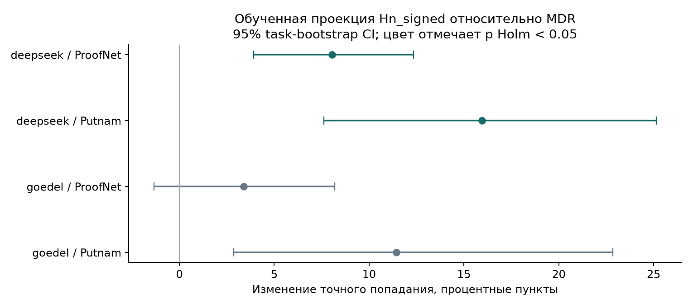
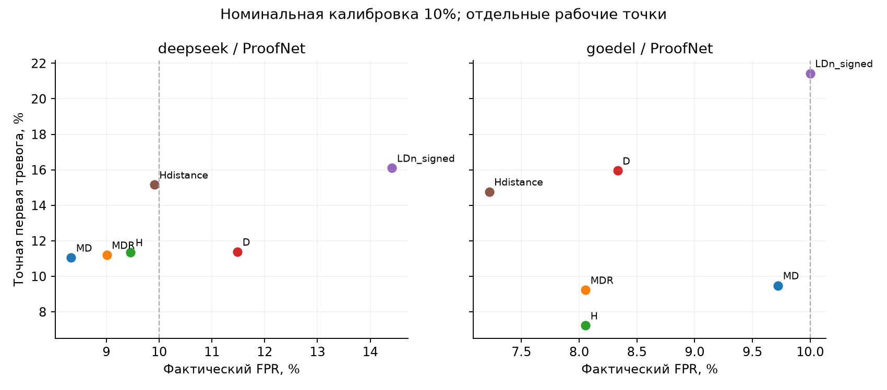
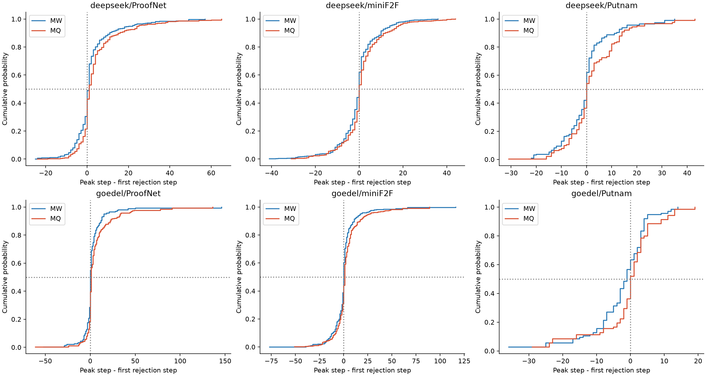
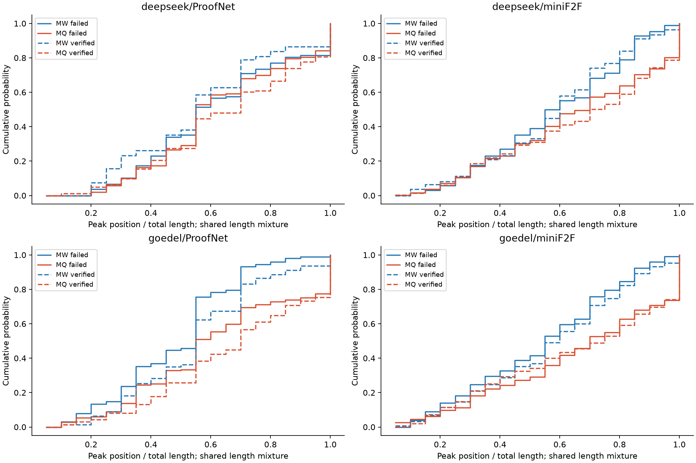
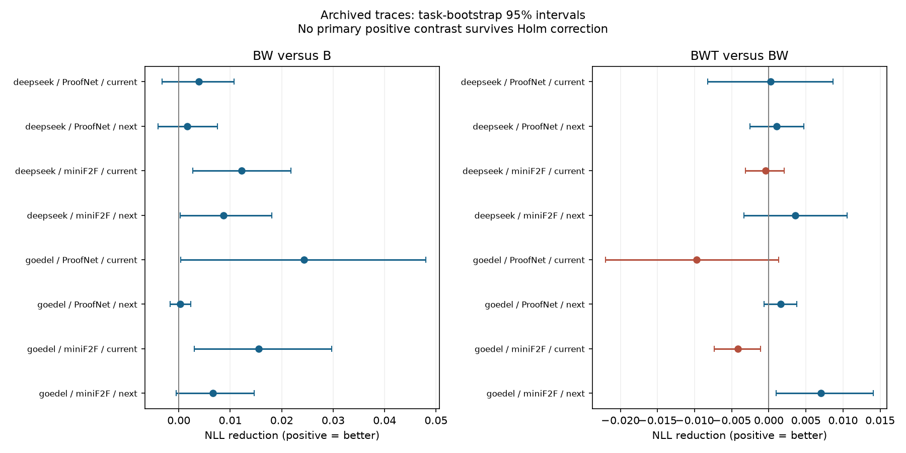

# Локализация и обнаружение ошибок в доказательствах

Полный сводный отчёт по новым экспериментам ноября 2026 года. Срез результатов на 15 ноября 2026 года.

Исследование связывает изменения скрытых представлений языковых моделей с первым формальным отказом Lean. Новые серии проверяют три разных утверждения: несёт ли величина скачка дополнительную информацию; помогают ли полные векторы и обучаемые проекции; объясняются ли наблюдения тяжёлыми хвостами и механизмом Кестена. Результаты этих проверок различаются. Геометрические детекторы дают положительные эффекты в ряде задач, тогда как для универсального преимущества скалярной нормы и специфического механизма Кестена убедительного общего подтверждения не получено.

В отчёт включены завершённые сравнения, отрицательные результаты, переносы между датасетами, контрольные проверки и незавершённая ячейка последней серии. Старые и уточнённые границы тактик, обучение на ProofNet и обучение на Putnam, локализация и наличие ошибки рассматриваются отдельно. Числа из разных популяций не соединяются в одну оценку эффекта.

[Указатель всех отчётов](REPORT_INDEX.md) содержит канонические источники, локальные и серверные пути, опубликованные ссылки и исторические версии. [Полный том с подробными отчётами](FULL_REPORT_RU.md) включает эту сводку и развёрнутые источники. [Таблицы новых серий](tables/) содержат все строки исходных сводных метрик, а не только выбранные положительные сравнения.

## Какие эксперименты объединены

| Серия | Содержание | Подробный отчёт |
| --- | --- | --- |
| 1 | Контроли рецензентов и чувствительность измерения | [Контроли рецензентов и чувствительность измерения](chapters/01_revision.md) |
| 2 | Перенос Putnam и сравнение хвостовых моделей | [Перенос Putnam и сравнение хвостовых моделей](chapters/02_extensions.md) |
| 3 | Первая позиция и дополнительные контроли | [Первая позиция и дополнительные контроли](chapters/03_strengthening.md) |
| 4 | Стриминг PRM и меньшая модель | [Стриминг PRM и меньшая модель](chapters/04_gaps.md) |
| 5 | Обзор новых экспериментов до 11 ноября | [Обзор новых экспериментов до 11 ноября](chapters/05_overview11.md) |
| 6 | Наличие ошибки и прогноз будущего отказа | [Наличие ошибки и прогноз будущего отказа](chapters/06_presence.md) |
| 7 | Условное распределение следующей ошибки | [Условное распределение следующей ошибки](chapters/07_next.md) |
| 8 | Положение максимума относительно отказа | [Положение максимума относительно отказа](chapters/08_lag.md) |
| 9 | Позиционные контроли совпадения | [Позиционные контроли совпадения](chapters/09_position.md) |
| 10 | Распределения максимумов ошибок и surprisal | [Распределения максимумов ошибок и surprisal](chapters/10_distributions.md) |
| 11 | Поправка на длину и предсказание по распределению | [Поправка на длину и предсказание по распределению](chapters/11_length.md) |
| 12 | Совместные гистограммы для каждой длины | [Совместные гистограммы для каждой длины](chapters/12_exact_length.md) |
| 13 | Направление и величина приращения | [Направление и величина приращения](chapters/13_direction.md) |
| 14 | Разложение выигрыша NLL | [Разложение выигрыша NLL](chapters/14_nll.md) |
| 15 | Строгий аудит отбора гибкий baseline и одинаковые префиксы | [Строгий аудит отбора гибкий baseline и одинаковые префиксы](chapters/15_priority.md) |
| 16 | Кестен хвосты и обычный пошаговый риск | [Кестен хвосты и обычный пошаговый риск](chapters/16_kesten.md) |
| 17 | Полная матрица состояния и приращения | [Полная матрица состояния и приращения](chapters/17_state_matrix.md) |
| 18 | Абляции позиции типа длины и surprisal | [Абляции позиции типа длины и surprisal](chapters/18_ablation.md) |
| 19 | Ничьи при выборе позиции ошибки | [Ничьи при выборе позиции ошибки](chapters/19_ties.md) |
| 20 | Устойчивость различий DeepSeek и Goedel | [Устойчивость различий DeepSeek и Goedel](chapters/20_goedel.md) |
| 21 | Тип и длина тактики у Goedel | [Тип и длина тактики у Goedel](chapters/21_type_length.md) |
| 22 | Раздельное обучение на Putnam и полная стриминговая матрица | [Раздельное обучение на Putnam и полная стриминговая матрица](chapters/22_daily.md) |
| 23 | Goedel после удаления длины тактики | [Goedel после удаления длины тактики](chapters/23_no_length.md) |
| 24 | Полная таблица наличия ошибки и прогнозов | [Полная таблица наличия ошибки и прогнозов](chapters/24_presence_full.md) |
| 25 | Длины тактик и проверка новых границ | [Длины тактик и проверка новых границ](chapters/25_granularity_pilot.md) |
| 26 | Полная матрица старых и уточнённых границ | [Полная матрица старых и уточнённых границ](chapters/26_granularity.md) |
| 27 | Проекции гиперплоскости и информация в векторах | [Проекции гиперплоскости и информация в векторах](chapters/27_geometry.md) |
| 28 | Полное состояние Goedel без длины тактики | [Завершённый досчёт X](chapters/28_no_length_state.md) |

Это исследование onebigjump. Более ранние работы с заменой attention, LoRA, gates и MLP, а также финансовые эксперименты относятся к другим проектам и в численные результаты этой статьи не включены.

## Объекты измерения и задачи

Основные генераторы доказательств — DeepSeek-Prover-V2-7B и Goedel-Prover-V2-8B. В первоначальных и отдельных контрольных сериях также участвует Kimina-Prover-Distill-8B. Неформальные решения ProcessBench читают Qwen2.5-7B-Instruct и Qwen2.5-1.5B-Instruct; отдельно применяется замороженная Qwen2.5-Math-PRM-7B. Эти роли нельзя смешивать: состояния модели, читающей чужой готовый ответ, не являются состояниями исходного генератора этого ответа.

ProofNet, miniF2F и Putnam в данном проекте используются как корпуса формальных математических задач и сохранённых попыток доказательства. Для Putnam анализируется конкретная собранная выборка попыток, а не всё множество задач математического соревнования. В доступной выборке Putnam нет полностью проверенных корректных доказательств. Отсюда следует отсутствие некоторых бинарных метрик и ложных тревог на правильных доказательствах, а не их нулевое значение.

Пусть hₜ — скрытый вектор на конце завершённой тактики t на фиксированном слое. В основных новых измерениях h₀ соответствует входу в формальную часть после неформального вступления. Для DeepSeek и Goedel основные слои имеют индексы 14 и 17 при нумерации с нуля; размер вектора равен 4096. Другие слои и начальные точки исследуются как отдельные варианты чувствительности.

    dₜ = hₜ − hₜ₋₁
    rₜ = ‖dₜ‖₂
    zₜ = Σ⁻¹ᐟ²(dₜ − μ)
    Wₜ = ‖zₜ‖₂
    uₜ = zₜ / ‖zₜ‖₂
    qₜ = − среднее log p(токен | предыдущие токены) внутри тактики t

Whitening использует отдельную калибровку по корректным трассам и фиксированную для конкретного протокола регуляризацию ковариации. В геометрической серии Dunit обозначает нормировку сырого dₜ, тогда как u в прежних сериях обычно означает направление whitened-вектора zₜ. Эти два представления различны.

T — индекс первой воспроизводимо отклонённой Lean тактики. L — число сгенерированных фрагментов в полной попытке. Модель может продолжать генерировать после T. Такой суффикс доступен в ретроспективной задаче, но не становится последовательностью проверенных отрицательных примеров для стримингового детектора.

| Задача | Доступная информация | Цель |
| --- | --- | --- |
| Ретроспективная локализация | Всё готовое доказательство, включая длину и суффикс | Выбрать T среди шагов ошибочной попытки |
| Обнаружение текущего отказа | Текущий завершённый фрагмент и предыдущий префикс | Подать первую тревогу на T |
| Наличие ошибки в готовой попытке | Всё доказательство | Отличить ошибочную попытку от строго verified |
| Наличие ошибки к текущему моменту | Доступный префикс | Оценить, появился ли отказ |
| Прогноз на следующий шаг или горизонт | Ещё принятый префикс | Оценить будущий отказ без просмотра будущего текста |

Стриминговая проверка использует сохранённые границы AST. Она проверяет причинную доступность признаков по времени, но не является готовой системой инкрементального разбора Lean и не демонстрирует предотвращение ошибки. Первый формальный отказ также не отождествляется с первым неверным математическим замыслом.

## Устройство локализаторов и оценка

Для ретроспективной локализации линейный score вычисляется отдельно для каждого шага и преобразуется в распределение по кандидатам внутри доказательства.

    aₜ = wᵀφₜ
    p(T = t | доказательство) = exp(aₜ) / Σⱼ exp(aⱼ)
    NLL = −log p(T = наблюдаемое место отказа)

Для стримингового детектора применяется логистическая вероятность на доступном шаге. После первого формального отказа новые шаги не добавляются как корректные наблюдения.

    pₜ = 1 / (1 + exp(−wᵀφₜ))
    BCEₜ = −yₜ log pₜ − (1−yₜ) log(1−pₜ)
    первая тревога = первый t с pₜ выше порога

MD — сильный baseline по позиции, длине тактики, AST-типу, surprisal и его знаковому и абсолютному соседнему изменению. В offline доступны также признаки, использующие полную длину; в streaming они исключены. MDW добавляет whitened-норму, MDR — сырую норму. H и D добавляют полное состояние и сырое приращение. Обозначения C, T, N в более ранних матрицах определяются в соответствующих источниках: C объединяет тип и длину, T оставляет тип, N — длину.

Группы задач разделены между train и test. Основные новые матрицы используют пять внешних и три внутренних разбиения; геометрия, масштабирование, словарь категорий, сплайны и регуляризация обучаются внутри соответствующего train. Обучение непосредственно на Putnam оценивается на его отложенных группах; замороженный перенос ProofNet → Putnam использует только обучение на ProofNet. Это разные режимы, и успех одного не переносится автоматически на другой.

Hit — доля точных локализаций. Exact — доля первых тревог ровно на T среди ошибочных попыток. Early — первая тревога до T. Miss — отсутствие своевременной тревоги согласно протоколу. FPR — тревога на строго корректном доказательстве; её знаменатель отличается от знаменателя Exact. Для полноты рядом с номинальной калибровкой приводится фактический FPR.

В новых таблицах задачи имеют равный вес, затем попытки внутри задачи; конкретная схема усреднения шагов сохраняется из исходного протокола. Доверительные интервалы получены перевыборкой задач при фиксированных обученных моделях. Они не включают всю неопределённость повторного обучения. Поправка Холма применяется внутри указанного семейства сравнений, а не ко всей многомесячной истории исследования. Повторное использование архива делает новые серии исследовательским развитием, а не полностью независимой подтверждающей выборкой.

## Полнота последних серий

| Серия | План единиц | Завершено | Неполные ячейки | Состояние |
| --- | --- | --- | --- | --- |
| Старая и уточнённая разметка | 4224 | 4224 | 0 | Завершена |
| Геометрия и интерпретация | 2816 | 2815 | 1 | Один fit не прошёл критерий сходимости |

| Модель | Обучение / оценка OOF | Ошибочные попытки offline | Задач offline | Все попытки stream | Задач stream |
| --- | --- | --- | --- | --- | --- |
| deepseek | ProofNet | 449 | 165 | 560 | 186 |
| deepseek | Putnam | 117 | 58 | 117 | 58 |
| goedel | ProofNet | 255 | 130 | 334 | 141 |
| goedel | Putnam | 48 | 35 | 48 | 35 |

Основная пара old/fine сравнивается на одинаковом допустимом составе попыток. Дополнительные строки changed_only относятся только к действительно изменённым траекториям. Они хранятся отдельно и не подменяют общую оценку. Недостающий D_retain_all для DeepSeek / Putnam / offline не получает нулевую метрику и не включён в полную итоговую ячейку.

## Что показали исходные дополнительные контроли

Добавление соседнего изменения surprisal усиливает постановку вопроса: сравниваются не только внутренняя величина изменения и средняя неожиданность текста, но и изменения неожиданности между шагами. В исходной разметке положительный добавочный эффект нормы у DeepSeek невелик; у Goedel он отсутствует в рассматриваемом ProofNet-сравнении. Отдельная проверка без первого кандидата существенно ослабляет эффект DeepSeek. Это условный контроль с известной первой ошибкой, а не обычный online-протокол.

| Модель | Кандидаты | N / G | M0 | M0W | MD | MDW | MDW−MD, п.п. [95%] |
|---|---|---|---|---|---|---|---|
| deepseek | все | 452 / 166 | 40.85% | 43.51% | 39.39% | 42.20% | +2.81 [+0.90; +5.02] |
| deepseek | t≥2; t*≥2, новое обучение | 353 / 148 | 39.68% | 40.92% | 39.56% | 39.62% | +0.06 [-1.80; +2.08] |
| goedel | все | 259 / 133 | 57.82% | 57.13% | 57.32% | 55.69% | -1.63 [-4.32; +0.63] |
| goedel | t≥2; t*≥2, новое обучение | 176 / 105 | 52.38% | 52.38% | 51.90% | 52.22% | +0.32 [-2.54; +2.86] |

Для t≥2 сохраняются исходные t и t/L, а Δq берётся относительно реально существовавшей предыдущей тактики. Это отдельная условная популяция с переобучением; её проценты нельзя напрямую сравнивать с основной строкой как изменение на тех же попытках.

| Модель | NLL MD | NLL MDW | NLL MD−MDW [95%] | ±1 MD / MDW | Exact p Holm2 | NLL p Holm2 | Helped / harmed |
|---|---|---|---|---|---|---|---|
| deepseek | 1.77968 | 1.77045 | +0.00923 [-0.00397; +0.02216] | 50.85% / 53.18% | 0.01770 | 0.16569 | 16 / 4 |
| goedel | 1.57061 | 1.62617 | -0.05556 [-0.09206; -0.02137] | 65.68% / 64.17% | 0.19374 | 0.00580 | 4 / 7 |

Первичные exact и NLL не дают одинакового вывода для обеих моделей. Отдельное исключение первого шага существенно меняет величину добавочного эффекта. Полные first/interior/last и length-страты, включая пустую last-страту, находятся в JSON метрик.

### Вторичные miniF2F-сравнения

Новая исследовательская nested CV на архивных evaluation-задачах. Общий детерминированный реестр групп фиксирует split между моделями и температурами; это не прежний frozen-transfer протокол T=0,6→1,0.

| Модель | T | N / G | MD | MDW | Δ exact, п.п. [95%] | NLL MD / MDW |
|---|---|---|---|---|---|---|
| deepseek | 0.6 | 528 / 122 | 49.44% | 50.45% | +1.01 [-0.42; +2.43] | 1.66854 / 1.66711 |
| deepseek | 1.0 | 541 / 140 | 45.85% | 46.05% | +0.20 [-2.29; +2.68] | 1.68768 / 1.67794 |
| goedel | 0.6 | 448 / 122 | 37.05% | 38.32% | +1.27 [-1.74; +4.28] | 2.00866 / 1.98027 |
| goedel | 1.0 | 453 / 124 | 39.85% | 40.04% | +0.19 [-1.83; +2.56] | 1.86589 / 1.85750 |
| kimina | 0.6 | 320 / 94 | 28.90% | 31.82% | +2.93 [-1.28; +7.33] | 2.33191 / 2.35228 |
| kimina | 1.0 | 483 / 120 | 37.30% | 36.83% | -0.47 [-2.63; +1.06] | 2.10971 / 2.10570 |

### Online detector

Старый detector использовал q минус среднее предыдущих q. Теперь добавлены именно соседняя Δq и её модуль. HD — простые текущие/прошлые признаки; HDW добавляет исходные три jump-признака. Полная длина и будущий максимум запрещены. Порог выбран по inner-OOF verified proofs; на test он фиксирован.

| Модель | Verified / failed | Целевой FPR | Exact HD / HDW | Реальный test FPR HD / HDW | Early HD / HDW |
|---|---|---|---|---|---|
| deepseek | 35 / 452 | 0.1 | 14.62% / 13.59% | 15.62% / 15.62% | 3.23% / 2.93% |
| deepseek | 35 / 452 | 0.2 | 18.70% / 21.18% | 28.12% / 36.46% | 4.64% / 6.04% |
| goedel | 40 / 259 | 0.1 | 8.33% / 8.96% | 4.39% / 4.39% | 0.75% / 1.69% |
| goedel | 40 / 259 | 0.2 | 18.01% / 14.16% | 14.91% / 10.53% | 5.33% / 3.70% |

Источник: [Контроли рецензентов и чувствительность измерения](chapters/01_revision.md).

Чувствительность к слоям, shrinkage и anchor не превращает наблюдение в универсальное правило. Проверка с одинаковым текстом exact/apply/rw в разных формальных контекстах показывает, что большой скачок не является общим монотонным индикатором неверности. В этих ограниченных синтетических семействах surprisal различает корректность существенно лучше нормы.

Корпус: exact, apply и rw; 75 pilot-четвёрок на 15 базовых конструкциях и 300 test-четвёрок на 60 других конструкциях. По пять вариантов имён/порядка гипотез/принятого префикса/дистракторов на конструкцию. Эти варианты не считаются независимыми задачами. Все четыре исполнения каждой четверки проверены настоящим Lean; sorry, parse/resource failures не заменяют отрицательную метку.

В A гипотеза hx имеет целевой тип, hy — другой; в B типы меняются местами. Сравниваются буквально те же тексты тактик. D=(w_A(hy)−w_A(hx)+w_B(hx)−w_B(hy))/2. Положительный D соответствует большему скачку на отклонённой тактике. Same-text ranking сравнивает одну и ту же тактику между A/B; ничьи дают 0,5. Порог шанса — 50%.

| Модель | D(w), 95% | Rank w, same text [95%] | Rank q, same text [95%] | Simple exact | Simple + w exact | Δ exact, п.п. [95%] |
|---|---|---|---|---|---|---|
| deepseek | -1.2528 [-1.71322; -0.78013] | 33.33% [+26.17; +40.83] | 100.00% [+100.00; +100.00] | 99.67% | 99.17% | -0.50 [-1.17; +0.00] |
| goedel | -1.0407 [-1.20937; -0.86864] | 19.83% [+15.33; +24.67] | 99.83% [+99.50; +100.00] | 98.67% | 98.67% | +0.00 [+0.00; +0.00] |
| kimina | -3.4040 [-3.99099; -2.81938] | 11.17% [+7.33; +15.17] | 99.67% [+99.17; +100.00] | 96.67% | 98.50% | +1.83 [+0.83; +2.83] |

Simple использует длину тактики, q, соседнюю Δq, |Δq| и отсутствие предыдущего шага; Simple+w добавляет log(1+w). Conditional-logistic выбор между двумя тактиками настроен только на pilot-конструкциях с групповым inner CV. Test-конструкции не участвовали в подборе λ. Коэффициент скачка не ограничен по знаку.

В этих простых синтетических конструкциях raw jump не ведёт себя как универсальный возрастающий индикатор ошибки. Перенос такого результата на естественные длинные доказательства ограничен: семейства exact/apply/rw и синтетические типы специально контролируются. Данные по каждой семье, все четыре w/q/Δq и learned NLL сохранены, включая отрицательные эффекты. Для всех трёх моделей в E5 использован один простой completion-промпт; это отдельный контролируемый режим, а не оценка стандартного chat/CoT-промпта каждой модели. В этом корпусе formal-entry совпадает с концом предоставленного промпта, потому что заголовок уже заканчивается на by; оба индекса сохранены явно.

Источник: [Контроли рецензентов и чувствительность измерения](chapters/01_revision.md).

Полные альтернативные слои, префиксные контроли и изменения состояния Lean находятся в [Контроли рецензентов и чувствительность измерения](chapters/01_revision.md). Переносы на новые Putnam-попытки и ограничения покрытия приведены в [Перенос Putnam и сравнение хвостовых моделей](chapters/02_extensions.md) и [Первая позиция и дополнительные контроли](chapters/03_strengthening.md).

## Норма направление и полное состояние

Полный вектор сохраняет координатную информацию, которую норма сворачивает в одно число. При этом направление после нормировки тоже может терять полезную величину. Поэтому сравниваются сырая разность, whitened-разность, её норма, направление, их сочетание, состояние, предыдущее состояние и гибкий baseline.

Прежняя матрица показывает, что у DeepSeek текущее состояние улучшает likelihood в нескольких сравнениях, в том числе относительно гибкого baseline. Нормированное направление не обязано выигрывать по NLL: улучшение Hit и улучшение вероятностей — разные цели. Все варианты и срезы T > 1 приведены в [Полная матрица состояния и приращения](chapters/17_state_matrix.md); развёрнутая постановка с контролем предыдущего состояния — в [Строгий аудит отбора гибкий baseline и одинаковые префиксы](chapters/15_priority.md).

В следующей исторической таблице delta означает выигрыш NLL: потери reference минус потери new. Локализаторы обучены на ProofNet; Putnam здесь оценивает замороженный перенос. Это не отдельное обучение на Putnam из следующего раздела.

| model | dataset | new | reference | delta | ci95 | ci_family_bonferroni8 | p_holm8 | tasks | attempts |
| --- | --- | --- | --- | --- | --- | --- | --- | --- | --- |
| deepseek | ProofNet | state | B | 0.1506 | [0.04799286663216905, 0.2575663514037345] | [0.005851002605364031, 0.2995439003912403] | 0.0132 | 166 | 452 |
| deepseek | ProofNet | state | prev | 0.4376 | [0.3279184803076688, 0.5528436778282877] | [0.2831124411090857, 0.5966197193779877] | 0.0008 | 166 | 452 |
| deepseek | ProofNet | u | r | -0.1163 | [-0.2157201741239891, -0.014133622884932355] | [-0.2537787071145294, 0.026553459767423092] | 0.0308 | 166 | 452 |
| deepseek | ProofNet | flexstate | flex | 0.2127 | [0.09624044986934976, 0.33351289933367007] | [0.04641859664838299, 0.3799109967059259] | 0.0025 | 166 | 452 |
| deepseek | Putnam | state | B | 0.2154 | [0.04659399156957907, 0.39738332314671393] | [-0.017435543967651585, 0.47188540745534874] | 0.0308 | 58 | 118 |
| deepseek | Putnam | state | prev | 0.8469 | [0.7005439958841752, 0.9893754857999078] | [0.6452556102088225, 1.049738976411883] | 0.0008 | 58 | 118 |
| deepseek | Putnam | u | r | -0.2735 | [-0.4396609075071856, -0.09962691650222019] | [-0.49402563511031455, -0.028452030957810688] | 0.0048 | 58 | 118 |
| deepseek | Putnam | flexstate | flex | 0.4244 | [0.24214041441084763, 0.605253153444099] | [0.1675602986401478, 0.6794160331611098] | 0.0008 | 58 | 118 |

Источник: [Строгий аудит отбора гибкий baseline и одинаковые префиксы](chapters/15_priority.md).

## Обучение на Putnam и перенос между датасетами

Выполнены отдельное обучение локализаторов на Putnam, исходные ProofNet-разбиения и перенос без дообучения. Языковые модели при этом остаются замороженными; обучается локализатор по сохранённым представлениям. Увеличение числа обучаемых координат может улучшить попадание и одновременно ухудшить NLL, особенно на небольшой выборке Putnam.

| Модель / обучение → оценка / режим | MD | MDW | MDR | H | D | Dunit | Hn_signed | LDn_signed | Hdistance |
| --- | --- | --- | --- | --- | --- | --- | --- | --- | --- |
| deepseek / ProofNet → Putnam / frozen | 37.50 / +0.00 | 37.64 / +0.14 | 37.50 / +0.00 | 45.83 / +8.33 | 41.38 / +3.88 | 44.25 / +6.75 | 39.94 / +2.44 | 40.37 / +2.87 | 47.41 / +9.91 |
| deepseek / ProofNet → miniF2F / frozen | 41.49 / +0.00 | 43.20 / +1.71 | 41.36 / -0.14 | 41.54 / +0.05 | 43.98 / +2.49 | 41.26 / -0.23 | 44.02 / +2.53 | 45.49 / +4.00 | 42.03 / +0.54 |
| deepseek / ProofNet → ProofNet / oof | 38.67 / +0.00 | 38.92 / +0.25 | 38.77 / +0.10 | 44.87 / +6.20 | 45.18 / +6.51 | 42.09 / +3.42 | 46.82 / +8.15 | 44.03 / +5.36 | 46.72 / +8.05 |
| deepseek / Putnam → Putnam / oof | 27.59 / +0.00 | 31.47 / +3.88 | 26.29 / -1.29 | 40.66 / +13.07 | 39.22 / +11.64 | 39.51 / +11.93 | 42.24 / +14.66 | 40.37 / +12.79 | 38.79 / +11.21 |
| goedel / ProofNet → Putnam / frozen | 40.00 / +0.00 | 40.00 / +0.00 | 40.00 / +0.00 | 42.38 / +2.38 | 37.14 / -2.86 | 33.81 / -6.19 | 40.00 / +0.00 | 34.29 / -5.71 | 42.38 / +2.38 |
| goedel / ProofNet → miniF2F / frozen | 29.25 / +0.00 | 29.92 / +0.67 | 30.19 / +0.94 | 38.38 / +9.13 | 32.92 / +3.67 | 32.77 / +3.52 | 31.12 / +1.87 | 30.38 / +1.13 | 36.03 / +6.77 |
| goedel / ProofNet → ProofNet / oof | 53.38 / +0.00 | 55.05 / +1.67 | 53.00 / -0.38 | 47.13 / -6.26 | 49.15 / -4.23 | 48.38 / -5.00 | 56.38 / +3.00 | 51.58 / -1.81 | 55.05 / +1.67 |
| goedel / Putnam → Putnam / oof | 28.57 / +0.00 | 31.43 / +2.86 | 28.57 / +0.00 | 43.81 / +15.24 | 39.05 / +10.48 | 33.33 / +4.76 | 40.00 / +11.43 | 36.19 / +7.62 | 34.29 / +5.71 |

В ячейках указаны Hit в процентах и дельта к MD в процентных пунктах. Таблица относится к уточнённой разметке последней геометрической серии. Она не является повторной записью прежней матрицы с другим округлением.

| Модель / обучение → оценка / режим | MD | MDW | MDR | H | D | Dunit | Hn_signed | LDn_signed | Hdistance |
| --- | --- | --- | --- | --- | --- | --- | --- | --- | --- |
| deepseek / ProofNet → Putnam / frozen | 1.9540 / +0.0000 | 1.9399 / +0.0140 | 1.9498 / +0.0042 | 1.5255 / +0.4285 | 1.9872 / -0.0333 | 1.9704 / -0.0165 | 1.9348 / +0.0191 | 1.9685 / -0.0145 | 1.6489 / +0.3051 |
| deepseek / ProofNet → miniF2F / frozen | 1.9559 / +0.0000 | 1.9395 / +0.0164 | 1.9576 / -0.0017 | 1.7055 / +0.2504 | 2.0197 / -0.0638 | 2.0291 / -0.0732 | 1.8706 / +0.0853 | 1.8825 / +0.0734 | 1.8982 / +0.0576 |
| deepseek / ProofNet → ProofNet / oof | 1.8666 / +0.0000 | 1.8571 / +0.0095 | 1.8655 / +0.0012 | 1.6970 / +0.1696 | 1.8676 / -0.0010 | 1.8822 / -0.0156 | 1.7635 / +0.1031 | 1.8027 / +0.0640 | 1.7208 / +0.1458 |
| deepseek / Putnam → Putnam / oof | 2.1775 / +0.0000 | 2.1608 / +0.0167 | 2.1745 / +0.0029 | 1.8270 / +0.3504 | 2.1204 / +0.0570 | 2.1092 / +0.0683 | 1.9280 / +0.2494 | 2.0076 / +0.1698 | 1.8414 / +0.3361 |
| goedel / ProofNet → Putnam / frozen | 2.0861 / +0.0000 | 2.1278 / -0.0417 | 2.0889 / -0.0028 | 1.8093 / +0.2768 | 2.0909 / -0.0048 | 2.0459 / +0.0401 | 2.0693 / +0.0168 | 2.1559 / -0.0698 | 2.0006 / +0.0854 |
| goedel / ProofNet → miniF2F / frozen | 2.3656 / +0.0000 | 2.3233 / +0.0422 | 2.3632 / +0.0023 | 1.9113 / +0.4542 | 2.2659 / +0.0996 | 2.2828 / +0.0827 | 2.2664 / +0.0992 | 2.2565 / +0.1090 | 2.1666 / +0.1990 |
| goedel / ProofNet → ProofNet / oof | 1.6735 / +0.0000 | 1.6661 / +0.0074 | 1.6868 / -0.0133 | 1.7363 / -0.0628 | 1.8284 / -0.1548 | 1.8505 / -0.1770 | 1.6572 / +0.0163 | 1.6846 / -0.0111 | 1.6068 / +0.0668 |
| goedel / Putnam → Putnam / oof | 2.0966 / +0.0000 | 2.1006 / -0.0039 | 2.1163 / -0.0196 | 1.9773 / +0.1194 | 2.4020 / -0.3053 | 2.3012 / -0.2046 | 2.0346 / +0.0620 | 2.1872 / -0.0906 | 2.0172 / +0.0794 |

В таблице NLL меньшее значение лучше. Знак после слеша — NLL(MD) минус NLL(вариант). Положительная дельта означает улучшение. Все оставшиеся arms, включая нормированные векторы, PCA и случайные контроли, сохранены в таблицах и подробном [Проекции гиперплоскости и информация в векторах](chapters/27_geometry.md).

## Обучаемые проекции и гиперплоскости

Обучаемый бинарный классификатор задаёт нормаль n и смещение b. Из приращения можно взять знаковую проекцию, её модуль и компоненту в касательной гиперплоскости. Из состояния можно взять знаковое расстояние до разделяющей плоскости.

    sₜ = nᵀdₜ / ‖n‖₂
    абсолютная проекция = |sₜ|
    касательная величина = ‖dₜ − n(nᵀdₜ)/‖n‖₂²‖₂
    расстояние состояния = (nᵀhₜ + b)/‖n‖₂

Hn и Dn — нормали отдельных hazard-пробников по состоянию и приращению. CHn и CDn обучаются совместно с metadata. LHn и LDn берутся из локализатора соответствующего режима. Hdistance использует плоскость бинарного hazard-пробника, поскольку свободное смещение в условном softmax по кандидатам не идентифицируется.

Проекция обучается заново внутри каждого внутреннего train. Однако это двухэтапный обучаемый метод: offline Hn также использует допустимые risk-set наблюдения обучающих групп, включая корректные префиксы и verified-попытки. Поэтому сравнение с обычным offline MD не изолирует единственную операцию замены нормы проекцией при одинаковой схеме обучения. Оно оценивает весь указанный способ построения детектора.

| Модель | Датасет | Δ Hit п.п. | 95% CI п.п. | p Holm | Размер семейства | Задач |
| --- | --- | --- | --- | --- | --- | --- |
| deepseek | ProofNet | +8.05 | [3.91; 12.35] | 0.0174 | 88 | 165 |
| deepseek | Putnam | +15.95 | [7.61; 25.14] | 0.0344 | 88 | 58 |
| goedel | ProofNet | +3.38 | [-1.35; 8.18] | 1.0000 | 88 | 130 |
| goedel | Putnam | +11.43 | [2.86; 22.86] | 1.0000 | 88 | 35 |

Здесь приведены все четыре OOF-сочетания двух моделей и двух датасетов для основного сравнения Hn_signed с MDR. Для DeepSeek интервалы положительны и поправка Холма сохраняет эффект. Для Goedel этого вывода в данных сравнениях нет. Положительный точечный эффект без соответствующей проверки не объявляется общим преимуществом.

Состояние, расстояние до плоскости, знаковая проекция и абсолютная проекция имеют разный смысл. Если направление полезно, это ещё не означает, что размер скачка сам по себе является причиной отказа.

## Максимум проекции как отдельное правило

Локализатор с проекцией и простое правило «выбрать максимальную проекцию» — разные методы. В первом используются metadata и обученная вероятностная модель. Во втором вся траектория сворачивается в argmax одного score.

| Модель / обучение → оценка | white_norm | raw_norm | Hn_signed | LDn_signed | Hn_abs | H_nearest_plane | MD |
| --- | --- | --- | --- | --- | --- | --- | --- |
| deepseek / ProofNet → Putnam / frozen | 18.68 | 15.66 | 32.18 | 32.47 | 17.39 | 14.51 | 37.50 |
| deepseek / ProofNet → miniF2F / frozen | 18.09 | 14.33 | 34.35 | 33.08 | 14.44 | 27.47 | 41.49 |
| deepseek / ProofNet → ProofNet / oof | 19.07 | 22.27 | 37.17 | 40.01 | 20.77 | 16.24 | 38.67 |
| deepseek / Putnam → Putnam / oof | 18.68 | 15.66 | 34.20 | 36.49 | 23.56 | 17.10 | 27.59 |
| goedel / ProofNet → Putnam / frozen | 6.67 | 11.43 | 26.67 | 22.38 | 15.24 | 26.67 | 40.00 |
| goedel / ProofNet → miniF2F / frozen | 21.46 | 6.48 | 29.75 | 29.92 | 8.62 | 29.61 | 29.25 |
| goedel / ProofNet → ProofNet / oof | 25.00 | 25.22 | 43.00 | 40.88 | 23.06 | 23.65 | 53.38 |
| goedel / Putnam → Putnam / oof | 6.67 | 11.43 | 28.10 | 30.95 | 18.57 | 9.05 | 28.57 |

Проверки максимумов выполняются на тех же внешних разбиениях. Выигрыш над whitened-нормой следует читать отдельно от выигрыша над MD. В предусмотренных сравнениях максимумов с MD положительного эффекта после поправки Холма не получено. Отдельные максимумы проекций лучше нормы, но это не делает их заменой сильного локализатора.

## Стриминговое обнаружение первого отказа

| Модель / обучение → оценка / режим | MD | MDW | MDR | H | D | Dunit | Hn_signed | LDn_signed | Hdistance |
| --- | --- | --- | --- | --- | --- | --- | --- | --- | --- |
| deepseek / ProofNet → Putnam / frozen | 4.45 / NA | 4.45 / NA | 4.45 / NA | 12.50 / NA | 7.90 / NA | 4.45 / NA | 16.52 / NA | 15.80 / NA | 21.41 / NA |
| deepseek / ProofNet → miniF2F / frozen | 3.46 / 9.91 | 0.76 / 1.64 | 3.46 / 8.99 | 7.66 / 5.77 | 4.34 / 5.83 | 4.93 / 5.05 | 9.26 / 8.40 | 8.17 / 7.26 | 8.42 / 5.83 |
| deepseek / ProofNet → ProofNet / oof | 11.05 / 8.33 | 10.68 / 11.71 | 11.20 / 9.01 | 11.35 / 9.46 | 11.38 / 11.49 | 9.76 / 13.51 | 11.42 / 11.71 | 16.10 / 14.41 | 15.16 / 9.91 |
| deepseek / Putnam → Putnam / oof | 9.20 / NA | 10.06 / NA | 10.06 / NA | 30.75 / NA | 12.50 / NA | 13.65 / NA | 25.72 / NA | 26.44 / NA | 29.31 / NA |
| goedel / ProofNet → Putnam / frozen | 5.71 / NA | 10.95 / NA | 5.71 / NA | 7.62 / NA | 5.71 / NA | 17.14 / NA | 6.67 / NA | 16.67 / NA | 13.33 / NA |
| goedel / ProofNet → miniF2F / frozen | 1.48 / 2.57 | 1.21 / 1.20 | 1.48 / 2.45 | 0.00 / 0.00 | 2.91 / 1.66 | 3.58 / 2.09 | 3.02 / 2.95 | 3.83 / 2.28 | 1.28 / 1.37 |
| goedel / ProofNet → ProofNet / oof | 9.49 / 9.72 | 10.00 / 12.22 | 9.23 / 8.06 | 7.23 / 8.06 | 15.95 / 8.33 | 15.44 / 8.33 | 12.69 / 10.00 | 21.44 / 10.00 | 14.77 / 7.22 |
| goedel / Putnam → Putnam / oof | 14.76 / NA | 14.76 / NA | 11.90 / NA | 4.29 / NA | 11.43 / NA | 10.95 / NA | 10.48 / NA | 14.76 / NA | 16.19 / NA |

В ячейках указаны Exact и фактический verified FPR в процентах при номинальной калибровке 10%. NA означает отсутствие корректных доказательств в соответствующей оценке. Для Putnam при собственном обучении cutoff выбирается по принятым префиксам; при переносе сохраняется cutoff ProofNet. Эти режимы не обеспечивают известный FPR на правильных Putnam-доказательствах.

| Модель / обучение → оценка / режим | MD | MDW | MDR | H | D | Dunit | Hn_signed | LDn_signed | Hdistance |
| --- | --- | --- | --- | --- | --- | --- | --- | --- | --- |
| deepseek / ProofNet → Putnam / frozen | 0.3652 / +0.0000 | 0.3632 / +0.0021 | 0.3655 / -0.0003 | 0.3217 / +0.0435 | 0.3729 / -0.0076 | 0.3732 / -0.0080 | 0.3748 / -0.0096 | 0.3632 / +0.0021 | 0.3275 / +0.0377 |
| deepseek / ProofNet → miniF2F / frozen | 0.3516 / +0.0000 | 0.2830 / +0.0686 | 0.3457 / +0.0059 | 0.2776 / +0.0740 | 0.3073 / +0.0443 | 0.3155 / +0.0360 | 0.2801 / +0.0715 | 0.2689 / +0.0826 | 0.2624 / +0.0892 |
| deepseek / ProofNet → ProofNet / oof | 0.4494 / +0.0000 | 0.4455 / +0.0039 | 0.4492 / +0.0002 | 0.3824 / +0.0670 | 0.4169 / +0.0325 | 0.4210 / +0.0283 | 0.4109 / +0.0384 | 0.4028 / +0.0465 | 0.3888 / +0.0606 |
| deepseek / Putnam → Putnam / oof | 0.3975 / +0.0000 | 0.3974 / +0.0002 | 0.3987 / -0.0011 | 0.3959 / +0.0017 | 0.4698 / -0.0722 | 0.4695 / -0.0719 | 0.3935 / +0.0041 | 0.4093 / -0.0118 | 0.3521 / +0.0454 |
| goedel / ProofNet → Putnam / frozen | 0.3437 / +0.0000 | 0.3457 / -0.0020 | 0.3458 / -0.0021 | 0.3524 / -0.0087 | 0.4335 / -0.0898 | 0.4201 / -0.0764 | 0.3652 / -0.0215 | 0.3834 / -0.0397 | 0.3331 / +0.0106 |
| goedel / ProofNet → miniF2F / frozen | 0.3345 / +0.0000 | 0.2696 / +0.0649 | 0.3339 / +0.0006 | 0.2546 / +0.0799 | 0.2666 / +0.0679 | 0.2739 / +0.0606 | 0.2820 / +0.0525 | 0.2357 / +0.0987 | 0.2328 / +0.1017 |
| goedel / ProofNet → ProofNet / oof | 0.4064 / +0.0000 | 0.4003 / +0.0061 | 0.4114 / -0.0050 | 0.3856 / +0.0208 | 0.4264 / -0.0200 | 0.4313 / -0.0249 | 0.3946 / +0.0119 | 0.3885 / +0.0180 | 0.3584 / +0.0481 |
| goedel / Putnam → Putnam / oof | 0.4615 / +0.0000 | 0.4624 / -0.0009 | 0.4666 / -0.0051 | 0.4631 / -0.0016 | 0.5311 / -0.0696 | 0.5194 / -0.0579 | 0.4792 / -0.0177 | 0.4813 / -0.0198 | 0.4190 / +0.0425 |

| Модель / данные | Сравнение | Метрика | Δ | 95% CI | p Holm |
| --- | --- | --- | --- | --- | --- |
| deepseek / ProofNet | LDn_signed-MDR | nll | 0.0464 | [0.0215; 0.0709] | 0.0405 |
| deepseek / ProofNet | LDn_signed-MDR | exact@0.1 | 4.8990 | [0.74; 9.08] | 1.0000 |
| deepseek / ProofNet | LDn_signed-MDR | false_alarm@0.1 | 5.4054 | [-4.50; 16.44] | 1.0000 |
| deepseek / ProofNet | Hdistance-MD | nll | 0.0606 | [0.0381; 0.0828] | 0.0176 |
| deepseek / ProofNet | Hdistance-MD | exact@0.1 | 4.1111 | [0.25; 8.02] | 1.0000 |
| deepseek / ProofNet | Hdistance-MD | false_alarm@0.1 | 1.5766 | [-7.66; 11.49] | 1.0000 |
| deepseek / ProofNet | Hdistance-MD | nll | 0.0606 | [0.0381; 0.0828] | 0.0991 |
| deepseek / ProofNet | Hdistance-MD | exact@0.1 | 4.1111 | [0.25; 8.02] | 1.0000 |
| deepseek / ProofNet | Hdistance-MD | false_alarm@0.1 | 1.5766 | [-7.66; 11.49] | 1.0000 |
| deepseek / Putnam | LDn_signed-MDR | nll | -0.0106 | [-0.0627; 0.0346] | 1.0000 |
| deepseek / Putnam | LDn_signed-MDR | exact@0.1 | 16.3793 | [5.60; 26.73] | 0.3542 |
| deepseek / Putnam | LDn_signed-MDR | false_alarm@0.1 | NA | NA | NA |
| deepseek / Putnam | Hdistance-MD | nll | 0.0454 | [0.0115; 0.0772] | 1.0000 |
| deepseek / Putnam | Hdistance-MD | exact@0.1 | 20.1149 | [10.63; 29.74] | 0.0088 |
| deepseek / Putnam | Hdistance-MD | false_alarm@0.1 | NA | NA | NA |
| deepseek / Putnam | Hdistance-MD | nll | 0.0454 | [0.0115; 0.0772] | 1.0000 |
| deepseek / Putnam | Hdistance-MD | exact@0.1 | 20.1149 | [10.63; 29.74] | 0.0496 |
| deepseek / Putnam | Hdistance-MD | false_alarm@0.1 | NA | NA | NA |
| goedel / ProofNet | LDn_signed-MDR | nll | 0.0230 | [-0.0123; 0.0551] | 1.0000 |
| goedel / ProofNet | LDn_signed-MDR | exact@0.1 | 12.2051 | [6.67; 18.14] | 0.0088 |
| goedel / ProofNet | LDn_signed-MDR | false_alarm@0.1 | 1.9444 | [-6.39; 11.67] | 1.0000 |
| goedel / ProofNet | Hdistance-MD | nll | 0.0481 | [0.0248; 0.0728] | 0.0176 |
| goedel / ProofNet | Hdistance-MD | exact@0.1 | 5.2821 | [0.38; 10.44] | 1.0000 |
| goedel / ProofNet | Hdistance-MD | false_alarm@0.1 | -2.5000 | [-8.33; 3.33] | 1.0000 |
| goedel / ProofNet | Hdistance-MD | nll | 0.0481 | [0.0248; 0.0728] | 0.0991 |
| goedel / ProofNet | Hdistance-MD | exact@0.1 | 5.2821 | [0.38; 10.44] | 1.0000 |
| goedel / ProofNet | Hdistance-MD | false_alarm@0.1 | -2.5000 | [-8.33; 3.33] | 1.0000 |
| goedel / Putnam | LDn_signed-MDR | nll | -0.0146 | [-0.0492; 0.0243] | 1.0000 |
| goedel / Putnam | LDn_signed-MDR | exact@0.1 | 2.8571 | [-6.19; 12.38] | 1.0000 |
| goedel / Putnam | LDn_signed-MDR | false_alarm@0.1 | NA | NA | NA |
| goedel / Putnam | Hdistance-MD | nll | 0.0425 | [-0.0094; 0.0868] | 1.0000 |
| goedel / Putnam | Hdistance-MD | exact@0.1 | 1.4286 | [-10.48; 13.81] | 1.0000 |
| goedel / Putnam | Hdistance-MD | false_alarm@0.1 | NA | NA | NA |
| goedel / Putnam | Hdistance-MD | nll | 0.0425 | [-0.0094; 0.0868] | 1.0000 |
| goedel / Putnam | Hdistance-MD | exact@0.1 | 1.4286 | [-10.48; 13.81] | 1.0000 |
| goedel / Putnam | Hdistance-MD | false_alarm@0.1 | NA | NA | NA |

Для NLL положительный знак означает снижение потерь; для Exact — рост попаданий; для FPR — рост ложных тревог. Вероятностные изменения представлены в процентных пунктах.

У Goedel / ProofNet обученная LDn-проекция даёт заметную прибавку Exact относительно MDR, при этом фактический FPR также меняется. Расстояние состояния до плоскости улучшает NLL в ряде условий. Данные не позволяют подменить эти результаты утверждением о предотвращении ошибок или о доминировании при строго одинаковом FPR.

## Что можно извлечь из скрытых векторов

Проверки декодирования отвечают, содержится ли в представлении информация о позиции, длине, типе и surprisal. Они сами по себе не показывают, что именно эту информацию использует оптимальный локализатор. Поэтому дополнительно удаляются связанные с metadata подпространства, после чего локализатор обучается заново.

| Модель / данные | Вектор | Признак | R² | Accuracy % | Majority accuracy % | Balanced accuracy % |
| --- | --- | --- | --- | --- | --- | --- |
| deepseek / ProofNet | H | position | 0.5971 | NA | NA | NA |
| deepseek / ProofNet | H | log_tokens | 0.7957 | NA | NA | NA |
| deepseek / ProofNet | H | surprisal | 0.0922 | NA | NA | NA |
| deepseek / ProofNet | H | tactic_type | NA | 92.67 | 22.29 | 91.46 |
| deepseek / ProofNet | D | position | 0.1285 | NA | NA | NA |
| deepseek / ProofNet | D | log_tokens | 0.6303 | NA | NA | NA |
| deepseek / ProofNet | D | surprisal | -0.0607 | NA | NA | NA |
| deepseek / ProofNet | D | tactic_type | NA | 75.98 | 22.29 | 68.32 |
| deepseek / Putnam | H | position | 0.4836 | NA | NA | NA |
| deepseek / Putnam | H | log_tokens | 0.7644 | NA | NA | NA |
| deepseek / Putnam | H | surprisal | -0.0777 | NA | NA | NA |
| deepseek / Putnam | H | tactic_type | NA | 92.85 | 21.83 | 92.04 |
| deepseek / Putnam | D | position | -0.2743 | NA | NA | NA |
| deepseek / Putnam | D | log_tokens | 0.3907 | NA | NA | NA |
| deepseek / Putnam | D | surprisal | -0.2961 | NA | NA | NA |
| deepseek / Putnam | D | tactic_type | NA | 61.65 | 21.83 | 58.02 |
| goedel / ProofNet | H | position | 0.5723 | NA | NA | NA |
| goedel / ProofNet | H | log_tokens | 0.8251 | NA | NA | NA |
| goedel / ProofNet | H | surprisal | 0.2156 | NA | NA | NA |
| goedel / ProofNet | H | tactic_type | NA | 91.40 | 29.15 | 88.05 |
| goedel / ProofNet | D | position | 0.0712 | NA | NA | NA |
| goedel / ProofNet | D | log_tokens | 0.6521 | NA | NA | NA |
| goedel / ProofNet | D | surprisal | 0.0303 | NA | NA | NA |
| goedel / ProofNet | D | tactic_type | NA | 74.81 | 29.15 | 66.92 |
| goedel / Putnam | H | position | 0.3864 | NA | NA | NA |
| goedel / Putnam | H | log_tokens | 0.6708 | NA | NA | NA |
| goedel / Putnam | H | surprisal | -0.1230 | NA | NA | NA |
| goedel / Putnam | H | tactic_type | NA | 90.01 | 22.48 | 82.54 |
| goedel / Putnam | D | position | -1.0624 | NA | NA | NA |
| goedel / Putnam | D | log_tokens | 0.3174 | NA | NA | NA |
| goedel / Putnam | D | surprisal | -0.5578 | NA | NA | NA |
| goedel / Putnam | D | tactic_type | NA | 56.22 | 22.48 | 48.37 |

Скрытое состояние хорошо кодирует тип и длину тактики. Приращение тоже содержит такую информацию, но показатели отличаются. Низкий или отрицательный R² для surprisal означает отсутствие полезного переноса именно этого линейного readout относительно обучающей константы.

Удаление выполняется ортогональной проекцией из диапазона взвешенной кросс-ковариации между вектором и блоками metadata. Это не гарантирует удаления всей нелинейной информации. Из того же пространства может исчезнуть информация о корректности, коррелирующая с типом или длиной.

| Модель / данные | Вариант | Hit % | NLL |
| --- | --- | --- | --- |
| deepseek / ProofNet | H | 44.87 | 1.6970 |
| deepseek / ProofNet | D | 45.18 | 1.8676 |
| deepseek / ProofNet | H_erase_all | 44.35 | 1.8902 |
| deepseek / ProofNet | D_erase_all | 39.84 | 2.1755 |
| deepseek / ProofNet | H_retain_all | 43.47 | 1.7612 |
| deepseek / ProofNet | D_retain_all | 43.42 | 1.8305 |
| deepseek / ProofNet | H_erase_random0 | 46.48 | 1.7097 |
| deepseek / ProofNet | H_erase_random1 | 46.84 | 1.7057 |
| deepseek / ProofNet | H_erase_random2 | 45.88 | 1.6979 |
| deepseek / ProofNet | D_erase_random0 | 44.22 | 1.8663 |
| deepseek / ProofNet | D_erase_random1 | 45.89 | 1.8664 |
| deepseek / ProofNet | D_erase_random2 | 45.08 | 1.8656 |
| deepseek / Putnam | H | 40.66 | 1.8270 |
| deepseek / Putnam | D | 39.22 | 2.1204 |
| deepseek / Putnam | H_erase_all | 32.47 | 2.3364 |
| deepseek / Putnam | D_erase_all | 29.02 | 2.5081 |
| deepseek / Putnam | H_retain_all | 41.52 | 1.8676 |
| deepseek / Putnam | H_erase_random0 | 42.39 | 1.8254 |
| deepseek / Putnam | H_erase_random1 | 38.94 | 1.8259 |
| deepseek / Putnam | H_erase_random2 | 40.66 | 1.8257 |
| deepseek / Putnam | D_erase_random0 | 39.51 | 2.1186 |
| deepseek / Putnam | D_erase_random1 | 38.65 | 2.1236 |
| deepseek / Putnam | D_erase_random2 | 39.22 | 2.1244 |
| goedel / ProofNet | H | 47.13 | 1.7363 |
| goedel / ProofNet | D | 49.15 | 1.8284 |
| goedel / ProofNet | H_erase_all | 40.44 | 2.1405 |
| goedel / ProofNet | D_erase_all | 34.86 | 2.2294 |
| goedel / ProofNet | H_retain_all | 48.42 | 1.6772 |
| goedel / ProofNet | D_retain_all | 50.46 | 1.7064 |
| goedel / ProofNet | H_erase_random0 | 47.13 | 1.7369 |
| goedel / ProofNet | H_erase_random1 | 47.90 | 1.7321 |
| goedel / ProofNet | H_erase_random2 | 47.13 | 1.7366 |
| goedel / ProofNet | D_erase_random0 | 49.92 | 1.8242 |
| goedel / ProofNet | D_erase_random1 | 49.15 | 1.8255 |
| goedel / ProofNet | D_erase_random2 | 49.92 | 1.8279 |
| goedel / Putnam | H | 43.81 | 1.9773 |
| goedel / Putnam | D | 39.05 | 2.4020 |
| goedel / Putnam | H_erase_all | 29.52 | 2.3590 |
| goedel / Putnam | D_erase_all | 17.14 | 2.7990 |
| goedel / Putnam | H_retain_all | 40.95 | 2.1695 |
| goedel / Putnam | D_retain_all | 35.71 | 2.3274 |
| goedel / Putnam | H_erase_random0 | 43.81 | 1.9741 |
| goedel / Putnam | H_erase_random1 | 43.81 | 1.9797 |
| goedel / Putnam | H_erase_random2 | 43.81 | 1.9759 |
| goedel / Putnam | D_erase_random0 | 39.05 | 2.3991 |
| goedel / Putnam | D_erase_random1 | 39.05 | 2.4032 |
| goedel / Putnam | D_erase_random2 | 39.05 | 2.4024 |

Случайные подпространства имеют тот же ранг и три фиксированных seed. Их строки приведены отдельно. Более сильное ухудшение после целевого удаления поддерживает связь полезных направлений с metadata, но не доказывает, что весь сигнал сводится к известным признакам. Последние также продолжают входить в MD явно.

| Модель / данные | Режим | Нормаль | Пар фолдов | Среднее cosine | Минимум | Максимум |
| --- | --- | --- | --- | --- | --- | --- |
| deepseek / ProofNet | offline | Hn | 10 | 0.7366 | 0.7212 | 0.7648 |
| deepseek / ProofNet | offline | LDn | 10 | 0.7202 | 0.6909 | 0.7506 |
| deepseek / ProofNet | stream | Hn | 10 | 0.7273 | 0.6935 | 0.7713 |
| deepseek / ProofNet | stream | LDn | 10 | 0.7297 | 0.6658 | 0.7838 |
| deepseek / Putnam | offline | Hn | 10 | 0.7510 | 0.7227 | 0.7834 |
| deepseek / Putnam | offline | LDn | 10 | 0.7563 | 0.7053 | 0.8235 |
| deepseek / Putnam | stream | Hn | 10 | 0.7510 | 0.7227 | 0.7834 |
| deepseek / Putnam | stream | LDn | 10 | 0.7479 | 0.6947 | 0.8035 |
| goedel / ProofNet | offline | Hn | 10 | 0.7274 | 0.6136 | 0.7970 |
| goedel / ProofNet | offline | LDn | 10 | 0.7272 | 0.6570 | 0.7765 |
| goedel / ProofNet | stream | Hn | 10 | 0.7414 | 0.7096 | 0.7745 |
| goedel / ProofNet | stream | LDn | 10 | 0.7395 | 0.6876 | 0.7956 |
| goedel / Putnam | offline | Hn | 10 | 0.7490 | 0.6913 | 0.8175 |
| goedel / Putnam | offline | LDn | 10 | 0.7146 | 0.5539 | 0.8214 |
| goedel / Putnam | stream | Hn | 10 | 0.7490 | 0.6913 | 0.8175 |
| goedel / Putnam | stream | LDn | 10 | 0.7110 | 0.5773 | 0.8304 |

Сходство нормалей между внешними фолдами — описательная диагностика. Фолды используют пересекающиеся обучающие наборы, поэтому высокое cosine не является независимой репликацией направления. Полные таблицы normal_overlap и normal_stability включены в комплект.

## Почему Goedel отличается

Сравнение по фолдам и исключение отдельных задач показывают, что прежнее ухудшение при добавлении состояния на ProofNet не сводится к одной случайной задаче. На общих задачах моделей различие сохраняется, но тексты доказательств и доступные популяции различаются, поэтому это не эксперимент с одним и тем же текстом.

Длина и тип тактики у Goedel дают сильный исходный сигнал. В длина-only локализаторе рост score фактически приводит к выбору самого длинного фрагмента. Длинный AST-фрагмент может включать вложенные конструкции, комментарии и составные доказательства.

| Данные | Модель | Hit % | Выбран максимум длины % | Совпадение с первым максимумом % |
| --- | --- | --- | --- | --- |
| ProofNet | N | 42.67 | 100.00 | 100.00 |
| ProofNet | T | 37.83 | 35.24 | 35.24 |
| ProofNet | C | 47.37 | 64.50 | 64.50 |
| Putnam | N | 45.24 | 100.00 | 100.00 |
| Putnam | T | 30.00 | 34.76 | 34.76 |
| Putnam | C | 42.38 | 54.29 | 54.29 |

Источник: [Тип и длина тактики у Goedel](chapters/21_type_length.md).

Удаление явной длины не обеспечивает устойчивого восстановления добавочной ценности нормы или сырой разности на ProofNet. Векторы и тип тактики могут сохранять информацию о длине косвенно.

| Вариант | Hit, % | Δ к своему baseline, п.п. | NLL |
| --- | ---: | ---: | ---: |
| PST | 50.43 | 0.00 | 1.7115 |
| PSTW | 50.93 | 0.50 | 1.6976 |
| PST_deltaX | 51.37 | 0.94 | 1.7566 |
| PST_u | 48.30 | -2.13 | 1.8833 |
| PST_state | 49.20 | -1.23 | 1.6938 |
| MD_noN | 50.39 | 0.00 | 1.7183 |
| MD_noNW | 51.05 | 0.66 | 1.7038 |
| MD_noN_deltaX | 51.37 | 0.98 | 1.7559 |
| MD_noN_u | 49.05 | -1.34 | 1.8835 |
| MD_noN_state | 49.20 | -1.19 | 1.6935 |

Источник: [Goedel после удаления длины тактики](chapters/23_no_length.md).

На Putnam и в стриминге картина иная; полная абляция содержит также ухудшения при переносе и изменения FPR. [Goedel после удаления длины тактики](chapters/23_no_length.md). Утверждение «для Goedel скрытые представления бесполезны» не соответствует совокупности выполненных сравнений.

## Полное состояние Goedel без длины тактики: досчёт 15 ноября

| Добавка к baseline | Hit baseline, % | Hit + X, % | Δ Hit, п.п. | 95% CI Δ Hit | NLL baseline | NLL + X | Выигрыш NLL | 95% CI NLL |
| --- | --- | --- | --- | --- | --- | --- | --- | --- |
| PST_state | 50.43 | 49.20 | -1.23 | [-8.53; 6.08] | 1.7115 | 1.6938 | 0.0177 | [-0.1316; 0.1687] |
| MD_noN_state | 50.39 | 49.20 | -1.19 | [-8.40; 6.02] | 1.7183 | 1.6935 | 0.0248 | [-0.1260; 0.1800] |

Удаление явной длины меняет и baseline, и модель с состоянием: положительная разница приростов может возникнуть из-за ослабления baseline. Для прямой проверки ниже показаны обе абсолютные модели и парная разница разниц. Это проверка предсказательной ценности конкретного регуляризованного линейного локализатора; она не устанавливает причинную роль длины и не исключает её косвенное кодирование в X или типе тактики.

Прежние −6,99 п.п. относятся к MD_state−MD; сопоставимый вариант без длины — MD_noN_state−MD_noN. В новом расчёте эффект X для этого baseline равен -1.19 п.п., 95% CI [-8.40; 6.02]. Сама модель с X после удаления длины меняется на -1.13 п.п., baseline — на -6.93 п.п.

Завершены 44/44 новых fits; 12 новых ячеек, вместе с исторической абляцией 60/60. Полное доказательство и стриминг, ProofNet и Putnam, перенос и реальные FPR приведены в новом подробном разделе.

[Подробный досчёт состояния X, все режимы, интервалы и сравнение с длиной](chapters/28_no_length_state.md).

## Более мелкие формальные фрагменты

Новые границы выбираются по структуре Lean, а затем проверяются семантическим replay и соответствием токенов. Старые точки скрытых состояний проходят проверку совпадения; для новых границ извлекаются новые состояния. Изменить гранулярность удалось только для части попыток. На Putnam и miniF2F у Goedel в этой серии новых допустимых разбиений не появилось.

| Модель | Данные | Кандидатов изменено | Прошли проверку |
| --- | --- | --- | --- |
| deepseek | ProofNet | 31 | 28 |
| deepseek | Putnam | 6 | 5 |
| deepseek | miniF2F | 1 | 1 |
| goedel | ProofNet | 22 | 18 |
| goedel | Putnam | 0 | 0 |
| goedel | miniF2F | 0 | 0 |

| Модель | Версия | Вариант | Hit % | Hit после отображения % | Ширина участка в символах | NLL |
| --- | --- | --- | --- | --- | --- | --- |
| deepseek | old | MD | 40.49 | 40.49 | 418.6 | 1.7891 |
| deepseek | old | MDW | 41.60 | 41.60 | 417.7 | 1.7799 |
| deepseek | old | N | 31.61 | 31.61 | 566.0 | 2.2457 |
| deepseek | old | deltaX | 46.68 | 46.68 | 370.9 | 1.7958 |
| deepseek | old | state | 47.29 | 47.29 | 337.4 | 1.6297 |
| goedel | old | MD | 57.04 | 57.04 | 680.6 | 1.6080 |
| goedel | old | MDW | 54.67 | 54.67 | 769.8 | 1.6698 |
| goedel | old | N | 41.35 | 41.35 | 1054.6 | 2.0825 |
| goedel | old | deltaX | 50.63 | 50.63 | 699.5 | 1.7594 |
| goedel | old | state | 49.56 | 49.56 | 590.2 | 1.6776 |
| deepseek | fine | MD | 38.67 | 41.25 | 387.2 | 1.8666 |
| deepseek | fine | MDW | 38.92 | 41.50 | 384.6 | 1.8571 |
| deepseek | fine | N | 29.04 | 31.61 | 536.3 | 2.3320 |
| deepseek | fine | deltaX | 45.18 | 47.15 | 335.8 | 1.8676 |
| deepseek | fine | state | 44.87 | 46.99 | 310.9 | 1.6970 |
| goedel | fine | MD | 53.38 | 54.79 | 479.1 | 1.6735 |
| goedel | fine | MDW | 55.05 | 56.46 | 531.7 | 1.6661 |
| goedel | fine | N | 38.01 | 40.83 | 827.9 | 2.1821 |
| goedel | fine | deltaX | 49.15 | 50.56 | 438.9 | 1.8284 |
| goedel | fine | state | 47.13 | 49.12 | 459.7 | 1.7363 |

Hit на собственной сетке old/fine сравнивает разные разрешения цели. Поэтому дополнительно измеряются попадание после отображения в старую границу, пересечение исходного участка и ширина предсказанного фрагмента в символах. Нельзя считать снижение ширины участка автоматическим улучшением точного Hit или переносить результат небольшой changed_only-подвыборки на весь корпус.

В старом/новом сравнении норма может менять знак небольшого эффекта. На ProofNet Goedel уточнение границ меняет point estimate MDW относительно MD, но для вывода используются парные интервалы и поправка, а не знак разности двух округлённых процентов. Все 48 вариантов, оба режима и переносы находятся в [Полная матрица старых и уточнённых границ](chapters/26_granularity.md).

## Наличие ошибки и прогноз будущего отказа

Задача наличия ошибки включает корректные доказательства и отличается от выбора места в уже известной ошибочной попытке. Выполнены offline, present, future1, future3, future5 и future_end, отдельные source-наборы ProofNet и miniF2F, OOF-оценки и замороженные переносы.

| Модель | Оценка | Цель | B | BW | BD | BH |
| --- | --- | --- | --- | --- | --- | --- |
| deepseek | ProofNet | offline | 0.3223 | 0.3153 | 0.3562 | 0.3364 |
| deepseek | ProofNet | present | 0.4745 | 0.4720 | 0.4725 | 0.4249 |
| deepseek | ProofNet | future1 | 0.6056 | 0.6073 | 0.6077 | 0.5710 |
| deepseek | ProofNet | future3 | 0.6596 | 0.6589 | 0.6573 | 0.6392 |
| deepseek | ProofNet | future5 | 0.6010 | 0.6019 | 0.5850 | 0.5745 |
| deepseek | ProofNet | future_end | 0.4299 | 0.4288 | 0.3505 | 0.2942 |
| deepseek | Putnam | offline | 0.0858 | 0.0879 | 0.0442 | 0.0221 |
| deepseek | Putnam | present | 0.4352 | 0.4297 | 0.4022 | 0.3711 |
| deepseek | Putnam | future1 | 0.5621 | 0.5621 | 0.5705 | 0.5263 |
| deepseek | Putnam | future3 | 0.6779 | 0.6776 | 0.7011 | 0.7030 |
| deepseek | Putnam | future5 | 0.6089 | 0.6090 | 0.6295 | 0.6513 |
| deepseek | Putnam | future_end | 0.1900 | 0.1801 | 0.1115 | 0.0525 |
| goedel | ProofNet | offline | 0.3614 | 0.3469 | 0.3539 | 0.3246 |
| goedel | ProofNet | present | 0.4595 | 0.4522 | 0.4297 | 0.4129 |
| goedel | ProofNet | future1 | 0.6269 | 0.6238 | 0.6767 | 0.6011 |
| goedel | ProofNet | future3 | 0.6257 | 0.6269 | 0.6338 | 0.5869 |
| goedel | ProofNet | future5 | 0.5568 | 0.5536 | 0.5289 | 0.4997 |
| goedel | ProofNet | future_end | 0.4156 | 0.4122 | 0.3305 | 0.2630 |
| goedel | Putnam | offline | 0.1025 | 0.1006 | 0.0297 | 0.0133 |
| goedel | Putnam | present | 0.5327 | 0.5087 | 0.5079 | 0.4091 |
| goedel | Putnam | future1 | 0.5686 | 0.5658 | 0.5883 | 0.5732 |
| goedel | Putnam | future3 | 0.6824 | 0.6835 | 0.7850 | 0.7312 |
| goedel | Putnam | future5 | 0.5775 | 0.5773 | 0.6396 | 0.6444 |
| goedel | Putnam | future_end | 0.1734 | 0.1727 | 0.1178 | 0.0669 |

Здесь показана NLL выбранных векторных и скалярных вариантов, обученных на ProofNet, для оценки на ProofNet и Putnam. Полная таблица всех режимов, источников и переносов приведена в [Полная таблица наличия ошибки и прогнозов](chapters/24_presence_full.md). Её NA для AUROC/AP на Putnam с одним классом сохраняются. Маленькая NLL на выборке только ошибочных доказательств не демонстрирует способность различать правильные и неправильные попытки.

Число будущих отказов и число уже имеющихся отказов отвечают на разные вопросы. При оценке future1 используется только ещё принятый префикс. Наличие hₜ после текущего фрагмента допустимо для обнаружения отказа в этом фрагменте, но не для прогноза его корректности до генерации.

## Почему снижение NLL не гарантирует точную тревогу

Точные исходные предсказания E14, без изменения коэффициентов или порогов. NLL разлагается с весами всей исходной выборки; показатели тревог воспроизводят исходное усреднение E14 отдельно среди ошибочных/корректных доказательств. Версия v2 уточняет это различие и проверяет совпадение агрегированных показателей тревог; значения NLL не меняются. Положительный вклад означает снижение NLL. Три категории суммируются в общий выигрыш с исходными весами задач, попыток и шагов.

| Модель / набор | Метод | Общий выигрыш | Первый отказ | Принятый префикс ошибочного | Проверенное доказательство |
|---|---|---:|---:|---:|---:|
| deepseek/ProofNet | HDW | 0.001788 | 0.000810 | 0.000334 | 0.000644 |
| deepseek/ProofNet | HD_state | 0.099219 | 0.037053 | 0.064154 | -0.001988 |
| deepseek/ProofNet | HD_increment | 0.058460 | 0.000090 | 0.054630 | 0.003741 |
| deepseek/Putnam | HDW | 0.002735 | -0.000722 | 0.003457 | 0.000000 |
| deepseek/Putnam | HD_state | 0.033478 | 0.000747 | 0.032732 | 0.000000 |
| deepseek/Putnam | HD_increment | -0.017852 | -0.036960 | 0.019108 | 0.000000 |
| goedel/ProofNet | HDW | 0.007524 | 0.003062 | 0.002920 | 0.001542 |
| goedel/ProofNet | HD_state | 0.020635 | -0.017744 | 0.035961 | 0.002418 |
| goedel/ProofNet | HD_increment | -0.013115 | -0.055971 | 0.032745 | 0.010111 |
| goedel/Putnam | HDW | -0.004561 | -0.018447 | 0.013886 | 0.000000 |
| goedel/Putnam | HD_state | -0.027273 | -0.060022 | 0.032750 | 0.000000 |
| goedel/Putnam | HD_increment | -0.102183 | -0.129176 | 0.026993 | 0.000000 |

Интервалы и условные NLL — в metrics.json. Переходы ранняя/точная/пропуск и расстояния до исходных порогов — trace_transitions.csv каждого набора; калибровка по фиксированным бинам — calibration.csv. Putnam не содержит корректных доказательств. Этот аудит показывает источники изменения метрики, но не доказывает причинный механизм.

Источник: [Разложение выигрыша NLL](chapters/14_nll.md).

Принятых шагов обычно больше, чем первых отказов. Улучшение вероятностей на них может давать выигрыш средней NLL даже при ухудшении score на самом отказе. Кроме того, первая тревога зависит от порога и всех предшествующих score. Это объяснение поведения метрик, а не доказательство устройства рассуждения модели.

## Одинаковые префиксы и изменённая корректность

В matched-prefix серии из одного и того же формального префикса генерируются альтернативные продолжения. Проверяются общий предыдущий hidden state, контекст Lean и первая законченная AST-тактика. Для сравнения информативны задачи, где среди альтернатив есть и принятые, и отклонённые продолжения.

Старый обработчик поддерживал только верхний уровень AST и оставлял по 11 задач. До генерации зафиксирована поправка C-1: поддержка вложенных контекстов при сохранении точного токенового префикса, Lean header, целей и локального контекста. Доступны 165/114 исходных задач; feasibility pilot — по 40 задач и 8 альтернатив. Задачи пилота исключаются из основного анализа.

Проверяется первая завершённая AST-тактика, а не первая строка. Accepted, включая завершение доказательства, даёт Y=0; надёжное семантическое отклонение — Y=1. Parse, timeout, resource, sorry, несовпадение контекста и неполная токеновая граница не превращаются в семантические ошибки. Все дубликаты и исключения сохраняются.

Для каждой группы альтернатив используется одна форма padded-forward и каноническое измерение префикса. Xprev должен совпадать побитно, previous-q общий. Замороженные B/BH/BD детекторы взяты из соответствующего OOF-fold исходной задачи. BH содержит текущее состояние и среднее по уже наблюдённому префиксу; отдельно показывается только векторный вклад ретроспективного state-probe. Полный ретроспективный score с неизвестными L/last не применяется.

Within-prefix AUC усредняется по независимым задачам; ties дают 0.5. Основной контраст — BH-B. При числе mixed-задач меньше 20 доверительный интервал не выводится. Основной M и K фиксируются из пилотной дисперсии, частоты mixed-групп и профиля ресурсов. Верхние пределы: 400 задач/модель, K=16, всего 60 новых GPU-часов и 1200 Lean CPU-часов. Сбор не продолжается до значимости.

| model | phase | score | metric | value | ci95 | ci95_MC_seed2 | independent_mixed_tasks | bootstrap_replicates | primary | CI_halfwidth | precision_halfwidth_target | precision_target_met | CI_missing_reason |
| --- | --- | --- | --- | --- | --- | --- | --- | --- | --- | --- | --- | --- | --- |
| deepseek | pilot | BH-B | paired_delta_AUC | 0.0000 | — | — | 2 | 10000 | False | — | 0.1000 | False | fewer_than_20_groups |
| deepseek | pilot | BD-B | paired_delta_AUC | 0.0000 | — | — | 2 | 10000 | False | — | 0.1000 | False | fewer_than_20_groups |
| deepseek | main | BH-B | paired_delta_AUC | 0.1144 | — | — | 9 | 10000 | True | — | 0.1000 | False | fewer_than_20_groups |
| deepseek | main | BD-B | paired_delta_AUC | 0.0911 | — | — | 9 | 10000 | False | — | 0.1000 | False | fewer_than_20_groups |
| goedel | pilot | BH-B | paired_delta_AUC | 0.0357 | — | — | 4 | 10000 | False | — | 0.1000 | False | fewer_than_20_groups |
| goedel | pilot | BD-B | paired_delta_AUC | 0.0000 | — | — | 4 | 10000 | False | — | 0.1000 | False | fewer_than_20_groups |
| goedel | main | BH-B | paired_delta_AUC | 0.0380 | — | — | 10 | 10000 | True | — | 0.1000 | False | fewer_than_20_groups |
| goedel | main | BD-B | paired_delta_AUC | -0.0076 | — | — | 10 | 10000 | False | — | 0.1000 | False | fewer_than_20_groups |

Источник: [Строгий аудит отбора гибкий baseline и одинаковые префиксы](chapters/15_priority.md).

Число независимых mixed-задач недостаточно для предусмотренных интервалов. Положительная точечная разность AUC у DeepSeek остаётся описательной. Большое число альтернатив одного префикса не заменяет большое число независимых задач.

## Распределения места ошибки максимума и surprisal

Сходные общие гистограммы могут возникнуть без дополнительной связи внутри конкретного доказательства. Поэтому использованы несколько контролей: случайная позиция внутри той же длины, максимум другой попытки той же длины, попытка другой задачи и более строгая попытка той же задачи, а также обучаемое распределение места ошибки.

Для известной ошибочной траектории с длиной L и отказом T равномерная случайная позиция U удовлетворяет:

    P(U < T | L,T) = (T−1)/L
    P(U = T | L,T) = 1/L

Этот контроль знает наблюдаемые L и T для вычисления ожидаемой доли совпадений. Он не является онлайн-предиктором и не обучается угадывать T. Контроль с чужим максимумом сохраняет эмпирические предпочтения позиций; его покрытие зависит от наличия подходящей другой попытки.

| Модель / набор | Попытки / задачи | Охват веса, % | Свой максимум, % | Чужой максимум, % | Разница, п.п. [95%] | Семейный интервал |
|---|---|---|---|---|---|---|
| deepseek/ProofNet | 438 / 165 | 97.04 | 24.36 | 18.90 | 5.46 [1.55; 9.84] | [-0.17; 12.09] |
| deepseek/miniF2F | 513 / 121 | 97.15 | 23.39 | 16.34 | 7.06 [0.77; 13.39] | [-2.31; 15.93] |
| deepseek/Putnam | 100 / 53 | 84.05 | 19.55 | 13.56 | 5.99 [-3.76; 16.73] | [-8.73; 21.82] |
| goedel/ProofNet | 229 / 117 | 85.03 | 43.88 | 36.12 | 7.75 [-1.72; 16.82] | [-7.06; 21.16] |
| goedel/miniF2F | 423 / 117 | 92.48 | 27.10 | 13.64 | 13.46 [6.79; 20.83] | [3.99; 24.60] |
| goedel/Putnam | 32 / 25 | 64.29 | 5.02 | 10.97 | -5.95 [-24.42; 14.07] | [-35.99; 26.03] |

Источник: [Распределения максимумов ошибок и surprisal](chapters/10_distributions.md).

Эффект в matched-популяции нельзя сравнивать с несопоставленным процентом на всех попытках. Внутри одной задачи покрытие значительно меньше, а некоторые Putnam-срезы слишком малы для интервалов. Увеличение точности над uniform и добавочная информация над сильным baseline не являются одним утверждением.

Проверены разные величины:

$$
D=M_W-T,\qquad \mathbb{E}[D],\qquad
\mathbb{E}[D/L],\qquad P(D\le0).
$$

Отрицательное среднее означает опережение, положительное — запаздывание. Вероятность $P(D\le0)>1/2$ характеризует большинство случаев; знак среднего она не определяет.

| Модель / набор | Среднее M_W−T, шаги [95%] | Медиана M_W−T | Среднее (M_W−T)/L, % длины [95%] | M_W≤T, % [95%] | Среднее M_Q−T [95%] |
|---|---|---|---|---|---|
| deepseek/ProofNet | 2.07 [0.89; 3.34] | 1.00 | 8.04 [3.99; 12.04] | 49.07 [43.20; 54.76] | 4.28 [2.98; 5.70] |
| deepseek/miniF2F | -0.29 [-1.35; 0.73] | 0.00 | -1.46 [-5.93; 2.90] | 62.10 [55.22; 68.79] | 1.34 [0.28; 2.42] |
| deepseek/Putnam | -0.15 [-2.20; 2.18] | 0.00 | -6.53 [-13.91; 0.58] | 62.07 [52.01; 71.70] | 2.52 [0.52; 4.64] |
| goedel/ProofNet | 2.53 [0.40; 5.42] | 0.00 | 4.36 [-0.17; 9.02] | 55.16 [47.88; 62.49] | 6.54 [3.82; 9.78] |
| goedel/miniF2F | 0.51 [-1.16; 2.36] | 0.00 | -1.25 [-5.46; 2.83] | 60.41 [53.27; 67.35] | 3.10 [1.20; 5.42] |
| goedel/Putnam | -3.12 [-6.23; -0.55] | -1.00 | -9.54 [-20.13; 1.07] | 63.33 [47.62; 78.11] | -1.02 [-4.28; 1.75] |

На ProofNet точечные средние положительны у обеих моделей. На Goedel / miniF2F большинство максимумов не позже отказа, но среднее смещение положительно: хвост поздних максимумов меняет знак среднего. На Goedel / Putnam обычный 95% интервал среднего числа шагов отрицателен, однако интервал после нормирования на длину включает ноль. При консервативном расширении интервала среднего по той же формуле family12 он также включает ноль; формально это дополнительная чувствительность вне основного семейства локализации. Нельзя описывать опережение как общий установленный закон.

Источник: [Распределения максимумов ошибок и surprisal](chapters/10_distributions.md).

Универсальное утверждение о раннем максимуме не подтверждается: направление средней задержки меняется между наборами. Положительная доля максимумов до отказа может существовать одновременно с положительной средней задержкой из-за асимметрии распределения. Гипотеза о более раннем ошибочном выборе остаётся отдельной от измерения первого отказа Lean.

## Длина доказательства и риск следующей ошибки

Смесь длин сама по себе создаёт неравномерное распределение абсолютных позиций. Даже при равномерном положении внутри каждой длины:

    P(U = t) = сумма по L ≥ t величин P(L)/L

Для контроля применены относительная позиция t/L, общая смесь длин, сравнения при точном L и отношение к контролю с такими же длинами. Стандартизация ограничивается общим покрытием длин; она не создаёт наблюдений для отсутствующих групп.

Для максимума скачка проверена доля попаданий в первые два шага. Контроль сохраняет фактические длины и равномерно выбирает позицию; его ожидание равно среднему $\min(2,L)/L$.

| Модель / набор | Максимум в первых двух шагах, % | Контроль длины, % | Разница, п.п. [95%] |
|---|---|---|---|
| deepseek/ProofNet | 34,58 | 25,11 | 9,47 [5,04; 13,96] |
| deepseek/miniF2F | 18,99 | 19,04 | -0,06 [-4,45; 4,72] |
| deepseek/Putnam | 29,60 | 15,01 | 14,58 [5,21; 24,72] |
| goedel/ProofNet | 42,61 | 26,30 | 16,30 [10,37; 22,30] |
| goedel/miniF2F | 15,27 | 16,88 | -1,61 [-5,13; 2,11] |
| goedel/Putnam | 37,14 | 15,04 | 22,10 [7,95; 36,86] |

На miniF2F избытка именно первых двух позиций относительно этого контроля не видно. На ProofNet и Putnam он сохраняется. Это не утверждение о равномерности всего распределения максимумов и не проверка совпадения максимума с ошибкой конкретной попытки.

Источник: [Поправка на длину и предсказание по распределению](chapters/11_length.md).

Гистограммы ошибок при каждой длине, совместные места максимумов и surprisal, а также таблицы Hits и интервалы представлены в [Совместные гистограммы для каждой длины](chapters/12_exact_length.md). Малые страты не используются для выбора «удачной длины» и подтверждающего утверждения. Высокий Hit внутри одной длины может быть объяснён тем, что почти все отказы и почти все максимумы находятся на одной позиции.

| Модель | Данные | k | Задач в риске | Следующая ошибка % | Поздняя ошибка % | Без ошибки % | 95% CI следующей |
| --- | --- | --- | --- | --- | --- | --- | --- |
| deepseek | ProofNet | 0 | 187 | 16.74 | 67.71 | 15.56 | [12.25; 21.43] |
| deepseek | ProofNet | 1 | 171 | 15.10 | 66.21 | 18.68 | [10.82; 19.81] |
| deepseek | ProofNet | 2 | 159 | 10.69 | 67.31 | 22.01 | [7.00; 14.83] |
| deepseek | ProofNet | 5 | 116 | 8.63 | 69.37 | 22.00 | NA |
| deepseek | miniF2F | 0 | 202 | 3.70 | 44.27 | 52.03 | NA |
| deepseek | miniF2F | 1 | 198 | 3.88 | 42.09 | 54.03 | NA |
| deepseek | miniF2F | 2 | 196 | 4.51 | 39.28 | 56.21 | [2.60; 6.78] |
| deepseek | miniF2F | 5 | 159 | 3.40 | 45.21 | 51.39 | NA |
| deepseek | Putnam | 0 | 58 | 9.48 | 90.52 | 0.00 | NA |
| deepseek | Putnam | 1 | 56 | 6.67 | 93.33 | 0.00 | NA |
| deepseek | Putnam | 2 | 55 | 14.63 | 85.37 | 0.00 | NA |
| deepseek | Putnam | 5 | 42 | 10.15 | 89.85 | 0.00 | NA |
| goedel | ProofNet | 0 | 144 | 24.73 | 60.56 | 14.71 | [18.58; 31.10] |
| goedel | ProofNet | 1 | 121 | 13.64 | 66.82 | 19.54 | [8.52; 19.34] |
| goedel | ProofNet | 2 | 108 | 14.76 | 62.61 | 22.63 | [8.95; 21.33] |
| goedel | ProofNet | 5 | 63 | 15.86 | 61.37 | 22.77 | NA |
| goedel | miniF2F | 0 | 200 | 3.18 | 40.82 | 56.00 | NA |
| goedel | miniF2F | 1 | 198 | 2.93 | 39.23 | 57.84 | NA |
| goedel | miniF2F | 2 | 194 | 4.14 | 36.27 | 59.59 | [2.34; 6.22] |
| goedel | miniF2F | 5 | 163 | 2.79 | 39.95 | 57.26 | NA |
| goedel | Putnam | 0 | 35 | 11.43 | 88.57 | 0.00 | NA |
| goedel | Putnam | 1 | 31 | 2.69 | 97.31 | 0.00 | NA |
| goedel | Putnam | 2 | 31 | 13.81 | 86.19 | 0.00 | NA |
| goedel | Putnam | 5 | 21 | 17.54 | 82.46 | 0.00 | NA |

В таблице показаны выбранные k для условия уже завершённых корректных шагов. Полный отчёт различает completed_k, next_attempted и eventual_failure. Последнее условие использует знание того, что попытка когда-нибудь завершится отказом, и поэтому не является реальным знанием онлайн-детектора. Мода среди отдельных позиций не означает большую абсолютную вероятность ошибки на следующем шаге.

## Surprisal и различение корректных и ошибочных попыток

Surprisal растёт на первом отказе относительно соседних доступных шагов в ряде парных проверок, но максимум по всему доказательству может слабо различать его общий исход. Корреляция со скачком неполная: признаки могут нести как общую, так и различную информацию.

| Модель / набор | Q отказа − Q предыдущей тактики [95%] | Q отказа − среднее Q префикса [95%] | Среднее Q суффикса − Q отказа [95%] |
|---|---|---|---|
| deepseek/ProofNet | 0.0315 [0.0187; 0.0441] | 0.0420 [0.0324; 0.0527] | -0.0370 [-0.0477; -0.0268] |
| deepseek/miniF2F | 0.0259 [0.0143; 0.0372] | 0.0336 [0.0254; 0.0421] | -0.0197 [-0.0293; -0.0101] |
| deepseek/Putnam | 0.0463 [0.0262; 0.0686] | 0.0541 [0.0371; 0.0739] | -0.0569 [-0.0752; -0.0397] |
| goedel/ProofNet | 0.0467 [0.0298; 0.0644] | 0.0528 [0.0385; 0.0685] | -0.0535 [-0.0696; -0.0392] |
| goedel/miniF2F | 0.0313 [0.0200; 0.0433] | 0.0360 [0.0274; 0.0451] | -0.0205 [-0.0326; -0.0088] |
| goedel/Putnam | 0.0525 [0.0272; 0.0782] | 0.0472 [0.0242; 0.0709] | -0.0504 [-0.0785; -0.0232] |

Первые два контраста положительны во всех шести сочетаниях с положительными обычными 95% интервалами. Это относится к отказам после первого шага. Во всех шести случаях средний surprisal последующего сгенерированного суффикса ниже surprisal на отказе. Такое снижение не означает, что доказательство снова стало правильным: после отказа Lean не подтвердил эти шаги.

Источник: [Распределения максимумов ошибок и surprisal](chapters/10_distributions.md).

Ниже AUC — вероятность, что значение признака в ошибочной попытке больше, чем в правильной попытке другой задачи точно той же длины; равенство даёт 0,5. Это условная парная concordance, а не AUROC произвольной смеси длин. Для позиции направление заранее фиксировано: большее t/L считается большим score; значение около 0,5 не исключает нелинейных различий формы распределений.

| Модель / набор | Задачи: ошибка / правильно | Охват веса ошибочных, % | AUC max W [95%] | AUC max Q [95%] | AUC позиции W [95%] | AUC позиции Q [95%] |
|---|---|---|---|---|---|---|
| deepseek/ProofNet | 124 / 37 | 59.30 | 0.490 [0.362; 0.629] | 0.573 [0.477; 0.676] | 0.531 [0.446; 0.614] | 0.451 [0.372; 0.533] |
| deepseek/miniF2F | 117 / 126 | 84.67 | 0.749 [0.684; 0.812] | 0.500 [0.434; 0.564] | 0.480 [0.411; 0.552] | 0.467 [0.384; 0.543] |
| goedel/ProofNet | 89 / 30 | 57.79 | 0.424 [0.303; 0.552] | 0.552 [0.420; 0.682] | 0.406 [0.308; 0.509] | 0.429 [0.311; 0.546] |
| goedel/miniF2F | 117 / 137 | 87.26 | 0.713 [0.629; 0.790] | 0.575 [0.509; 0.640] | 0.462 [0.400; 0.527] | 0.506 [0.447; 0.568] |

На miniF2F величина максимального скачка сохраняет различительную способность при одинаковой длине. На ProofNet обычные интервалы AUC max W включают 0,5. Положение максимума само по себе значительно слабее; интервалы приведённых позиционных AUC включают 0,5.

Дополнительная нормировка max W / median W не универсальна: она может менять картину в зависимости от набора. Её условные AUC приведены ниже, чтобы не выбирать нормировку после просмотра удачного результата.

| Модель / набор | AUC max W / median W при одной длине [95%] |
|---|---|
| deepseek/ProofNet | 0.621 [0.507; 0.723] |
| deepseek/miniF2F | 0.485 [0.400; 0.569] |
| goedel/ProofNet | 0.544 [0.420; 0.675] |
| goedel/miniF2F | 0.564 [0.485; 0.639] |

Для этого рисунка обе категории приводятся к одной смеси точных длин: масса длины пропорциональна минимуму исходных масс двух классов; нужны хотя бы две задачи каждого класса на длину. Это отдельная описательная популяция, а не парная оценка из предыдущей таблицы.

| Модель / набор | Охват общего веса, % | TV позиций W после стандартизации | TV позиций Q после стандартизации |
|---|---|---|---|
| deepseek/ProofNet | 54.00 | 0.218 | 0.203 |
| deepseek/miniF2F | 89.16 | 0.178 | 0.129 |
| goedel/ProofNet | 51.71 | 0.174 | 0.210 |
| goedel/miniF2F | 89.19 | 0.111 | 0.141 |

Источник: [Распределения максимумов ошибок и surprisal](chapters/10_distributions.md).

Контроли длины и задачи существенны: разные доказательства могут различаться по длине, типам шагов, сложности и отбору. Одна корреляция или разность средних не заменяет предсказательную проверку на новых задачах.

## PRM и проверка вне исходных моделей

| Срез | PRM argmin | Норма скачка | Surprisal |
|---|---:|---:|---:|
| pooled | 52.15% | 20.29% | 19.94% |
| gsm8k | 71.09% | 27.89% | 27.21% |
| math | 56.76% | 18.96% | 20.65% |
| olympiadbench | 51.11% | 18.22% | 19.60% |
| omnimath | 43.83% | 20.40% | 17.55% |
| Qwen_family | 50.23% | 20.44% | 21.45% |
| other_generator | 54.39% | 20.33% | 17.85% |

Полные интервалы, страты и проверки находятся в metrics.json рядом с отчётом.

Источник: [Стриминг PRM и меньшая модель](chapters/04_gaps.md).

| Вариант | Hit % | NLL |
| --- | --- | --- |
| M0 | 39.49 | 1.5935 |
| M1 | 39.16 | 1.5982 |
| M0_PRM | 62.49 | 1.0220 |
| M1_PRM | 62.45 | 1.0236 |

M1 добавляет норму скачка к M0; суффикс PRM добавляет признаки готовой process reward model. Сохраняется одинаковая task-weighted оценка.

PRM применяется в своём математическом домене к тем же готовым текстам ProcessBench. Это сравнение с готовой моделью оценки шагов, а не Lean-верификатор. Первый score ниже фиксированного порога, минимум score и обучаемый локализатор по score — разные правила.

| Срез | M0 | M1 | Delta, п.п. |
|---|---:|---:|---:|
| pooled | 39.99% | 39.72% | -0.276 |
| Qwen_family | 41.79% | 41.70% | -0.087 |
| other_generator | 35.63% | 35.04% | -0.589 |
| gsm8k | 45.58% | 46.94% | 1.361 |
| math | 39.98% | 39.98% | 0.0 |
| olympiadbench | 36.54% | 36.10% | -0.443 |
| omnimath | 40.42% | 39.56% | -0.854 |

Полные интервалы, страты и проверки находятся в metrics.json рядом с отчётом.

Источник: [Стриминг PRM и меньшая модель](chapters/04_gaps.md).

Меньшая Qwen-модель читает сохранённые решения. Отсутствие положительного pooled-эффекта нормы в этом опыте ограничивает обобщение исходной эвристики. Оно не является экспериментом, в котором изолирован только размер модели, и не описывает её собственную генерацию.

## Хвостовые модели и механизм Кестена

Локализация экстремума допускает разные типы хвостов. Чтобы выделить тяжёлый степенной хвост, нужны его отличительные свойства и сравнения с альтернативами на отложенных данных. Чтобы выделить механизм Кестена, дополнительно нужна связь с измеренной мультипликативной динамикой, а не только форма распределения одной нормы.

Историческая проверка E9 обучала хвостовые модели только на тренировочных задачах. Основной порог — 95-й процентиль train; сравнивается условная плотность превышений. Для подгонки требовались не менее 80 train-превышений и 20 train-групп. Ниже DeepSeek, ProofNet, принятые шаги до первого отказа.

| Семейство | NLL | Test превышений | Test задач | Фолдов |
| --- | --- | --- | --- | --- |
| pareto | 3.37756 | 116 | 49 | 5 |
| exponential | 3.37030 | 116 | 49 | 5 |
| lognormal | 3.36675 | 116 | 49 | 5 |
| gpd | 3.36679 | 116 | 49 | 5 |

Меньшая NLL лучше. Для exponential минус Pareto в обозначении выигрыша NLL:

Выигрыш exponential = **0.00726**, 95% CI [-0.00006; 0.01455].

Поэтому здесь нет преимущества Pareto. Различие между альтернативами также не следует объявлять установленным только по порядку точечных оценок.

| Оценка на train в пяти фолдах | Минимум | Максимум |
| --- | --- | --- |
| Hill | 0.05962 | 0.06445 |
| Moment | -0.13998 | -0.03937 |
| GPD shape | -0.16888 | -0.06486 |

У Goedel и для первых отказов E9 не набрал заранее требуемого хвостового покрытия. Это недостаток данных, а не измеренный нулевой эффект. Отрицательные signed moment/GPD на доступном диапазоне не выделяют положительный индекс Кестена; они также не доказывают точный асимптотический закон ограниченного хвоста.

Симуляция рекурсии Кестена проверяет следствия выбранной модели. Она не является эмпирическим свидетельством того, что prover реализует эту рекурсию.

Источник: [Кестен хвосты и обычный пошаговый риск](chapters/16_kesten.md).

В таблице Pareto не имеет преимущества. Знак moment/GPD оценок и ограниченное число превышений должны сохраняться, а не заменяться положительной оценкой Hill. Для некоторых моделей и страт данных для хвостового сравнения недостаточно; это отсутствие оценки, а не измеренный нулевой эффект.

«Текущий» и «следующий» имеют разные risk sets, поэтому их абсолютные NLL нельзя сравнивать как качество одной задачи.

| Модель | Данные | Ошибка | Задач | Попыток | Шагов | Constant | Position | B | BW | BWT |
| --- | --- | --- | --- | --- | --- | --- | --- | --- | --- | --- |
| deepseek | ProofNet | текущий | 187 | 563 | 3216 | 0.63099 | 0.60444 | 0.48568 | 0.48180 | 0.48159 |
| deepseek | ProofNet | следующий | 171 | 464 | 2653 | 0.61647 | 0.59769 | 0.60500 | 0.60334 | 0.60230 |
| deepseek | miniF2F | текущий | 202 | 1303 | 12237 | 0.35048 | 0.35074 | 0.28210 | 0.26993 | 0.27038 |
| deepseek | miniF2F | следующий | 198 | 1263 | 10934 | 0.35498 | 0.35385 | 0.34653 | 0.33781 | 0.33426 |
| goedel | ProofNet | текущий | 144 | 338 | 1838 | 0.67296 | 0.62395 | 0.46616 | 0.44184 | 0.45156 |
| goedel | ProofNet | следующий | 121 | 255 | 1500 | 0.63081 | 0.62324 | 0.62624 | 0.62596 | 0.62434 |
| goedel | miniF2F | текущий | 200 | 1256 | 14144 | 0.31814 | 0.31555 | 0.25352 | 0.23796 | 0.24212 |
| goedel | miniF2F | следующий | 198 | 1227 | 12888 | 0.33544 | 0.33983 | 0.31705 | 0.31038 | 0.30339 |

Далее положительная $\Delta\mathrm{NLL}$ означает выигрыш: loss исходной модели минус loss дополненной.

| Модель | Данные | Ошибка | Сравнение | Δ NLL | 95% CI | p Holm |
| --- | --- | --- | --- | --- | --- | --- |
| deepseek | ProofNet | current | BW против B | +0.00388 | [-0.00330; 0.01072] | 1.0000 |
| deepseek | ProofNet | current | BWT против BW | +0.00021 | [-0.00821; 0.00864] | 1.0000 |
| deepseek | ProofNet | next | BW против B | +0.00167 | [-0.00400; 0.00748] | 1.0000 |
| deepseek | ProofNet | next | BWT против BW | +0.00104 | [-0.00255; 0.00474] | 1.0000 |
| deepseek | miniF2F | current | BW против B | +0.01217 | [0.00270; 0.02178] | 0.1837 |
| deepseek | miniF2F | current | BWT против BW | -0.00044 | [-0.00317; 0.00205] | 1.0000 |
| deepseek | miniF2F | next | BW против B | +0.00872 | [0.00022; 0.01810] | 0.6171 |
| deepseek | miniF2F | next | BWT против BW | +0.00355 | [-0.00334; 0.01058] | 1.0000 |
| goedel | ProofNet | current | BW против B | +0.02432 | [0.00039; 0.04801] | 0.5460 |
| goedel | ProofNet | current | BWT против BW | -0.00972 | [-0.02197; 0.00132] | 0.8950 |
| goedel | ProofNet | next | BW против B | +0.00028 | [-0.00167; 0.00233] | 1.0000 |
| goedel | ProofNet | next | BWT против BW | +0.00162 | [-0.00066; 0.00375] | 1.0000 |
| goedel | miniF2F | current | BW против B | +0.01555 | [0.00297; 0.02968] | 0.3297 |
| goedel | miniF2F | current | BWT против BW | -0.00416 | [-0.00737; -0.00109] | 0.1488 |
| goedel | miniF2F | next | BW против B | +0.00667 | [-0.00048; 0.01464] | 0.8335 |
| goedel | miniF2F | next | BWT против BW | +0.00700 | [0.00099; 0.01408] | 0.4816 |

Из 16 основных контрастов 0 показывают положительный эффект при p Holm < 0,05. Это не доказывает отсутствие эффекта: часть номинальных интервалов положительна, но после учёта всего семейства проверок убедительной общей прибавки не получено. Специальные хвостовые признаки также не дают устойчивого преимущества сверх BW.

Полные Brier, все модели и переносы: [model_metrics.csv](assets/185503bc4d31_model_metrics.csv). Все контрасты и интервалы: [contrasts.csv](assets/03ebe7cf4f3f_contrasts.csv).

Важно сравнивать также с Position: более подробная B не обязана лучше обобщаться при конечной выборке. Например, на ProofNet в прогнозе следующего шага её преимущество не установлено самим включением дополнительных признаков. Таблица сохраняет более простой контроль, чтобы улучшение относительно B не выдавалось автоматически за победу над всеми обычными моделями.

Источник: [Кестен хвосты и обычный пошаговый риск](chapters/16_kesten.md).

Экспоненциальный закон успеха по длине возникает при постоянном пошаговом риске:

    P(T > L) = (1−p)^L

Та же формула получается для независимых превышений порога при любой форме распределения скачков. При изменяющемся риске используется произведение вероятностей выживания на шагах. Поэтому само качество прогноза по длине не идентифицирует остаточные экстремумы или тяжёлые хвосты.

Дополнительные хвостовые признаки проверены после позиции, surprisal, длины и истории величины скачка. Основные сравнения не дали общей положительной добавки после поправки; отдельный перенос DeepSeek miniF2F → Putnam по next-step NLL является вторичным результатом. Он показывает возможность предсказательной информации, но не выделяет Кестен из альтернатив.

## Аудит отбора и исправления прежних трактовок

| модель | все попытки | strict verified | whole_ok | sorryAx среди предполагаемых недостающих | локализованные отказы | покрытие nonverified, % |
| --- | --- | --- | --- | --- | --- | --- |
| deepseek | 840 | 111 | 155 | 44 | 452 | 62.0027 |
| goedel | 840 | 79 | 167 | 88 | 259 | 34.0342 |

Поле whole_proof_ok означает успешность определённого этапа elaboration и само по себе не гарантирует отсутствие дыр в доказательстве. Все предполагаемые недостающие verified-попытки имеют зависимость от sorryAx; их replay не подтверждает корректность. Их нельзя добавлять как отрицательные примеры ошибки. Все действительно verified-попытки уже имеют состояния. Восстановление дополнительных verified-состояний и refit расширенного v2 в этой популяции не требуются: допустимое множество не расширилось.

Предложенная замена покрытия на 66,0% / 38,5% не применяется. Знаменатель nonverified равен всем evaluation-попыткам минус строго verified. Существующие примерно 62% / 34% согласуются с этим определением. Технические pilot-попытки не подмешиваются в evaluation.

В population_manifest сохранены исходные и строгие метки, SHA исходных записей, причины исключения и пересекающиеся флаги. AST и токеновые длины при отсутствии корректного измерения остаются пропусками. Состав тактик рассчитывается по AST, с отдельными весами по тактикам и по задачам/попыткам.

Источник: [Строгий аудит отбора гибкий baseline и одинаковые префиксы](chapters/15_priority.md).

Поле whole_proof_ok нельзя использовать вместо строгой корректности. Успешная elaboration с зависимостью от sorryAx не превращает попытку в правильное доказательство. Исправленный аудит сохраняет прежнее покрытие обучаемой популяции; более высокие проценты, фигурировавшие в промежуточном отчёте, не используются.

Отсутствие первого отказа на последней тактике в старой eligible-популяции проверено на коде и фикстурах. Общего запрета на такой случай нет. Суффикс после отказа и правила отбора помогают объяснить наблюдаемую картину, но не позволяют переносить позиционный baseline на все возможные ошибки рассуждения.

Исторические отчёты могут содержать статусы очередей, предложения следующих опытов и обозначения до уточнений. Они сохраняются как источники с датой и SHA; актуальная полнота последних серий приведена в начале сводки. Старые состояния очереди не означают, что эти задания всё ещё выполняются.

## Ответы на вопросы рецензентов

| Рецензент | Вопрос | Ответ | Источник |
| --- | --- | --- | --- |
| 1ooR и wDaH | Поддержка Кестена и тяжёлых хвостов | Подтверждения специфического механизма нет | [Кестен хвосты и обычный пошаговый риск](chapters/16_kesten.md) |
| 1ooR | Отличие от обычного пошагового риска | Проверено; основные scalar/tail контрасты не проходят Holm | [Кестен хвосты и обычный пошаговый риск](chapters/16_kesten.md) |
| 1ooR | Причины исключений и состав выборки | Аудит выполнен; selection bias ограничивает вывод | [Строгий аудит отбора гибкий baseline и одинаковые префиксы](chapters/15_priority.md) |
| 1ooR | Последний шаг и начальный anchor | Разметка и чувствительность проверены; универсального закона нет | [Контроли рецензентов и чувствительность измерения](chapters/01_revision.md) |
| wDaH | Изменения surprisal | Добавлены signed и absolute изменения; вклад нормы зависит от модели | [Контроли рецензентов и чувствительность измерения](chapters/01_revision.md) |
| wDaH | Первый отказ и первая ошибка рассуждения | Измеряется формальный отказ; внутренний неверный выбор не установлен | [Полная матрица старых и уточнённых границ](chapters/26_granularity.md) |
| 22Kj | Сравнение с hidden probes | Полные матрицы и геометрические признаки; положительные результаты отдельных методов | [Проекции гиперплоскости и информация в векторах](chapters/27_geometry.md) |
| 22Kj | Сравнение с PRM | PRM сильнее простого максимума нормы на общей ProcessBench выборке | [Стриминг PRM и меньшая модель](chapters/04_gaps.md) |
| 22Kj | Практическая польза online | Есть эффекты проекций; одинаковый FPR и предотвращение требуют проверки | [Проекции гиперплоскости и информация в векторах](chapters/27_geometry.md) |
| 22Kj | DeepSeek против Goedel | Проверены фолды, общие задачи, длина, тип и границы; единой причины не установлено | [Устойчивость различий DeepSeek и Goedel](chapters/20_goedel.md) |
| 22Kj | P5 и успех по длине | Предсказательная полезность длины не выделяет EVT | [Кестен хвосты и обычный пошаговый риск](chapters/16_kesten.md) |
| 22Kj | Меньшие модели и неформальные решения | Выполнен reader-based опыт 1.5B; положительной pooled добавки нормы нет | [Стриминг PRM и меньшая модель](chapters/04_gaps.md) |

Новые положительные результаты относятся к извлечению информации обучаемыми геометрическими признаками на обозначенных популяциях. Они не заменяют проверку специфических теоретических предпосылок. Связь результатов с условными утверждениями теории и ограничение цели до формального отказа должны быть отражены в тексте статьи.

## Что остаётся исследовать

Для обобщения геометрического результата нужна независимая выборка задач, собранная после фиксации представления, обучения и критериев сравнения. Это особенно существенно для больших матриц, многократно использующих тот же архив.

Для практического online-применения нужны более точная оценка на корректных доказательствах, сравнение при сопоставимом фактическом FPR, инкрементальное определение границ и отдельный эксперимент с вмешательством в генерацию. Нынешняя тревога на завершённом ошибочном фрагменте не измеряет предотвращение отказа.

Для механистической интерпретации нужно отделить кодирование типа, длины и позиции от информации о формальной корректности на достаточно большом числе контролируемых контекстов. Удаление коррелирующего подпространства и наблюдаемая стабильность нормали — диагностические шаги, не полное причинное объяснение.

Для специфической гипотезы Кестена необходимы независимо определённые динамические переменные и проверяемая связь их мультипликативных коэффициентов с хвостовыми предсказаниями. По одной локализации максимума и экспоненциальной кривой успеха такую связь установить нельзя.

## Где находятся материалы

Основной локальный каталог: /Users/den/work/Airi_work/evolve_alpha_handover/reports/onebigjump_complete_20261115.

Серверный каталог: /beegfs/home/denis.rakhmankin/onebigjump/runs/research_synthesis_20261115_v1/delivery.

Канонические исходники находятся под /beegfs/home/denis.rakhmankin/onebigjump/runs/. [Каталог отчётов](REPORT_INDEX.md) содержит точные пути каждой серии. GitHub проверен по дереву коммита 818fe065afaa6bc9127d804aa6e2467e5f897cc8; в этой публикации добавлены новые геометрические серии.

Пакет включает исходные сводные таблицы, проверенные локальные копии подробных отчётов, графики, реестр публикаций и manifest сборки. Оригинальные веса моделей, полные hidden-state массивы и все поштучные предсказания остаются в серверных каталогах исходных серий; их не следует путать с компактными отчётными метриками.

Таблицы последних серий собраны из сохранённых metrics и contrasts без переобучения. Manifest содержит SHA256 входов и выходов, Python и библиотеки, узел и Slurm job, git commit и dirty-статус. Проверены полнота ключей, совпадение MD между геометрической и fine-матрицей, отсутствие подмены NA нулями и локальные ссылки созданных документов.

