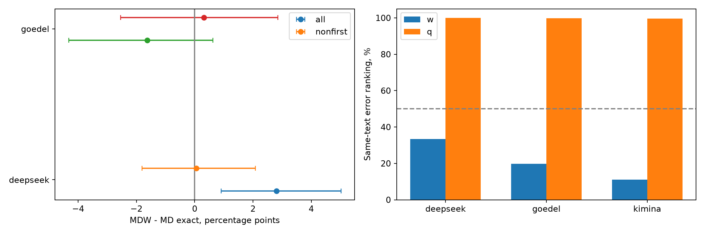

# Скачки скрытых состояний и первый отказ Lean: новая серия

Сформировано: 2026-11-07T20:41:16.686512+00:00. Проект onebigjump; исходный commit bf0bdbe21c00fb9bd677da5a0318eac83f1c8f98. Рабочее дерево было изменено до этой серии; исходный diff, статус и хеши сохранены. Существующие результаты не перезаписаны.

## Что выполнено

Завершены новые расчёты E0–E6: воспроизведение архива, аудит меток, adjacent delta-surprisal, чувствительность геометрии и anchors, полноразмерные линейные probes, перекрёстный Lean-тест и анализ принятых переходов. Исторические контроли и статус расширений E7–E9 приведены отдельно. Новая независимая natural-task репликация и новые семейства хвостовых распределений в эту серию не входят.

Это **локализация первой воспроизводимо отклонённой Lean тактики**. Она не размечает момент возникновения ошибочного замысла. Кандидаты в ретроспективной задаче включают весь исходный AST-путь, в том числе текст после отказа. Метка 0 после отказа не означает корректность.

## Модели, измерения и статистика

DeepSeek-Prover-V2-7B — основной prover; Goedel-Prover-V2-8B — репликация. Kimina-Prover-Distill-8B включена во вторичные miniF2F-сравнения и новый перекрёстный тест. Веса языковых моделей заморожены; fine-tuning не выполнялся. Новые forwards выполнены в BF16/SDPA на одном A100 за раз.

Для тактики t состояние X_t снимается после decoder block на её последнем исходном токене. Основные блоки: 14 для DeepSeek и 17 для Goedel/Kimina, индексация с нуля. Hook сравнен с hidden_states[block+1]; embedding-состояние не принято за блок.

Измерения: ξ_t = X_t − X_(t−1); w_t = ‖Σ_ρ^(−1/2)(ξ_t−μ)‖₂; Σ_ρ = (1−ρ)Σ + ρ·tr(Σ)/d·I. Это норма, не квадрат нормы. Основной anchor — вход в формальную часть; ρ=0,1. μ и Σ получены на отдельных проверенных miniF2F calibration-задачах.

q_t — среднее −log p исходных токенов тактики, с предсказанием token[k] из logits[k−1]. Δq_t=q_t−q_(t−1). Для первого шага Δq=0; уже существующий first-индикатор кодирует отсутствие предыдущего шага, дополнительная дублирующая колонка не добавлялась.

M0: прежние spline-преобразования позиции t, t/L, log(1+число токенов), q, индикаторы первого/последнего шага и AST-тип тактики. M0W=M0+log(1+w). MD=M0+Δq+|Δq|. MDW=MD+log(1+w). Все добавленные числовые признаки стандартизованы только по соответствующему train-fold.

Локализатор: p_it=exp(r_it)/Σ_s exp(r_is); loss=−Σ_i a_i log p_i,t* + λ‖β‖²/2, где a_i=1/(G·n_g). Сначала равны веса групп задач, затем попыток внутри группы. Сохранены исходные 5 внешних × 3 внутренних split, сетка λ и критерий inner NLL. Все scalers, knots и категории обучаются заново внутри train.

Интервалы: 20 000 парных bootstrap групп при **фиксированных OOF-моделях**. Они не учитывают полностью неопределённость повторного обучения CV. ProofNet и архивный miniF2F уже исследовались раньше; новые анализы этих данных остаются исследовательскими. Два основных exact-сравнения MDW−MD корректируются Holm отдельно от семейства двух NLL-сравнений. Чувствительности не выбирались по знаку результата.

## E0–E1: воспроизведение и разметка

| Модель | Попытки / группы learned | M0 exact | M0W exact | Побитовая проверка старых признаков |
|---|---|---|---|---|
| deepseek | 452 / 166 | 40.85% | 43.51% | jump и q совпали; сохранённые предсказания воспроизведены |
| goedel | 259 / 133 | 57.82% | 57.13% | jump и q совпали; сохранённые предсказания воспроизведены |

Полное повторное обучение M0/M0W также воспроизвело исходные вероятности и предсказания. Все восемь исторических argmax-ячеек miniF2F/ProofNet, включая T=1,0, проверены по исходным артефактам.

| Модель | Все evaluation | Verified по старой category | Whole-proof verified | Не verified: старый / уточнённый знаменатель | Eligible learned / argmax |
|---|---|---|---|---|---|
| deepseek | 840 | 111 | 155 | 729 / 685 | 452 / 456 |
| goedel | 840 | 79 | 167 | 761 / 673 | 259 / 262 |

Уточнены знаменатели coverage: прежняя category и отдельный whole_proof_ok отвечают на разные вопросы; например, завершившая Lean-доказательство генерация могла быть помечена generation_truncation. Основная learned-популяция и её t* не изменились. Разница с argmax-популяцией обусловлена дополнительным исключением неполных токенных границ.

Полная взаимоисключающая классификация:

| Модель | Категория аудита | Попытки |
|---|---|---|
| deepseek | accepted_but_unsolved | 22 |
| deepseek | ambiguous_localization | 50 |
| deepseek | context_mismatch | 9 |
| deepseek | generation_truncation | 55 |
| deepseek | included_reproducible_rejection | 452 |
| deepseek | parse_error | 38 |
| deepseek | resource_or_internal | 54 |
| deepseek | sorry_invalid | 1 |
| deepseek | token_boundary_incomplete | 4 |
| deepseek | verified | 155 |
| goedel | accepted_but_unsolved | 14 |
| goedel | ambiguous_localization | 48 |
| goedel | context_mismatch | 7 |
| goedel | generation_truncation | 294 |
| goedel | included_reproducible_rejection | 259 |
| goedel | parse_error | 32 |
| goedel | resource_or_internal | 16 |
| goedel | token_boundary_incomplete | 3 |
| goedel | verified | 167 |

### Почему нет первого отказа на последней тактике

В коде не обнаружен общий запрет t*=L. Реальные Lean-fixtures проверили первый, внутренний и последний отказы, принятый последний шаг с незакрытыми целями, полностью корректное доказательство, parse error и ресурсный сбой. Дополнительная проверка полного production-пути прошла через verify_one, AST-replay и исходные токенные границы: последний отказ сохранил p2_eligible=True.

| Модель | Есть AST-observer / все | Последняя тактика exact в learned | Осталось шагов после отказа: min / median / max |
|---|---|---|---|
| deepseek | 651 / 840 | 442 | 1 / 7 / 82 |
| goedel | 410 / 840 | 252 | 1 / 6 / 161 |

В этой выбранной популяции ошибка обычно находится внутри построения вспомогательного доказательства, после которого остаётся завершающая тактика. Найденные последние отказы более грубого старого replay относятся к исключённым truncated/sorry-ответам; они перечислены в E1_last_lineage. Для исключённых попыток без точного AST-observer положение t* неизвестно. Поэтому отсутствие последних отказов — свойство наблюдаемой выбранной популяции, не основание обобщать качество на любые ошибки.

## E2: добавочная ценность после Δq

| Модель | Кандидаты | N / G | M0 | M0W | MD | MDW | MDW−MD, п.п. [95%] |
|---|---|---|---|---|---|---|---|
| deepseek | все | 452 / 166 | 40.85% | 43.51% | 39.39% | 42.20% | +2.81 [+0.90; +5.02] |
| deepseek | t≥2; t*≥2, новое обучение | 353 / 148 | 39.68% | 40.92% | 39.56% | 39.62% | +0.06 [-1.80; +2.08] |
| goedel | все | 259 / 133 | 57.82% | 57.13% | 57.32% | 55.69% | -1.63 [-4.32; +0.63] |
| goedel | t≥2; t*≥2, новое обучение | 176 / 105 | 52.38% | 52.38% | 51.90% | 52.22% | +0.32 [-2.54; +2.86] |

Для t≥2 сохраняются исходные t и t/L, а Δq берётся относительно реально существовавшей предыдущей тактики. Это отдельная условная популяция с переобучением; её проценты нельзя напрямую сравнивать с основной строкой как изменение на тех же попытках.

| Модель | NLL MD | NLL MDW | NLL MD−MDW [95%] | ±1 MD / MDW | Exact p Holm2 | NLL p Holm2 | Helped / harmed |
|---|---|---|---|---|---|---|---|
| deepseek | 1.77968 | 1.77045 | +0.00923 [-0.00397; +0.02216] | 50.85% / 53.18% | 0.01770 | 0.16569 | 16 / 4 |
| goedel | 1.57061 | 1.62617 | -0.05556 [-0.09206; -0.02137] | 65.68% / 64.17% | 0.19374 | 0.00580 | 4 / 7 |

Первичные exact и NLL не дают одинакового вывода для обеих моделей. Отдельное исключение первого шага существенно меняет величину добавочного эффекта. Полные first/interior/last и length-страты, включая пустую last-страту, находятся в JSON метрик.

### Вторичные miniF2F-сравнения

Новая исследовательская nested CV на архивных evaluation-задачах. Общий детерминированный реестр групп фиксирует split между моделями и температурами; это не прежний frozen-transfer протокол T=0,6→1,0.

| Модель | T | N / G | MD | MDW | Δ exact, п.п. [95%] | NLL MD / MDW |
|---|---|---|---|---|---|---|
| deepseek | 0.6 | 528 / 122 | 49.44% | 50.45% | +1.01 [-0.42; +2.43] | 1.66854 / 1.66711 |
| deepseek | 1.0 | 541 / 140 | 45.85% | 46.05% | +0.20 [-2.29; +2.68] | 1.68768 / 1.67794 |
| goedel | 0.6 | 448 / 122 | 37.05% | 38.32% | +1.27 [-1.74; +4.28] | 2.00866 / 1.98027 |
| goedel | 1.0 | 453 / 124 | 39.85% | 40.04% | +0.19 [-1.83; +2.56] | 1.86589 / 1.85750 |
| kimina | 0.6 | 320 / 94 | 28.90% | 31.82% | +2.93 [-1.28; +7.33] | 2.33191 / 2.35228 |
| kimina | 1.0 | 483 / 120 | 37.30% | 36.83% | -0.47 [-2.63; +1.06] | 2.10971 / 2.10570 |

### Online detector

Старый detector использовал q минус среднее предыдущих q. Теперь добавлены именно соседняя Δq и её модуль. HD — простые текущие/прошлые признаки; HDW добавляет исходные три jump-признака. Полная длина и будущий максимум запрещены. Порог выбран по inner-OOF verified proofs; на test он фиксирован.

| Модель | Verified / failed | Целевой FPR | Exact HD / HDW | Реальный test FPR HD / HDW | Early HD / HDW |
|---|---|---|---|---|---|
| deepseek | 35 / 452 | 0.1 | 14.62% / 13.59% | 15.62% / 15.62% | 3.23% / 2.93% |
| deepseek | 35 / 452 | 0.2 | 18.70% / 21.18% | 28.12% / 36.46% | 4.64% / 6.04% |
| goedel | 40 / 259 | 0.1 | 8.33% / 8.96% | 4.39% / 4.39% | 0.75% / 1.69% |
| goedel | 40 / 259 | 0.2 | 18.01% / 14.16% | 14.91% / 10.53% | 5.33% / 3.70% |

## E3: слой, whitening, anchor

Все десять вариантов показаны; лучший вариант не заменяет исходную основную конфигурацию. Меняется один фактор. Prompt-fixed заменяет только первый increment при прежнем whitening; prompt-recalibrated использует transform по тем же разрешённым calibration-задачам с другим anchor.

| Модель | Вариант | MDW exact, все | Δ к MD, п.п. [95%] | Δ без первого кандидата, п.п. [95%] |
|---|---|---|---|---|
| deepseek | primary | 42.20% | +2.81 [+0.90; +5.02] | +0.06 [-1.80; +2.08] |
| deepseek | layer_lower | 41.15% | +1.76 [+0.05; +3.77] | +0.28 [-1.52; +2.31] |
| deepseek | layer_upper | 42.75% | +3.36 [+1.05; +6.02] | +1.07 [-0.90; +3.21] |
| deepseek | rho_001 | 42.20% | +2.81 [+0.90; +5.02] | +0.51 [-1.35; +2.53] |
| deepseek | rho_05 | 42.20% | +2.81 [+0.90; +5.02] | +0.23 [-1.63; +2.31] |
| deepseek | rho_1 | 40.75% | +1.36 [+0.15; +2.96] | +0.28 [-1.18; +2.14] |
| deepseek | raw | 40.75% | +1.36 [+0.15; +2.96] | +0.28 [-1.18; +2.14] |
| deepseek | centered | 40.75% | +1.36 [+0.15; +2.96] | +0.28 [-1.18; +2.14] |
| deepseek | prompt_fixed | 40.70% | +1.31 [-0.10; +3.06] | +0.06 [-1.80; +2.08] |
| deepseek | prompt_recalibrated | 41.90% | +2.51 [+0.70; +4.67] | +0.06 [-1.80; +2.08] |
| goedel | primary | 55.69% | -1.63 [-4.32; +0.63] | +0.32 [-2.54; +2.86] |
| goedel | layer_lower | 56.25% | -1.07 [-3.20; +0.75] | -0.95 [-3.65; +1.27] |
| goedel | layer_upper | 56.13% | -1.19 [-3.20; +0.25] | +0.00 [-3.02; +3.17] |
| goedel | rho_001 | 56.44% | -0.88 [-3.07; +0.94] | +0.32 [-2.54; +2.86] |
| goedel | rho_05 | 56.13% | -1.19 [-3.82; +0.94] | -0.16 [-2.86; +2.22] |
| goedel | rho_1 | 57.13% | -0.19 [-1.32; +0.94] | -1.43 [-4.76; +1.27] |
| goedel | raw | 57.13% | -0.19 [-1.32; +0.94] | -1.27 [-3.49; +0.00] |
| goedel | centered | 57.13% | -0.19 [-1.32; +0.94] | -1.43 [-4.76; +1.27] |
| goedel | prompt_fixed | 57.07% | -0.25 [-2.26; +1.25] | +0.32 [-2.54; +2.86] |
| goedel | prompt_recalibrated | 56.44% | -0.88 [-3.07; +0.94] | +0.32 [-2.54; +2.86] |

Нижний/верхний блок — 6/21 у DeepSeek и 8/26 у Goedel. Полные argmax-оценки и исходный uniform сохраняются отдельно от learned-популяции. У каждого варианта одинаковое покрытие; ни один вариант не получил дополнительного отбора по результату.

Пилот с forward только промпта показал небольшие BF16-расхождения с полным контекстом. Эти pilot anchors не используются в итоговых сравнениях: выполнен полный forward всех исходных последовательностей, сохранены оба anchor и все слои; состояния на архивных границах обязаны совпасть побитово.

### Префикс до известного t* и matched verified pseudo-prefix

Это диагностика с известным концом отказа, не online accuracy. C1 использует проверенное доказательство той же группы и ту же точку отсечения; C2 использует префиксы с более поздним первым отказом. В этой компактной prefix-таблице веса равны по попыткам; equal-group варианты и интервалы сохранены в summary.json. Совместно ресемплируются целые группы. При недостаточном числе независимых групп CI не приводится.

| Модель | Вариант | Prefix hit | Uniform | C1 N / группы | C1 hit / control | C2 hit / control |
|---|---|---|---|---|---|---|
| deepseek | primary | 42.86% | 24.76% | 27 / 14 | 55.56% / 41.98% | 42.98% / 34.80% |
| deepseek | layer_lower | 43.70% | 24.76% | 27 / 14 | 62.96% / 54.32% | 43.82% / 28.94% |
| deepseek | layer_upper | 38.38% | 24.76% | 27 / 14 | 51.85% / 51.85% | 38.48% / 32.87% |
| deepseek | rho_001 | 42.86% | 24.76% | 27 / 14 | 55.56% / 41.98% | 42.98% / 34.63% |
| deepseek | rho_05 | 42.30% | 24.76% | 27 / 14 | 59.26% / 50.62% | 42.42% / 35.28% |
| deepseek | rho_1 | 39.50% | 24.76% | 27 / 14 | 44.44% / 19.14% | 39.61% / 24.71% |
| deepseek | raw | 33.33% | 24.76% | 27 / 14 | 29.63% / 9.26% | 33.43% / 19.42% |
| deepseek | centered | 39.50% | 24.76% | 27 / 14 | 44.44% / 19.14% | 39.61% / 24.71% |
| deepseek | prompt_fixed | 6.16% | 24.76% | 27 / 14 | 7.41% / 0.00% | 6.18% / 2.77% |
| deepseek | prompt_recalibrated | 42.86% | 24.76% | 27 / 14 | 55.56% / 41.98% | 42.98% / 35.31% |
| goedel | primary | 41.34% | 24.40% | 19 / 11 | 36.84% / 29.82% | 41.57% / 24.93% |
| goedel | layer_lower | 37.43% | 24.40% | 19 / 11 | 52.63% / 36.84% | 37.64% / 24.36% |
| goedel | layer_upper | 32.96% | 24.40% | 19 / 11 | 21.05% / 21.05% | 33.15% / 22.85% |
| goedel | rho_001 | 38.55% | 24.40% | 19 / 11 | 36.84% / 31.58% | 38.76% / 24.98% |
| goedel | rho_05 | 45.25% | 24.40% | 19 / 11 | 47.37% / 36.84% | 45.51% / 24.58% |
| goedel | rho_1 | 13.41% | 24.40% | 19 / 11 | 15.79% / 19.30% | 13.48% / 6.19% |
| goedel | raw | 7.82% | 24.40% | 19 / 11 | 10.53% / 19.30% | 7.87% / 2.80% |
| goedel | centered | 13.41% | 24.40% | 19 / 11 | 15.79% / 19.30% | 13.48% / 6.19% |
| goedel | prompt_fixed | 7.82% | 24.40% | 19 / 11 | 0.00% / 0.00% | 7.87% / 1.26% |
| goedel | prompt_recalibrated | 43.02% | 24.40% | 19 / 11 | 47.37% / 31.58% | 43.26% / 24.92% |

Архивные miniF2F/Kimina readout-, whitening- и prefix-чувствительности включены как уже выполненные проверки; их не выдаём за новую независимую выборку. Формальная версия tail/threshold диагностик воспроизведена с исходными правилами и числами превышений; signed Hill/moment/GPD остаются в archive_extensions/metrics.json.

## E4: полноразмерные линейные probes

MD_state добавляет линейный score X_t, MD_increment — линейный score ξ_t. Использованы все 4096 координат, без PCA. Каждый scaler обучен внутри своего train-fold; регуляризация выбрана тем же inner NLL. Веса LLM не менялись.

| Модель | MD | MDW | MD + state | MD + increment | NLL MD / MDW / state / increment | CPU wall, мин |
|---|---|---|---|---|---|---|
| deepseek | 39.39% | 42.20% | 47.64% | 46.82% | 1.77968 / 1.77045 / 1.62908 / 1.78748 | 16.07 |
| goedel | 57.32% | 55.69% | 50.33% | 51.49% | 1.57061 / 1.62617 / 1.67394 / 1.74147 | 11.00 |

Размеры design matrix и коэффициентов по folds, все OOF-вероятности, λ, расходы и интервалы парных сравнений находятся в E4/*/{fits в fold-*.json, metrics.json, predictions.json}. Сравнение относится к этим регуляризованным линейным probes на имеющемся числе задач, а не к пределу возможностей всех probes.

## E5: одинаковый текст тактики, изменённая корректность

Корпус: exact, apply и rw; 75 pilot-четвёрок на 15 базовых конструкциях и 300 test-четвёрок на 60 других конструкциях. По пять вариантов имён/порядка гипотез/принятого префикса/дистракторов на конструкцию. Эти варианты не считаются независимыми задачами. Все четыре исполнения каждой четверки проверены настоящим Lean; sorry, parse/resource failures не заменяют отрицательную метку.

В A гипотеза hx имеет целевой тип, hy — другой; в B типы меняются местами. Сравниваются буквально те же тексты тактик. D=(w_A(hy)−w_A(hx)+w_B(hx)−w_B(hy))/2. Положительный D соответствует большему скачку на отклонённой тактике. Same-text ranking сравнивает одну и ту же тактику между A/B; ничьи дают 0,5. Порог шанса — 50%.

| Модель | D(w), 95% | Rank w, same text [95%] | Rank q, same text [95%] | Simple exact | Simple + w exact | Δ exact, п.п. [95%] |
|---|---|---|---|---|---|---|
| deepseek | -1.2528 [-1.71322; -0.78013] | 33.33% [+26.17; +40.83] | 100.00% [+100.00; +100.00] | 99.67% | 99.17% | -0.50 [-1.17; +0.00] |
| goedel | -1.0407 [-1.20937; -0.86864] | 19.83% [+15.33; +24.67] | 99.83% [+99.50; +100.00] | 98.67% | 98.67% | +0.00 [+0.00; +0.00] |
| kimina | -3.4040 [-3.99099; -2.81938] | 11.17% [+7.33; +15.17] | 99.67% [+99.17; +100.00] | 96.67% | 98.50% | +1.83 [+0.83; +2.83] |

Simple использует длину тактики, q, соседнюю Δq, |Δq| и отсутствие предыдущего шага; Simple+w добавляет log(1+w). Conditional-logistic выбор между двумя тактиками настроен только на pilot-конструкциях с групповым inner CV. Test-конструкции не участвовали в подборе λ. Коэффициент скачка не ограничен по знаку.

В этих простых синтетических конструкциях raw jump не ведёт себя как универсальный возрастающий индикатор ошибки. Перенос такого результата на естественные длинные доказательства ограничен: семейства exact/apply/rw и синтетические типы специально контролируются. Данные по каждой семье, все четыре w/q/Δq и learned NLL сохранены, включая отрицательные эффекты. Для всех трёх моделей в E5 использован один простой completion-промпт; это отдельный контролируемый режим, а не оценка стандартного chat/CoT-промпта каждой модели. В этом корпусе formal-entry совпадает с концом предоставленного промпта, потому что заголовок уже заканчивается на by; оба индекса сохранены явно.

## E6: принятые тактики и изменение состояния Lean

Включены только реально принятые шаги до отказа и шаги проверенных доказательств. Счётчики целей основаны на множествах Lean goal IDs внутри перехода. Число строк объявлений и длина pretty-printed state — прокси; размер AST выражений по ним не заявляется. Execution-outcome признаки используются только для объяснения log(1+w), не для pre-Lean детектора ошибок.

| Модель | Принятые шаги / группы | Verified / pre-failure | Порог τ | Превышений / группы | Held-out MSE baseline / +transition | Δ MSE [95%] |
|---|---|---|---|---|---|---|
| deepseek | 2275 / 150 | 275 / 2000 | 152.7247 | 195 / 69 | 0.05403 / 0.05337 | +0.000665 [-0.00056; +0.00207] |
| goedel | 1363 / 110 | 282 / 1081 | 98.9471 | 199 / 59 | 0.09586 / 0.09516 | +0.000702 [-0.00201; +0.00331] |

Порог перенесён из архивной независимой threshold-calibration части; её группы не пересекаются с whitening-fit группами. В первом техническом расчёте E6 по ошибке использовался эмпирический 99-й процентиль самих whitening-fit приращений. Он сохранён для аудита, но не используется в этой таблице. Исправление затронуло только отметку large_jump и набор примеров; regression/OOF-оценки порог не используют и не изменились.

Примеры крупных принятых переходов выбраны фиксированным SHA256-правилом; для каждого сохранены исходная тактика, before/after, w, q и ссылка на Lean detail. Это наблюдательные связи, не причинная идентификация механизма ошибок.

## E7–E9 и границы выполненной работы

| Блок | Фактический статус | Что осталось |
|---|---|---|
| E7 | archived exact-prefix audit completed | A new fixed-prefix continuation collection would be needed if archived coverage is insufficient; not replace missing mixed outcomes by adaptive generation. |
| E8 | historical protocols and results retained; no fresh natural-task confirmatory replication in this campaign | Freeze H1-H4 on a newly sampled task-family-disjoint natural-task corpus after development; pilot and renamings must not count as independent tasks. |
| E9 | formal-entry archived threshold rates reproduced; archived Hill/moment/GPD retained | Held-out tail-family likelihood comparison and held-out conditional rank model are optional new work; no fresh claim of Kesten or regularly varying tails. |

В строгом поиске одинаковых исходных token-prefix среди доступных принятых/первых отклонённых шагов получено:

| Модель | Шаги | Уникальные префиксы | Разные продолжения одного префикса | Mixed outcome |
|---|---|---|---|---|
| deepseek | 2727 | 2727 | 0 | 0 |
| goedel | 1624 | 1624 | 0 | 0 |

Новые естественные продолжения для E7 не генерировались; новая natural-task серия H1–H4 для E8 не выдаётся за выполненную. Архивный Appendix-H/ProofNet и T=1 transfer уже изучались, поэтому повторный расчёт не делает их независимым подтверждением. Для E9 сохранены прежние signed оценки; положительный Hill сам по себе не устанавливает регулярно меняющийся хвост, а логнормальное распределение не относится к таким хвостам.

## Материалы для статьи и ответа рецензентам

Доступен архив сентябрьских отчётов и draft, а замечания 1ooR/wDaH/22Kj взяты из задания. Текущая публичная страница OpenReview/API не открылась (HTTP 403); точное совпадение серверного draft с поданной версией ICLR 2027 не установлено. Поэтому ниже указаны смысловые места для вставки, не выдуманные номера строк актуальной статьи. Ответы в OpenReview не публиковались.

| Рецензент / вопрос | Проверка и численная опора | Допустимый вывод | Место в статье | Ограничение |
|---|---|---|---|---|
| 1ooR: отбор и последний шаг | E1: все попытки учтены; last-step fixture проходит production/token path; исходные learned-числа воспроизведены | Метка работает на последнем шаге; текущая выбранная популяция последних отказов не содержит | Dataset/labeling + eligibility appendix | Неизвестные t* у исключённых не восстанавливаются догадкой |
| 1ooR: геометрия | E3 и geometry.csv: все слои, shrinkages, raw/centered, оба anchor; prefix_controls.csv | Эффект оценивается вместе с чувствительностью к выбору readout и первого шага | Sensitivity appendix | Исторические данные, множественные описательные варианты |
| wDaH: Δsurprisal | E2 + E2-online: MDW−MD, exact/NLL, first-step-excluded refit; primary_contrasts.csv | Можно утверждать добавочную предсказательную ценность только в конкретной модели/популяции и метрике | Incremental value + online subsection | Разные prover-модели дают разные результаты; CI условны на OOF fits |
| wDaH: начало ошибки | Операциональная метка t* и исключение post-error из E6 | Измеряется первый воспроизводимый отказ Lean | Definitions/limitations | Это не начало ошибочного рассуждения |
| 22Kj: probes | E4, полные 4096 координат, одинаковые split/loss/tuning | Сравнение с конкретными регуляризованными линейными probes | Practical payoff | Не универсальная оценка всех возможных probes/PRM |
| 22Kj: объяснение скачка | E5: текст фиксирован, корректность меняется; E6: принятые переходы и goal states | Простая монотонная интерпретация raw jump ограничена; q в контролируемом корпусе информативен | Controlled tests + discussion | Синтетические типы и наблюдательный E6 |
| Все: Кестен/фиксированный порог | Архивная formal-entry tail/threshold диагностика; отрицательные и смешанные результаты сохранены | Наблюдения не устанавливают механизм Кестена или универсальный порог отказа | Theory/empirical scope | Не выполнено новое held-out сравнение семейств хвостовых распределений |

### Rebuttal-ready factual text

On the archived ProofNet deepseek cohort (452 attempts, 166 task groups), adding the jump feature after adjacent surprisal-change controls changed equal-group exact localization by +2.81 percentage points (fixed-OOF group-bootstrap 95% CI [+0.90; +5.02]). Retraining with the first candidate excluded gave +0.06 points ([-1.80; +2.08]). These are exploratory analyses of previously inspected data, not a fresh confirmatory evaluation.

On the archived ProofNet goedel cohort (259 attempts, 133 task groups), adding the jump feature after adjacent surprisal-change controls changed equal-group exact localization by -1.63 percentage points (fixed-OOF group-bootstrap 95% CI [-4.32; +0.63]). Retraining with the first candidate excluded gave +0.32 points ([-2.54; +2.86]). These are exploratory analyses of previously inspected data, not a fresh confirmatory evaluation.

## Проверка, ресурсы и воспроизводимость

Финальная проверка: 62 обязательных выходов; 8692 проверок выходных digest; 49696 распределений вероятностей. Проверены gradient, shift/позиции, исходные split и отсутствие пересечения pilot/test конструкций. Все требуемые проверки прошли.

Каждое вычисление выполнялось в Slurm. Исторические результаты, исходные checkpoints/токены и архивные manifests не изменялись. Неудачные технические задания сохранены в логах; исправлялась только новая серия. В E3 DeepSeek один inner-fit завершился статусом ABNORMAL при max|gradient|=4,79×10⁻⁸. Недостающие варианты досчитаны с повтором того же L-BFGS-B из нуля и увеличенным maxls 40→200; loss, λ-grid, splits и критерии сходимости сохранены. Завершённые варианты не пересчитывались. Исходники, зависимости, первоначальный git diff/status и версии библиотек входят в пакет воспроизводимости.

Ссылки на основные таблицы: [scores.csv](../assets/846c51a77cf7_scores.csv), [primary_contrasts.csv](../assets/dd28616902d6_primary_contrasts.csv), [geometry.csv](../assets/bd5ccf8c9853_geometry.csv), [prefix_controls.csv](../assets/d99a5c64d9cd_prefix_controls.csv), [crossed.csv](../assets/de3ba1b5b683_crossed.csv). Полный машинный свод — summary.json (полный исходник на Жоресе: /beegfs/home/denis.rakhmankin/onebigjump/runs/revision_20261107_v1/delivery_final/summary.json).

## Карта кода, входов и проверенных выходов

Пути ниже даны относительно onebigjump. Новые скрипты находятся в experiments/revision_20261107_v1, новые результаты — в runs/revision_20261107_v1.

| Блок | Код новой проверки | Основные входы / переиспользованный код | Готовые выходы | Статус |
|---|---|---|---|---|
| E0 | audit.py | audit/lean_localizer_20260925_v1 + исходные OOF/состояния | E0/metrics.json | воспроизведён |
| E1 | label_audit.py, last_lineage.py, production_fixtures_v2.py | whole-proof outcome, frozen observer и semantic replay | E1_archive, E1_last_lineage, E1_production_v2 | завершён, живой Lean проверен |
| E2 | localizer.py, online.py, secondary.py | старый engine и сохранённые групповые splits; NNG_A5 hazard | E2, E2_online, secondary | завершён |
| E3 | geometry.py + geometry_retry.py, full_anchors.py, anchor_compare.py, prefix_controls.py | NNG_vectors, NNG_A2 whitening; prefix_positional_control | E3, E3_anchor, E3_prefix | завершён |
| E4 | probe.py | те же ProofNet rows/splits; 4096D boundary states | E4 | завершён; PCA не использовалась |
| E5 | crossed_corpus.py, crossed_extract.py, crossed_kimina.py, crossed_analyze_all3.py | новый замороженный корпус; реальные Lean-исходы | E5_corpus, E5_gpu, E5_analysis_all3 | завершён, 3 prover-модели |
| E6 | transitions.py, correct_threshold.py | принятые события replay; независимый archival threshold | E6, E6_corrected_threshold | завершён; используется исправленный порог |
| E7–E9 | archive_extensions.py | сохранённые prefixes, Appendix H и tail-артефакты | archive_extensions | архив проверен; новые расширения перечислены отдельно |

## Дополнение: argmax и uniform на полной доступной популяции

Это описательные point estimates. Все варианты используют одинаковые попытки внутри модели. Кандидаты и популяция all/nonfirst соответствуют названиям; candidate-first исключается отдельно от основной learned-популяции. Числа не объединяются с learned exact.

| Модель | Вариант | N / G | Exact / uniform, equal-group | Δ, п.п. | Exact / uniform, attempt-weighted |
|---|---|---|---|---|---|
| deepseek | primary | 456 / 167 | 18.39% / 12.50% | +5.90 | 20.39% / 13.34% |
| deepseek | layer_lower | 456 / 167 | 25.27% / 12.50% | +12.77 | 28.73% / 13.34% |
| deepseek | layer_upper | 456 / 167 | 20.08% / 12.50% | +7.58 | 22.15% / 13.34% |
| deepseek | rho_001 | 456 / 167 | 19.29% / 12.50% | +6.80 | 20.61% / 13.34% |
| deepseek | rho_05 | 456 / 167 | 18.31% / 12.50% | +5.82 | 19.96% / 13.34% |
| deepseek | rho_1 | 456 / 167 | 24.48% / 12.50% | +11.99 | 25.66% / 13.34% |
| deepseek | raw | 456 / 167 | 24.20% / 12.50% | +11.71 | 26.32% / 13.34% |
| deepseek | centered | 456 / 167 | 24.48% / 12.50% | +11.99 | 25.66% / 13.34% |
| deepseek | prompt_fixed | 456 / 167 | 21.21% / 12.50% | +8.71 | 22.81% / 13.34% |
| deepseek | prompt_recalibrated | 456 / 167 | 18.64% / 12.50% | +6.15 | 20.18% / 13.34% |
| goedel | primary | 262 / 134 | 26.37% / 13.08% | +13.29 | 29.39% / 14.16% |
| goedel | layer_lower | 262 / 134 | 27.74% / 13.08% | +14.65 | 31.30% / 14.16% |
| goedel | layer_upper | 262 / 134 | 26.24% / 13.08% | +13.16 | 27.86% / 14.16% |
| goedel | rho_001 | 262 / 134 | 25.56% / 13.08% | +12.48 | 28.24% / 14.16% |
| goedel | rho_05 | 262 / 134 | 27.49% / 13.08% | +14.40 | 30.92% / 14.16% |
| goedel | rho_1 | 262 / 134 | 28.54% / 13.08% | +15.46 | 30.92% / 14.16% |
| goedel | raw | 262 / 134 | 27.24% / 13.08% | +14.16 | 30.15% / 14.16% |
| goedel | centered | 262 / 134 | 28.54% / 13.08% | +15.46 | 30.92% / 14.16% |
| goedel | prompt_fixed | 262 / 134 | 28.17% / 13.08% | +15.09 | 30.92% / 14.16% |
| goedel | prompt_recalibrated | 262 / 134 | 27.43% / 13.08% | +14.34 | 28.24% / 14.16% |

Полные all/nonfirst показатели с обоими весами: [argmax.csv](../assets/cd3853e1294c_argmax.csv).

## Дополнение: неопределённость probes

Все интервалы ниже — парные bootstrap по группам при фиксированных OOF-предсказаниях. Это вторичные сравнения; отдельные p-values не используются для объявления семейства подтверждённых эффектов.

| Модель | Контраст | Δ exact, п.п. [95%] | Выигрыш NLL [95%] |
|---|---|---|---|
| deepseek | MD_state-MD | +8.2473 [+2.1228; +14.4981] | +0.1506 [+0.0449; +0.2570] |
| deepseek | MD_increment-MD | +7.4283 [+1.1546; +13.8038] | -0.0078 [-0.1050; +0.0902] |
| deepseek | MDW-MD_state | -5.4360 [-11.3396; +0.4475] | -0.1414 [-0.2461; -0.0367] |
| deepseek | MDW-MD_increment | -4.6170 [-10.7114; +1.4417] | +0.0170 [-0.0796; +0.1123] |
| goedel | MD_state-MD | -6.9925 [-14.1103; +0.0251] | -0.1033 [-0.2588; +0.0550] |
| goedel | MD_increment-MD | -5.8271 [-12.0927; +0.3133] | -0.1709 [-0.3206; -0.0122] |
| goedel | MDW-MD_state | +5.3634 [-1.6541; +12.5063] | +0.0478 [-0.1105; +0.2005] |
| goedel | MDW-MD_increment | +4.1980 [-1.8170; +10.2130] | +0.1153 [-0.0383; +0.2590] |

Совместимый готовый process reward model для этого формата Lean-шагов в проверенной инфраструктуре не найден; PRM baseline остаётся открытым пунктом. Новая большая PRM не обучалась.

## Дополнение: типы принятых переходов и примеры E6

Категории ниже определены только по изменению числа целей: уменьшилось / увеличилось / сохранилось. Равное число целей допускает замену цели и изменение гипотез. Это не доказательство семантической эквивалентности состояний.

| Модель | Переход | Все принятые: шаги / группы | Выше τ: шаги / группы | Только verified выше τ: шаги / группы |
|---|---|---|---|---|
| deepseek | fewer_goals | 694 / 103 | 39 / 26 | 5 / 5 |
| deepseek | more_goals | 130 / 50 | 20 / 14 | 1 / 1 |
| deepseek | same_goal_count | 1451 / 148 | 136 / 58 | 10 / 4 |
| goedel | fewer_goals | 537 / 66 | 44 / 27 | 16 / 8 |
| goedel | more_goals | 60 / 26 | 31 / 16 | 2 / 2 |
| goedel | same_goal_count | 766 / 105 | 124 / 50 | 18 / 4 |

### deepseek: evaluation:proofnet-8:Artin_exercise_10_2_4:T0.6:a00, шаг 2

Шаг принят Lean; полное доказательство позднее завершилось отказом. w=155.80732, q=0.10283, Δq=0.06442. Пример взят из сохранённой SHA256-выборки: первый в своей категории verified/pre-failure.

```lean
have h₁ : p ∈ span ({2} : Set (Polynomial ℤ)) := hp.1
```

Состояние до:

```text
p : ℤ[X]
hp : p ∈ Ideal.span {2} ⊓ Ideal.span {X}
⊢ p ∈ Ideal.span {2 * X}
```

Состояние после:

```text
p : ℤ[X]
hp : p ∈ Ideal.span {2} ⊓ Ideal.span {X}
h₁ : p ∈ Ideal.span {2}
⊢ p ∈ Ideal.span {2 * X}
```

Источник: `/beegfs/home/denis.rakhmankin/onebigjump/runs/followthrough_20260915_v1/p2_pipeline/deepseek/verification-1/a33ef502534e8f7841b8057a43a7567e7a3b7d995b6689943175684a06fa4e37.json.gz`; SHA256 `8a4d45a090b72c2635f8c3746cc12271f1ecc7b7e9a8fbf8d53174cd9e3c2ac8`.

### goedel: evaluation:proofnet-199:Axler_exercise_1_4:T0.6:a00, шаг 3

Шаг принят Lean; полное доказательство позднее завершилось отказом. w=102.05051, q=0.05892, Δq=0.00865. Пример взят из сохранённой SHA256-выборки: первый в своей категории verified/pre-failure.

```lean
exact Or.inl ha
```

Состояние до:

```text
case pos
F : Type u_1
V : Type u_2
inst✝² : AddCommGroup V
inst✝¹ : Field F
inst✝ : Module F V
v : V
a : F
h : a • v = 0
ha : a = 0
⊢ a = 0 ∨ v = 0
```

Состояние после:

```text
(нет целей)
```

Источник: `/beegfs/home/denis.rakhmankin/onebigjump/runs/followthrough_20260915_v1/p2_pipeline/goedel/verification-3/a0c5ac9b785340cea28e26b61c53582b76ba9091362e9c150eaafc88ac518bb8.json.gz`; SHA256 `fdf8754ffe5eafc41e6c186d1da8bece16dd7e2b2f7dc3383e0f73569210414c`.

### goedel: evaluation:proofnet-217:Dummit_Foote_exercise_1_1_29:T0.6:a00, шаг 9

Шаг принят Lean; полное доказательство проверено. w=100.82358, q=0.00788, Δq=0.00787. Пример взят из сохранённой SHA256-выборки: первый в своей категории verified/pre-failure.

```lean
rintro ⟨hA, hB⟩ x y
```

Состояние до:

```text
A : Type u_1
B : Type u_2
inst✝¹ : Group A
inst✝ : Group B
h_imp : (∀ (x y : A × B), x * y = y * x) → (∀ (x y : A), x * y = y * x) ∧ ∀ (x y : B), x * y = y * x
⊢ ((∀ (x y : A), x * y = y * x) ∧ ∀ (x y : B), x * y = y * x) → ∀ (x y : A × B), x * y = y * x
```

Состояние после:

```text
A : Type u_1
B : Type u_2
inst✝¹ : Group A
inst✝ : Group B
h_imp : (∀ (x y : A × B), x * y = y * x) → (∀ (x y : A), x * y = y * x) ∧ ∀ (x y : B), x * y = y * x
hA : ∀ (x y : A), x * y = y * x
hB : ∀ (x y : B), x * y = y * x
x y : A × B
⊢ x * y = y * x
```

Источник: `/beegfs/home/denis.rakhmankin/onebigjump/runs/followthrough_20260915_v1/p2_pipeline/goedel/verification-0/5597f5ed1644533dabdb819b0e6db36b71c8a4262de65f530b6efa497f97827c.json.gz`; SHA256 `1dcfe2c9d68a438f375fc1a1b4f9947c2bf2f4cbc90b789a66382310507693c6`.

## Предлагаемые правки статьи

**Abstract.** Назвать эмпирическое событие первым воспроизводимым отказом Lean. Описать измеряемую связь геометрии скрытых состояний с этим событием и модельную зависимость добавочной локализации. Не представлять наблюдательную связь как установление механизма Кестена или универсального порога.

**Contributions.** Разделить три результата: теоретическую условную модель; воспроизводимый аудит и измерение Lean-события; сравнение предсказательных признаков и контролируемые проверки. Добавить Δsurprisal, полный линейный probe, crossed-корпус и корректные переходы как самостоятельные эмпирические проверки с явными ограничениями.

**Эксперименты.** Главную learned-таблицу дополнить MD/MDW с равными весами задач и Holm2, отдельно показать refit без первого кандидата. Вынести argmax, онлайн-детектор и prefix-диагностику в разные таблицы с собственными популяциями. В чувствительности показать все заранее заданные варианты, не выбирать лучший по текущему тесту. Добавить полные интервалы probes и отрицательные/модельно различающиеся результаты E5/E6.

**Ограничения.** Текущий ProofNet/miniF2F анализ повторно использует уже исследованные данные. E5 — новые отложенные синтетические конструкции с общим completion-промптом; перенос между семействами приведён в отдельном вторичном анализе ниже. Новые естественные развилки E7, нетронутые задачи E8, held-out сравнение хвостовых семейств E9 и PRM требуют отдельных запусков. Точное совпадение доступного draft с текущей подачей не проверено из-за недоступности OpenReview.

## Дополнительный учёт ресурсов

Новый каталог расчётов до упаковки отчёта: 1.021 GiB. Валидация 1500 синтетических Lean-исполнений заняла 52.34 с внутри выделенного задания, без staging. CPU-задания запрашивали 4 CPU / 32 GiB RAM; GPU-задания — 4 CPU / 64 GiB host RAM и одну A100 80 GB. Пакет GPU metadata содержит измеренную память и throughput. Извлечение выполнялось с batch=1; переход на другой dtype или многообъектный batch не использовался.

## E5: перенос на другое семейство тактик

Для каждого holdout-семейства локализатор обучен только на pilot-конструкциях двух других семейств: 10 групп. Регуляризация выбирается 3-fold group CV там же. Затем оцениваются 100 test-четвёрок / 20 групп оставленного семейства. Все три holdout и все prover-модели показаны. Это вторичная исследовательская проверка, выполненная после общего E5-анализа; новый датированный addendum сохранён до расчёта. Тестовые признаки и outcomes не используются в обучении, scalers или выборе λ.

| Модель | Новое семейство | Simple exact | Simple+w exact | Δ, п.п. [95%] | NLL Simple / +w |
|---|---|---|---|---|---|
| deepseek | exact | 100.00% | 100.00% | +0.00 [+0.00; +0.00] | 0.00002 / 0.00001 |
| deepseek | apply | 100.00% | 100.00% | +0.00 [+0.00; +0.00] | 0.00074 / 0.00099 |
| deepseek | rw | 99.00% | 98.50% | -0.50 [-1.50; +0.00] | 0.12344 / 0.12244 |
| goedel | exact | 100.00% | 100.00% | +0.00 [+0.00; +0.00] | 0.00376 / 0.00364 |
| goedel | apply | 96.00% | 95.50% | -0.50 [-1.50; +0.00] | 0.10043 / 0.09472 |
| goedel | rw | 100.00% | 100.00% | +0.00 [+0.00; +0.00] | 0.01336 / 0.01390 |
| kimina | exact | 93.50% | 95.50% | +2.00 [+0.50; +4.00] | 0.13229 / 0.08581 |
| kimina | apply | 96.50% | 99.00% | +2.50 [+1.00; +4.50] | 0.06548 / 0.02305 |
| kimina | rw | 100.00% | 100.00% | +0.00 [+0.00; +0.00] | 0.01546 / 0.05490 |

CSV: [family_transfer.csv](../assets/6ef6e077e44b_family_transfer.csv). При 20 базовых конструкциях на семейство точность интервалов ограничена; повторные варианты одной конструкции ресемплируются вместе.

## Численная таблица для rebuttal

Эта таблица дополняет карту замечаний выше конкретными оценками и интервалами. Числа построены из тех же метрик, что основной отчёт.

| Замечание | Проверка | Результат [95%] | Допустимая формулировка | Раздел | Осталось |
|---|---|---|---|---|---|
| wDaH | deepseek: MDW−MD exact | +2.811 [+0.904; +5.020] п.п. | Добавочная локализация зависит от модели и популяции | Incremental value | Исследованные ранее ProofNet; фиксированные OOF fits |
| 22Kj | deepseek: state probe−MD exact | +8.247 [+2.123; +14.498] п.п. | Сравнение с конкретным полным линейным probe | Probe baseline | Малое число независимых групп; не все возможные probes |
| 22Kj | deepseek: E6 gain MSE | +0.001 [-0.001; +0.002] | Измерены наблюдательные связи на принятых шагах | Accepted transitions | CI включает отсутствие улучшения; текстовые прокси |
| wDaH | goedel: MDW−MD exact | -1.629 [-4.323; +0.627] п.п. | Добавочная локализация зависит от модели и популяции | Incremental value | Исследованные ранее ProofNet; фиксированные OOF fits |
| 22Kj | goedel: state probe−MD exact | -6.992 [-14.110; +0.025] п.п. | Сравнение с конкретным полным линейным probe | Probe baseline | Малое число независимых групп; не все возможные probes |
| 22Kj | goedel: E6 gain MSE | +0.001 [-0.002; +0.003] | Измерены наблюдательные связи на принятых шагах | Accepted transitions | CI включает отсутствие улучшения; текстовые прокси |
| 22Kj | deepseek: raw w same-text ranking | 33.33% [26.17; 40.83] | В этом корпусе больший raw jump не является возрастающим индикатором отказа | Crossed control | Синтетические конструкции; общий completion-промпт |
| 22Kj | goedel: raw w same-text ranking | 19.83% [15.33; 24.67] | В этом корпусе больший raw jump не является возрастающим индикатором отказа | Crossed control | Синтетические конструкции; общий completion-промпт |
| 22Kj | kimina: raw w same-text ranking | 11.17% [7.33; 15.17] | В этом корпусе больший raw jump не является возрастающим индикатором отказа | Crossed control | Синтетические конструкции; общий completion-промпт |
| 1ooR | Последний отказ Lean | 5/5 production fixtures; последний отказ p2_eligible=True | Общего фильтра t*=L не обнаружено | Labeling / eligibility | Fixtures не оценивают частоту в естественной популяции; CI неприменим |

Фактический GPU-расход этой серии на момент отчёта по Slurm: **0.298 GPU-часа**. Это elapsed allocation × число GPU; запрошенный walltime не является фактическим расходом. Полная ведомость — slurm_accounting.psv (исходный путь: slurm_accounting.psv).



Серверная папка: /beegfs/home/denis.rakhmankin/onebigjump/runs/revision_20261107_v1. Код: experiments/revision_20261107_v1. Связанные первичные данные и большие состояния остаются на сервере; в компактный локальный пакет включены отчёт, таблицы, итоговые метрики, проверки, исходники и диагностические логи.
