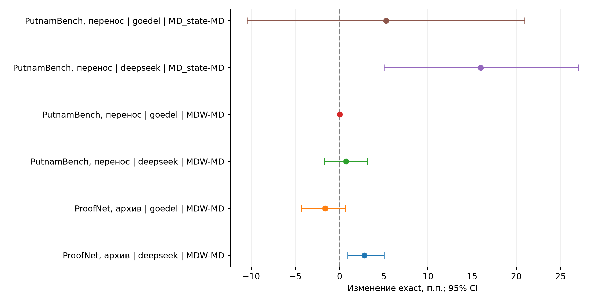

# Жорес: результаты onebigjump и дополнительные эксперименты

Срез: 2026-11-10T19:57:37+03:00, Москва.

Проверен проект /beegfs/home/denis.rakhmankin/onebigjump: серии 7–8 ноября и новые проверки 10 ноября 2026. Другие проекты аккаунта не входят в научный разбор. Доступный контракт статьи: docs/experimental_specification.md. Совпадение этого документа с последним поданным PDF не установлено.

## Вывод для статьи

Универсальное объяснение отказов Lean через величину одного скачка скрытого состояния не подтверждено. Положительный архивный результат DeepSeek ослабевает при контроле первого шага и не получил убедительного подтверждения на PutnamBench. Для Goedel добавочная польза нормы скачка не подтверждена. Более перспективен полный вектор состояния DeepSeek; его необходимо сопоставлять с сильными baseline и контролями.

Усиление статьи — в устранении альтернативных объяснений, проверке переноса и полном раскрытии отрицательных результатов. Подбор конфигурации до положительного результата не проводился.

## Какие эксперименты завершились

| Серия | Фактический результат |
| --- | --- |
| E0–E1 | Воспроизведение архива, аудит меток/знаменателей и live Lean fixtures завершены, включая исправленные повторы. |
| E2 | Adjacent Δsurprisal, отдельный nonfirst refit, online и вторичные miniF2F сравнения завершены. |
| E3 | Проверены слои, whitening, anchor и matched prefixes; лучший вариант не подменяет основной. |
| E4 | Полноразмерные probes состояния и приращения завершены. |
| E5 | Контролируемый синтетический тест трёх моделей и перенос семейства тактик завершены. |
| E6 | Крупные корректные Lean переходы проанализированы; причинность не установлена. |
| E8 | Новые для истории проекта PutnamBench задачи с frozen переносом старых локализаторов завершены. |
| E9 | Held-out хвостовые семейства и rank-модель на архиве завершены; большинство хвостовых ячеек недостаточно наполнены. |
| E7 | Генерация, Lean-разметка, измерения и анализ завершены; смешанных исходов внутри выбранных префиксов не получено. |

Аудит 10 ноября подтвердил SHA256 всех 3179 уникальных выходных файлов E7–E9. Полная валидация E0–E6 и исходный отчёт сохранены в runs/revision_20261107_v1/delivery_checked.

Причина зависания E7: задача 8526320 подготовила данные и отправила дочерние этапы, затем упала при отправке отчёта с устаревшими Slurm dependencies. Генерация 8526436 получила DependencyNeverSatisfied. После успешного аудита 8530954 зависимость заменена на этот аудит; исходные запросы, seed и все научные этапы сохранены. Новый отчёт зависит от действующего анализа.

## Основные результаты

MD использует позицию, длину, тип тактики, surprisal и соседнюю Δsurprisal. MDW добавляет log(1+w), где w — норма whitened increment. Exact — локализация первого воспроизводимого отказа Lean, с равными весами задач; это не доля решённых теорем. Интервалы — 20 000 парных bootstrap задач, условных на обученные модели.

| Выборка | Модель | Кандидаты | N | Группы | MD,% | MDW,% | Δ,п.п. | 95% CI,п.п. |
| --- | --- | --- | --- | --- | --- | --- | --- | --- |
| ProofNet, архив | deepseek | all | 452 | 166 | 39.39 | 42.20 | +2.81 | [+0.904; +5.020] |
| ProofNet, архив | deepseek | nonfirst | 353 | 148 | 39.56 | 39.62 | +0.06 | [-1.802; +2.083] |
| ProofNet, архив | goedel | all | 259 | 133 | 57.32 | 55.69 | -1.63 | [-4.323; +0.627] |
| ProofNet, архив | goedel | nonfirst | 176 | 105 | 51.90 | 52.22 | +0.32 | [-2.540; +2.857] |
| PutnamBench, перенос | deepseek | all | 118 | 58 | 33.48 | 34.20 | +0.72 | [-1.724; +3.161] |
| PutnamBench, перенос | deepseek | nonfirst | 107 | 56 | 35.42 | 37.35 | +1.93 | [-0.893; +6.548] |
| PutnamBench, перенос | goedel | all | 48 | 35 | 45.71 | 45.71 | +0.00 | [+0.000; +0.000] |
| PutnamBench, перенос | goedel | nonfirst | 44 | 31 | 39.25 | 38.71 | -0.54 | [-8.602; +5.914] |

nonfirst исключает первый кандидат и попытки с t*=1; исходные позиции/длины и предыдущая Δq сохранены. Это отдельная условная оценка с переобучением на архиве.

У Goedel в основной E8 MD/MDW не изменили ни одного бинарного exact-исхода: bootstrap даёт [0;0]. Это вырожденная эмпирическая оценка, не доказательство точной эквивалентности в генеральной совокупности. Оба основных exact-контраста E8 незначимы после Holm по двум моделям. Интервалы NLL также включают ноль.

### Покрытие E8

| Модель | Назначено | Локализуемые попытки | Доля,% | Группы |
| --- | --- | --- | --- | --- |
| deepseek | 304 | 118 | 38.82 | 58 |
| goedel | 304 | 48 | 15.79 | 35 |

76 тестовых задач × 4 попытки на каждую модель; отдельные 12 пилотных задач не входят в тест. Новизна относительно истории проекта не означает отсутствия в предобучении LLM. t* исключённых попыток не угадывается. Низкое покрытие Goedel ограничивает обобщение.

### Полный вектор состояния

| Модель | MD,% | MD+state,% | Δ,п.п. | 95% CI,п.п. |
| --- | --- | --- | --- | --- |
| deepseek | 33.48 | 49.43 | +15.95 | [+5.029; +27.011] |
| goedel | 45.71 | 50.95 | +5.24 | [-10.476; +20.952] |

Это заранее предусмотренное вторичное сравнение E8. Положительный результат полного вектора не подтверждает универсальность его скалярной нормы. Новые E11/E12 проверяют влияние первого кандидата и соответствие вектора шагу.

## Хвосты и ранговое объяснение: E9

| Модель | Популяция, q=.95 | Семейство | Фолды | Превышения | Группы | Test NLL |
| --- | --- | --- | --- | --- | --- | --- |
| deepseek | accepted_pre | pareto | 5 | 116 | 49 | 3.37756 |
| deepseek | accepted_pre | exponential | 5 | 116 | 49 | 3.37030 |
| deepseek | accepted_pre | lognormal | 5 | 116 | 49 | 3.36675 |
| deepseek | accepted_pre | gpd | 5 | 116 | 49 | 3.36679 |
| deepseek | first_error | pareto | 0 | 0 | 0 | — |
| deepseek | first_error | exponential | 0 | 0 | 0 | — |
| deepseek | first_error | lognormal | 0 | 0 | 0 | — |
| deepseek | first_error | gpd | 0 | 0 | 0 | — |
| goedel | accepted_pre | pareto | 0 | 0 | 0 | — |
| goedel | accepted_pre | exponential | 0 | 0 | 0 | — |
| goedel | accepted_pre | lognormal | 0 | 0 | 0 | — |
| goedel | accepted_pre | gpd | 0 | 0 | 0 | — |
| goedel | first_error | pareto | 0 | 0 | 0 | — |
| goedel | first_error | exponential | 0 | 0 | 0 | — |
| goedel | first_error | lognormal | 0 | 0 | 0 | — |
| goedel | first_error | gpd | 0 | 0 | 0 | — |

Основной q=.95, принятые шаги DeepSeek: выигрыш exponential над Pareto по NLL +0.007261, CI [-0.000062; +0.014546]; включает ноль. Преимущество exponential на q=.90 вторично и не заменяет основной порог.

Для Goedel и первых отказов не выполняется фиксированный минимум ≥80 train-превышений и ≥20 групп. Это нехватка данных, а не доказательство отсутствия хвоста. Положительный Hill не идентифицирует регулярную вариацию; механизм Кестена текущими наблюдениями не установлен.

Rank-модель улучшает Brier против uniform на архиве, но conditioned-вариант часто заменяется pooled из-за покрытия. Его независимое преимущество не установлено.

## Новые эксперименты: обоснование и протокол

| Эксперимент | Проверка | Объём / ограничения |
| --- | --- | --- |
| E7 восстановлена | Естественные альтернативы после принятого префикса | 5/3 групп DeepSeek/Goedel, по 8 продолжений; только описательные выводы. |
| E10 | То же на историческом ProofNet | По 9 внутренних префиксов × 8 продолжений; отдельная малая выборка. |
| E11 | Полный вектор после исключения первого шага | Новый nonfirst fit только на ProofNet; λ по исходным group-CV; frozen Putnam test. Также mask-first без refit. |
| E12 | Согласование векторного вклада с внутренним шагом | 999 перестановок; первый/последний фиксированы, остальные признаки неизменны; не тест причинности. |
| E13 | Первый шаг при одном исходном формальном состоянии | 100 задач/модель × 8 продолжений; Δq=0, previous отсутствует. Не заменяет внутренние префиксы. |

E13 добавлена после входного аудита малого покрытия E10 и до новых генераций. Префиксы фиксированы SHA256-правилом без отбора по w/q или исходам новых продолжений. Ровно заданное число попыток, без добора до mixed outcomes. Новые альтернативы исторических задач не называются новым независимым корпусом.

E10/E13 сохраняют частоты дубликатов primary и unique-text sensitivity. Задача остаётся целиком в одной группе nested 5×3 CV. CI/learned оценки только при ≥20 смешанных группах; иначе результат описательный. Токенизационные, Lean, ресурсные и незавершённые случаи учитываются отдельно.

## Новые результаты, готовые на этот срез

| Модель | Probe/кандидаты | Original,% | Permuted mean,% | Original NLL | Permuted NLL |
| --- | --- | --- | --- | --- | --- |
| deepseek | MD_state/all | 49.43 | 12.81 | 1.7205 | 3.1363 |
| deepseek | MD_state/nonfirst | 49.70 | 9.10 | 1.6624 | 3.2470 |
| deepseek | MD_increment/all | 35.06 | 14.13 | 2.0507 | 3.0427 |
| deepseek | MD_increment/nonfirst | 35.12 | 9.61 | 2.0129 | 3.1172 |
| goedel | MD_state/all | 50.95 | 18.92 | 1.8459 | 2.9804 |
| goedel | MD_state/nonfirst | 51.08 | 10.02 | 1.8901 | 3.1650 |
| goedel | MD_increment/all | 36.19 | 11.93 | 2.1105 | 2.9913 |
| goedel | MD_increment/nonfirst | 45.70 | 10.24 | 2.1205 | 3.1064 |

Падение качества согласуется с информацией, привязанной к шагу. Но перестановка также разрушает связь с содержанием, типом и внутренней позицией; это не доказательство специфичности к корректности, не exchangeability p-value и не откалиброванный альтернативный классификатор.

| E11 deepseek | N | Группы | MD,% | MD+state,% | Δ,п.п. | 95% CI |
| --- | --- | --- | --- | --- | --- | --- |
| nonfirst_refit | 107 | 56 | 35.42 | 48.36 | +12.95 | [+1.190; +25.000] |
| original_fit_first_masked | 107 | 56 | 38.84 | 49.70 | +10.86 | [+0.298; +21.726] |

| E11 goedel | N | Группы | MD,% | MD+state,% | Δ,п.п. | 95% CI |
| --- | --- | --- | --- | --- | --- | --- |
| nonfirst_refit | 44 | 31 | 39.25 | 51.61 | +12.37 | [-1.613; +26.882] |
| original_fit_first_masked | 44 | 31 | 40.32 | 51.08 | +10.75 | [-3.763; +25.806] |

| E7 | Назначено | Измерено | Mixed группы | Альтернативы | w rank,% | CI,% | Learned |
| --- | --- | --- | --- | --- | --- | --- | --- |
| deepseek | 5 | 5 | 0 | 25 | — | нет | insufficient_mixed_groups |
| goedel | 3 | 2 | 0 | 14 | — | нет | insufficient_mixed_groups |

| E10 | Назначено | Измерено | Mixed группы | Альтернативы | w rank,% | CI,% | Learned |
| --- | --- | --- | --- | --- | --- | --- | --- |
| deepseek | 9 | 8 | 2 | 52 | 25.00 | нет | insufficient_mixed_groups |
| goedel | 9 | 9 | 1 | 51 | 83.33 | нет | insufficient_mixed_groups |

| E13 | Назначено | Измерено | Mixed группы | Альтернативы | w rank,% | CI,% | Learned |
| --- | --- | --- | --- | --- | --- | --- | --- |
| deepseek | 100 | 91 | 14 | 573 | 44.35 | нет | insufficient_mixed_groups |
| goedel | 100 | 91 | 12 | 542 | 41.01 | нет | insufficient_mixed_groups |

## Продолжение после лимита времени

На проверке очередь была пустой: родительская CPU-разметка завершилась TIMEOUT, зависимые GPU/analysis задания были отменены Slurm. Продолжение сохраняет 1507 готовых меток и обрабатывает оставшиеся 237 ответов; после этого запускаются прежние extraction и analysis. Сводка проверки сохранённых артефактов:

```json
{
  "pass": true,
  "counts": {
    "strengthening_20261110_v1/deepseek": {
      "requested": 72,
      "saved": 72,
      "remaining": 0,
      "shards": {
        "0": {
          "saved": 18,
          "manifest": true
        },
        "1": {
          "saved": 18,
          "manifest": true
        },
        "2": {
          "saved": 18,
          "manifest": true
        },
        "3": {
          "saved": 18,
          "manifest": true
        }
      }
    },
    "strengthening_20261110_v1/goedel": {
      "requested": 72,
      "saved": 72,
      "remaining": 0,
      "shards": {
        "0": {
          "saved": 18,
          "manifest": true
        },
        "1": {
          "saved": 18,
          "manifest": true
        },
        "2": {
          "saved": 18,
          "manifest": true
        },
        "3": {
          "saved": 18,
          "manifest": true
        }
      }
    },
    "entry_controls_20261110_v1/deepseek": {
      "requested": 800,
      "saved": 563,
      "remaining": 237,
      "shards": {
        "0": {
          "saved": 200,
          "manifest": true
        },
        "1": {
          "saved": 200,
          "manifest": true
        },
        "2": {
          "saved": 163,
          "manifest": false
        }
      }
    },
    "entry_controls_20261110_v1/goedel": {
      "requested": 800,
      "saved": 800,
      "remaining": 0,
      "shards": {
        "0": {
          "saved": 200,
          "manifest": true
        },
        "1": {
          "saved": 200,
          "manifest": true
        },
        "2": {
          "saved": 200,
          "manifest": true
        },
        "3": {
          "saved": 200,
          "manifest": true
        }
      }
    }
  },
  "verified_files": 4588,
  "retry_scope": "only missing DeepSeek E13 labels; no new generation or sample selection"
}
```

## Что изменить в статье

1. Описывать локализацию первого воспроизводимого отказа Lean, а не начало неверного замысла.
2. Показать рядом архив, frozen Putnam перенос, покрытие и nonfirst; не заявлять универсальность нормы скачка.
3. Выделить полный вектор как сильный baseline; раскрыть вторичный/исследовательский статус и все знаки эффектов.
4. Оставить тяжёлые хвосты и Кестена условной теорией, не установленным эмпирическим механизмом.
5. Добавить реальные prefix-контроли, все исключения, протоколы и manifests в appendix.

Пока не запущены новый большой независимый корпус для эффектов в несколько п.п. и хвостов первых отказов, PRM baseline и причинные hidden-state interventions. Текущий план сначала закрывает конкретные смешения при ограниченном бюджете. Новые попытки на старых задачах не заменяют новые независимые группы.

## Задания, ресурсы и воспроизводимость

Все расчёты и live-проверки идут через Slurm. GPU этапы E7 → E10/E13 связаны последовательно: максимум одна A100. Новые объединённые generation и extraction ограничены по 2 часа, суммарно не более 4 GPU-часов резервирования; это не фактический расход. CPU-verification упакована в 2 параллельных элемента (по 4 логических shard каждый) для лимита очереди, без изменения научного протокола. После TIMEOUT DeepSeek CPU-разметки возобновлены только два незавершённых E13 shard отдельными двухчасовыми заданиями. Сохранённые ответы и метки не пересчитываются; выборка не расширена.

| Этап | Slurm ID |
| --- | --- |
| audit | 8530954 |
| E7_generation | 8526436 |
| E7_Lean | 8526437 |
| E7_states | 8526438 |
| E7_analysis | 8526439 |
| E7_E9_report | 8530959 |
| E10_prepare_failed | 8530955 |
| E10_prepare | 8530960 |
| E10_checks | 8530962 |
| E13_prepare | 8530961 |
| E13_checks | 8530963 |
| E11_deepseek | 8530956 |
| E11_goedel | 8530957 |
| E12 | 8530958 |
| E10_E13_generation | 8530965 |
| E10_E13_Lean | 8530966 |
| E10_E13_states | 8530967 |
| E10_E13_analysis | 8530968 |
| report_snapshot | 8530970 |
| report_final | 8530971 |
| report_snapshot_v2 | 8530972 |
| recovery-audit | 8532107 |
| E13-Lean-resume | 8532108 |
| E10E13-states-resume | 8532109 |
| E10E13-analysis-resume | 8532110 |
| recovery-final-report | 8532111 |
| recovery-status-report | 8532112 |

На входе дерево было dirty, commit bf0bdbe21c00fb9bd677da5a0318eac83f1c8f98 сам по себе не воспроизводит запуск. Датированные новые исходники и manifests сохраняют digests входов/выходов, пакеты, хосты и source. Старые результаты и технические неудачи не удалены.



## Источники

- Числа и новые результаты: metrics.json (полный исходник на Жоресе: /beegfs/home/denis.rakhmankin/onebigjump/runs/strengthening_20261110_v1/delivery/recovery_20261110_final/metrics.json).
- Компактное сравнение: [comparison.csv](../assets/b56a22a2363c_comparison.csv).
- Фактический снимок Slurm: slurm_status.psv (исходный путь: slurm_status.psv).
- E0–E6: runs/revision_20261107_v1/delivery_checked/REPORT_ONEBIGJUMP_REVISION_20261107_RU.md.
- E8/E9: runs/extensions_20261108_v1/{E8_analysis,E9}/metrics.json.
- Новые протоколы: experiments/{strengthening_20261110_v1,entry_controls_20261110_v1}/PROTOCOL.md.

Отчёт не означает завершения задач, которые на срезе Slurm ещё RUNNING/PENDING. Следующий серверный отчёт строится после окончания новых этапов, включая неуспешные исходы.