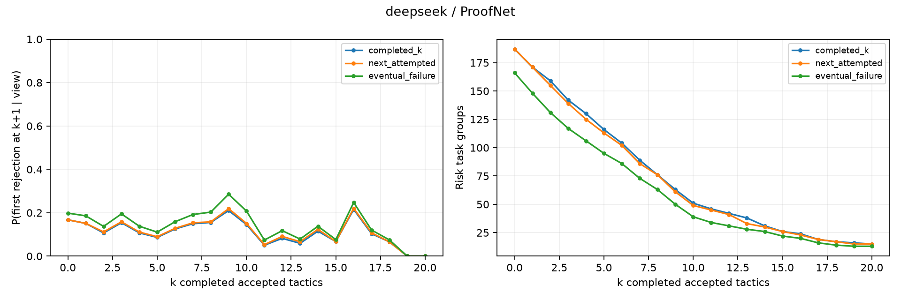
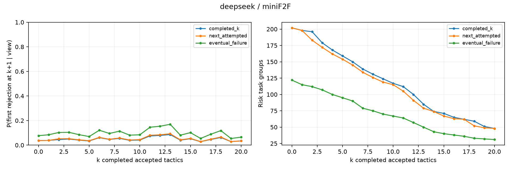
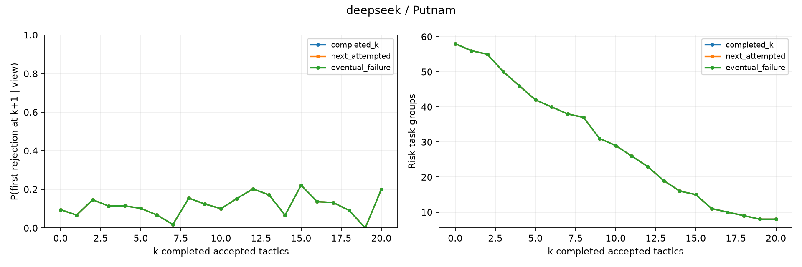
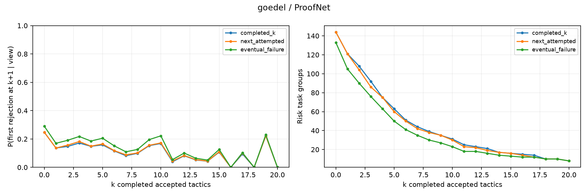
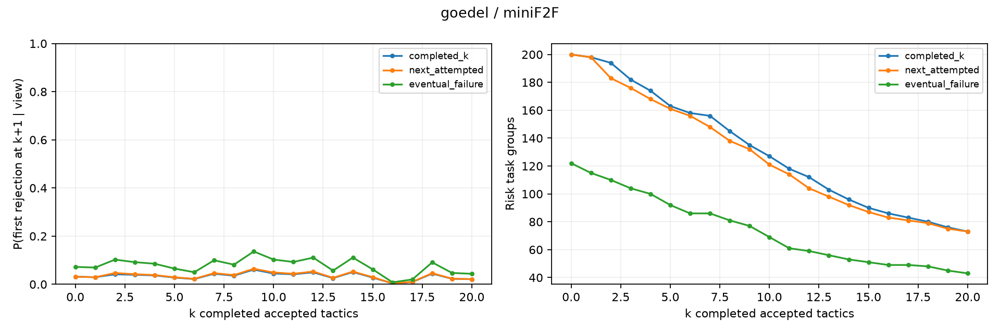
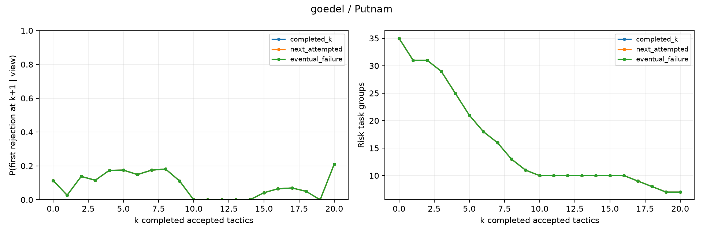

# Условное место следующей ошибки: результаты

T — первая воспроизводимо отклонённая Lean тактика. Большинство среди отдельных позиций и большая абсолютная вероятность — разные утверждения. Данные ограничены сохранённой feature-cohort.

Вес каждой задачи фиксирован до условного отбора; старые таблицы с повторной балансировкой групп после отбора могут отличаться. Интервалы ниже — точечные; simultaneous bands и полные k до 50 находятся в metrics.json и CSV. «—» означает отсутствие достаточной поддержки, не нулевую неопределённость.

## deepseek / ProofNet

N=563, G=187, verified=111, failed=452.

### completed_k

| k | N / G | Следующая ошибка, % | Любая поздняя ошибка, % | Без ошибки, % | 95% CI следующей | Эмпирическая мода T | OOF modal / next, % | Разность, п.п. |
|---|---|---|---|---|---|---|---|---|
| 0 | 563 / 187 | 16.74 | 67.71 | 15.56 | [12.25; 21.43] | 1 | 15.24 / 16.74 | -1.49 |
| 1 | 464 / 171 | 15.10 | 66.21 | 18.68 | [10.82; 19.81] | без ошибки | 18.68 / 15.10 | 3.58 |
| 2 | 390 / 159 | 10.69 | 67.31 | 22.01 | [7.00; 14.83] | без ошибки | 22.01 / 10.69 | 11.32 |
| 3 | 328 / 142 | 15.40 | 63.71 | 20.90 | [10.87; 20.31] | без ошибки | 20.90 / 15.40 | 5.50 |
| 4 | 258 / 130 | 10.72 | 67.03 | 22.25 | [6.86; 15.13] | без ошибки | 22.25 / 10.72 | 11.53 |
| 5 | 215 / 116 | 8.63 | 69.37 | 22.00 | — | без ошибки | 22.00 / 8.63 | 13.37 |
| 6 | 183 / 104 | 12.51 | 66.43 | 21.06 | [7.20; 18.84] | без ошибки | 21.06 / 12.51 | 8.54 |
| 7 | 155 / 89 | 14.95 | 63.01 | 22.04 | — | без ошибки | 22.04 / 14.95 | 7.09 |
| 8 | 130 / 76 | 15.52 | 60.95 | 23.53 | — | без ошибки | 23.53 / 15.52 | 8.02 |
| 9 | 109 / 63 | 21.01 | 52.62 | 26.37 | — | без ошибки | 21.01 / 21.01 | 0.00 |
| 10 | 85 / 51 | 14.54 | 55.54 | 29.91 | — | без ошибки | 29.91 / 14.54 | 15.37 |

### next_attempted

| k | N / G | Следующая ошибка, % | Любая поздняя ошибка, % | Без ошибки, % | 95% CI следующей | Эмпирическая мода T | OOF modal / next, % | Разность, п.п. |
|---|---|---|---|---|---|---|---|---|
| 0 | 563 / 187 | 16.74 | 67.71 | 15.56 | [12.25; 21.43] | 1 | 15.24 / 16.74 | -1.49 |
| 1 | 464 / 171 | 15.10 | 66.21 | 18.68 | [10.82; 19.81] | без ошибки | 18.68 / 15.10 | 3.58 |
| 2 | 369 / 155 | 11.16 | 70.28 | 18.57 | [7.31; 15.50] | без ошибки | 18.57 / 11.16 | 7.41 |
| 3 | 316 / 139 | 15.82 | 65.45 | 18.73 | [11.19; 20.82] | без ошибки | 18.73 / 15.82 | 2.91 |
| 4 | 246 / 125 | 11.09 | 69.35 | 19.56 | [7.08; 15.68] | без ошибки | 19.56 / 11.09 | 8.47 |
| 5 | 203 / 113 | 8.94 | 71.89 | 19.17 | — | без ошибки | 19.17 / 8.94 | 10.23 |
| 6 | 177 / 102 | 12.80 | 67.98 | 19.22 | [7.37; 19.26] | без ошибки | 19.22 / 12.80 | 6.42 |
| 7 | 147 / 86 | 15.36 | 64.72 | 19.92 | — | без ошибки | 19.92 / 15.36 | 4.56 |
| 8 | 127 / 76 | 15.79 | 62.01 | 22.21 | — | без ошибки | 17.70 / 15.79 | 1.91 |
| 9 | 103 / 61 | 21.87 | 54.76 | 23.37 | — | без ошибки | 15.65 / 21.87 | -6.22 |
| 10 | 81 / 49 | 15.08 | 57.60 | 27.32 | — | без ошибки | 27.32 / 15.08 | 12.24 |

### eventual_failure

| k | N / G | Следующая ошибка, % | Любая поздняя ошибка, % | Без ошибки, % | 95% CI следующей | Эмпирическая мода T | OOF modal / next, % | Разность, п.п. |
|---|---|---|---|---|---|---|---|---|
| 0 | 452 / 166 | 19.82 | 80.18 | 0.00 | [14.58; 25.29] | 1 | 19.82 / 19.82 | 0.00 |
| 1 | 353 / 148 | 18.57 | 81.43 | 0.00 | [13.39; 24.22] | 2 | 18.57 / 18.57 | 0.00 |
| 2 | 279 / 131 | 13.70 | 86.30 | 0.00 | [9.04; 18.95] | 4 | 16.80 / 13.70 | 3.10 |
| 3 | 238 / 117 | 19.46 | 80.54 | 0.00 | [13.91; 25.42] | 4 | 19.46 / 19.46 | 0.00 |
| 4 | 180 / 106 | 13.79 | 86.21 | 0.00 | [8.90; 19.34] | 5 | 8.07 / 13.79 | -5.72 |
| 5 | 149 / 95 | 11.06 | 88.94 | 0.00 | — | 8 | 7.47 / 11.06 | -3.59 |
| 6 | 129 / 86 | 15.85 | 84.15 | 0.00 | [9.28; 23.69] | 8 | 8.40 / 15.85 | -7.45 |
| 7 | 107 / 73 | 19.18 | 80.82 | 0.00 | — | 8 | 10.71 / 19.18 | -8.47 |
| 8 | 90 / 63 | 20.29 | 79.71 | 0.00 | — | 10 | 14.50 / 20.29 | -5.80 |
| 9 | 72 / 50 | 28.54 | 71.46 | 0.00 | — | 10 | 28.54 / 28.54 | 0.00 |
| 10 | 54 / 39 | 20.75 | 79.25 | 0.00 | — | 11 | 20.75 / 20.75 | 0.00 |

[CSV](../assets/5a182e118c95_summary.csv) · Полные метрики (полный исходник на Жоресе: /beegfs/home/denis.rakhmankin/onebigjump/runs/conditional_next_error_20261111_v2/deepseek/ProofNet/metrics.json) · Распределения по точным позициям (полный исходник на Жоресе: /beegfs/home/denis.rakhmankin/onebigjump/runs/conditional_next_error_20261111_v2/deepseek/ProofNet/histograms.json)

## deepseek / miniF2F

N=1303, G=202, verified=775, failed=528.

### completed_k

| k | N / G | Следующая ошибка, % | Любая поздняя ошибка, % | Без ошибки, % | 95% CI следующей | Эмпирическая мода T | OOF modal / next, % | Разность, п.п. |
|---|---|---|---|---|---|---|---|---|
| 0 | 1303 / 202 | 3.70 | 44.27 | 52.03 | — | без ошибки | 52.03 / 3.70 | 48.33 |
| 1 | 1263 / 198 | 3.88 | 42.09 | 54.03 | — | без ошибки | 54.03 / 3.88 | 50.15 |
| 2 | 1224 / 196 | 4.51 | 39.28 | 56.21 | [2.60; 6.78] | без ошибки | 56.21 / 4.51 | 51.70 |
| 3 | 1000 / 179 | 4.95 | 42.47 | 52.58 | [3.04; 7.13] | без ошибки | 52.58 / 4.95 | 47.62 |
| 4 | 883 / 168 | 4.09 | 43.86 | 52.05 | [2.35; 6.09] | без ошибки | 52.05 / 4.09 | 47.96 |
| 5 | 789 / 159 | 3.40 | 45.21 | 51.39 | — | без ошибки | 51.39 / 3.40 | 47.99 |
| 6 | 709 / 150 | 6.07 | 44.04 | 49.89 | [3.32; 9.37] | без ошибки | 49.89 / 6.07 | 43.82 |
| 7 | 644 / 139 | 4.65 | 44.23 | 51.12 | — | без ошибки | 51.12 / 4.65 | 46.47 |
| 8 | 591 / 131 | 5.51 | 42.79 | 51.71 | [3.54; 7.76] | без ошибки | 51.71 / 5.51 | 46.20 |
| 9 | 517 / 124 | 3.91 | 44.22 | 51.87 | — | без ошибки | 51.87 / 3.91 | 47.96 |
| 10 | 454 / 117 | 4.16 | 45.34 | 50.49 | — | без ошибки | 50.49 / 4.16 | 46.33 |

### next_attempted

| k | N / G | Следующая ошибка, % | Любая поздняя ошибка, % | Без ошибки, % | 95% CI следующей | Эмпирическая мода T | OOF modal / next, % | Разность, п.п. |
|---|---|---|---|---|---|---|---|---|
| 0 | 1303 / 202 | 3.70 | 44.27 | 52.03 | — | без ошибки | 52.03 / 3.70 | 48.33 |
| 1 | 1263 / 198 | 3.88 | 42.09 | 54.03 | — | без ошибки | 54.03 / 3.88 | 50.15 |
| 2 | 1048 / 183 | 5.17 | 44.97 | 49.86 | [2.99; 7.73] | без ошибки | 49.86 / 5.17 | 44.70 |
| 3 | 932 / 172 | 5.30 | 45.41 | 49.29 | [3.26; 7.63] | без ошибки | 49.29 / 5.30 | 44.00 |
| 4 | 822 / 162 | 4.33 | 46.50 | 49.16 | [2.50; 6.46] | без ошибки | 49.16 / 4.33 | 44.83 |
| 5 | 729 / 154 | 3.63 | 48.29 | 48.08 | — | без ошибки | 48.08 / 3.63 | 44.45 |
| 6 | 676 / 145 | 6.31 | 45.79 | 47.90 | [3.45; 9.72] | без ошибки | 47.90 / 6.31 | 41.58 |
| 7 | 615 / 134 | 4.83 | 45.96 | 49.21 | — | без ошибки | 49.21 / 4.83 | 44.38 |
| 8 | 552 / 126 | 5.83 | 45.32 | 48.85 | [3.77; 8.18] | без ошибки | 48.85 / 5.83 | 43.01 |
| 9 | 475 / 119 | 4.19 | 47.43 | 48.38 | — | без ошибки | 48.38 / 4.19 | 44.18 |
| 10 | 413 / 115 | 4.50 | 48.99 | 46.51 | — | без ошибки | 46.51 / 4.50 | 42.02 |

### eventual_failure

| k | N / G | Следующая ошибка, % | Любая поздняя ошибка, % | Без ошибки, % | 95% CI следующей | Эмпирическая мода T | OOF modal / next, % | Разность, п.п. |
|---|---|---|---|---|---|---|---|---|
| 0 | 528 / 122 | 7.71 | 92.29 | 0.00 | — | 3 | 5.12 / 7.71 | -2.60 |
| 1 | 488 / 115 | 8.44 | 91.56 | 0.00 | — | 3 | 8.03 / 8.44 | -0.42 |
| 2 | 449 / 112 | 10.30 | 89.70 | 0.00 | [6.13; 15.10] | 3 | 8.77 / 10.30 | -1.53 |
| 3 | 401 / 107 | 10.45 | 89.55 | 0.00 | [6.51; 14.95] | 4 | 8.94 / 10.45 | -1.51 |
| 4 | 352 / 100 | 8.53 | 91.47 | 0.00 | [5.04; 12.52] | 7 | 10.31 / 8.53 | 1.78 |
| 5 | 319 / 95 | 6.99 | 93.01 | 0.00 | — | 7 | 11.27 / 6.99 | 4.27 |
| 6 | 299 / 90 | 12.11 | 87.89 | 0.00 | [6.83; 18.42] | 7 | 12.11 / 12.11 | 0.00 |
| 7 | 267 / 79 | 9.51 | 90.49 | 0.00 | — | 9 | 7.27 / 9.51 | -2.25 |
| 8 | 243 / 75 | 11.40 | 88.60 | 0.00 | [7.54; 15.95] | 9 | 9.47 / 11.40 | -1.93 |
| 9 | 208 / 70 | 8.12 | 91.88 | 0.00 | — | 12 | 8.15 / 8.12 | 0.02 |
| 10 | 187 / 67 | 8.41 | 91.59 | 0.00 | — | 12 | 8.87 / 8.41 | 0.46 |

[CSV](../assets/64b47224f088_summary.csv) · Полные метрики (полный исходник на Жоресе: /beegfs/home/denis.rakhmankin/onebigjump/runs/conditional_next_error_20261111_v2/deepseek/miniF2F/metrics.json) · Распределения по точным позициям (полный исходник на Жоресе: /beegfs/home/denis.rakhmankin/onebigjump/runs/conditional_next_error_20261111_v2/deepseek/miniF2F/histograms.json)

## deepseek / Putnam

N=118, G=58, verified=0, failed=118.

### completed_k

| k | N / G | Следующая ошибка, % | Любая поздняя ошибка, % | Без ошибки, % | 95% CI следующей | Эмпирическая мода T | OOF modal / next, % | Разность, п.п. |
|---|---|---|---|---|---|---|---|---|
| 0 | 118 / 58 | 9.48 | 90.52 | 0.00 | — | 3 | 12.36 / 9.48 | 2.87 |
| 1 | 107 / 56 | 6.67 | 93.33 | 0.00 | — | 3 | 13.65 / 6.67 | 6.98 |
| 2 | 100 / 55 | 14.63 | 85.37 | 0.00 | — | 3 | 14.63 / 14.63 | 0.00 |
| 3 | 85 / 50 | 11.35 | 88.65 | 0.00 | — | 4 | 5.78 / 11.35 | -5.58 |
| 4 | 73 / 46 | 11.46 | 88.54 | 0.00 | — | 5 | 6.07 / 11.46 | -5.39 |
| 5 | 65 / 42 | 10.15 | 89.85 | 0.00 | — | 9 | 7.11 / 10.15 | -3.05 |
| 6 | 58 / 40 | 6.78 | 93.22 | 0.00 | — | 9 | 7.91 / 6.78 | 1.13 |
| 7 | 54 / 38 | 1.82 | 98.18 | 0.00 | — | 9 | 8.48 / 1.82 | 6.67 |
| 8 | 53 / 37 | 15.43 | 84.57 | 0.00 | — | 9 | 8.64 / 15.43 | -6.79 |
| 9 | 45 / 31 | 12.41 | 87.59 | 0.00 | — | 13 | 0.00 / 12.41 | -12.41 |
| 10 | 40 / 29 | 10.00 | 90.00 | 0.00 | — | 13 | 1.25 / 10.00 | -8.75 |

### next_attempted

| k | N / G | Следующая ошибка, % | Любая поздняя ошибка, % | Без ошибки, % | 95% CI следующей | Эмпирическая мода T | OOF modal / next, % | Разность, п.п. |
|---|---|---|---|---|---|---|---|---|
| 0 | 118 / 58 | 9.48 | 90.52 | 0.00 | — | 3 | 12.36 / 9.48 | 2.87 |
| 1 | 107 / 56 | 6.67 | 93.33 | 0.00 | — | 3 | 13.65 / 6.67 | 6.98 |
| 2 | 100 / 55 | 14.63 | 85.37 | 0.00 | — | 3 | 14.63 / 14.63 | 0.00 |
| 3 | 85 / 50 | 11.35 | 88.65 | 0.00 | — | 4 | 5.78 / 11.35 | -5.58 |
| 4 | 73 / 46 | 11.46 | 88.54 | 0.00 | — | 5 | 6.07 / 11.46 | -5.39 |
| 5 | 65 / 42 | 10.15 | 89.85 | 0.00 | — | 9 | 7.11 / 10.15 | -3.05 |
| 6 | 58 / 40 | 6.78 | 93.22 | 0.00 | — | 9 | 7.91 / 6.78 | 1.13 |
| 7 | 54 / 38 | 1.82 | 98.18 | 0.00 | — | 9 | 8.48 / 1.82 | 6.67 |
| 8 | 53 / 37 | 15.43 | 84.57 | 0.00 | — | 9 | 8.64 / 15.43 | -6.79 |
| 9 | 45 / 31 | 12.41 | 87.59 | 0.00 | — | 13 | 0.00 / 12.41 | -12.41 |
| 10 | 40 / 29 | 10.00 | 90.00 | 0.00 | — | 13 | 1.25 / 10.00 | -8.75 |

### eventual_failure

| k | N / G | Следующая ошибка, % | Любая поздняя ошибка, % | Без ошибки, % | 95% CI следующей | Эмпирическая мода T | OOF modal / next, % | Разность, п.п. |
|---|---|---|---|---|---|---|---|---|
| 0 | 118 / 58 | 9.48 | 90.52 | 0.00 | — | 3 | 12.36 / 9.48 | 2.87 |
| 1 | 107 / 56 | 6.67 | 93.33 | 0.00 | — | 3 | 13.65 / 6.67 | 6.98 |
| 2 | 100 / 55 | 14.63 | 85.37 | 0.00 | — | 3 | 14.63 / 14.63 | 0.00 |
| 3 | 85 / 50 | 11.35 | 88.65 | 0.00 | — | 4 | 5.78 / 11.35 | -5.58 |
| 4 | 73 / 46 | 11.46 | 88.54 | 0.00 | — | 5 | 6.07 / 11.46 | -5.39 |
| 5 | 65 / 42 | 10.15 | 89.85 | 0.00 | — | 9 | 7.11 / 10.15 | -3.05 |
| 6 | 58 / 40 | 6.78 | 93.22 | 0.00 | — | 9 | 7.91 / 6.78 | 1.13 |
| 7 | 54 / 38 | 1.82 | 98.18 | 0.00 | — | 9 | 8.48 / 1.82 | 6.67 |
| 8 | 53 / 37 | 15.43 | 84.57 | 0.00 | — | 9 | 8.64 / 15.43 | -6.79 |
| 9 | 45 / 31 | 12.41 | 87.59 | 0.00 | — | 13 | 0.00 / 12.41 | -12.41 |
| 10 | 40 / 29 | 10.00 | 90.00 | 0.00 | — | 13 | 1.25 / 10.00 | -8.75 |

[CSV](../assets/18f99f4668df_summary.csv) · Полные метрики (полный исходник на Жоресе: /beegfs/home/denis.rakhmankin/onebigjump/runs/conditional_next_error_20261111_v2/deepseek/Putnam/metrics.json) · Распределения по точным позициям (полный исходник на Жоресе: /beegfs/home/denis.rakhmankin/onebigjump/runs/conditional_next_error_20261111_v2/deepseek/Putnam/histograms.json)

## goedel / ProofNet

N=338, G=144, verified=79, failed=259.

### completed_k

| k | N / G | Следующая ошибка, % | Любая поздняя ошибка, % | Без ошибки, % | 95% CI следующей | Эмпирическая мода T | OOF modal / next, % | Разность, п.п. |
|---|---|---|---|---|---|---|---|---|
| 0 | 338 / 144 | 24.73 | 60.56 | 14.71 | [18.58; 31.10] | 1 | 24.73 / 24.73 | 0.00 |
| 1 | 255 / 121 | 13.64 | 66.82 | 19.54 | [8.52; 19.34] | без ошибки | 19.54 / 13.64 | 5.90 |
| 2 | 222 / 108 | 14.76 | 62.61 | 22.63 | [8.95; 21.33] | без ошибки | 22.63 / 14.76 | 7.87 |
| 3 | 171 / 92 | 17.14 | 61.58 | 21.28 | [10.27; 24.88] | без ошибки | 17.03 / 17.14 | -0.11 |
| 4 | 131 / 75 | 14.82 | 65.11 | 20.07 | — | без ошибки | 20.07 / 14.82 | 5.25 |
| 5 | 113 / 63 | 15.86 | 61.37 | 22.77 | — | без ошибки | 22.77 / 15.86 | 6.92 |
| 6 | 91 / 51 | 11.58 | 64.80 | 23.62 | — | без ошибки | 23.62 / 11.58 | 12.04 |
| 7 | 81 / 44 | 8.21 | 66.71 | 25.08 | — | без ошибки | 25.08 / 8.21 | 16.87 |
| 8 | 65 / 39 | 9.91 | 68.48 | 21.61 | — | без ошибки | 10.82 / 9.91 | 0.92 |
| 9 | 58 / 35 | 15.31 | 62.91 | 21.78 | — | без ошибки | 10.46 / 15.31 | -4.85 |
| 10 | 50 / 31 | 16.82 | 58.87 | 24.31 | — | без ошибки | 11.90 / 16.82 | -4.92 |

### next_attempted

| k | N / G | Следующая ошибка, % | Любая поздняя ошибка, % | Без ошибки, % | 95% CI следующей | Эмпирическая мода T | OOF modal / next, % | Разность, п.п. |
|---|---|---|---|---|---|---|---|---|
| 0 | 338 / 144 | 24.73 | 60.56 | 14.71 | [18.58; 31.10] | 1 | 24.73 / 24.73 | 0.00 |
| 1 | 255 / 121 | 13.64 | 66.82 | 19.54 | [8.52; 19.34] | без ошибки | 19.54 / 13.64 | 5.90 |
| 2 | 200 / 104 | 15.65 | 66.40 | 17.95 | [9.55; 22.52] | без ошибки | 14.36 / 15.65 | -1.29 |
| 3 | 157 / 86 | 18.20 | 65.38 | 16.42 | [10.95; 26.28] | 4 | 15.47 / 18.20 | -2.73 |
| 4 | 129 / 75 | 14.95 | 65.68 | 19.37 | — | без ошибки | 19.37 / 14.95 | 4.42 |
| 5 | 106 / 60 | 16.48 | 63.79 | 19.73 | — | без ошибки | 14.71 / 16.48 | -1.77 |
| 6 | 88 / 50 | 11.81 | 66.07 | 22.12 | — | без ошибки | 22.12 / 11.81 | 10.31 |
| 7 | 74 / 42 | 8.80 | 71.49 | 19.71 | — | без ошибки | 9.87 / 8.80 | 1.07 |
| 8 | 62 / 38 | 10.17 | 70.27 | 19.56 | — | без ошибки | 9.40 / 10.17 | -0.77 |
| 9 | 56 / 35 | 15.56 | 63.91 | 20.53 | — | без ошибки | 10.05 / 15.56 | -5.51 |
| 10 | 49 / 30 | 17.23 | 60.32 | 22.45 | — | без ошибки | 3.69 / 17.23 | -13.54 |

### eventual_failure

| k | N / G | Следующая ошибка, % | Любая поздняя ошибка, % | Без ошибки, % | 95% CI следующей | Эмпирическая мода T | OOF modal / next, % | Разность, п.п. |
|---|---|---|---|---|---|---|---|---|
| 0 | 259 / 133 | 29.00 | 71.00 | 0.00 | [21.97; 36.27] | 1 | 29.00 / 29.00 | 0.00 |
| 1 | 176 / 105 | 16.95 | 83.05 | 0.00 | [10.66; 23.98] | 2 | 12.27 / 16.95 | -4.68 |
| 2 | 143 / 90 | 19.08 | 80.92 | 0.00 | [11.74; 27.27] | 3 | 14.59 / 19.08 | -4.49 |
| 3 | 114 / 76 | 21.78 | 78.22 | 0.00 | [13.14; 31.36] | 4 | 21.78 / 21.78 | 0.00 |
| 4 | 88 / 63 | 18.54 | 81.46 | 0.00 | — | 5 | 8.18 / 18.54 | -10.36 |
| 5 | 72 / 50 | 20.53 | 79.47 | 0.00 | — | 6 | 20.53 / 20.53 | 0.00 |
| 6 | 57 / 41 | 15.16 | 84.84 | 0.00 | — | 7 | 11.79 / 15.16 | -3.37 |
| 7 | 50 / 35 | 10.96 | 89.04 | 0.00 | — | 10 | 7.94 / 10.96 | -3.02 |
| 8 | 41 / 30 | 12.64 | 87.36 | 0.00 | — | 10 | 8.92 / 12.64 | -3.72 |
| 9 | 37 / 27 | 19.57 | 80.43 | 0.00 | — | 10 | 10.21 / 19.57 | -9.36 |
| 10 | 31 / 23 | 22.22 | 77.78 | 0.00 | — | 11 | 6.35 / 22.22 | -15.87 |

[CSV](../assets/6607987f7747_summary.csv) · Полные метрики (полный исходник на Жоресе: /beegfs/home/denis.rakhmankin/onebigjump/runs/conditional_next_error_20261111_v2/goedel/ProofNet/metrics.json) · Распределения по точным позициям (полный исходник на Жоресе: /beegfs/home/denis.rakhmankin/onebigjump/runs/conditional_next_error_20261111_v2/goedel/ProofNet/histograms.json)

## goedel / miniF2F

N=1256, G=200, verified=808, failed=448.

### completed_k

| k | N / G | Следующая ошибка, % | Любая поздняя ошибка, % | Без ошибки, % | 95% CI следующей | Эмпирическая мода T | OOF modal / next, % | Разность, п.п. |
|---|---|---|---|---|---|---|---|---|
| 0 | 1256 / 200 | 3.18 | 40.82 | 56.00 | — | без ошибки | 56.00 / 3.18 | 52.82 |
| 1 | 1227 / 198 | 2.93 | 39.23 | 57.84 | — | без ошибки | 57.84 / 2.93 | 54.91 |
| 2 | 1194 / 194 | 4.14 | 36.27 | 59.59 | [2.34; 6.22] | без ошибки | 59.59 / 4.14 | 55.44 |
| 3 | 996 / 182 | 3.97 | 39.18 | 56.85 | [2.26; 5.95] | без ошибки | 56.85 / 3.97 | 52.89 |
| 4 | 892 / 174 | 3.69 | 39.51 | 56.80 | [2.05; 5.61] | без ошибки | 56.80 / 3.69 | 53.11 |
| 5 | 817 / 163 | 2.79 | 39.95 | 57.26 | — | без ошибки | 57.26 / 2.79 | 54.47 |
| 6 | 749 / 158 | 2.17 | 41.00 | 56.84 | — | без ошибки | 56.84 / 2.17 | 54.67 |
| 7 | 689 / 156 | 4.39 | 39.58 | 56.03 | — | без ошибки | 56.03 / 4.39 | 51.65 |
| 8 | 621 / 145 | 3.58 | 40.34 | 56.09 | — | без ошибки | 56.09 / 3.58 | 52.51 |
| 9 | 552 / 135 | 6.10 | 38.61 | 55.29 | — | без ошибки | 55.29 / 6.10 | 49.20 |
| 10 | 493 / 127 | 4.48 | 39.15 | 56.36 | — | без ошибки | 56.36 / 4.48 | 51.88 |

### next_attempted

| k | N / G | Следующая ошибка, % | Любая поздняя ошибка, % | Без ошибки, % | 95% CI следующей | Эмпирическая мода T | OOF modal / next, % | Разность, п.п. |
|---|---|---|---|---|---|---|---|---|
| 0 | 1256 / 200 | 3.18 | 40.82 | 56.00 | — | без ошибки | 56.00 / 3.18 | 52.82 |
| 1 | 1227 / 198 | 2.93 | 39.23 | 57.84 | — | без ошибки | 57.84 / 2.93 | 54.91 |
| 2 | 1036 / 183 | 4.70 | 41.12 | 54.18 | [2.66; 7.04] | без ошибки | 54.18 / 4.70 | 49.48 |
| 3 | 933 / 176 | 4.19 | 41.39 | 54.42 | [2.39; 6.27] | без ошибки | 54.42 / 4.19 | 50.23 |
| 4 | 849 / 168 | 3.84 | 41.10 | 55.06 | [2.13; 5.81] | без ошибки | 55.06 / 3.84 | 51.22 |
| 5 | 770 / 161 | 2.93 | 41.90 | 55.17 | — | без ошибки | 55.17 / 2.93 | 52.25 |
| 6 | 706 / 156 | 2.27 | 42.97 | 54.76 | — | без ошибки | 54.76 / 2.27 | 52.49 |
| 7 | 647 / 148 | 4.64 | 41.88 | 53.48 | — | без ошибки | 53.48 / 4.64 | 48.84 |
| 8 | 571 / 138 | 3.82 | 43.00 | 53.18 | — | без ошибки | 53.18 / 3.82 | 49.37 |
| 9 | 513 / 132 | 6.44 | 40.82 | 52.73 | — | без ошибки | 52.73 / 6.44 | 46.29 |
| 10 | 442 / 121 | 4.89 | 42.73 | 52.38 | — | без ошибки | 52.38 / 4.89 | 47.49 |

### eventual_failure

| k | N / G | Следующая ошибка, % | Любая поздняя ошибка, % | Без ошибки, % | 95% CI следующей | Эмпирическая мода T | OOF modal / next, % | Разность, п.п. |
|---|---|---|---|---|---|---|---|---|
| 0 | 448 / 122 | 7.23 | 92.77 | 0.00 | — | 3 | 6.05 / 7.23 | -1.18 |
| 1 | 419 / 115 | 6.95 | 93.05 | 0.00 | — | 3 | 6.52 / 6.95 | -0.43 |
| 2 | 386 / 110 | 10.25 | 89.75 | 0.00 | [5.95; 15.13] | 3 | 7.01 / 10.25 | -3.24 |
| 3 | 346 / 104 | 9.19 | 90.81 | 0.00 | [5.32; 13.66] | 4 | 7.37 / 9.19 | -1.82 |
| 4 | 305 / 100 | 8.54 | 91.46 | 0.00 | [4.84; 12.91] | 10 | 5.45 / 8.54 | -3.10 |
| 5 | 273 / 92 | 6.53 | 93.47 | 0.00 | — | 10 | 7.82 / 6.53 | 1.30 |
| 6 | 252 / 86 | 5.02 | 94.98 | 0.00 | — | 10 | 8.37 / 5.02 | 3.35 |
| 7 | 235 / 86 | 9.98 | 90.02 | 0.00 | — | 10 | 8.81 / 9.98 | -1.17 |
| 8 | 209 / 81 | 8.15 | 91.85 | 0.00 | — | 10 | 12.52 / 8.15 | 4.37 |
| 9 | 190 / 77 | 13.63 | 86.37 | 0.00 | — | 10 | 13.63 / 13.63 | 0.00 |
| 10 | 170 / 69 | 10.27 | 89.73 | 0.00 | — | 11 | 3.33 / 10.27 | -6.94 |

[CSV](../assets/3bd2aaa133b5_summary.csv) · Полные метрики (полный исходник на Жоресе: /beegfs/home/denis.rakhmankin/onebigjump/runs/conditional_next_error_20261111_v2/goedel/miniF2F/metrics.json) · Распределения по точным позициям (полный исходник на Жоресе: /beegfs/home/denis.rakhmankin/onebigjump/runs/conditional_next_error_20261111_v2/goedel/miniF2F/histograms.json)

## goedel / Putnam

N=48, G=35, verified=0, failed=48.

### completed_k

| k | N / G | Следующая ошибка, % | Любая поздняя ошибка, % | Без ошибки, % | 95% CI следующей | Эмпирическая мода T | OOF modal / next, % | Разность, п.п. |
|---|---|---|---|---|---|---|---|---|
| 0 | 48 / 35 | 11.43 | 88.57 | 0.00 | — | 3 | 0.00 / 11.43 | -11.43 |
| 1 | 44 / 31 | 2.69 | 97.31 | 0.00 | — | 3 | 2.69 / 2.69 | 0.00 |
| 2 | 42 / 31 | 13.81 | 86.19 | 0.00 | — | 3 | 2.76 / 13.81 | -11.05 |
| 3 | 35 / 29 | 11.54 | 88.46 | 0.00 | — | 5 | 7.69 / 11.54 | -3.85 |
| 4 | 31 / 25 | 17.39 | 82.61 | 0.00 | — | 5 | 8.70 / 17.39 | -8.70 |
| 5 | 27 / 21 | 17.54 | 82.46 | 0.00 | — | 6 | 10.53 / 17.54 | -7.02 |
| 6 | 23 / 18 | 14.89 | 85.11 | 0.00 | — | 8, 7 | 2.13 / 14.89 | -12.77 |
| 7 | 18 / 16 | 17.50 | 82.50 | 0.00 | — | 8 | 0.00 / 17.50 | -17.50 |
| 8 | 14 / 13 | 18.18 | 81.82 | 0.00 | — | 27, 9 | 0.00 / 18.18 | -18.18 |
| 9 | 12 / 11 | 11.11 | 88.89 | 0.00 | — | 27 | 0.00 / 11.11 | -11.11 |
| 10 | 11 / 10 | 0.00 | 100.00 | 0.00 | — | 27 | 0.00 / 0.00 | 0.00 |

### next_attempted

| k | N / G | Следующая ошибка, % | Любая поздняя ошибка, % | Без ошибки, % | 95% CI следующей | Эмпирическая мода T | OOF modal / next, % | Разность, п.п. |
|---|---|---|---|---|---|---|---|---|
| 0 | 48 / 35 | 11.43 | 88.57 | 0.00 | — | 3 | 0.00 / 11.43 | -11.43 |
| 1 | 44 / 31 | 2.69 | 97.31 | 0.00 | — | 3 | 2.69 / 2.69 | 0.00 |
| 2 | 42 / 31 | 13.81 | 86.19 | 0.00 | — | 3 | 2.76 / 13.81 | -11.05 |
| 3 | 35 / 29 | 11.54 | 88.46 | 0.00 | — | 5 | 7.69 / 11.54 | -3.85 |
| 4 | 31 / 25 | 17.39 | 82.61 | 0.00 | — | 5 | 8.70 / 17.39 | -8.70 |
| 5 | 27 / 21 | 17.54 | 82.46 | 0.00 | — | 6 | 10.53 / 17.54 | -7.02 |
| 6 | 23 / 18 | 14.89 | 85.11 | 0.00 | — | 8, 7 | 2.13 / 14.89 | -12.77 |
| 7 | 18 / 16 | 17.50 | 82.50 | 0.00 | — | 8 | 0.00 / 17.50 | -17.50 |
| 8 | 14 / 13 | 18.18 | 81.82 | 0.00 | — | 27, 9 | 0.00 / 18.18 | -18.18 |
| 9 | 12 / 11 | 11.11 | 88.89 | 0.00 | — | 27 | 0.00 / 11.11 | -11.11 |
| 10 | 11 / 10 | 0.00 | 100.00 | 0.00 | — | 27 | 0.00 / 0.00 | 0.00 |

### eventual_failure

| k | N / G | Следующая ошибка, % | Любая поздняя ошибка, % | Без ошибки, % | 95% CI следующей | Эмпирическая мода T | OOF modal / next, % | Разность, п.п. |
|---|---|---|---|---|---|---|---|---|
| 0 | 48 / 35 | 11.43 | 88.57 | 0.00 | — | 3 | 0.00 / 11.43 | -11.43 |
| 1 | 44 / 31 | 2.69 | 97.31 | 0.00 | — | 3 | 2.69 / 2.69 | 0.00 |
| 2 | 42 / 31 | 13.81 | 86.19 | 0.00 | — | 3 | 2.76 / 13.81 | -11.05 |
| 3 | 35 / 29 | 11.54 | 88.46 | 0.00 | — | 5 | 7.69 / 11.54 | -3.85 |
| 4 | 31 / 25 | 17.39 | 82.61 | 0.00 | — | 5 | 8.70 / 17.39 | -8.70 |
| 5 | 27 / 21 | 17.54 | 82.46 | 0.00 | — | 6 | 10.53 / 17.54 | -7.02 |
| 6 | 23 / 18 | 14.89 | 85.11 | 0.00 | — | 8, 7 | 2.13 / 14.89 | -12.77 |
| 7 | 18 / 16 | 17.50 | 82.50 | 0.00 | — | 8 | 0.00 / 17.50 | -17.50 |
| 8 | 14 / 13 | 18.18 | 81.82 | 0.00 | — | 27, 9 | 0.00 / 18.18 | -18.18 |
| 9 | 12 / 11 | 11.11 | 88.89 | 0.00 | — | 27 | 0.00 / 11.11 | -11.11 |
| 10 | 11 / 10 | 0.00 | 100.00 | 0.00 | — | 27 | 0.00 / 0.00 | 0.00 |

[CSV](../assets/a4fd267dd8c2_summary.csv) · Полные метрики (полный исходник на Жоресе: /beegfs/home/denis.rakhmankin/onebigjump/runs/conditional_next_error_20261111_v2/goedel/Putnam/metrics.json) · Распределения по точным позициям (полный исходник на Жоресе: /beegfs/home/denis.rakhmankin/onebigjump/runs/conditional_next_error_20261111_v2/goedel/Putnam/histograms.json)

## Как читать результат

completed_k включает корректное завершение ровно на k; next_attempted условен на попытку следующей тактики; eventual_failure дополнительно знает будущий исход и применим только как ретроспективный анализ. Высокая доля последнего не является вероятностью ошибки на всех генерациях.

Эмпирическая мода оценена на той же выборке. OOF mode выбирается только на train-группах. Для Putnam это новый исследовательский position-only CV, не frozen-перенос старого векторного детектора. Непревосходство modal над next не устанавливает универсальность next. Интервалы условны на сохранённых OOF выборах. Новые веса LLM не обучались; GPU не использовались.
