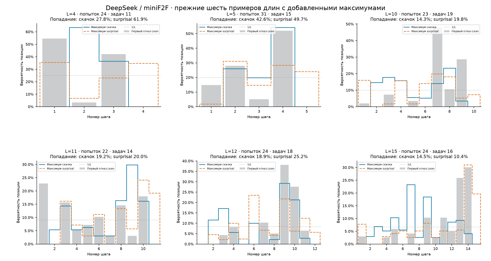
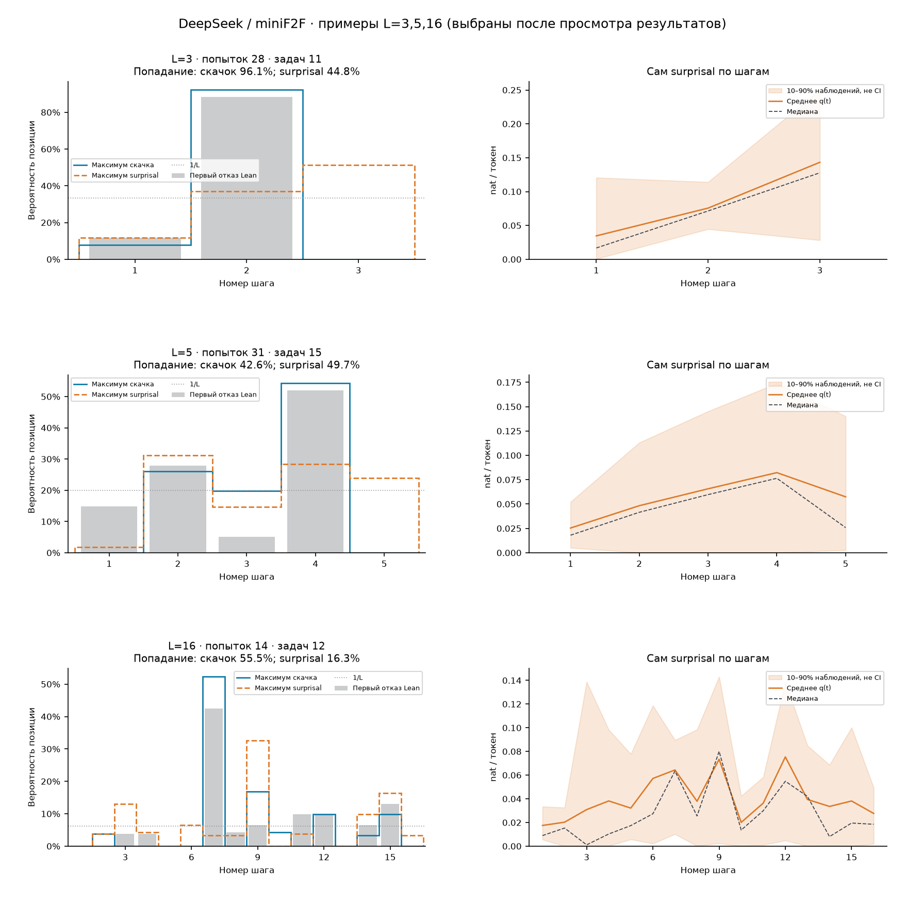

# Позиции ошибки, максимума скачка и surprisal при каждой точной длине

Новый файл дополняет прежние гистограммы ошибок. Все численные таблицы сформированы из сохранённых q/w и меток; новые LLM-вызовы и GPU не использовались.

## Что на графиках

Слева для одной L наложены T, MW и MQ на одном cohort. Справа — среднее/медиана q(t), полоса 10–90% наблюдений (не CI). Surprisal — средний минус логарифм вероятности токенов текущей тактики, nat/token; не вероятность логической ошибки.

T=f+1, argmax берётся по полному набору 1..L, равенства максимумов разрешаются в пользу первого шага. Сгенерированные шаги после первого отказа не считаются исполненными. Только ошибочные попытки с надёжной локализацией.

## Как проверяется попадание

Обычный hit = P(MW=T|L) с прежними task weights 1/n_failed_attempts, фиксированными до отбора L. Рядом показаны 1/L, тривиальный выбор шага 1, чувствительность равных task weights внутри L и описательная независимость sum_t pMW(t|L)*pT(t|L). Последняя оценивает сходство маргинальных гистограмм, а не индивидуальную связь.

Для основного контроля берутся ordered пары разных исходных задач одной точной длины с весом w_i*w_j. На ОДИНАКОВЫХ весах сравниваются I(MW_i=T_i) и I(MW_j=T_i). Поэтому парный own-hit может отличаться от обычного hit; это явно разные колонки. Нет пар одной задачи и не смешиваются длины.

10000 bootstrap целых исходных задач. В bootstrap заново взвешиваются обе стороны pair matrices. CI/p отсутствуют при <20 задач, а не заменены на ноль. Номинальные 95% CI условны на текущие данные; centered-bootstrap p скорректированы Holm по всем 362 длинам/model/dataset. Отдельное семейство W, отдельное дополнительное Q. Неподдержанные ячейки учитываются как p=1 при correction. Анализ exploratory; короткая длина сама увеличивает 1/L.

## Состав и среднее попадание без отбора длины

| cell | попыток | задач | длин | W hit, % | Q hit, % |
| --- | --- | --- | --- | --- | --- |
| deepseek/ProofNet | 452 | 166 | 62 | 18.504 | 21.401 |
| deepseek/miniF2F | 528 | 122 | 74 | 18.090 | 18.890 |
| deepseek/Putnam | 118 | 58 | 47 | 19.828 | 17.529 |
| goedel/ProofNet | 259 | 133 | 65 | 26.566 | 21.266 |
| goedel/miniF2F | 448 | 122 | 87 | 21.461 | 13.150 |
| goedel/Putnam | 48 | 35 | 27 | 6.667 | 15.714 |

## DeepSeek / miniF2F: ранее показанные длины

Эти длины выбраны в предыдущем отчёте, до нового анализа попадания. Высокое попадание само по себе не означает, что скачок добавил информацию сверх позиционных предпочтений.

| cell | L | n | задач | W hit, % | Q hit, % | парный W, % | чужой W, % | добавка, п.п. | 95% CI | p Holm |
| --- | --- | --- | --- | --- | --- | --- | --- | --- | --- | --- |
| deepseek/miniF2F | 4 | 24 | 11 | 27.848 | 61.885 | 29.753 | 17.989 | 11.764 | не оценён: мало задач | — |
| deepseek/miniF2F | 5 | 31 | 15 | 42.591 | 49.728 | 42.854 | 36.076 | 6.777 | не оценён: мало задач | — |
| deepseek/miniF2F | 10 | 23 | 19 | 14.310 | 19.833 | 15.439 | 12.551 | 2.889 | не оценён: мало задач | — |
| deepseek/miniF2F | 11 | 22 | 14 | 19.231 | 20.000 | 19.616 | 7.849 | 11.768 | не оценён: мало задач | — |
| deepseek/miniF2F | 12 | 24 | 18 | 18.885 | 25.174 | 19.469 | 19.674 | -0.205 | не оценён: мало задач | — |
| deepseek/miniF2F | 15 | 24 | 16 | 14.497 | 10.355 | 14.672 | 7.329 | 7.343 | не оценён: мало задач | — |

## Самые большие описательные попадания

Ниже ранжированы только длины с не менее 10 задачами. Это просмотр результата после расчёта, а не заранее выбранная подтверждающая проверка. Все остальные длины сохранены в PDF/CSV.

| cell | L | n | задач | W hit, % | Q hit, % | парный W, % | чужой W, % | добавка, п.п. | 95% CI | p Holm |
| --- | --- | --- | --- | --- | --- | --- | --- | --- | --- | --- |
| deepseek/miniF2F | 3 | 28 | 11 | 96.084 | 44.755 | 95.723 | 80.009 | 15.714 | не оценён: мало задач | — |
| goedel/ProofNet | 2 | 22 | 13 | 94.915 | 37.288 | 94.724 | 94.724 | 0.000 | не оценён: мало задач | — |
| deepseek/ProofNet | 3 | 31 | 18 | 64.341 | 63.566 | 63.998 | 51.495 | 12.503 | не оценён: мало задач | — |
| deepseek/ProofNet | 4 | 16 | 12 | 62.319 | 58.696 | 62.008 | 43.740 | 18.267 | не оценён: мало задач | — |
| deepseek/miniF2F | 16 | 14 | 12 | 55.521 | 16.330 | 53.266 | 18.798 | 34.468 | не оценён: мало задач | — |
| goedel/ProofNet | 5 | 15 | 11 | 49.425 | 63.218 | 49.881 | 21.216 | 28.665 | не оценён: мало задач | — |
| goedel/ProofNet | 4 | 17 | 17 | 44.828 | 56.322 | 44.268 | 26.334 | 17.934 | не оценён: мало задач | — |
| goedel/ProofNet | 7 | 13 | 11 | 43.590 | 41.026 | 44.018 | 17.578 | 26.440 | не оценён: мало задач | — |
| goedel/miniF2F | 9 | 15 | 11 | 42.915 | 19.838 | 42.020 | 14.189 | 27.831 | не оценён: мало задач | — |
| deepseek/miniF2F | 5 | 31 | 15 | 42.591 | 49.728 | 42.854 | 36.076 | 6.777 | не оценён: мало задач | — |
| goedel/miniF2F | 11 | 20 | 14 | 41.514 | 11.351 | 41.273 | 9.348 | 31.926 | не оценён: мало задач | — |
| goedel/ProofNet | 3 | 20 | 14 | 41.463 | 43.089 | 41.797 | 50.058 | -8.261 | не оценён: мало задач | — |

## Неопределённость по длинам

Ячеек с >=20 задачами: 1 из 362. С p Holm <0.05 для W-контраста: 0. Это не тест равенства эффектов между длинами: различие двух точечных оценок либо наличие CI только в одной группе не доказывает взаимодействие с длиной.

| cell | L | n | задач | W hit, % | Q hit, % | парный W, % | чужой W, % | добавка, п.п. | 95% CI | p Holm |
| --- | --- | --- | --- | --- | --- | --- | --- | --- | --- | --- |
| deepseek/ProofNet | 2 | 37 | 20 | 11.204 | 74.510 | 11.449 | 11.449 | 0.000 | [-0.0; +0.0] п.п. | 1 |

## Файлы

- [deepseek/ProofNet: все длины](../assets/c929c458562e_deepseek_ProofNet_errors_jump_surprisal_by_exact_length.pdf)
- [deepseek/miniF2F: все длины](../assets/f86d699f90f0_deepseek_miniF2F_errors_jump_surprisal_by_exact_length.pdf)
- [deepseek/Putnam: все длины](../assets/48e91fbad592_deepseek_Putnam_errors_jump_surprisal_by_exact_length.pdf)
- [goedel/ProofNet: все длины](../assets/103413e76ee7_goedel_ProofNet_errors_jump_surprisal_by_exact_length.pdf)
- [goedel/miniF2F: все длины](../assets/0257655b93bf_goedel_miniF2F_errors_jump_surprisal_by_exact_length.pdf)
- [goedel/Putnam: все длины](../assets/e6d61bf20319_goedel_Putnam_errors_jump_surprisal_by_exact_length.pdf)

Полные таблицы: exact_length_metrics.csv, position_distributions.csv, surprisal_profiles.csv, metrics.json. Исходные гистограммы T численно воспроизведены во всех ячейках; тесты и хеши источников в manifest.json. Исходные отчёты и текущие задания не изменены.

## Почему даже очень высокий hit иногда ничего не добавляет

deepseek/ProofNet: при L=2 первая ошибка всегда на шаге 1 в этом выбранном cohort. Свой и чужой максимум имеют одинаковое парное попадание (11.4%). Нулевая парная разность отражает это свойство сохранённых данных, а не универсальную эквивалентность методов.

goedel/ProofNet: при L=2 первая ошибка всегда на шаге 1 в этом выбранном cohort. Свой и чужой максимум имеют одинаковое парное попадание (94.7%). Нулевая парная разность отражает это свойство сохранённых данных, а не универсальную эквивалентность методов.

