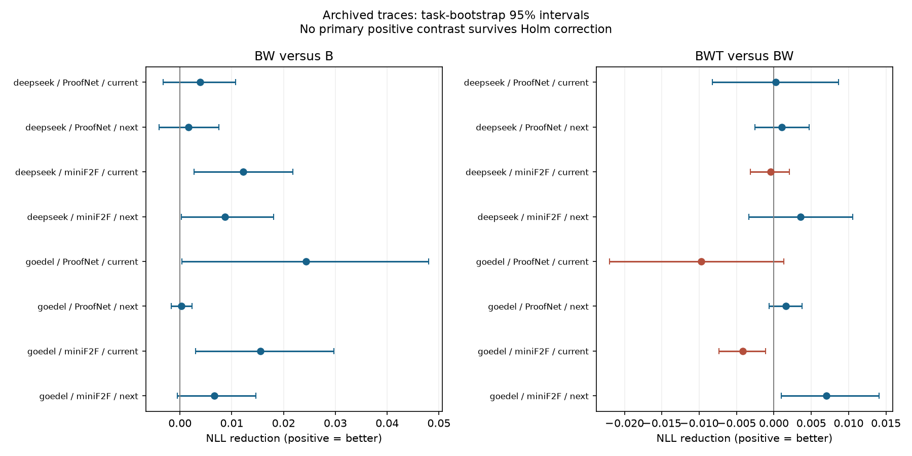

# Хвосты Кестена и накопление ошибок по шагам

## Ответ на вопрос рецензента

По имеющимся данным нельзя выделить суррогат Кестена как установленное объяснение ошибок. Локализация максимумом, сходство распределений позиций и экспоненциальная зависимость успешности от длины этого не делают. Результаты сравнения хвостов также не выделяют степенной хвост.

Более узкий вопрос проверяем: содержит ли величина скачка информацию о первом отказе сверх позиции, длины тактики и surprisal? Для него выполнен новый анализ сохранённых трасс DeepSeek и Goedel. Основные сравнения не дали результата, выдерживающего поправку на множественные проверки. Есть отдельный положительный результат переноса на выбранную популяцию неудачных Putnam-доказательств; он не устанавливает механизм Кестена. Все численные таблицы ниже сформированы из файлов метрик.

Вопрос рецензента состоит из трёх разных требований:

| Требование | Ответ по имеющимся данным |
| --- | --- |
| Нужен ли тяжёлый степенной хвост для самой локализации? | Нет. Рассматриваемая теорема допускает также быстро меняющиеся хвосты. |
| Даёт ли скачок информацию сверх обычного риска ошибки? | Это проверяемая предсказательная гипотеза; результаты зависят от модели, данных и момента наблюдения. |
| Обусловлен ли сигнал именно динамикой Кестена? | Сейчас нет эмпирической идентификации такого механизма. Проверка одного хвоста недостаточна. |

## Почему экспонента по длине не различает объяснения

Обозначим через $T$ номер первой отвергнутой Lean тактики, через $W_t$ норму whitened приращения скрытого состояния, а через $L$ горизонт наблюдения. Первая ошибка Lean не обязательно совпадает с первым математически неверным замыслом.

При независимой постоянной вероятности ошибки $p$ на каждом шаге:

$$
\Pr(T>L)=(1-p)^L.
$$

Это точная дискретная экспонента по $L$. Равенство $(1-p)^L\approx e^{-pL}$ требует малого $p$, но сама экспоненциальная форма не требует этого приближения.

Теперь возьмём независимые $W_t$ с любым распределением и определим ошибку первым превышением фиксированного порога:

$$
T=\min\{t:W_t>\tau\},\qquad p=\Pr(W_t>\tau).
$$

Получится та же формула $\Pr(T>L)=(1-p)^L$. Она верна как для Pareto, так и для exponential, lognormal и ограниченных распределений. По одним меткам и длинам эти примеры неразличимы. Нужна совместная информация о скачке и метке.

Более того, любая модель времени первой ошибки допускает представление через условный риск:

$$
h_t=\Pr(T=t\mid T\ge t),\qquad
\Pr(T>L)=\prod_{t=1}^{L}(1-h_t).
$$

При обусловливании на дополнительных доступных признаках аналогично определяется риск в соответствующей информационной истории. Поэтому «coupling с экстремумом» и «ошибки на каждом шаге» не являются непересекающимися классами моделей. Различие возникает, только если обычной модели явно запретить дополнительную зависимость от residual-признаков.

Наконец, геометрическое распределение имеет максимум на первом шаге, но это не означает большой вероятности ошибки на первом шаге. Например, его мода остаётся первой и при малом $p$. В редком режиме $Lp\ll1$ распределение $T$, условное на $T\le L$, приближается к равномерному; за пределами этого режима такой вывод не следует. Наблюдаемая финальная длина генерации сама зависит от процесса и исхода, поэтому группировка по ней является ретроспективной диагностикой, а не заменой контроля длины эксперимента.

## Что именно отличает степенной хвост и механизм Кестена

Для степенного регулярно меняющегося хвоста:

$$
\frac{\Pr(W>uy)}{\Pr(W>u)}\longrightarrow y^{-\alpha},\qquad y>1.
$$

Для быстро меняющегося хвоста это отношение стремится к нулю. Проверяемое различие — устойчивость относительных превышений при повышении порога, а также предсказательное качество хвостовых моделей на отложенных задачах. Прямая линия на коротком участке log–log графика и положительный Hill недостаточны. Lognormal тоже быстро меняется в этом смысле, хотя его часто относят к тяжёлым хвостам в другой классификации; здесь обсуждается именно отличие от степенного хвоста.

Суррогат Кестена задаёт более сильную структуру:

$$
E_t=a_tE_{t-1}+B_t,\qquad
\mathbb E[\log a_t]<0,\qquad
\Pr(a_t>1)>0.
$$

При дополнительных условиях на независимость, моменты, невырожденность и неарифметичность хвостовой показатель связан с множителем:

$$
\mathbb E[a_t^\alpha]=1.
$$

Это теорема о заданной случайной рекурсии, а не обратная теорема «увидели тяжёлый хвост — значит Кестен». Классические условия и ограничения сформулированы, например, у [Kevei](https://arxiv.org/abs/1512.07262); методы сравнения степенного хвоста с альтернативами обсуждают [Clauset, Shalizi и Newman](https://arxiv.org/abs/0706.1062).

В нашей постановке $E_t$ — отклонение от предполагаемой корректной динамики. Оно не равно автоматически наблюдаемому residual-вектору $X_t$, его центрированной версии или норме $W_t$. Подстановка отношения соседних норм вместо $a_t$ не измеряет коэффициент Кестена: она смешивает аддитивную часть, направление, позиционные эффекты и ошибку выбора самого состояния.

### Что уже показало сравнение хвостов

Историческая проверка E9 обучала хвостовые модели только на тренировочных задачах. Основной порог — 95-й процентиль train; сравнивается условная плотность превышений. Для подгонки требовались не менее 80 train-превышений и 20 train-групп. Ниже DeepSeek, ProofNet, принятые шаги до первого отказа.

| Семейство | NLL | Test превышений | Test задач | Фолдов |
| --- | --- | --- | --- | --- |
| pareto | 3.37756 | 116 | 49 | 5 |
| exponential | 3.37030 | 116 | 49 | 5 |
| lognormal | 3.36675 | 116 | 49 | 5 |
| gpd | 3.36679 | 116 | 49 | 5 |

Меньшая NLL лучше. Для exponential минус Pareto в обозначении выигрыша NLL:

Выигрыш exponential = **0.00726**, 95% CI [-0.00006; 0.01455].

Поэтому здесь нет преимущества Pareto. Различие между альтернативами также не следует объявлять установленным только по порядку точечных оценок.

| Оценка на train в пяти фолдах | Минимум | Максимум |
| --- | --- | --- |
| Hill | 0.05962 | 0.06445 |
| Moment | -0.13998 | -0.03937 |
| GPD shape | -0.16888 | -0.06486 |

У Goedel и для первых отказов E9 не набрал заранее требуемого хвостового покрытия. Это недостаток данных, а не измеренный нулевой эффект. Отрицательные signed moment/GPD на доступном диапазоне не выделяют положительный индекс Кестена; они также не доказывают точный асимптотический закон ограниченного хвоста.

Симуляция рекурсии Кестена проверяет следствия выбранной модели. Она не является эмпирическим свидетельством того, что prover реализует эту рекурсию.

### Что уже показала проверка фиксированного порога

Сильная гипотеза статьи имеет вид:

$$
v_t=\mathbf 1\{W_t\le\tau\}
$$

до первой ошибки включительно. Она требует, чтобы первое превышение совпадало с отказом, а на полностью корректной траектории превышений не было. Это существенно сильнее небольшой статистической корреляции.

В архивной A1 пороги получены на отдельных verified calibration задачах. Ниже один заранее исследованный уровень — 99-й процентиль. $F$ означает первое превышение, $M=\max_tW_t$. Это исторические популяции с ограниченным набором корректных трасс, а не новая расширенная выборка.

| Выборка | Failed | Verified | M выше порога на failed | M выше порога на verified | F совпал с T среди failed с превышением |
| --- | --- | --- | --- | --- | --- |
| miniF2F/deepseek | 528 | 172 | 9.66% | 8.14% | 1.96% |
| miniF2F/goedel | 448 | 231 | 18.97% | 10.82% | 11.76% |
| ProofNet/deepseek | 456 | 35 | 52.63% | 22.86% | 20.83% |
| ProofNet/goedel | 262 | 40 | 65.65% | 35.00% | 31.98% |

Пороги плохо реализуют строгую связь с валидностью. Доля $M>\tau$ на failed использует полный сгенерированный текст, включая суффикс после отказа; поэтому сама по себе она не измеряет своевременное обнаружение. Для этого в таблице отдельно приведено совпадение первого превышения с ошибкой. Эти результаты не опровергают существование любого возможного порога, статистики или readout, но не поддерживают испытанные варианты точного coupling.

## Новая проверка на существующих трассах

Выполнен отдельный CPU-анализ; исходные LLM, состояния, метки и текущие обучения не менялись. Проверены DeepSeek-Prover-V2-7B и Goedel-Prover-V2-8B. Для ProofNet и miniF2F использованы прежние пять внешних разбиений по задачам и три внутренних. Полные source-fits также перенесены без перенастройки на Putnam.

Включены строгие verified доказательства и попытки с надёжно локализованным первым отказом. Технически неразмеченные, обрезанные и неразбираемые случаи не превращаются в корректные. Все выводы условны на этом покрытии архива.

**Текущий шаг:** наблюдаем законченную тактику и её $W_t$, оцениваем, является ли она первым отказом, при условии корректного предшествующего префикса.

**Следующий шаг:** наблюдаем только непустой принятый префикс до $t$, оцениваем отказ на реально наблюдаемой следующей тактике $t+1$. Завершившиеся корректные доказательства без следующего шага не входят в этот risk set. Формальный старт без законченных тактик здесь отдельно не оценивался.

В обоих случаях отсутствуют будущая длина, относительная позиция $t/L$, будущие скачки и surprisal, результат verifier и метаданные тактики из полного AST. Риск прекращается при первом отказе. Текущий скачок при обнаружении уже наблюдается; при прогнозировании следующего шага его будущий скачок недоступен.

| Модель | Признаки |
| --- | --- |
| Constant | Постоянный риск, оценённый на train. |
| Position | Номер доступного шага, логарифм, квадрат и фиксированные сгибы зависимости. |
| B | Position, текущий и предыдущий surprisal, их изменение, история surprisal и длины тактик в токенах. |
| BW | B плюс текущая/предыдущая величина скачка, среднее, максимум, разброс и изменение по уже наблюдаемому префиксу. |
| BWT | BW плюс превышения 95-го и 99-го процентилей, хвостовой ранг и история превышений. |

Для BWT распределение нормы оценивается только на принятых train-шагах, отдельно в позиционных группах 1, 2, 3–5, 6–10, 11+. При недостаточном количестве наблюдений используется общий train-reference. Таким образом «большой скачок» сравнивается с типичными скачками похожей позиции. Это лишь позиционная нормировка; она не является полным условным распределением по всем признакам B и не означает подгонку Кестена.

Регуляризацию выбирали по внутренней NLL, без выбора на test. Каждая задача имеет одинаковый вес, её попытки — одинаковый вес внутри задачи, шаги — внутри попытки. Основная метрика — бинарная NLL, дополнительно сохранён Brier. Интервалы — 20 000 bootstrap целых задач при фиксированных обученных моделях. Они не включают неопределённость повторного обучения; статистика исследовательская.

### Основные результаты

«Текущий» и «следующий» имеют разные risk sets, поэтому их абсолютные NLL нельзя сравнивать как качество одной задачи.

| Модель | Данные | Ошибка | Задач | Попыток | Шагов | Constant | Position | B | BW | BWT |
| --- | --- | --- | --- | --- | --- | --- | --- | --- | --- | --- |
| deepseek | ProofNet | текущий | 187 | 563 | 3216 | 0.63099 | 0.60444 | 0.48568 | 0.48180 | 0.48159 |
| deepseek | ProofNet | следующий | 171 | 464 | 2653 | 0.61647 | 0.59769 | 0.60500 | 0.60334 | 0.60230 |
| deepseek | miniF2F | текущий | 202 | 1303 | 12237 | 0.35048 | 0.35074 | 0.28210 | 0.26993 | 0.27038 |
| deepseek | miniF2F | следующий | 198 | 1263 | 10934 | 0.35498 | 0.35385 | 0.34653 | 0.33781 | 0.33426 |
| goedel | ProofNet | текущий | 144 | 338 | 1838 | 0.67296 | 0.62395 | 0.46616 | 0.44184 | 0.45156 |
| goedel | ProofNet | следующий | 121 | 255 | 1500 | 0.63081 | 0.62324 | 0.62624 | 0.62596 | 0.62434 |
| goedel | miniF2F | текущий | 200 | 1256 | 14144 | 0.31814 | 0.31555 | 0.25352 | 0.23796 | 0.24212 |
| goedel | miniF2F | следующий | 198 | 1227 | 12888 | 0.33544 | 0.33983 | 0.31705 | 0.31038 | 0.30339 |

Далее положительная $\Delta\mathrm{NLL}$ означает выигрыш: loss исходной модели минус loss дополненной.

| Модель | Данные | Ошибка | Сравнение | Δ NLL | 95% CI | p Holm |
| --- | --- | --- | --- | --- | --- | --- |
| deepseek | ProofNet | current | BW против B | +0.00388 | [-0.00330; 0.01072] | 1.0000 |
| deepseek | ProofNet | current | BWT против BW | +0.00021 | [-0.00821; 0.00864] | 1.0000 |
| deepseek | ProofNet | next | BW против B | +0.00167 | [-0.00400; 0.00748] | 1.0000 |
| deepseek | ProofNet | next | BWT против BW | +0.00104 | [-0.00255; 0.00474] | 1.0000 |
| deepseek | miniF2F | current | BW против B | +0.01217 | [0.00270; 0.02178] | 0.1837 |
| deepseek | miniF2F | current | BWT против BW | -0.00044 | [-0.00317; 0.00205] | 1.0000 |
| deepseek | miniF2F | next | BW против B | +0.00872 | [0.00022; 0.01810] | 0.6171 |
| deepseek | miniF2F | next | BWT против BW | +0.00355 | [-0.00334; 0.01058] | 1.0000 |
| goedel | ProofNet | current | BW против B | +0.02432 | [0.00039; 0.04801] | 0.5460 |
| goedel | ProofNet | current | BWT против BW | -0.00972 | [-0.02197; 0.00132] | 0.8950 |
| goedel | ProofNet | next | BW против B | +0.00028 | [-0.00167; 0.00233] | 1.0000 |
| goedel | ProofNet | next | BWT против BW | +0.00162 | [-0.00066; 0.00375] | 1.0000 |
| goedel | miniF2F | current | BW против B | +0.01555 | [0.00297; 0.02968] | 0.3297 |
| goedel | miniF2F | current | BWT против BW | -0.00416 | [-0.00737; -0.00109] | 0.1488 |
| goedel | miniF2F | next | BW против B | +0.00667 | [-0.00048; 0.01464] | 0.8335 |
| goedel | miniF2F | next | BWT против BW | +0.00700 | [0.00099; 0.01408] | 0.4816 |

Из 16 основных контрастов 0 показывают положительный эффект при p Holm < 0,05. Это не доказывает отсутствие эффекта: часть номинальных интервалов положительна, но после учёта всего семейства проверок убедительной общей прибавки не получено. Специальные хвостовые признаки также не дают устойчивого преимущества сверх BW.

Полные Brier, все модели и переносы: [model_metrics.csv](../assets/185503bc4d31_model_metrics.csv). Все контрасты и интервалы: [contrasts.csv](../assets/03ebe7cf4f3f_contrasts.csv).

Важно сравнивать также с Position: более подробная B не обязана лучше обобщаться при конечной выборке. Например, на ProofNet в прогнозе следующего шага её преимущество не установлено самим включением дополнительных признаков. Таблица сохраняет более простой контроль, чтобы улучшение относительно B не выдавалось автоматически за победу над всеми обычными моделями.

### Перенос на Putnam

| Модель | Обучение | Ошибка | Сравнение | Δ NLL | 95% CI | p Holm |
| --- | --- | --- | --- | --- | --- | --- |
| deepseek | ProofNet | current | BW против B | +0.00476 | [-0.00688; 0.01576] | 1.0000 |
| deepseek | ProofNet | current | BWT против BW | +0.00119 | [-0.01071; 0.01335] | 1.0000 |
| deepseek | ProofNet | next | BW против B | -0.00289 | [-0.00986; 0.00387] | 1.0000 |
| deepseek | ProofNet | next | BWT против BW | -0.00209 | [-0.00754; 0.00125] | 1.0000 |
| deepseek | miniF2F | current | BW против B | +0.07319 | [0.02780; 0.12485] | 0.0581 |
| deepseek | miniF2F | current | BWT против BW | -0.00807 | [-0.01825; 0.00113] | 1.0000 |
| deepseek | miniF2F | next | BW против B | +0.07120 | [0.03010; 0.11746] | 0.0304 |
| deepseek | miniF2F | next | BWT против BW | -0.03025 | [-0.08966; 0.01639] | 1.0000 |
| goedel | ProofNet | current | BW против B | +0.01194 | [-0.01780; 0.04178] | 1.0000 |
| goedel | ProofNet | current | BWT против BW | -0.02585 | [-0.04188; -0.00876] | 0.0304 |
| goedel | ProofNet | next | BW против B | -0.00169 | [-0.00353; 0.00012] | 0.9470 |
| goedel | ProofNet | next | BWT против BW | +0.00019 | [-0.00160; 0.00235] | 1.0000 |
| goedel | miniF2F | current | BW против B | +0.03524 | [-0.05720; 0.15810] | 1.0000 |
| goedel | miniF2F | current | BWT против BW | +0.00575 | [-0.01364; 0.02324] | 1.0000 |
| goedel | miniF2F | next | BW против B | +0.03313 | [-0.01065; 0.08291] | 1.0000 |
| goedel | miniF2F | next | BWT против BW | -0.04623 | [-0.10563; 0.00566] | 1.0000 |

Отдельный положительный контраст — DeepSeek, miniF2F → Putnam, следующий шаг: NLL B **0.67143 → BW 0.60023**, Δ = 0.07120, 95% CI [0.03010; 0.11746], p Holm = 0.0304. Position имеет NLL 0.62330; преимущество BW над Position здесь описательное, отдельным основным тестом не было. BWT имеет NLL 0.63048, то есть добавление хвостовых признаков ухудшило точечную оценку относительно BW. Это аргумент в пользу ограниченной предсказательной ценности scalar-history в конкретном переносе, а не специфического экстремального закона. В переносе Goedel с ProofNet хвостовое дополнение ухудшает обнаружение текущего отказа; отрицательные результаты сохранены в той же таблице.

Putnam здесь содержит только попытки с отказом. Внутри них есть принятые и отвергнутые шаги, поэтому шаговую NLL вычислить можно; частоту ошибок в общей популяции, качество распознавания полностью корректных доказательств и их false-positive rate по этому срезу оценить нельзя.

Ранее найденные улучшения при использовании полного скрытого вектора относятся к другой гипотезе: вектор может кодировать содержание и тип тактики, а его норма — нет. Предсказательная ценность направления или состояния сама по себе не подтверждает хвостовой механизм.

## Какой результат различал бы гипотезы

Операциональная нулевая гипотеза должна быть сформулирована явно. Для текущего законченного шага:

$$
H_0:\quad
\Pr(T=t\mid T\ge t,B_t,W_{1:t})
=
\Pr(T=t\mid T\ge t,B_t).
$$

Альтернатива утверждает, что residual-история улучшает оценку риска после учёта доступных обычных признаков. Проверка — прирост отложенной NLL/Brier, калибровки и, отдельно, качества тревог при сопоставимой false-positive rate. Для предварительного прогноза слева должны стоять только $B_{t-1},W_{1:t-1}$; данные ошибочной тактики использовать нельзя.

Положительный результат отвергает только этот ограниченный вариант отсутствия добавочной предсказательной информации. Он не исключает более гибкую обычную модель с неучтённой сложностью шага и не устанавливает, что скачок причинно создаёт ошибку.

Для более сильной версии «важны именно экстремумы» полезны дополнительные различия:

1. **Хвост сверх обычной величины.** Превышения и их история улучшают прогноз сверх гладких признаков нормы. BWT против BW — ограниченная реализованная проверка; она не охватывает все возможные функции распределения.
2. **Сохранение эффекта при одинаковом префиксе.** Из одного Lean состояния генерируются разные следующие тактики; исход, surprisal и скачок сравниваются внутри задачи и состояния. Такая серия уже идёт отдельно. Она уменьшает смешение по сложности задачи, но разные тексты тактик всё ещё не являются случайным вмешательством только в hidden state.
3. **Независимое предсказание хвостового масштаба и кластеров.** Параметры динамики, оценённые без подгонки к тестовым отказам, должны предсказывать overshoot, серии превышений и смещение первого превышения относительно максимума на новых задачах. Само наличие кластеров не уникально для Кестена.
4. **Вмешательство.** При одинаковом префиксе контролированно менять амплитуду/направление возмущения и измерять следующую валидность при одинаковом бюджете генерации. Сравнивать со случайными направлениями и состояниями той же нормы. Это проверка причинного влияния выбранного вмешательства, а не автоматическое доказательство естественного механизма.

Сходные гистограммы позиций $T$ и максимума могут объяснять часть попаданий. Уже выполненный контроль с максимумом другой задачи той же длины сохраняет эти маргинальные предпочтения и проверяет дополнительное совпадение внутри траектории. Но даже остаточная связь в таком тесте не определяет закон хвоста и механизм генерации.

## Что потребуется для специфической проверки Кестена

Одних дополнительных прогонов того же локализатора недостаточно. Нужно сначала связать переменные теории с наблюдаемой динамикой.

**Определить измеряемое отклонение $E_t$.** Например, получить обоснованную корректную reference-динамику на сопоставимых состояниях. Простое вычитание среднего hidden state — лишь выбранная proxy, а не расстояние до множества корректных рассуждений. Эту разницу нужно сохранить в формулировке вывода.

**Оценить динамику на train и сравнить альтернативы на новых задачах.** Для независимого скалярного $a_t$ и центрированного независимого шума $B_t$, условно на $E_{t-1}=e$, модель даёт:

$$
\mathbb E[E_t\mid E_{t-1}=e]=\mathbb E[a_t]e,
$$

$$
\mathrm{Cov}(E_t\mid E_{t-1}=e)
=
\mathrm{Var}(a_t)\,ee^\top+\Sigma_B.
$$

Это конкретное предсказание мультипликативной динамики: компонент условной дисперсии растёт квадратично с величиной состояния и направлен вдоль него. Постоянное сжатие с независимым аддитивным шумом такого компонента не имеет. Однако другая модель с зависимой от состояния дисперсией тоже способна его воспроизвести, поэтому нужны сравнение нескольких альтернатив и совместные предсказания, а не один тест.

**Связать отдельно оценённые множители с хвостом.** Проверить среднее логарифмическое сжатие, наличие расширений, адекватность предположений о независимости/стационарности и согласие корня $\mathbb E[a^\alpha]=1$ с хвостовой оценкой на отдельной выборке. Не оценивать $a_t$ из отношения тех же экстремальных норм, на которых затем подтверждается показатель.

**Набрать хвостовые события на независимых задачах.** В нынешнем E9 часть важных ячеек не прошла минимальные пороги покрытия. Точное число новых генераций следует выбирать через предварительную оценку мощности для различения заданных альтернатив и заданного диапазона порогов. Увеличивать бюджет до появления нужного знака нельзя. Короткие, позиционно неоднородные proof traces не превращаются в длинную стационарную траекторию при склеивании.

Пока эти связи не определены, корректная роль Кестена в статье — математический пример механизма, способного порождать тяжёлые хвосты. Новый анализ закрывает более узкую проверку добавочной предсказательной информации на существующем архиве; он не заменяет идентификацию динамики.

## Короткий ответ рецензенту

The current experiments do not specifically identify the Kesten heavy-tail surrogate. Localization is compatible with rapidly varying tails, and an exponential success–length curve also follows from independent per-step errors. In our held-out tail comparison, the Pareto model did not outperform exponential, lognormal or GPD alternatives; several model/event strata lacked sufficient tail coverage. We therefore treat Kesten dynamics as an illustrative mechanism rather than an empirically identified explanation.

A discriminating observable is incremental failure-risk prediction from residual statistics conditional on step position and output-based covariates. We tested this on archived traces using task-disjoint nested cross-validation, separating current-step detection from next-step prediction and excluding post-failure risk rows and future features. None of the 16 primary norm/tail-feature contrasts remained positive at Holm-adjusted p < .05. A secondary DeepSeek miniF2F-to-Putnam next-step contrast improved NLL by 0.0712 (95% CI [0.0301; 0.1175]), but that Putnam cohort contains failed proofs only, and adding dedicated tail features did not improve it. This is a limited predictive result, not identification of heavy tails or Kesten dynamics.

An unrestricted per-step hazard can itself depend on residual extremes, so the two descriptions are not mutually exclusive. Identifying Kesten dynamics would additionally require a justified observable deviation state, independently estimated multipliers, and held-out predictions linking those multipliers to tail exponents and dependence structure. Those requirements are not satisfied by the existing localization results.

## Воспроизводимость

Завершены 48 единиц обучения, 240 итоговых моделей и 80 строк метрик. Отдельная проверка восстановила 326330 вероятностей из сохранённых коэффициентов; максимальное расхождение 0. Независимый пересчёт task-weighted NLL отличается не более чем на 2.22e-16. Выполнено 380 дополнительных проверок инвариантности к будущему суффиксу. Основной Slurm job: 8534406; CPU, без GPU. Job проверки и отчёта: 8534407.

Точный протокол: PROTOCOL.txt (полный исходник на Жоресе: /beegfs/home/denis.rakhmankin/onebigjump/runs/reviewer_kesten_response_delivery_20261112_v1/PROTOCOL.txt). Исходный анализ: analyze.py (исходный путь: analyze.py). Проверка и сборка отчёта: audit_report.py (исходный путь: audit_report.py). Численные результаты: metrics.json (полный исходник на Жоресе: /beegfs/home/denis.rakhmankin/onebigjump/runs/reviewer_kesten_response_delivery_20261112_v1/metrics.json). Исторические источники E9 и A1 скопированы в evidence вместе с их манифестами; хеши входов и выходов находятся в manifest.json (полный исходник на Жоресе: /beegfs/home/denis.rakhmankin/onebigjump/runs/reviewer_kesten_response_delivery_20261112_v1/manifest.json).

Исходный репозиторий содержал незакоммиченные изменения. Для этой работы зафиксированы фактические SHA-256 исходников и входов, commit и состояние дерева; чистый checkout не заявляется. Статья и её старая спецификация различаются в деталях протокола: здесь использованы проверенные formal-entry состояния и строгие метки текущего архива, а не старые правила для timeout/unsolved-goals.

Текущие генерации альтернативных продолжений и другие задания не останавливались и не изменялись. Настоящий отчёт относится к завершённому анализу сохранённых данных; новые результаты продолжающихся серий в него не приписаны.
