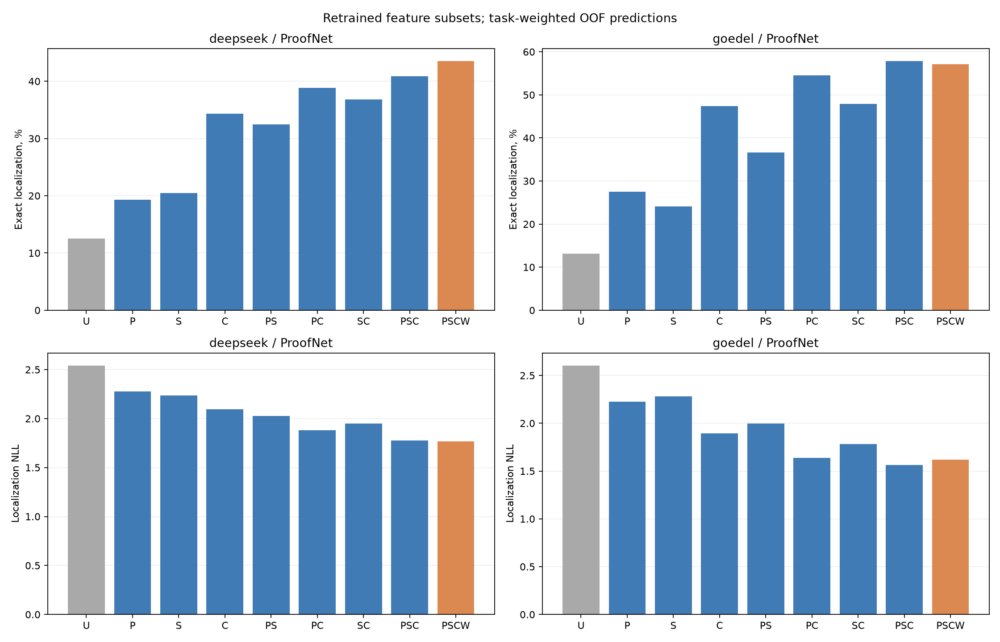

# Что использует локализатор: позиция, surprisal, тип тактики и скачок

Новая серия на сохранённых трассах DeepSeek-Prover-V2-7B и Goedel-Prover-V2-8B. Все локализаторы переобучены отдельно. Генерации LLM и GPU не использовались. Это исследовательские сравнения после изучения того же архива, а не независимая подтверждающая выборка.

P — только номер и относительная позиция тактики, первый/последний шаг; S — только средний token surprisal текущей тактики; C — тип и длина тактики. W — скаляр log(1+норма whitened-приращения). PSC — исходный baseline статьи, PSCW — его расширение. MD дополнительно использует соседнюю разность surprisal и её модуль. В S нет разности, индикатора первого шага, типа или длины тактики. U — равномерное распределение с ожидаемой точностью 1/L.

Полное готовое доказательство доступно; исход — первая Lean-отвергнутая тактика среди ошибочных доказательств. Softmax нормирует вероятности по доступным кандидатам, поэтому S не является стриминговым локализатором. Это не доля решённых задач и не тест наличия ошибки.

## Проверка и протокол

Сохранены прежние 5 внешних и 3 внутренних group-fold, сетка регуляризации и conditional softmax. Сплайны, масштабы, категории и lambda определены только на train. Putnam — замороженный перенос с ProofNet без настройки на Putnam. Во всех 10 внешних фолдах воспроизведены исходные M0/M0W/MD/MDW вероятности с ошибкой <1e-6. Проверены независимость P от прочих признаков и отсутствие прямой позиции в S, сходимость и нормировка вероятностей. Все вычисления выполнены через Slurm.

Основные веса равны по задачам и затем по попыткам внутри задачи. Интервалы — 20000 bootstrap задач при фиксированных предсказаниях, без переобучения. Holm80 корректирует 80 заранее перечисленных сравнений Hit/NLL; дополнительные срезы и Shapley остаются описательными. Полный протокол: [PROTOCOL.md](https://github.com/Kilkaintomat/Scoltech-big_jump/blob/818fe065afaa6bc9127d804aa6e2467e5f897cc8/reports/localizer_daily_20261113/scalar_protocol.md).

## Основная матрица

В ячейке: Hit, % / NLL. Больше Hit и меньше NLL — лучше.

| Признаки | deepseek / ProofNet | deepseek / Putnam | goedel / ProofNet | goedel / Putnam |
| --- | --- | --- | --- | --- |
| U | 12.55 / 2.5426 | 7.51 / 2.8979 | 13.15 / 2.6047 | 7.52 / 2.8246 |
| P | 19.31 / 2.2760 | 16.67 / 2.8224 | 27.53 / 2.2274 | 11.43 / 2.9017 |
| S | 20.47 / 2.2340 | 16.95 / 2.4613 | 24.06 / 2.2802 | 20.48 / 2.4485 |
| C | 34.33 / 2.0937 | 34.05 / 2.2023 | 47.37 / 1.8925 | 42.38 / 2.2477 |
| PS | 32.49 / 2.0277 | 13.51 / 2.4216 | 36.64 / 1.9989 | 16.67 / 2.5403 |
| PC | 38.87 / 1.8812 | 33.33 / 2.1385 | 54.50 / 1.6376 | 38.57 / 2.3032 |
| SC | 36.80 / 1.9514 | 32.33 / 1.9701 | 47.87 / 1.7840 | 35.24 / 2.0350 |
| PSC | 40.85 / 1.7747 | 34.05 / 1.9328 | 57.82 / 1.5617 | 45.71 / 2.0895 |
| W | 18.50 / 2.4587 | 19.83 / 2.7744 | 26.57 / 2.3975 | 6.67 / 2.8764 |
| PW | 24.92 / 2.2538 | 17.39 / 2.7657 | 31.67 / 2.1592 | 12.86 / 2.9049 |
| SW | 27.92 / 2.1950 | 21.41 / 2.4094 | 26.90 / 2.2212 | 12.86 / 2.5046 |
| CW | 36.46 / 2.0518 | 27.73 / 2.1548 | 46.43 / 1.8393 | 40.95 / 2.2704 |
| PSW | 33.26 / 2.0185 | 16.67 / 2.3912 | 38.37 / 1.9828 | 19.52 / 2.5640 |
| PCW | 41.53 / 1.8639 | 31.75 / 2.1091 | 54.81 / 1.6189 | 35.71 / 2.3316 |
| SCW | 38.72 / 1.9323 | 32.47 / 1.9504 | 46.68 / 1.7576 | 42.38 / 2.0765 |
| PSCW | 43.51 / 1.7659 | 34.20 / 1.9172 | 57.13 / 1.6179 | 40.00 / 2.1247 |
| MD | 39.39 / 1.7797 | 33.48 / 1.9359 | 57.32 / 1.5706 | 45.71 / 2.0755 |
| MDW | 42.20 / 1.7705 | 34.20 / 1.9202 | 55.69 / 1.6262 | 45.71 / 2.1098 |

## Добавочная полезность групп признаков

ΔHit — процентные пункты; выигрыш NLL = NLL(base)-NLL(new). Положительное значение означает улучшение.

| Модель / данные | Сравнение | ΔHit [95%] | выигрыш NLL [95%] | Holm p Hit / NLL |
| --- | --- | --- | --- | --- |
| deepseek / ProofNet | PS − S | +12.01 [7.37; 16.85] | +0.2062 [0.1437; 0.2669] | 0.0040 / 0.0040 |
| deepseek / ProofNet | PS − P | +13.18 [8.58; 18.07] | +0.2483 [0.1863; 0.3059] | 0.0040 / 0.0040 |
| deepseek / ProofNet | PSC − PS | +8.36 [2.73; 13.83] | +0.2531 [0.1684; 0.3363] | 0.1764 / 0.0040 |
| deepseek / ProofNet | PSC − SC | +4.05 [0.06; 8.01] | +0.1767 [0.1110; 0.2419] | 1.0000 / 0.0040 |
| deepseek / ProofNet | PSC − PC | +1.98 [-0.50; 4.59] | +0.1065 [0.0589; 0.1511] | 1.0000 / 0.0040 |
| deepseek / ProofNet | PW − P | +5.61 [1.29; 10.06] | +0.0223 [0.0007; 0.0426] | 0.6200 / 1.0000 |
| deepseek / ProofNet | SW − S | +7.45 [2.31; 12.65] | +0.0390 [0.0120; 0.0643] | 0.2464 / 0.2145 |
| deepseek / ProofNet | PSW − PS | +0.78 [-2.37; 3.97] | +0.0092 [-0.0045; 0.0222] | 1.0000 / 1.0000 |
| deepseek / ProofNet | PSCW − PSC | +2.66 [0.50; 5.17] | +0.0088 [-0.0043; 0.0218] | 1.0000 / 1.0000 |
| deepseek / ProofNet | MDW − MD | +2.81 [0.95; 5.02] | +0.0092 [-0.0040; 0.0224] | 0.4212 / 1.0000 |
| deepseek / Putnam | PS − S | -3.45 [-11.78; 4.89] | +0.0397 [-0.0831; 0.1622] | 1.0000 / 1.0000 |
| deepseek / Putnam | PS − P | -3.16 [-11.49; 4.31] | +0.4009 [0.2794; 0.5139] | 1.0000 / 0.0040 |
| deepseek / Putnam | PSC − PS | +20.55 [11.21; 30.17] | +0.4888 [0.3374; 0.6414] | 0.0040 / 0.0040 |
| deepseek / Putnam | PSC − SC | +1.72 [-5.46; 9.34] | +0.0373 [-0.0696; 0.1447] | 1.0000 / 1.0000 |
| deepseek / Putnam | PSC − PC | +0.72 [-1.87; 3.59] | +0.2057 [0.1148; 0.2914] | 1.0000 / 0.0040 |
| deepseek / Putnam | PW − P | +0.72 [-8.76; 10.20] | +0.0567 [0.0184; 0.0949] | 1.0000 / 0.2145 |
| deepseek / Putnam | SW − S | +4.45 [-4.17; 13.22] | +0.0519 [0.0080; 0.0967] | 1.0000 / 0.9423 |
| deepseek / Putnam | PSW − PS | +3.16 [-0.57; 7.18] | +0.0303 [0.0041; 0.0561] | 1.0000 / 1.0000 |
| deepseek / Putnam | PSCW − PSC | +0.14 [-2.16; 2.30] | +0.0156 [-0.0108; 0.0409] | 1.0000 / 1.0000 |
| deepseek / Putnam | MDW − MD | +0.72 [-1.72; 3.16] | +0.0156 [-0.0108; 0.0408] | 1.0000 / 1.0000 |
| goedel / ProofNet | PS − S | +12.58 [4.82; 20.40] | +0.2813 [0.1815; 0.3820] | 0.0944 / 0.0040 |
| goedel / ProofNet | PS − P | +9.11 [4.94; 13.81] | +0.2285 [0.1353; 0.3132] | 0.0094 / 0.0064 |
| goedel / ProofNet | PSC − PS | +21.18 [13.85; 28.57] | +0.4372 [0.2998; 0.5702] | 0.0040 / 0.0040 |
| goedel / ProofNet | PSC − SC | +9.95 [4.80; 15.35] | +0.2223 [0.1202; 0.3260] | 0.0279 / 0.0040 |
| goedel / ProofNet | PSC − PC | +3.32 [0.19; 6.89] | +0.0759 [0.0136; 0.1346] | 1.0000 / 0.6624 |
| goedel / ProofNet | PW − P | +4.14 [-0.44; 9.02] | +0.0682 [0.0139; 0.1203] | 1.0000 / 0.6043 |
| goedel / ProofNet | SW − S | +2.84 [-3.27; 8.96] | +0.0590 [-0.0166; 0.1263] | 1.0000 / 1.0000 |
| goedel / ProofNet | PSW − PS | +1.73 [-1.57; 5.26] | +0.0160 [-0.0190; 0.0492] | 1.0000 / 1.0000 |
| goedel / ProofNet | PSCW − PSC | -0.69 [-3.13; 1.57] | -0.0562 [-0.0921; -0.0225] | 1.0000 / 0.0944 |
| goedel / ProofNet | MDW − MD | -1.63 [-4.32; 0.63] | -0.0556 [-0.0924; -0.0206] | 1.0000 / 0.1425 |
| goedel / Putnam | PS − S | -3.81 [-18.10; 11.43] | -0.0918 [-0.2955; 0.0958] | 1.0000 / 1.0000 |
| goedel / Putnam | PS − P | +5.24 [0.00; 12.38] | +0.3614 [0.2098; 0.4976] | 1.0000 / 0.0040 |
| goedel / Putnam | PSC − PS | +29.05 [12.86; 45.71] | +0.4508 [0.0927; 0.7951] | 0.0510 / 0.6200 |
| goedel / Putnam | PSC − SC | +10.48 [-3.33; 25.71] | -0.0544 [-0.2485; 0.1318] | 1.0000 / 1.0000 |
| goedel / Putnam | PSC − PC | +7.14 [0.00; 15.71] | +0.2137 [0.1058; 0.3359] | 1.0000 / 0.0396 |
| goedel / Putnam | PW − P | +1.43 [0.00; 4.29] | -0.0031 [-0.1013; 0.0965] | 1.0000 / 1.0000 |
| goedel / Putnam | SW − S | -7.62 [-22.38; 6.19] | -0.0561 [-0.1531; 0.0404] | 1.0000 / 1.0000 |
| goedel / Putnam | PSW − PS | +2.86 [0.00; 7.14] | -0.0237 [-0.0867; 0.0394] | 1.0000 / 1.0000 |
| goedel / Putnam | PSCW − PSC | -5.71 [-14.29; 0.00] | -0.0352 [-0.0775; 0.0072] | 1.0000 / 1.0000 |
| goedel / Putnam | MDW − MD | +0.00 [0.00; 0.00] | -0.0343 [-0.0771; 0.0083] | 1.0000 / 1.0000 |

## Откуда берётся NLL-выигрыш baseline

Shapley по всем порядкам добавления P/S/C, каждый набор отдельно переобучен. Вклад измерен в снижении held-out NLL; сумма трёх вкладов точно равна NLL(U)-NLL(PSC). Это характеристика предсказания выбранного алгоритма, не причинность и не прочтение смысла нейронов.

| Модель / данные | Группа | Вклад [95%] |
| --- | --- | --- |
| deepseek / Putnam | P | 0.0548 [-0.0623; 0.1704] |
| deepseek / Putnam | S | 0.3196 [0.2214; 0.4052] |
| deepseek / Putnam | C | 0.5906 [0.4217; 0.7564] |
| deepseek / ProofNet | P | 0.2176 [0.1536; 0.2790] |
| deepseek / ProofNet | S | 0.2035 [0.1487; 0.2535] |
| deepseek / ProofNet | C | 0.3469 [0.2560; 0.4349] |
| goedel / Putnam | P | -0.0684 [-0.2796; 0.1289] |
| goedel / Putnam | S | 0.2923 [0.1662; 0.4088] |
| goedel / Putnam | C | 0.5112 [0.1202; 0.8822] |
| goedel / ProofNet | P | 0.2893 [0.1865; 0.3924] |
| goedel / ProofNet | S | 0.1896 [0.1086; 0.2632] |
| goedel / ProofNet | C | 0.5641 [0.4179; 0.7025] |

## Поведение предсказаний

Доли с равными весами задач, %. Совпадение с PSC не доказывает достаточности группы; важны качество и переобучаемые абляции выше.

| Модель / данные | Признаки | Выбран первый | Выбран последний | Совпадает с PSC |
| --- | --- | --- | --- | --- |
| deepseek / Putnam | P | 32.33 | 0.00 | 18.82 |
| deepseek / Putnam | S | 3.88 | 2.87 | 22.70 |
| deepseek / Putnam | C | 8.62 | 0.00 | 57.76 |
| deepseek / Putnam | PS | 26.58 | 0.00 | 26.87 |
| deepseek / Putnam | PSC | 13.36 | 0.00 | 100.00 |
| deepseek / ProofNet | P | 39.80 | 0.00 | 21.55 |
| deepseek / ProofNet | S | 13.30 | 6.50 | 25.28 |
| deepseek / ProofNet | C | 19.13 | 0.20 | 56.17 |
| deepseek / ProofNet | PS | 35.91 | 0.00 | 41.30 |
| deepseek / ProofNet | PSC | 22.09 | 0.00 | 100.00 |
| goedel / Putnam | P | 100.00 | 0.00 | 24.29 |
| goedel / Putnam | S | 2.86 | 0.00 | 19.05 |
| goedel / Putnam | C | 22.86 | 0.00 | 52.86 |
| goedel / Putnam | PS | 39.05 | 0.00 | 24.76 |
| goedel / Putnam | PSC | 24.29 | 0.00 | 100.00 |
| goedel / ProofNet | P | 97.37 | 0.00 | 33.71 |
| goedel / ProofNet | S | 13.10 | 8.71 | 25.65 |
| goedel / ProofNet | C | 21.80 | 0.75 | 60.20 |
| goedel / ProofNet | PS | 55.34 | 0.00 | 43.88 |
| goedel / ProofNet | PSC | 35.21 | 0.00 | 100.00 |

## Ограничения интерпретации

Высокий результат P означает, что позиционный паттерн предсказывает метку в выбранной популяции; высокий результат S — что достаточно вероятностей токенов для части локализаций. Ни то ни другое само по себе не устанавливает математическую причину ошибки. Surprisal и тип тактики могут коррелировать с позицией даже без прямого позиционного признака. Модели генерировали разные доказательства; состав локализуемых ошибок и исключений различается.

Улучшение от вектора состояния или приращения нельзя автоматически приписывать его норме: направление, содержание и тип шага могут содержать другую информацию. Даже положительный W-контраст не выбирает Kesten среди альтернативных механизмов. Отсутствие выигрышного W-контраста не доказывает отсутствие любой информации в скрытом состоянии.

[strata.csv](https://github.com/Kilkaintomat/Scoltech-big_jump/blob/818fe065afaa6bc9127d804aa6e2467e5f897cc8/reports/localizer_daily_20261113/strata.csv) содержит первый/непервый отказ и срезы по длине. Для непервых ошибок сохраняются все кандидаты и уже обученные модели. [margin_contributions.csv](../assets/831d2ae7f7ca_margin_contributions.csv) содержит точное аддитивное разложение PSC-logit margin между настоящим отказом и самым сильным неверным кандидатом; [fit_diagnostics.csv](https://github.com/Kilkaintomat/Scoltech-big_jump/blob/818fe065afaa6bc9127d804aa6e2467e5f897cc8/reports/localizer_daily_20261113/fit_diagnostics.csv) — сходимость, размер и lambda каждого outer/frozen fit.

