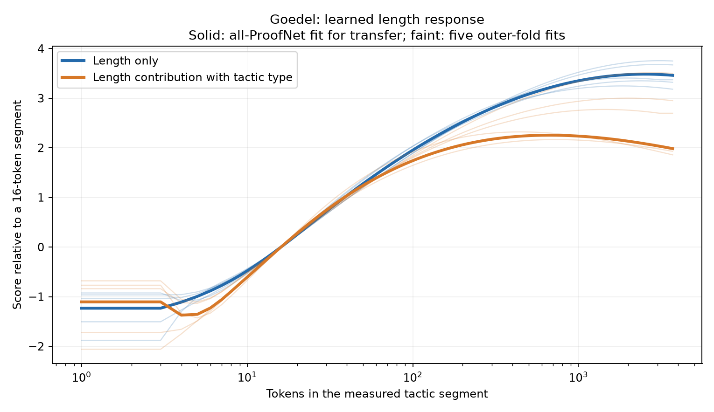

# Goedel: тип и длина тактики в локализаторе

Восстановление сохранённых моделей, без нового обучения. Основные кривые — финальная модель на всём ProofNet для переноса на Putnam; тонкие линии — пять outer-fold моделей. Scores не являются абсолютными вероятностями ошибки. Вероятности нормируются softmax по кандидатам одного доказательства.

Тип — категория AST-узла статического разбора; объединённые категории разделены вертикальной чертой. Длина — token_end-token_start+1 в исходной токенизации. Измеряется выделенный фрагмент, включая попавшие в него комментарии, вложенные блоки и разделители. Это не число токенов одного слова-команды.

N: s=g(log(1+n)). T: s=a_type. C: s=g(log(1+n))+a_type. Сплайн кубический, train-only узлы и масштабы. В C нет взаимодействия типа и длины: одна общая кривая и разные вертикальные смещения. Редкие типы объединены в OTHER.

## Сравнение с правилом максимальной длины

| Данные | Модель | Hit % | Выбран максимум длины % | Совпадение с первым максимумом % |
| --- | --- | --- | --- | --- |
| ProofNet | N | 42.67 | 100.00 | 100.00 |
| ProofNet | T | 37.83 | 35.24 | 35.24 |
| ProofNet | C | 47.37 | 64.50 | 64.50 |
| Putnam | N | 45.24 | 100.00 | 100.00 |
| Putnam | T | 30.00 | 34.76 | 34.76 |
| Putnam | C | 42.38 | 54.29 | 54.29 |

## Кривая

| Токены | Score N относительно 16 | Вес N относительно 16 | Score C относительно 16 | Вес C относительно 16 |
| --- | --- | --- | --- | --- |
| 2 | -1.2325 | 0.2916 | -1.1050 | 0.3312 |
| 4 | -1.1104 | 0.3294 | -1.3725 | 0.2535 |
| 8 | -0.6725 | 0.5104 | -0.8938 | 0.4091 |
| 16 | 0.0000 | 1.0000 | 0.0000 | 1.0000 |
| 32 | 0.7893 | 2.2018 | 0.8120 | 2.2524 |
| 64 | 1.5296 | 4.6162 | 1.4408 | 4.2240 |
| 128 | 2.1692 | 8.7509 | 1.8751 | 6.5213 |
| 256 | 2.6940 | 14.7904 | 2.1350 | 8.4573 |
| 512 | 3.0931 | 22.0461 | 2.2457 | 9.4469 |
| 1024 | 3.3573 | 28.7106 | 2.2341 | 9.3379 |
| 2048 | 3.4777 | 32.3855 | 2.1281 | 8.3989 |
| 4096 | 3.4606 | 31.8351 | 1.9842 | 7.2729 |

Вес — exp(score(n)-score(16)); это отношение вероятностей двух кандидатов, для C при одинаковом типе. Вне крайних train-узлов сплайн продолжается константой.

## Эффекты типов

| Тип AST | Train groups | Score T относительно OTHER | Score C относительно OTHER |
| --- | --- | --- | --- |
| Lean.Parser.Tactic.classical | 12 | 4.5736 | 3.3849 |
| Mathlib.Tactic.useSyntax | 14 | 1.4242 | 1.4444 |
| Lean.Parser.Tactic.simpa | 48 | 1.3797 | 1.6540 |
| Lean.Parser.Tactic.apply | 67 | 1.3187 | 1.3281 |
| Lean.Parser.Tactic.«tactic_<;>_» | 89 | 1.1868 | 0.8137 |
| Lean.Parser.Tactic.tacticHave__&#124;Lean.Parser.Tactic.«tactic_<;>_» | 51 | 1.0377 | 0.4489 |
| Mathlib.Tactic.linarith | 16 | 0.4061 | 1.6784 |
| Lean.Parser.Tactic.simp | 36 | 0.3912 | 0.6670 |
| Lean.Parser.Tactic.rwSeq | 69 | 0.2946 | 0.7529 |
| OTHER | 0 | 0.0000 | 0.0000 |
| Lean.Parser.Tactic.obtain | 42 | -0.0938 | 0.3393 |
| Mathlib.Tactic.normNum | 11 | -0.4054 | 0.0027 |
| Lean.Parser.Tactic.exact | 133 | -0.4405 | 0.9639 |
| Lean.Parser.Tactic.refine' | 36 | -0.4733 | -0.0634 |
| Lean.Parser.Tactic.tacticHave__ | 91 | -1.0415 | -0.7212 |
| Lean.Parser.Tactic.exact&#124;Lean.Parser.Tactic.tacticHave__ | 108 | -1.0713 | 0.1917 |
| Lean.Parser.Tactic.intro | 80 | -1.3453 | -0.8587 |
| «tacticBy_cases_:_» | 17 | -1.8444 | -1.4770 |
| Lean.Parser.Tactic.rcases | 17 | -1.8471 | -1.1444 |
| Lean.Parser.Tactic.constructor | 28 | -1.8515 | -0.9960 |
| Lean.Parser.Tactic.simpAll | 14 | -1.8620 | -1.0472 |
| Batteries.Tactic.byContra | 36 | -1.9371 | -1.6305 |
| Lean.Parser.Tactic.contradiction | 16 | -1.9602 | -0.9829 |
| Lean.Parser.Tactic.tacticExfalso | 16 | -2.0887 | -1.6194 |
| Lean.Parser.Tactic.omega | 11 | -2.0898 | -1.4014 |

Типовые оценки условны на отобранных ошибочных доказательствах; это не частота неправильности команды во всех доказательствах. Равные scores разрешаются выбором первого кандидата; предыдущая tie-абляция измеряет этот эффект.

## Представление деревом

Исходная модель — аддитивный spline-score с softmax. Дерево можно построить как приближение кривой либо обучить отдельно на тех же групповых разбиениях. Если g строго возрастает на кандидатах, argmax совпадает с максимумом длины. Возможные изгибы проверяются по коэффициентам; плато вне train-диапазона создаёт равные scores. В C более короткая тактика может победить из-за смещения её типа.

В исходной ProofNet-таблице 5460 шагов; 21.01% сегментов содержат маркер комментария, 7.20% имеют объединённый AST-тип. Это описательные доли шагов; доля токенов комментария здесь не измерялась. В examples.json сохранены реальные примеры. Все вероятности восстановлены с ошибкой <1e-10.
