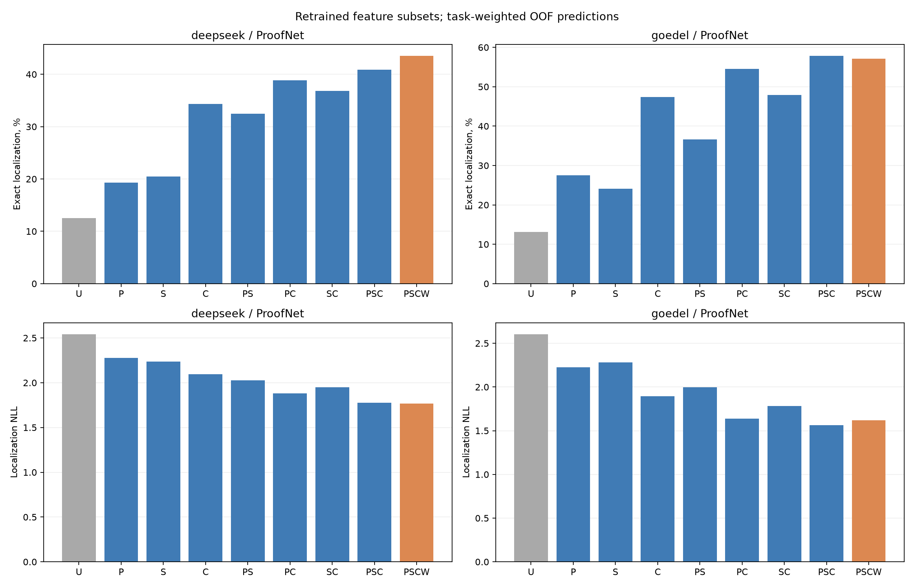
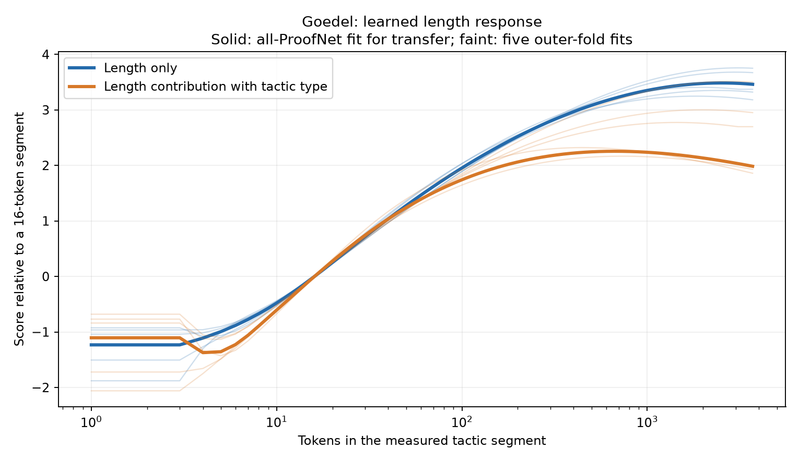

# Локализация, наличие и прогноз ошибки в доказательствах

Отчёт дополнен полной завершённой серией по наличию и будущему появлению ошибки и чистой абляцией Goedel без длины тактики. Результаты прежних разделов сохранены; сегодняшняя матрица обновлена по новому снимку.

[Goedel без длины тактики — отдельная таблица](no_length_report.md). [Наличие и прогноз — все 19 вариантов и 6 целей](presence_all_results.md). Оба раздела также полностью приведены в конце этого отчёта.

## Полнота результатов

| Серия | Полные ячейки | Что проверяется |
| --- | --- | --- |
| Новая матрица локализаторов | 268/312 | 39 вариантов: Putnam offline и три streaming-условия для обеих LLM |
| Наличие и прогноз ошибки | 1368/1368 | 19 вариантов, 6 целей, две LLM, два обучающих корпуса и три тестовых корпуса |
| Goedel без длины тактики | 48/48 | 8 вариантов в 6 условиях: offline и streaming |

Матрица «наличие/прогноз» не совпадает с новой матрицей из 39 локализаторов: у неё собственные 19 наборов признаков, обучение и цели. Все 39 новых вариантов ещё не исследованы на всех шести задачах наличия/прогноза. Полной называется завершённая запланированная серия, а не совокупность всех возможных сочетаний. Незавершённые результаты локализации и абляции не подставляются в таблицы как нули.

Сводный отчёт о сегодняшних переобучениях и разборах сохранённых экспериментов с DeepSeek-Prover-V2-7B и Goedel-Prover-V2-8B. Он объединяет разложение baseline на признаки, полную матрицу скрытых состояний и приращений, разбор различий Goedel, тип и длину тактики, а также новые серии обучения на Putnam и стримингового обнаружения.

Дата относится к часовому поясу Europe/Moscow. Момент снимка вычислений приведён ниже в UTC. Модели генерации доказательств заморожены; сегодня обучаются локализаторы, а не сами LLM. Сборка матрицы прежних векторных экспериментов и аудит сохранённых предсказаний отдельно отмечены и не считаются новой генерацией.

## Что означает режим оценки

| Режим | Что доступно при решении | Выход | Какие числа к нему относятся |
| --- | --- | --- | --- |
| Ретроспективная локализация | Готовое доказательство, его длина и все шаги, включая текст после отказа | Один наиболее вероятный первый отказ | Прежние матрицы Hit@1/NLL, сегодняшние абляции P/S/T/N и анализ длины |
| Стриминговое обнаружение | Признаки текущего и предыдущих завершённых шагов | Первая тревога при превышении фиксированного порога | Новая полная матрица streaming ниже; прежние отдельные streaming-серии относятся к своим baseline и cohort |
| Прогноз до следующего шага | Только уже принятый префикс, без текущего будущего шага | Риск будущего отказа | Отдельная задача; текущая новая матрица её не подменяет |

Стриминговый эксперимент здесь — causal replay сохранённых состояний при заданных границах завершённых AST-фрагментов. Численные признаки проверены на независимость от будущих шагов. Самостоятельный онлайн-парсер, который устанавливает эти границы без полного текста, отдельно не проверен. Поэтому результаты не обозначаются как end-to-end система остановки генерации.

## Что означают разность, норма и нормировка

Состояние X_t — вектор из 4096 координат после завершения шага t; X_0 взят на входе в формальное доказательство. Слои readout: 14 у DeepSeek и 17 у Goedel, нумерация с нуля.

Исходный вектор изменения:

$$
\Delta X_t=X_t-X_{t-1}.
$$

Его обычная евклидова норма:

$$
\rho_t=\|\Delta X_t\|_2.
$$

В основной матрице скачок измеряется после whitening — центрирования и линейного изменения масштаба направлений по отдельной исходной calibration-выборке:

$$
z_t=\Sigma^{-1/2}(\Delta X_t-\mu),\qquad
r_t=\|z_t\|_2,\qquad
u_t=\frac{z_t}{r_t}.
$$

При нулевой норме направление задаётся нулём. В таблицах W или r означает скалярный признак log(1+r_t), а u — все координаты единичного вектора. Поэтому:

| Признак | Размерность | Какая информация сохраняется |
| --- | --- | --- |
| raw deltaX | 4096 | Исходное изменение, включая направление и величину |
| z | 4096 | Изменение после фиксированного whitening, включая величину |
| r, или W после log1p | 1 | Только величина whitened-изменения |
| u | 4096 | Только направление whitened-изменения |
| r + u | 4097 | Величина и направление как отдельные входы |
| X | 4096 | Текущее состояние, а не изменение |

Например, для вектора (3,4) норма равна 5, а единичное направление — (0.6,0.8). Вектор (30,40) имеет то же направление, но норму 50. Локализатор по норме не различит (3,4) и (-3,-4), а локализатор по направлению различит.

После построения признаков координаты дополнительно стандартизируются по train mean/std. Эта общая для выборки стандартизация не делит каждый отдельный вектор на его собственную норму и не удаляет его амплитуду.

Хотя z=r*u, линейная модель с отдельными r и u не эквивалентна линейной модели по z: для восстановления произведения нужны взаимодействия. Добавление скрытого состояния означает добавление обучаемой линейной проекции его координат к оценке baseline; это отдельный probe, а не дообучение LLM.

## Как обучаются локализаторы

В ретроспективном случае каждый шаг получает оценку s_t. Вероятности нормируются по всем шагам доказательства:

$$
p_t=\frac{\exp(s_t)}{\sum_{j=1}^{L}\exp(s_j)},\qquad
\widehat t=\arg\max_t p_t.
$$

Loss одной ошибочной попытки — -log p_f, где f — первый Lean-отказ. Наличие вероятности, нормированной по всем кандидатам, само по себе делает такую оценку ретроспективной, даже если отдельный score использует только surprisal текущего шага.

Для новой стриминговой версии используется sigmoid:

$$
h_t=\frac{1}{1+\exp(-s_t)},\qquad
\widehat t=\min\{t:h_t>c\}.
$$

Обучение использует только шаги до первого отказа включительно; последующие не превращаются в отрицательные примеры. y_t=1 только на отказе, y_t=0 на предшествовавших принятых шагах и всех шагах строго verified-попыток. BCE шага:

$$
\ell_t=-y_t\log h_t-(1-y_t)\log(1-h_t).
$$

Порог c выбирается на внутренних out-of-fold прогнозах. В тесте он фиксирован, тревога не отзывается после просмотра будущего текста. Из позиционных признаков удалены t/L и индикатор последнего шага. Это обнаружение после текущей тактики, не предсказание её отказа до генерации.

Exact означает, что первая тревога пришлась точно на первый отказ; Early — тревога раньше отказа; Miss — отсутствие тревоги до отказа включительно. FPR по verified означает хотя бы одну тревогу за всё корректное доказательство.

NLL ретроспективной локализации и средняя BCE стримингового детектора относятся к разным исходам и разным нормировкам. Их численные значения нельзя сравнивать напрямую.

## Обучение непосредственно на Putnam

В прежних таблицах Putnam был только внешней проверкой: все параметры локализатора выбраны на ProofNet. Новая серия обучает и подбирает параметры на части задач Putnam и проверяет на других задачах Putnam: пять внешних групповых фолдов, по три внутренних для настройки. Все попытки одной группы задачи находятся в одном фолде.

В доступном Putnam-архиве нет полностью verified-доказательств. Ретроспективная локализация на ошибочных попытках остаётся определённой. Для streaming имеются отрицательные шаги до первого отказа, но нет отрицательных целых доказательств. Порог Putnam-trained моделей калибруется по максимумам на принятых префиксах тренировочных попыток; его контроль относится к преждевременной тревоге, не к ложной тревоге на корректных доказательствах.

Таким образом, Putnam-trained streaming описывает условную популяцию доступных ошибочных попыток. Его нельзя использовать как оценку общей вероятности ошибки среди всех генерируемых доказательств. Для такой оценки нужны также достоверно корректные попытки Putnam. В замороженном переносе ProofNet -> Putnam используется исходный ProofNet-порог, без перенастройки по Putnam.

Размер train у Putnam меньше, чем у ProofNet, и это также меняет сравнение переноса с обучением внутри датасета. Разница результатов не изолирует только эффект совпадения домена.

## Какие работы объединены

| Работа | Что выполнено |
| --- | --- |
| Полная матрица состояний и приращений | Сборка завершённых прежних fits: X, Xprev, raw deltaX, whitening, величина, направление, гибкие baseline |
| Разбор Goedel | Внешние фолды, исключение одной задачи, общие задачи двух моделей, исправленные и испорченные попадания; без нового обучения |
| Абляция P/S/C/W | 18 заново обученных скалярных вариантов на ProofNet и перенос на Putnam |
| Разделение типа и длины | 8 новых вариантов T/N и комбинаций с P/S плюс воспроизведение 4 исходных контролей |
| Равенство scores | Пересчёт выбора первого против случайного выбора среди равных максимумов; без переобучения |
| Кривая длины Goedel | Восстановление коэффициентов, сравнение каждого прогноза с самым длинным фрагментом, аудит токеновых span |
| Новая полная серия | 39 вариантов для двух LLM: Putnam-trained retrospective; ProofNet-trained streaming OOF; Putnam-trained streaming OOF; ProofNet -> Putnam streaming |

Ниже приведены полные таблицы. Все значения берутся из сохранённых результатов; незавершённые сравнения явно оставлены без результата.

## Статус новой серии на момент отчёта

Снимок UTC: 2026-11-12T23:04:36.982324+00:00. Завершено 1136 из 1248 внешних/frozen fits. Полностью собраны 268 из 312 сочетаний режима, LLM и варианта локализатора. Один внешний fit включает внутренний подбор параметров; это не число новых генераций LLM.

[Подробный протокол новой серии](new_protocol.md). [Все готовые новые метрики](new_metrics.csv). [Парные сравнения](new_contrasts.csv). [Незавершённые ячейки](pending.csv).

### Состав новой выборки

| LLM | Датасет | Попытки | Группы задач | Отказы | Verified |
| --- | --- | --- | --- | --- | --- |
| deepseek | ProofNet | 563 | 187 | 452 | 111 |
| deepseek | Putnam | 118 | 58 | 118 | 0 |
| goedel | ProofNet | 338 | 144 | 259 | 79 |
| goedel | Putnam | 48 | 35 | 48 | 0 |

### Добавка скачка при обучении на Putnam

Только модели с завершёнными всеми внешними фолдами. Δ в процентных пунктах, 95% bootstrap задач при фиксированных прогнозах.

| LLM | Baseline | Без скачка, Hit % | Со скачком, Hit % | Δ [95% CI] | NLL без / со скачком |
| --- | --- | --- | --- | --- | --- |
| deepseek | PSC | 28.30 | 32.76 | +4.45 [-2.01; 11.49] | 2.1522 / 2.1327 |
| deepseek | MD | 28.30 | 32.47 | +4.17 [-2.01; 10.78] | 2.1515 / 2.1328 |
| goedel | PSC | 32.86 | 32.86 | +0.00 [0.00; 0.00] | 2.1065 / 2.1099 |
| goedel | MD | 28.57 | 31.43 | +2.86 [0.00; 8.57] | 2.0966 / 2.1006 |

Таблица описывает точечные оценки и неопределённость. Полная поправка Holm для зарегистрированных сравнений приведена в разделе новой серии. Нулевой размах bootstrap, если у двух моделей совпали все попадания, не означает доказанного равенства обучающих процедур.

## Что использует локализатор: позиция, surprisal, тип тактики и скачок

Новая серия на сохранённых трассах DeepSeek-Prover-V2-7B и Goedel-Prover-V2-8B. Все локализаторы переобучены отдельно. Генерации LLM и GPU не использовались. Это исследовательские сравнения после изучения того же архива, а не независимая подтверждающая выборка.

P — только номер и относительная позиция тактики, первый/последний шаг; S — только средний token surprisal текущей тактики; C — тип и длина тактики. W — скаляр log(1+норма whitened-приращения). PSC — исходный baseline статьи, PSCW — его расширение. MD дополнительно использует соседнюю разность surprisal и её модуль. В S нет разности, индикатора первого шага, типа или длины тактики. U — равномерное распределение с ожидаемой точностью 1/L.

Полное готовое доказательство доступно; исход — первая Lean-отвергнутая тактика среди ошибочных доказательств. Softmax нормирует вероятности по доступным кандидатам, поэтому S не является стриминговым локализатором. Это не доля решённых задач и не тест наличия ошибки.

### Проверка и протокол

Сохранены прежние 5 внешних и 3 внутренних group-fold, сетка регуляризации и conditional softmax. Сплайны, масштабы, категории и lambda определены только на train. Putnam — замороженный перенос с ProofNet без настройки на Putnam. Во всех 10 внешних фолдах воспроизведены исходные M0/M0W/MD/MDW вероятности с ошибкой <1e-6. Проверены независимость P от прочих признаков и отсутствие прямой позиции в S, сходимость и нормировка вероятностей. Все вычисления выполнены через Slurm.

Основные веса равны по задачам и затем по попыткам внутри задачи. Интервалы — 20000 bootstrap задач при фиксированных предсказаниях, без переобучения. Holm80 корректирует 80 заранее перечисленных сравнений Hit/NLL; дополнительные срезы и Shapley остаются описательными. Полный протокол: [протокол абляции](scalar_protocol.md).

### Основная матрица

В ячейке: Hit, % / NLL. Больше Hit и меньше NLL — лучше.

| Признаки | deepseek / ProofNet | deepseek / Putnam | goedel / ProofNet | goedel / Putnam |
| --- | --- | --- | --- | --- |
| U | 12.55 / 2.5426 | 7.51 / 2.8979 | 13.15 / 2.6047 | 7.52 / 2.8246 |
| P | 19.31 / 2.2760 | 16.67 / 2.8224 | 27.53 / 2.2274 | 11.43 / 2.9017 |
| S | 20.47 / 2.2340 | 16.95 / 2.4613 | 24.06 / 2.2802 | 20.48 / 2.4485 |
| C | 34.33 / 2.0937 | 34.05 / 2.2023 | 47.37 / 1.8925 | 42.38 / 2.2477 |
| PS | 32.49 / 2.0277 | 13.51 / 2.4216 | 36.64 / 1.9989 | 16.67 / 2.5403 |
| PC | 38.87 / 1.8812 | 33.33 / 2.1385 | 54.50 / 1.6376 | 38.57 / 2.3032 |
| SC | 36.80 / 1.9514 | 32.33 / 1.9701 | 47.87 / 1.7840 | 35.24 / 2.0350 |
| PSC | 40.85 / 1.7747 | 34.05 / 1.9328 | 57.82 / 1.5617 | 45.71 / 2.0895 |
| W | 18.50 / 2.4587 | 19.83 / 2.7744 | 26.57 / 2.3975 | 6.67 / 2.8764 |
| PW | 24.92 / 2.2538 | 17.39 / 2.7657 | 31.67 / 2.1592 | 12.86 / 2.9049 |
| SW | 27.92 / 2.1950 | 21.41 / 2.4094 | 26.90 / 2.2212 | 12.86 / 2.5046 |
| CW | 36.46 / 2.0518 | 27.73 / 2.1548 | 46.43 / 1.8393 | 40.95 / 2.2704 |
| PSW | 33.26 / 2.0185 | 16.67 / 2.3912 | 38.37 / 1.9828 | 19.52 / 2.5640 |
| PCW | 41.53 / 1.8639 | 31.75 / 2.1091 | 54.81 / 1.6189 | 35.71 / 2.3316 |
| SCW | 38.72 / 1.9323 | 32.47 / 1.9504 | 46.68 / 1.7576 | 42.38 / 2.0765 |
| PSCW | 43.51 / 1.7659 | 34.20 / 1.9172 | 57.13 / 1.6179 | 40.00 / 2.1247 |
| MD | 39.39 / 1.7797 | 33.48 / 1.9359 | 57.32 / 1.5706 | 45.71 / 2.0755 |
| MDW | 42.20 / 1.7705 | 34.20 / 1.9202 | 55.69 / 1.6262 | 45.71 / 2.1098 |

### Добавочная полезность групп признаков

ΔHit — процентные пункты; выигрыш NLL = NLL(base)-NLL(new). Положительное значение означает улучшение.

| Модель / данные | Сравнение | ΔHit [95%] | выигрыш NLL [95%] | Holm p Hit / NLL |
| --- | --- | --- | --- | --- |
| deepseek / ProofNet | PS − S | +12.01 [7.37; 16.85] | +0.2062 [0.1437; 0.2669] | 0.0040 / 0.0040 |
| deepseek / ProofNet | PS − P | +13.18 [8.58; 18.07] | +0.2483 [0.1863; 0.3059] | 0.0040 / 0.0040 |
| deepseek / ProofNet | PSC − PS | +8.36 [2.73; 13.83] | +0.2531 [0.1684; 0.3363] | 0.1764 / 0.0040 |
| deepseek / ProofNet | PSC − SC | +4.05 [0.06; 8.01] | +0.1767 [0.1110; 0.2419] | 1.0000 / 0.0040 |
| deepseek / ProofNet | PSC − PC | +1.98 [-0.50; 4.59] | +0.1065 [0.0589; 0.1511] | 1.0000 / 0.0040 |
| deepseek / ProofNet | PW − P | +5.61 [1.29; 10.06] | +0.0223 [0.0007; 0.0426] | 0.6200 / 1.0000 |
| deepseek / ProofNet | SW − S | +7.45 [2.31; 12.65] | +0.0390 [0.0120; 0.0643] | 0.2464 / 0.2145 |
| deepseek / ProofNet | PSW − PS | +0.78 [-2.37; 3.97] | +0.0092 [-0.0045; 0.0222] | 1.0000 / 1.0000 |
| deepseek / ProofNet | PSCW − PSC | +2.66 [0.50; 5.17] | +0.0088 [-0.0043; 0.0218] | 1.0000 / 1.0000 |
| deepseek / ProofNet | MDW − MD | +2.81 [0.95; 5.02] | +0.0092 [-0.0040; 0.0224] | 0.4212 / 1.0000 |
| deepseek / Putnam | PS − S | -3.45 [-11.78; 4.89] | +0.0397 [-0.0831; 0.1622] | 1.0000 / 1.0000 |
| deepseek / Putnam | PS − P | -3.16 [-11.49; 4.31] | +0.4009 [0.2794; 0.5139] | 1.0000 / 0.0040 |
| deepseek / Putnam | PSC − PS | +20.55 [11.21; 30.17] | +0.4888 [0.3374; 0.6414] | 0.0040 / 0.0040 |
| deepseek / Putnam | PSC − SC | +1.72 [-5.46; 9.34] | +0.0373 [-0.0696; 0.1447] | 1.0000 / 1.0000 |
| deepseek / Putnam | PSC − PC | +0.72 [-1.87; 3.59] | +0.2057 [0.1148; 0.2914] | 1.0000 / 0.0040 |
| deepseek / Putnam | PW − P | +0.72 [-8.76; 10.20] | +0.0567 [0.0184; 0.0949] | 1.0000 / 0.2145 |
| deepseek / Putnam | SW − S | +4.45 [-4.17; 13.22] | +0.0519 [0.0080; 0.0967] | 1.0000 / 0.9423 |
| deepseek / Putnam | PSW − PS | +3.16 [-0.57; 7.18] | +0.0303 [0.0041; 0.0561] | 1.0000 / 1.0000 |
| deepseek / Putnam | PSCW − PSC | +0.14 [-2.16; 2.30] | +0.0156 [-0.0108; 0.0409] | 1.0000 / 1.0000 |
| deepseek / Putnam | MDW − MD | +0.72 [-1.72; 3.16] | +0.0156 [-0.0108; 0.0408] | 1.0000 / 1.0000 |
| goedel / ProofNet | PS − S | +12.58 [4.82; 20.40] | +0.2813 [0.1815; 0.3820] | 0.0944 / 0.0040 |
| goedel / ProofNet | PS − P | +9.11 [4.94; 13.81] | +0.2285 [0.1353; 0.3132] | 0.0094 / 0.0064 |
| goedel / ProofNet | PSC − PS | +21.18 [13.85; 28.57] | +0.4372 [0.2998; 0.5702] | 0.0040 / 0.0040 |
| goedel / ProofNet | PSC − SC | +9.95 [4.80; 15.35] | +0.2223 [0.1202; 0.3260] | 0.0279 / 0.0040 |
| goedel / ProofNet | PSC − PC | +3.32 [0.19; 6.89] | +0.0759 [0.0136; 0.1346] | 1.0000 / 0.6624 |
| goedel / ProofNet | PW − P | +4.14 [-0.44; 9.02] | +0.0682 [0.0139; 0.1203] | 1.0000 / 0.6043 |
| goedel / ProofNet | SW − S | +2.84 [-3.27; 8.96] | +0.0590 [-0.0166; 0.1263] | 1.0000 / 1.0000 |
| goedel / ProofNet | PSW − PS | +1.73 [-1.57; 5.26] | +0.0160 [-0.0190; 0.0492] | 1.0000 / 1.0000 |
| goedel / ProofNet | PSCW − PSC | -0.69 [-3.13; 1.57] | -0.0562 [-0.0921; -0.0225] | 1.0000 / 0.0944 |
| goedel / ProofNet | MDW − MD | -1.63 [-4.32; 0.63] | -0.0556 [-0.0924; -0.0206] | 1.0000 / 0.1425 |
| goedel / Putnam | PS − S | -3.81 [-18.10; 11.43] | -0.0918 [-0.2955; 0.0958] | 1.0000 / 1.0000 |
| goedel / Putnam | PS − P | +5.24 [0.00; 12.38] | +0.3614 [0.2098; 0.4976] | 1.0000 / 0.0040 |
| goedel / Putnam | PSC − PS | +29.05 [12.86; 45.71] | +0.4508 [0.0927; 0.7951] | 0.0510 / 0.6200 |
| goedel / Putnam | PSC − SC | +10.48 [-3.33; 25.71] | -0.0544 [-0.2485; 0.1318] | 1.0000 / 1.0000 |
| goedel / Putnam | PSC − PC | +7.14 [0.00; 15.71] | +0.2137 [0.1058; 0.3359] | 1.0000 / 0.0396 |
| goedel / Putnam | PW − P | +1.43 [0.00; 4.29] | -0.0031 [-0.1013; 0.0965] | 1.0000 / 1.0000 |
| goedel / Putnam | SW − S | -7.62 [-22.38; 6.19] | -0.0561 [-0.1531; 0.0404] | 1.0000 / 1.0000 |
| goedel / Putnam | PSW − PS | +2.86 [0.00; 7.14] | -0.0237 [-0.0867; 0.0394] | 1.0000 / 1.0000 |
| goedel / Putnam | PSCW − PSC | -5.71 [-14.29; 0.00] | -0.0352 [-0.0775; 0.0072] | 1.0000 / 1.0000 |
| goedel / Putnam | MDW − MD | +0.00 [0.00; 0.00] | -0.0343 [-0.0771; 0.0083] | 1.0000 / 1.0000 |

### Откуда берётся NLL-выигрыш baseline

Shapley по всем порядкам добавления P/S/C, каждый набор отдельно переобучен. Вклад измерен в снижении held-out NLL; сумма трёх вкладов точно равна NLL(U)-NLL(PSC). Это характеристика предсказания выбранного алгоритма, не причинность и не прочтение смысла нейронов.

| Модель / данные | Группа | Вклад [95%] |
| --- | --- | --- |
| deepseek / Putnam | P | 0.0548 [-0.0623; 0.1704] |
| deepseek / Putnam | S | 0.3196 [0.2214; 0.4052] |
| deepseek / Putnam | C | 0.5906 [0.4217; 0.7564] |
| deepseek / ProofNet | P | 0.2176 [0.1536; 0.2790] |
| deepseek / ProofNet | S | 0.2035 [0.1487; 0.2535] |
| deepseek / ProofNet | C | 0.3469 [0.2560; 0.4349] |
| goedel / Putnam | P | -0.0684 [-0.2796; 0.1289] |
| goedel / Putnam | S | 0.2923 [0.1662; 0.4088] |
| goedel / Putnam | C | 0.5112 [0.1202; 0.8822] |
| goedel / ProofNet | P | 0.2893 [0.1865; 0.3924] |
| goedel / ProofNet | S | 0.1896 [0.1086; 0.2632] |
| goedel / ProofNet | C | 0.5641 [0.4179; 0.7025] |

### Поведение предсказаний

Доли с равными весами задач, %. Совпадение с PSC не доказывает достаточности группы; важны качество и переобучаемые абляции выше.

| Модель / данные | Признаки | Выбран первый | Выбран последний | Совпадает с PSC |
| --- | --- | --- | --- | --- |
| deepseek / Putnam | P | 32.33 | 0.00 | 18.82 |
| deepseek / Putnam | S | 3.88 | 2.87 | 22.70 |
| deepseek / Putnam | C | 8.62 | 0.00 | 57.76 |
| deepseek / Putnam | PS | 26.58 | 0.00 | 26.87 |
| deepseek / Putnam | PSC | 13.36 | 0.00 | 100.00 |
| deepseek / ProofNet | P | 39.80 | 0.00 | 21.55 |
| deepseek / ProofNet | S | 13.30 | 6.50 | 25.28 |
| deepseek / ProofNet | C | 19.13 | 0.20 | 56.17 |
| deepseek / ProofNet | PS | 35.91 | 0.00 | 41.30 |
| deepseek / ProofNet | PSC | 22.09 | 0.00 | 100.00 |
| goedel / Putnam | P | 100.00 | 0.00 | 24.29 |
| goedel / Putnam | S | 2.86 | 0.00 | 19.05 |
| goedel / Putnam | C | 22.86 | 0.00 | 52.86 |
| goedel / Putnam | PS | 39.05 | 0.00 | 24.76 |
| goedel / Putnam | PSC | 24.29 | 0.00 | 100.00 |
| goedel / ProofNet | P | 97.37 | 0.00 | 33.71 |
| goedel / ProofNet | S | 13.10 | 8.71 | 25.65 |
| goedel / ProofNet | C | 21.80 | 0.75 | 60.20 |
| goedel / ProofNet | PS | 55.34 | 0.00 | 43.88 |
| goedel / ProofNet | PSC | 35.21 | 0.00 | 100.00 |

### Ограничения интерпретации

Высокий результат P означает, что позиционный паттерн предсказывает метку в выбранной популяции; высокий результат S — что достаточно вероятностей токенов для части локализаций. Ни то ни другое само по себе не устанавливает математическую причину ошибки. Surprisal и тип тактики могут коррелировать с позицией даже без прямого позиционного признака. Модели генерировали разные доказательства; состав локализуемых ошибок и исключений различается.

Улучшение от вектора состояния или приращения нельзя автоматически приписывать его норме: направление, содержание и тип шага могут содержать другую информацию. Даже положительный W-контраст не выбирает Kesten среди альтернативных механизмов. Отсутствие выигрышного W-контраста не доказывает отсутствие любой информации в скрытом состоянии.

[strata.csv](strata.csv) содержит первый/непервый отказ и срезы по длине. Для непервых ошибок сохраняются все кандидаты и уже обученные модели. сохранённый на сервере margin_contributions.csv содержит точное аддитивное разложение PSC-logit margin между настоящим отказом и самым сильным неверным кандидатом; [fit_diagnostics.csv](fit_diagnostics.csv) — сходимость, размер и lambda каждого outer/frozen fit.

## Уточнение: тип тактики отдельно от её длины

Дополнительная исследовательская абляция после получения основной матрицы. Те же популяции, outer/inner folds, регуляризация и замороженный перенос. T — только категория тактики; N — только сплайн log(1+число токенов); P/S — позиция/surprisal. PSC — полная исходная модель: P+S+T+N. Все варианты переобучены. Ни один столбец не содержит сам текст тактики или сообщение Lean. Последующие шаги не считаются корректными.

В ячейке Hit, % / NLL. Тип тактики может косвенно кодировать позицию, длину и стиль доказательства. Эта абляция измеряет предсказательную полезность, а не причину ошибки. Типовой локализатор может давать одинаковые scores повторяющимся типам внутри доказательства; при равенстве сохраняется историческое правило выбора первого кандидата. Поэтому T не является полностью свободным от позиционного эффекта в tie-breaking; NLL учитывает всю распределённую вероятность.

| Признаки | deepseek / ProofNet | deepseek / Putnam | goedel / ProofNet | goedel / Putnam |
| --- | --- | --- | --- | --- |
| T | 34.27 / 2.2632 | 30.46 / 2.3676 | 37.83 / 2.2589 | 30.00 / 2.3350 |
| N | 32.43 / 2.2216 | 28.74 / 2.4619 | 42.67 / 2.0523 | 45.24 / 2.3727 |
| PT | 34.85 / 1.9834 | 25.00 / 2.2634 | 47.92 / 1.8335 | 32.86 / 2.4042 |
| PN | 35.68 / 2.0715 | 27.30 / 2.4448 | 45.26 / 1.8799 | 27.14 / 2.4713 |
| ST | 33.41 / 2.0644 | 31.75 / 2.1103 | 39.56 / 2.0559 | 32.86 / 2.1253 |
| SN | 34.00 / 2.0564 | 29.17 / 2.1763 | 43.63 / 1.9028 | 36.67 / 2.1392 |
| PST | 38.80 / 1.8281 | 30.46 / 2.0317 | 50.43 / 1.7115 | 43.33 / 2.1763 |
| PSN | 35.45 / 1.9307 | 26.01 / 2.1720 | 44.76 / 1.7419 | 32.86 / 2.2353 |
| PSC | 40.85 / 1.7747 | 34.05 / 1.9328 | 57.82 / 1.5617 | 45.71 / 2.0895 |
| PSCW | 43.51 / 1.7659 | 34.20 / 1.9172 | 57.13 / 1.6179 | 40.00 / 2.1247 |
| MD | 39.39 / 1.7797 | 33.48 / 1.9359 | 57.32 / 1.5706 | 45.71 / 2.0755 |
| MDW | 42.20 / 1.7705 | 34.20 / 1.9202 | 55.69 / 1.6262 | 45.71 / 2.1098 |

### Парные сравнения

ΔHit, п.п., и выигрыш NLL=old-new. Bootstrap задач 20000 при фиксированных OOF/frozen предсказаниях. Holm48 применён внутри этой дополнительной семьи; это не единая корректировка всех исторических исследований.

| Модель / данные | Сравнение | Метрика | Δ [95%] | Holm p |
| --- | --- | --- | --- | --- |
| deepseek / ProofNet | PT − T | hit | +0.5766 [-3.0479; 4.2470] | 1.0000 |
| deepseek / ProofNet | PT − T | nll | +0.2798 [0.2027; 0.3558] | 0.0024 |
| deepseek / ProofNet | PN − N | hit | +3.2487 [-0.5164; 6.9854] | 1.0000 |
| deepseek / ProofNet | PN − N | nll | +0.1501 [0.0840; 0.2135] | 0.0040 |
| deepseek / ProofNet | PST − PT | hit | +3.9515 [0.2510; 7.6883] | 0.9500 |
| deepseek / ProofNet | PST − PT | nll | +0.1553 [0.1010; 0.2064] | 0.0024 |
| deepseek / ProofNet | PSN − PN | hit | -0.2309 [-3.5643; 3.0326] | 1.0000 |
| deepseek / ProofNet | PSN − PN | nll | +0.1408 [0.0897; 0.1889] | 0.0024 |
| deepseek / ProofNet | PSC − PST | hit | +2.0482 [-2.2593; 6.3454] | 1.0000 |
| deepseek / ProofNet | PSC − PST | nll | +0.0534 [0.0107; 0.0950] | 0.3668 |
| deepseek / ProofNet | PSC − PSN | hit | +5.4002 [1.5419; 9.3445] | 0.1798 |
| deepseek / ProofNet | PSC − PSN | nll | +0.1560 [0.0950; 0.2156] | 0.0024 |
| deepseek / Putnam | PT − T | hit | -5.4598 [-13.5057; 2.8736] | 1.0000 |
| deepseek / Putnam | PT − T | nll | +0.1042 [-0.0479; 0.2535] | 1.0000 |
| deepseek / Putnam | PN − N | hit | -1.4368 [-9.9138; 7.0402] | 1.0000 |
| deepseek / Putnam | PN − N | nll | +0.0172 [-0.1020; 0.1351] | 1.0000 |
| deepseek / Putnam | PST − PT | hit | +5.4598 [-1.1494; 12.6437] | 1.0000 |
| deepseek / Putnam | PST − PT | nll | +0.2316 [0.1309; 0.3205] | 0.0024 |
| deepseek / Putnam | PSN − PN | hit | -1.2931 [-6.4655; 3.4483] | 1.0000 |
| deepseek / Putnam | PSN − PN | nll | +0.2728 [0.1790; 0.3598] | 0.0024 |
| deepseek / Putnam | PSC − PST | hit | +3.5920 [-4.0230; 11.2069] | 1.0000 |
| deepseek / Putnam | PSC − PST | nll | +0.0989 [0.0135; 0.1815] | 0.6196 |
| deepseek / Putnam | PSC − PSN | hit | +8.0460 [0.5747; 15.9483] | 0.9500 |
| deepseek / Putnam | PSC − PSN | nll | +0.2392 [0.1549; 0.3197] | 0.0024 |
| goedel / ProofNet | PT − T | hit | +10.0877 [4.6992; 15.7895] | 0.0297 |
| goedel / ProofNet | PT − T | nll | +0.4254 [0.2794; 0.5697] | 0.0024 |
| goedel / ProofNet | PN − N | hit | +2.5940 [-1.7299; 6.9925] | 1.0000 |
| goedel / ProofNet | PN − N | nll | +0.1724 [0.0828; 0.2616] | 0.0076 |
| goedel / ProofNet | PST − PT | hit | +2.5063 [-1.1278; 6.3910] | 1.0000 |
| goedel / ProofNet | PST − PT | nll | +0.1221 [0.0443; 0.1932] | 0.0620 |
| goedel / ProofNet | PSN − PN | hit | -0.5013 [-5.3885; 4.3233] | 1.0000 |
| goedel / ProofNet | PSN − PN | nll | +0.1380 [0.0648; 0.2089] | 0.0126 |
| goedel / ProofNet | PSC − PST | hit | +7.3935 [2.4420; 12.5940] | 0.1605 |
| goedel / ProofNet | PSC − PST | nll | +0.1498 [0.0805; 0.2247] | 0.0040 |
| goedel / ProofNet | PSC − PSN | hit | +13.0576 [6.5789; 19.8246] | 0.0153 |
| goedel / ProofNet | PSC − PSN | nll | +0.1802 [0.0834; 0.2753] | 0.0126 |
| goedel / Putnam | PT − T | hit | +2.8571 [-10.0000; 15.7143] | 1.0000 |
| goedel / Putnam | PT − T | nll | -0.0692 [-0.3600; 0.2073] | 1.0000 |
| goedel / Putnam | PN − N | hit | -18.0952 [-35.2381; -0.9524] | 0.9500 |
| goedel / Putnam | PN − N | nll | -0.0986 [-0.3135; 0.0990] | 1.0000 |
| goedel / Putnam | PST − PT | hit | +10.4762 [1.4286; 21.4286] | 0.9500 |
| goedel / Putnam | PST − PT | nll | +0.2280 [0.1141; 0.3398] | 0.0076 |
| goedel / Putnam | PSN − PN | hit | +5.7143 [-5.7143; 17.1429] | 1.0000 |
| goedel / Putnam | PSN − PN | nll | +0.2360 [0.0897; 0.3833] | 0.0448 |
| goedel / Putnam | PSC − PST | hit | +2.3810 [-7.1429; 11.9048] | 1.0000 |
| goedel / Putnam | PSC − PST | nll | +0.0868 [-0.0883; 0.2604] | 1.0000 |
| goedel / Putnam | PSC − PSN | hit | +12.8571 [2.8571; 24.7619] | 0.6196 |
| goedel / Putnam | PSC − PSN | nll | +0.1458 [-0.0428; 0.3287] | 1.0000 |

## Равенство оценок кандидатов и скрытый эффект выбора первого

Без переобучения, по тем же OOF/frozen scores. При точном равенстве максимальных scores историческая реализация выбирает самый ранний шаг. Для признака только типа тактики повторения одного типа создают такие равенства. Здесь также рассчитана ожидаемая точность равномерного выбора среди максимальных кандидатов. NLL от разрешения равенств не зависит. P — позиция, S — surprisal, T — тип тактики, N — её длина в токенах; C=T+N. Проценты с равными весами задач. Отдельные совпадения близких, но не равных scores не объединяются.

| Модель / данные | Признаки | Hit: первый при равенстве | Hit: случайный при равенстве | Доля с равенством | Среднее число максимумов |
| --- | --- | --- | --- | --- | --- |
| deepseek / ProofNet | P | 19.31 | 19.31 | 0.00 | 1.00 |
| deepseek / ProofNet | S | 20.47 | 20.47 | 0.00 | 1.00 |
| deepseek / ProofNet | C | 34.33 | 33.43 | 5.49 | 1.07 |
| deepseek / ProofNet | PSC | 40.85 | 40.85 | 0.00 | 1.00 |
| deepseek / ProofNet | PSCW | 43.51 | 43.51 | 0.00 | 1.00 |
| deepseek / ProofNet | T | 34.27 | 28.67 | 39.80 | 1.91 |
| deepseek / ProofNet | N | 32.43 | 31.65 | 5.56 | 1.06 |
| deepseek / ProofNet | PST | 38.80 | 38.80 | 0.00 | 1.00 |
| deepseek / ProofNet | PSN | 35.45 | 35.45 | 0.00 | 1.00 |
| deepseek / Putnam | P | 16.67 | 16.67 | 0.00 | 1.00 |
| deepseek / Putnam | S | 16.95 | 16.95 | 0.00 | 1.00 |
| deepseek / Putnam | C | 34.05 | 34.20 | 5.32 | 1.05 |
| deepseek / Putnam | PSC | 34.05 | 34.05 | 0.00 | 1.00 |
| deepseek / Putnam | PSCW | 34.20 | 34.20 | 0.00 | 1.00 |
| deepseek / Putnam | T | 30.46 | 27.34 | 48.13 | 2.36 |
| deepseek / Putnam | N | 28.74 | 28.74 | 1.72 | 1.02 |
| deepseek / Putnam | PST | 30.46 | 30.46 | 0.00 | 1.00 |
| deepseek / Putnam | PSN | 26.01 | 26.01 | 0.00 | 1.00 |
| goedel / ProofNet | P | 27.53 | 27.53 | 0.00 | 1.00 |
| goedel / ProofNet | S | 24.06 | 24.06 | 0.00 | 1.00 |
| goedel / ProofNet | C | 47.37 | 46.87 | 3.76 | 1.04 |
| goedel / ProofNet | PSC | 57.82 | 57.82 | 0.00 | 1.00 |
| goedel / ProofNet | PSCW | 57.13 | 57.13 | 0.00 | 1.00 |
| goedel / ProofNet | T | 37.83 | 31.94 | 44.10 | 2.25 |
| goedel / ProofNet | N | 42.67 | 42.00 | 5.64 | 1.07 |
| goedel / ProofNet | PST | 50.43 | 50.43 | 0.00 | 1.00 |
| goedel / ProofNet | PSN | 44.76 | 44.76 | 0.00 | 1.00 |
| goedel / Putnam | P | 11.43 | 11.43 | 0.00 | 1.00 |
| goedel / Putnam | S | 20.48 | 20.48 | 0.00 | 1.00 |
| goedel / Putnam | C | 42.38 | 42.38 | 0.00 | 1.00 |
| goedel / Putnam | PSC | 45.71 | 45.71 | 0.00 | 1.00 |
| goedel / Putnam | PSCW | 40.00 | 40.00 | 0.00 | 1.00 |
| goedel / Putnam | T | 30.00 | 23.14 | 37.62 | 1.88 |
| goedel / Putnam | N | 45.24 | 45.24 | 1.43 | 1.01 |
| goedel / Putnam | PST | 43.33 | 43.33 | 0.00 | 1.00 |
| goedel / Putnam | PSN | 32.86 | 32.86 | 0.00 | 1.00 |

## Localization matrix all

Each cell: Hit@1 percent / NLL. Higher Hit and lower NLL are better. All original candidates retained. ProofNet task-group OOF; Putnam frozen transfer from ProofNet. Equal tasks then attempts. Failed proofs only.

| Variant | DeepSeek ProofNet | DeepSeek Putnam | Goedel ProofNet | Goedel Putnam |
| --- | --- | --- | --- | --- |
| B | 39.39 / 1.780 | 33.48 / 1.936 | 57.32 / 1.571 | 45.71 / 2.075 |
| B + r | 42.20 / 1.770 | 34.20 / 1.920 | 55.69 / 1.626 | 45.71 / 2.110 |
| B + Xprev | 39.46 / 2.067 | 21.98 / 2.567 | 38.08 / 2.021 | 20.48 / 2.425 |
| B + raw deltaX | 46.82 / 1.787 | 35.06 / 2.051 | 51.49 / 1.741 | 36.19 / 2.110 |
| B + X | 47.64 / 1.629 | 49.43 / 1.721 | 50.33 / 1.674 | 50.95 / 1.846 |
| B + Xprev + deltaX | 50.59 / 1.714 | 41.67 / 1.977 | 49.79 / 1.686 | 28.57 / 2.025 |
| B + Xprev + X | 52.53 / 1.622 | 45.55 / 1.785 | 49.67 / 1.603 | 39.05 / 1.875 |
| B + u | 45.67 / 1.887 | 41.09 / 2.194 | 49.99 / 1.859 | 30.48 / 2.509 |
| B + r + u | 45.87 / 1.886 | 41.09 / 2.192 | 49.80 / 1.854 | 30.48 / 2.514 |
| B + z | 45.24 / 1.892 | 43.39 / 2.202 | 51.87 / 1.859 | 26.19 / 2.505 |
| B + a | 39.79 / 1.782 | 33.48 / 1.936 | 56.88 / 1.578 | 45.71 / 2.078 |
| B + e | 46.00 / 1.628 | 45.55 / 1.537 | 49.51 / 1.663 | 48.10 / 1.857 |
| B + a + e | 46.00 / 1.628 | 45.55 / 1.537 | 49.51 / 1.663 | 48.10 / 1.857 |
| Flexible B | 40.46 / 1.790 | 33.48 / 1.940 | 56.25 / 1.552 | 48.10 / 2.067 |
| Flexible B + X | 50.72 / 1.577 | 50.57 / 1.515 | 49.90 / 1.612 | 50.95 / 1.692 |

### Hit and delta versus B

Hit percent / delta percentage points.

| Variant | DeepSeek ProofNet | DeepSeek Putnam | Goedel ProofNet | Goedel Putnam |
| --- | --- | --- | --- | --- |
| B | 39.39 / +0.00 | 33.48 / +0.00 | 57.32 / +0.00 | 45.71 / +0.00 |
| B + r | 42.20 / +2.81 | 34.20 / +0.72 | 55.69 / -1.63 | 45.71 / +0.00 |
| B + Xprev | 39.46 / +0.07 | 21.98 / -11.49 | 38.08 / -19.24 | 20.48 / -25.24 |
| B + raw deltaX | 46.82 / +7.43 | 35.06 / +1.58 | 51.49 / -5.83 | 36.19 / -9.52 |
| B + X | 47.64 / +8.25 | 49.43 / +15.95 | 50.33 / -6.99 | 50.95 / +5.24 |
| B + Xprev + deltaX | 50.59 / +11.20 | 41.67 / +8.19 | 49.79 / -7.53 | 28.57 / -17.14 |
| B + Xprev + X | 52.53 / +13.14 | 45.55 / +12.07 | 49.67 / -7.64 | 39.05 / -6.67 |
| B + u | 45.67 / +6.28 | 41.09 / +7.61 | 49.99 / -7.33 | 30.48 / -15.24 |
| B + r + u | 45.87 / +6.48 | 41.09 / +7.61 | 49.80 / -7.52 | 30.48 / -15.24 |
| B + z | 45.24 / +5.85 | 43.39 / +9.91 | 51.87 / -5.45 | 26.19 / -19.52 |
| B + a | 39.79 / +0.40 | 33.48 / +0.00 | 56.88 / -0.44 | 45.71 / +0.00 |
| B + e | 46.00 / +6.61 | 45.55 / +12.07 | 49.51 / -7.81 | 48.10 / +2.38 |
| B + a + e | 46.00 / +6.61 | 45.55 / +12.07 | 49.51 / -7.81 | 48.10 / +2.38 |
| Flexible B | 40.46 / +1.07 | 33.48 / +0.00 | 56.25 / -1.07 | 48.10 / +2.38 |
| Flexible B + X | 50.72 / +11.33 | 50.57 / +17.10 | 49.90 / -7.42 | 50.95 / +5.24 |

### NLL and improvement versus B

NLL / NLL(B)-NLL(arm).

| Variant | DeepSeek ProofNet | DeepSeek Putnam | Goedel ProofNet | Goedel Putnam |
| --- | --- | --- | --- | --- |
| B | 1.7797 / +0.0000 | 1.9359 / +0.0000 | 1.5706 / +0.0000 | 2.0755 / +0.0000 |
| B + r | 1.7705 / +0.0092 | 1.9202 / +0.0156 | 1.6262 / -0.0556 | 2.1098 / -0.0343 |
| B + Xprev | 2.0667 / -0.2870 | 2.5674 / -0.6315 | 2.0206 / -0.4500 | 2.4245 / -0.3490 |
| B + raw deltaX | 1.7875 / -0.0078 | 2.0507 / -0.1149 | 1.7415 / -0.1709 | 2.1105 / -0.0350 |
| B + X | 1.6291 / +0.1506 | 1.7205 / +0.2154 | 1.6739 / -0.1033 | 1.8459 / +0.2296 |
| B + Xprev + deltaX | 1.7139 / +0.0657 | 1.9771 / -0.0413 | 1.6859 / -0.1153 | 2.0254 / +0.0501 |
| B + Xprev + X | 1.6219 / +0.1578 | 1.7853 / +0.1506 | 1.6033 / -0.0327 | 1.8747 / +0.2008 |
| B + u | 1.8868 / -0.1071 | 2.1938 / -0.2579 | 1.8595 / -0.2889 | 2.5087 / -0.4332 |
| B + r + u | 1.8859 / -0.1062 | 2.1921 / -0.2562 | 1.8538 / -0.2832 | 2.5136 / -0.4381 |
| B + z | 1.8918 / -0.1121 | 2.2019 / -0.2660 | 1.8585 / -0.2879 | 2.5051 / -0.4296 |
| B + a | 1.7815 / -0.0018 | 1.9355 / +0.0003 | 1.5778 / -0.0072 | 2.0775 / -0.0020 |
| B + e | 1.6281 / +0.1516 | 1.5365 / +0.3993 | 1.6630 / -0.0923 | 1.8574 / +0.2181 |
| B + a + e | 1.6280 / +0.1516 | 1.5367 / +0.3991 | 1.6630 / -0.0924 | 1.8574 / +0.2181 |
| Flexible B | 1.7899 / -0.0102 | 1.9398 / -0.0040 | 1.5523 / +0.0184 | 2.0666 / +0.0089 |
| Flexible B + X | 1.5773 / +0.2024 | 1.5155 / +0.4204 | 1.6124 / -0.0418 | 1.6915 / +0.3840 |

X: current full state. Xprev: previous state. raw deltaX=X-Xprev: no whitening or vector-length normalization. z: independently whitened deltaX, r=norm(z), u=z/r. r feature is log1p(r). a=norm(X-train_mean_X), e=(X-train_mean_X)/a. Zero directions mapped to zero. All vector coordinates subsequently use train-only coordinate standardization; this retains amplitude information and is distinct from dividing each vector by its norm. Flexible baseline is a one-hidden-layer GELU with linear skip, three-seed probability ensemble; X branch remains linear.

## Goedel и устойчивость добавки скрытого состояния

Исследовательский разбор сохранённых предсказаний, 13 ноября 2026. Новых fits и LLM-запусков нет. Положительная delta NLL=loss baseline-loss state; delta Hit=Hit state-Hit baseline в п.п. Равные веса задач и попыток внутри задачи. 20000 task-bootstrap фиксированных предсказаний; нет refit и поправки на все исследовательские срезы. Фолды не являются независимыми повторениями обучения.

### Эффект по внешним фолдам ProofNet

| model | new | fold | tasks | base Hit | new Hit | delta Hit | delta NLL |
| --- | --- | --- | --- | --- | --- | --- | --- |
| deepseek | state | 0 | 35 | 44.1905 | 50.2857 | 6.0952 | 0.2914 |
| deepseek | state | 1 | 33 | 48.9899 | 48.9899 | -0.0000 | -0.0599 |
| deepseek | state | 2 | 33 | 38.3838 | 52.2727 | 13.8889 | 0.0108 |
| deepseek | state | 3 | 33 | 36.1111 | 50.7576 | 14.6465 | 0.3535 |
| deepseek | state | 4 | 32 | 28.6607 | 35.3497 | 6.6890 | 0.1487 |
| deepseek | flexstate | 0 | 35 | 44.4286 | 49.5714 | 5.1429 | 0.3511 |
| deepseek | flexstate | 1 | 33 | 52.5253 | 51.7677 | -0.7576 | -0.0930 |
| deepseek | flexstate | 2 | 33 | 37.3737 | 54.0404 | 16.6667 | 0.1113 |
| deepseek | flexstate | 3 | 33 | 35.8586 | 58.8384 | 22.9798 | 0.3982 |
| deepseek | flexstate | 4 | 32 | 31.6295 | 39.1071 | 7.4777 | 0.2896 |
| goedel | state | 0 | 24 | 60.0694 | 51.7361 | -8.3333 | 0.0611 |
| goedel | state | 1 | 28 | 61.3095 | 56.5476 | -4.7619 | -0.1137 |
| goedel | state | 2 | 31 | 54.0323 | 36.8280 | -17.2043 | -0.0313 |
| goedel | state | 3 | 26 | 58.3333 | 55.4487 | -2.8846 | -0.1025 |
| goedel | state | 4 | 24 | 53.0556 | 53.5417 | 0.4861 | -0.3496 |
| goedel | flexstate | 0 | 24 | 60.4167 | 49.6528 | -10.7639 | 0.1912 |
| goedel | flexstate | 1 | 28 | 57.7381 | 52.9762 | -4.7619 | -0.1802 |
| goedel | flexstate | 2 | 31 | 54.3011 | 41.9355 | -12.3656 | -0.0428 |
| goedel | flexstate | 3 | 26 | 53.5256 | 49.6795 | -3.8462 | -0.1772 |
| goedel | flexstate | 4 | 24 | 55.8333 | 57.0833 | 1.2500 | -0.0670 |

### Чувствительность к исключению одной задачи

Это диагностический пересчёт оценок, без переобучения. Значения min/max не являются доверительным интервалом.

| model | dataset | new | metric | delta | leave-one-task min | leave-one-task max |
| --- | --- | --- | --- | --- | --- | --- |
| deepseek | ProofNet | state | hit | 8.247274813539875 | 7.691197691197693 | 8.903318903318905 |
| deepseek | ProofNet | state | nll | 0.15060742853755593 | 0.13580950186739724 | 0.165475489799713 |
| deepseek | ProofNet | flexstate | hit | 10.256741250717155 | 9.712842712842713 | 10.924963924963926 |
| deepseek | ProofNet | flexstate | nll | 0.21267181947415734 | 0.1965975910285626 | 0.22827343354456298 |
| deepseek | Putnam | state | hit | 15.948275862068966 | 14.473684210526315 | 17.982456140350877 |
| deepseek | Putnam | state | nll | 0.21535638172717336 | 0.16751502358030204 | 0.24003235077169027 |
| deepseek | Putnam | flexstate | hit | 17.097701149425287 | 15.643274853801168 | 19.152046783625728 |
| deepseek | Putnam | flexstate | nll | 0.42435081775650674 | 0.397922897908273 | 0.4593230613880085 |
| goedel | ProofNet | state | hit | -6.992481203007519 | -7.803030303030303 | -6.287878787878788 |
| goedel | ProofNet | state | nll | -0.10332383598475482 | -0.1314074392167823 | -0.07937685041817062 |
| goedel | ProofNet | flexstate | hit | -6.353383458646617 | -7.159090909090909 | -5.643939393939394 |
| goedel | ProofNet | flexstate | nll | -0.06012234027355339 | -0.09401972348166399 | -0.032883912956565356 |
| goedel | Putnam | state | hit | 5.238095238095238 | 2.450980392156863 | 8.333333333333334 |
| goedel | Putnam | state | nll | 0.2295580154511765 | 0.14184414597959538 | 0.26999292452209445 |
| goedel | Putnam | flexstate | hit | 2.857142857142857 | 0.0 | 5.882352941176471 |
| goedel | Putnam | flexstate | nll | 0.37502279258193694 | 0.2527149095180485 | 0.4443725238476586 |

### Сравнение на общих задачах

Сопоставлены задачи, но разные модели генерировали разные доказательства. Это не контроль идентичного текста, не повторная генерация и не устранение отбора по локализуемости.

| dataset | metric | tasks | DS gain | Go gain | DS-Go | 95% CI |
| --- | --- | --- | --- | --- | --- | --- |
| ProofNet | hit | 118 | 5.881759483454399 | -6.045197740112994 | 11.926957223567392 | [2.2073244552058116, 21.587974172719935] |
| ProofNet | nll | 118 | 0.05999067212584034 | -0.1328442034796166 | 0.1928348756054569 | [-0.007126572300069767, 0.3945764562811712] |
| Putnam | hit | 30 | 13.611111111111112 | 11.111111111111112 | 2.5 | [-22.5, 27.777777777777782] |
| Putnam | nll | 30 | 0.13115094560112445 | 0.27834643194504183 | -0.14719548634391735 | [-0.5247571948804, 0.22694702842522094] |

### Исправления и испорченные попадания

| model | dataset | new | corrected pp | broken pp |
| --- | --- | --- | --- | --- |
| deepseek | ProofNet | state | 18.6144578313253 | 10.367183017785427 |
| deepseek | ProofNet | flexstate | 18.831038439472174 | 8.57429718875502 |
| deepseek | Putnam | state | 23.419540229885055 | 7.471264367816091 |
| deepseek | Putnam | flexstate | 21.982758620689655 | 4.885057471264368 |
| goedel | ProofNet | state | 9.385964912280702 | 16.37844611528822 |
| goedel | ProofNet | flexstate | 10.112781954887218 | 16.466165413533833 |
| goedel | Putnam | state | 15.238095238095237 | 10.0 |
| goedel | Putnam | flexstate | 13.809523809523808 | 10.95238095238095 |

Полные срезы по длине и первой ошибке: strata.csv. Они выбраны для диагностики после наблюдения основных результатов, не для нового подтверждающего теста. Нулевая разность или интервал через ноль не доказывают равенство методов. Сравнения разных моделей условны на разных доступных популяциях.

## Goedel: тип и длина тактики в локализаторе

Восстановление сохранённых моделей, без нового обучения. Основные кривые — финальная модель на всём ProofNet для переноса на Putnam; тонкие линии — пять outer-fold моделей. Scores не являются абсолютными вероятностями ошибки. Вероятности нормируются softmax по кандидатам одного доказательства.

Тип — категория AST-узла статического разбора; объединённые категории разделены вертикальной чертой. Длина — token_end-token_start+1 в исходной токенизации. Измеряется выделенный фрагмент, включая попавшие в него комментарии, вложенные блоки и разделители. Это не число токенов одного слова-команды.

N: s=g(log(1+n)). T: s=a_type. C: s=g(log(1+n))+a_type. Сплайн кубический, train-only узлы и масштабы. В C нет взаимодействия типа и длины: одна общая кривая и разные вертикальные смещения. Редкие типы объединены в OTHER.

### Сравнение с правилом максимальной длины

| Данные | Модель | Hit % | Выбран максимум длины % | Совпадение с первым максимумом % |
| --- | --- | --- | --- | --- |
| ProofNet | N | 42.67 | 100.00 | 100.00 |
| ProofNet | T | 37.83 | 35.24 | 35.24 |
| ProofNet | C | 47.37 | 64.50 | 64.50 |
| Putnam | N | 45.24 | 100.00 | 100.00 |
| Putnam | T | 30.00 | 34.76 | 34.76 |
| Putnam | C | 42.38 | 54.29 | 54.29 |

### Кривая

| Токены | Score N относительно 16 | Вес N относительно 16 | Score C относительно 16 | Вес C относительно 16 |
| --- | --- | --- | --- | --- |
| 2 | -1.2325 | 0.2916 | -1.1050 | 0.3312 |
| 4 | -1.1104 | 0.3294 | -1.3725 | 0.2535 |
| 8 | -0.6725 | 0.5104 | -0.8938 | 0.4091 |
| 16 | 0.0000 | 1.0000 | 0.0000 | 1.0000 |
| 32 | 0.7893 | 2.2018 | 0.8120 | 2.2524 |
| 64 | 1.5296 | 4.6162 | 1.4408 | 4.2240 |
| 128 | 2.1692 | 8.7509 | 1.8751 | 6.5213 |
| 256 | 2.6940 | 14.7904 | 2.1350 | 8.4573 |
| 512 | 3.0931 | 22.0461 | 2.2457 | 9.4469 |
| 1024 | 3.3573 | 28.7106 | 2.2341 | 9.3379 |
| 2048 | 3.4777 | 32.3855 | 2.1281 | 8.3989 |
| 4096 | 3.4606 | 31.8351 | 1.9842 | 7.2729 |

Вес — exp(score(n)-score(16)); это отношение вероятностей двух кандидатов, для C при одинаковом типе. Вне крайних train-узлов сплайн продолжается константой.

### Эффекты типов

| Тип AST | Train groups | Score T относительно OTHER | Score C относительно OTHER |
| --- | --- | --- | --- |
| Lean.Parser.Tactic.classical | 12 | 4.5736 | 3.3849 |
| Mathlib.Tactic.useSyntax | 14 | 1.4242 | 1.4444 |
| Lean.Parser.Tactic.simpa | 48 | 1.3797 | 1.6540 |
| Lean.Parser.Tactic.apply | 67 | 1.3187 | 1.3281 |
| Lean.Parser.Tactic.«tactic_<;>_» | 89 | 1.1868 | 0.8137 |
| Lean.Parser.Tactic.tacticHave__&#124;Lean.Parser.Tactic.«tactic_<;>_» | 51 | 1.0377 | 0.4489 |
| Mathlib.Tactic.linarith | 16 | 0.4061 | 1.6784 |
| Lean.Parser.Tactic.simp | 36 | 0.3912 | 0.6670 |
| Lean.Parser.Tactic.rwSeq | 69 | 0.2946 | 0.7529 |
| OTHER | 0 | 0.0000 | 0.0000 |
| Lean.Parser.Tactic.obtain | 42 | -0.0938 | 0.3393 |
| Mathlib.Tactic.normNum | 11 | -0.4054 | 0.0027 |
| Lean.Parser.Tactic.exact | 133 | -0.4405 | 0.9639 |
| Lean.Parser.Tactic.refine' | 36 | -0.4733 | -0.0634 |
| Lean.Parser.Tactic.tacticHave__ | 91 | -1.0415 | -0.7212 |
| Lean.Parser.Tactic.exact&#124;Lean.Parser.Tactic.tacticHave__ | 108 | -1.0713 | 0.1917 |
| Lean.Parser.Tactic.intro | 80 | -1.3453 | -0.8587 |
| «tacticBy_cases_:_» | 17 | -1.8444 | -1.4770 |
| Lean.Parser.Tactic.rcases | 17 | -1.8471 | -1.1444 |
| Lean.Parser.Tactic.constructor | 28 | -1.8515 | -0.9960 |
| Lean.Parser.Tactic.simpAll | 14 | -1.8620 | -1.0472 |
| Batteries.Tactic.byContra | 36 | -1.9371 | -1.6305 |
| Lean.Parser.Tactic.contradiction | 16 | -1.9602 | -0.9829 |
| Lean.Parser.Tactic.tacticExfalso | 16 | -2.0887 | -1.6194 |
| Lean.Parser.Tactic.omega | 11 | -2.0898 | -1.4014 |

Типовые оценки условны на отобранных ошибочных доказательствах; это не частота неправильности команды во всех доказательствах. Равные scores разрешаются выбором первого кандидата; предыдущая tie-абляция измеряет этот эффект.

### Представление деревом

Исходная модель — аддитивный spline-score с softmax. Дерево можно построить как приближение кривой либо обучить отдельно на тех же групповых разбиениях. Если g строго возрастает на кандидатах, argmax совпадает с максимумом длины. Возможные изгибы проверяются по коэффициентам; плато вне train-диапазона создаёт равные scores. В C более короткая тактика может победить из-за смещения её типа.

В исходной ProofNet-таблице 5460 шагов; 21.01% сегментов содержат маркер комментария, 7.20% имеют объединённый AST-тип. Это описательные доли шагов; доля токенов комментария здесь не измерялась. В examples.json сохранены реальные примеры. Все вероятности восстановлены с ошибкой <1e-10.

## Новые локализаторы Putnam и streaming

Снимок: 2026-11-12T23:04:36.982324+00:00. Завершены 1136 из 1248 внешних/frozen fits; полные ячейки 268 из 312. Учитываются только модели со всеми требуемыми внешними фолдами; незавершённые ячейки не усредняются.

В streaming решение использует текущий префикс при заданных архивных AST-границах. End-to-end incremental parser не проверен. В Putnam нет verified-попыток, поэтому verified FPR отсутствует. Для Putnam-trained cutoff калиброван по принятым префиксам до отказа; ProofNet-trained cutoff — по verified траекториям.

### deepseek / Putnam trained, retrospective OOF

| Вариант | Hit, % | NLL |
| --- | --- | --- |
| U | 7.51 | 2.8979 |
| P | 7.47 | 2.8041 |
| S | 16.67 | 2.4603 |
| C | 25.86 | 2.3937 |
| PS | 17.67 | 2.3868 |
| PC | 30.17 | 2.2450 |
| SC | 28.74 | 2.1935 |
| PSC | 28.30 | 2.1522 |
| W | 19.83 | 2.7755 |
| PW | 14.37 | 2.7121 |
| SW | 19.40 | 2.4081 |
| CW | 26.15 | 2.2946 |
| PSW | 23.85 | 2.3363 |
| PCW | 33.76 | 2.2140 |
| SCW | 30.46 | 2.1712 |
| PSCW | 32.76 | 2.1327 |
| MD | 28.30 | 2.1515 |
| MDW | 32.47 | 2.1328 |
| N | 30.46 | 2.5194 |
| T | 31.75 | 2.4745 |
| PN | 22.99 | 2.5130 |
| PT | 33.48 | 2.3457 |
| SN | 29.74 | 2.2067 |
| ST | 34.20 | 2.2949 |
| PSN | 23.71 | 2.2252 |
| PST | 36.06 | 2.1818 |
| prev | 18.82 | 2.7314 |
| deltaX | 38.36 | 2.1123 |
| state | 42.24 | 1.8273 |
| prev_delta | 36.93 | 2.2166 |
| prev_state | 37.50 | 2.0171 |
| u | 40.80 | 2.2824 |
| ru | 41.38 | 2.2793 |
| z | 40.37 | 2.3237 |
| a | 29.17 | 2.1480 |
| e | 43.25 | 1.8455 |
| ae | 42.67 | 1.8454 |
| flex | 32.76 | 1.9858 |
| flexstate | 42.10 | 1.8048 |

### goedel / Putnam trained, retrospective OOF

| Вариант | Hit, % | NLL |
| --- | --- | --- |
| U | 7.52 | 2.8246 |
| P | 1.43 | 3.1567 |
| S | 15.71 | 2.4974 |
| C | 41.43 | 2.2439 |
| PS | 15.24 | 2.4638 |
| PC | 42.86 | 2.2828 |
| SC | 31.43 | 2.1075 |
| PSC | 32.86 | 2.1065 |
| W | 6.67 | 2.8134 |
| PW | 3.81 | 3.1358 |
| SW | 12.38 | 2.5263 |
| CW | 38.57 | 2.2465 |
| PSW | 12.38 | 2.4882 |
| PCW | 40.00 | 2.2408 |
| SCW | 32.86 | 2.1108 |
| PSCW | 32.86 | 2.1099 |
| MD | 28.57 | 2.0966 |
| MDW | 31.43 | 2.1006 |
| N | 40.95 | 4.2161 |
| T | 33.81 | 2.3610 |
| PN | 39.52 | 2.4895 |
| PT | 27.14 | 2.2803 |
| SN | 30.95 | 2.2980 |
| ST | 26.67 | 2.2260 |
| PSN | 30.95 | 2.2968 |
| PST | 34.29 | 2.1164 |
| prev | 24.76 | 2.6801 |
| deltaX | 39.05 | 2.4020 |
| state | 43.81 | 1.9773 |
| prev_delta | 29.52 | 2.4266 |
| prev_state | 35.24 | 2.1540 |
| u | 23.81 | 2.5368 |
| ru | 23.81 | 2.5368 |
| z | 26.67 | 2.5793 |
| a | 28.57 | 2.1116 |
| e | 42.38 | 1.9504 |
| ae | 42.38 | 1.9506 |
| flex | 27.14 | 2.1067 |
| flexstate | 42.38 | 2.1921 |

### deepseek / ProofNet trained, streaming OOF

Номинальная калибровка 10%; ниже фактические результаты на отложенных задачах. Exact/early/miss считаются среди отказов, FPR — среди verified. Pre-error alarm — среди отказов с хотя бы одним принятым шагом.

| Вариант | Exact, % | Early, % | Miss, % | Verified FPR, % | Pre-error alarm, % | BCE |
| --- | --- | --- | --- | --- | --- | --- |
| U | 0.00 | 0.00 | 100.00 | 0.00 | 0.00 | 0.6310 |
| P | 0.00 | 0.00 | 100.00 | 0.00 | 0.00 | 0.6032 |
| S | 0.00 | 0.00 | 100.00 | 0.00 | 0.00 | 0.5518 |
| C | 10.74 | 2.11 | 87.15 | 7.88 | 2.36 | 0.4824 |
| PS | 5.38 | 4.69 | 89.93 | 10.36 | 6.70 | 0.5039 |
| PC | 13.35 | 1.86 | 84.79 | 6.53 | 2.08 | 0.4778 |
| SC | 11.70 | 1.91 | 86.40 | 9.23 | 2.14 | 0.4494 |
| PSC | 11.06 | 2.53 | 86.41 | 6.31 | 3.60 | 0.4408 |
| W | 0.00 | 0.00 | 100.00 | 0.00 | 0.00 | 0.6310 |
| PW | 1.17 | 5.97 | 92.85 | 9.23 | 7.04 | 0.6020 |
| SW | 1.96 | 3.92 | 94.13 | 7.66 | 5.18 | 0.5515 |
| CW | 9.84 | 2.11 | 88.05 | 7.88 | 2.36 | 0.4774 |
| PSW | 5.08 | 4.44 | 90.48 | 14.19 | 6.48 | 0.5025 |
| PCW | 13.30 | 2.78 | 83.92 | 6.53 | 3.66 | 0.4703 |
| SCW | 9.89 | 2.51 | 87.60 | 8.33 | 2.82 | 0.4488 |
| PSCW | 12.97 | 3.63 | 83.39 | 9.23 | 4.84 | 0.4371 |
| MD | 11.16 | 2.53 | 86.31 | 7.66 | 3.60 | 0.4416 |
| MDW | 12.22 | 3.63 | 84.15 | 9.23 | 4.84 | 0.4378 |
| N | 14.16 | 4.07 | 81.78 | 7.21 | 4.62 | 0.5229 |
| T | 6.33 | 1.41 | 92.27 | 0.68 | 1.58 | 0.5473 |
| PN | 12.40 | 3.94 | 83.66 | 12.16 | 5.01 | 0.5177 |
| PT | 9.01 | 2.03 | 88.97 | 11.26 | 2.39 | 0.5189 |
| SN | 13.91 | 2.96 | 83.13 | 9.46 | 3.38 | 0.4785 |
| ST | 7.50 | 1.10 | 91.40 | 15.77 | 1.24 | 0.4965 |
| PSN | 11.37 | 5.39 | 83.24 | 11.49 | 6.98 | 0.4653 |
| PST | 8.57 | 2.13 | 89.30 | 9.46 | 3.27 | 0.4667 |
| prev | 9.79 | 7.35 | 82.86 | 9.91 | 8.98 | 0.5086 |
| deltaX | 12.12 | 1.41 | 86.48 | 12.39 | 1.69 | 0.4087 |
| state | 12.44 | 0.80 | 86.76 | 12.39 | 0.90 | 0.3790 |
| prev_delta | 11.30 | 1.46 | 87.25 | 12.16 | 1.63 | 0.3889 |
| prev_state | 12.44 | 0.90 | 86.66 | 12.16 | 1.01 | 0.3689 |
| u | 15.89 | 2.01 | 82.10 | 13.29 | 2.36 | 0.4362 |
| ru | 15.89 | 2.01 | 82.10 | 13.29 | 2.36 | 0.4361 |
| z | 14.87 | 2.33 | 82.80 | 10.81 | 2.73 | 0.4379 |
| a | 11.62 | 2.68 | 85.70 | 8.56 | 3.77 | 0.4414 |
| e | 7.97 | 0.80 | 91.22 | 11.04 | 0.90 | 0.3799 |
| ae | 7.82 | 0.80 | 91.38 | 11.04 | 0.90 | 0.3799 |
| flex | 10.88 | 3.38 | 85.73 | 7.43 | 4.45 | 0.4390 |
| flexstate | 12.29 | 1.10 | 86.61 | 12.39 | 1.24 | 0.3822 |

### goedel / ProofNet trained, streaming OOF

Номинальная калибровка 10%; ниже фактические результаты на отложенных задачах. Exact/early/miss считаются среди отказов, FPR — среди verified. Pre-error alarm — среди отказов с хотя бы одним принятым шагом.

| Вариант | Exact, % | Early, % | Miss, % | Verified FPR, % | Pre-error alarm, % | BCE |
| --- | --- | --- | --- | --- | --- | --- |
| U | 0.00 | 0.00 | 100.00 | 0.00 | 0.00 | 0.6730 |
| P | 0.00 | 0.00 | 100.00 | 0.00 | 0.00 | 0.6193 |
| S | 0.00 | 0.00 | 100.00 | 0.00 | 0.00 | 0.5784 |
| C | 12.72 | 0.75 | 86.53 | 7.78 | 1.43 | 0.4490 |
| PS | 7.02 | 5.39 | 87.59 | 7.22 | 8.89 | 0.5175 |
| PC | 13.16 | 2.01 | 84.84 | 12.50 | 3.17 | 0.4277 |
| SC | 13.60 | 1.38 | 85.03 | 10.56 | 2.22 | 0.4215 |
| PSC | 11.59 | 0.81 | 87.59 | 13.06 | 1.90 | 0.4006 |
| W | 2.76 | 2.07 | 95.18 | 1.94 | 2.86 | 0.6603 |
| PW | 4.20 | 2.32 | 93.48 | 10.28 | 3.17 | 0.6122 |
| SW | 0.88 | 4.20 | 94.92 | 9.17 | 6.03 | 0.5742 |
| CW | 13.66 | 1.00 | 85.34 | 12.78 | 1.90 | 0.4369 |
| PSW | 5.70 | 5.39 | 88.91 | 7.22 | 8.73 | 0.5140 |
| PCW | 13.60 | 2.63 | 83.77 | 6.11 | 4.29 | 0.4173 |
| SCW | 10.90 | 1.00 | 88.10 | 15.00 | 1.90 | 0.4158 |
| PSCW | 12.47 | 0.94 | 86.59 | 10.83 | 1.90 | 0.3950 |
| MD | 10.96 | 0.81 | 88.22 | 9.72 | 1.90 | 0.4033 |
| MDW | 12.97 | 0.94 | 86.09 | 5.56 | 1.90 | 0.3985 |
| N | 17.61 | 2.01 | 80.39 | 10.00 | 3.17 | 0.5243 |
| T | 0.50 | 0.00 | 99.50 | 0.00 | 0.00 | 0.5840 |
| PN | 15.35 | 2.82 | 81.83 | 6.94 | 4.29 | 0.5144 |
| PT | 6.70 | 4.51 | 88.78 | 11.39 | 5.87 | 0.5010 |
| SN | 13.28 | 1.13 | 85.59 | 10.56 | 1.90 | 0.4718 |
| ST | 2.51 | 2.57 | 94.92 | 12.22 | 3.57 | 0.5166 |
| PSN | 13.53 | 2.19 | 84.27 | 9.72 | 3.17 | 0.4480 |
| PST | 9.99 | 4.82 | 85.19 | 8.33 | 7.30 | 0.4526 |
| prev | 17.63 | 10.28 | 72.09 | 9.17 | 15.40 | 0.5179 |
| deltaX | 21.08 | 2.26 | 76.67 | 12.78 | 2.86 | 0.4146 |
| state | 9.39 | 0.75 | 89.86 | 8.06 | 0.95 | 0.3878 |
| prev_delta | 18.55 | 2.13 | 79.32 | 4.44 | 2.70 | 0.3985 |
| prev_state | 14.60 | 1.19 | 84.21 | 5.56 | 1.75 | 0.3746 |
| u | 26.99 | 2.13 | 70.88 | 15.83 | 2.86 | 0.4439 |
| ru | 26.99 | 2.13 | 70.88 | 15.83 | 2.86 | 0.4426 |
| z | 20.76 | 1.75 | 77.48 | 15.00 | 2.38 | 0.4394 |
| a | 10.21 | 0.81 | 88.97 | 8.06 | 1.90 | 0.4048 |
| e | 13.81 | 0.75 | 85.44 | 7.22 | 0.95 | 0.3797 |
| ae | 13.81 | 0.75 | 85.44 | 7.22 | 0.95 | 0.3797 |
| flex | 16.04 | 4.70 | 79.26 | 9.72 | 6.83 | 0.3927 |
| flexstate | 18.41 | 1.69 | 79.90 | 10.56 | 2.38 | 0.3993 |

### deepseek / Putnam trained, streaming OOF

Номинальная калибровка 10%; ниже фактические результаты на отложенных задачах. Exact/early/miss считаются среди отказов, FPR — среди verified. Pre-error alarm — среди отказов с хотя бы одним принятым шагом.

| Вариант | Exact, % | Early, % | Miss, % | Verified FPR, % | Pre-error alarm, % | BCE |
| --- | --- | --- | --- | --- | --- | --- |
| U | 0.00 | 0.00 | 100.00 | NA | 0.00 | 0.5756 |
| P | 0.00 | 0.00 | 100.00 | NA | 0.00 | 0.5767 |
| S | 5.17 | 5.46 | 89.37 | NA | 5.65 | 0.5072 |
| C | 9.34 | 11.78 | 78.88 | NA | 15.48 | 0.4538 |
| PS | 1.72 | 6.03 | 92.24 | NA | 6.25 | 0.4770 |
| PC | 10.20 | 10.63 | 79.17 | NA | 14.29 | 0.4589 |
| SC | 8.76 | 5.75 | 85.49 | NA | 8.04 | 0.4044 |
| PSC | 10.34 | 5.46 | 84.20 | NA | 8.04 | 0.4010 |
| W | 0.00 | 2.30 | 97.70 | NA | 2.38 | 0.5827 |
| PW | 0.00 | 0.57 | 99.43 | NA | 0.60 | 0.5697 |
| SW | 6.03 | 6.03 | 87.93 | NA | 6.25 | 0.5129 |
| CW | 11.64 | 8.62 | 79.74 | NA | 10.42 | 0.4530 |
| PSW | 2.59 | 7.47 | 89.94 | NA | 7.74 | 0.4792 |
| PCW | 8.76 | 7.76 | 83.48 | NA | 9.82 | 0.4567 |
| SCW | 10.20 | 4.89 | 84.91 | NA | 7.14 | 0.4068 |
| PSCW | 10.92 | 6.03 | 83.05 | NA | 8.63 | 0.4015 |
| MD | 9.48 | 5.46 | 85.06 | NA | 8.04 | 0.4023 |
| MDW | 9.77 | 6.03 | 84.20 | NA | 8.63 | 0.4031 |
| N | 13.94 | 7.47 | 78.59 | NA | 9.23 | 0.4991 |
| T | 6.90 | 14.94 | 78.16 | NA | 18.75 | 0.5107 |
| PN | 13.94 | 9.20 | 76.87 | NA | 11.01 | 0.5048 |
| PT | 7.04 | 12.64 | 80.32 | NA | 16.96 | 0.4881 |
| SN | 10.63 | 11.21 | 78.16 | NA | 11.61 | 0.4364 |
| ST | 4.74 | 11.06 | 84.20 | NA | 12.05 | 0.4614 |
| PSN | 12.50 | 7.47 | 80.03 | NA | 8.33 | 0.4285 |
| PST | 6.18 | 4.74 | 89.08 | NA | 5.80 | 0.4365 |
| flex | 7.33 | 6.32 | 86.35 | NA | 8.93 | 0.4081 |
| flexstate | 29.60 | 11.64 | 58.76 | NA | 12.35 | 0.3937 |

### goedel / Putnam trained, streaming OOF

Номинальная калибровка 10%; ниже фактические результаты на отложенных задачах. Exact/early/miss считаются среди отказов, FPR — среди verified. Pre-error alarm — среди отказов с хотя бы одним принятым шагом.

| Вариант | Exact, % | Early, % | Miss, % | Verified FPR, % | Pre-error alarm, % | BCE |
| --- | --- | --- | --- | --- | --- | --- |
| U | 0.00 | 0.00 | 100.00 | NA | 0.00 | 0.5958 |
| P | 0.00 | 0.00 | 100.00 | NA | 0.00 | 0.5984 |
| S | 1.43 | 10.00 | 88.57 | NA | 11.29 | 0.5529 |
| C | 24.29 | 8.57 | 67.14 | NA | 9.68 | 0.4499 |
| PS | 2.86 | 12.86 | 84.29 | NA | 14.52 | 0.5852 |
| PC | 17.62 | 2.86 | 79.52 | NA | 3.23 | 0.4550 |
| SC | 18.57 | 5.71 | 75.71 | NA | 6.45 | 0.4174 |
| PSC | 14.76 | 2.86 | 82.38 | NA | 3.23 | 0.4603 |
| W | 0.00 | 0.00 | 100.00 | NA | 0.00 | 0.5957 |
| PW | 0.00 | 0.00 | 100.00 | NA | 0.00 | 0.6026 |
| SW | 2.86 | 10.00 | 87.14 | NA | 11.29 | 0.5749 |
| CW | 21.43 | 11.43 | 67.14 | NA | 12.90 | 0.4351 |
| PSW | 2.86 | 15.71 | 81.43 | NA | 17.74 | 0.5956 |
| PCW | 12.38 | 2.86 | 84.76 | NA | 3.23 | 0.4816 |
| SCW | 21.43 | 5.71 | 72.86 | NA | 6.45 | 0.4171 |
| PSCW | 14.76 | 2.86 | 82.38 | NA | 3.23 | 0.4613 |
| MD | 14.76 | 0.00 | 85.24 | NA | 0.00 | 0.4615 |
| MDW | 14.76 | 0.00 | 85.24 | NA | 0.00 | 0.4624 |
| N | 20.95 | 7.14 | 71.90 | NA | 8.06 | 0.4827 |
| T | 8.57 | 7.62 | 83.81 | NA | 8.60 | 0.4863 |
| PN | 10.95 | 7.14 | 81.90 | NA | 8.06 | 0.4971 |
| PT | 7.14 | 2.86 | 90.00 | NA | 3.23 | 0.5126 |
| SN | 20.00 | 7.14 | 72.86 | NA | 8.06 | 0.4514 |
| ST | 10.00 | 7.62 | 82.38 | NA | 8.60 | 0.4623 |
| PSN | 8.10 | 5.71 | 86.19 | NA | 6.45 | 0.4979 |
| PST | 10.95 | 4.29 | 84.76 | NA | 4.84 | 0.4739 |
| flex | 21.43 | 12.86 | 65.71 | NA | 14.52 | 0.4078 |
| flexstate | 13.33 | 13.33 | 73.33 | NA | 15.05 | 0.4493 |

### deepseek / ProofNet trained, streaming -> Putnam frozen

Номинальная калибровка 10%; ниже фактические результаты на отложенных задачах. Exact/early/miss считаются среди отказов, FPR — среди verified. Pre-error alarm — среди отказов с хотя бы одним принятым шагом.

| Вариант | Exact, % | Early, % | Miss, % | Verified FPR, % | Pre-error alarm, % | BCE |
| --- | --- | --- | --- | --- | --- | --- |
| U | 0.00 | 0.00 | 100.00 | NA | 0.00 | 0.5772 |
| P | 0.00 | 0.00 | 100.00 | NA | 0.00 | 0.5568 |
| S | 0.00 | 0.00 | 100.00 | NA | 0.00 | 0.5062 |
| C | 16.38 | 1.44 | 82.18 | NA | 1.49 | 0.4198 |
| PS | 2.87 | 11.49 | 85.63 | NA | 12.50 | 0.4672 |
| PC | 9.48 | 0.86 | 89.66 | NA | 0.89 | 0.4151 |
| SC | 13.36 | 0.57 | 86.06 | NA | 0.89 | 0.3681 |
| PSC | 5.32 | 1.15 | 93.53 | NA | 1.79 | 0.3583 |
| W | 0.00 | 0.00 | 100.00 | NA | 0.00 | 0.5772 |
| PW | 0.00 | 0.00 | 100.00 | NA | 0.00 | 0.5542 |
| SW | 0.00 | 0.86 | 99.14 | NA | 0.89 | 0.5070 |
| CW | 16.95 | 1.44 | 81.61 | NA | 1.49 | 0.4155 |
| PSW | 2.30 | 2.30 | 95.40 | NA | 2.38 | 0.4644 |
| PCW | 12.07 | 1.72 | 86.21 | NA | 1.79 | 0.4081 |
| SCW | 14.80 | 0.57 | 84.63 | NA | 0.89 | 0.3690 |
| PSCW | 6.18 | 1.44 | 92.39 | NA | 1.79 | 0.3561 |
| MD | 5.32 | 1.15 | 93.53 | NA | 1.79 | 0.3592 |
| MDW | 5.32 | 1.44 | 93.25 | NA | 1.79 | 0.3569 |
| N | 14.80 | 10.63 | 74.57 | NA | 12.80 | 0.4914 |
| T | 5.32 | 0.43 | 94.25 | NA | 0.45 | 0.4399 |
| PN | 11.06 | 6.61 | 82.33 | NA | 7.44 | 0.4911 |
| PT | 4.17 | 0.43 | 95.40 | NA | 0.45 | 0.4227 |
| SN | 15.37 | 8.91 | 75.72 | NA | 9.52 | 0.4248 |
| ST | 5.32 | 0.43 | 94.25 | NA | 0.45 | 0.3915 |
| PSN | 4.45 | 4.60 | 90.95 | NA | 5.36 | 0.4161 |
| PST | 4.45 | 1.01 | 94.54 | NA | 1.34 | 0.3687 |
| flex | 5.32 | 2.01 | 92.67 | NA | 2.68 | 0.3618 |
| flexstate | 14.66 | 2.30 | 83.05 | NA | 2.68 | 0.3304 |

### goedel / ProofNet trained, streaming -> Putnam frozen

Номинальная калибровка 10%; ниже фактические результаты на отложенных задачах. Exact/early/miss считаются среди отказов, FPR — среди verified. Pre-error alarm — среди отказов с хотя бы одним принятым шагом.

| Вариант | Exact, % | Early, % | Miss, % | Verified FPR, % | Pre-error alarm, % | BCE |
| --- | --- | --- | --- | --- | --- | --- |
| U | 0.00 | 0.00 | 100.00 | NA | 0.00 | 0.6123 |
| P | 0.00 | 0.00 | 100.00 | NA | 0.00 | 0.5596 |
| S | 0.00 | 0.00 | 100.00 | NA | 0.00 | 0.5286 |
| C | 20.00 | 3.81 | 76.19 | NA | 4.30 | 0.3685 |
| PS | 2.86 | 5.71 | 91.43 | NA | 6.45 | 0.4635 |
| PC | 9.52 | 0.00 | 90.48 | NA | 0.00 | 0.3561 |
| SC | 18.57 | 4.29 | 77.14 | NA | 4.84 | 0.3336 |
| PSC | 15.24 | 0.00 | 84.76 | NA | 0.00 | 0.3209 |
| W | 0.00 | 0.00 | 100.00 | NA | 0.00 | 0.6034 |
| PW | 0.00 | 2.86 | 97.14 | NA | 3.23 | 0.5601 |
| SW | 1.43 | 4.29 | 94.29 | NA | 4.84 | 0.5247 |
| CW | 11.90 | 2.38 | 85.71 | NA | 2.69 | 0.3714 |
| PSW | 0.00 | 0.00 | 100.00 | NA | 0.00 | 0.4644 |
| PCW | 10.95 | 0.00 | 89.05 | NA | 0.00 | 0.3601 |
| SCW | 14.76 | 1.43 | 83.81 | NA | 1.61 | 0.3378 |
| PSCW | 13.81 | 0.00 | 86.19 | NA | 0.00 | 0.3267 |
| MD | 15.24 | 0.00 | 84.76 | NA | 0.00 | 0.3222 |
| MDW | 16.67 | 0.00 | 83.33 | NA | 0.00 | 0.3286 |
| N | 6.67 | 5.71 | 87.62 | NA | 6.45 | 0.4992 |
| T | 0.00 | 0.00 | 100.00 | NA | 0.00 | 0.4369 |
| PN | 8.57 | 0.00 | 91.43 | NA | 0.00 | 0.4695 |
| PT | 5.71 | 0.00 | 94.29 | NA | 0.00 | 0.3733 |
| SN | 15.24 | 0.00 | 84.76 | NA | 0.00 | 0.4399 |
| ST | 1.43 | 1.43 | 97.14 | NA | 1.61 | 0.3699 |
| PSN | 4.29 | 0.00 | 95.71 | NA | 0.00 | 0.4017 |
| PST | 5.71 | 1.43 | 92.86 | NA | 1.61 | 0.3402 |
| flex | 10.95 | 0.00 | 89.05 | NA | 0.00 | 0.3095 |
| flexstate | 13.33 | 2.86 | 83.81 | NA | 3.23 | 0.3480 |

### Добавка нормы скачка

ΔHit/Exact = new-base, выигрыш NLL = base-new. 10000 bootstrap задач, фиксированные fits; интервалы не включают повторное обучение. Holm учитывает всю запланированную семью из 16 сравнений отдельно для NLL и локализации; отсутствующие результаты консервативно считаются p=1.

| Режим | Модель | Сравнение | Метрика | Δ | 95% CI | Holm p |
| --- | --- | --- | --- | --- | --- | --- |
| Putnam trained, retrospective OOF | deepseek | PSCW-PSC | nll | 0.0195 | [-0.0063; 0.0444] | 1.0 |
| Putnam trained, retrospective OOF | deepseek | PSCW-PSC | hit | 4.4540 | [-2.0115; 11.4943] | 1.0 |
| Putnam trained, retrospective OOF | deepseek | MDW-MD | nll | 0.0186 | [-0.0067; 0.0430] | 1.0 |
| Putnam trained, retrospective OOF | deepseek | MDW-MD | hit | 4.1667 | [-2.0115; 10.7759] | 1.0 |
| Putnam trained, retrospective OOF | goedel | PSCW-PSC | nll | -0.0034 | [-0.0080; 0.0009] | 1.0 |
| Putnam trained, retrospective OOF | goedel | PSCW-PSC | hit | 0.0000 | [0.0000; 0.0000] | 1.0 |
| Putnam trained, retrospective OOF | goedel | MDW-MD | nll | -0.0039 | [-0.0093; 0.0011] | 1.0 |
| Putnam trained, retrospective OOF | goedel | MDW-MD | hit | 2.8571 | [0.0000; 8.5714] | 1.0 |
| ProofNet trained, streaming OOF | deepseek | PSCW-PSC | nll | 0.0037 | [-0.0075; 0.0117] | 1.0 |
| ProofNet trained, streaming OOF | deepseek | PSCW-PSC | exact | 1.9076 | [0.2008; 3.9157] | 0.7903209679032097 |
| ProofNet trained, streaming OOF | deepseek | MDW-MD | nll | 0.0038 | [-0.0072; 0.0115] | 1.0 |
| ProofNet trained, streaming OOF | deepseek | MDW-MD | exact | 1.0542 | [-0.6024; 2.9618] | 1.0 |
| ProofNet trained, streaming OOF | goedel | PSCW-PSC | nll | 0.0056 | [-0.0064; 0.0169] | 1.0 |
| ProofNet trained, streaming OOF | goedel | PSCW-PSC | exact | 0.8772 | [-2.5063; 4.5113] | 1.0 |
| ProofNet trained, streaming OOF | goedel | MDW-MD | nll | 0.0048 | [-0.0070; 0.0157] | 1.0 |
| ProofNet trained, streaming OOF | goedel | MDW-MD | exact | 2.0050 | [-1.5038; 5.5138] | 1.0 |
| Putnam trained, streaming OOF | deepseek | PSCW-PSC | nll | -0.0005 | [-0.0036; 0.0023] | 1.0 |
| Putnam trained, streaming OOF | deepseek | PSCW-PSC | exact | 0.5747 | [0.0000; 1.7241] | 1.0 |
| Putnam trained, streaming OOF | deepseek | MDW-MD | nll | -0.0007 | [-0.0035; 0.0018] | 1.0 |
| Putnam trained, streaming OOF | deepseek | MDW-MD | exact | 0.2874 | [-2.8736; 3.1609] | 1.0 |
| Putnam trained, streaming OOF | goedel | PSCW-PSC | nll | -0.0009 | [-0.0049; 0.0036] | 1.0 |
| Putnam trained, streaming OOF | goedel | PSCW-PSC | exact | 0.0000 | [0.0000; 0.0000] | 1.0 |
| Putnam trained, streaming OOF | goedel | MDW-MD | nll | -0.0009 | [-0.0046; 0.0033] | 1.0 |
| Putnam trained, streaming OOF | goedel | MDW-MD | exact | 0.0000 | [0.0000; 0.0000] | 1.0 |
| ProofNet trained, streaming -> Putnam frozen | deepseek | PSCW-PSC | nll | 0.0022 | [-0.0104; 0.0147] | 1.0 |
| ProofNet trained, streaming -> Putnam frozen | deepseek | PSCW-PSC | exact | 0.8621 | [0.0000; 2.5862] | 1.0 |
| ProofNet trained, streaming -> Putnam frozen | deepseek | MDW-MD | nll | 0.0023 | [-0.0104; 0.0151] | 1.0 |
| ProofNet trained, streaming -> Putnam frozen | deepseek | MDW-MD | exact | 0.0000 | [0.0000; 0.0000] | 1.0 |
| ProofNet trained, streaming -> Putnam frozen | goedel | PSCW-PSC | nll | -0.0058 | [-0.0214; 0.0090] | 1.0 |
| ProofNet trained, streaming -> Putnam frozen | goedel | PSCW-PSC | exact | -1.4286 | [-8.5714; 4.2857] | 1.0 |
| ProofNet trained, streaming -> Putnam frozen | goedel | MDW-MD | nll | -0.0064 | [-0.0218; 0.0084] | 1.0 |
| ProofNet trained, streaming -> Putnam frozen | goedel | MDW-MD | exact | 1.4286 | [0.0000; 4.2857] | 1.0 |

Полный план и незавершённые ячейки сохраняются в pending.json; статус ошибки выполнения не заменяется численным результатом.

## Проверка выполнения и воспроизводимость

Пройдены проверки всех 39 схем признаков на инвариантность к изменению будущего и усечению префикса, разделения групп, полного покрытия отложенных задач, градиентов обеих функций потерь и тождеств векторов. Прежние PSC/PSCW/MD/MDW матрицы признаков воспроизведены с максимальной абсолютной погрешностью 7.82e-14. Проверены forward, optimizer step и совпадение torch loss с независимой реализацией.

Repository make test/test-all: test: unavailable; test-all: unavailable. Эти проверки не обозначаются пройденными при отсутствии инструмента make в контейнере.

Исходное дерево Zhores имеет незакоммиченные изменения; один git commit не описывает его целиком. По каждому запуску сохраняются SHA исходных файлов, входов и выходов, версии пакетов, узел и Slurm job. Исходные сохранённые попытки и старые fits не изменялись.

Первый запуск GPU-пула завершился до обучения из-за имени служебного файла array.py, совпавшего с модулем Python. Файл переименован, добавлена проверка шага оптимизатора, затем пул отправлен повторно; готовые результаты не перезаписывались. CPU-прогоны продолжались. План очереди использует 8 CPU-работников и 2 GPU-работника, checkpoints и продолжения двухчасовых заданий.

Подробное математическое описание исходного локализатора: [предыдущий отчёт](../localizer_explained_20261113/REPORT_RU.md).

## Goedel после удаления длины тактики

Удалена только длина тактики в токенах; тип, позиция и surprisal сохранены. Все варианты переобучены. PST = позиция + surprisal + тип; MD_noN добавляет знаковое и абсолютное соседнее изменение surprisal. W — log1p нормы whitened-приращения; deltaX — исходный 4096-мерный вектор изменения; u — единичное направление whitened-приращения. Удаление явного признака длины не исключает косвенную информацию о ней в типе или скрытых состояниях.

Снимок 2026-11-12T23:04:23.008468+00:00: 176/176 внешних/frozen fits, 48/48 полных ячеек. Частичные фолды не усредняются. [Протокол](no_length_protocol.md), [все метрики](no_length_metrics.csv), [парные сравнения и интервалы](no_length_contrasts.csv), [оставшиеся ячейки](no_length_pending.csv).

### ретроспектива / ProofNet OOF

| Вариант | Hit, % | Δ к своему baseline, п.п. | NLL |
| --- | ---: | ---: | ---: |
| PST | 50.43 | 0.00 | 1.7115 |
| PSTW | 50.93 | 0.50 | 1.6976 |
| PST_deltaX | 51.37 | 0.94 | 1.7566 |
| PST_u | 48.30 | -2.13 | 1.8833 |
| MD_noN | 50.39 | 0.00 | 1.7183 |
| MD_noNW | 51.05 | 0.66 | 1.7038 |
| MD_noN_deltaX | 51.37 | 0.98 | 1.7559 |
| MD_noN_u | 49.05 | -1.34 | 1.8835 |

### ретроспектива / Putnam OOF

| Вариант | Hit, % | Δ к своему baseline, п.п. | NLL |
| --- | ---: | ---: | ---: |
| PST | 34.29 | 0.00 | 2.1164 |
| PSTW | 34.29 | 0.00 | 2.1569 |
| PST_deltaX | 39.05 | 4.76 | 2.4118 |
| PST_u | 23.81 | -10.48 | 2.5660 |
| MD_noN | 32.86 | 0.00 | 2.1338 |
| MD_noNW | 30.00 | -2.86 | 2.2164 |
| MD_noN_deltaX | 39.05 | 6.19 | 2.4089 |
| MD_noN_u | 23.81 | -9.05 | 2.5622 |

### ретроспектива / ProofNet -> Putnam frozen

| Вариант | Hit, % | Δ к своему baseline, п.п. | NLL |
| --- | ---: | ---: | ---: |
| PST | 43.33 | 0.00 | 2.1763 |
| PSTW | 40.00 | -3.33 | 2.2000 |
| PST_deltaX | 33.33 | -10.00 | 2.1276 |
| PST_u | 27.62 | -15.71 | 2.5613 |
| MD_noN | 46.19 | 0.00 | 2.1612 |
| MD_noNW | 45.71 | -0.48 | 2.1841 |
| MD_noN_deltaX | 33.33 | -12.86 | 2.1258 |
| MD_noN_u | 27.62 | -18.57 | 2.5589 |

### streaming / ProofNet OOF

Номинальная калибровка 10%; на ProofNet по verified-траекториям, на Putnam по принятым префиксам. Это обнаружение текущего отказа при заданных архивных границах тактик.

| Вариант | Exact, % | Δ, п.п. | Early, % | Miss, % | Verified FPR, % | BCE |
| --- | ---: | ---: | ---: | ---: | ---: | ---: |
| PST | 9.99 | 0.00 | 4.82 | 85.19 | 8.33 | 0.4526 |
| PSTW | 10.55 | 0.56 | 6.20 | 83.25 | 8.33 | 0.4494 |
| PST_deltaX | 18.95 | 8.96 | 2.26 | 78.80 | 12.78 | 0.4175 |
| PST_u | 25.05 | 15.06 | 2.13 | 72.82 | 15.83 | 0.4486 |
| MD_noN | 9.99 | 0.00 | 4.82 | 85.19 | 8.33 | 0.4527 |
| MD_noNW | 11.49 | 1.50 | 5.95 | 82.56 | 7.22 | 0.4492 |
| MD_noN_deltaX | 20.08 | 10.09 | 2.26 | 77.67 | 12.78 | 0.4174 |
| MD_noN_u | 25.05 | 15.06 | 2.13 | 72.82 | 15.83 | 0.4486 |

### streaming / Putnam OOF

Номинальная калибровка 10%; на ProofNet по verified-траекториям, на Putnam по принятым префиксам. Это обнаружение текущего отказа при заданных архивных границах тактик.

| Вариант | Exact, % | Δ, п.п. | Early, % | Miss, % | Verified FPR, % | BCE |
| --- | ---: | ---: | ---: | ---: | ---: | ---: |
| PST | 10.95 | 0.00 | 4.29 | 84.76 | NA | 0.4739 |
| PSTW | 10.00 | -0.95 | 1.43 | 88.57 | NA | 0.5007 |
| PST_deltaX | 11.43 | 0.48 | 11.90 | 76.67 | NA | 0.5330 |
| PST_u | 1.43 | -9.52 | 5.71 | 92.86 | NA | 0.5976 |
| MD_noN | 6.67 | 0.00 | 5.71 | 87.62 | NA | 0.4775 |
| MD_noNW | 7.14 | 0.48 | 6.67 | 86.19 | NA | 0.5038 |
| MD_noN_deltaX | 11.43 | 4.76 | 11.90 | 76.67 | NA | 0.5330 |
| MD_noN_u | 1.43 | -5.24 | 5.71 | 92.86 | NA | 0.5976 |

### streaming / ProofNet -> Putnam frozen

Номинальная калибровка 10%; на ProofNet по verified-траекториям, на Putnam по принятым префиксам. Это обнаружение текущего отказа при заданных архивных границах тактик.

| Вариант | Exact, % | Δ, п.п. | Early, % | Miss, % | Verified FPR, % | BCE |
| --- | ---: | ---: | ---: | ---: | ---: | ---: |
| PST | 5.71 | 0.00 | 1.43 | 92.86 | NA | 0.3402 |
| PSTW | 5.71 | 0.00 | 0.00 | 94.29 | NA | 0.3428 |
| PST_deltaX | 9.52 | 3.81 | 2.86 | 87.62 | NA | 0.4420 |
| PST_u | 7.14 | 1.43 | 2.86 | 90.00 | NA | 0.5078 |
| MD_noN | 5.71 | 0.00 | 1.43 | 92.86 | NA | 0.3382 |
| MD_noNW | 5.71 | 0.00 | 0.00 | 94.29 | NA | 0.3407 |
| MD_noN_deltaX | 9.52 | 3.81 | 2.86 | 87.62 | NA | 0.4413 |
| MD_noN_u | 7.14 | 1.43 | 2.86 | 90.00 | NA | 0.5072 |

### Парные изменения

Δ попадания = новый вариант минус baseline; выигрыш NLL = baseline минус новый вариант. Интервалы: 10000 bootstrap задач при фиксированных моделях; минимум 20 групп. Holm24 применяется к двум основным добавкам W и deltaX, двум baseline и шести условиям отдельно для NLL и попадания; u — дополнительный вариант без этой поправки.

| Условие | Сравнение | Метрика | Δ | 95% CI | Holm24 p |
| --- | --- | --- | ---: | --- | ---: |
| ретроспектива / ProofNet OOF | PSTW-PST | nll | 0.0138 | [-0.0159; 0.0432] | 1.0000 |
| ретроспектива / ProofNet OOF | PSTW-PST | hit | 0.5013 | [-2.3825; 3.6967] | 1.0000 |
| ретроспектива / ProofNet OOF | PST_deltaX-PST | nll | -0.0452 | [-0.1961; 0.1077] | 1.0000 |
| ретроспектива / ProofNet OOF | PST_deltaX-PST | hit | 0.9398 | [-5.4511; 7.4561] | 1.0000 |
| ретроспектива / ProofNet OOF | PST_u-PST | nll | -0.1718 | [-0.3518; 0.0051] | NA |
| ретроспектива / ProofNet OOF | PST_u-PST | hit | -2.1303 | [-9.1479; 4.7619] | NA |
| ретроспектива / ProofNet OOF | MD_noNW-MD_noN | nll | 0.0145 | [-0.0151; 0.0441] | 1.0000 |
| ретроспектива / ProofNet OOF | MD_noNW-MD_noN | hit | 0.6642 | [-2.3308; 3.9850] | 1.0000 |
| ретроспектива / ProofNet OOF | MD_noN_deltaX-MD_noN | nll | -0.0376 | [-0.1922; 0.1185] | 1.0000 |
| ретроспектива / ProofNet OOF | MD_noN_deltaX-MD_noN | hit | 0.9774 | [-5.4762; 7.5066] | 1.0000 |
| ретроспектива / ProofNet OOF | MD_noN_u-MD_noN | nll | -0.1652 | [-0.3472; 0.0156] | NA |
| ретроспектива / ProofNet OOF | MD_noN_u-MD_noN | hit | -1.3409 | [-8.3584; 5.5764] | NA |
| ретроспектива / Putnam OOF | PSTW-PST | nll | -0.0405 | [-0.0724; -0.0141] | 0.1701 |
| ретроспектива / Putnam OOF | PSTW-PST | hit | 0.0000 | [0.0000; 0.0000] | 1.0000 |
| ретроспектива / Putnam OOF | PST_deltaX-PST | nll | -0.2954 | [-0.6734; 0.0753] | 1.0000 |
| ретроспектива / Putnam OOF | PST_deltaX-PST | hit | 4.7619 | [-10.0000; 20.0000] | 1.0000 |
| ретроспектива / Putnam OOF | PST_u-PST | nll | -0.4496 | [-0.7355; -0.1537] | NA |
| ретроспектива / Putnam OOF | PST_u-PST | hit | -10.4762 | [-24.2857; 2.8571] | NA |
| ретроспектива / Putnam OOF | MD_noNW-MD_noN | nll | -0.0826 | [-0.1419; -0.0316] | 0.0897 |
| ретроспектива / Putnam OOF | MD_noNW-MD_noN | hit | -2.8571 | [-8.5714; 0.0000] | 1.0000 |
| ретроспектива / Putnam OOF | MD_noN_deltaX-MD_noN | nll | -0.2751 | [-0.6573; 0.0901] | 1.0000 |
| ретроспектива / Putnam OOF | MD_noN_deltaX-MD_noN | hit | 6.1905 | [-9.0476; 21.9048] | 1.0000 |
| ретроспектива / Putnam OOF | MD_noN_u-MD_noN | nll | -0.4284 | [-0.7040; -0.1506] | NA |
| ретроспектива / Putnam OOF | MD_noN_u-MD_noN | hit | -9.0476 | [-23.3333; 4.7619] | NA |
| ретроспектива / ProofNet -> Putnam frozen | PSTW-PST | nll | -0.0237 | [-0.0759; 0.0258] | 1.0000 |
| ретроспектива / ProofNet -> Putnam frozen | PSTW-PST | hit | -3.3333 | [-12.8571; 4.2857] | 1.0000 |
| ретроспектива / ProofNet -> Putnam frozen | PST_deltaX-PST | nll | 0.0487 | [-0.3045; 0.4231] | 1.0000 |
| ретроспектива / ProofNet -> Putnam frozen | PST_deltaX-PST | hit | -10.0000 | [-28.5714; 8.5714] | 1.0000 |
| ретроспектива / ProofNet -> Putnam frozen | PST_u-PST | nll | -0.3851 | [-0.9613; 0.1665] | NA |
| ретроспектива / ProofNet -> Putnam frozen | PST_u-PST | hit | -15.7143 | [-35.7143; 4.2857] | NA |
| ретроспектива / ProofNet -> Putnam frozen | MD_noNW-MD_noN | nll | -0.0229 | [-0.0755; 0.0268] | 1.0000 |
| ретроспектива / ProofNet -> Putnam frozen | MD_noNW-MD_noN | hit | -0.4762 | [-7.6190; 5.2381] | 1.0000 |
| ретроспектива / ProofNet -> Putnam frozen | MD_noN_deltaX-MD_noN | nll | 0.0354 | [-0.3142; 0.4021] | 1.0000 |
| ретроспектива / ProofNet -> Putnam frozen | MD_noN_deltaX-MD_noN | hit | -12.8571 | [-31.4286; 5.7143] | 1.0000 |
| ретроспектива / ProofNet -> Putnam frozen | MD_noN_u-MD_noN | nll | -0.3977 | [-0.9686; 0.1494] | NA |
| ретроспектива / ProofNet -> Putnam frozen | MD_noN_u-MD_noN | hit | -18.5714 | [-38.5714; 2.8571] | NA |
| streaming / ProofNet OOF | PSTW-PST | nll | 0.0032 | [-0.0065; 0.0122] | 1.0000 |
| streaming / ProofNet OOF | PSTW-PST | exact | 0.5639 | [-2.9449; 4.2607] | 1.0000 |
| streaming / ProofNet OOF | PST_deltaX-PST | nll | 0.0351 | [-0.0162; 0.0863] | 1.0000 |
| streaming / ProofNet OOF | PST_deltaX-PST | exact | 8.9599 | [2.8822; 15.1629] | 0.1288 |
| streaming / ProofNet OOF | PST_u-PST | nll | 0.0039 | [-0.0561; 0.0610] | NA |
| streaming / ProofNet OOF | PST_u-PST | exact | 15.0627 | [8.0827; 22.2431] | NA |
| streaming / ProofNet OOF | MD_noNW-MD_noN | nll | 0.0035 | [-0.0063; 0.0127] | 1.0000 |
| streaming / ProofNet OOF | MD_noNW-MD_noN | exact | 1.5038 | [-2.3183; 5.5138] | 1.0000 |
| streaming / ProofNet OOF | MD_noN_deltaX-MD_noN | nll | 0.0353 | [-0.0158; 0.0863] | 1.0000 |
| streaming / ProofNet OOF | MD_noN_deltaX-MD_noN | exact | 10.0877 | [3.8221; 16.6040] | 0.0528 |
| streaming / ProofNet OOF | MD_noN_u-MD_noN | nll | 0.0041 | [-0.0566; 0.0617] | NA |
| streaming / ProofNet OOF | MD_noN_u-MD_noN | exact | 15.0627 | [8.0827; 22.2431] | NA |
| streaming / Putnam OOF | PSTW-PST | nll | -0.0268 | [-0.0455; -0.0099] | 0.0864 |
| streaming / Putnam OOF | PSTW-PST | exact | -0.9524 | [-2.8571; 0.0000] | 1.0000 |
| streaming / Putnam OOF | PST_deltaX-PST | nll | -0.0592 | [-0.1414; 0.0097] | 1.0000 |
| streaming / Putnam OOF | PST_deltaX-PST | exact | 0.4762 | [-14.2857; 14.7619] | 1.0000 |
| streaming / Putnam OOF | PST_u-PST | nll | -0.1237 | [-0.2288; -0.0335] | NA |
| streaming / Putnam OOF | PST_u-PST | exact | -9.5238 | [-20.4762; 0.0000] | NA |
| streaming / Putnam OOF | MD_noNW-MD_noN | nll | -0.0262 | [-0.0449; -0.0094] | 0.1056 |
| streaming / Putnam OOF | MD_noNW-MD_noN | exact | 0.4762 | [-2.8571; 4.2857] | 1.0000 |
| streaming / Putnam OOF | MD_noN_deltaX-MD_noN | nll | -0.0554 | [-0.1384; 0.0136] | 1.0000 |
| streaming / Putnam OOF | MD_noN_deltaX-MD_noN | exact | 4.7619 | [-8.5714; 18.0952] | 1.0000 |
| streaming / Putnam OOF | MD_noN_u-MD_noN | nll | -0.1200 | [-0.2258; -0.0295] | NA |
| streaming / Putnam OOF | MD_noN_u-MD_noN | exact | -5.2381 | [-14.7619; 1.9048] | NA |
| streaming / ProofNet -> Putnam frozen | PSTW-PST | nll | -0.0026 | [-0.0158; 0.0095] | 1.0000 |
| streaming / ProofNet -> Putnam frozen | PSTW-PST | exact | 0.0000 | [0.0000; 0.0000] | 1.0000 |
| streaming / ProofNet -> Putnam frozen | PST_deltaX-PST | nll | -0.1018 | [-0.2029; -0.0119] | 0.7010 |
| streaming / ProofNet -> Putnam frozen | PST_deltaX-PST | exact | 3.8095 | [-8.5714; 17.1429] | 1.0000 |
| streaming / ProofNet -> Putnam frozen | PST_u-PST | nll | -0.1676 | [-0.2956; -0.0538] | NA |
| streaming / ProofNet -> Putnam frozen | PST_u-PST | exact | 1.4286 | [-10.0000; 12.8571] | NA |
| streaming / ProofNet -> Putnam frozen | MD_noNW-MD_noN | nll | -0.0025 | [-0.0155; 0.0096] | 1.0000 |
| streaming / ProofNet -> Putnam frozen | MD_noNW-MD_noN | exact | 0.0000 | [0.0000; 0.0000] | 1.0000 |
| streaming / ProofNet -> Putnam frozen | MD_noN_deltaX-MD_noN | nll | -0.1030 | [-0.2034; -0.0130] | 0.6939 |
| streaming / ProofNet -> Putnam frozen | MD_noN_deltaX-MD_noN | exact | 3.8095 | [-8.5714; 17.1429] | 1.0000 |
| streaming / ProofNet -> Putnam frozen | MD_noN_u-MD_noN | nll | -0.1690 | [-0.2983; -0.0544] | NA |
| streaming / ProofNet -> Putnam frozen | MD_noN_u-MD_noN | exact | 1.4286 | [-10.0000; 12.8571] | NA |

Входы и признаки прошли проверку независимости от длины тактики при переобучении preprocessing и при предсказании; streaming проверен на усечение и изменение будущего. Исторический PST воспроизведён по сохранённым коэффициентам с максимальным отклонением 6.66e-16.

## Наличие ошибки и прогноз будущего отказа — полная серия

Это отдельная завершённая серия, начатая 11 ноября: 19 вариантов × 6 целей × 2 модели × 2 обучающих корпуса × 3 тестовых корпуса = 1368 полных ячеек. Все 144 обучающих unit и 24 сборки результатов присутствуют. Она дополняет матрицу локализации из 39 вариантов; эти две матрицы различаются целями, признаками и регуляризацией. Результаты этой серии не означают, что все 39 новых локализаторов уже проверены на всех шести целях.

| Цель | Положительный ответ | Доступная информация |
| --- | --- | --- |
| offline | В готовом доказательстве есть надёжно локализованный отказ Lean | Полное доказательство |
| present | Первый отказ уже содержится в доступном префиксе | Только текущий префикс; после отказа метка остаётся положительной |
| future1 / future3 / future5 | Отказ произойдёт в следующие 1 / 3 / 5 тактик | Только принятый префикс, до будущего шага |
| future_end | В продолжении до его завершения будет отказ | Только принятый префикс |

Обучение — nested 5×3 cross-validation по задачам внутри ProofNet или miniF2F. OOF означает проверку на отложенных задачах того же корпуса. Перенос на два других корпуса frozen: параметры и пороги не подбираются на них. На Putnam в этих данных нет verified-попыток: для offline и future_end отсутствует отрицательный класс, поэтому AUROC/AP и FPR не определены. Низкий NLL на таких данных не измеряет различение правильных и ошибочных доказательств. Для present и ограниченных future-горизонтов отрицательные префиксы могут существовать и в ошибочной попытке.

Present отличается от hazard-локализатора: метка present остаётся единицей после первого отказа, а hazard обучается только до первого отказа включительно и отмечает именно текущий первый отказ. Отказ Lean — операциональная метка, а не гарантированно самая ранняя математическая ошибка.

В этой серии из причинных present/future-признаков полностью исключены типы полного AST. Сохранённые границы завершённых тактик по-прежнему заданы; самостоятельный потоковый парсер не проверен. Новая 39-вариантная серия и абляция без длины сохраняют архивный тип, поэтому их следует называть replay при заданных границах и типах.

| Обозначение | Признаки |
| --- | --- |
| Constant | Обученная распространённость положительной метки |
| Length | Доступные длина/позиция и агрегаты длины; без будущей длины в streaming |
| Q, DQ | Surprisal и соседние изменения surprisal, текущие и накопленные показатели |
| W | Текущая величина whitened-скачка и скалярная история скачков |
| MaxW, RelativeW, MaxQ | Максимальный скачок, относительный максимум, максимальный surprisal |
| Metadata | Длина и тип в offline; только Length в present/future |
| B | Length + Q + DQ; типы добавлены только в offline |
| H, D | Текущий полный вектор состояния/приращения и средний вектор доступного префикса |
| BW, BH, BD, BHD и QW/DQW/LengthW | Объединение указанных блоков |

Регуляризованная логистическая модель; preprocessing и lambda выбираются только на train/inner validation. Каждый task имеет равный вес, попытки и префиксы взвешены внутри него. Это обучаемые probes сохранённых векторов, не дообучение prover-моделей.

Во всех таблицах AUROC, AP, NLL и Brier записаны как «значение / разница относительно B»; знак дельты всегда method−B, так что отрицательная дельта NLL/Brier означает меньшую ошибку. Recall и FPR — фактические значения на тесте при номинальной калибровке 10%; для present порог калибруется по максимуму на verified-траектории, но столбец FPR этой таблицы относится к строкам-префиксам. Траекторные ложные тревоги и первое срабатывание вынесены в отдельный CSV.

95% интервалы из bootstrap 2000 задач и остальные метрики: [полные метрики](presence_metrics.csv), [парные сравнения](presence_contrasts.csv), [все пороги](presence_operating_points.csv), [первые тревоги](presence_streaming.csv), [фиксированные позиции префикса](presence_landmarks.csv), [страты длины](presence_length_strata.csv), [калибровка вероятностей](presence_calibration.csv), [необученные максимумы](presence_raw_rank_metrics.csv), [внутри задач со смешанными исходами](presence_mixed_task_auc.csv), [состав выборок](presence_coverage.csv), [исходный протокол](presence_protocol.txt). Интервалы условны на обученных моделях; для двухклассовых интервалов требуется не менее 20 положительных и 20 отрицательных групп.

### offline

#### deepseek / ProofNet → ProofNet OOF

Строк: 563; попыток: 563; групп: 187; групп с положительными/отрицательными строками: 166/37. Положительная доля по весам: 84.44%.

| Вариант | AUROC / Δ | AP / Δ | NLL / Δ | Brier / Δ | Recall, % | FPR строк, % | F1 |
| --- | ---: | ---: | ---: | ---: | ---: | ---: | ---: |
| Constant | 0.4707 / -0.3742 | 0.8342 / -0.1333 | 0.4327 / +0.1104 | 0.1315 / +0.0307 | 0.00 | 0.00 | 0.0000 |
| Length | 0.8152 / -0.0297 | 0.9570 / -0.0105 | 0.3433 / +0.0210 | 0.1061 / +0.0053 | 51.45 | 7.73 | 0.6731 |
| Q | 0.6498 / -0.1951 | 0.8854 / -0.0820 | 0.4261 / +0.1037 | 0.1274 / +0.0266 | 26.27 | 13.46 | 0.4081 |
| DQ | 0.6652 / -0.1797 | 0.9131 / -0.0543 | 0.4125 / +0.0901 | 0.1267 / +0.0259 | 21.98 | 5.44 | 0.3574 |
| W | 0.6761 / -0.1688 | 0.9210 / -0.0465 | 0.4040 / +0.0816 | 0.1242 / +0.0234 | 24.56 | 7.16 | 0.3902 |
| MaxW | 0.6534 / -0.1915 | 0.9097 / -0.0577 | 0.4147 / +0.0924 | 0.1272 / +0.0264 | 27.08 | 8.92 | 0.4207 |
| RelativeW | 0.6794 / -0.1655 | 0.9105 / -0.0570 | 0.4064 / +0.0841 | 0.1244 / +0.0236 | 28.14 | 9.66 | 0.4332 |
| MaxQ | 0.6798 / -0.1651 | 0.8976 / -0.0699 | 0.4049 / +0.0826 | 0.1228 / +0.0220 | 26.12 | 10.60 | 0.4079 |
| Metadata | 0.8303 / -0.0146 | 0.9637 / -0.0038 | 0.3385 / +0.0162 | 0.1055 / +0.0047 | 53.09 | 5.44 | 0.6891 |
| QW | 0.7140 / -0.1309 | 0.9173 / -0.0501 | 0.4053 / +0.0830 | 0.1233 / +0.0225 | 30.27 | 11.17 | 0.4574 |
| DQW | 0.6949 / -0.1500 | 0.9252 / -0.0423 | 0.4044 / +0.0821 | 0.1255 / +0.0247 | 31.63 | 7.45 | 0.4756 |
| LengthW | 0.8282 / -0.0167 | 0.9569 / -0.0106 | 0.3379 / +0.0156 | 0.1051 / +0.0043 | 58.84 | 10.03 | 0.7324 |
| B | 0.8449 / +0.0000 | 0.9675 / +0.0000 | 0.3223 / +0.0000 | 0.1008 / +0.0000 | 52.64 | 7.16 | 0.6838 |
| BW | 0.8538 / +0.0089 | 0.9689 / +0.0014 | 0.3153 / -0.0070 | 0.0989 / -0.0019 | 49.32 | 7.45 | 0.6545 |
| H | 0.8402 / -0.0047 | 0.9632 / -0.0042 | 0.3405 / +0.0182 | 0.0993 / -0.0014 | 60.79 | 16.90 | 0.7418 |
| D | 0.7892 / -0.0558 | 0.9480 / -0.0195 | 0.3687 / +0.0464 | 0.1090 / +0.0082 | 47.07 | 12.03 | 0.6306 |
| BH | 0.8445 / -0.0005 | 0.9645 / -0.0030 | 0.3364 / +0.0141 | 0.0982 / -0.0025 | 62.06 | 18.62 | 0.7500 |
| BD | 0.8091 / -0.0358 | 0.9524 / -0.0151 | 0.3562 / +0.0339 | 0.1061 / +0.0053 | 51.79 | 9.37 | 0.6747 |
| BHD | 0.8449 / -0.0000 | 0.9607 / -0.0068 | 0.3497 / +0.0274 | 0.0983 / -0.0025 | 65.91 | 14.61 | 0.7819 |

#### deepseek / ProofNet → miniF2F frozen

Строк: 1303; попыток: 1303; групп: 202; групп с положительными/отрицательными строками: 122/126. Положительная доля по весам: 47.97%.

| Вариант | AUROC / Δ | AP / Δ | NLL / Δ | Brier / Δ | Recall, % | FPR строк, % | F1 |
| --- | ---: | ---: | ---: | ---: | ---: | ---: | ---: |
| Constant | 0.5000 / -0.2934 | 0.4797 / -0.2839 | 1.0492 / +0.1471 | 0.3826 / +0.0808 | 0.00 | 0.00 | 0.0000 |
| Length | 0.8170 / +0.0236 | 0.8009 / +0.0373 | 0.8932 / -0.0090 | 0.3080 / +0.0061 | 66.06 | 17.42 | 0.7143 |
| Q | 0.5756 / -0.2178 | 0.5704 / -0.1932 | 0.9937 / +0.0915 | 0.3581 / +0.0562 | 14.13 | 7.23 | 0.2316 |
| DQ | 0.6178 / -0.1756 | 0.6054 / -0.1582 | 0.9774 / +0.0752 | 0.3534 / +0.0515 | 12.58 | 5.00 | 0.2132 |
| W | 0.7221 / -0.0714 | 0.6764 / -0.0871 | 0.8712 / -0.0310 | 0.3151 / +0.0133 | 19.81 | 6.38 | 0.3126 |
| MaxW | 0.4600 / -0.3335 | 0.5060 / -0.2575 | 0.9369 / +0.0347 | 0.3480 / +0.0462 | 7.67 | 2.87 | 0.1385 |
| RelativeW | 0.7002 / -0.0932 | 0.6180 / -0.1456 | 0.9812 / +0.0790 | 0.3429 / +0.0410 | 34.08 | 16.52 | 0.4484 |
| MaxQ | 0.5615 / -0.2319 | 0.5317 / -0.2319 | 1.0146 / +0.1124 | 0.3634 / +0.0616 | 20.78 | 16.09 | 0.3006 |
| Metadata | 0.8301 / +0.0367 | 0.7827 / +0.0191 | 0.9517 / +0.0495 | 0.3156 / +0.0138 | 71.67 | 20.50 | 0.7393 |
| QW | 0.6078 / -0.1856 | 0.6006 / -0.1629 | 0.9450 / +0.0428 | 0.3371 / +0.0353 | 14.71 | 5.08 | 0.2447 |
| DQW | 0.6728 / -0.1207 | 0.6408 / -0.1228 | 0.9113 / +0.0091 | 0.3265 / +0.0247 | 16.32 | 5.77 | 0.2663 |
| LengthW | 0.8212 / +0.0278 | 0.8046 / +0.0410 | 0.7423 / -0.1599 | 0.2537 / -0.0481 | 59.59 | 13.88 | 0.6824 |
| B | 0.7934 / +0.0000 | 0.7636 / +0.0000 | 0.9022 / +0.0000 | 0.3018 / +0.0000 | 56.12 | 13.30 | 0.6582 |
| BW | 0.8244 / +0.0310 | 0.7896 / +0.0260 | 0.7117 / -0.1904 | 0.2342 / -0.0677 | 50.12 | 9.65 | 0.6242 |
| H | 0.8954 / +0.1020 | 0.8660 / +0.1025 | 0.7311 / -0.1711 | 0.2226 / -0.0792 | 68.15 | 11.27 | 0.7556 |
| D | 0.8579 / +0.0645 | 0.8371 / +0.0735 | 0.8196 / -0.0825 | 0.2704 / -0.0314 | 54.65 | 7.58 | 0.6711 |
| BH | 0.8953 / +0.1019 | 0.8655 / +0.1019 | 0.7246 / -0.1776 | 0.2215 / -0.0803 | 67.82 | 10.95 | 0.7548 |
| BD | 0.8554 / +0.0620 | 0.8359 / +0.0723 | 0.8194 / -0.0827 | 0.2709 / -0.0310 | 59.03 | 11.36 | 0.6890 |
| BHD | 0.8877 / +0.0943 | 0.8651 / +0.1016 | 0.8198 / -0.0824 | 0.2476 / -0.0543 | 69.06 | 14.57 | 0.7471 |

#### deepseek / ProofNet → Putnam frozen

Строк: 118; попыток: 118; групп: 58; групп с положительными/отрицательными строками: 58/0. Положительная доля по весам: 100.00%.

| Вариант | AUROC / Δ | AP / Δ | NLL / Δ | Brier / Δ | Recall, % | FPR строк, % | F1 |
| --- | ---: | ---: | ---: | ---: | ---: | ---: | ---: |
| Constant | NA / NA | NA / NA | 0.1691 / +0.0832 | 0.0242 / +0.0072 | 0.00 | NA | 0.0000 |
| Length | NA / NA | NA / NA | 0.0910 / +0.0052 | 0.0141 / -0.0029 | 70.69 | NA | 0.8283 |
| Q | NA / NA | NA / NA | 0.1726 / +0.0868 | 0.0338 / +0.0168 | 22.27 | NA | 0.3643 |
| DQ | NA / NA | NA / NA | 0.1553 / +0.0694 | 0.0247 / +0.0077 | 22.70 | NA | 0.3700 |
| W | NA / NA | NA / NA | 0.1395 / +0.0537 | 0.0214 / +0.0044 | 43.68 | NA | 0.6080 |
| MaxW | NA / NA | NA / NA | 0.1759 / +0.0901 | 0.0282 / +0.0112 | 29.17 | NA | 0.4516 |
| RelativeW | NA / NA | NA / NA | 0.1324 / +0.0465 | 0.0200 / +0.0030 | 40.66 | NA | 0.5781 |
| MaxQ | NA / NA | NA / NA | 0.1637 / +0.0779 | 0.0262 / +0.0092 | 27.73 | NA | 0.4342 |
| Metadata | NA / NA | NA / NA | 0.0685 / -0.0173 | 0.0094 / -0.0076 | 77.01 | NA | 0.8701 |
| QW | NA / NA | NA / NA | 0.1687 / +0.0828 | 0.0375 / +0.0205 | 38.22 | NA | 0.5530 |
| DQW | NA / NA | NA / NA | 0.1454 / +0.0595 | 0.0250 / +0.0080 | 35.78 | NA | 0.5270 |
| LengthW | NA / NA | NA / NA | 0.1006 / +0.0148 | 0.0188 / +0.0018 | 71.12 | NA | 0.8312 |
| B | NA / NA | NA / NA | 0.0858 / +0.0000 | 0.0170 / +0.0000 | 69.11 | NA | 0.8173 |
| BW | NA / NA | NA / NA | 0.0879 / +0.0020 | 0.0178 / +0.0008 | 69.97 | NA | 0.8233 |
| H | NA / NA | NA / NA | 0.0216 / -0.0642 | 0.0015 / -0.0155 | 86.93 | NA | 0.9301 |
| D | NA / NA | NA / NA | 0.0450 / -0.0408 | 0.0042 / -0.0128 | 75.72 | NA | 0.8618 |
| BH | NA / NA | NA / NA | 0.0221 / -0.0637 | 0.0016 / -0.0154 | 86.93 | NA | 0.9301 |
| BD | NA / NA | NA / NA | 0.0442 / -0.0416 | 0.0040 / -0.0130 | 79.31 | NA | 0.8846 |
| BHD | NA / NA | NA / NA | 0.0160 / -0.0698 | 0.0008 / -0.0162 | 87.36 | NA | 0.9325 |

#### deepseek / miniF2F → miniF2F OOF

Строк: 1303; попыток: 1303; групп: 202; групп с положительными/отрицательными строками: 122/126. Положительная доля по весам: 47.97%.

| Вариант | AUROC / Δ | AP / Δ | NLL / Δ | Brier / Δ | Recall, % | FPR строк, % | F1 |
| --- | ---: | ---: | ---: | ---: | ---: | ---: | ---: |
| Constant | 0.4848 / -0.3546 | 0.4704 / -0.3235 | 0.6925 / +0.1950 | 0.2497 / +0.0892 | 0.00 | 0.00 | 0.0000 |
| Length | 0.8324 / -0.0071 | 0.8074 / +0.0134 | 0.5089 / +0.0114 | 0.1663 / +0.0058 | 54.73 | 10.02 | 0.6610 |
| Q | 0.7459 / -0.0935 | 0.7046 / -0.0894 | 0.5972 / +0.0997 | 0.2047 / +0.0442 | 34.46 | 9.36 | 0.4765 |
| DQ | 0.7060 / -0.1335 | 0.6655 / -0.1285 | 0.6322 / +0.1346 | 0.2190 / +0.0585 | 34.72 | 10.68 | 0.4746 |
| W | 0.8411 / +0.0017 | 0.7896 / -0.0044 | 0.4860 / -0.0115 | 0.1582 / -0.0023 | 50.36 | 10.45 | 0.6229 |
| MaxW | 0.7973 / -0.0421 | 0.7047 / -0.0893 | 0.5189 / +0.0214 | 0.1736 / +0.0131 | 32.15 | 12.57 | 0.4410 |
| RelativeW | 0.6955 / -0.1439 | 0.6285 / -0.1655 | 0.6304 / +0.1329 | 0.2191 / +0.0585 | 24.88 | 13.64 | 0.3563 |
| MaxQ | 0.5474 / -0.2920 | 0.5287 / -0.2653 | 0.6878 / +0.1903 | 0.2474 / +0.0869 | 9.79 | 7.27 | 0.1664 |
| Metadata | 0.8398 / +0.0003 | 0.7854 / -0.0086 | 0.4960 / -0.0015 | 0.1599 / -0.0006 | 52.66 | 11.82 | 0.6364 |
| QW | 0.8489 / +0.0095 | 0.7927 / -0.0012 | 0.4794 / -0.0181 | 0.1558 / -0.0047 | 53.78 | 10.17 | 0.6527 |
| DQW | 0.8390 / -0.0005 | 0.7687 / -0.0252 | 0.4915 / -0.0060 | 0.1593 / -0.0012 | 48.68 | 10.43 | 0.6085 |
| LengthW | 0.8686 / +0.0292 | 0.8335 / +0.0395 | 0.4511 / -0.0465 | 0.1443 / -0.0162 | 56.76 | 9.96 | 0.6774 |
| B | 0.8394 / +0.0000 | 0.7940 / +0.0000 | 0.4975 / +0.0000 | 0.1605 / +0.0000 | 49.90 | 10.13 | 0.6203 |
| BW | 0.8642 / +0.0248 | 0.8136 / +0.0197 | 0.4743 / -0.0233 | 0.1508 / -0.0097 | 56.72 | 9.66 | 0.6785 |
| H | 0.9043 / +0.0648 | 0.8787 / +0.0847 | 0.4029 / -0.0946 | 0.1202 / -0.0403 | 67.68 | 9.79 | 0.7591 |
| D | 0.8836 / +0.0442 | 0.8401 / +0.0462 | 0.4369 / -0.0607 | 0.1344 / -0.0262 | 63.42 | 10.25 | 0.7267 |
| BH | 0.9049 / +0.0655 | 0.8798 / +0.0859 | 0.4023 / -0.0953 | 0.1201 / -0.0404 | 67.38 | 9.75 | 0.7573 |
| BD | 0.8851 / +0.0457 | 0.8435 / +0.0495 | 0.4321 / -0.0654 | 0.1332 / -0.0274 | 64.77 | 10.05 | 0.7374 |
| BHD | 0.9010 / +0.0615 | 0.8667 / +0.0727 | 0.4206 / -0.0770 | 0.1233 / -0.0372 | 69.57 | 10.04 | 0.7710 |

#### deepseek / miniF2F → ProofNet frozen

Строк: 563; попыток: 563; групп: 187; групп с положительными/отрицательными строками: 166/37. Положительная доля по весам: 84.44%.

| Вариант | AUROC / Δ | AP / Δ | NLL / Δ | Brier / Δ | Recall, % | FPR строк, % | F1 |
| --- | ---: | ---: | ---: | ---: | ---: | ---: | ---: |
| Constant | 0.5000 / -0.2499 | 0.8444 / -0.0975 | 0.7220 / +0.0812 | 0.2644 / +0.0466 | 0.00 | 0.00 | 0.0000 |
| Length | 0.8186 / +0.0687 | 0.9583 / +0.0164 | 0.6508 / +0.0101 | 0.2293 / +0.0115 | 40.22 | 4.30 | 0.5705 |
| Q | 0.6062 / -0.1437 | 0.8853 / -0.0566 | 0.7350 / +0.0943 | 0.2631 / +0.0453 | 24.97 | 20.26 | 0.3880 |
| DQ | 0.6777 / -0.0722 | 0.9194 / -0.0225 | 0.6727 / +0.0320 | 0.2398 / +0.0220 | 27.09 | 8.31 | 0.4212 |
| W | 0.5711 / -0.1787 | 0.8698 / -0.0721 | 0.4615 / -0.1792 | 0.1446 / -0.0732 | 80.24 | 62.64 | 0.8368 |
| MaxW | 0.4233 / -0.3265 | 0.8145 / -0.1274 | 0.5195 / -0.1213 | 0.1661 / -0.0517 | 27.86 | 36.53 | 0.4140 |
| RelativeW | 0.7034 / -0.0464 | 0.9188 / -0.0231 | 0.6642 / +0.0234 | 0.2314 / +0.0136 | 15.92 | 3.07 | 0.2733 |
| MaxQ | 0.6877 / -0.0622 | 0.9088 / -0.0331 | 0.7066 / +0.0658 | 0.2567 / +0.0389 | 13.09 | 6.88 | 0.2289 |
| Metadata | 0.7483 / -0.0016 | 0.9398 / -0.0021 | 0.6595 / +0.0187 | 0.2261 / +0.0083 | 39.72 | 3.15 | 0.5662 |
| QW | 0.5803 / -0.1695 | 0.8679 / -0.0740 | 0.4619 / -0.1789 | 0.1445 / -0.0733 | 80.14 | 64.93 | 0.8343 |
| DQW | 0.5875 / -0.1623 | 0.8802 / -0.0617 | 0.4568 / -0.1840 | 0.1430 / -0.0748 | 77.66 | 64.93 | 0.8191 |
| LengthW | 0.7732 / +0.0234 | 0.9499 / +0.0080 | 0.4333 / -0.2075 | 0.1370 / -0.0808 | 63.70 | 16.33 | 0.7642 |
| B | 0.7499 / +0.0000 | 0.9419 / +0.0000 | 0.6408 / +0.0000 | 0.2178 / +0.0000 | 36.72 | 5.73 | 0.5330 |
| BW | 0.8006 / +0.0508 | 0.9583 / +0.0164 | 0.4664 / -0.1743 | 0.1460 / -0.0718 | 69.15 | 25.50 | 0.7955 |
| H | 0.8876 / +0.1378 | 0.9789 / +0.0370 | 0.3075 / -0.3333 | 0.0995 / -0.1183 | 75.52 | 12.65 | 0.8493 |
| D | 0.8020 / +0.0522 | 0.9592 / +0.0173 | 0.5096 / -0.1311 | 0.1617 / -0.0560 | 61.70 | 11.60 | 0.7532 |
| BH | 0.8886 / +0.1388 | 0.9791 / +0.0371 | 0.3073 / -0.3334 | 0.0994 / -0.1184 | 75.63 | 12.65 | 0.8500 |
| BD | 0.8113 / +0.0615 | 0.9616 / +0.0197 | 0.5089 / -0.1318 | 0.1616 / -0.0562 | 59.48 | 8.66 | 0.7385 |
| BHD | 0.8631 / +0.1133 | 0.9736 / +0.0317 | 0.3653 / -0.2755 | 0.1175 / -0.1003 | 74.26 | 16.14 | 0.8380 |

#### deepseek / miniF2F → Putnam frozen

Строк: 118; попыток: 118; групп: 58; групп с положительными/отрицательными строками: 58/0. Положительная доля по весам: 100.00%.

| Вариант | AUROC / Δ | AP / Δ | NLL / Δ | Brier / Δ | Recall, % | FPR строк, % | F1 |
| --- | ---: | ---: | ---: | ---: | ---: | ---: | ---: |
| Constant | NA / NA | NA / NA | 0.7346 / +0.3696 | 0.2707 / +0.1607 | 0.00 | NA | 0.0000 |
| Length | NA / NA | NA / NA | 0.4710 / +0.1059 | 0.1546 / +0.0446 | 59.20 | NA | 0.7437 |
| Q | NA / NA | NA / NA | 0.5549 / +0.1899 | 0.1852 / +0.0753 | 34.48 | NA | 0.5128 |
| DQ | NA / NA | NA / NA | 0.6117 / +0.2467 | 0.2113 / +0.1014 | 33.05 | NA | 0.4968 |
| W | NA / NA | NA / NA | 0.2295 / -0.1356 | 0.0456 / -0.0643 | 88.51 | NA | 0.9390 |
| MaxW | NA / NA | NA / NA | 0.3105 / -0.0545 | 0.0735 / -0.0365 | 41.95 | NA | 0.5911 |
| RelativeW | NA / NA | NA / NA | 0.5792 / +0.2142 | 0.1916 / +0.0816 | 22.13 | NA | 0.3624 |
| MaxQ | NA / NA | NA / NA | 0.7190 / +0.3540 | 0.2629 / +0.1529 | 12.93 | NA | 0.2290 |
| Metadata | NA / NA | NA / NA | 0.3874 / +0.0224 | 0.1191 / +0.0091 | 55.46 | NA | 0.7135 |
| QW | NA / NA | NA / NA | 0.2211 / -0.1440 | 0.0437 / -0.0663 | 87.07 | NA | 0.9309 |
| DQW | NA / NA | NA / NA | 0.2202 / -0.1449 | 0.0427 / -0.0672 | 85.78 | NA | 0.9234 |
| LengthW | NA / NA | NA / NA | 0.2449 / -0.1201 | 0.0585 / -0.0515 | 75.43 | NA | 0.8600 |
| B | NA / NA | NA / NA | 0.3650 / +0.0000 | 0.1100 / +0.0000 | 60.06 | NA | 0.7504 |
| BW | NA / NA | NA / NA | 0.3086 / -0.0565 | 0.0756 / -0.0344 | 83.91 | NA | 0.9125 |
| H | NA / NA | NA / NA | 0.0584 / -0.3067 | 0.0077 / -0.1022 | 96.84 | NA | 0.9839 |
| D | NA / NA | NA / NA | 0.1727 / -0.1923 | 0.0355 / -0.0744 | 90.23 | NA | 0.9486 |
| BH | NA / NA | NA / NA | 0.0579 / -0.3071 | 0.0075 / -0.1024 | 96.26 | NA | 0.9810 |
| BD | NA / NA | NA / NA | 0.1712 / -0.1938 | 0.0351 / -0.0749 | 87.36 | NA | 0.9325 |
| BHD | NA / NA | NA / NA | 0.0624 / -0.3026 | 0.0094 / -0.1006 | 96.84 | NA | 0.9839 |

#### goedel / ProofNet → ProofNet OOF

Строк: 338; попыток: 338; групп: 144; групп с положительными/отрицательными строками: 133/30. Положительная доля по весам: 85.29%.

| Вариант | AUROC / Δ | AP / Δ | NLL / Δ | Brier / Δ | Recall, % | FPR строк, % | F1 |
| --- | ---: | ---: | ---: | ---: | ---: | ---: | ---: |
| Constant | 0.4821 / -0.3165 | 0.8480 / -0.1016 | 0.4178 / +0.0564 | 0.1255 / +0.0161 | 0.00 | 0.00 | 0.0000 |
| Length | 0.8271 / +0.0285 | 0.9650 / +0.0154 | 0.3398 / -0.0216 | 0.1040 / -0.0053 | 49.94 | 12.87 | 0.6564 |
| Q | 0.6459 / -0.1527 | 0.9175 / -0.0322 | 0.4035 / +0.0421 | 0.1231 / +0.0138 | 28.83 | 12.59 | 0.4401 |
| DQ | 0.7041 / -0.0944 | 0.9270 / -0.0226 | 0.3907 / +0.0293 | 0.1196 / +0.0103 | 35.41 | 8.66 | 0.5173 |
| W | 0.7283 / -0.0702 | 0.9341 / -0.0156 | 0.3862 / +0.0249 | 0.1171 / +0.0077 | 28.02 | 7.48 | 0.4334 |
| MaxW | 0.5570 / -0.2415 | 0.8731 / -0.0765 | 0.4163 / +0.0550 | 0.1250 / +0.0157 | 7.26 | 5.51 | 0.1342 |
| RelativeW | 0.7241 / -0.0744 | 0.9229 / -0.0268 | 0.3827 / +0.0214 | 0.1162 / +0.0069 | 32.13 | 10.91 | 0.4795 |
| MaxQ | 0.6706 / -0.1279 | 0.9089 / -0.0407 | 0.4014 / +0.0401 | 0.1219 / +0.0126 | 21.52 | 9.64 | 0.3493 |
| Metadata | 0.7957 / -0.0028 | 0.9536 / +0.0039 | 0.3560 / -0.0053 | 0.1090 / -0.0004 | 48.41 | 15.23 | 0.6410 |
| QW | 0.7319 / -0.0666 | 0.9382 / -0.0115 | 0.3806 / +0.0193 | 0.1169 / +0.0076 | 35.96 | 11.02 | 0.5217 |
| DQW | 0.7518 / -0.0467 | 0.9449 / -0.0047 | 0.3806 / +0.0193 | 0.1161 / +0.0068 | 36.91 | 12.20 | 0.5310 |
| LengthW | 0.8181 / +0.0195 | 0.9593 / +0.0096 | 0.3590 / -0.0024 | 0.1092 / -0.0002 | 45.63 | 9.33 | 0.6198 |
| B | 0.7985 / +0.0000 | 0.9497 / +0.0000 | 0.3614 / +0.0000 | 0.1094 / +0.0000 | 46.27 | 9.33 | 0.6258 |
| BW | 0.8134 / +0.0148 | 0.9598 / +0.0102 | 0.3469 / -0.0145 | 0.1060 / -0.0033 | 51.09 | 8.66 | 0.6697 |
| H | 0.8507 / +0.0521 | 0.9681 / +0.0185 | 0.3279 / -0.0335 | 0.0971 / -0.0123 | 56.52 | 7.87 | 0.7160 |
| D | 0.7949 / -0.0036 | 0.9488 / -0.0009 | 0.3569 / -0.0044 | 0.1002 / -0.0091 | 29.24 | 5.51 | 0.4492 |
| BH | 0.8535 / +0.0549 | 0.9691 / +0.0194 | 0.3246 / -0.0368 | 0.0960 / -0.0133 | 57.33 | 8.54 | 0.7220 |
| BD | 0.7989 / +0.0003 | 0.9513 / +0.0016 | 0.3539 / -0.0074 | 0.0995 / -0.0098 | 30.67 | 7.87 | 0.4646 |
| BHD | 0.8394 / +0.0409 | 0.9646 / +0.0150 | 0.3561 / -0.0053 | 0.0997 / -0.0096 | 54.21 | 7.87 | 0.6969 |

#### goedel / ProofNet → miniF2F frozen

Строк: 1256; попыток: 1256; групп: 200; групп с положительными/отрицательными строками: 122/137. Положительная доля по весам: 44.00%.

| Вариант | AUROC / Δ | AP / Δ | NLL / Δ | Brier / Δ | Recall, % | FPR строк, % | F1 |
| --- | ---: | ---: | ---: | ---: | ---: | ---: | ---: |
| Constant | 0.5000 / -0.2795 | 0.4400 / -0.2786 | 1.1434 / +0.0970 | 0.4169 / +0.0356 | 0.00 | 0.00 | 0.0000 |
| Length | 0.7958 / +0.0163 | 0.7150 / -0.0036 | 1.0859 / +0.0394 | 0.3681 / -0.0132 | 61.03 | 17.21 | 0.6672 |
| Q | 0.6718 / -0.1077 | 0.5870 / -0.1316 | 1.0995 / +0.0531 | 0.3951 / +0.0138 | 26.41 | 12.64 | 0.3707 |
| DQ | 0.6315 / -0.1480 | 0.5731 / -0.1455 | 1.1263 / +0.0798 | 0.4104 / +0.0291 | 16.59 | 6.97 | 0.2644 |
| W | 0.7913 / +0.0117 | 0.7187 / +0.0001 | 0.9538 / -0.0926 | 0.3403 / -0.0410 | 45.77 | 10.41 | 0.5756 |
| MaxW | 0.8017 / +0.0222 | 0.7325 / +0.0139 | 1.0336 / -0.0129 | 0.3862 / +0.0048 | 5.06 | 0.37 | 0.0959 |
| RelativeW | 0.7338 / -0.0457 | 0.6684 / -0.0502 | 1.0351 / -0.0113 | 0.3754 / -0.0060 | 28.82 | 8.70 | 0.4120 |
| MaxQ | 0.5936 / -0.1860 | 0.4988 / -0.2198 | 1.1306 / +0.0842 | 0.4043 / +0.0230 | 21.26 | 15.29 | 0.3021 |
| Metadata | 0.7329 / -0.0466 | 0.6923 / -0.0263 | 1.0595 / +0.0131 | 0.3615 / -0.0198 | 47.49 | 13.63 | 0.5762 |
| QW | 0.7570 / -0.0225 | 0.6894 / -0.0292 | 1.0531 / +0.0066 | 0.3870 / +0.0057 | 33.58 | 9.83 | 0.4597 |
| DQW | 0.7663 / -0.0133 | 0.6976 / -0.0209 | 1.0664 / +0.0200 | 0.3911 / +0.0097 | 39.32 | 10.08 | 0.5169 |
| LengthW | 0.8186 / +0.0391 | 0.7555 / +0.0369 | 0.9682 / -0.0782 | 0.3545 / -0.0268 | 60.37 | 15.91 | 0.6685 |
| B | 0.7795 / +0.0000 | 0.7186 / +0.0000 | 1.0465 / +0.0000 | 0.3813 / +0.0000 | 40.22 | 9.25 | 0.5292 |
| BW | 0.8055 / +0.0259 | 0.7517 / +0.0331 | 0.9534 / -0.0930 | 0.3498 / -0.0315 | 46.72 | 10.44 | 0.5840 |
| H | 0.8400 / +0.0605 | 0.7745 / +0.0559 | 0.7835 / -0.2629 | 0.2403 / -0.1411 | 21.77 | 3.19 | 0.3460 |
| D | 0.7910 / +0.0115 | 0.6894 / -0.0292 | 1.0091 / -0.0374 | 0.2983 / -0.0831 | 27.54 | 8.44 | 0.3984 |
| BH | 0.8383 / +0.0588 | 0.7732 / +0.0546 | 0.7886 / -0.2579 | 0.2417 / -0.1397 | 24.10 | 3.41 | 0.3753 |
| BD | 0.7963 / +0.0168 | 0.7033 / -0.0153 | 0.9975 / -0.0489 | 0.2957 / -0.0856 | 27.14 | 7.54 | 0.3970 |
| BHD | 0.8305 / +0.0510 | 0.7648 / +0.0462 | 0.8536 / -0.1929 | 0.2496 / -0.1317 | 20.15 | 3.10 | 0.3248 |

#### goedel / ProofNet → Putnam frozen

Строк: 48; попыток: 48; групп: 35; групп с положительными/отрицательными строками: 35/0. Положительная доля по весам: 100.00%.

| Вариант | AUROC / Δ | AP / Δ | NLL / Δ | Brier / Δ | Recall, % | FPR строк, % | F1 |
| --- | ---: | ---: | ---: | ---: | ---: | ---: | ---: |
| Constant | NA / NA | NA / NA | 0.1591 / +0.0566 | 0.0216 / +0.0114 | 0.00 | NA | 0.0000 |
| Length | NA / NA | NA / NA | 0.0719 / -0.0307 | 0.0067 / -0.0035 | 61.43 | NA | 0.7611 |
| Q | NA / NA | NA / NA | 0.1246 / +0.0221 | 0.0151 / +0.0050 | 35.24 | NA | 0.5211 |
| DQ | NA / NA | NA / NA | 0.1412 / +0.0387 | 0.0177 / +0.0075 | 23.81 | NA | 0.3846 |
| W | NA / NA | NA / NA | 0.1071 / +0.0046 | 0.0129 / +0.0028 | 54.29 | NA | 0.7037 |
| MaxW | NA / NA | NA / NA | 0.1619 / +0.0594 | 0.0224 / +0.0122 | 10.00 | NA | 0.1818 |
| RelativeW | NA / NA | NA / NA | 0.1217 / +0.0192 | 0.0152 / +0.0050 | 40.95 | NA | 0.5811 |
| MaxQ | NA / NA | NA / NA | 0.1340 / +0.0314 | 0.0170 / +0.0069 | 23.81 | NA | 0.3846 |
| Metadata | NA / NA | NA / NA | 0.1038 / +0.0013 | 0.0171 / +0.0069 | 52.86 | NA | 0.6916 |
| QW | NA / NA | NA / NA | 0.1219 / +0.0193 | 0.0137 / +0.0035 | 37.14 | NA | 0.5417 |
| DQW | NA / NA | NA / NA | 0.1212 / +0.0187 | 0.0136 / +0.0034 | 38.10 | NA | 0.5517 |
| LengthW | NA / NA | NA / NA | 0.1054 / +0.0029 | 0.0110 / +0.0008 | 71.90 | NA | 0.8366 |
| B | NA / NA | NA / NA | 0.1025 / +0.0000 | 0.0102 / +0.0000 | 41.43 | NA | 0.5859 |
| BW | NA / NA | NA / NA | 0.1006 / -0.0020 | 0.0102 / -0.0000 | 61.90 | NA | 0.7647 |
| H | NA / NA | NA / NA | 0.0136 / -0.0889 | 0.0005 / -0.0097 | 76.67 | NA | 0.8679 |
| D | NA / NA | NA / NA | 0.0315 / -0.0710 | 0.0027 / -0.0075 | 60.48 | NA | 0.7537 |
| BH | NA / NA | NA / NA | 0.0133 / -0.0892 | 0.0005 / -0.0097 | 76.67 | NA | 0.8679 |
| BD | NA / NA | NA / NA | 0.0297 / -0.0728 | 0.0025 / -0.0077 | 60.48 | NA | 0.7537 |
| BHD | NA / NA | NA / NA | 0.0102 / -0.0924 | 0.0004 / -0.0098 | 70.00 | NA | 0.8235 |

#### goedel / miniF2F → miniF2F OOF

Строк: 1256; попыток: 1256; групп: 200; групп с положительными/отрицательными строками: 122/137. Положительная доля по весам: 44.00%.

| Вариант | AUROC / Δ | AP / Δ | NLL / Δ | Brier / Δ | Recall, % | FPR строк, % | F1 |
| --- | ---: | ---: | ---: | ---: | ---: | ---: | ---: |
| Constant | 0.4624 / -0.3967 | 0.4191 / -0.4008 | 0.6874 / +0.2210 | 0.2471 / +0.0968 | 0.00 | 0.00 | 0.0000 |
| Length | 0.8071 / -0.0521 | 0.7395 / -0.0804 | 0.5328 / +0.0664 | 0.1771 / +0.0269 | 47.13 | 9.67 | 0.5912 |
| Q | 0.6972 / -0.1620 | 0.6266 / -0.1933 | 0.6274 / +0.1610 | 0.2185 / +0.0683 | 28.94 | 8.51 | 0.4141 |
| DQ | 0.6878 / -0.1713 | 0.5856 / -0.2343 | 0.6421 / +0.1757 | 0.2240 / +0.0738 | 21.04 | 9.61 | 0.3157 |
| W | 0.8025 / -0.0566 | 0.7046 / -0.1154 | 0.5334 / +0.0670 | 0.1791 / +0.0288 | 42.89 | 9.73 | 0.5525 |
| MaxW | 0.7956 / -0.0636 | 0.7043 / -0.1156 | 0.5399 / +0.0735 | 0.1812 / +0.0309 | 42.43 | 10.74 | 0.5437 |
| RelativeW | 0.7239 / -0.1352 | 0.6401 / -0.1798 | 0.6112 / +0.1448 | 0.2108 / +0.0606 | 33.23 | 9.24 | 0.4584 |
| MaxQ | 0.5753 / -0.2838 | 0.5004 / -0.3195 | 0.6770 / +0.2106 | 0.2420 / +0.0918 | 7.80 | 6.08 | 0.1350 |
| Metadata | 0.8578 / -0.0013 | 0.8067 / -0.0132 | 0.4690 / +0.0026 | 0.1510 / +0.0007 | 58.44 | 10.92 | 0.6782 |
| QW | 0.8098 / -0.0494 | 0.7352 / -0.0847 | 0.5256 / +0.0592 | 0.1764 / +0.0261 | 41.35 | 9.44 | 0.5393 |
| DQW | 0.8015 / -0.0576 | 0.7140 / -0.1059 | 0.5351 / +0.0687 | 0.1799 / +0.0297 | 39.74 | 9.39 | 0.5240 |
| LengthW | 0.8380 / -0.0212 | 0.7812 / -0.0387 | 0.4916 / +0.0252 | 0.1626 / +0.0124 | 47.79 | 9.90 | 0.5959 |
| B | 0.8591 / +0.0000 | 0.8199 / +0.0000 | 0.4664 / +0.0000 | 0.1503 / +0.0000 | 57.37 | 8.93 | 0.6800 |
| BW | 0.8747 / +0.0156 | 0.8370 / +0.0171 | 0.4405 / -0.0259 | 0.1421 / -0.0081 | 58.24 | 9.64 | 0.6831 |
| H | 0.9224 / +0.0632 | 0.8951 / +0.0752 | 0.3516 / -0.1148 | 0.1103 / -0.0399 | 72.64 | 8.82 | 0.7902 |
| D | 0.8788 / +0.0196 | 0.8374 / +0.0175 | 0.4391 / -0.0273 | 0.1395 / -0.0107 | 62.13 | 9.40 | 0.7138 |
| BH | 0.9224 / +0.0633 | 0.8950 / +0.0751 | 0.3513 / -0.1151 | 0.1104 / -0.0399 | 72.78 | 8.93 | 0.7904 |
| BD | 0.8850 / +0.0259 | 0.8471 / +0.0272 | 0.4270 / -0.0394 | 0.1356 / -0.0147 | 63.10 | 9.20 | 0.7219 |
| BHD | 0.9144 / +0.0553 | 0.8884 / +0.0685 | 0.3732 / -0.0933 | 0.1181 / -0.0321 | 67.73 | 8.11 | 0.7607 |

#### goedel / miniF2F → ProofNet frozen

Строк: 338; попыток: 338; групп: 144; групп с положительными/отрицательными строками: 133/30. Положительная доля по весам: 85.29%.

| Вариант | AUROC / Δ | AP / Δ | NLL / Δ | Brier / Δ | Recall, % | FPR строк, % | F1 |
| --- | ---: | ---: | ---: | ---: | ---: | ---: | ---: |
| Constant | 0.5000 / -0.3225 | 0.8529 / -0.1097 | 0.7855 / -0.0621 | 0.2960 / +0.0198 | 0.00 | 0.00 | 0.0000 |
| Length | 0.7939 / -0.0286 | 0.9570 / -0.0056 | 0.8865 / +0.0389 | 0.2988 / +0.0226 | 34.71 | 5.12 | 0.5120 |
| Q | 0.6555 / -0.1670 | 0.9155 / -0.0471 | 0.7410 / -0.1066 | 0.2691 / -0.0071 | 24.24 | 8.26 | 0.3857 |
| DQ | 0.7378 / -0.0847 | 0.9442 / -0.0184 | 0.7565 / -0.0911 | 0.2764 / +0.0002 | 20.25 | 1.18 | 0.3362 |
| W | 0.6920 / -0.1305 | 0.9233 / -0.0394 | 0.4941 / -0.3535 | 0.1584 / -0.1178 | 61.57 | 34.12 | 0.7354 |
| MaxW | 0.5720 / -0.2505 | 0.8808 / -0.0818 | 0.4625 / -0.3851 | 0.1444 / -0.1318 | 76.86 | 76.78 | 0.8086 |
| RelativeW | 0.7579 / -0.0646 | 0.9455 / -0.0171 | 0.7100 / -0.1376 | 0.2429 / -0.0333 | 41.33 | 9.72 | 0.5780 |
| MaxQ | 0.6806 / -0.1419 | 0.9164 / -0.0463 | 0.7598 / -0.0878 | 0.2816 / +0.0054 | 5.56 | 2.36 | 0.1050 |
| Metadata | 0.8233 / +0.0008 | 0.9631 / +0.0005 | 0.8858 / +0.0382 | 0.2932 / +0.0170 | 35.92 | 3.54 | 0.5262 |
| QW | 0.6885 / -0.1340 | 0.9255 / -0.0372 | 0.4747 / -0.3730 | 0.1517 / -0.1245 | 67.62 | 43.73 | 0.7721 |
| DQW | 0.7142 / -0.1083 | 0.9363 / -0.0263 | 0.4850 / -0.3626 | 0.1553 / -0.1209 | 65.69 | 35.30 | 0.7648 |
| LengthW | 0.7853 / -0.0372 | 0.9554 / -0.0072 | 0.5456 / -0.3020 | 0.1812 / -0.0949 | 59.26 | 13.77 | 0.7333 |
| B | 0.8225 / +0.0000 | 0.9626 / +0.0000 | 0.8476 / +0.0000 | 0.2762 / +0.0000 | 36.69 | 4.72 | 0.5336 |
| BW | 0.8131 / -0.0094 | 0.9611 / -0.0015 | 0.5975 / -0.2502 | 0.1965 / -0.0797 | 51.85 | 8.26 | 0.6766 |
| H | 0.8913 / +0.0688 | 0.9782 / +0.0155 | 0.3886 / -0.4590 | 0.1212 / -0.1550 | 72.17 | 14.73 | 0.8262 |
| D | 0.8686 / +0.0461 | 0.9748 / +0.0121 | 0.4719 / -0.3758 | 0.1489 / -0.1273 | 57.89 | 4.33 | 0.7298 |
| BH | 0.8948 / +0.0723 | 0.9790 / +0.0164 | 0.3935 / -0.4541 | 0.1230 / -0.1532 | 71.96 | 14.73 | 0.8248 |
| BD | 0.8828 / +0.0603 | 0.9780 / +0.0154 | 0.4690 / -0.3786 | 0.1491 / -0.1271 | 62.30 | 4.33 | 0.7642 |
| BHD | 0.8913 / +0.0688 | 0.9791 / +0.0164 | 0.3765 / -0.4711 | 0.1197 / -0.1565 | 76.54 | 17.09 | 0.8529 |

#### goedel / miniF2F → Putnam frozen

Строк: 48; попыток: 48; групп: 35; групп с положительными/отрицательными строками: 35/0. Положительная доля по весам: 100.00%.

| Вариант | AUROC / Δ | AP / Δ | NLL / Δ | Brier / Δ | Recall, % | FPR строк, % | F1 |
| --- | ---: | ---: | ---: | ---: | ---: | ---: | ---: |
| Constant | NA / NA | NA / NA | 0.8210 / +0.4495 | 0.3136 / +0.2033 | 0.00 | NA | 0.0000 |
| Length | NA / NA | NA / NA | 0.4706 / +0.0991 | 0.1493 / +0.0390 | 48.57 | NA | 0.6538 |
| Q | NA / NA | NA / NA | 0.6112 / +0.2397 | 0.2110 / +0.1007 | 33.81 | NA | 0.5053 |
| DQ | NA / NA | NA / NA | 0.6933 / +0.3217 | 0.2497 / +0.1394 | 18.57 | NA | 0.3133 |
| W | NA / NA | NA / NA | 0.3437 / -0.0278 | 0.0898 / -0.0205 | 75.24 | NA | 0.8587 |
| MaxW | NA / NA | NA / NA | 0.3119 / -0.0597 | 0.0767 / -0.0336 | 79.05 | NA | 0.8830 |
| RelativeW | NA / NA | NA / NA | 0.5948 / +0.2232 | 0.2027 / +0.0924 | 43.33 | NA | 0.6047 |
| MaxQ | NA / NA | NA / NA | 0.7208 / +0.3493 | 0.2641 / +0.1538 | 10.00 | NA | 0.1818 |
| Metadata | NA / NA | NA / NA | 0.4454 / +0.0738 | 0.1396 / +0.0293 | 56.19 | NA | 0.7195 |
| QW | NA / NA | NA / NA | 0.2670 / -0.1045 | 0.0611 / -0.0492 | 83.81 | NA | 0.9119 |
| DQW | NA / NA | NA / NA | 0.3078 / -0.0637 | 0.0764 / -0.0339 | 83.81 | NA | 0.9119 |
| LengthW | NA / NA | NA / NA | 0.2651 / -0.1064 | 0.0614 / -0.0489 | 82.86 | NA | 0.9062 |
| B | NA / NA | NA / NA | 0.3715 / +0.0000 | 0.1103 / +0.0000 | 63.81 | NA | 0.7791 |
| BW | NA / NA | NA / NA | 0.2428 / -0.1287 | 0.0581 / -0.0522 | 78.57 | NA | 0.8800 |
| H | NA / NA | NA / NA | 0.0999 / -0.2717 | 0.0146 / -0.0957 | 99.05 | NA | 0.9952 |
| D | NA / NA | NA / NA | 0.2362 / -0.1353 | 0.0549 / -0.0554 | 80.48 | NA | 0.8918 |
| BH | NA / NA | NA / NA | 0.0997 / -0.2719 | 0.0145 / -0.0958 | 99.05 | NA | 0.9952 |
| BD | NA / NA | NA / NA | 0.2207 / -0.1508 | 0.0490 / -0.0613 | 86.19 | NA | 0.9258 |
| BHD | NA / NA | NA / NA | 0.0987 / -0.2728 | 0.0144 / -0.0959 | 99.05 | NA | 0.9952 |

### present

#### deepseek / ProofNet → ProofNet OOF

Строк: 8893; попыток: 563; групп: 187; групп с положительными/отрицательными строками: 166/171. Положительная доля по весам: 61.74%.

| Вариант | AUROC / Δ | AP / Δ | NLL / Δ | Brier / Δ | Recall, % | FPR строк, % | F1 |
| --- | ---: | ---: | ---: | ---: | ---: | ---: | ---: |
| Constant | 0.4906 / -0.3474 | 0.6121 / -0.2725 | 0.6654 / +0.1909 | 0.2363 / +0.0796 | 0.00 | 0.00 | 0.0000 |
| Length | 0.8152 / -0.0227 | 0.8704 / -0.0142 | 0.5072 / +0.0327 | 0.1680 / +0.0113 | 25.71 | 3.21 | 0.4026 |
| Q | 0.7644 / -0.0735 | 0.8180 / -0.0666 | 0.5388 / +0.0643 | 0.1816 / +0.0250 | 16.61 | 2.62 | 0.2809 |
| DQ | 0.7210 / -0.1169 | 0.8044 / -0.0802 | 0.5873 / +0.1128 | 0.2017 / +0.0451 | 19.75 | 3.28 | 0.3243 |
| W | 0.7401 / -0.0978 | 0.8004 / -0.0842 | 0.5905 / +0.1160 | 0.1987 / +0.0421 | 10.06 | 1.52 | 0.1812 |
| MaxW | 0.6810 / -0.1570 | 0.7461 / -0.1385 | 0.6256 / +0.1511 | 0.2159 / +0.0592 | 22.43 | 8.12 | 0.3519 |
| RelativeW | 0.7035 / -0.1344 | 0.7846 / -0.1000 | 0.6043 / +0.1298 | 0.2088 / +0.0521 | 18.41 | 4.68 | 0.3035 |
| MaxQ | 0.7333 / -0.1046 | 0.7702 / -0.1144 | 0.5573 / +0.0828 | 0.1890 / +0.0324 | 22.49 | 7.77 | 0.3533 |
| Metadata | 0.8152 / -0.0227 | 0.8704 / -0.0142 | 0.5072 / +0.0327 | 0.1680 / +0.0113 | 25.71 | 3.21 | 0.4026 |
| QW | 0.7850 / -0.0529 | 0.8294 / -0.0553 | 0.5322 / +0.0577 | 0.1775 / +0.0208 | 14.88 | 2.97 | 0.2550 |
| DQW | 0.7635 / -0.0745 | 0.8209 / -0.0637 | 0.5629 / +0.0884 | 0.1893 / +0.0326 | 13.67 | 2.17 | 0.2377 |
| LengthW | 0.8209 / -0.0170 | 0.8622 / -0.0225 | 0.5009 / +0.0264 | 0.1647 / +0.0080 | 31.87 | 4.26 | 0.4738 |
| B | 0.8379 / +0.0000 | 0.8846 / +0.0000 | 0.4745 / +0.0000 | 0.1566 / +0.0000 | 31.60 | 2.95 | 0.4737 |
| BW | 0.8390 / +0.0010 | 0.8821 / -0.0025 | 0.4720 / -0.0025 | 0.1553 / -0.0013 | 33.73 | 3.73 | 0.4959 |
| H | 0.8629 / +0.0250 | 0.8898 / +0.0051 | 0.4406 / -0.0339 | 0.1403 / -0.0164 | 19.11 | 1.63 | 0.3183 |
| D | 0.8182 / -0.0197 | 0.8410 / -0.0436 | 0.4977 / +0.0232 | 0.1624 / +0.0058 | 7.49 | 2.25 | 0.1376 |
| BH | 0.8730 / +0.0350 | 0.8994 / +0.0147 | 0.4249 / -0.0496 | 0.1358 / -0.0208 | 23.51 | 1.66 | 0.3775 |
| BD | 0.8397 / +0.0017 | 0.8649 / -0.0197 | 0.4725 / -0.0019 | 0.1536 / -0.0030 | 17.09 | 2.62 | 0.2879 |
| BHD | 0.8704 / +0.0325 | 0.8959 / +0.0113 | 0.4295 / -0.0450 | 0.1377 / -0.0190 | 24.61 | 2.22 | 0.3906 |

#### deepseek / ProofNet → miniF2F frozen

Строк: 18201; попыток: 1303; групп: 202; групп с положительными/отрицательными строками: 122/198. Положительная доля по весам: 27.06%.

| Вариант | AUROC / Δ | AP / Δ | NLL / Δ | Brier / Δ | Recall, % | FPR строк, % | F1 |
| --- | ---: | ---: | ---: | ---: | ---: | ---: | ---: |
| Constant | 0.5000 / -0.3079 | 0.2706 / -0.3553 | 0.8312 / +0.1883 | 0.3176 / +0.0924 | 0.00 | 0.00 | 0.0000 |
| Length | 0.8167 / +0.0088 | 0.6467 / +0.0209 | 0.7144 / +0.0715 | 0.2486 / +0.0234 | 31.00 | 3.46 | 0.4418 |
| Q | 0.7036 / -0.1043 | 0.4721 / -0.1538 | 0.7036 / +0.0607 | 0.2540 / +0.0288 | 14.46 | 3.01 | 0.2360 |
| DQ | 0.7260 / -0.0820 | 0.4807 / -0.1451 | 0.7174 / +0.0745 | 0.2547 / +0.0295 | 16.40 | 3.57 | 0.2603 |
| W | 0.3867 / -0.4212 | 0.2111 / -0.4148 | 1.2663 / +0.6234 | 0.4591 / +0.2339 | 7.97 | 18.40 | 0.1011 |
| MaxW | 0.3483 / -0.4596 | 0.1990 / -0.4269 | 0.9574 / +0.3144 | 0.3582 / +0.1330 | 7.29 | 28.71 | 0.0789 |
| RelativeW | 0.7220 / -0.0859 | 0.4398 / -0.1860 | 0.7876 / +0.1447 | 0.2814 / +0.0562 | 21.40 | 8.13 | 0.2986 |
| MaxQ | 0.6881 / -0.1198 | 0.3937 / -0.2322 | 0.7179 / +0.0750 | 0.2641 / +0.0389 | 10.70 | 5.46 | 0.1707 |
| Metadata | 0.8167 / +0.0088 | 0.6467 / +0.0209 | 0.7144 / +0.0715 | 0.2486 / +0.0234 | 31.00 | 3.46 | 0.4418 |
| QW | 0.5242 / -0.2837 | 0.2674 / -0.3585 | 1.0577 / +0.4147 | 0.3826 / +0.1574 | 11.64 | 18.46 | 0.1442 |
| DQW | 0.4334 / -0.3745 | 0.2240 / -0.4018 | 1.2795 / +0.6366 | 0.4517 / +0.2265 | 20.41 | 38.05 | 0.1830 |
| LengthW | 0.7063 / -0.1016 | 0.5074 / -0.1184 | 0.8878 / +0.2449 | 0.3242 / +0.0990 | 33.87 | 9.29 | 0.4263 |
| B | 0.8079 / +0.0000 | 0.6259 / +0.0000 | 0.6429 / +0.0000 | 0.2252 / +0.0000 | 32.41 | 4.78 | 0.4462 |
| BW | 0.7138 / -0.0941 | 0.5131 / -0.1128 | 0.7979 / +0.1549 | 0.2876 / +0.0624 | 28.60 | 7.13 | 0.3870 |
| H | 0.8386 / +0.0307 | 0.6260 / +0.0001 | 0.6476 / +0.0047 | 0.2231 / -0.0020 | 14.84 | 1.61 | 0.2490 |
| D | 0.8121 / +0.0042 | 0.6004 / -0.0255 | 0.6231 / -0.0198 | 0.2224 / -0.0027 | 2.34 | 0.19 | 0.0455 |
| BH | 0.8479 / +0.0400 | 0.6564 / +0.0305 | 0.5880 / -0.0549 | 0.2012 / -0.0240 | 15.53 | 1.48 | 0.2599 |
| BD | 0.8330 / +0.0251 | 0.6499 / +0.0240 | 0.5203 / -0.1227 | 0.1731 / -0.0521 | 13.63 | 0.95 | 0.2346 |
| BHD | 0.8572 / +0.0493 | 0.6879 / +0.0620 | 0.5389 / -0.1041 | 0.1838 / -0.0414 | 13.72 | 0.71 | 0.2373 |

#### deepseek / ProofNet → Putnam frozen

Строк: 2715; попыток: 118; групп: 58; групп с положительными/отрицательными строками: 58/56. Положительная доля по весам: 62.89%.

| Вариант | AUROC / Δ | AP / Δ | NLL / Δ | Brier / Δ | Recall, % | FPR строк, % | F1 |
| --- | ---: | ---: | ---: | ---: | ---: | ---: | ---: |
| Constant | 0.5000 / -0.3756 | 0.6289 / -0.2976 | 0.6598 / +0.2246 | 0.2335 / +0.0903 | 0.00 | 0.00 | 0.0000 |
| Length | 0.8584 / -0.0172 | 0.9137 / -0.0128 | 0.4663 / +0.0311 | 0.1546 / +0.0114 | 36.40 | 2.14 | 0.5288 |
| Q | 0.7812 / -0.0944 | 0.8567 / -0.0698 | 0.5212 / +0.0861 | 0.1772 / +0.0340 | 22.18 | 1.75 | 0.3600 |
| DQ | 0.7766 / -0.0990 | 0.8588 / -0.0677 | 0.5456 / +0.1104 | 0.1848 / +0.0417 | 18.70 | 0.49 | 0.3143 |
| W | 0.7699 / -0.1057 | 0.8271 / -0.0994 | 0.5586 / +0.1235 | 0.1882 / +0.0450 | 10.52 | 2.18 | 0.1881 |
| MaxW | 0.7054 / -0.1702 | 0.8020 / -0.1245 | 0.6043 / +0.1691 | 0.2085 / +0.0653 | 21.97 | 4.10 | 0.3532 |
| RelativeW | 0.7619 / -0.1137 | 0.8106 / -0.1159 | 0.5736 / +0.1384 | 0.1944 / +0.0512 | 22.30 | 3.88 | 0.3580 |
| MaxQ | 0.7591 / -0.1165 | 0.8280 / -0.0985 | 0.5449 / +0.1097 | 0.1847 / +0.0415 | 17.74 | 1.89 | 0.2985 |
| Metadata | 0.8584 / -0.0172 | 0.9137 / -0.0128 | 0.4663 / +0.0311 | 0.1546 / +0.0114 | 36.40 | 2.14 | 0.5288 |
| QW | 0.7983 / -0.0773 | 0.8579 / -0.0686 | 0.5110 / +0.0758 | 0.1706 / +0.0275 | 19.21 | 2.75 | 0.3180 |
| DQW | 0.8008 / -0.0748 | 0.8554 / -0.0711 | 0.5251 / +0.0900 | 0.1743 / +0.0311 | 22.17 | 2.63 | 0.3584 |
| LengthW | 0.8655 / -0.0101 | 0.9122 / -0.0143 | 0.4597 / +0.0245 | 0.1502 / +0.0070 | 45.39 | 2.92 | 0.6171 |
| B | 0.8756 / +0.0000 | 0.9265 / +0.0000 | 0.4352 / +0.0000 | 0.1432 / +0.0000 | 48.22 | 3.17 | 0.6425 |
| BW | 0.8765 / +0.0010 | 0.9242 / -0.0023 | 0.4297 / -0.0054 | 0.1405 / -0.0027 | 46.57 | 2.81 | 0.6283 |
| H | 0.9027 / +0.0272 | 0.9421 / +0.0156 | 0.3924 / -0.0427 | 0.1265 / -0.0167 | 24.49 | 0.14 | 0.3932 |
| D | 0.8651 / -0.0105 | 0.9117 / -0.0148 | 0.4638 / +0.0286 | 0.1509 / +0.0077 | 7.16 | 0.13 | 0.1335 |
| BH | 0.9154 / +0.0398 | 0.9505 / +0.0240 | 0.3711 / -0.0641 | 0.1183 / -0.0249 | 27.41 | 0.00 | 0.4302 |
| BD | 0.8978 / +0.0222 | 0.9367 / +0.0102 | 0.4022 / -0.0330 | 0.1254 / -0.0178 | 24.10 | 0.34 | 0.3878 |
| BHD | 0.9191 / +0.0435 | 0.9528 / +0.0263 | 0.3669 / -0.0683 | 0.1169 / -0.0263 | 27.08 | 0.23 | 0.4258 |

#### deepseek / miniF2F → miniF2F OOF

Строк: 18201; попыток: 1303; групп: 202; групп с положительными/отрицательными строками: 122/198. Положительная доля по весам: 27.06%.

| Вариант | AUROC / Δ | AP / Δ | NLL / Δ | Brier / Δ | Recall, % | FPR строк, % | F1 |
| --- | ---: | ---: | ---: | ---: | ---: | ---: | ---: |
| Constant | 0.4818 / -0.3421 | 0.2624 / -0.4000 | 0.5841 / +0.1453 | 0.1975 / +0.0573 | 0.00 | 0.00 | 0.0000 |
| Length | 0.8254 / +0.0015 | 0.6694 / +0.0071 | 0.4366 / -0.0022 | 0.1391 / -0.0011 | 15.01 | 0.83 | 0.2560 |
| Q | 0.7500 / -0.0739 | 0.5015 / -0.1609 | 0.5065 / +0.0677 | 0.1678 / +0.0276 | 12.77 | 2.67 | 0.2129 |
| DQ | 0.7416 / -0.0823 | 0.5034 / -0.1589 | 0.5116 / +0.0728 | 0.1690 / +0.0288 | 12.07 | 2.35 | 0.2039 |
| W | 0.7948 / -0.0291 | 0.5341 / -0.1283 | 0.4721 / +0.0333 | 0.1555 / +0.0153 | 15.22 | 3.19 | 0.2458 |
| MaxW | 0.7598 / -0.0641 | 0.4698 / -0.1926 | 0.4880 / +0.0492 | 0.1637 / +0.0235 | 16.38 | 6.81 | 0.2431 |
| RelativeW | 0.7162 / -0.1077 | 0.4407 / -0.2217 | 0.5271 / +0.0883 | 0.1752 / +0.0350 | 4.72 | 1.30 | 0.0872 |
| MaxQ | 0.6815 / -0.1424 | 0.3867 / -0.2757 | 0.5325 / +0.0937 | 0.1808 / +0.0406 | 5.03 | 2.46 | 0.0901 |
| Metadata | 0.8254 / +0.0015 | 0.6694 / +0.0071 | 0.4366 / -0.0022 | 0.1391 / -0.0011 | 15.01 | 0.83 | 0.2560 |
| QW | 0.8051 / -0.0188 | 0.5579 / -0.1044 | 0.4607 / +0.0219 | 0.1525 / +0.0123 | 13.07 | 2.33 | 0.2190 |
| DQW | 0.8017 / -0.0222 | 0.5555 / -0.1069 | 0.4652 / +0.0265 | 0.1531 / +0.0129 | 13.97 | 2.36 | 0.2321 |
| LengthW | 0.8476 / +0.0237 | 0.6831 / +0.0207 | 0.4161 / -0.0227 | 0.1331 / -0.0071 | 17.38 | 1.28 | 0.2876 |
| B | 0.8239 / +0.0000 | 0.6624 / +0.0000 | 0.4388 / +0.0000 | 0.1402 / +0.0000 | 13.01 | 0.81 | 0.2259 |
| BW | 0.8481 / +0.0242 | 0.6746 / +0.0123 | 0.4162 / -0.0226 | 0.1336 / -0.0066 | 13.47 | 0.99 | 0.2320 |
| H | 0.9005 / +0.0766 | 0.7608 / +0.0985 | 0.3522 / -0.0866 | 0.1100 / -0.0302 | 17.75 | 1.08 | 0.2943 |
| D | 0.8648 / +0.0409 | 0.6670 / +0.0047 | 0.4238 / -0.0150 | 0.1294 / -0.0108 | 8.95 | 1.03 | 0.1603 |
| BH | 0.9049 / +0.0811 | 0.7681 / +0.1058 | 0.3452 / -0.0936 | 0.1075 / -0.0327 | 18.60 | 1.11 | 0.3059 |
| BD | 0.8827 / +0.0588 | 0.7067 / +0.0444 | 0.3881 / -0.0507 | 0.1190 / -0.0212 | 9.03 | 0.93 | 0.1620 |
| BHD | 0.9026 / +0.0788 | 0.7685 / +0.1061 | 0.3475 / -0.0913 | 0.1067 / -0.0335 | 18.60 | 0.98 | 0.3068 |

#### deepseek / miniF2F → ProofNet frozen

Строк: 8893; попыток: 563; групп: 187; групп с положительными/отрицательными строками: 166/171. Положительная доля по весам: 61.74%.

| Вариант | AUROC / Δ | AP / Δ | NLL / Δ | Brier / Δ | Recall, % | FPR строк, % | F1 |
| --- | ---: | ---: | ---: | ---: | ---: | ---: | ---: |
| Constant | 0.5000 / -0.3200 | 0.6174 / -0.2517 | 0.9277 / +0.1633 | 0.3565 / +0.0856 | 0.00 | 0.00 | 0.0000 |
| Length | 0.8125 / -0.0075 | 0.8650 / -0.0041 | 0.7928 / +0.0284 | 0.2808 / +0.0100 | 10.62 | 0.79 | 0.1911 |
| Q | 0.7382 / -0.0817 | 0.8164 / -0.0527 | 0.8249 / +0.0605 | 0.3019 / +0.0310 | 7.66 | 0.34 | 0.1420 |
| DQ | 0.7184 / -0.1016 | 0.8043 / -0.0648 | 0.8603 / +0.0959 | 0.3076 / +0.0368 | 8.55 | 0.59 | 0.1569 |
| W | 0.6712 / -0.1488 | 0.7634 / -0.1057 | 0.7633 / -0.0011 | 0.2722 / +0.0013 | 9.17 | 1.99 | 0.1661 |
| MaxW | 0.5537 / -0.2663 | 0.6451 / -0.2240 | 0.7371 / -0.0272 | 0.2637 / -0.0072 | 57.97 | 50.69 | 0.6122 |
| RelativeW | 0.7101 / -0.1099 | 0.7864 / -0.0827 | 0.8651 / +0.1007 | 0.3134 / +0.0426 | 3.58 | 0.64 | 0.0689 |
| MaxQ | 0.7368 / -0.0832 | 0.7814 / -0.0877 | 0.7729 / +0.0086 | 0.2904 / +0.0195 | 11.28 | 4.17 | 0.1981 |
| Metadata | 0.8125 / -0.0075 | 0.8650 / -0.0041 | 0.7928 / +0.0284 | 0.2808 / +0.0100 | 10.62 | 0.79 | 0.1911 |
| QW | 0.7211 / -0.0989 | 0.7929 / -0.0761 | 0.6726 / -0.0918 | 0.2382 / -0.0327 | 8.11 | 1.43 | 0.1488 |
| DQW | 0.7094 / -0.1106 | 0.7963 / -0.0728 | 0.7185 / -0.0459 | 0.2511 / -0.0197 | 10.34 | 1.74 | 0.1856 |
| LengthW | 0.7924 / -0.0275 | 0.8516 / -0.0175 | 0.6737 / -0.0907 | 0.2372 / -0.0336 | 12.42 | 1.02 | 0.2198 |
| B | 0.8200 / +0.0000 | 0.8691 / +0.0000 | 0.7644 / +0.0000 | 0.2709 / +0.0000 | 7.40 | 0.44 | 0.1374 |
| BW | 0.8075 / -0.0125 | 0.8592 / -0.0099 | 0.6311 / -0.1332 | 0.2210 / -0.0498 | 12.99 | 1.20 | 0.2284 |
| H | 0.8500 / +0.0300 | 0.8974 / +0.0283 | 0.5245 / -0.2399 | 0.1692 / -0.1017 | 33.25 | 2.53 | 0.4932 |
| D | 0.8019 / -0.0181 | 0.8421 / -0.0269 | 0.6691 / -0.0953 | 0.2176 / -0.0533 | 10.57 | 1.42 | 0.1897 |
| BH | 0.8590 / +0.0390 | 0.9057 / +0.0366 | 0.5152 / -0.2492 | 0.1662 / -0.1047 | 37.25 | 3.24 | 0.5349 |
| BD | 0.8215 / +0.0015 | 0.8682 / -0.0009 | 0.6633 / -0.1011 | 0.2193 / -0.0515 | 10.27 | 0.77 | 0.1854 |
| BHD | 0.8457 / +0.0258 | 0.8963 / +0.0273 | 0.6113 / -0.1531 | 0.1855 / -0.0853 | 39.12 | 3.44 | 0.5539 |

#### deepseek / miniF2F → Putnam frozen

Строк: 2715; попыток: 118; групп: 58; групп с положительными/отрицательными строками: 58/56. Положительная доля по весам: 62.89%.

| Вариант | AUROC / Δ | AP / Δ | NLL / Δ | Brier / Δ | Recall, % | FPR строк, % | F1 |
| --- | ---: | ---: | ---: | ---: | ---: | ---: | ---: |
| Constant | 0.5000 / -0.3691 | 0.6289 / -0.2918 | 0.9391 / +0.3382 | 0.3618 / +0.1570 | 0.00 | 0.00 | 0.0000 |
| Length | 0.8620 / -0.0072 | 0.9157 / -0.0050 | 0.6174 / +0.0165 | 0.2114 / +0.0067 | 20.75 | 0.28 | 0.3432 |
| Q | 0.7507 / -0.1184 | 0.8307 / -0.0900 | 0.7519 / +0.1510 | 0.2749 / +0.0701 | 13.44 | 1.33 | 0.2353 |
| DQ | 0.7564 / -0.1127 | 0.8390 / -0.0817 | 0.7635 / +0.1625 | 0.2770 / +0.0722 | 14.06 | 0.85 | 0.2455 |
| W | 0.7491 / -0.1200 | 0.8320 / -0.0887 | 0.6461 / +0.0452 | 0.2264 / +0.0216 | 14.01 | 1.71 | 0.2436 |
| MaxW | 0.5462 / -0.3230 | 0.6329 / -0.2878 | 0.6914 / +0.0905 | 0.2483 / +0.0435 | 62.09 | 55.33 | 0.6377 |
| RelativeW | 0.7664 / -0.1027 | 0.8352 / -0.0855 | 0.7652 / +0.1642 | 0.2792 / +0.0745 | 6.81 | 0.80 | 0.1269 |
| MaxQ | 0.7591 / -0.1100 | 0.8254 / -0.0953 | 0.7827 / +0.1818 | 0.2938 / +0.0891 | 11.57 | 1.31 | 0.2060 |
| Metadata | 0.8620 / -0.0072 | 0.9157 / -0.0050 | 0.6174 / +0.0165 | 0.2114 / +0.0067 | 20.75 | 0.28 | 0.3432 |
| QW | 0.7752 / -0.0939 | 0.8531 / -0.0676 | 0.5907 / -0.0102 | 0.2037 / -0.0010 | 13.20 | 0.68 | 0.2323 |
| DQW | 0.7713 / -0.0979 | 0.8540 / -0.0667 | 0.6292 / +0.0282 | 0.2187 / +0.0139 | 14.58 | 0.47 | 0.2539 |
| LengthW | 0.8605 / -0.0086 | 0.9133 / -0.0074 | 0.5383 / -0.0626 | 0.1796 / -0.0251 | 24.46 | 1.53 | 0.3903 |
| B | 0.8691 / +0.0000 | 0.9207 / +0.0000 | 0.6009 / +0.0000 | 0.2047 / +0.0000 | 15.05 | 0.07 | 0.2615 |
| BW | 0.8735 / +0.0044 | 0.9207 / -0.0000 | 0.5123 / -0.0886 | 0.1694 / -0.0354 | 23.69 | 1.30 | 0.3806 |
| H | 0.9013 / +0.0322 | 0.9371 / +0.0164 | 0.3855 / -0.2154 | 0.1228 / -0.0819 | 44.92 | 2.38 | 0.6140 |
| D | 0.8470 / -0.0221 | 0.8890 / -0.0317 | 0.5012 / -0.0998 | 0.1635 / -0.0412 | 18.46 | 1.89 | 0.3088 |
| BH | 0.9142 / +0.0451 | 0.9453 / +0.0246 | 0.3615 / -0.2394 | 0.1141 / -0.0907 | 50.28 | 2.55 | 0.6625 |
| BD | 0.8911 / +0.0220 | 0.9273 / +0.0066 | 0.4513 / -0.1496 | 0.1442 / -0.0606 | 20.18 | 0.58 | 0.3349 |
| BHD | 0.9065 / +0.0373 | 0.9417 / +0.0210 | 0.3825 / -0.2184 | 0.1202 / -0.0846 | 55.56 | 4.38 | 0.7026 |

#### goedel / ProofNet → ProofNet OOF

Строк: 5958; попыток: 338; групп: 144; групп с положительными/отрицательными строками: 133/121. Положительная доля по весам: 67.26%.

| Вариант | AUROC / Δ | AP / Δ | NLL / Δ | Brier / Δ | Recall, % | FPR строк, % | F1 |
| --- | ---: | ---: | ---: | ---: | ---: | ---: | ---: |
| Constant | 0.4525 / -0.3803 | 0.6480 / -0.2596 | 0.6341 / +0.1745 | 0.2210 / +0.0695 | 0.00 | 0.00 | 0.0000 |
| Length | 0.8216 / -0.0112 | 0.9015 / -0.0061 | 0.4865 / +0.0270 | 0.1584 / +0.0070 | 31.15 | 2.83 | 0.4700 |
| Q | 0.7319 / -0.1009 | 0.8409 / -0.0667 | 0.5381 / +0.0785 | 0.1821 / +0.0307 | 17.01 | 2.93 | 0.2872 |
| DQ | 0.7068 / -0.1260 | 0.8338 / -0.0738 | 0.5680 / +0.1085 | 0.1945 / +0.0431 | 22.74 | 5.63 | 0.3624 |
| W | 0.7028 / -0.1300 | 0.8133 / -0.0943 | 0.5797 / +0.1202 | 0.1970 / +0.0456 | 15.69 | 3.68 | 0.2671 |
| MaxW | 0.5924 / -0.2403 | 0.7458 / -0.1618 | 0.6191 / +0.1596 | 0.2145 / +0.0631 | 12.96 | 5.62 | 0.2240 |
| RelativeW | 0.7102 / -0.1226 | 0.8338 / -0.0738 | 0.5668 / +0.1073 | 0.1938 / +0.0424 | 26.25 | 5.04 | 0.4079 |
| MaxQ | 0.7044 / -0.1283 | 0.8234 / -0.0842 | 0.5517 / +0.0922 | 0.1874 / +0.0359 | 13.13 | 2.03 | 0.2301 |
| Metadata | 0.8216 / -0.0112 | 0.9015 / -0.0061 | 0.4865 / +0.0270 | 0.1584 / +0.0070 | 31.15 | 2.83 | 0.4700 |
| QW | 0.7533 / -0.0795 | 0.8498 / -0.0578 | 0.5283 / +0.0688 | 0.1770 / +0.0256 | 17.85 | 2.82 | 0.2995 |
| DQW | 0.7332 / -0.0995 | 0.8359 / -0.0717 | 0.5607 / +0.1012 | 0.1893 / +0.0379 | 20.53 | 3.49 | 0.3360 |
| LengthW | 0.8240 / -0.0088 | 0.8966 / -0.0110 | 0.4740 / +0.0145 | 0.1557 / +0.0042 | 31.78 | 2.88 | 0.4773 |
| B | 0.8328 / +0.0000 | 0.9076 / +0.0000 | 0.4595 / +0.0000 | 0.1514 / +0.0000 | 29.48 | 2.91 | 0.4504 |
| BW | 0.8384 / +0.0056 | 0.9063 / -0.0013 | 0.4522 / -0.0074 | 0.1480 / -0.0034 | 34.15 | 2.39 | 0.5047 |
| H | 0.8544 / +0.0216 | 0.9062 / -0.0014 | 0.4325 / -0.0270 | 0.1362 / -0.0153 | 17.48 | 1.34 | 0.2959 |
| D | 0.8362 / +0.0035 | 0.8984 / -0.0092 | 0.4564 / -0.0032 | 0.1480 / -0.0034 | 7.09 | 0.84 | 0.1319 |
| BH | 0.8669 / +0.0341 | 0.9158 / +0.0082 | 0.4129 / -0.0467 | 0.1299 / -0.0216 | 19.34 | 1.25 | 0.3224 |
| BD | 0.8604 / +0.0276 | 0.9178 / +0.0102 | 0.4297 / -0.0298 | 0.1383 / -0.0131 | 18.84 | 1.16 | 0.3156 |
| BHD | 0.8723 / +0.0395 | 0.9217 / +0.0141 | 0.4117 / -0.0479 | 0.1309 / -0.0205 | 21.68 | 1.37 | 0.3544 |

#### goedel / ProofNet → miniF2F frozen

Строк: 20688; попыток: 1256; групп: 200; групп с положительными/отрицательными строками: 122/198. Положительная доля по весам: 25.17%.

| Вариант | AUROC / Δ | AP / Δ | NLL / Δ | Brier / Δ | Recall, % | FPR строк, % | F1 |
| --- | ---: | ---: | ---: | ---: | ---: | ---: | ---: |
| Constant | 0.5000 / -0.2989 | 0.2517 / -0.3126 | 0.9353 / +0.1676 | 0.3655 / +0.0938 | 0.00 | 0.00 | 0.0000 |
| Length | 0.7988 / -0.0001 | 0.5619 / -0.0024 | 0.8519 / +0.0842 | 0.3067 / +0.0350 | 36.93 | 7.06 | 0.4677 |
| Q | 0.7367 / -0.0622 | 0.4697 / -0.0947 | 0.8384 / +0.0707 | 0.3032 / +0.0315 | 16.71 | 4.28 | 0.2582 |
| DQ | 0.7545 / -0.0444 | 0.4787 / -0.0857 | 0.8683 / +0.1006 | 0.3148 / +0.0431 | 22.36 | 5.73 | 0.3209 |
| W | 0.7669 / -0.0320 | 0.5150 / -0.0493 | 0.8420 / +0.0743 | 0.3122 / +0.0406 | 15.59 | 2.99 | 0.2505 |
| MaxW | 0.7266 / -0.0724 | 0.4590 / -0.1054 | 0.5947 / -0.1731 | 0.2122 / -0.0595 | 3.51 | 0.46 | 0.0670 |
| RelativeW | 0.7517 / -0.0473 | 0.5039 / -0.0604 | 0.8455 / +0.0778 | 0.3123 / +0.0406 | 23.54 | 5.73 | 0.3349 |
| MaxQ | 0.7082 / -0.0907 | 0.4010 / -0.1634 | 0.8439 / +0.0762 | 0.3089 / +0.0372 | 13.40 | 6.48 | 0.2021 |
| Metadata | 0.7988 / -0.0001 | 0.5619 / -0.0024 | 0.8519 / +0.0842 | 0.3067 / +0.0350 | 36.93 | 7.06 | 0.4677 |
| QW | 0.7816 / -0.0173 | 0.5303 / -0.0340 | 0.7294 / -0.0384 | 0.2613 / -0.0104 | 17.12 | 3.19 | 0.2704 |
| DQW | 0.7691 / -0.0298 | 0.5108 / -0.0536 | 0.8522 / +0.0845 | 0.3119 / +0.0403 | 21.58 | 4.75 | 0.3181 |
| LengthW | 0.8286 / +0.0297 | 0.6060 / +0.0416 | 0.5704 / -0.1973 | 0.1945 / -0.0771 | 22.96 | 2.94 | 0.3487 |
| B | 0.7989 / +0.0000 | 0.5644 / +0.0000 | 0.7677 / +0.0000 | 0.2717 / +0.0000 | 25.44 | 3.92 | 0.3712 |
| BW | 0.8336 / +0.0347 | 0.6111 / +0.0468 | 0.5131 / -0.2546 | 0.1716 / -0.1001 | 15.22 | 1.75 | 0.2529 |
| H | 0.8019 / +0.0030 | 0.5641 / -0.0002 | 0.5492 / -0.2185 | 0.1869 / -0.0848 | 4.64 | 0.34 | 0.0879 |
| D | 0.8101 / +0.0112 | 0.5610 / -0.0034 | 0.6677 / -0.1000 | 0.2408 / -0.0309 | 2.50 | 0.30 | 0.0484 |
| BH | 0.8085 / +0.0096 | 0.5852 / +0.0208 | 0.5268 / -0.2409 | 0.1788 / -0.0929 | 5.63 | 0.31 | 0.1057 |
| BD | 0.8262 / +0.0272 | 0.6017 / +0.0374 | 0.6294 / -0.1384 | 0.2244 / -0.0472 | 12.28 | 1.45 | 0.2106 |
| BHD | 0.8217 / +0.0228 | 0.6067 / +0.0424 | 0.5025 / -0.2652 | 0.1716 / -0.1001 | 13.17 | 0.98 | 0.2268 |

#### goedel / ProofNet → Putnam frozen

Строк: 1017; попыток: 48; групп: 35; групп с положительными/отрицательными строками: 35/31. Положительная доля по весам: 61.45%.

| Вариант | AUROC / Δ | AP / Δ | NLL / Δ | Brier / Δ | Recall, % | FPR строк, % | F1 |
| --- | ---: | ---: | ---: | ---: | ---: | ---: | ---: |
| Constant | 0.5000 / -0.3110 | 0.6145 / -0.2059 | 0.6742 / +0.1415 | 0.2403 / +0.0728 | 0.00 | 0.00 | 0.0000 |
| Length | 0.7949 / -0.0160 | 0.8477 / +0.0273 | 0.5564 / +0.0237 | 0.1863 / +0.0188 | 38.09 | 9.73 | 0.5283 |
| Q | 0.7579 / -0.0531 | 0.7870 / -0.0334 | 0.5868 / +0.0541 | 0.1953 / +0.0279 | 17.18 | 6.93 | 0.2828 |
| DQ | 0.7415 / -0.0694 | 0.7724 / -0.0481 | 0.6501 / +0.1175 | 0.2114 / +0.0439 | 24.68 | 9.96 | 0.3770 |
| W | 0.7193 / -0.0916 | 0.8019 / -0.0185 | 0.6168 / +0.0841 | 0.2146 / +0.0471 | 17.65 | 3.03 | 0.2953 |
| MaxW | 0.6206 / -0.1903 | 0.7254 / -0.0950 | 0.6506 / +0.1179 | 0.2296 / +0.0622 | 9.04 | 2.42 | 0.1635 |
| RelativeW | 0.6895 / -0.1214 | 0.7795 / -0.0409 | 0.6370 / +0.1044 | 0.2217 / +0.0542 | 27.89 | 11.77 | 0.4123 |
| MaxQ | 0.7448 / -0.0662 | 0.7565 / -0.0639 | 0.5962 / +0.0635 | 0.2003 / +0.0328 | 14.07 | 7.00 | 0.2375 |
| Metadata | 0.7949 / -0.0160 | 0.8477 / +0.0273 | 0.5564 / +0.0237 | 0.1863 / +0.0188 | 38.09 | 9.73 | 0.5283 |
| QW | 0.7572 / -0.0538 | 0.7937 / -0.0267 | 0.5773 / +0.0447 | 0.1919 / +0.0245 | 23.93 | 7.59 | 0.3719 |
| DQW | 0.7342 / -0.0768 | 0.7756 / -0.0448 | 0.6218 / +0.0892 | 0.2086 / +0.0412 | 23.88 | 8.33 | 0.3699 |
| LengthW | 0.8005 / -0.0105 | 0.8645 / +0.0441 | 0.5372 / +0.0045 | 0.1804 / +0.0130 | 37.29 | 4.89 | 0.5313 |
| B | 0.8110 / +0.0000 | 0.8204 / +0.0000 | 0.5327 / +0.0000 | 0.1674 / +0.0000 | 35.37 | 11.95 | 0.4951 |
| BW | 0.8211 / +0.0102 | 0.8357 / +0.0153 | 0.5087 / -0.0239 | 0.1590 / -0.0084 | 28.97 | 8.46 | 0.4315 |
| H | 0.8931 / +0.0821 | 0.9284 / +0.1080 | 0.4226 / -0.1101 | 0.1385 / -0.0290 | 15.01 | 0.30 | 0.2605 |
| D | 0.8203 / +0.0094 | 0.8662 / +0.0458 | 0.5233 / -0.0093 | 0.1755 / +0.0080 | 7.84 | 0.49 | 0.1450 |
| BH | 0.9033 / +0.0923 | 0.9370 / +0.1166 | 0.4091 / -0.1236 | 0.1339 / -0.0335 | 21.14 | 0.15 | 0.3488 |
| BD | 0.8220 / +0.0111 | 0.8489 / +0.0285 | 0.5079 / -0.0248 | 0.1676 / +0.0002 | 24.39 | 5.08 | 0.3824 |
| BHD | 0.9035 / +0.0925 | 0.9397 / +0.1193 | 0.4135 / -0.1192 | 0.1367 / -0.0307 | 45.38 | 1.66 | 0.6198 |

#### goedel / miniF2F → miniF2F OOF

Строк: 20688; попыток: 1256; групп: 200; групп с положительными/отрицательными строками: 122/198. Положительная доля по весам: 25.17%.

| Вариант | AUROC / Δ | AP / Δ | NLL / Δ | Brier / Δ | Recall, % | FPR строк, % | F1 |
| --- | ---: | ---: | ---: | ---: | ---: | ---: | ---: |
| Constant | 0.4534 / -0.3564 | 0.2332 / -0.3567 | 0.5659 / +0.1246 | 0.1890 / +0.0460 | 0.00 | 0.00 | 0.0000 |
| Length | 0.8039 / -0.0059 | 0.5898 / -0.0001 | 0.4451 / +0.0038 | 0.1442 / +0.0012 | 10.19 | 1.07 | 0.1798 |
| Q | 0.7312 / -0.0786 | 0.4396 / -0.1503 | 0.5005 / +0.0592 | 0.1666 / +0.0237 | 9.27 | 2.71 | 0.1580 |
| DQ | 0.7346 / -0.0753 | 0.4446 / -0.1453 | 0.5023 / +0.0610 | 0.1661 / +0.0232 | 9.76 | 2.50 | 0.1665 |
| W | 0.7971 / -0.0127 | 0.5555 / -0.0344 | 0.4536 / +0.0123 | 0.1482 / +0.0052 | 20.62 | 3.31 | 0.3161 |
| MaxW | 0.7831 / -0.0267 | 0.5187 / -0.0712 | 0.4661 / +0.0248 | 0.1527 / +0.0097 | 27.05 | 6.07 | 0.3729 |
| RelativeW | 0.7419 / -0.0680 | 0.4830 / -0.1069 | 0.4942 / +0.0528 | 0.1624 / +0.0194 | 15.26 | 3.64 | 0.2421 |
| MaxQ | 0.6973 / -0.1125 | 0.3749 / -0.2150 | 0.5111 / +0.0698 | 0.1713 / +0.0283 | 6.62 | 3.45 | 0.1133 |
| Metadata | 0.8039 / -0.0059 | 0.5898 / -0.0001 | 0.4451 / +0.0038 | 0.1442 / +0.0012 | 10.19 | 1.07 | 0.1798 |
| QW | 0.8069 / -0.0029 | 0.5762 / -0.0137 | 0.4442 / +0.0029 | 0.1450 / +0.0020 | 18.98 | 2.96 | 0.2971 |
| DQW | 0.8031 / -0.0067 | 0.5736 / -0.0163 | 0.4477 / +0.0064 | 0.1458 / +0.0028 | 19.69 | 2.62 | 0.3090 |
| LengthW | 0.8294 / +0.0196 | 0.6206 / +0.0306 | 0.4235 / -0.0179 | 0.1371 / -0.0059 | 16.29 | 1.54 | 0.2695 |
| B | 0.8098 / +0.0000 | 0.5899 / +0.0000 | 0.4413 / +0.0000 | 0.1430 / +0.0000 | 8.75 | 0.96 | 0.1568 |
| BW | 0.8361 / +0.0263 | 0.6329 / +0.0430 | 0.4167 / -0.0247 | 0.1349 / -0.0081 | 15.73 | 1.34 | 0.2627 |
| H | 0.8811 / +0.0713 | 0.6942 / +0.1043 | 0.3680 / -0.0734 | 0.1184 / -0.0246 | 14.44 | 0.97 | 0.2462 |
| D | 0.8396 / +0.0298 | 0.6130 / +0.0231 | 0.4258 / -0.0155 | 0.1357 / -0.0073 | 4.91 | 0.46 | 0.0924 |
| BH | 0.8860 / +0.0762 | 0.7094 / +0.1195 | 0.3611 / -0.0802 | 0.1160 / -0.0270 | 15.51 | 0.85 | 0.2629 |
| BD | 0.8510 / +0.0412 | 0.6395 / +0.0496 | 0.4089 / -0.0324 | 0.1304 / -0.0126 | 7.23 | 0.44 | 0.1333 |
| BHD | 0.8846 / +0.0748 | 0.7221 / +0.1322 | 0.3618 / -0.0796 | 0.1146 / -0.0283 | 15.95 | 0.91 | 0.2688 |

#### goedel / miniF2F → ProofNet frozen

Строк: 5958; попыток: 338; групп: 144; групп с положительными/отрицательными строками: 133/121. Положительная доля по весам: 67.26%.

| Вариант | AUROC / Δ | AP / Δ | NLL / Δ | Brier / Δ | Recall, % | FPR строк, % | F1 |
| --- | ---: | ---: | ---: | ---: | ---: | ---: | ---: |
| Constant | 0.5000 / -0.3100 | 0.6726 / -0.2230 | 1.0227 / +0.1537 | 0.3973 / +0.0997 | 0.00 | 0.00 | 0.0000 |
| Length | 0.7955 / -0.0145 | 0.8858 / -0.0097 | 0.9789 / +0.1099 | 0.3345 / +0.0369 | 7.96 | 0.09 | 0.1474 |
| Q | 0.7369 / -0.0731 | 0.8467 / -0.0488 | 0.9343 / +0.0653 | 0.3422 / +0.0446 | 7.33 | 0.31 | 0.1364 |
| DQ | 0.7128 / -0.0972 | 0.8333 / -0.0622 | 1.0154 / +0.1464 | 0.3600 / +0.0624 | 7.80 | 0.99 | 0.1440 |
| W | 0.7133 / -0.0967 | 0.8476 / -0.0479 | 0.7870 / -0.0820 | 0.2800 / -0.0176 | 22.06 | 2.55 | 0.3579 |
| MaxW | 0.6200 / -0.1900 | 0.7745 / -0.1210 | 0.6759 / -0.1931 | 0.2398 / -0.0578 | 65.83 | 50.41 | 0.6916 |
| RelativeW | 0.7248 / -0.0852 | 0.8419 / -0.0537 | 0.9823 / +0.1133 | 0.3375 / +0.0398 | 16.81 | 2.96 | 0.2843 |
| MaxQ | 0.7232 / -0.0868 | 0.8327 / -0.0628 | 0.8944 / +0.0255 | 0.3358 / +0.0382 | 9.25 | 1.53 | 0.1681 |
| Metadata | 0.7955 / -0.0145 | 0.8858 / -0.0097 | 0.9789 / +0.1099 | 0.3345 / +0.0369 | 7.96 | 0.09 | 0.1474 |
| QW | 0.7485 / -0.0615 | 0.8638 / -0.0317 | 0.6999 / -0.1690 | 0.2468 / -0.0509 | 23.57 | 2.52 | 0.3778 |
| DQW | 0.7273 / -0.0827 | 0.8549 / -0.0406 | 0.7604 / -0.1085 | 0.2668 / -0.0309 | 29.19 | 4.14 | 0.4449 |
| LengthW | 0.8063 / -0.0037 | 0.8928 / -0.0028 | 0.6937 / -0.1753 | 0.2445 / -0.0532 | 19.55 | 1.02 | 0.3257 |
| B | 0.8100 / +0.0000 | 0.8955 / +0.0000 | 0.8689 / +0.0000 | 0.2976 / +0.0000 | 8.09 | 0.06 | 0.1496 |
| BW | 0.8192 / +0.0092 | 0.8993 / +0.0038 | 0.6395 / -0.2295 | 0.2232 / -0.0745 | 20.79 | 1.06 | 0.3428 |
| H | 0.8777 / +0.0677 | 0.9267 / +0.0311 | 0.5656 / -0.3033 | 0.1942 / -0.1034 | 12.69 | 0.65 | 0.2246 |
| D | 0.8171 / +0.0071 | 0.8818 / -0.0137 | 0.6551 / -0.2139 | 0.2148 / -0.0829 | 13.14 | 2.22 | 0.2300 |
| BH | 0.8796 / +0.0696 | 0.9278 / +0.0322 | 0.5702 / -0.2988 | 0.1966 / -0.1010 | 13.47 | 0.66 | 0.2367 |
| BD | 0.8414 / +0.0314 | 0.9011 / +0.0056 | 0.6034 / -0.2656 | 0.1994 / -0.0983 | 14.41 | 1.65 | 0.2502 |
| BHD | 0.8501 / +0.0401 | 0.9158 / +0.0203 | 0.6488 / -0.2201 | 0.2131 / -0.0845 | 19.70 | 0.97 | 0.3279 |

#### goedel / miniF2F → Putnam frozen

Строк: 1017; попыток: 48; групп: 35; групп с положительными/отрицательными строками: 35/31. Положительная доля по весам: 61.45%.

| Вариант | AUROC / Δ | AP / Δ | NLL / Δ | Brier / Δ | Recall, % | FPR строк, % | F1 |
| --- | ---: | ---: | ---: | ---: | ---: | ---: | ---: |
| Constant | 0.5000 / -0.2626 | 0.6145 / -0.1699 | 0.9594 / +0.2817 | 0.3685 / +0.1279 | 0.00 | 0.00 | 0.0000 |
| Length | 0.7503 / -0.0123 | 0.7950 / +0.0106 | 0.7771 / +0.0995 | 0.2745 / +0.0340 | 3.73 | 0.25 | 0.0717 |
| Q | 0.7334 / -0.0293 | 0.7855 / +0.0011 | 0.7855 / +0.1079 | 0.2920 / +0.0514 | 4.98 | 0.58 | 0.0946 |
| DQ | 0.7318 / -0.0309 | 0.7997 / +0.0153 | 0.7956 / +0.1179 | 0.2929 / +0.0524 | 7.68 | 0.64 | 0.1421 |
| W | 0.6889 / -0.0737 | 0.7722 / -0.0122 | 0.6866 / +0.0090 | 0.2449 / +0.0043 | 22.34 | 8.11 | 0.3506 |
| MaxW | 0.6320 / -0.1306 | 0.7320 / -0.0524 | 0.6798 / +0.0022 | 0.2415 / +0.0010 | 65.49 | 45.78 | 0.6744 |
| RelativeW | 0.6895 / -0.0731 | 0.7795 / -0.0048 | 0.7991 / +0.1215 | 0.2890 / +0.0484 | 16.18 | 2.40 | 0.2750 |
| MaxQ | 0.7447 / -0.0179 | 0.7549 / -0.0294 | 0.7639 / +0.0862 | 0.2871 / +0.0466 | 9.88 | 6.81 | 0.1731 |
| Metadata | 0.7503 / -0.0123 | 0.7950 / +0.0106 | 0.7771 / +0.0995 | 0.2745 / +0.0340 | 3.73 | 0.25 | 0.0717 |
| QW | 0.7353 / -0.0273 | 0.7834 / -0.0010 | 0.6127 / -0.0650 | 0.2133 / -0.0273 | 26.14 | 11.23 | 0.3925 |
| DQW | 0.7274 / -0.0353 | 0.7934 / +0.0090 | 0.6504 / -0.0273 | 0.2273 / -0.0133 | 30.83 | 10.94 | 0.4478 |
| LengthW | 0.7580 / -0.0046 | 0.8193 / +0.0349 | 0.6242 / -0.0535 | 0.2181 / -0.0224 | 19.96 | 3.21 | 0.3274 |
| B | 0.7626 / +0.0000 | 0.7844 / +0.0000 | 0.6777 / +0.0000 | 0.2406 / +0.0000 | 7.59 | 2.04 | 0.1394 |
| BW | 0.7870 / +0.0244 | 0.8294 / +0.0451 | 0.5643 / -0.1134 | 0.1936 / -0.0470 | 23.31 | 5.40 | 0.3679 |
| H | 0.8585 / +0.0959 | 0.9000 / +0.1157 | 0.4844 / -0.1932 | 0.1575 / -0.0831 | 29.75 | 3.75 | 0.4504 |
| D | 0.8146 / +0.0520 | 0.8678 / +0.0834 | 0.5766 / -0.1010 | 0.1937 / -0.0468 | 15.32 | 2.10 | 0.2627 |
| BH | 0.8696 / +0.1070 | 0.9133 / +0.1289 | 0.4683 / -0.2094 | 0.1511 / -0.0895 | 29.86 | 0.74 | 0.4582 |
| BD | 0.8154 / +0.0528 | 0.8617 / +0.0774 | 0.5412 / -0.1365 | 0.1820 / -0.0585 | 14.81 | 1.88 | 0.2553 |
| BHD | 0.8737 / +0.1111 | 0.9179 / +0.1335 | 0.4637 / -0.2140 | 0.1473 / -0.0933 | 39.75 | 1.40 | 0.5654 |

### future1

#### deepseek / ProofNet → ProofNet OOF

Строк: 3216; попыток: 563; групп: 187; групп с положительными/отрицательными строками: 166/171. Положительная доля по весам: 32.41%.

| Вариант | AUROC / Δ | AP / Δ | NLL / Δ | Brier / Δ | Recall, % | FPR строк, % | F1 |
| --- | ---: | ---: | ---: | ---: | ---: | ---: | ---: |
| Constant | 0.4636 / -0.1606 | 0.3064 / -0.0999 | 0.6310 / +0.0254 | 0.2195 / +0.0110 | 0.00 | 0.00 | 0.0000 |
| Length | 0.6279 / +0.0036 | 0.4057 / -0.0006 | 0.6036 / -0.0021 | 0.2078 / -0.0008 | 42.71 | 21.84 | 0.4537 |
| Q | 0.6131 / -0.0111 | 0.3990 / -0.0073 | 0.6101 / +0.0045 | 0.2104 / +0.0019 | 0.00 | 0.03 | 0.0000 |
| DQ | 0.5961 / -0.0282 | 0.3774 / -0.0290 | 0.6097 / +0.0040 | 0.2104 / +0.0019 | 0.00 | 0.00 | 0.0000 |
| W | 0.6189 / -0.0053 | 0.4034 / -0.0030 | 0.6066 / +0.0010 | 0.2085 / -0.0000 | 34.61 | 15.29 | 0.4158 |
| MaxW | 0.6206 / -0.0036 | 0.4033 / -0.0030 | 0.6066 / +0.0010 | 0.2089 / +0.0004 | 42.71 | 21.84 | 0.4537 |
| RelativeW | 0.6218 / -0.0024 | 0.4025 / -0.0039 | 0.6058 / +0.0002 | 0.2086 / +0.0001 | 42.71 | 21.84 | 0.4537 |
| MaxQ | 0.6098 / -0.0144 | 0.3971 / -0.0092 | 0.6089 / +0.0033 | 0.2099 / +0.0014 | 8.09 | 6.55 | 0.1329 |
| Metadata | 0.6279 / +0.0036 | 0.4057 / -0.0006 | 0.6036 / -0.0021 | 0.2078 / -0.0008 | 42.71 | 21.84 | 0.4537 |
| QW | 0.6137 / -0.0105 | 0.4013 / -0.0051 | 0.6090 / +0.0034 | 0.2095 / +0.0010 | 31.33 | 17.10 | 0.3752 |
| DQW | 0.6198 / -0.0044 | 0.4036 / -0.0028 | 0.6043 / -0.0013 | 0.2079 / -0.0006 | 34.61 | 15.29 | 0.4158 |
| LengthW | 0.6217 / -0.0025 | 0.4043 / -0.0021 | 0.6052 / -0.0005 | 0.2082 / -0.0003 | 42.71 | 21.84 | 0.4537 |
| B | 0.6242 / +0.0000 | 0.4064 / +0.0000 | 0.6056 / +0.0000 | 0.2085 / +0.0000 | 42.71 | 21.84 | 0.4537 |
| BW | 0.6170 / -0.0073 | 0.4021 / -0.0042 | 0.6073 / +0.0017 | 0.2090 / +0.0005 | 31.33 | 17.10 | 0.3752 |
| H | 0.7156 / +0.0914 | 0.5450 / +0.1386 | 0.5702 / -0.0355 | 0.1918 / -0.0168 | 37.27 | 12.03 | 0.4592 |
| D | 0.6278 / +0.0036 | 0.4229 / +0.0165 | 0.6199 / +0.0143 | 0.2112 / +0.0027 | 7.71 | 4.39 | 0.1320 |
| BH | 0.7150 / +0.0908 | 0.5440 / +0.1377 | 0.5710 / -0.0346 | 0.1920 / -0.0165 | 37.13 | 11.93 | 0.4584 |
| BD | 0.6477 / +0.0234 | 0.4345 / +0.0282 | 0.6077 / +0.0021 | 0.2068 / -0.0017 | 5.16 | 2.10 | 0.0941 |
| BHD | 0.7123 / +0.0881 | 0.5405 / +0.1342 | 0.5880 / -0.0176 | 0.1946 / -0.0139 | 39.54 | 11.43 | 0.4840 |

#### deepseek / ProofNet → miniF2F frozen

Строк: 12237; попыток: 1303; групп: 202; групп с положительными/отрицательными строками: 122/198. Положительная доля по весам: 11.11%.

| Вариант | AUROC / Δ | AP / Δ | NLL / Δ | Brier / Δ | Recall, % | FPR строк, % | F1 |
| --- | ---: | ---: | ---: | ---: | ---: | ---: | ---: |
| Constant | 0.5000 / -0.0728 | 0.1111 / -0.0291 | 0.4733 / +0.0254 | 0.1441 / +0.0081 | 0.00 | 0.00 | 0.0000 |
| Length | 0.5736 / +0.0008 | 0.1398 / -0.0005 | 0.4432 / -0.0048 | 0.1349 / -0.0010 | 0.00 | 0.00 | 0.0000 |
| Q | 0.5719 / -0.0009 | 0.1390 / -0.0013 | 0.4468 / -0.0011 | 0.1359 / -0.0001 | 0.00 | 0.00 | 0.0000 |
| DQ | 0.5355 / -0.0373 | 0.1243 / -0.0159 | 0.4589 / +0.0109 | 0.1410 / +0.0050 | 0.00 | 0.00 | 0.0000 |
| W | 0.5322 / -0.0406 | 0.1318 / -0.0084 | 0.4655 / +0.0175 | 0.1427 / +0.0068 | 0.00 | 0.00 | 0.0000 |
| MaxW | 0.5119 / -0.0609 | 0.1268 / -0.0134 | 0.4996 / +0.0516 | 0.1575 / +0.0216 | 0.00 | 0.00 | 0.0000 |
| RelativeW | 0.5622 / -0.0106 | 0.1360 / -0.0042 | 0.4460 / -0.0019 | 0.1352 / -0.0008 | 0.00 | 0.00 | 0.0000 |
| MaxQ | 0.5866 / +0.0138 | 0.1436 / +0.0034 | 0.4471 / -0.0009 | 0.1350 / -0.0010 | 0.00 | 0.00 | 0.0000 |
| Metadata | 0.5736 / +0.0008 | 0.1398 / -0.0005 | 0.4432 / -0.0048 | 0.1349 / -0.0010 | 0.00 | 0.00 | 0.0000 |
| QW | 0.5367 / -0.0360 | 0.1328 / -0.0075 | 0.4617 / +0.0137 | 0.1413 / +0.0054 | 0.00 | 0.00 | 0.0000 |
| DQW | 0.5341 / -0.0387 | 0.1321 / -0.0081 | 0.4638 / +0.0159 | 0.1424 / +0.0064 | 0.00 | 0.00 | 0.0000 |
| LengthW | 0.5496 / -0.0232 | 0.1346 / -0.0057 | 0.4568 / +0.0089 | 0.1395 / +0.0036 | 0.00 | 0.00 | 0.0000 |
| B | 0.5728 / +0.0000 | 0.1402 / +0.0000 | 0.4480 / +0.0000 | 0.1360 / +0.0000 | 0.00 | 0.00 | 0.0000 |
| BW | 0.5467 / -0.0261 | 0.1340 / -0.0062 | 0.4561 / +0.0081 | 0.1395 / +0.0035 | 0.00 | 0.00 | 0.0000 |
| H | 0.6936 / +0.1208 | 0.2045 / +0.0643 | 0.3424 / -0.1055 | 0.1005 / -0.0355 | 3.61 | 1.83 | 0.0611 |
| D | 0.5922 / +0.0195 | 0.1543 / +0.0141 | 0.4199 / -0.0280 | 0.1280 / -0.0080 | 4.86 | 2.37 | 0.0785 |
| BH | 0.6931 / +0.1204 | 0.2037 / +0.0634 | 0.3419 / -0.1061 | 0.1004 / -0.0356 | 3.61 | 1.75 | 0.0614 |
| BD | 0.6130 / +0.0402 | 0.1597 / +0.0194 | 0.4014 / -0.0465 | 0.1226 / -0.0134 | 1.89 | 0.65 | 0.0353 |
| BHD | 0.6634 / +0.0907 | 0.1937 / +0.0535 | 0.3447 / -0.1033 | 0.1006 / -0.0353 | 3.04 | 1.59 | 0.0524 |

#### deepseek / ProofNet → Putnam frozen

Строк: 1068; попыток: 118; групп: 58; групп с положительными/отрицательными строками: 58/56. Положительная доля по весам: 25.24%.

| Вариант | AUROC / Δ | AP / Δ | NLL / Δ | Brier / Δ | Recall, % | FPR строк, % | F1 |
| --- | ---: | ---: | ---: | ---: | ---: | ---: | ---: |
| Constant | 0.5000 / -0.0834 | 0.2524 / -0.0671 | 0.5772 / +0.0150 | 0.1938 / +0.0060 | 0.00 | 0.00 | 0.0000 |
| Length | 0.6063 / +0.0229 | 0.3302 / +0.0107 | 0.5561 / -0.0060 | 0.1857 / -0.0021 | 0.00 | 0.00 | 0.0000 |
| Q | 0.5735 / -0.0100 | 0.3152 / -0.0042 | 0.5639 / +0.0018 | 0.1887 / +0.0008 | 0.00 | 0.00 | 0.0000 |
| DQ | 0.5240 / -0.0595 | 0.2791 / -0.0403 | 0.5756 / +0.0135 | 0.1934 / +0.0056 | 0.00 | 0.00 | 0.0000 |
| W | 0.5772 / -0.0062 | 0.3180 / -0.0014 | 0.5610 / -0.0012 | 0.1873 / -0.0005 | 0.00 | 0.00 | 0.0000 |
| MaxW | 0.5667 / -0.0168 | 0.3143 / -0.0052 | 0.5623 / +0.0002 | 0.1878 / +0.0000 | 0.00 | 0.00 | 0.0000 |
| RelativeW | 0.5863 / +0.0029 | 0.3179 / -0.0015 | 0.5587 / -0.0035 | 0.1864 / -0.0014 | 0.00 | 0.00 | 0.0000 |
| MaxQ | 0.5740 / -0.0095 | 0.3132 / -0.0062 | 0.5647 / +0.0026 | 0.1889 / +0.0011 | 0.00 | 0.00 | 0.0000 |
| Metadata | 0.6063 / +0.0229 | 0.3302 / +0.0107 | 0.5561 / -0.0060 | 0.1857 / -0.0021 | 0.00 | 0.00 | 0.0000 |
| QW | 0.5726 / -0.0108 | 0.3157 / -0.0038 | 0.5620 / -0.0001 | 0.1878 / -0.0001 | 0.00 | 0.00 | 0.0000 |
| DQW | 0.5573 / -0.0262 | 0.3117 / -0.0077 | 0.5638 / +0.0016 | 0.1884 / +0.0006 | 0.00 | 0.00 | 0.0000 |
| LengthW | 0.5954 / +0.0120 | 0.3244 / +0.0049 | 0.5594 / -0.0027 | 0.1868 / -0.0010 | 0.00 | 0.00 | 0.0000 |
| B | 0.5834 / +0.0000 | 0.3195 / +0.0000 | 0.5621 / +0.0000 | 0.1878 / +0.0000 | 0.00 | 0.00 | 0.0000 |
| BW | 0.5838 / +0.0003 | 0.3196 / +0.0002 | 0.5621 / -0.0000 | 0.1879 / +0.0000 | 0.00 | 0.00 | 0.0000 |
| H | 0.6804 / +0.0970 | 0.4365 / +0.1171 | 0.5257 / -0.0364 | 0.1739 / -0.0140 | 12.66 | 2.90 | 0.2088 |
| D | 0.5758 / -0.0076 | 0.3267 / +0.0072 | 0.5876 / +0.0255 | 0.1937 / +0.0059 | 5.06 | 3.61 | 0.0874 |
| BH | 0.6796 / +0.0961 | 0.4326 / +0.1132 | 0.5263 / -0.0358 | 0.1741 / -0.0137 | 12.66 | 3.25 | 0.2070 |
| BD | 0.6068 / +0.0234 | 0.3456 / +0.0261 | 0.5705 / +0.0084 | 0.1884 / +0.0006 | 2.28 | 0.35 | 0.0441 |
| BHD | 0.6618 / +0.0783 | 0.4043 / +0.0849 | 0.5461 / -0.0160 | 0.1787 / -0.0091 | 11.39 | 3.12 | 0.1888 |

#### deepseek / miniF2F → miniF2F OOF

Строк: 12237; попыток: 1303; групп: 202; групп с положительными/отрицательными строками: 122/198. Положительная доля по весам: 11.11%.

| Вариант | AUROC / Δ | AP / Δ | NLL / Δ | Brier / Δ | Recall, % | FPR строк, % | F1 |
| --- | ---: | ---: | ---: | ---: | ---: | ---: | ---: |
| Constant | 0.4352 / -0.1546 | 0.0980 / -0.0395 | 0.3505 / +0.0053 | 0.0991 / +0.0008 | 0.00 | 0.00 | 0.0000 |
| Length | 0.5829 / -0.0069 | 0.1324 / -0.0051 | 0.3455 / +0.0004 | 0.0984 / +0.0002 | 8.81 | 7.58 | 0.1039 |
| Q | 0.5313 / -0.0585 | 0.1186 / -0.0189 | 0.3510 / +0.0059 | 0.0992 / +0.0010 | 9.93 | 13.06 | 0.0926 |
| DQ | 0.5065 / -0.0833 | 0.1095 / -0.0281 | 0.3503 / +0.0052 | 0.0991 / +0.0008 | 0.00 | 0.00 | 0.0000 |
| W | 0.5980 / +0.0082 | 0.1308 / -0.0067 | 0.3432 / -0.0020 | 0.0982 / -0.0000 | 5.68 | 8.38 | 0.0657 |
| MaxW | 0.5468 / -0.0430 | 0.1193 / -0.0182 | 0.3488 / +0.0037 | 0.0991 / +0.0008 | 5.44 | 8.35 | 0.0631 |
| RelativeW | 0.4807 / -0.1091 | 0.1074 / -0.0301 | 0.3519 / +0.0068 | 0.0995 / +0.0012 | 8.49 | 12.56 | 0.0813 |
| MaxQ | 0.5480 / -0.0418 | 0.1221 / -0.0154 | 0.3493 / +0.0042 | 0.0990 / +0.0007 | 9.93 | 13.26 | 0.0919 |
| Metadata | 0.5829 / -0.0069 | 0.1324 / -0.0051 | 0.3455 / +0.0004 | 0.0984 / +0.0002 | 8.81 | 7.58 | 0.1039 |
| QW | 0.6006 / +0.0108 | 0.1383 / +0.0008 | 0.3435 / -0.0016 | 0.0981 / -0.0001 | 6.57 | 7.79 | 0.0778 |
| DQW | 0.5933 / +0.0035 | 0.1314 / -0.0061 | 0.3440 / -0.0012 | 0.0983 / -0.0000 | 4.81 | 7.37 | 0.0587 |
| LengthW | 0.6371 / +0.0473 | 0.1574 / +0.0199 | 0.3356 / -0.0096 | 0.0969 / -0.0014 | 13.61 | 6.22 | 0.1667 |
| B | 0.5898 / +0.0000 | 0.1375 / +0.0000 | 0.3451 / +0.0000 | 0.0983 / +0.0000 | 7.10 | 6.86 | 0.0877 |
| BW | 0.6230 / +0.0332 | 0.1563 / +0.0188 | 0.3383 / -0.0068 | 0.0971 / -0.0011 | 14.61 | 9.59 | 0.1527 |
| H | 0.7792 / +0.1894 | 0.2753 / +0.1378 | 0.3031 / -0.0420 | 0.0903 / -0.0080 | 41.18 | 10.95 | 0.3600 |
| D | 0.6598 / +0.0700 | 0.2065 / +0.0690 | 0.3298 / -0.0153 | 0.0951 / -0.0032 | 23.79 | 9.46 | 0.2385 |
| BH | 0.7785 / +0.1887 | 0.2741 / +0.1365 | 0.3034 / -0.0417 | 0.0903 / -0.0079 | 41.25 | 11.05 | 0.3592 |
| BD | 0.6802 / +0.0904 | 0.2097 / +0.0722 | 0.3268 / -0.0184 | 0.0947 / -0.0036 | 17.33 | 4.93 | 0.2210 |
| BHD | 0.7612 / +0.1714 | 0.2657 / +0.1281 | 0.3121 / -0.0330 | 0.0918 / -0.0065 | 39.43 | 11.38 | 0.3421 |

#### deepseek / miniF2F → ProofNet frozen

Строк: 3216; попыток: 563; групп: 187; групп с положительными/отрицательными строками: 166/171. Положительная доля по весам: 32.41%.

| Вариант | AUROC / Δ | AP / Δ | NLL / Δ | Brier / Δ | Recall, % | FPR строк, % | F1 |
| --- | ---: | ---: | ---: | ---: | ---: | ---: | ---: |
| Constant | 0.5000 / -0.1139 | 0.3241 / -0.0860 | 0.7917 / +0.0381 | 0.2644 / +0.0101 | 0.00 | 0.00 | 0.0000 |
| Length | 0.5958 / -0.0181 | 0.3970 / -0.0131 | 0.7537 / +0.0001 | 0.2535 / -0.0008 | 4.10 | 3.70 | 0.0733 |
| Q | 0.6263 / +0.0124 | 0.4229 / +0.0127 | 0.7708 / +0.0172 | 0.2597 / +0.0054 | 54.24 | 32.53 | 0.4884 |
| DQ | 0.6144 / +0.0005 | 0.4004 / -0.0097 | 0.7800 / +0.0264 | 0.2619 / +0.0076 | 0.00 | 0.00 | 0.0000 |
| W | 0.5750 / -0.0389 | 0.3662 / -0.0439 | 0.7206 / -0.0330 | 0.2471 / -0.0072 | 9.81 | 12.40 | 0.1446 |
| MaxW | 0.6322 / +0.0183 | 0.4266 / +0.0165 | 0.7361 / -0.0175 | 0.2515 / -0.0028 | 0.00 | 0.00 | 0.0000 |
| RelativeW | 0.6408 / +0.0269 | 0.4266 / +0.0165 | 0.7795 / +0.0259 | 0.2618 / +0.0075 | 51.65 | 28.40 | 0.4898 |
| MaxQ | 0.6271 / +0.0132 | 0.4228 / +0.0127 | 0.7595 / +0.0059 | 0.2567 / +0.0024 | 55.37 | 33.92 | 0.4897 |
| Metadata | 0.5958 / -0.0181 | 0.3970 / -0.0131 | 0.7537 / +0.0001 | 0.2535 / -0.0008 | 4.10 | 3.70 | 0.0733 |
| QW | 0.5876 / -0.0263 | 0.3809 / -0.0292 | 0.7239 / -0.0297 | 0.2486 / -0.0057 | 14.37 | 15.40 | 0.1962 |
| DQW | 0.5653 / -0.0486 | 0.3642 / -0.0459 | 0.7308 / -0.0228 | 0.2489 / -0.0054 | 9.46 | 11.87 | 0.1410 |
| LengthW | 0.5389 / -0.0750 | 0.3505 / -0.0596 | 0.7198 / -0.0338 | 0.2469 / -0.0075 | 15.35 | 19.16 | 0.1976 |
| B | 0.6139 / +0.0000 | 0.4101 / +0.0000 | 0.7536 / +0.0000 | 0.2544 / +0.0000 | 2.52 | 2.75 | 0.0466 |
| BW | 0.5460 / -0.0679 | 0.3505 / -0.0596 | 0.7220 / -0.0316 | 0.2479 / -0.0065 | 14.54 | 16.51 | 0.1952 |
| H | 0.6254 / +0.0115 | 0.4221 / +0.0120 | 0.7472 / -0.0064 | 0.2466 / -0.0078 | 30.17 | 22.28 | 0.3416 |
| D | 0.5947 / -0.0192 | 0.4091 / -0.0010 | 0.7858 / +0.0322 | 0.2557 / +0.0014 | 18.34 | 15.15 | 0.2446 |
| BH | 0.6245 / +0.0106 | 0.4202 / +0.0101 | 0.7481 / -0.0055 | 0.2468 / -0.0076 | 29.84 | 22.29 | 0.3385 |
| BD | 0.6249 / +0.0110 | 0.4296 / +0.0195 | 0.7661 / +0.0125 | 0.2509 / -0.0034 | 11.83 | 8.44 | 0.1828 |
| BHD | 0.6319 / +0.0180 | 0.4283 / +0.0182 | 0.7810 / +0.0275 | 0.2493 / -0.0050 | 35.46 | 23.57 | 0.3841 |

#### deepseek / miniF2F → Putnam frozen

Строк: 1068; попыток: 118; групп: 58; групп с положительными/отрицательными строками: 58/56. Положительная доля по весам: 25.24%.

| Вариант | AUROC / Δ | AP / Δ | NLL / Δ | Brier / Δ | Recall, % | FPR строк, % | F1 |
| --- | ---: | ---: | ---: | ---: | ---: | ---: | ---: |
| Constant | 0.5000 / -0.0681 | 0.2524 / -0.0568 | 0.6426 / +0.0068 | 0.2086 / +0.0030 | 0.00 | 0.00 | 0.0000 |
| Length | 0.5710 / +0.0030 | 0.3054 / -0.0037 | 0.6443 / +0.0085 | 0.2065 / +0.0009 | 1.71 | 3.86 | 0.0302 |
| Q | 0.5574 / -0.0106 | 0.3083 / -0.0008 | 0.6381 / +0.0023 | 0.2074 / +0.0018 | 37.58 | 24.76 | 0.3563 |
| DQ | 0.5606 / -0.0074 | 0.2895 / -0.0197 | 0.6409 / +0.0050 | 0.2082 / +0.0026 | 0.00 | 0.00 | 0.0000 |
| W | 0.5532 / -0.0149 | 0.2997 / -0.0095 | 0.6130 / -0.0228 | 0.2013 / -0.0043 | 7.57 | 10.40 | 0.1094 |
| MaxW | 0.5873 / +0.0192 | 0.3237 / +0.0145 | 0.6131 / -0.0227 | 0.2018 / -0.0038 | 0.00 | 0.00 | 0.0000 |
| RelativeW | 0.5863 / +0.0183 | 0.3179 / +0.0088 | 0.6374 / +0.0016 | 0.2075 / +0.0019 | 37.58 | 21.07 | 0.3758 |
| MaxQ | 0.5740 / +0.0059 | 0.3132 / +0.0041 | 0.6360 / +0.0002 | 0.2066 / +0.0010 | 39.29 | 26.10 | 0.3627 |
| Metadata | 0.5710 / +0.0030 | 0.3054 / -0.0037 | 0.6443 / +0.0085 | 0.2065 / +0.0009 | 1.71 | 3.86 | 0.0302 |
| QW | 0.5709 / +0.0028 | 0.2912 / -0.0179 | 0.6062 / -0.0296 | 0.2003 / -0.0053 | 12.72 | 13.71 | 0.1658 |
| DQW | 0.5538 / -0.0143 | 0.3072 / -0.0019 | 0.6127 / -0.0231 | 0.2006 / -0.0050 | 10.15 | 9.15 | 0.1479 |
| LengthW | 0.5714 / +0.0034 | 0.2924 / -0.0167 | 0.6137 / -0.0221 | 0.2013 / -0.0043 | 7.88 | 11.36 | 0.1113 |
| B | 0.5681 / +0.0000 | 0.3092 / +0.0000 | 0.6358 / +0.0000 | 0.2056 / +0.0000 | 0.00 | 3.07 | 0.0000 |
| BW | 0.5644 / -0.0036 | 0.2936 / -0.0155 | 0.6081 / -0.0277 | 0.2004 / -0.0052 | 9.87 | 9.83 | 0.1420 |
| H | 0.6482 / +0.0801 | 0.4110 / +0.1018 | 0.5668 / -0.0690 | 0.1847 / -0.0209 | 58.99 | 39.05 | 0.4295 |
| D | 0.5801 / +0.0120 | 0.2941 / -0.0151 | 0.6228 / -0.0130 | 0.2036 / -0.0020 | 27.53 | 23.46 | 0.2794 |
| BH | 0.6486 / +0.0805 | 0.4125 / +0.1033 | 0.5662 / -0.0697 | 0.1844 / -0.0212 | 59.41 | 39.36 | 0.4305 |
| BD | 0.6025 / +0.0345 | 0.3089 / -0.0002 | 0.6155 / -0.0203 | 0.2015 / -0.0042 | 18.74 | 14.11 | 0.2335 |
| BHD | 0.6410 / +0.0729 | 0.3824 / +0.0733 | 0.5779 / -0.0580 | 0.1873 / -0.0183 | 57.82 | 39.93 | 0.4188 |

#### goedel / ProofNet → ProofNet OOF

Строк: 1838; попыток: 338; групп: 144; групп с положительными/отрицательными строками: 133/121. Положительная доля по весам: 39.17%.

| Вариант | AUROC / Δ | AP / Δ | NLL / Δ | Brier / Δ | Recall, % | FPR строк, % | F1 |
| --- | ---: | ---: | ---: | ---: | ---: | ---: | ---: |
| Constant | 0.4360 / -0.2079 | 0.3590 / -0.1397 | 0.6730 / +0.0461 | 0.2399 / +0.0223 | 0.00 | 0.00 | 0.0000 |
| Length | 0.6601 / +0.0162 | 0.5043 / +0.0056 | 0.6190 / -0.0078 | 0.2147 / -0.0029 | 0.00 | 0.00 | 0.0000 |
| Q | 0.6125 / -0.0314 | 0.4753 / -0.0234 | 0.6529 / +0.0261 | 0.2277 / +0.0101 | 0.00 | 0.00 | 0.0000 |
| DQ | 0.5834 / -0.0605 | 0.4336 / -0.0650 | 0.6469 / +0.0201 | 0.2278 / +0.0102 | 0.00 | 0.00 | 0.0000 |
| W | 0.6492 / +0.0053 | 0.5039 / +0.0052 | 0.6228 / -0.0041 | 0.2161 / -0.0015 | 13.89 | 6.09 | 0.2252 |
| MaxW | 0.6399 / -0.0040 | 0.4962 / -0.0024 | 0.6233 / -0.0036 | 0.2162 / -0.0014 | 0.00 | 0.00 | 0.0000 |
| RelativeW | 0.6331 / -0.0108 | 0.4936 / -0.0051 | 0.6215 / -0.0054 | 0.2155 / -0.0021 | 13.89 | 6.09 | 0.2252 |
| MaxQ | 0.6190 / -0.0250 | 0.4788 / -0.0198 | 0.6371 / +0.0102 | 0.2222 / +0.0046 | 0.00 | 0.00 | 0.0000 |
| Metadata | 0.6601 / +0.0162 | 0.5043 / +0.0056 | 0.6190 / -0.0078 | 0.2147 / -0.0029 | 0.00 | 0.00 | 0.0000 |
| QW | 0.6375 / -0.0065 | 0.4957 / -0.0029 | 0.6283 / +0.0014 | 0.2182 / +0.0006 | 13.89 | 6.09 | 0.2252 |
| DQW | 0.6411 / -0.0028 | 0.4970 / -0.0016 | 0.6247 / -0.0021 | 0.2169 / -0.0007 | 13.89 | 6.09 | 0.2252 |
| LengthW | 0.6566 / +0.0127 | 0.5025 / +0.0038 | 0.6216 / -0.0052 | 0.2158 / -0.0018 | 13.89 | 6.09 | 0.2252 |
| B | 0.6439 / +0.0000 | 0.4987 / +0.0000 | 0.6269 / +0.0000 | 0.2176 / +0.0000 | 13.89 | 6.09 | 0.2252 |
| BW | 0.6432 / -0.0007 | 0.4979 / -0.0008 | 0.6238 / -0.0030 | 0.2164 / -0.0012 | 13.89 | 6.09 | 0.2252 |
| H | 0.7417 / +0.0978 | 0.6355 / +0.1368 | 0.5996 / -0.0273 | 0.2012 / -0.0164 | 35.35 | 7.83 | 0.4793 |
| D | 0.6268 / -0.0172 | 0.4750 / -0.0236 | 0.7000 / +0.0731 | 0.2335 / +0.0159 | 3.97 | 4.36 | 0.0717 |
| BH | 0.7411 / +0.0972 | 0.6368 / +0.1381 | 0.6011 / -0.0258 | 0.2015 / -0.0160 | 35.35 | 7.99 | 0.4785 |
| BD | 0.6486 / +0.0047 | 0.4920 / -0.0067 | 0.6767 / +0.0498 | 0.2255 / +0.0079 | 1.63 | 2.55 | 0.0308 |
| BHD | 0.7394 / +0.0955 | 0.6329 / +0.1342 | 0.6355 / +0.0087 | 0.2058 / -0.0118 | 35.97 | 9.77 | 0.4760 |

#### goedel / ProofNet → miniF2F frozen

Строк: 14144; попыток: 1256; групп: 200; групп с положительными/отрицательными строками: 122/198. Положительная доля по весам: 9.49%.

| Вариант | AUROC / Δ | AP / Δ | NLL / Δ | Brier / Δ | Recall, % | FPR строк, % | F1 |
| --- | ---: | ---: | ---: | ---: | ---: | ---: | ---: |
| Constant | 0.5000 / -0.0684 | 0.0949 / -0.0277 | 0.5389 / +0.0692 | 0.1740 / +0.0279 | 0.00 | 0.00 | 0.0000 |
| Length | 0.5496 / -0.0189 | 0.1185 / -0.0041 | 0.4657 / -0.0039 | 0.1463 / +0.0002 | 0.00 | 0.00 | 0.0000 |
| Q | 0.5802 / +0.0117 | 0.1277 / +0.0051 | 0.4816 / +0.0120 | 0.1495 / +0.0035 | 0.00 | 0.00 | 0.0000 |
| DQ | 0.5725 / +0.0040 | 0.1141 / -0.0085 | 0.4956 / +0.0260 | 0.1561 / +0.0100 | 0.00 | 0.00 | 0.0000 |
| W | 0.5448 / -0.0236 | 0.1192 / -0.0034 | 0.4984 / +0.0288 | 0.1577 / +0.0117 | 0.00 | 0.00 | 0.0000 |
| MaxW | 0.6266 / +0.0582 | 0.1357 / +0.0131 | 0.4432 / -0.0265 | 0.1383 / -0.0078 | 0.00 | 0.00 | 0.0000 |
| RelativeW | 0.5733 / +0.0049 | 0.1234 / +0.0008 | 0.4700 / +0.0004 | 0.1461 / +0.0000 | 0.00 | 0.00 | 0.0000 |
| MaxQ | 0.5749 / +0.0064 | 0.1248 / +0.0022 | 0.4709 / +0.0013 | 0.1465 / +0.0005 | 0.00 | 0.00 | 0.0000 |
| Metadata | 0.5496 / -0.0189 | 0.1185 / -0.0041 | 0.4657 / -0.0039 | 0.1463 / +0.0002 | 0.00 | 0.00 | 0.0000 |
| QW | 0.5579 / -0.0105 | 0.1217 / -0.0009 | 0.4918 / +0.0222 | 0.1550 / +0.0090 | 0.00 | 0.00 | 0.0000 |
| DQW | 0.5570 / -0.0114 | 0.1210 / -0.0016 | 0.4948 / +0.0251 | 0.1564 / +0.0104 | 0.00 | 0.00 | 0.0000 |
| LengthW | 0.5422 / -0.0262 | 0.1175 / -0.0051 | 0.4847 / +0.0151 | 0.1524 / +0.0063 | 0.00 | 0.00 | 0.0000 |
| B | 0.5684 / +0.0000 | 0.1226 / +0.0000 | 0.4696 / +0.0000 | 0.1461 / +0.0000 | 0.00 | 0.00 | 0.0000 |
| BW | 0.5552 / -0.0132 | 0.1197 / -0.0029 | 0.4819 / +0.0122 | 0.1514 / +0.0053 | 0.00 | 0.00 | 0.0000 |
| H | 0.6952 / +0.1267 | 0.1988 / +0.0762 | 0.3097 / -0.1599 | 0.0886 / -0.0575 | 4.35 | 0.15 | 0.0823 |
| D | 0.5769 / +0.0085 | 0.1193 / -0.0033 | 0.4613 / -0.0083 | 0.1471 / +0.0010 | 1.34 | 2.87 | 0.0208 |
| BH | 0.6951 / +0.1266 | 0.1996 / +0.0770 | 0.3086 / -0.1610 | 0.0881 / -0.0580 | 4.13 | 0.15 | 0.0783 |
| BD | 0.6168 / +0.0483 | 0.1352 / +0.0126 | 0.4086 / -0.0610 | 0.1281 / -0.0180 | 0.36 | 0.13 | 0.0070 |
| BHD | 0.6639 / +0.0954 | 0.1778 / +0.0552 | 0.3123 / -0.1573 | 0.0882 / -0.0579 | 0.90 | 0.17 | 0.0177 |

#### goedel / ProofNet → Putnam frozen

Строк: 479; попыток: 48; групп: 35; групп с положительными/отрицательными строками: 35/31. Положительная доля по весам: 26.18%.

| Вариант | AUROC / Δ | AP / Δ | NLL / Δ | Brier / Δ | Recall, % | FPR строк, % | F1 |
| --- | ---: | ---: | ---: | ---: | ---: | ---: | ---: |
| Constant | 0.5000 / -0.1250 | 0.2618 / -0.1026 | 0.6123 / +0.0438 | 0.2101 / +0.0191 | 0.00 | 0.00 | 0.0000 |
| Length | 0.6536 / +0.0286 | 0.3799 / +0.0155 | 0.5577 / -0.0108 | 0.1875 / -0.0036 | 0.00 | 0.00 | 0.0000 |
| Q | 0.5735 / -0.0515 | 0.3399 / -0.0245 | 0.5856 / +0.0170 | 0.1982 / +0.0071 | 0.00 | 0.00 | 0.0000 |
| DQ | 0.5731 / -0.0519 | 0.3015 / -0.0629 | 0.5945 / +0.0260 | 0.2027 / +0.0117 | 0.00 | 0.00 | 0.0000 |
| W | 0.6089 / -0.0161 | 0.3638 / -0.0006 | 0.5686 / +0.0001 | 0.1909 / -0.0002 | 0.00 | 0.00 | 0.0000 |
| MaxW | 0.5944 / -0.0306 | 0.3554 / -0.0090 | 0.5686 / +0.0001 | 0.1912 / +0.0001 | 0.00 | 0.00 | 0.0000 |
| RelativeW | 0.6131 / -0.0119 | 0.3579 / -0.0065 | 0.5634 / -0.0052 | 0.1889 / -0.0022 | 0.00 | 0.00 | 0.0000 |
| MaxQ | 0.5730 / -0.0520 | 0.3400 / -0.0244 | 0.5749 / +0.0063 | 0.1938 / +0.0027 | 0.00 | 0.00 | 0.0000 |
| Metadata | 0.6536 / +0.0286 | 0.3799 / +0.0155 | 0.5577 / -0.0108 | 0.1875 / -0.0036 | 0.00 | 0.00 | 0.0000 |
| QW | 0.5939 / -0.0311 | 0.3560 / -0.0084 | 0.5706 / +0.0020 | 0.1917 / +0.0007 | 0.00 | 0.00 | 0.0000 |
| DQW | 0.6069 / -0.0181 | 0.3608 / -0.0036 | 0.5700 / +0.0015 | 0.1916 / +0.0005 | 0.00 | 0.00 | 0.0000 |
| LengthW | 0.6340 / +0.0090 | 0.3700 / +0.0056 | 0.5640 / -0.0045 | 0.1892 / -0.0018 | 0.00 | 0.00 | 0.0000 |
| B | 0.6250 / +0.0000 | 0.3644 / +0.0000 | 0.5686 / +0.0000 | 0.1911 / +0.0000 | 0.00 | 0.00 | 0.0000 |
| BW | 0.6269 / +0.0019 | 0.3661 / +0.0017 | 0.5658 / -0.0027 | 0.1900 / -0.0010 | 0.00 | 0.00 | 0.0000 |
| H | 0.6466 / +0.0215 | 0.4449 / +0.0805 | 0.5718 / +0.0033 | 0.1898 / -0.0013 | 10.91 | 6.05 | 0.1706 |
| D | 0.5859 / -0.0391 | 0.3429 / -0.0215 | 0.6300 / +0.0614 | 0.2086 / +0.0176 | 4.30 | 5.04 | 0.0726 |
| BH | 0.6487 / +0.0236 | 0.4446 / +0.0802 | 0.5732 / +0.0047 | 0.1903 / -0.0007 | 10.91 | 6.05 | 0.1706 |
| BD | 0.6297 / +0.0046 | 0.3854 / +0.0210 | 0.5883 / +0.0198 | 0.1934 / +0.0023 | 1.82 | 0.00 | 0.0357 |
| BHD | 0.6613 / +0.0363 | 0.4525 / +0.0881 | 0.5824 / +0.0138 | 0.1873 / -0.0037 | 12.73 | 5.38 | 0.1991 |

#### goedel / miniF2F → miniF2F OOF

Строк: 14144; попыток: 1256; групп: 200; групп с положительными/отрицательными строками: 122/198. Положительная доля по весам: 9.49%.

| Вариант | AUROC / Δ | AP / Δ | NLL / Δ | Brier / Δ | Recall, % | FPR строк, % | F1 |
| --- | ---: | ---: | ---: | ---: | ---: | ---: | ---: |
| Constant | 0.3939 / -0.2522 | 0.0784 / -0.0783 | 0.3181 / +0.0160 | 0.0866 / +0.0026 | 0.00 | 0.00 | 0.0000 |
| Length | 0.6210 / -0.0251 | 0.1424 / -0.0143 | 0.3100 / +0.0078 | 0.0848 / +0.0008 | 10.77 | 4.18 | 0.1430 |
| Q | 0.5866 / -0.0595 | 0.1149 / -0.0418 | 0.3134 / +0.0112 | 0.0862 / +0.0022 | 3.57 | 2.61 | 0.0556 |
| DQ | 0.4802 / -0.1659 | 0.0895 / -0.0672 | 0.3174 / +0.0152 | 0.0866 / +0.0026 | 0.22 | 0.02 | 0.0044 |
| W | 0.5697 / -0.0764 | 0.1115 / -0.0452 | 0.3124 / +0.0102 | 0.0860 / +0.0020 | 1.47 | 1.65 | 0.0251 |
| MaxW | 0.5430 / -0.1031 | 0.1057 / -0.0510 | 0.3123 / +0.0101 | 0.0859 / +0.0019 | 14.23 | 10.09 | 0.1353 |
| RelativeW | 0.4728 / -0.1733 | 0.0966 / -0.0601 | 0.3159 / +0.0137 | 0.0863 / +0.0023 | 8.25 | 6.61 | 0.0963 |
| MaxQ | 0.5367 / -0.1094 | 0.1038 / -0.0529 | 0.3148 / +0.0126 | 0.0862 / +0.0022 | 8.21 | 7.28 | 0.0925 |
| Metadata | 0.6210 / -0.0251 | 0.1424 / -0.0143 | 0.3100 / +0.0078 | 0.0848 / +0.0008 | 10.77 | 4.18 | 0.1430 |
| QW | 0.6307 / -0.0154 | 0.1518 / -0.0049 | 0.3046 / +0.0024 | 0.0843 / +0.0003 | 7.39 | 3.35 | 0.1060 |
| DQW | 0.5942 / -0.0519 | 0.1246 / -0.0321 | 0.3112 / +0.0091 | 0.0854 / +0.0015 | 4.98 | 2.42 | 0.0778 |
| LengthW | 0.6519 / +0.0058 | 0.1522 / -0.0045 | 0.3013 / -0.0009 | 0.0841 / +0.0002 | 10.31 | 4.81 | 0.1320 |
| B | 0.6461 / +0.0000 | 0.1567 / +0.0000 | 0.3022 / +0.0000 | 0.0840 / +0.0000 | 11.85 | 4.29 | 0.1552 |
| BW | 0.6763 / +0.0302 | 0.1800 / +0.0233 | 0.2941 / -0.0081 | 0.0826 / -0.0014 | 13.51 | 5.22 | 0.1654 |
| H | 0.8233 / +0.1772 | 0.3115 / +0.1548 | 0.2557 / -0.0465 | 0.0752 / -0.0088 | 51.01 | 11.60 | 0.3900 |
| D | 0.6746 / +0.0285 | 0.1981 / +0.0414 | 0.2942 / -0.0080 | 0.0820 / -0.0019 | 25.16 | 9.41 | 0.2342 |
| BH | 0.8232 / +0.1771 | 0.3121 / +0.1554 | 0.2556 / -0.0466 | 0.0752 / -0.0088 | 51.21 | 11.59 | 0.3913 |
| BD | 0.7009 / +0.0548 | 0.2088 / +0.0521 | 0.2887 / -0.0135 | 0.0811 / -0.0029 | 16.42 | 4.64 | 0.2044 |
| BHD | 0.8014 / +0.1553 | 0.3088 / +0.1520 | 0.2633 / -0.0389 | 0.0761 / -0.0079 | 52.41 | 11.17 | 0.4049 |

#### goedel / miniF2F → ProofNet frozen

Строк: 1838; попыток: 338; групп: 144; групп с положительными/отрицательными строками: 133/121. Положительная доля по весам: 39.17%.

| Вариант | AUROC / Δ | AP / Δ | NLL / Δ | Brier / Δ | Recall, % | FPR строк, % | F1 |
| --- | ---: | ---: | ---: | ---: | ---: | ---: | ---: |
| Constant | 0.5000 / -0.0956 | 0.3917 / -0.0768 | 0.9830 / +0.0587 | 0.3263 / +0.0184 | 0.00 | 0.00 | 0.0000 |
| Length | 0.5948 / -0.0008 | 0.4666 / -0.0019 | 0.9164 / -0.0078 | 0.3073 / -0.0007 | 5.00 | 11.29 | 0.0816 |
| Q | 0.6024 / +0.0068 | 0.4771 / +0.0086 | 0.9006 / -0.0236 | 0.3072 / -0.0008 | 6.49 | 9.96 | 0.1064 |
| DQ | 0.6190 / +0.0234 | 0.4755 / +0.0071 | 0.9342 / +0.0099 | 0.3166 / +0.0086 | 0.94 | 0.75 | 0.0183 |
| W | 0.5687 / -0.0270 | 0.4401 / -0.0284 | 0.8534 / -0.0709 | 0.2982 / -0.0098 | 13.05 | 21.47 | 0.1783 |
| MaxW | 0.6772 / +0.0815 | 0.5358 / +0.0674 | 0.8764 / -0.0478 | 0.3036 / -0.0044 | 63.15 | 30.10 | 0.6017 |
| RelativeW | 0.6689 / +0.0733 | 0.5287 / +0.0602 | 0.9109 / -0.0134 | 0.3111 / +0.0031 | 63.15 | 30.10 | 0.6017 |
| MaxQ | 0.6424 / +0.0468 | 0.5150 / +0.0465 | 0.9017 / -0.0226 | 0.3071 / -0.0009 | 66.03 | 36.38 | 0.5934 |
| Metadata | 0.5948 / -0.0008 | 0.4666 / -0.0019 | 0.9164 / -0.0078 | 0.3073 / -0.0007 | 5.00 | 11.29 | 0.0816 |
| QW | 0.6047 / +0.0090 | 0.4762 / +0.0077 | 0.8682 / -0.0561 | 0.3003 / -0.0076 | 9.09 | 13.20 | 0.1403 |
| DQW | 0.5814 / -0.0142 | 0.4530 / -0.0155 | 0.8597 / -0.0646 | 0.2990 / -0.0089 | 10.05 | 17.37 | 0.1467 |
| LengthW | 0.5453 / -0.0503 | 0.4307 / -0.0378 | 0.8833 / -0.0410 | 0.3034 / -0.0046 | 12.65 | 21.98 | 0.1724 |
| B | 0.5956 / +0.0000 | 0.4685 / +0.0000 | 0.9243 / +0.0000 | 0.3080 / +0.0000 | 6.60 | 11.64 | 0.1058 |
| BW | 0.5563 / -0.0393 | 0.4393 / -0.0292 | 0.8996 / -0.0247 | 0.3058 / -0.0021 | 11.21 | 20.57 | 0.1567 |
| H | 0.6864 / +0.0907 | 0.5478 / +0.0794 | 0.7499 / -0.1743 | 0.2594 / -0.0486 | 68.68 | 39.33 | 0.5978 |
| D | 0.5844 / -0.0112 | 0.4569 / -0.0116 | 0.9608 / +0.0366 | 0.3186 / +0.0107 | 14.44 | 17.50 | 0.2040 |
| BH | 0.6859 / +0.0903 | 0.5468 / +0.0783 | 0.7504 / -0.1738 | 0.2597 / -0.0483 | 68.91 | 38.83 | 0.6013 |
| BD | 0.6345 / +0.0388 | 0.4884 / +0.0199 | 0.9072 / -0.0171 | 0.3075 / -0.0005 | 11.00 | 13.27 | 0.1672 |
| BHD | 0.6805 / +0.0849 | 0.5359 / +0.0674 | 0.7739 / -0.1504 | 0.2632 / -0.0447 | 71.95 | 41.18 | 0.6100 |

#### goedel / miniF2F → Putnam frozen

Строк: 479; попыток: 48; групп: 35; групп с положительными/отрицательными строками: 35/31. Положительная доля по весам: 26.18%.

| Вариант | AUROC / Δ | AP / Δ | NLL / Δ | Brier / Δ | Recall, % | FPR строк, % | F1 |
| --- | ---: | ---: | ---: | ---: | ---: | ---: | ---: |
| Constant | 0.5000 / -0.0406 | 0.2618 / -0.0543 | 0.6901 / -0.0222 | 0.2211 / +0.0011 | 0.00 | 0.00 | 0.0000 |
| Length | 0.5668 / +0.0262 | 0.3266 / +0.0105 | 0.6995 / -0.0129 | 0.2183 / -0.0017 | 1.82 | 7.12 | 0.0298 |
| Q | 0.5357 / -0.0050 | 0.2941 / -0.0220 | 0.6808 / -0.0315 | 0.2179 / -0.0021 | 6.18 | 12.44 | 0.0876 |
| DQ | 0.5039 / -0.0367 | 0.2756 / -0.0405 | 0.6910 / -0.0213 | 0.2206 / +0.0005 | 1.82 | 3.30 | 0.0327 |
| W | 0.5160 / -0.0246 | 0.2857 / -0.0304 | 0.6535 / -0.0588 | 0.2129 / -0.0072 | 9.03 | 19.27 | 0.1106 |
| MaxW | 0.5936 / +0.0529 | 0.3564 / +0.0403 | 0.6504 / -0.0619 | 0.2123 / -0.0077 | 43.65 | 19.99 | 0.4365 |
| RelativeW | 0.5579 / +0.0173 | 0.3433 / +0.0272 | 0.6662 / -0.0461 | 0.2157 / -0.0043 | 43.65 | 19.99 | 0.4365 |
| MaxQ | 0.5333 / -0.0074 | 0.3300 / +0.0139 | 0.6839 / -0.0285 | 0.2175 / -0.0025 | 43.65 | 24.29 | 0.4116 |
| Metadata | 0.5668 / +0.0262 | 0.3266 / +0.0105 | 0.6995 / -0.0129 | 0.2183 / -0.0017 | 1.82 | 7.12 | 0.0298 |
| QW | 0.4891 / -0.0515 | 0.2717 / -0.0444 | 0.6755 / -0.0369 | 0.2175 / -0.0025 | 9.52 | 19.04 | 0.1167 |
| DQW | 0.4647 / -0.0759 | 0.2684 / -0.0477 | 0.6732 / -0.0391 | 0.2172 / -0.0028 | 10.06 | 18.30 | 0.1245 |
| LengthW | 0.5325 / -0.0081 | 0.2930 / -0.0231 | 0.6853 / -0.0270 | 0.2197 / -0.0003 | 11.58 | 15.74 | 0.1485 |
| B | 0.5406 / +0.0000 | 0.3161 / +0.0000 | 0.7123 / +0.0000 | 0.2200 / +0.0000 | 6.18 | 11.55 | 0.0891 |
| BW | 0.4966 / -0.0440 | 0.2833 / -0.0328 | 0.7105 / -0.0018 | 0.2240 / +0.0039 | 7.40 | 18.42 | 0.0928 |
| H | 0.6734 / +0.1327 | 0.5222 / +0.2061 | 0.5412 / -0.1711 | 0.1762 / -0.0438 | 57.00 | 40.24 | 0.4215 |
| D | 0.5800 / +0.0394 | 0.3260 / +0.0099 | 0.6721 / -0.0402 | 0.2145 / -0.0055 | 20.38 | 18.65 | 0.2356 |
| BH | 0.6693 / +0.1286 | 0.5226 / +0.2064 | 0.5440 / -0.1683 | 0.1768 / -0.0433 | 57.00 | 38.39 | 0.4298 |
| BD | 0.6109 / +0.0702 | 0.3558 / +0.0397 | 0.6599 / -0.0525 | 0.2112 / -0.0089 | 13.92 | 13.74 | 0.1823 |
| BHD | 0.6723 / +0.1317 | 0.5063 / +0.1901 | 0.5552 / -0.1571 | 0.1781 / -0.0420 | 58.92 | 37.69 | 0.4444 |

### future3

#### deepseek / ProofNet → ProofNet OOF

Строк: 3216; попыток: 563; групп: 187; групп с положительными/отрицательными строками: 166/146. Положительная доля по весам: 57.46%.

| Вариант | AUROC / Δ | AP / Δ | NLL / Δ | Brier / Δ | Recall, % | FPR строк, % | F1 |
| --- | ---: | ---: | ---: | ---: | ---: | ---: | ---: |
| Constant | 0.4779 / -0.1389 | 0.5601 / -0.0970 | 0.6825 / +0.0229 | 0.2447 / +0.0111 | 0.00 | 0.00 | 0.0000 |
| Length | 0.6219 / +0.0052 | 0.6599 / +0.0029 | 0.6566 / -0.0030 | 0.2321 / -0.0014 | 24.95 | 14.94 | 0.3669 |
| Q | 0.6140 / -0.0027 | 0.6546 / -0.0025 | 0.6601 / +0.0005 | 0.2338 / +0.0003 | 25.24 | 15.28 | 0.3696 |
| DQ | 0.5925 / -0.0242 | 0.6303 / -0.0267 | 0.6632 / +0.0037 | 0.2353 / +0.0017 | 0.00 | 0.00 | 0.0000 |
| W | 0.6218 / +0.0051 | 0.6638 / +0.0068 | 0.6603 / +0.0007 | 0.2339 / +0.0003 | 25.07 | 15.10 | 0.3680 |
| MaxW | 0.6002 / -0.0166 | 0.6505 / -0.0065 | 0.6621 / +0.0026 | 0.2349 / +0.0013 | 24.95 | 14.94 | 0.3669 |
| RelativeW | 0.6081 / -0.0087 | 0.6536 / -0.0035 | 0.6605 / +0.0010 | 0.2341 / +0.0005 | 24.95 | 14.94 | 0.3669 |
| MaxQ | 0.5938 / -0.0229 | 0.6484 / -0.0087 | 0.6623 / +0.0027 | 0.2349 / +0.0014 | 25.10 | 15.13 | 0.3683 |
| Metadata | 0.6219 / +0.0052 | 0.6599 / +0.0029 | 0.6566 / -0.0030 | 0.2321 / -0.0014 | 24.95 | 14.94 | 0.3669 |
| QW | 0.6046 / -0.0122 | 0.6522 / -0.0048 | 0.6616 / +0.0021 | 0.2346 / +0.0010 | 24.95 | 14.94 | 0.3669 |
| DQW | 0.6180 / +0.0012 | 0.6614 / +0.0043 | 0.6613 / +0.0018 | 0.2344 / +0.0008 | 25.39 | 15.49 | 0.3711 |
| LengthW | 0.6131 / -0.0037 | 0.6575 / +0.0004 | 0.6613 / +0.0017 | 0.2343 / +0.0008 | 24.95 | 14.94 | 0.3669 |
| B | 0.6168 / +0.0000 | 0.6571 / +0.0000 | 0.6596 / +0.0000 | 0.2336 / +0.0000 | 24.95 | 14.94 | 0.3669 |
| BW | 0.6137 / -0.0031 | 0.6560 / -0.0010 | 0.6589 / -0.0006 | 0.2333 / -0.0003 | 24.95 | 14.94 | 0.3669 |
| H | 0.6871 / +0.0703 | 0.7215 / +0.0645 | 0.6388 / -0.0208 | 0.2221 / -0.0115 | 20.96 | 8.46 | 0.3295 |
| D | 0.6216 / +0.0048 | 0.6575 / +0.0004 | 0.6700 / +0.0105 | 0.2365 / +0.0030 | 10.24 | 7.29 | 0.1771 |
| BH | 0.6864 / +0.0697 | 0.7205 / +0.0634 | 0.6392 / -0.0204 | 0.2222 / -0.0113 | 20.80 | 8.01 | 0.3282 |
| BD | 0.6418 / +0.0251 | 0.6752 / +0.0181 | 0.6573 / -0.0023 | 0.2312 / -0.0024 | 7.27 | 3.94 | 0.1320 |
| BHD | 0.6841 / +0.0674 | 0.7175 / +0.0605 | 0.6515 / -0.0081 | 0.2260 / -0.0076 | 22.18 | 8.54 | 0.3452 |

#### deepseek / ProofNet → miniF2F frozen

Строк: 12237; попыток: 1303; групп: 202; групп с положительными/отрицательными строками: 122/192. Положительная доля по весам: 24.05%.

| Вариант | AUROC / Δ | AP / Δ | NLL / Δ | Brier / Δ | Recall, % | FPR строк, % | F1 |
| --- | ---: | ---: | ---: | ---: | ---: | ---: | ---: |
| Constant | 0.5000 / -0.0400 | 0.2405 / -0.0309 | 0.7824 / +0.0393 | 0.2943 / +0.0213 | 0.00 | 0.00 | 0.0000 |
| Length | 0.5479 / +0.0079 | 0.2731 / +0.0016 | 0.7466 / +0.0035 | 0.2746 / +0.0017 | 28.94 | 20.92 | 0.2968 |
| Q | 0.5459 / +0.0059 | 0.2752 / +0.0037 | 0.7384 / -0.0047 | 0.2706 / -0.0023 | 29.53 | 21.12 | 0.3010 |
| DQ | 0.5192 / -0.0208 | 0.2548 / -0.0167 | 0.7635 / +0.0204 | 0.2835 / +0.0106 | 0.00 | 0.00 | 0.0000 |
| W | 0.5855 / +0.0455 | 0.2915 / +0.0200 | 0.7094 / -0.0336 | 0.2564 / -0.0166 | 28.94 | 20.92 | 0.2968 |
| MaxW | 0.4814 / -0.0586 | 0.2499 / -0.0216 | 0.8204 / +0.0773 | 0.3111 / +0.0382 | 28.94 | 20.92 | 0.2968 |
| RelativeW | 0.5390 / -0.0010 | 0.2684 / -0.0031 | 0.7496 / +0.0065 | 0.2765 / +0.0036 | 28.94 | 20.92 | 0.2968 |
| MaxQ | 0.5721 / +0.0321 | 0.2852 / +0.0137 | 0.7465 / +0.0034 | 0.2751 / +0.0022 | 28.94 | 20.92 | 0.2968 |
| Metadata | 0.5479 / +0.0079 | 0.2731 / +0.0016 | 0.7466 / +0.0035 | 0.2746 / +0.0017 | 28.94 | 20.92 | 0.2968 |
| QW | 0.5158 / -0.0242 | 0.2632 / -0.0083 | 0.7667 / +0.0236 | 0.2849 / +0.0120 | 28.94 | 20.92 | 0.2968 |
| DQW | 0.5065 / -0.0335 | 0.2595 / -0.0120 | 0.7720 / +0.0289 | 0.2875 / +0.0146 | 28.94 | 20.92 | 0.2968 |
| LengthW | 0.5252 / -0.0148 | 0.2644 / -0.0071 | 0.7617 / +0.0186 | 0.2823 / +0.0094 | 28.94 | 20.92 | 0.2968 |
| B | 0.5400 / +0.0000 | 0.2715 / +0.0000 | 0.7431 / +0.0000 | 0.2729 / +0.0000 | 28.94 | 20.92 | 0.2968 |
| BW | 0.5248 / -0.0152 | 0.2651 / -0.0064 | 0.7585 / +0.0154 | 0.2807 / +0.0077 | 28.94 | 20.92 | 0.2968 |
| H | 0.7059 / +0.1659 | 0.3946 / +0.1232 | 0.5800 / -0.1631 | 0.1992 / -0.0737 | 3.21 | 0.89 | 0.0605 |
| D | 0.6063 / +0.0663 | 0.3033 / +0.0318 | 0.6602 / -0.0829 | 0.2385 / -0.0345 | 5.47 | 3.16 | 0.0947 |
| BH | 0.7042 / +0.1642 | 0.3947 / +0.1232 | 0.5771 / -0.1659 | 0.1980 / -0.0749 | 3.31 | 0.89 | 0.0624 |
| BD | 0.6297 / +0.0897 | 0.3215 / +0.0501 | 0.6408 / -0.1022 | 0.2282 / -0.0447 | 2.46 | 0.48 | 0.0473 |
| BHD | 0.6882 / +0.1482 | 0.3882 / +0.1167 | 0.5637 / -0.1794 | 0.1928 / -0.0801 | 3.50 | 1.15 | 0.0654 |

#### deepseek / ProofNet → Putnam frozen

Строк: 1068; попыток: 118; групп: 58; групп с положительными/отрицательными строками: 58/50. Положительная доля по весам: 53.72%.

| Вариант | AUROC / Δ | AP / Δ | NLL / Δ | Brier / Δ | Recall, % | FPR строк, % | F1 |
| --- | ---: | ---: | ---: | ---: | ---: | ---: | ---: |
| Constant | 0.5000 / -0.0942 | 0.5372 / -0.0773 | 0.6932 / +0.0153 | 0.2500 / +0.0076 | 0.00 | 0.00 | 0.0000 |
| Length | 0.6049 / +0.0108 | 0.6222 / +0.0077 | 0.6756 / -0.0024 | 0.2412 / -0.0012 | 30.93 | 18.62 | 0.4209 |
| Q | 0.5689 / -0.0253 | 0.5990 / -0.0155 | 0.6920 / +0.0140 | 0.2491 / +0.0067 | 31.15 | 20.47 | 0.4187 |
| DQ | 0.5820 / -0.0122 | 0.6013 / -0.0132 | 0.6800 / +0.0020 | 0.2434 / +0.0010 | 0.00 | 0.00 | 0.0000 |
| W | 0.5778 / -0.0164 | 0.6112 / -0.0033 | 0.6848 / +0.0069 | 0.2458 / +0.0033 | 30.93 | 18.62 | 0.4209 |
| MaxW | 0.5746 / -0.0196 | 0.6048 / -0.0097 | 0.6813 / +0.0034 | 0.2441 / +0.0017 | 30.93 | 18.62 | 0.4209 |
| RelativeW | 0.5888 / -0.0054 | 0.6111 / -0.0034 | 0.6793 / +0.0013 | 0.2431 / +0.0007 | 30.93 | 18.62 | 0.4209 |
| MaxQ | 0.5416 / -0.0526 | 0.5868 / -0.0277 | 0.6861 / +0.0081 | 0.2464 / +0.0040 | 30.93 | 19.98 | 0.4176 |
| Metadata | 0.6049 / +0.0108 | 0.6222 / +0.0077 | 0.6756 / -0.0024 | 0.2412 / -0.0012 | 30.93 | 18.62 | 0.4209 |
| QW | 0.5807 / -0.0135 | 0.6081 / -0.0064 | 0.6794 / +0.0015 | 0.2432 / +0.0007 | 30.93 | 18.62 | 0.4209 |
| DQW | 0.5889 / -0.0053 | 0.6130 / -0.0015 | 0.6778 / -0.0001 | 0.2424 / -0.0000 | 30.93 | 18.62 | 0.4209 |
| LengthW | 0.5970 / +0.0028 | 0.6175 / +0.0031 | 0.6772 / -0.0007 | 0.2421 / -0.0003 | 30.93 | 18.62 | 0.4209 |
| B | 0.5942 / +0.0000 | 0.6145 / +0.0000 | 0.6779 / +0.0000 | 0.2424 / +0.0000 | 30.93 | 18.62 | 0.4209 |
| BW | 0.5958 / +0.0016 | 0.6146 / +0.0001 | 0.6776 / -0.0003 | 0.2423 / -0.0002 | 30.93 | 18.62 | 0.4209 |
| H | 0.5767 / -0.0175 | 0.6136 / -0.0009 | 0.7036 / +0.0257 | 0.2531 / +0.0107 | 7.45 | 3.44 | 0.1349 |
| D | 0.5506 / -0.0435 | 0.5905 / -0.0240 | 0.7231 / +0.0452 | 0.2618 / +0.0193 | 10.06 | 7.58 | 0.1726 |
| BH | 0.5771 / -0.0171 | 0.6169 / +0.0024 | 0.7030 / +0.0251 | 0.2529 / +0.0105 | 7.94 | 3.58 | 0.1430 |
| BD | 0.5745 / -0.0197 | 0.6095 / -0.0050 | 0.7011 / +0.0231 | 0.2520 / +0.0096 | 5.22 | 3.78 | 0.0962 |
| BHD | 0.5711 / -0.0230 | 0.6191 / +0.0046 | 0.7196 / +0.0417 | 0.2583 / +0.0159 | 8.63 | 4.27 | 0.1538 |

#### deepseek / miniF2F → miniF2F OOF

Строк: 12237; попыток: 1303; групп: 202; групп с положительными/отрицательными строками: 122/192. Положительная доля по весам: 24.05%.

| Вариант | AUROC / Δ | AP / Δ | NLL / Δ | Brier / Δ | Recall, % | FPR строк, % | F1 |
| --- | ---: | ---: | ---: | ---: | ---: | ---: | ---: |
| Constant | 0.4546 / -0.1421 | 0.2220 / -0.0779 | 0.5530 / +0.0116 | 0.1832 / +0.0039 | 0.00 | 0.00 | 0.0000 |
| Length | 0.6013 / +0.0046 | 0.3138 / +0.0139 | 0.5398 / -0.0016 | 0.1784 / -0.0008 | 13.71 | 6.00 | 0.2067 |
| Q | 0.5663 / -0.0304 | 0.2680 / -0.0320 | 0.5491 / +0.0076 | 0.1817 / +0.0025 | 13.69 | 10.01 | 0.1884 |
| DQ | 0.5232 / -0.0735 | 0.2432 / -0.0567 | 0.5516 / +0.0102 | 0.1827 / +0.0034 | 0.00 | 0.00 | 0.0000 |
| W | 0.6280 / +0.0312 | 0.3102 / +0.0103 | 0.5297 / -0.0117 | 0.1762 / -0.0031 | 15.87 | 7.90 | 0.2254 |
| MaxW | 0.5743 / -0.0224 | 0.2645 / -0.0354 | 0.5386 / -0.0028 | 0.1788 / -0.0004 | 8.18 | 8.52 | 0.1211 |
| RelativeW | 0.5098 / -0.0869 | 0.2504 / -0.0495 | 0.5520 / +0.0105 | 0.1828 / +0.0036 | 14.44 | 13.08 | 0.1854 |
| MaxQ | 0.5654 / -0.0314 | 0.2699 / -0.0300 | 0.5490 / +0.0076 | 0.1818 / +0.0026 | 6.51 | 4.19 | 0.1087 |
| Metadata | 0.6013 / +0.0046 | 0.3138 / +0.0139 | 0.5398 / -0.0016 | 0.1784 / -0.0008 | 13.71 | 6.00 | 0.2067 |
| QW | 0.6265 / +0.0297 | 0.3135 / +0.0136 | 0.5289 / -0.0125 | 0.1758 / -0.0034 | 13.46 | 7.36 | 0.1970 |
| DQW | 0.6311 / +0.0344 | 0.3100 / +0.0101 | 0.5292 / -0.0122 | 0.1758 / -0.0034 | 15.31 | 7.77 | 0.2189 |
| LengthW | 0.6534 / +0.0567 | 0.3546 / +0.0546 | 0.5183 / -0.0231 | 0.1717 / -0.0076 | 21.11 | 7.98 | 0.2886 |
| B | 0.5967 / +0.0000 | 0.2999 / +0.0000 | 0.5414 / +0.0000 | 0.1792 / +0.0000 | 12.98 | 6.96 | 0.1923 |
| BW | 0.6470 / +0.0503 | 0.3442 / +0.0443 | 0.5226 / -0.0188 | 0.1732 / -0.0060 | 18.55 | 8.17 | 0.2570 |
| H | 0.8127 / +0.2160 | 0.5744 / +0.2745 | 0.4308 / -0.1106 | 0.1402 / -0.0390 | 45.44 | 10.62 | 0.5078 |
| D | 0.7162 / +0.1194 | 0.4502 / +0.1503 | 0.4846 / -0.0568 | 0.1604 / -0.0188 | 29.89 | 9.99 | 0.3703 |
| BH | 0.8122 / +0.2155 | 0.5733 / +0.2734 | 0.4312 / -0.1102 | 0.1403 / -0.0389 | 45.32 | 10.80 | 0.5051 |
| BD | 0.7215 / +0.1248 | 0.4511 / +0.1512 | 0.4826 / -0.0588 | 0.1598 / -0.0195 | 25.76 | 7.39 | 0.3456 |
| BHD | 0.8048 / +0.2081 | 0.5621 / +0.2622 | 0.4368 / -0.1046 | 0.1423 / -0.0369 | 43.67 | 10.88 | 0.4907 |

#### deepseek / miniF2F → ProofNet frozen

Строк: 3216; попыток: 563; групп: 187; групп с положительными/отрицательными строками: 166/146. Положительная доля по весам: 57.46%.

| Вариант | AUROC / Δ | AP / Δ | NLL / Δ | Brier / Δ | Recall, % | FPR строк, % | F1 |
| --- | ---: | ---: | ---: | ---: | ---: | ---: | ---: |
| Constant | 0.5000 / -0.0720 | 0.5746 / -0.0569 | 0.9358 / +0.0333 | 0.3560 / +0.0160 | 0.00 | 0.00 | 0.0000 |
| Length | 0.5610 / -0.0110 | 0.6200 / -0.0116 | 0.9086 / +0.0061 | 0.3399 / -0.0001 | 6.67 | 9.24 | 0.1175 |
| Q | 0.6057 / +0.0338 | 0.6620 / +0.0305 | 0.9038 / +0.0013 | 0.3417 / +0.0017 | 48.45 | 28.88 | 0.5706 |
| DQ | 0.5937 / +0.0218 | 0.6427 / +0.0111 | 0.9242 / +0.0217 | 0.3515 / +0.0115 | 0.00 | 0.00 | 0.0000 |
| W | 0.5393 / -0.0327 | 0.6072 / -0.0243 | 0.8244 / -0.0781 | 0.3104 / -0.0296 | 22.82 | 22.73 | 0.3268 |
| MaxW | 0.6111 / +0.0392 | 0.6647 / +0.0332 | 0.8619 / -0.0406 | 0.3270 / -0.0130 | 0.00 | 0.00 | 0.0000 |
| RelativeW | 0.5918 / +0.0199 | 0.6577 / +0.0262 | 0.9056 / +0.0032 | 0.3437 / +0.0038 | 44.45 | 24.43 | 0.5470 |
| MaxQ | 0.6113 / +0.0393 | 0.6652 / +0.0337 | 0.8984 / -0.0041 | 0.3402 / +0.0002 | 51.76 | 30.89 | 0.5928 |
| Metadata | 0.5610 / -0.0110 | 0.6200 / -0.0116 | 0.9086 / +0.0061 | 0.3399 / -0.0001 | 6.67 | 9.24 | 0.1175 |
| QW | 0.5366 / -0.0353 | 0.6023 / -0.0292 | 0.8375 / -0.0650 | 0.3151 / -0.0249 | 21.36 | 23.69 | 0.3075 |
| DQW | 0.5218 / -0.0501 | 0.5943 / -0.0373 | 0.8385 / -0.0640 | 0.3157 / -0.0243 | 23.45 | 26.36 | 0.3280 |
| LengthW | 0.5140 / -0.0579 | 0.5872 / -0.0444 | 0.8249 / -0.0776 | 0.3102 / -0.0298 | 28.18 | 32.28 | 0.3706 |
| B | 0.5720 / +0.0000 | 0.6315 / +0.0000 | 0.9025 / +0.0000 | 0.3400 / +0.0000 | 4.12 | 4.86 | 0.0765 |
| BW | 0.5148 / -0.0571 | 0.5917 / -0.0398 | 0.8377 / -0.0648 | 0.3146 / -0.0254 | 24.49 | 28.86 | 0.3358 |
| H | 0.6362 / +0.0642 | 0.6686 / +0.0371 | 0.8350 / -0.0675 | 0.3013 / -0.0387 | 38.63 | 24.98 | 0.4918 |
| D | 0.5848 / +0.0128 | 0.6323 / +0.0008 | 0.8928 / -0.0096 | 0.3301 / -0.0099 | 25.69 | 23.81 | 0.3585 |
| BH | 0.6352 / +0.0632 | 0.6679 / +0.0363 | 0.8368 / -0.0657 | 0.3019 / -0.0381 | 38.64 | 24.95 | 0.4919 |
| BD | 0.6090 / +0.0370 | 0.6460 / +0.0145 | 0.8770 / -0.0255 | 0.3234 / -0.0166 | 21.09 | 17.60 | 0.3145 |
| BHD | 0.6304 / +0.0584 | 0.6625 / +0.0310 | 0.8692 / -0.0333 | 0.3077 / -0.0323 | 37.84 | 24.71 | 0.4847 |

#### deepseek / miniF2F → Putnam frozen

Строк: 1068; попыток: 118; групп: 58; групп с положительными/отрицательными строками: 58/50. Положительная доля по весам: 53.72%.

| Вариант | AUROC / Δ | AP / Δ | NLL / Δ | Brier / Δ | Recall, % | FPR строк, % | F1 |
| --- | ---: | ---: | ---: | ---: | ---: | ---: | ---: |
| Constant | 0.5000 / -0.0167 | 0.5372 / -0.0186 | 0.8928 / -0.0142 | 0.3366 / -0.0013 | 0.00 | 0.00 | 0.0000 |
| Length | 0.5450 / +0.0283 | 0.5712 / +0.0154 | 0.9310 / +0.0240 | 0.3426 / +0.0046 | 4.76 | 6.67 | 0.0862 |
| Q | 0.5331 / +0.0163 | 0.5773 / +0.0215 | 0.8920 / -0.0151 | 0.3342 / -0.0038 | 32.18 | 25.20 | 0.4183 |
| DQ | 0.5813 / +0.0645 | 0.6014 / +0.0456 | 0.8900 / -0.0170 | 0.3353 / -0.0027 | 0.00 | 0.00 | 0.0000 |
| W | 0.5664 / +0.0497 | 0.6012 / +0.0454 | 0.8007 / -0.1063 | 0.2989 / -0.0391 | 20.15 | 17.07 | 0.2988 |
| MaxW | 0.5869 / +0.0702 | 0.6138 / +0.0580 | 0.8320 / -0.0750 | 0.3128 / -0.0252 | 0.00 | 0.00 | 0.0000 |
| RelativeW | 0.5381 / +0.0214 | 0.5917 / +0.0359 | 0.8823 / -0.0247 | 0.3320 / -0.0060 | 30.93 | 18.62 | 0.4209 |
| MaxQ | 0.5627 / +0.0460 | 0.5942 / +0.0384 | 0.8872 / -0.0199 | 0.3329 / -0.0051 | 35.61 | 25.97 | 0.4508 |
| Metadata | 0.5450 / +0.0283 | 0.5712 / +0.0154 | 0.9310 / +0.0240 | 0.3426 / +0.0046 | 4.76 | 6.67 | 0.0862 |
| QW | 0.5354 / +0.0187 | 0.5564 / +0.0006 | 0.8267 / -0.0804 | 0.3085 / -0.0295 | 20.74 | 19.49 | 0.3016 |
| DQW | 0.5535 / +0.0368 | 0.5935 / +0.0376 | 0.8112 / -0.0958 | 0.3023 / -0.0356 | 23.64 | 19.87 | 0.3360 |
| LengthW | 0.5493 / +0.0326 | 0.5626 / +0.0068 | 0.8238 / -0.0832 | 0.3075 / -0.0305 | 21.19 | 20.69 | 0.3049 |
| B | 0.5167 / +0.0000 | 0.5558 / +0.0000 | 0.9070 / +0.0000 | 0.3380 / +0.0000 | 1.74 | 4.50 | 0.0329 |
| BW | 0.5256 / +0.0089 | 0.5510 / -0.0048 | 0.8433 / -0.0637 | 0.3137 / -0.0243 | 18.92 | 19.53 | 0.2787 |
| H | 0.6119 / +0.0951 | 0.6345 / +0.0787 | 0.7614 / -0.1456 | 0.2693 / -0.0687 | 56.68 | 40.58 | 0.5916 |
| D | 0.5366 / +0.0199 | 0.5797 / +0.0239 | 0.8379 / -0.0691 | 0.3071 / -0.0308 | 38.17 | 35.05 | 0.4535 |
| BH | 0.6114 / +0.0947 | 0.6343 / +0.0785 | 0.7621 / -0.1450 | 0.2694 / -0.0686 | 57.22 | 40.69 | 0.5952 |
| BD | 0.5633 / +0.0465 | 0.5955 / +0.0397 | 0.8306 / -0.0764 | 0.3039 / -0.0341 | 30.46 | 25.45 | 0.3997 |
| BHD | 0.6103 / +0.0936 | 0.6349 / +0.0791 | 0.7816 / -0.1254 | 0.2707 / -0.0672 | 59.73 | 41.41 | 0.6114 |

#### goedel / ProofNet → ProofNet OOF

Строк: 1838; попыток: 338; групп: 144; групп с положительными/отрицательными строками: 133/96. Положительная доля по весам: 62.91%.

| Вариант | AUROC / Δ | AP / Δ | NLL / Δ | Brier / Δ | Recall, % | FPR строк, % | F1 |
| --- | ---: | ---: | ---: | ---: | ---: | ---: | ---: |
| Constant | 0.4216 / -0.2152 | 0.5845 / -0.1332 | 0.6652 / +0.0394 | 0.2360 / +0.0182 | 0.00 | 0.00 | 0.0000 |
| Length | 0.6366 / -0.0002 | 0.7150 / -0.0026 | 0.6280 / +0.0023 | 0.2188 / +0.0010 | 9.11 | 7.05 | 0.1608 |
| Q | 0.6208 / -0.0161 | 0.7027 / -0.0150 | 0.6332 / +0.0075 | 0.2211 / +0.0033 | 0.09 | 0.00 | 0.0018 |
| DQ | 0.5888 / -0.0481 | 0.6715 / -0.0461 | 0.6385 / +0.0128 | 0.2232 / +0.0055 | 0.00 | 0.03 | 0.0000 |
| W | 0.6421 / +0.0052 | 0.7196 / +0.0019 | 0.6267 / +0.0010 | 0.2181 / +0.0004 | 9.11 | 7.13 | 0.1608 |
| MaxW | 0.6355 / -0.0014 | 0.7140 / -0.0037 | 0.6307 / +0.0050 | 0.2200 / +0.0022 | 9.11 | 7.05 | 0.1608 |
| RelativeW | 0.6264 / -0.0105 | 0.7135 / -0.0041 | 0.6322 / +0.0065 | 0.2209 / +0.0031 | 9.11 | 7.05 | 0.1608 |
| MaxQ | 0.6049 / -0.0319 | 0.7005 / -0.0171 | 0.6432 / +0.0174 | 0.2260 / +0.0082 | 0.00 | 0.00 | 0.0000 |
| Metadata | 0.6366 / -0.0002 | 0.7150 / -0.0026 | 0.6280 / +0.0023 | 0.2188 / +0.0010 | 9.11 | 7.05 | 0.1608 |
| QW | 0.6387 / +0.0019 | 0.7143 / -0.0034 | 0.6275 / +0.0018 | 0.2184 / +0.0006 | 9.11 | 7.40 | 0.1605 |
| DQW | 0.6405 / +0.0036 | 0.7190 / +0.0013 | 0.6267 / +0.0009 | 0.2181 / +0.0003 | 9.20 | 7.36 | 0.1620 |
| LengthW | 0.6409 / +0.0040 | 0.7173 / -0.0004 | 0.6257 / -0.0000 | 0.2176 / -0.0002 | 9.11 | 7.16 | 0.1607 |
| B | 0.6369 / +0.0000 | 0.7177 / +0.0000 | 0.6257 / +0.0000 | 0.2178 / +0.0000 | 9.11 | 7.05 | 0.1608 |
| BW | 0.6374 / +0.0006 | 0.7119 / -0.0058 | 0.6269 / +0.0012 | 0.2182 / +0.0004 | 9.20 | 7.40 | 0.1620 |
| H | 0.7319 / +0.0951 | 0.7888 / +0.0711 | 0.5863 / -0.0394 | 0.1992 / -0.0185 | 28.34 | 7.78 | 0.4264 |
| D | 0.6174 / -0.0194 | 0.6866 / -0.0311 | 0.6570 / +0.0313 | 0.2272 / +0.0094 | 7.96 | 8.72 | 0.1408 |
| BH | 0.7315 / +0.0947 | 0.7879 / +0.0702 | 0.5869 / -0.0388 | 0.1995 / -0.0183 | 28.37 | 7.42 | 0.4274 |
| BD | 0.6541 / +0.0172 | 0.7120 / -0.0057 | 0.6338 / +0.0081 | 0.2178 / +0.0000 | 6.32 | 5.07 | 0.1157 |
| BHD | 0.7216 / +0.0847 | 0.7829 / +0.0652 | 0.6094 / -0.0164 | 0.2073 / -0.0105 | 23.60 | 7.02 | 0.3695 |

#### goedel / ProofNet → miniF2F frozen

Строк: 14144; попыток: 1256; групп: 200; групп с положительными/отрицательными строками: 122/193. Положительная доля по весам: 20.70%.

| Вариант | AUROC / Δ | AP / Δ | NLL / Δ | Brier / Δ | Recall, % | FPR строк, % | F1 |
| --- | ---: | ---: | ---: | ---: | ---: | ---: | ---: |
| Constant | 0.5000 / -0.0653 | 0.2070 / -0.0394 | 0.8824 / +0.0882 | 0.3423 / +0.0460 | 0.00 | 0.00 | 0.0000 |
| Length | 0.5576 / -0.0077 | 0.2422 / -0.0041 | 0.7830 / -0.0112 | 0.2899 / -0.0064 | 0.00 | 0.00 | 0.0000 |
| Q | 0.5918 / +0.0265 | 0.2616 / +0.0153 | 0.7802 / -0.0140 | 0.2896 / -0.0066 | 0.00 | 0.00 | 0.0000 |
| DQ | 0.5577 / -0.0076 | 0.2353 / -0.0110 | 0.8152 / +0.0210 | 0.3068 / +0.0106 | 0.00 | 0.00 | 0.0000 |
| W | 0.5274 / -0.0379 | 0.2352 / -0.0111 | 0.8681 / +0.0739 | 0.3322 / +0.0360 | 0.00 | 0.00 | 0.0000 |
| MaxW | 0.5834 / +0.0181 | 0.2550 / +0.0087 | 0.8425 / +0.0483 | 0.3188 / +0.0226 | 0.00 | 0.00 | 0.0000 |
| RelativeW | 0.5549 / -0.0104 | 0.2433 / -0.0030 | 0.7940 / -0.0002 | 0.2949 / -0.0014 | 0.00 | 0.00 | 0.0000 |
| MaxQ | 0.5648 / -0.0005 | 0.2531 / +0.0067 | 0.8090 / +0.0148 | 0.3043 / +0.0080 | 0.00 | 0.00 | 0.0000 |
| Metadata | 0.5576 / -0.0077 | 0.2422 / -0.0041 | 0.7830 / -0.0112 | 0.2899 / -0.0064 | 0.00 | 0.00 | 0.0000 |
| QW | 0.5388 / -0.0265 | 0.2391 / -0.0072 | 0.8567 / +0.0625 | 0.3266 / +0.0303 | 0.00 | 0.00 | 0.0000 |
| DQW | 0.5347 / -0.0307 | 0.2376 / -0.0087 | 0.8622 / +0.0681 | 0.3291 / +0.0329 | 0.00 | 0.00 | 0.0000 |
| LengthW | 0.5362 / -0.0291 | 0.2363 / -0.0100 | 0.8459 / +0.0517 | 0.3210 / +0.0247 | 0.00 | 0.00 | 0.0000 |
| B | 0.5653 / +0.0000 | 0.2463 / +0.0000 | 0.7942 / +0.0000 | 0.2963 / +0.0000 | 0.00 | 0.00 | 0.0000 |
| BW | 0.5441 / -0.0212 | 0.2389 / -0.0074 | 0.8391 / +0.0449 | 0.3175 / +0.0212 | 0.00 | 0.00 | 0.0000 |
| H | 0.6860 / +0.1207 | 0.3283 / +0.0819 | 0.5129 / -0.2813 | 0.1714 / -0.1249 | 1.87 | 0.70 | 0.0358 |
| D | 0.5966 / +0.0313 | 0.2508 / +0.0045 | 0.7012 / -0.0930 | 0.2546 / -0.0416 | 3.63 | 3.31 | 0.0625 |
| BH | 0.6866 / +0.1213 | 0.3292 / +0.0828 | 0.5123 / -0.2819 | 0.1711 / -0.1251 | 1.86 | 0.69 | 0.0356 |
| BD | 0.6370 / +0.0716 | 0.2816 / +0.0353 | 0.6340 / -0.1602 | 0.2247 / -0.0716 | 1.57 | 0.38 | 0.0305 |
| BHD | 0.6736 / +0.1083 | 0.3248 / +0.0785 | 0.5155 / -0.2787 | 0.1701 / -0.1261 | 1.62 | 0.54 | 0.0313 |

#### goedel / ProofNet → Putnam frozen

Строк: 479; попыток: 48; групп: 35; групп с положительными/отрицательными строками: 35/29. Положительная доля по весам: 54.50%.

| Вариант | AUROC / Δ | AP / Δ | NLL / Δ | Brier / Δ | Recall, % | FPR строк, % | F1 |
| --- | ---: | ---: | ---: | ---: | ---: | ---: | ---: |
| Constant | 0.5000 / -0.1099 | 0.5450 / -0.0701 | 0.7039 / +0.0215 | 0.2550 / +0.0111 | 0.00 | 0.00 | 0.0000 |
| Length | 0.6045 / -0.0054 | 0.6122 / -0.0029 | 0.6759 / -0.0064 | 0.2405 / -0.0034 | 0.00 | 0.00 | 0.0000 |
| Q | 0.5953 / -0.0147 | 0.6128 / -0.0022 | 0.6856 / +0.0032 | 0.2455 / +0.0016 | 0.00 | 0.00 | 0.0000 |
| DQ | 0.5690 / -0.0410 | 0.5888 / -0.0263 | 0.6929 / +0.0105 | 0.2492 / +0.0053 | 0.00 | 0.00 | 0.0000 |
| W | 0.5711 / -0.0388 | 0.6005 / -0.0146 | 0.6919 / +0.0096 | 0.2487 / +0.0048 | 0.00 | 0.00 | 0.0000 |
| MaxW | 0.5460 / -0.0639 | 0.5906 / -0.0245 | 0.7030 / +0.0207 | 0.2536 / +0.0097 | 0.00 | 0.00 | 0.0000 |
| RelativeW | 0.5889 / -0.0210 | 0.6022 / -0.0128 | 0.6886 / +0.0062 | 0.2466 / +0.0027 | 0.00 | 0.00 | 0.0000 |
| MaxQ | 0.5468 / -0.0631 | 0.5898 / -0.0253 | 0.6971 / +0.0147 | 0.2513 / +0.0074 | 0.00 | 0.00 | 0.0000 |
| Metadata | 0.6045 / -0.0054 | 0.6122 / -0.0029 | 0.6759 / -0.0064 | 0.2405 / -0.0034 | 0.00 | 0.00 | 0.0000 |
| QW | 0.5823 / -0.0277 | 0.6045 / -0.0105 | 0.6900 / +0.0076 | 0.2477 / +0.0038 | 0.00 | 0.00 | 0.0000 |
| DQW | 0.5817 / -0.0283 | 0.6041 / -0.0109 | 0.6901 / +0.0077 | 0.2477 / +0.0038 | 0.00 | 0.00 | 0.0000 |
| LengthW | 0.5978 / -0.0122 | 0.6088 / -0.0062 | 0.6864 / +0.0041 | 0.2458 / +0.0019 | 0.00 | 0.00 | 0.0000 |
| B | 0.6099 / +0.0000 | 0.6150 / +0.0000 | 0.6824 / +0.0000 | 0.2439 / +0.0000 | 0.00 | 0.00 | 0.0000 |
| BW | 0.6031 / -0.0069 | 0.6120 / -0.0031 | 0.6835 / +0.0011 | 0.2443 / +0.0004 | 0.00 | 0.00 | 0.0000 |
| H | 0.5900 / -0.0199 | 0.6519 / +0.0369 | 0.7317 / +0.0493 | 0.2606 / +0.0167 | 6.29 | 2.22 | 0.1163 |
| D | 0.4584 / -0.1515 | 0.5305 / -0.0845 | 0.8360 / +0.1536 | 0.3012 / +0.0573 | 7.16 | 11.51 | 0.1227 |
| BH | 0.5897 / -0.0202 | 0.6522 / +0.0371 | 0.7312 / +0.0488 | 0.2605 / +0.0166 | 6.29 | 2.40 | 0.1162 |
| BD | 0.5218 / -0.0881 | 0.5716 / -0.0434 | 0.7850 / +0.1026 | 0.2802 / +0.0363 | 1.05 | 5.61 | 0.0198 |
| BHD | 0.5803 / -0.0297 | 0.6430 / +0.0279 | 0.7758 / +0.0934 | 0.2718 / +0.0279 | 7.17 | 3.47 | 0.1302 |

#### goedel / miniF2F → miniF2F OOF

Строк: 14144; попыток: 1256; групп: 200; групп с положительными/отрицательными строками: 122/193. Положительная доля по весам: 20.70%.

| Вариант | AUROC / Δ | AP / Δ | NLL / Δ | Brier / Δ | Recall, % | FPR строк, % | F1 |
| --- | ---: | ---: | ---: | ---: | ---: | ---: | ---: |
| Constant | 0.4108 / -0.2147 | 0.1790 / -0.1189 | 0.5154 / +0.0203 | 0.1659 / +0.0064 | 0.00 | 0.00 | 0.0000 |
| Length | 0.6171 / -0.0084 | 0.2991 / +0.0013 | 0.4970 / +0.0019 | 0.1597 / +0.0003 | 17.32 | 5.80 | 0.2483 |
| Q | 0.5476 / -0.0779 | 0.2276 / -0.0703 | 0.5141 / +0.0190 | 0.1659 / +0.0064 | 3.39 | 2.65 | 0.0598 |
| DQ | 0.4481 / -0.1774 | 0.1847 / -0.1132 | 0.5189 / +0.0238 | 0.1672 / +0.0078 | 0.09 | 0.48 | 0.0018 |
| W | 0.5806 / -0.0449 | 0.2420 / -0.0559 | 0.5056 / +0.0105 | 0.1634 / +0.0039 | 8.45 | 4.13 | 0.1360 |
| MaxW | 0.5393 / -0.0862 | 0.2156 / -0.0822 | 0.5102 / +0.0151 | 0.1648 / +0.0053 | 10.68 | 10.43 | 0.1418 |
| RelativeW | 0.4374 / -0.1881 | 0.1861 / -0.1118 | 0.5156 / +0.0205 | 0.1661 / +0.0066 | 10.81 | 11.06 | 0.1411 |
| MaxQ | 0.5366 / -0.0889 | 0.2174 / -0.0805 | 0.5179 / +0.0228 | 0.1671 / +0.0077 | 11.96 | 12.15 | 0.1509 |
| Metadata | 0.6171 / -0.0084 | 0.2991 / +0.0013 | 0.4970 / +0.0019 | 0.1597 / +0.0003 | 17.32 | 5.80 | 0.2483 |
| QW | 0.5957 / -0.0298 | 0.2551 / -0.0427 | 0.5026 / +0.0075 | 0.1625 / +0.0031 | 7.94 | 3.36 | 0.1314 |
| DQW | 0.5784 / -0.0471 | 0.2356 / -0.0622 | 0.5102 / +0.0151 | 0.1650 / +0.0056 | 5.12 | 4.28 | 0.0843 |
| LengthW | 0.6543 / +0.0289 | 0.3001 / +0.0022 | 0.4852 / -0.0099 | 0.1578 / -0.0016 | 16.41 | 7.26 | 0.2276 |
| B | 0.6255 / +0.0000 | 0.2979 / +0.0000 | 0.4951 / +0.0000 | 0.1594 / +0.0000 | 18.91 | 6.34 | 0.2641 |
| BW | 0.6536 / +0.0281 | 0.3011 / +0.0032 | 0.4856 / -0.0095 | 0.1579 / -0.0016 | 17.37 | 7.54 | 0.2375 |
| H | 0.8028 / +0.1773 | 0.4689 / +0.1711 | 0.4124 / -0.0827 | 0.1353 / -0.0242 | 37.77 | 10.30 | 0.4262 |
| D | 0.7069 / +0.0814 | 0.3991 / +0.1012 | 0.4543 / -0.0408 | 0.1471 / -0.0123 | 30.08 | 9.78 | 0.3591 |
| BH | 0.8026 / +0.1772 | 0.4685 / +0.1706 | 0.4125 / -0.0826 | 0.1353 / -0.0241 | 38.44 | 10.29 | 0.4322 |
| BD | 0.7149 / +0.0894 | 0.3956 / +0.0977 | 0.4530 / -0.0421 | 0.1470 / -0.0125 | 24.01 | 6.54 | 0.3221 |
| BHD | 0.8001 / +0.1746 | 0.4732 / +0.1753 | 0.4150 / -0.0801 | 0.1364 / -0.0231 | 38.91 | 10.30 | 0.4363 |

#### goedel / miniF2F → ProofNet frozen

Строк: 1838; попыток: 338; групп: 144; групп с положительными/отрицательными строками: 133/96. Положительная доля по весам: 62.91%.

| Вариант | AUROC / Δ | AP / Δ | NLL / Δ | Brier / Δ | Recall, % | FPR строк, % | F1 |
| --- | ---: | ---: | ---: | ---: | ---: | ---: | ---: |
| Constant | 0.5000 / -0.0886 | 0.6291 / -0.0518 | 1.0769 / +0.0484 | 0.4115 / +0.0320 | 0.00 | 0.00 | 0.0000 |
| Length | 0.5785 / -0.0101 | 0.6769 / -0.0040 | 1.0282 / -0.0004 | 0.3814 / +0.0019 | 12.14 | 15.67 | 0.2000 |
| Q | 0.6089 / +0.0203 | 0.7068 / +0.0259 | 0.9902 / -0.0384 | 0.3766 / -0.0030 | 9.16 | 9.14 | 0.1599 |
| DQ | 0.6160 / +0.0274 | 0.6995 / +0.0186 | 1.0267 / -0.0019 | 0.3932 / +0.0136 | 0.83 | 0.81 | 0.0163 |
| W | 0.5882 / -0.0004 | 0.6894 / +0.0086 | 0.9017 / -0.1269 | 0.3443 / -0.0352 | 25.73 | 25.26 | 0.3660 |
| MaxW | 0.6521 / +0.0635 | 0.7351 / +0.0542 | 0.9603 / -0.0683 | 0.3692 / -0.0103 | 52.56 | 26.90 | 0.6242 |
| RelativeW | 0.6478 / +0.0592 | 0.7288 / +0.0479 | 1.0138 / -0.0147 | 0.3878 / +0.0082 | 52.56 | 26.90 | 0.6242 |
| MaxQ | 0.6279 / +0.0393 | 0.7215 / +0.0407 | 1.0053 / -0.0233 | 0.3834 / +0.0038 | 57.41 | 32.01 | 0.6514 |
| Metadata | 0.5785 / -0.0101 | 0.6769 / -0.0040 | 1.0282 / -0.0004 | 0.3814 / +0.0019 | 12.14 | 15.67 | 0.2000 |
| QW | 0.5956 / +0.0070 | 0.6886 / +0.0078 | 0.9123 / -0.1163 | 0.3482 / -0.0314 | 20.83 | 23.13 | 0.3098 |
| DQW | 0.5886 / -0.0000 | 0.6897 / +0.0088 | 0.9060 / -0.1225 | 0.3457 / -0.0339 | 25.62 | 26.39 | 0.3629 |
| LengthW | 0.5273 / -0.0613 | 0.6494 / -0.0315 | 0.9279 / -0.1007 | 0.3513 / -0.0283 | 24.05 | 32.51 | 0.3358 |
| B | 0.5886 / +0.0000 | 0.6809 / +0.0000 | 1.0286 / +0.0000 | 0.3796 / +0.0000 | 14.04 | 15.62 | 0.2279 |
| BW | 0.5517 / -0.0370 | 0.6602 / -0.0207 | 0.9353 / -0.0933 | 0.3528 / -0.0268 | 23.54 | 29.13 | 0.3346 |
| H | 0.6945 / +0.1059 | 0.7707 / +0.0898 | 0.7048 / -0.3238 | 0.2503 / -0.1293 | 71.66 | 40.23 | 0.7336 |
| D | 0.6021 / +0.0134 | 0.7035 / +0.0226 | 0.9586 / -0.0700 | 0.3633 / -0.0162 | 28.16 | 22.92 | 0.3976 |
| BH | 0.6949 / +0.1063 | 0.7708 / +0.0899 | 0.7045 / -0.3241 | 0.2502 / -0.1293 | 71.59 | 40.56 | 0.7324 |
| BD | 0.6429 / +0.0543 | 0.7200 / +0.0391 | 0.9069 / -0.1216 | 0.3439 / -0.0357 | 27.42 | 22.91 | 0.3892 |
| BHD | 0.6949 / +0.1063 | 0.7703 / +0.0895 | 0.7164 / -0.3122 | 0.2534 / -0.1262 | 71.14 | 39.68 | 0.7314 |

#### goedel / miniF2F → Putnam frozen

Строк: 479; попыток: 48; групп: 35; групп с положительными/отрицательными строками: 35/29. Положительная доля по весам: 54.50%.

| Вариант | AUROC / Δ | AP / Δ | NLL / Δ | Brier / Δ | Recall, % | FPR строк, % | F1 |
| --- | ---: | ---: | ---: | ---: | ---: | ---: | ---: |
| Constant | 0.5000 / -0.0383 | 0.5450 / -0.0474 | 0.9640 / -0.0439 | 0.3622 / +0.0031 | 0.00 | 0.00 | 0.0000 |
| Length | 0.5150 / -0.0233 | 0.5658 / -0.0266 | 1.0076 / -0.0003 | 0.3657 / +0.0066 | 7.09 | 10.21 | 0.1227 |
| Q | 0.5727 / +0.0344 | 0.6285 / +0.0362 | 0.9245 / -0.0834 | 0.3430 / -0.0161 | 17.32 | 8.04 | 0.2792 |
| DQ | 0.5180 / -0.0203 | 0.5624 / -0.0300 | 0.9606 / -0.0473 | 0.3598 / +0.0007 | 2.97 | 3.37 | 0.0562 |
| W | 0.5355 / -0.0028 | 0.5516 / -0.0408 | 0.8620 / -0.1459 | 0.3239 / -0.0352 | 21.32 | 24.39 | 0.3009 |
| MaxW | 0.5483 / +0.0100 | 0.5917 / -0.0006 | 0.8996 / -0.1083 | 0.3389 / -0.0203 | 30.44 | 21.09 | 0.4112 |
| RelativeW | 0.5301 / -0.0082 | 0.5803 / -0.0121 | 0.9525 / -0.0554 | 0.3569 / -0.0022 | 30.44 | 21.09 | 0.4112 |
| MaxQ | 0.4995 / -0.0388 | 0.5721 / -0.0202 | 0.9584 / -0.0495 | 0.3576 / -0.0015 | 32.33 | 25.80 | 0.4202 |
| Metadata | 0.5150 / -0.0233 | 0.5658 / -0.0266 | 1.0076 / -0.0003 | 0.3657 / +0.0066 | 7.09 | 10.21 | 0.1227 |
| QW | 0.5243 / -0.0139 | 0.5779 / -0.0145 | 0.8627 / -0.1452 | 0.3216 / -0.0375 | 25.88 | 28.48 | 0.3459 |
| DQW | 0.4956 / -0.0427 | 0.5419 / -0.0505 | 0.8740 / -0.1339 | 0.3277 / -0.0314 | 25.60 | 29.97 | 0.3399 |
| LengthW | 0.5006 / -0.0377 | 0.5422 / -0.0502 | 0.9096 / -0.0983 | 0.3393 / -0.0199 | 20.14 | 26.91 | 0.2824 |
| B | 0.5383 / +0.0000 | 0.5924 / +0.0000 | 1.0079 / +0.0000 | 0.3591 / +0.0000 | 15.10 | 9.62 | 0.2453 |
| BW | 0.5034 / -0.0349 | 0.5637 / -0.0286 | 0.9203 / -0.0876 | 0.3377 / -0.0214 | 22.43 | 24.84 | 0.3134 |
| H | 0.5908 / +0.0525 | 0.6458 / +0.0534 | 0.7485 / -0.2594 | 0.2717 / -0.0874 | 58.33 | 43.72 | 0.5988 |
| D | 0.5279 / -0.0104 | 0.5986 / +0.0063 | 0.8687 / -0.1392 | 0.3208 / -0.0384 | 38.86 | 31.70 | 0.4701 |
| BH | 0.5827 / +0.0444 | 0.6446 / +0.0523 | 0.7511 / -0.2568 | 0.2726 / -0.0865 | 57.34 | 45.39 | 0.5874 |
| BD | 0.5668 / +0.0285 | 0.6126 / +0.0202 | 0.8514 / -0.1565 | 0.3141 / -0.0450 | 34.95 | 31.54 | 0.4334 |
| BHD | 0.5865 / +0.0483 | 0.6502 / +0.0578 | 0.7624 / -0.2455 | 0.2760 / -0.0832 | 57.36 | 42.47 | 0.5950 |

### future5

#### deepseek / ProofNet → ProofNet OOF

Строк: 3216; попыток: 563; групп: 187; групп с положительными/отрицательными строками: 166/128. Положительная доля по весам: 68.87%.

| Вариант | AUROC / Δ | AP / Δ | NLL / Δ | Brier / Δ | Recall, % | FPR строк, % | F1 |
| --- | ---: | ---: | ---: | ---: | ---: | ---: | ---: |
| Constant | 0.4822 / -0.1305 | 0.6788 / -0.0824 | 0.6204 / +0.0194 | 0.2145 / +0.0082 | 0.00 | 0.00 | 0.0000 |
| Length | 0.6126 / -0.0002 | 0.7594 / -0.0018 | 0.6008 / -0.0002 | 0.2063 / -0.0001 | 17.38 | 9.61 | 0.2855 |
| Q | 0.6069 / -0.0059 | 0.7561 / -0.0051 | 0.6036 / +0.0026 | 0.2074 / +0.0011 | 0.00 | 0.03 | 0.0000 |
| DQ | 0.5766 / -0.0362 | 0.7300 / -0.0312 | 0.6091 / +0.0081 | 0.2097 / +0.0033 | 0.02 | 0.08 | 0.0004 |
| W | 0.6215 / +0.0087 | 0.7650 / +0.0038 | 0.6012 / +0.0002 | 0.2065 / +0.0002 | 17.55 | 9.61 | 0.2880 |
| MaxW | 0.5791 / -0.0337 | 0.7468 / -0.0144 | 0.6038 / +0.0028 | 0.2077 / +0.0014 | 17.38 | 9.61 | 0.2855 |
| RelativeW | 0.6011 / -0.0117 | 0.7536 / -0.0076 | 0.6030 / +0.0020 | 0.2073 / +0.0009 | 17.38 | 9.61 | 0.2855 |
| MaxQ | 0.5921 / -0.0207 | 0.7512 / -0.0099 | 0.6051 / +0.0041 | 0.2082 / +0.0018 | 9.53 | 4.38 | 0.1710 |
| Metadata | 0.6126 / -0.0002 | 0.7594 / -0.0018 | 0.6008 / -0.0002 | 0.2063 / -0.0001 | 17.38 | 9.61 | 0.2855 |
| QW | 0.5985 / -0.0142 | 0.7542 / -0.0070 | 0.6055 / +0.0045 | 0.2084 / +0.0021 | 17.38 | 9.61 | 0.2855 |
| DQW | 0.6149 / +0.0021 | 0.7626 / +0.0015 | 0.6029 / +0.0019 | 0.2073 / +0.0010 | 17.40 | 9.65 | 0.2858 |
| LengthW | 0.6078 / -0.0050 | 0.7580 / -0.0031 | 0.6030 / +0.0020 | 0.2074 / +0.0010 | 17.38 | 9.61 | 0.2855 |
| B | 0.6128 / +0.0000 | 0.7612 / +0.0000 | 0.6010 / +0.0000 | 0.2063 / +0.0000 | 17.38 | 9.61 | 0.2855 |
| BW | 0.6071 / -0.0057 | 0.7572 / -0.0040 | 0.6019 / +0.0009 | 0.2068 / +0.0005 | 17.38 | 9.61 | 0.2855 |
| H | 0.6917 / +0.0789 | 0.7983 / +0.0371 | 0.5743 / -0.0267 | 0.1926 / -0.0137 | 20.57 | 8.64 | 0.3305 |
| D | 0.6394 / +0.0266 | 0.7658 / +0.0046 | 0.5942 / -0.0068 | 0.2020 / -0.0043 | 10.29 | 6.85 | 0.1815 |
| BH | 0.6913 / +0.0786 | 0.7978 / +0.0366 | 0.5745 / -0.0265 | 0.1926 / -0.0137 | 19.51 | 8.54 | 0.3162 |
| BD | 0.6563 / +0.0436 | 0.7762 / +0.0150 | 0.5850 / -0.0160 | 0.1983 / -0.0081 | 8.95 | 5.26 | 0.1609 |
| BHD | 0.6893 / +0.0765 | 0.7977 / +0.0365 | 0.5830 / -0.0179 | 0.1954 / -0.0109 | 18.32 | 9.47 | 0.2988 |

#### deepseek / ProofNet → miniF2F frozen

Строк: 12237; попыток: 1303; групп: 202; групп с положительными/отрицательными строками: 122/185. Положительная доля по весам: 31.40%.

| Вариант | AUROC / Δ | AP / Δ | NLL / Δ | Brier / Δ | Recall, % | FPR строк, % | F1 |
| --- | ---: | ---: | ---: | ---: | ---: | ---: | ---: |
| Constant | 0.5000 / -0.0225 | 0.3140 / -0.0243 | 0.9177 / +0.0315 | 0.3558 / +0.0173 | 0.00 | 0.00 | 0.0000 |
| Length | 0.5257 / +0.0032 | 0.3367 / -0.0016 | 0.8850 / -0.0012 | 0.3365 / -0.0021 | 26.96 | 20.97 | 0.3121 |
| Q | 0.5348 / +0.0123 | 0.3441 / +0.0058 | 0.8796 / -0.0066 | 0.3349 / -0.0036 | 26.96 | 20.97 | 0.3121 |
| DQ | 0.5015 / -0.0210 | 0.3182 / -0.0201 | 0.9019 / +0.0157 | 0.3460 / +0.0075 | 0.14 | 0.04 | 0.0028 |
| W | 0.4821 / -0.0404 | 0.3205 / -0.0177 | 0.9080 / +0.0218 | 0.3488 / +0.0103 | 26.96 | 20.97 | 0.3121 |
| MaxW | 0.4557 / -0.0668 | 0.3101 / -0.0282 | 0.9383 / +0.0521 | 0.3617 / +0.0232 | 26.96 | 20.97 | 0.3121 |
| RelativeW | 0.5184 / -0.0041 | 0.3323 / -0.0060 | 0.8874 / +0.0012 | 0.3388 / +0.0003 | 26.96 | 20.97 | 0.3121 |
| MaxQ | 0.5596 / +0.0371 | 0.3547 / +0.0164 | 0.8825 / -0.0037 | 0.3372 / -0.0013 | 26.96 | 20.97 | 0.3121 |
| Metadata | 0.5257 / +0.0032 | 0.3367 / -0.0016 | 0.8850 / -0.0012 | 0.3365 / -0.0021 | 26.96 | 20.97 | 0.3121 |
| QW | 0.4985 / -0.0240 | 0.3284 / -0.0099 | 0.8989 / +0.0127 | 0.3444 / +0.0059 | 26.96 | 20.97 | 0.3121 |
| DQW | 0.4852 / -0.0373 | 0.3220 / -0.0163 | 0.9062 / +0.0200 | 0.3478 / +0.0092 | 26.96 | 20.97 | 0.3121 |
| LengthW | 0.5049 / -0.0176 | 0.3278 / -0.0105 | 0.8939 / +0.0076 | 0.3417 / +0.0032 | 26.96 | 20.97 | 0.3121 |
| B | 0.5225 / +0.0000 | 0.3383 / +0.0000 | 0.8862 / +0.0000 | 0.3385 / +0.0000 | 26.96 | 20.97 | 0.3121 |
| BW | 0.5085 / -0.0140 | 0.3317 / -0.0066 | 0.8898 / +0.0036 | 0.3396 / +0.0011 | 26.96 | 20.97 | 0.3121 |
| H | 0.7392 / +0.2167 | 0.4891 / +0.1508 | 0.6620 / -0.2243 | 0.2338 / -0.1047 | 2.47 | 1.01 | 0.0471 |
| D | 0.6283 / +0.1058 | 0.3815 / +0.0432 | 0.7548 / -0.1314 | 0.2781 / -0.0604 | 5.68 | 3.85 | 0.0996 |
| BH | 0.7385 / +0.2160 | 0.4907 / +0.1524 | 0.6576 / -0.2287 | 0.2321 / -0.1064 | 2.44 | 0.93 | 0.0467 |
| BD | 0.6485 / +0.1260 | 0.3974 / +0.0591 | 0.7388 / -0.1474 | 0.2694 / -0.0691 | 2.72 | 1.12 | 0.0517 |
| BHD | 0.7224 / +0.1999 | 0.4820 / +0.1437 | 0.6449 / -0.2413 | 0.2282 / -0.1103 | 2.54 | 0.90 | 0.0486 |

#### deepseek / ProofNet → Putnam frozen

Строк: 1068; попыток: 118; групп: 58; групп с положительными/отрицательными строками: 58/42. Положительная доля по весам: 68.91%.

| Вариант | AUROC / Δ | AP / Δ | NLL / Δ | Brier / Δ | Recall, % | FPR строк, % | F1 |
| --- | ---: | ---: | ---: | ---: | ---: | ---: | ---: |
| Constant | 0.5000 / -0.1008 | 0.6891 / -0.0668 | 0.6198 / +0.0110 | 0.2142 / +0.0045 | 0.00 | 0.00 | 0.0000 |
| Length | 0.5951 / -0.0057 | 0.7573 / +0.0014 | 0.6101 / +0.0013 | 0.2104 / +0.0007 | 29.21 | 16.42 | 0.4277 |
| Q | 0.5755 / -0.0253 | 0.7435 / -0.0124 | 0.6139 / +0.0050 | 0.2119 / +0.0022 | 29.35 | 18.12 | 0.4269 |
| DQ | 0.6077 / +0.0068 | 0.7531 / -0.0028 | 0.6069 / -0.0020 | 0.2087 / -0.0010 | 0.00 | 0.00 | 0.0000 |
| W | 0.5692 / -0.0316 | 0.7471 / -0.0088 | 0.6095 / +0.0006 | 0.2100 / +0.0003 | 29.21 | 16.42 | 0.4277 |
| MaxW | 0.5652 / -0.0356 | 0.7431 / -0.0128 | 0.6112 / +0.0023 | 0.2108 / +0.0011 | 29.21 | 16.42 | 0.4277 |
| RelativeW | 0.5786 / -0.0222 | 0.7495 / -0.0064 | 0.6114 / +0.0025 | 0.2110 / +0.0012 | 29.21 | 16.42 | 0.4277 |
| MaxQ | 0.5402 / -0.0606 | 0.7304 / -0.0255 | 0.6162 / +0.0074 | 0.2129 / +0.0032 | 29.35 | 18.12 | 0.4269 |
| Metadata | 0.5951 / -0.0057 | 0.7573 / +0.0014 | 0.6101 / +0.0013 | 0.2104 / +0.0007 | 29.21 | 16.42 | 0.4277 |
| QW | 0.5730 / -0.0278 | 0.7476 / -0.0082 | 0.6107 / +0.0018 | 0.2106 / +0.0008 | 29.21 | 16.42 | 0.4277 |
| DQW | 0.5939 / -0.0069 | 0.7561 / +0.0002 | 0.6082 / -0.0006 | 0.2095 / -0.0003 | 29.21 | 16.42 | 0.4277 |
| LengthW | 0.5869 / -0.0139 | 0.7548 / -0.0011 | 0.6092 / +0.0003 | 0.2099 / +0.0002 | 29.21 | 16.42 | 0.4277 |
| B | 0.6008 / +0.0000 | 0.7559 / +0.0000 | 0.6089 / +0.0000 | 0.2097 / +0.0000 | 29.21 | 16.42 | 0.4277 |
| BW | 0.5979 / -0.0029 | 0.7563 / +0.0004 | 0.6090 / +0.0001 | 0.2098 / +0.0001 | 29.21 | 16.42 | 0.4277 |
| H | 0.5512 / -0.0496 | 0.7363 / -0.0196 | 0.6521 / +0.0432 | 0.2280 / +0.0183 | 6.62 | 6.35 | 0.1210 |
| D | 0.5442 / -0.0567 | 0.7307 / -0.0251 | 0.6410 / +0.0321 | 0.2240 / +0.0143 | 11.19 | 8.61 | 0.1945 |
| BH | 0.5528 / -0.0481 | 0.7369 / -0.0190 | 0.6513 / +0.0424 | 0.2277 / +0.0180 | 6.85 | 5.68 | 0.1253 |
| BD | 0.5790 / -0.0218 | 0.7546 / -0.0013 | 0.6295 / +0.0207 | 0.2194 / +0.0097 | 7.01 | 3.58 | 0.1291 |
| BHD | 0.5601 / -0.0407 | 0.7414 / -0.0145 | 0.6563 / +0.0475 | 0.2293 / +0.0196 | 7.49 | 5.60 | 0.1362 |

#### deepseek / miniF2F → miniF2F OOF

Строк: 12237; попыток: 1303; групп: 202; групп с положительными/отрицательными строками: 122/185. Положительная доля по весам: 31.40%.

| Вариант | AUROC / Δ | AP / Δ | NLL / Δ | Brier / Δ | Recall, % | FPR строк, % | F1 |
| --- | ---: | ---: | ---: | ---: | ---: | ---: | ---: |
| Constant | 0.4708 / -0.1214 | 0.2997 / -0.0903 | 0.6229 / +0.0158 | 0.2157 / +0.0063 | 0.00 | 0.00 | 0.0000 |
| Length | 0.5952 / +0.0030 | 0.3866 / -0.0034 | 0.6106 / +0.0035 | 0.2106 / +0.0012 | 13.18 | 5.95 | 0.2089 |
| Q | 0.5713 / -0.0209 | 0.3550 / -0.0350 | 0.6174 / +0.0103 | 0.2132 / +0.0037 | 4.31 | 3.10 | 0.0775 |
| DQ | 0.5127 / -0.0795 | 0.3180 / -0.0721 | 0.6240 / +0.0169 | 0.2161 / +0.0067 | 2.46 | 2.28 | 0.0458 |
| W | 0.6357 / +0.0435 | 0.3954 / +0.0054 | 0.5919 / -0.0152 | 0.2044 / -0.0051 | 17.22 | 10.50 | 0.2457 |
| MaxW | 0.5872 / -0.0050 | 0.3611 / -0.0289 | 0.6008 / -0.0063 | 0.2077 / -0.0017 | 4.69 | 2.95 | 0.0845 |
| RelativeW | 0.5167 / -0.0755 | 0.3315 / -0.0585 | 0.6224 / +0.0153 | 0.2154 / +0.0060 | 4.91 | 4.10 | 0.0863 |
| MaxQ | 0.5491 / -0.0431 | 0.3441 / -0.0460 | 0.6200 / +0.0128 | 0.2144 / +0.0050 | 5.23 | 3.73 | 0.0922 |
| Metadata | 0.5952 / +0.0030 | 0.3866 / -0.0034 | 0.6106 / +0.0035 | 0.2106 / +0.0012 | 13.18 | 5.95 | 0.2089 |
| QW | 0.6376 / +0.0454 | 0.4070 / +0.0170 | 0.5910 / -0.0161 | 0.2040 / -0.0054 | 18.85 | 10.25 | 0.2669 |
| DQW | 0.6390 / +0.0468 | 0.4034 / +0.0134 | 0.5911 / -0.0160 | 0.2039 / -0.0055 | 17.93 | 10.97 | 0.2527 |
| LengthW | 0.6533 / +0.0611 | 0.4313 / +0.0412 | 0.5810 / -0.0261 | 0.2001 / -0.0093 | 21.74 | 10.60 | 0.3000 |
| B | 0.5922 / +0.0000 | 0.3900 / +0.0000 | 0.6071 / +0.0000 | 0.2094 / +0.0000 | 12.95 | 7.09 | 0.2016 |
| BW | 0.6516 / +0.0594 | 0.4206 / +0.0306 | 0.5845 / -0.0226 | 0.2014 / -0.0080 | 20.13 | 10.46 | 0.2816 |
| H | 0.8242 / +0.2320 | 0.6562 / +0.2662 | 0.4671 / -0.1400 | 0.1553 / -0.0541 | 47.69 | 10.79 | 0.5569 |
| D | 0.7437 / +0.1515 | 0.5584 / +0.1684 | 0.5263 / -0.0808 | 0.1797 / -0.0297 | 33.41 | 10.30 | 0.4286 |
| BH | 0.8237 / +0.2315 | 0.6547 / +0.2647 | 0.4678 / -0.1393 | 0.1555 / -0.0539 | 47.78 | 10.71 | 0.5582 |
| BD | 0.7423 / +0.1501 | 0.5544 / +0.1643 | 0.5258 / -0.0813 | 0.1796 / -0.0298 | 31.49 | 9.57 | 0.4133 |
| BHD | 0.8232 / +0.2310 | 0.6563 / +0.2663 | 0.4678 / -0.1393 | 0.1557 / -0.0537 | 45.80 | 10.64 | 0.5419 |

#### deepseek / miniF2F → ProofNet frozen

Строк: 3216; попыток: 563; групп: 187; групп с положительными/отрицательными строками: 166/128. Положительная доля по весам: 68.87%.

| Вариант | AUROC / Δ | AP / Δ | NLL / Δ | Brier / Δ | Recall, % | FPR строк, % | F1 |
| --- | ---: | ---: | ---: | ---: | ---: | ---: | ---: |
| Constant | 0.5000 / -0.0534 | 0.6887 / -0.0309 | 0.9151 / +0.0188 | 0.3548 / +0.0113 | 0.00 | 0.00 | 0.0000 |
| Length | 0.5419 / -0.0115 | 0.7160 / -0.0037 | 0.8959 / -0.0004 | 0.3413 / -0.0022 | 8.86 | 12.96 | 0.1545 |
| Q | 0.5909 / +0.0375 | 0.7505 / +0.0309 | 0.8963 / +0.0000 | 0.3445 / +0.0011 | 1.67 | 2.23 | 0.0326 |
| DQ | 0.5428 / -0.0106 | 0.7143 / -0.0053 | 0.9158 / +0.0195 | 0.3547 / +0.0112 | 3.04 | 5.39 | 0.0577 |
| W | 0.4543 / -0.0991 | 0.6809 / -0.0387 | 0.7862 / -0.1102 | 0.2952 / -0.0483 | 30.53 | 39.21 | 0.4119 |
| MaxW | 0.4705 / -0.0829 | 0.6867 / -0.0330 | 0.8275 / -0.0688 | 0.3153 / -0.0281 | 0.00 | 0.00 | 0.0000 |
| RelativeW | 0.5784 / +0.0249 | 0.7528 / +0.0331 | 0.8924 / -0.0039 | 0.3440 / +0.0006 | 41.98 | 22.55 | 0.5518 |
| MaxQ | 0.6090 / +0.0556 | 0.7640 / +0.0444 | 0.8848 / -0.0115 | 0.3404 / -0.0031 | 47.52 | 28.02 | 0.5933 |
| Metadata | 0.5419 / -0.0115 | 0.7160 / -0.0037 | 0.8959 / -0.0004 | 0.3413 / -0.0022 | 8.86 | 12.96 | 0.1545 |
| QW | 0.4835 / -0.0699 | 0.6856 / -0.0341 | 0.8043 / -0.0920 | 0.3033 / -0.0402 | 25.72 | 31.83 | 0.3671 |
| DQW | 0.4648 / -0.0886 | 0.6756 / -0.0440 | 0.8027 / -0.0936 | 0.3027 / -0.0407 | 26.33 | 34.28 | 0.3713 |
| LengthW | 0.4730 / -0.0804 | 0.6736 / -0.0460 | 0.7848 / -0.1115 | 0.2943 / -0.0491 | 34.34 | 42.26 | 0.4476 |
| B | 0.5534 / +0.0000 | 0.7197 / +0.0000 | 0.8963 / +0.0000 | 0.3435 / +0.0000 | 6.03 | 9.35 | 0.1093 |
| BW | 0.4730 / -0.0804 | 0.6762 / -0.0435 | 0.8026 / -0.0938 | 0.3022 / -0.0412 | 27.61 | 35.05 | 0.3849 |
| H | 0.6720 / +0.1186 | 0.7880 / +0.0684 | 0.7584 / -0.1379 | 0.2718 / -0.0716 | 41.93 | 23.59 | 0.5496 |
| D | 0.6178 / +0.0644 | 0.7522 / +0.0325 | 0.8303 / -0.0660 | 0.3113 / -0.0322 | 29.83 | 23.22 | 0.4252 |
| BH | 0.6714 / +0.1179 | 0.7874 / +0.0678 | 0.7601 / -0.1362 | 0.2725 / -0.0709 | 41.17 | 23.59 | 0.5423 |
| BD | 0.6295 / +0.0761 | 0.7573 / +0.0377 | 0.8211 / -0.0752 | 0.3070 / -0.0365 | 29.46 | 22.52 | 0.4220 |
| BHD | 0.6657 / +0.1123 | 0.7827 / +0.0631 | 0.7833 / -0.1130 | 0.2785 / -0.0650 | 40.36 | 24.50 | 0.5331 |

#### deepseek / miniF2F → Putnam frozen

Строк: 1068; попыток: 118; групп: 58; групп с положительными/отрицательными строками: 58/42. Положительная доля по весам: 68.91%.

| Вариант | AUROC / Δ | AP / Δ | NLL / Δ | Brier / Δ | Recall, % | FPR строк, % | F1 |
| --- | ---: | ---: | ---: | ---: | ---: | ---: | ---: |
| Constant | 0.5000 / +0.0281 | 0.6891 / +0.0139 | 0.9154 / -0.0315 | 0.3549 / -0.0088 | 0.00 | 0.00 | 0.0000 |
| Length | 0.5261 / +0.0541 | 0.7048 / +0.0296 | 0.9621 / +0.0152 | 0.3654 / +0.0017 | 6.85 | 11.09 | 0.1224 |
| Q | 0.4931 / +0.0212 | 0.7032 / +0.0280 | 0.9272 / -0.0198 | 0.3577 / -0.0060 | 1.79 | 3.47 | 0.0347 |
| DQ | 0.5212 / +0.0493 | 0.7067 / +0.0315 | 0.9207 / -0.0262 | 0.3568 / -0.0069 | 3.72 | 6.73 | 0.0697 |
| W | 0.5029 / +0.0310 | 0.7068 / +0.0316 | 0.7796 / -0.1673 | 0.2920 / -0.0718 | 29.11 | 28.85 | 0.4097 |
| MaxW | 0.4638 / -0.0081 | 0.6832 / +0.0080 | 0.8237 / -0.1232 | 0.3136 / -0.0502 | 0.00 | 0.00 | 0.0000 |
| RelativeW | 0.5440 / +0.0721 | 0.7372 / +0.0620 | 0.9061 / -0.0409 | 0.3502 / -0.0136 | 29.21 | 16.42 | 0.4277 |
| MaxQ | 0.5481 / +0.0762 | 0.7318 / +0.0566 | 0.9139 / -0.0331 | 0.3530 / -0.0107 | 33.07 | 24.11 | 0.4595 |
| Metadata | 0.5261 / +0.0541 | 0.7048 / +0.0296 | 0.9621 / +0.0152 | 0.3654 / +0.0017 | 6.85 | 11.09 | 0.1224 |
| QW | 0.4664 / -0.0055 | 0.6831 / +0.0079 | 0.8174 / -0.1295 | 0.3092 / -0.0546 | 24.56 | 30.88 | 0.3547 |
| DQW | 0.4981 / +0.0261 | 0.7114 / +0.0362 | 0.7960 / -0.1509 | 0.2994 / -0.0643 | 29.15 | 28.25 | 0.4108 |
| LengthW | 0.4857 / +0.0137 | 0.6817 / +0.0065 | 0.8069 / -0.1401 | 0.3036 / -0.0601 | 27.17 | 30.15 | 0.3860 |
| B | 0.4719 / +0.0000 | 0.6752 / +0.0000 | 0.9469 / +0.0000 | 0.3637 / +0.0000 | 4.71 | 10.45 | 0.0860 |
| BW | 0.4710 / -0.0010 | 0.6699 / -0.0053 | 0.8351 / -0.1118 | 0.3155 / -0.0482 | 23.35 | 29.26 | 0.3420 |
| H | 0.5912 / +0.1193 | 0.7516 / +0.0764 | 0.7134 / -0.2335 | 0.2548 / -0.1089 | 55.95 | 44.96 | 0.6350 |
| D | 0.5073 / +0.0353 | 0.7141 / +0.0389 | 0.7982 / -0.1487 | 0.2982 / -0.0655 | 41.66 | 43.37 | 0.5168 |
| BH | 0.5905 / +0.1185 | 0.7524 / +0.0772 | 0.7149 / -0.2320 | 0.2553 / -0.1084 | 55.87 | 45.01 | 0.6343 |
| BD | 0.5275 / +0.0555 | 0.7213 / +0.0461 | 0.7952 / -0.1518 | 0.2967 / -0.0670 | 41.81 | 42.33 | 0.5197 |
| BHD | 0.5949 / +0.1230 | 0.7526 / +0.0774 | 0.7163 / -0.2306 | 0.2532 / -0.1106 | 56.56 | 46.46 | 0.6372 |

#### goedel / ProofNet → ProofNet OOF

Строк: 1838; попыток: 338; групп: 144; групп с положительными/отрицательными строками: 133/75. Положительная доля по весам: 72.90%.

| Вариант | AUROC / Δ | AP / Δ | NLL / Δ | Brier / Δ | Recall, % | FPR строк, % | F1 |
| --- | ---: | ---: | ---: | ---: | ---: | ---: | ---: |
| Constant | 0.4243 / -0.2086 | 0.6896 / -0.1064 | 0.5897 / +0.0329 | 0.1997 / +0.0134 | 0.00 | 0.00 | 0.0000 |
| Length | 0.6323 / -0.0006 | 0.7969 / +0.0009 | 0.5586 / +0.0017 | 0.1872 / +0.0009 | 8.48 | 6.94 | 0.1527 |
| Q | 0.6300 / -0.0029 | 0.7923 / -0.0036 | 0.5584 / +0.0016 | 0.1867 / +0.0004 | 0.08 | 0.47 | 0.0016 |
| DQ | 0.5915 / -0.0413 | 0.7625 / -0.0335 | 0.5668 / +0.0100 | 0.1902 / +0.0039 | 0.00 | 0.00 | 0.0000 |
| W | 0.6431 / +0.0102 | 0.8003 / +0.0043 | 0.5563 / -0.0005 | 0.1862 / -0.0001 | 0.00 | 0.00 | 0.0000 |
| MaxW | 0.6331 / +0.0002 | 0.8004 / +0.0044 | 0.5586 / +0.0018 | 0.1877 / +0.0014 | 8.48 | 6.94 | 0.1527 |
| RelativeW | 0.6324 / -0.0005 | 0.7959 / -0.0000 | 0.5602 / +0.0034 | 0.1880 / +0.0017 | 8.48 | 6.94 | 0.1527 |
| MaxQ | 0.6079 / -0.0250 | 0.7877 / -0.0083 | 0.5683 / +0.0115 | 0.1918 / +0.0055 | 0.00 | 0.00 | 0.0000 |
| Metadata | 0.6323 / -0.0006 | 0.7969 / +0.0009 | 0.5586 / +0.0017 | 0.1872 / +0.0009 | 8.48 | 6.94 | 0.1527 |
| QW | 0.6483 / +0.0154 | 0.8010 / +0.0050 | 0.5522 / -0.0046 | 0.1842 / -0.0021 | 8.56 | 7.16 | 0.1540 |
| DQW | 0.6405 / +0.0076 | 0.7996 / +0.0036 | 0.5558 / -0.0010 | 0.1861 / -0.0002 | 8.56 | 6.94 | 0.1541 |
| LengthW | 0.6415 / +0.0086 | 0.7991 / +0.0031 | 0.5552 / -0.0016 | 0.1857 / -0.0006 | 8.48 | 6.94 | 0.1527 |
| B | 0.6329 / +0.0000 | 0.7960 / +0.0000 | 0.5568 / +0.0000 | 0.1863 / +0.0000 | 9.22 | 6.19 | 0.1654 |
| BW | 0.6437 / +0.0108 | 0.8002 / +0.0043 | 0.5536 / -0.0032 | 0.1852 / -0.0011 | 8.56 | 7.16 | 0.1540 |
| H | 0.7576 / +0.1247 | 0.8660 / +0.0701 | 0.4996 / -0.0572 | 0.1621 / -0.0242 | 29.99 | 8.60 | 0.4503 |
| D | 0.6540 / +0.0212 | 0.7950 / -0.0010 | 0.5519 / -0.0049 | 0.1809 / -0.0054 | 12.08 | 8.70 | 0.2095 |
| BH | 0.7575 / +0.1246 | 0.8660 / +0.0700 | 0.4997 / -0.0571 | 0.1622 / -0.0242 | 29.85 | 8.52 | 0.4488 |
| BD | 0.6904 / +0.0575 | 0.8137 / +0.0177 | 0.5289 / -0.0279 | 0.1724 / -0.0139 | 9.79 | 5.88 | 0.1748 |
| BHD | 0.7520 / +0.1191 | 0.8563 / +0.0604 | 0.5134 / -0.0434 | 0.1660 / -0.0204 | 26.27 | 8.63 | 0.4058 |

#### goedel / ProofNet → miniF2F frozen

Строк: 14144; попыток: 1256; групп: 200; групп с положительными/отрицательными строками: 122/189. Положительная доля по весам: 27.10%.

| Вариант | AUROC / Δ | AP / Δ | NLL / Δ | Brier / Δ | Recall, % | FPR строк, % | F1 |
| --- | ---: | ---: | ---: | ---: | ---: | ---: | ---: |
| Constant | 0.5000 / -0.0582 | 0.2710 / -0.0424 | 1.0374 / +0.0952 | 0.4073 / +0.0469 | 0.00 | 0.00 | 0.0000 |
| Length | 0.5507 / -0.0075 | 0.3070 / -0.0065 | 0.9289 / -0.0133 | 0.3513 / -0.0091 | 26.61 | 18.60 | 0.3013 |
| Q | 0.5714 / +0.0132 | 0.3230 / +0.0095 | 0.9273 / -0.0149 | 0.3532 / -0.0073 | 0.00 | 0.00 | 0.0000 |
| DQ | 0.5368 / -0.0214 | 0.2926 / -0.0208 | 0.9712 / +0.0289 | 0.3723 / +0.0118 | 0.00 | 0.00 | 0.0000 |
| W | 0.5075 / -0.0507 | 0.2929 / -0.0206 | 1.0194 / +0.0772 | 0.3947 / +0.0343 | 26.61 | 18.60 | 0.3013 |
| MaxW | 0.5856 / +0.0274 | 0.3238 / +0.0104 | 0.9742 / +0.0320 | 0.3723 / +0.0119 | 26.61 | 18.60 | 0.3013 |
| RelativeW | 0.5326 / -0.0256 | 0.3007 / -0.0127 | 0.9599 / +0.0177 | 0.3686 / +0.0082 | 26.61 | 18.60 | 0.3013 |
| MaxQ | 0.5487 / -0.0095 | 0.3138 / +0.0004 | 0.9621 / +0.0198 | 0.3710 / +0.0106 | 0.00 | 0.00 | 0.0000 |
| Metadata | 0.5507 / -0.0075 | 0.3070 / -0.0065 | 0.9289 / -0.0133 | 0.3513 / -0.0091 | 26.61 | 18.60 | 0.3013 |
| QW | 0.5352 / -0.0230 | 0.3081 / -0.0053 | 1.0162 / +0.0740 | 0.3886 / +0.0282 | 1.06 | 0.52 | 0.0208 |
| DQW | 0.5150 / -0.0432 | 0.2956 / -0.0178 | 1.0134 / +0.0712 | 0.3914 / +0.0310 | 26.61 | 18.60 | 0.3013 |
| LengthW | 0.5259 / -0.0323 | 0.2990 / -0.0144 | 0.9926 / +0.0504 | 0.3820 / +0.0216 | 26.61 | 18.60 | 0.3013 |
| B | 0.5582 / +0.0000 | 0.3134 / +0.0000 | 0.9422 / +0.0000 | 0.3604 / +0.0000 | 26.61 | 18.60 | 0.3013 |
| BW | 0.5343 / -0.0239 | 0.3021 / -0.0113 | 0.9837 / +0.0415 | 0.3776 / +0.0172 | 26.61 | 18.60 | 0.3013 |
| H | 0.7226 / +0.1644 | 0.4597 / +0.1463 | 0.5833 / -0.3589 | 0.2019 / -0.1586 | 3.81 | 0.77 | 0.0720 |
| D | 0.6043 / +0.0461 | 0.3251 / +0.0117 | 0.8036 / -0.1386 | 0.2956 / -0.0648 | 3.68 | 3.54 | 0.0650 |
| BH | 0.7246 / +0.1664 | 0.4611 / +0.1477 | 0.5828 / -0.3594 | 0.2016 / -0.1589 | 4.12 | 0.81 | 0.0775 |
| BD | 0.6373 / +0.0791 | 0.3517 / +0.0382 | 0.7368 / -0.2054 | 0.2647 / -0.0958 | 0.88 | 0.47 | 0.0173 |
| BHD | 0.7155 / +0.1573 | 0.4724 / +0.1590 | 0.5735 / -0.3688 | 0.1966 / -0.1639 | 3.23 | 0.66 | 0.0614 |

#### goedel / ProofNet → Putnam frozen

Строк: 479; попыток: 48; групп: 35; групп с положительными/отрицательными строками: 35/21. Положительная доля по весам: 71.54%.

| Вариант | AUROC / Δ | AP / Δ | NLL / Δ | Brier / Δ | Recall, % | FPR строк, % | F1 |
| --- | ---: | ---: | ---: | ---: | ---: | ---: | ---: |
| Constant | 0.5000 / -0.1640 | 0.7154 / -0.0795 | 0.5977 / +0.0201 | 0.2038 / +0.0089 | 0.00 | 0.00 | 0.0000 |
| Length | 0.6591 / -0.0049 | 0.7925 / -0.0024 | 0.5686 / -0.0090 | 0.1901 / -0.0047 | 29.38 | 18.15 | 0.4301 |
| Q | 0.6408 / -0.0232 | 0.7898 / -0.0051 | 0.5807 / +0.0031 | 0.1966 / +0.0018 | 0.00 | 0.00 | 0.0000 |
| DQ | 0.6268 / -0.0372 | 0.7788 / -0.0161 | 0.5810 / +0.0034 | 0.1966 / +0.0018 | 0.00 | 0.00 | 0.0000 |
| W | 0.6178 / -0.0462 | 0.7825 / -0.0124 | 0.5850 / +0.0075 | 0.1986 / +0.0037 | 29.38 | 18.15 | 0.4301 |
| MaxW | 0.5862 / -0.0778 | 0.7718 / -0.0231 | 0.5950 / +0.0174 | 0.2030 / +0.0082 | 29.38 | 18.15 | 0.4301 |
| RelativeW | 0.6333 / -0.0306 | 0.7841 / -0.0108 | 0.5839 / +0.0063 | 0.1978 / +0.0030 | 29.38 | 18.15 | 0.4301 |
| MaxQ | 0.6212 / -0.0427 | 0.7816 / -0.0133 | 0.5863 / +0.0087 | 0.1991 / +0.0042 | 0.00 | 0.00 | 0.0000 |
| Metadata | 0.6591 / -0.0049 | 0.7925 / -0.0024 | 0.5686 / -0.0090 | 0.1901 / -0.0047 | 29.38 | 18.15 | 0.4301 |
| QW | 0.6299 / -0.0340 | 0.7863 / -0.0086 | 0.5825 / +0.0049 | 0.1977 / +0.0028 | 0.00 | 0.00 | 0.0000 |
| DQW | 0.6353 / -0.0287 | 0.7864 / -0.0085 | 0.5821 / +0.0045 | 0.1971 / +0.0023 | 29.38 | 18.15 | 0.4301 |
| LengthW | 0.6554 / -0.0086 | 0.7925 / -0.0024 | 0.5798 / +0.0022 | 0.1959 / +0.0010 | 29.38 | 18.15 | 0.4301 |
| B | 0.6640 / +0.0000 | 0.7949 / +0.0000 | 0.5775 / +0.0000 | 0.1948 / +0.0000 | 29.38 | 18.15 | 0.4301 |
| BW | 0.6589 / -0.0050 | 0.7937 / -0.0012 | 0.5773 / -0.0002 | 0.1947 / -0.0001 | 29.38 | 18.15 | 0.4301 |
| H | 0.6087 / -0.0552 | 0.7776 / -0.0173 | 0.6455 / +0.0680 | 0.2190 / +0.0242 | 19.05 | 13.00 | 0.3067 |
| D | 0.4619 / -0.2021 | 0.7151 / -0.0798 | 0.6968 / +0.1193 | 0.2428 / +0.0479 | 12.04 | 15.33 | 0.2039 |
| BH | 0.6081 / -0.0559 | 0.7774 / -0.0175 | 0.6444 / +0.0669 | 0.2186 / +0.0238 | 19.85 | 13.00 | 0.3175 |
| BD | 0.5804 / -0.0836 | 0.7700 / -0.0249 | 0.6396 / +0.0620 | 0.2197 / +0.0248 | 5.79 | 3.64 | 0.1080 |
| BHD | 0.6048 / -0.0591 | 0.7732 / -0.0217 | 0.6662 / +0.0886 | 0.2251 / +0.0303 | 22.11 | 14.09 | 0.3462 |

#### goedel / miniF2F → miniF2F OOF

Строк: 14144; попыток: 1256; групп: 200; групп с положительными/отрицательными строками: 122/189. Положительная доля по весам: 27.10%.

| Вариант | AUROC / Δ | AP / Δ | NLL / Δ | Brier / Δ | Recall, % | FPR строк, % | F1 |
| --- | ---: | ---: | ---: | ---: | ---: | ---: | ---: |
| Constant | 0.4357 / -0.1793 | 0.2442 / -0.1138 | 0.5874 / +0.0200 | 0.1988 / +0.0074 | 0.00 | 0.00 | 0.0000 |
| Length | 0.6178 / +0.0028 | 0.3894 / +0.0314 | 0.5666 / -0.0007 | 0.1901 / -0.0013 | 19.41 | 7.26 | 0.2794 |
| Q | 0.5434 / -0.0715 | 0.2928 / -0.0652 | 0.5870 / +0.0197 | 0.1989 / +0.0075 | 4.21 | 2.98 | 0.0750 |
| DQ | 0.4321 / -0.1829 | 0.2387 / -0.1193 | 0.5931 / +0.0257 | 0.2011 / +0.0097 | 0.53 | 1.09 | 0.0103 |
| W | 0.5945 / -0.0205 | 0.3190 / -0.0390 | 0.5743 / +0.0069 | 0.1948 / +0.0034 | 9.26 | 5.58 | 0.1490 |
| MaxW | 0.5569 / -0.0581 | 0.2885 / -0.0695 | 0.5784 / +0.0110 | 0.1959 / +0.0046 | 1.68 | 2.77 | 0.0308 |
| RelativeW | 0.4783 / -0.1367 | 0.2616 / -0.0964 | 0.5878 / +0.0205 | 0.1990 / +0.0077 | 5.21 | 4.34 | 0.0892 |
| MaxQ | 0.5330 / -0.0819 | 0.2811 / -0.0769 | 0.5905 / +0.0231 | 0.2002 / +0.0089 | 8.70 | 7.44 | 0.1351 |
| Metadata | 0.6178 / +0.0028 | 0.3894 / +0.0314 | 0.5666 / -0.0007 | 0.1901 / -0.0013 | 19.41 | 7.26 | 0.2794 |
| QW | 0.6044 / -0.0106 | 0.3312 / -0.0268 | 0.5709 / +0.0035 | 0.1933 / +0.0020 | 9.84 | 5.10 | 0.1593 |
| DQW | 0.5865 / -0.0284 | 0.3111 / -0.0469 | 0.5769 / +0.0095 | 0.1957 / +0.0043 | 9.01 | 5.72 | 0.1448 |
| LengthW | 0.6642 / +0.0492 | 0.3890 / +0.0310 | 0.5481 / -0.0193 | 0.1857 / -0.0057 | 21.47 | 9.02 | 0.2946 |
| B | 0.6150 / +0.0000 | 0.3580 / +0.0000 | 0.5674 / +0.0000 | 0.1914 / +0.0000 | 16.82 | 7.75 | 0.2444 |
| BW | 0.6613 / +0.0463 | 0.3887 / +0.0307 | 0.5484 / -0.0190 | 0.1857 / -0.0057 | 20.72 | 8.87 | 0.2866 |
| H | 0.8283 / +0.2133 | 0.5878 / +0.2298 | 0.4415 / -0.1259 | 0.1484 / -0.0430 | 40.96 | 10.62 | 0.4833 |
| D | 0.7364 / +0.1214 | 0.5043 / +0.1463 | 0.5015 / -0.0658 | 0.1688 / -0.0226 | 33.88 | 9.80 | 0.4229 |
| BH | 0.8284 / +0.2134 | 0.5882 / +0.2302 | 0.4414 / -0.1260 | 0.1483 / -0.0431 | 40.62 | 10.60 | 0.4804 |
| BD | 0.7381 / +0.1231 | 0.4985 / +0.1405 | 0.5018 / -0.0656 | 0.1691 / -0.0223 | 30.03 | 7.91 | 0.3969 |
| BHD | 0.8270 / +0.2120 | 0.5863 / +0.2282 | 0.4435 / -0.1238 | 0.1498 / -0.0415 | 39.64 | 10.81 | 0.4699 |

#### goedel / miniF2F → ProofNet frozen

Строк: 1838; попыток: 338; групп: 144; групп с положительными/отрицательными строками: 133/75. Положительная доля по весам: 72.90%.

| Вариант | AUROC / Δ | AP / Δ | NLL / Δ | Brier / Δ | Recall, % | FPR строк, % | F1 |
| --- | ---: | ---: | ---: | ---: | ---: | ---: | ---: |
| Constant | 0.5000 / -0.0838 | 0.7290 / -0.0422 | 1.0375 / +0.0634 | 0.4073 / +0.0384 | 0.00 | 0.00 | 0.0000 |
| Length | 0.5767 / -0.0070 | 0.7647 / -0.0065 | 0.9931 / +0.0190 | 0.3758 / +0.0069 | 13.00 | 16.84 | 0.2180 |
| Q | 0.6272 / +0.0434 | 0.8058 / +0.0346 | 0.9609 / -0.0132 | 0.3732 / +0.0043 | 6.49 | 4.08 | 0.1202 |
| DQ | 0.6233 / +0.0396 | 0.7907 / +0.0195 | 1.0118 / +0.0378 | 0.3968 / +0.0279 | 0.32 | 0.00 | 0.0063 |
| W | 0.5437 / -0.0400 | 0.7752 / +0.0040 | 0.8489 / -0.1252 | 0.3245 / -0.0444 | 27.30 | 31.50 | 0.3928 |
| MaxW | 0.6375 / +0.0537 | 0.8121 / +0.0409 | 0.9086 / -0.0655 | 0.3529 / -0.0160 | 0.00 | 0.00 | 0.0000 |
| RelativeW | 0.6006 / +0.0168 | 0.7999 / +0.0287 | 0.9862 / +0.0121 | 0.3849 / +0.0160 | 50.02 | 24.29 | 0.6290 |
| MaxQ | 0.6268 / +0.0431 | 0.8053 / +0.0341 | 0.9736 / -0.0004 | 0.3787 / +0.0098 | 56.12 | 30.09 | 0.6709 |
| Metadata | 0.5767 / -0.0070 | 0.7647 / -0.0065 | 0.9931 / +0.0190 | 0.3758 / +0.0069 | 13.00 | 16.84 | 0.2180 |
| QW | 0.5797 / -0.0041 | 0.7727 / +0.0015 | 0.8567 / -0.1174 | 0.3279 / -0.0410 | 25.77 | 28.24 | 0.3782 |
| DQW | 0.5530 / -0.0307 | 0.7779 / +0.0067 | 0.8510 / -0.1230 | 0.3254 / -0.0436 | 28.94 | 33.06 | 0.4098 |
| LengthW | 0.5152 / -0.0686 | 0.7423 / -0.0289 | 0.8673 / -0.1068 | 0.3303 / -0.0386 | 27.72 | 35.46 | 0.3934 |
| B | 0.5838 / +0.0000 | 0.7712 / +0.0000 | 0.9741 / +0.0000 | 0.3689 / +0.0000 | 16.07 | 18.90 | 0.2611 |
| BW | 0.5362 / -0.0475 | 0.7495 / -0.0217 | 0.8713 / -0.1028 | 0.3310 / -0.0379 | 27.80 | 32.97 | 0.3969 |
| H | 0.7223 / +0.1385 | 0.8591 / +0.0879 | 0.6500 / -0.3241 | 0.2270 / -0.1419 | 62.97 | 32.09 | 0.7201 |
| D | 0.6423 / +0.0585 | 0.8047 / +0.0335 | 0.8944 / -0.0797 | 0.3427 / -0.0262 | 29.91 | 21.04 | 0.4343 |
| BH | 0.7231 / +0.1393 | 0.8593 / +0.0881 | 0.6485 / -0.3255 | 0.2264 / -0.1425 | 63.18 | 32.37 | 0.7212 |
| BD | 0.6764 / +0.0927 | 0.8168 / +0.0456 | 0.8518 / -0.1223 | 0.3242 / -0.0448 | 30.56 | 20.89 | 0.4419 |
| BHD | 0.7273 / +0.1436 | 0.8612 / +0.0900 | 0.6664 / -0.3076 | 0.2318 / -0.1371 | 63.15 | 30.29 | 0.7242 |

#### goedel / miniF2F → Putnam frozen

Строк: 479; попыток: 48; групп: 35; групп с положительными/отрицательными строками: 35/21. Положительная доля по весам: 71.54%.

| Вариант | AUROC / Δ | AP / Δ | NLL / Δ | Brier / Δ | Recall, % | FPR строк, % | F1 |
| --- | ---: | ---: | ---: | ---: | ---: | ---: | ---: |
| Constant | 0.5000 / -0.0272 | 0.7154 / -0.0343 | 1.0240 / -0.0363 | 0.4011 / +0.0023 | 0.00 | 0.00 | 0.0000 |
| Length | 0.5434 / +0.0162 | 0.7484 / -0.0013 | 1.0641 / +0.0038 | 0.4024 / +0.0036 | 9.84 | 10.68 | 0.1725 |
| Q | 0.5316 / +0.0045 | 0.7530 / +0.0033 | 0.9911 / -0.0692 | 0.3845 / -0.0144 | 8.29 | 6.07 | 0.1497 |
| DQ | 0.5557 / +0.0285 | 0.7540 / +0.0043 | 1.0184 / -0.0419 | 0.3986 / -0.0003 | 0.80 | 1.15 | 0.0158 |
| W | 0.6110 / +0.0838 | 0.7911 / +0.0413 | 0.8456 / -0.2147 | 0.3226 / -0.0763 | 30.78 | 23.80 | 0.4389 |
| MaxW | 0.5388 / +0.0116 | 0.7553 / +0.0056 | 0.9176 / -0.1428 | 0.3561 / -0.0428 | 0.00 | 0.00 | 0.0000 |
| RelativeW | 0.4789 / -0.0483 | 0.7316 / -0.0181 | 1.0126 / -0.0477 | 0.3952 / -0.0036 | 29.38 | 18.15 | 0.4301 |
| MaxQ | 0.5124 / -0.0148 | 0.7468 / -0.0029 | 1.0106 / -0.0497 | 0.3932 / -0.0057 | 33.22 | 22.86 | 0.4669 |
| Metadata | 0.5434 / +0.0162 | 0.7484 / -0.0013 | 1.0641 / +0.0038 | 0.4024 / +0.0036 | 9.84 | 10.68 | 0.1725 |
| QW | 0.5355 / +0.0084 | 0.7575 / +0.0078 | 0.8536 / -0.2067 | 0.3246 / -0.0743 | 33.03 | 33.31 | 0.4516 |
| DQW | 0.5507 / +0.0235 | 0.7564 / +0.0067 | 0.8573 / -0.2030 | 0.3272 / -0.0717 | 35.13 | 31.46 | 0.4758 |
| LengthW | 0.5673 / +0.0402 | 0.7501 / +0.0004 | 0.8831 / -0.1772 | 0.3361 / -0.0627 | 24.23 | 24.76 | 0.3614 |
| B | 0.5272 / +0.0000 | 0.7497 / +0.0000 | 1.0603 / +0.0000 | 0.3989 / +0.0000 | 13.33 | 10.38 | 0.2270 |
| BW | 0.5106 / -0.0166 | 0.7391 / -0.0106 | 0.9044 / -0.1559 | 0.3421 / -0.0568 | 26.11 | 26.62 | 0.3820 |
| H | 0.5844 / +0.0573 | 0.7736 / +0.0239 | 0.7398 / -0.3206 | 0.2672 / -0.1317 | 53.37 | 35.92 | 0.6366 |
| D | 0.5314 / +0.0042 | 0.7582 / +0.0084 | 0.8832 / -0.1772 | 0.3351 / -0.0638 | 38.82 | 31.98 | 0.5124 |
| BH | 0.5716 / +0.0445 | 0.7689 / +0.0192 | 0.7422 / -0.3181 | 0.2684 / -0.1305 | 53.42 | 41.84 | 0.6283 |
| BD | 0.5817 / +0.0545 | 0.7740 / +0.0242 | 0.8639 / -0.1964 | 0.3267 / -0.0722 | 38.32 | 32.51 | 0.5068 |
| BHD | 0.5698 / +0.0426 | 0.7760 / +0.0263 | 0.7681 / -0.2923 | 0.2770 / -0.1218 | 53.23 | 41.76 | 0.6268 |

### future_end

#### deepseek / ProofNet → ProofNet OOF

Строк: 3216; попыток: 563; групп: 187; групп с положительными/отрицательными строками: 166/37. Положительная доля по весам: 84.44%.

| Вариант | AUROC / Δ | AP / Δ | NLL / Δ | Brier / Δ | Recall, % | FPR строк, % | F1 |
| --- | ---: | ---: | ---: | ---: | ---: | ---: | ---: |
| Constant | 0.4707 / -0.0894 | 0.8342 / -0.0393 | 0.4327 / +0.0028 | 0.1315 / +0.0004 | 0.00 | 0.00 | 0.0000 |
| Length | 0.5655 / +0.0054 | 0.8756 / +0.0021 | 0.4257 / -0.0041 | 0.1296 / -0.0014 | 16.00 | 10.67 | 0.2713 |
| Q | 0.5383 / -0.0218 | 0.8669 / -0.0066 | 0.4323 / +0.0024 | 0.1316 / +0.0006 | 16.51 | 7.94 | 0.2798 |
| DQ | 0.5268 / -0.0333 | 0.8565 / -0.0170 | 0.4315 / +0.0016 | 0.1312 / +0.0001 | 0.00 | 0.00 | 0.0000 |
| W | 0.5860 / +0.0260 | 0.8764 / +0.0029 | 0.4246 / -0.0053 | 0.1292 / -0.0018 | 16.56 | 8.43 | 0.2805 |
| MaxW | 0.5552 / -0.0049 | 0.8696 / -0.0039 | 0.4270 / -0.0028 | 0.1301 / -0.0010 | 15.84 | 8.25 | 0.2700 |
| RelativeW | 0.5478 / -0.0123 | 0.8687 / -0.0048 | 0.4300 / +0.0002 | 0.1312 / +0.0002 | 8.58 | 4.27 | 0.1569 |
| MaxQ | 0.5687 / +0.0086 | 0.8731 / -0.0004 | 0.4267 / -0.0031 | 0.1300 / -0.0010 | 23.51 | 13.88 | 0.3730 |
| Metadata | 0.5655 / +0.0054 | 0.8756 / +0.0021 | 0.4257 / -0.0041 | 0.1296 / -0.0014 | 16.00 | 10.67 | 0.2713 |
| QW | 0.5357 / -0.0244 | 0.8649 / -0.0086 | 0.4307 / +0.0009 | 0.1311 / +0.0001 | 15.84 | 8.25 | 0.2700 |
| DQW | 0.5401 / -0.0200 | 0.8681 / -0.0054 | 0.4291 / -0.0008 | 0.1307 / -0.0003 | 8.58 | 4.27 | 0.1569 |
| LengthW | 0.5662 / +0.0061 | 0.8719 / -0.0016 | 0.4250 / -0.0048 | 0.1294 / -0.0017 | 17.04 | 9.17 | 0.2870 |
| B | 0.5601 / +0.0000 | 0.8735 / +0.0000 | 0.4299 / +0.0000 | 0.1310 / +0.0000 | 9.37 | 5.33 | 0.1698 |
| BW | 0.5292 / -0.0309 | 0.8640 / -0.0095 | 0.4288 / -0.0010 | 0.1307 / -0.0004 | 15.84 | 8.25 | 0.2700 |
| H | 0.8724 / +0.3123 | 0.9694 / +0.0959 | 0.2941 / -0.1357 | 0.0889 / -0.0422 | 55.24 | 8.27 | 0.7048 |
| D | 0.7913 / +0.2313 | 0.9426 / +0.0691 | 0.3429 / -0.0870 | 0.1016 / -0.0294 | 32.19 | 6.59 | 0.4826 |
| BH | 0.8726 / +0.3125 | 0.9695 / +0.0960 | 0.2942 / -0.1357 | 0.0889 / -0.0422 | 55.17 | 8.71 | 0.7038 |
| BD | 0.7899 / +0.2298 | 0.9417 / +0.0682 | 0.3505 / -0.0794 | 0.1008 / -0.0302 | 29.44 | 5.40 | 0.4514 |
| BHD | 0.8783 / +0.3182 | 0.9703 / +0.0968 | 0.2875 / -0.1423 | 0.0868 / -0.0442 | 57.58 | 8.50 | 0.7236 |

#### deepseek / ProofNet → miniF2F frozen

Строк: 12237; попыток: 1303; групп: 202; групп с положительными/отрицательными строками: 122/126. Положительная доля по весам: 47.97%.

| Вариант | AUROC / Δ | AP / Δ | NLL / Δ | Brier / Δ | Recall, % | FPR строк, % | F1 |
| --- | ---: | ---: | ---: | ---: | ---: | ---: | ---: |
| Constant | 0.5000 / -0.0319 | 0.4797 / -0.0175 | 1.0492 / +0.0335 | 0.3826 / +0.0169 | 0.00 | 0.00 | 0.0000 |
| Length | 0.5220 / -0.0099 | 0.4888 / -0.0085 | 1.0315 / +0.0158 | 0.3726 / +0.0068 | 23.24 | 22.83 | 0.3141 |
| Q | 0.5286 / -0.0033 | 0.4963 / -0.0010 | 1.0227 / +0.0069 | 0.3726 / +0.0068 | 23.16 | 22.56 | 0.3137 |
| DQ | 0.4786 / -0.0534 | 0.4601 / -0.0371 | 1.0458 / +0.0301 | 0.3813 / +0.0155 | 0.00 | 0.00 | 0.0000 |
| W | 0.6115 / +0.0795 | 0.5276 / +0.0304 | 0.8481 / -0.1676 | 0.2973 / -0.0684 | 0.77 | 1.66 | 0.0150 |
| MaxW | 0.3868 / -0.1451 | 0.4327 / -0.0645 | 1.0694 / +0.0537 | 0.3862 / +0.0205 | 23.16 | 22.56 | 0.3137 |
| RelativeW | 0.4674 / -0.0645 | 0.4638 / -0.0334 | 1.0332 / +0.0175 | 0.3761 / +0.0103 | 23.16 | 22.56 | 0.3137 |
| MaxQ | 0.5324 / +0.0005 | 0.4975 / +0.0003 | 1.0251 / +0.0093 | 0.3739 / +0.0082 | 0.00 | 0.00 | 0.0000 |
| Metadata | 0.5220 / -0.0099 | 0.4888 / -0.0085 | 1.0315 / +0.0158 | 0.3726 / +0.0068 | 23.24 | 22.83 | 0.3141 |
| QW | 0.4349 / -0.0970 | 0.4549 / -0.0424 | 1.0465 / +0.0308 | 0.3803 / +0.0145 | 23.16 | 22.56 | 0.3137 |
| DQW | 0.4158 / -0.1162 | 0.4448 / -0.0524 | 1.0535 / +0.0378 | 0.3824 / +0.0167 | 23.16 | 22.56 | 0.3137 |
| LengthW | 0.6073 / +0.0754 | 0.5280 / +0.0308 | 0.8661 / -0.1496 | 0.3023 / -0.0635 | 3.19 | 3.16 | 0.0599 |
| B | 0.5319 / +0.0000 | 0.4972 / +0.0000 | 1.0157 / +0.0000 | 0.3657 / +0.0000 | 1.33 | 0.99 | 0.0259 |
| BW | 0.4328 / -0.0991 | 0.4532 / -0.0440 | 1.0416 / +0.0259 | 0.3785 / +0.0127 | 23.16 | 22.56 | 0.3137 |
| H | 0.8698 / +0.3378 | 0.8293 / +0.3321 | 0.7893 / -0.2265 | 0.2551 / -0.1106 | 68.89 | 14.24 | 0.7474 |
| D | 0.7778 / +0.2459 | 0.7193 / +0.2221 | 0.8330 / -0.1827 | 0.2845 / -0.0813 | 40.74 | 10.63 | 0.5351 |
| BH | 0.8698 / +0.3379 | 0.8296 / +0.3324 | 0.7869 / -0.2289 | 0.2546 / -0.1112 | 69.00 | 14.18 | 0.7485 |
| BD | 0.7571 / +0.2252 | 0.6981 / +0.2009 | 0.8266 / -0.1891 | 0.2818 / -0.0839 | 32.57 | 8.16 | 0.4606 |
| BHD | 0.8728 / +0.3408 | 0.8329 / +0.3357 | 0.7831 / -0.2327 | 0.2503 / -0.1155 | 70.83 | 14.90 | 0.7576 |

#### deepseek / ProofNet → Putnam frozen

Строк: 1068; попыток: 118; групп: 58; групп с положительными/отрицательными строками: 58/0. Положительная доля по весам: 100.00%.

| Вариант | AUROC / Δ | AP / Δ | NLL / Δ | Brier / Δ | Recall, % | FPR строк, % | F1 |
| --- | ---: | ---: | ---: | ---: | ---: | ---: | ---: |
| Constant | NA / NA | NA / NA | 0.1691 / -0.0209 | 0.0242 / -0.0102 | 0.00 | NA | 0.0000 |
| Length | NA / NA | NA / NA | 0.1853 / -0.0047 | 0.0311 / -0.0032 | 26.36 | NA | 0.4172 |
| Q | NA / NA | NA / NA | 0.1807 / -0.0094 | 0.0284 / -0.0059 | 25.86 | NA | 0.4110 |
| DQ | NA / NA | NA / NA | 0.1745 / -0.0155 | 0.0258 / -0.0085 | 0.00 | NA | 0.0000 |
| W | NA / NA | NA / NA | 0.1754 / -0.0146 | 0.0294 / -0.0050 | 0.64 | NA | 0.0126 |
| MaxW | NA / NA | NA / NA | 0.1794 / -0.0106 | 0.0278 / -0.0065 | 25.24 | NA | 0.4030 |
| RelativeW | NA / NA | NA / NA | 0.1806 / -0.0095 | 0.0282 / -0.0062 | 25.24 | NA | 0.4030 |
| MaxQ | NA / NA | NA / NA | 0.1804 / -0.0096 | 0.0282 / -0.0062 | 0.00 | NA | 0.0000 |
| Metadata | NA / NA | NA / NA | 0.1853 / -0.0047 | 0.0311 / -0.0032 | 26.36 | NA | 0.4172 |
| QW | NA / NA | NA / NA | 0.1794 / -0.0106 | 0.0277 / -0.0066 | 25.24 | NA | 0.4030 |
| DQW | NA / NA | NA / NA | 0.1790 / -0.0110 | 0.0275 / -0.0068 | 25.24 | NA | 0.4030 |
| LengthW | NA / NA | NA / NA | 0.1792 / -0.0108 | 0.0328 / -0.0015 | 11.92 | NA | 0.2130 |
| B | NA / NA | NA / NA | 0.1900 / +0.0000 | 0.0344 / +0.0000 | 2.50 | NA | 0.0488 |
| BW | NA / NA | NA / NA | 0.1801 / -0.0100 | 0.0281 / -0.0063 | 25.24 | NA | 0.4030 |
| H | NA / NA | NA / NA | 0.0525 / -0.1375 | 0.0068 / -0.0276 | 80.87 | NA | 0.8943 |
| D | NA / NA | NA / NA | 0.1065 / -0.0835 | 0.0134 / -0.0210 | 49.79 | NA | 0.6648 |
| BH | NA / NA | NA / NA | 0.0525 / -0.1375 | 0.0068 / -0.0276 | 81.19 | NA | 0.8962 |
| BD | NA / NA | NA / NA | 0.1115 / -0.0785 | 0.0148 / -0.0196 | 40.66 | NA | 0.5781 |
| BHD | NA / NA | NA / NA | 0.0458 / -0.1443 | 0.0055 / -0.0289 | 84.03 | NA | 0.9132 |

#### deepseek / miniF2F → miniF2F OOF

Строк: 12237; попыток: 1303; групп: 202; групп с положительными/отрицательными строками: 122/126. Положительная доля по весам: 47.97%.

| Вариант | AUROC / Δ | AP / Δ | NLL / Δ | Brier / Δ | Recall, % | FPR строк, % | F1 |
| --- | ---: | ---: | ---: | ---: | ---: | ---: | ---: |
| Constant | 0.4848 / -0.1255 | 0.4704 / -0.0925 | 0.6925 / +0.0261 | 0.2497 / +0.0122 | 0.00 | 0.00 | 0.0000 |
| Length | 0.6058 / -0.0046 | 0.5555 / -0.0074 | 0.6726 / +0.0062 | 0.2402 / +0.0027 | 15.10 | 8.29 | 0.2433 |
| Q | 0.5827 / -0.0276 | 0.5392 / -0.0238 | 0.6803 / +0.0139 | 0.2435 / +0.0060 | 13.45 | 8.50 | 0.2193 |
| DQ | 0.5247 / -0.0856 | 0.4973 / -0.0656 | 0.6935 / +0.0271 | 0.2501 / +0.0126 | 5.55 | 4.38 | 0.1006 |
| W | 0.6950 / +0.0846 | 0.6331 / +0.0702 | 0.6232 / -0.0433 | 0.2176 / -0.0199 | 23.88 | 10.90 | 0.3520 |
| MaxW | 0.6530 / +0.0427 | 0.5718 / +0.0089 | 0.6453 / -0.0211 | 0.2281 / -0.0094 | 22.53 | 11.70 | 0.3333 |
| RelativeW | 0.5294 / -0.0810 | 0.4985 / -0.0644 | 0.6919 / +0.0255 | 0.2494 / +0.0119 | 8.64 | 7.78 | 0.1475 |
| MaxQ | 0.5233 / -0.0871 | 0.4894 / -0.0735 | 0.6928 / +0.0264 | 0.2498 / +0.0123 | 1.66 | 1.83 | 0.0319 |
| Metadata | 0.6058 / -0.0046 | 0.5555 / -0.0074 | 0.6726 / +0.0062 | 0.2402 / +0.0027 | 15.10 | 8.29 | 0.2433 |
| QW | 0.7039 / +0.0935 | 0.6458 / +0.0829 | 0.6169 / -0.0495 | 0.2152 / -0.0223 | 25.45 | 9.90 | 0.3738 |
| DQW | 0.6949 / +0.0846 | 0.6331 / +0.0702 | 0.6216 / -0.0449 | 0.2172 / -0.0203 | 24.47 | 10.60 | 0.3599 |
| LengthW | 0.7197 / +0.1094 | 0.6544 / +0.0915 | 0.6059 / -0.0605 | 0.2105 / -0.0270 | 26.12 | 10.32 | 0.3804 |
| B | 0.6103 / +0.0000 | 0.5629 / +0.0000 | 0.6664 / +0.0000 | 0.2375 / +0.0000 | 15.35 | 8.95 | 0.2455 |
| BW | 0.7165 / +0.1062 | 0.6580 / +0.0951 | 0.6064 / -0.0600 | 0.2108 / -0.0267 | 27.09 | 9.94 | 0.3930 |
| H | 0.8937 / +0.2834 | 0.8452 / +0.2823 | 0.4039 / -0.2625 | 0.1270 / -0.1105 | 66.69 | 11.77 | 0.7432 |
| D | 0.8528 / +0.2425 | 0.8209 / +0.2580 | 0.4690 / -0.1974 | 0.1536 / -0.0840 | 57.45 | 10.72 | 0.6796 |
| BH | 0.8936 / +0.2832 | 0.8451 / +0.2822 | 0.4042 / -0.2622 | 0.1271 / -0.1104 | 66.56 | 11.84 | 0.7420 |
| BD | 0.8491 / +0.2388 | 0.8173 / +0.2544 | 0.4729 / -0.1935 | 0.1552 / -0.0823 | 56.96 | 10.91 | 0.6749 |
| BHD | 0.8965 / +0.2862 | 0.8549 / +0.2919 | 0.3974 / -0.2691 | 0.1253 / -0.1123 | 67.24 | 11.78 | 0.7471 |

#### deepseek / miniF2F → ProofNet frozen

Строк: 3216; попыток: 563; групп: 187; групп с положительными/отрицательными строками: 166/37. Положительная доля по весам: 84.44%.

| Вариант | AUROC / Δ | AP / Δ | NLL / Δ | Brier / Δ | Recall, % | FPR строк, % | F1 |
| --- | ---: | ---: | ---: | ---: | ---: | ---: | ---: |
| Constant | 0.5000 / +0.0070 | 0.8444 / +0.0093 | 0.7220 / -0.0142 | 0.2644 / -0.0052 | 0.00 | 0.00 | 0.0000 |
| Length | 0.5105 / +0.0174 | 0.8482 / +0.0131 | 0.7329 / -0.0032 | 0.2670 / -0.0026 | 9.21 | 9.48 | 0.1660 |
| Q | 0.4994 / +0.0064 | 0.8400 / +0.0048 | 0.7347 / -0.0014 | 0.2698 / +0.0002 | 4.93 | 9.05 | 0.0925 |
| DQ | 0.4358 / -0.0572 | 0.8218 / -0.0134 | 0.7454 / +0.0093 | 0.2760 / +0.0064 | 2.99 | 4.08 | 0.0576 |
| W | 0.4216 / -0.0714 | 0.8296 / -0.0056 | 0.5895 / -0.1466 | 0.2012 / -0.0684 | 45.99 | 59.65 | 0.5860 |
| MaxW | 0.4310 / -0.0621 | 0.8259 / -0.0093 | 0.6222 / -0.1140 | 0.2154 / -0.0542 | 34.44 | 41.75 | 0.4847 |
| RelativeW | 0.4871 / -0.0059 | 0.8346 / -0.0006 | 0.7310 / -0.0051 | 0.2687 / -0.0009 | 6.10 | 10.85 | 0.1129 |
| MaxQ | 0.5805 / +0.0875 | 0.8661 / +0.0309 | 0.7113 / -0.0249 | 0.2590 / -0.0106 | 6.57 | 10.77 | 0.1210 |
| Metadata | 0.5105 / +0.0174 | 0.8482 / +0.0131 | 0.7329 / -0.0032 | 0.2670 / -0.0026 | 9.21 | 9.48 | 0.1660 |
| QW | 0.4329 / -0.0602 | 0.8323 / -0.0029 | 0.6061 / -0.1301 | 0.2090 / -0.0606 | 34.02 | 40.75 | 0.4807 |
| DQW | 0.4186 / -0.0744 | 0.8245 / -0.0107 | 0.5999 / -0.1362 | 0.2057 / -0.0639 | 37.92 | 51.44 | 0.5145 |
| LengthW | 0.4453 / -0.0477 | 0.8249 / -0.0103 | 0.5945 / -0.1417 | 0.2025 / -0.0671 | 43.43 | 52.46 | 0.5673 |
| B | 0.4930 / +0.0000 | 0.8352 / +0.0000 | 0.7362 / +0.0000 | 0.2696 / +0.0000 | 6.82 | 9.54 | 0.1257 |
| BW | 0.4499 / -0.0431 | 0.8288 / -0.0064 | 0.6057 / -0.1304 | 0.2080 / -0.0616 | 37.43 | 46.49 | 0.5127 |
| H | 0.8662 / +0.3732 | 0.9700 / +0.1348 | 0.3802 / -0.3559 | 0.1169 / -0.1527 | 65.39 | 12.43 | 0.7799 |
| D | 0.7680 / +0.2750 | 0.9396 / +0.1044 | 0.4960 / -0.2401 | 0.1653 / -0.1043 | 50.54 | 19.24 | 0.6560 |
| BH | 0.8659 / +0.3729 | 0.9699 / +0.1347 | 0.3811 / -0.3551 | 0.1172 / -0.1524 | 65.22 | 12.48 | 0.7786 |
| BD | 0.7654 / +0.2724 | 0.9396 / +0.1044 | 0.5040 / -0.2321 | 0.1694 / -0.1002 | 49.77 | 18.14 | 0.6501 |
| BHD | 0.8722 / +0.3792 | 0.9715 / +0.1363 | 0.3653 / -0.3708 | 0.1119 / -0.1577 | 68.72 | 13.73 | 0.8026 |

#### deepseek / miniF2F → Putnam frozen

Строк: 1068; попыток: 118; групп: 58; групп с положительными/отрицательными строками: 58/0. Положительная доля по весам: 100.00%.

| Вариант | AUROC / Δ | AP / Δ | NLL / Δ | Brier / Δ | Recall, % | FPR строк, % | F1 |
| --- | ---: | ---: | ---: | ---: | ---: | ---: | ---: |
| Constant | NA / NA | NA / NA | 0.7346 / -0.0284 | 0.2707 / -0.0106 | 0.00 | NA | 0.0000 |
| Length | NA / NA | NA / NA | 0.7715 / +0.0085 | 0.2826 / +0.0013 | 8.74 | NA | 0.1608 |
| Q | NA / NA | NA / NA | 0.7473 / -0.0157 | 0.2758 / -0.0055 | 9.81 | NA | 0.1787 |
| DQ | NA / NA | NA / NA | 0.7422 / -0.0208 | 0.2744 / -0.0069 | 5.55 | NA | 0.1051 |
| W | NA / NA | NA / NA | 0.4592 / -0.3038 | 0.1406 / -0.1407 | 48.37 | NA | 0.6520 |
| MaxW | NA / NA | NA / NA | 0.5312 / -0.2318 | 0.1711 / -0.1102 | 45.78 | NA | 0.6281 |
| RelativeW | NA / NA | NA / NA | 0.7329 / -0.0301 | 0.2695 / -0.0118 | 10.81 | NA | 0.1951 |
| MaxQ | NA / NA | NA / NA | 0.7371 / -0.0259 | 0.2719 / -0.0094 | 6.90 | NA | 0.1290 |
| Metadata | NA / NA | NA / NA | 0.7715 / +0.0085 | 0.2826 / +0.0013 | 8.74 | NA | 0.1608 |
| QW | NA / NA | NA / NA | 0.4917 / -0.2713 | 0.1570 / -0.1243 | 34.03 | NA | 0.5078 |
| DQW | NA / NA | NA / NA | 0.4736 / -0.2894 | 0.1474 / -0.1340 | 38.65 | NA | 0.5575 |
| LengthW | NA / NA | NA / NA | 0.4732 / -0.2897 | 0.1494 / -0.1319 | 40.05 | NA | 0.5719 |
| B | NA / NA | NA / NA | 0.7630 / +0.0000 | 0.2813 / +0.0000 | 8.10 | NA | 0.1498 |
| BW | NA / NA | NA / NA | 0.4971 / -0.2659 | 0.1603 / -0.1210 | 36.07 | NA | 0.5302 |
| H | NA / NA | NA / NA | 0.1932 / -0.5698 | 0.0431 / -0.2382 | 82.50 | NA | 0.9041 |
| D | NA / NA | NA / NA | 0.2985 / -0.4645 | 0.0929 / -0.1884 | 69.09 | NA | 0.8172 |
| BH | NA / NA | NA / NA | 0.1937 / -0.5693 | 0.0433 / -0.2380 | 82.02 | NA | 0.9012 |
| BD | NA / NA | NA / NA | 0.3020 / -0.4610 | 0.0946 / -0.1867 | 68.64 | NA | 0.8141 |
| BHD | NA / NA | NA / NA | 0.1596 / -0.6034 | 0.0325 / -0.2488 | 86.91 | NA | 0.9300 |

#### goedel / ProofNet → ProofNet OOF

Строк: 1838; попыток: 338; групп: 144; групп с положительными/отрицательными строками: 133/30. Положительная доля по весам: 85.29%.

| Вариант | AUROC / Δ | AP / Δ | NLL / Δ | Brier / Δ | Recall, % | FPR строк, % | F1 |
| --- | ---: | ---: | ---: | ---: | ---: | ---: | ---: |
| Constant | 0.4821 / -0.0611 | 0.8480 / -0.0273 | 0.4178 / +0.0022 | 0.1255 / +0.0001 | 0.00 | 0.00 | 0.0000 |
| Length | 0.5502 / +0.0070 | 0.8796 / +0.0042 | 0.4129 / -0.0027 | 0.1245 / -0.0009 | 18.53 | 11.43 | 0.3076 |
| Q | 0.5621 / +0.0189 | 0.8820 / +0.0066 | 0.4147 / -0.0009 | 0.1250 / -0.0004 | 0.00 | 0.00 | 0.0000 |
| DQ | 0.5102 / -0.0330 | 0.8563 / -0.0191 | 0.4177 / +0.0021 | 0.1255 / +0.0001 | 0.00 | 0.00 | 0.0000 |
| W | 0.5788 / +0.0356 | 0.8833 / +0.0079 | 0.4122 / -0.0034 | 0.1243 / -0.0011 | 19.40 | 13.28 | 0.3188 |
| MaxW | 0.6050 / +0.0618 | 0.8876 / +0.0122 | 0.4074 / -0.0082 | 0.1230 / -0.0024 | 18.53 | 11.43 | 0.3076 |
| RelativeW | 0.5560 / +0.0128 | 0.8735 / -0.0018 | 0.4143 / -0.0014 | 0.1247 / -0.0007 | 19.46 | 13.93 | 0.3193 |
| MaxQ | 0.5608 / +0.0176 | 0.8770 / +0.0017 | 0.4121 / -0.0035 | 0.1242 / -0.0012 | 0.00 | 0.00 | 0.0000 |
| Metadata | 0.5502 / +0.0070 | 0.8796 / +0.0042 | 0.4129 / -0.0027 | 0.1245 / -0.0009 | 18.53 | 11.43 | 0.3076 |
| QW | 0.5699 / +0.0267 | 0.8806 / +0.0053 | 0.4115 / -0.0041 | 0.1241 / -0.0013 | 19.23 | 12.48 | 0.3168 |
| DQW | 0.5731 / +0.0299 | 0.8859 / +0.0106 | 0.4119 / -0.0037 | 0.1242 / -0.0012 | 19.33 | 13.17 | 0.3179 |
| LengthW | 0.5613 / +0.0181 | 0.8766 / +0.0012 | 0.4112 / -0.0044 | 0.1240 / -0.0014 | 9.35 | 8.09 | 0.1688 |
| B | 0.5432 / +0.0000 | 0.8754 / +0.0000 | 0.4156 / +0.0000 | 0.1254 / +0.0000 | 18.53 | 11.43 | 0.3076 |
| BW | 0.5566 / +0.0134 | 0.8779 / +0.0025 | 0.4122 / -0.0034 | 0.1243 / -0.0010 | 18.53 | 11.43 | 0.3076 |
| H | 0.8862 / +0.3430 | 0.9741 / +0.0987 | 0.2623 / -0.1533 | 0.0771 / -0.0483 | 59.57 | 9.57 | 0.7390 |
| D | 0.7806 / +0.2374 | 0.9403 / +0.0649 | 0.3277 / -0.0879 | 0.0931 / -0.0323 | 30.19 | 6.97 | 0.4595 |
| BH | 0.8853 / +0.3421 | 0.9739 / +0.0985 | 0.2630 / -0.1527 | 0.0773 / -0.0481 | 59.47 | 9.58 | 0.7382 |
| BD | 0.7644 / +0.2212 | 0.9360 / +0.0607 | 0.3305 / -0.0851 | 0.0937 / -0.0317 | 26.50 | 6.27 | 0.4154 |
| BHD | 0.8893 / +0.3461 | 0.9748 / +0.0995 | 0.2589 / -0.1567 | 0.0761 / -0.0492 | 61.52 | 8.76 | 0.7547 |

#### goedel / ProofNet → miniF2F frozen

Строк: 14144; попыток: 1256; групп: 200; групп с положительными/отрицательными строками: 122/137. Положительная доля по весам: 44.00%.

| Вариант | AUROC / Δ | AP / Δ | NLL / Δ | Brier / Δ | Recall, % | FPR строк, % | F1 |
| --- | ---: | ---: | ---: | ---: | ---: | ---: | ---: |
| Constant | 0.5000 / -0.0270 | 0.4400 / -0.0184 | 1.1434 / +0.0379 | 0.4169 / +0.0122 | 0.00 | 0.00 | 0.0000 |
| Length | 0.4917 / -0.0353 | 0.4444 / -0.0139 | 1.1079 / +0.0024 | 0.4058 / +0.0011 | 0.00 | 0.00 | 0.0000 |
| Q | 0.5207 / -0.0063 | 0.4583 / -0.0001 | 1.1106 / +0.0051 | 0.4074 / +0.0027 | 0.00 | 0.00 | 0.0000 |
| DQ | 0.4782 / -0.0488 | 0.4241 / -0.0343 | 1.1268 / +0.0213 | 0.4121 / +0.0074 | 0.00 | 0.00 | 0.0000 |
| W | 0.3981 / -0.1289 | 0.4024 / -0.0560 | 1.1591 / +0.0536 | 0.4196 / +0.0148 | 0.00 | 0.00 | 0.0000 |
| MaxW | 0.3955 / -0.1315 | 0.3995 / -0.0589 | 1.1997 / +0.0942 | 0.4286 / +0.0238 | 0.00 | 0.00 | 0.0000 |
| RelativeW | 0.5517 / +0.0247 | 0.4680 / +0.0097 | 1.1216 / +0.0161 | 0.4109 / +0.0062 | 0.00 | 0.00 | 0.0000 |
| MaxQ | 0.5529 / +0.0260 | 0.4700 / +0.0116 | 1.0936 / -0.0119 | 0.4012 / -0.0035 | 0.00 | 0.00 | 0.0000 |
| Metadata | 0.4917 / -0.0353 | 0.4444 / -0.0139 | 1.1079 / +0.0024 | 0.4058 / +0.0011 | 0.00 | 0.00 | 0.0000 |
| QW | 0.4128 / -0.1142 | 0.4112 / -0.0472 | 1.1508 / +0.0453 | 0.4173 / +0.0125 | 0.00 | 0.00 | 0.0000 |
| DQW | 0.3990 / -0.1279 | 0.4028 / -0.0556 | 1.1595 / +0.0540 | 0.4196 / +0.0149 | 0.00 | 0.00 | 0.0000 |
| LengthW | 0.3813 / -0.1457 | 0.3966 / -0.0618 | 1.1483 / +0.0428 | 0.4163 / +0.0116 | 0.00 | 0.00 | 0.0000 |
| B | 0.5270 / +0.0000 | 0.4584 / +0.0000 | 1.1055 / +0.0000 | 0.4047 / +0.0000 | 0.00 | 0.00 | 0.0000 |
| BW | 0.4076 / -0.1193 | 0.4087 / -0.0497 | 1.1458 / +0.0403 | 0.4155 / +0.0108 | 0.00 | 0.00 | 0.0000 |
| H | 0.8621 / +0.3352 | 0.8090 / +0.3507 | 0.6758 / -0.4297 | 0.2180 / -0.1868 | 44.55 | 7.15 | 0.5799 |
| D | 0.7082 / +0.1813 | 0.6063 / +0.1480 | 0.8561 / -0.2494 | 0.2944 / -0.1104 | 20.55 | 7.29 | 0.3166 |
| BH | 0.8623 / +0.3353 | 0.8088 / +0.3505 | 0.6756 / -0.4299 | 0.2178 / -0.1869 | 44.26 | 6.88 | 0.5785 |
| BD | 0.7085 / +0.1815 | 0.6022 / +0.1438 | 0.8347 / -0.2708 | 0.2875 / -0.1172 | 12.30 | 3.45 | 0.2108 |
| BHD | 0.8667 / +0.3397 | 0.8123 / +0.3539 | 0.6494 / -0.4561 | 0.2107 / -0.1941 | 39.64 | 5.30 | 0.5415 |

#### goedel / ProofNet → Putnam frozen

Строк: 479; попыток: 48; групп: 35; групп с положительными/отрицательными строками: 35/0. Положительная доля по весам: 100.00%.

| Вариант | AUROC / Δ | AP / Δ | NLL / Δ | Brier / Δ | Recall, % | FPR строк, % | F1 |
| --- | ---: | ---: | ---: | ---: | ---: | ---: | ---: |
| Constant | NA / NA | NA / NA | 0.1591 / -0.0143 | 0.0216 / -0.0046 | 0.00 | NA | 0.0000 |
| Length | NA / NA | NA / NA | 0.1723 / -0.0011 | 0.0258 / -0.0005 | 0.00 | NA | 0.0000 |
| Q | NA / NA | NA / NA | 0.1701 / -0.0033 | 0.0249 / -0.0013 | 0.00 | NA | 0.0000 |
| DQ | NA / NA | NA / NA | 0.1673 / -0.0062 | 0.0239 / -0.0023 | 0.00 | NA | 0.0000 |
| W | NA / NA | NA / NA | 0.1723 / -0.0012 | 0.0259 / -0.0004 | 0.00 | NA | 0.0000 |
| MaxW | NA / NA | NA / NA | 0.1752 / +0.0018 | 0.0271 / +0.0008 | 0.00 | NA | 0.0000 |
| RelativeW | NA / NA | NA / NA | 0.1652 / -0.0083 | 0.0234 / -0.0029 | 0.00 | NA | 0.0000 |
| MaxQ | NA / NA | NA / NA | 0.1724 / -0.0010 | 0.0261 / -0.0002 | 0.00 | NA | 0.0000 |
| Metadata | NA / NA | NA / NA | 0.1723 / -0.0011 | 0.0258 / -0.0005 | 0.00 | NA | 0.0000 |
| QW | NA / NA | NA / NA | 0.1728 / -0.0006 | 0.0261 / -0.0002 | 0.00 | NA | 0.0000 |
| DQW | NA / NA | NA / NA | 0.1721 / -0.0014 | 0.0258 / -0.0004 | 0.00 | NA | 0.0000 |
| LengthW | NA / NA | NA / NA | 0.1734 / -0.0001 | 0.0264 / +0.0001 | 0.00 | NA | 0.0000 |
| B | NA / NA | NA / NA | 0.1734 / +0.0000 | 0.0263 / +0.0000 | 0.00 | NA | 0.0000 |
| BW | NA / NA | NA / NA | 0.1727 / -0.0008 | 0.0262 / -0.0000 | 0.00 | NA | 0.0000 |
| H | NA / NA | NA / NA | 0.0671 / -0.1064 | 0.0101 / -0.0161 | 64.47 | NA | 0.7839 |
| D | NA / NA | NA / NA | 0.1138 / -0.0596 | 0.0156 / -0.0107 | 40.06 | NA | 0.5721 |
| BH | NA / NA | NA / NA | 0.0669 / -0.1065 | 0.0101 / -0.0161 | 64.75 | NA | 0.7860 |
| BD | NA / NA | NA / NA | 0.1178 / -0.0556 | 0.0165 / -0.0097 | 27.91 | NA | 0.4364 |
| BHD | NA / NA | NA / NA | 0.0605 / -0.1129 | 0.0088 / -0.0174 | 66.30 | NA | 0.7973 |

#### goedel / miniF2F → miniF2F OOF

Строк: 14144; попыток: 1256; групп: 200; групп с положительными/отрицательными строками: 122/137. Положительная доля по весам: 44.00%.

| Вариант | AUROC / Δ | AP / Δ | NLL / Δ | Brier / Δ | Recall, % | FPR строк, % | F1 |
| --- | ---: | ---: | ---: | ---: | ---: | ---: | ---: |
| Constant | 0.4624 / -0.1646 | 0.4191 / -0.1374 | 0.6874 / +0.0275 | 0.2471 / +0.0131 | 0.00 | 0.00 | 0.0000 |
| Length | 0.6204 / -0.0067 | 0.5800 / +0.0236 | 0.6614 / +0.0016 | 0.2343 / +0.0003 | 24.16 | 9.90 | 0.3534 |
| Q | 0.5208 / -0.1062 | 0.4560 / -0.1005 | 0.6853 / +0.0255 | 0.2462 / +0.0122 | 7.95 | 5.19 | 0.1388 |
| DQ | 0.4328 / -0.1942 | 0.3972 / -0.1593 | 0.6926 / +0.0328 | 0.2497 / +0.0157 | 1.33 | 1.96 | 0.0255 |
| W | 0.6537 / +0.0266 | 0.5749 / +0.0184 | 0.6444 / -0.0154 | 0.2270 / -0.0070 | 25.11 | 9.42 | 0.3663 |
| MaxW | 0.6390 / +0.0120 | 0.5508 / -0.0057 | 0.6517 / -0.0082 | 0.2305 / -0.0034 | 25.42 | 9.99 | 0.3680 |
| RelativeW | 0.5038 / -0.1232 | 0.4444 / -0.1120 | 0.6890 / +0.0291 | 0.2479 / +0.0139 | 8.30 | 5.91 | 0.1432 |
| MaxQ | 0.5127 / -0.1144 | 0.4401 / -0.1163 | 0.6904 / +0.0305 | 0.2485 / +0.0145 | 2.21 | 3.26 | 0.0415 |
| Metadata | 0.6204 / -0.0067 | 0.5800 / +0.0236 | 0.6614 / +0.0016 | 0.2343 / +0.0003 | 24.16 | 9.90 | 0.3534 |
| QW | 0.6626 / +0.0355 | 0.5827 / +0.0262 | 0.6385 / -0.0214 | 0.2243 / -0.0096 | 26.57 | 9.22 | 0.3842 |
| DQW | 0.6532 / +0.0261 | 0.5773 / +0.0209 | 0.6449 / -0.0149 | 0.2271 / -0.0069 | 27.02 | 9.67 | 0.3878 |
| LengthW | 0.7126 / +0.0856 | 0.6408 / +0.0843 | 0.6095 / -0.0504 | 0.2111 / -0.0228 | 34.12 | 9.33 | 0.4675 |
| B | 0.6271 / +0.0000 | 0.5565 / +0.0000 | 0.6598 / +0.0000 | 0.2340 / +0.0000 | 24.74 | 9.99 | 0.3600 |
| BW | 0.7144 / +0.0873 | 0.6371 / +0.0807 | 0.6088 / -0.0511 | 0.2108 / -0.0231 | 34.54 | 9.78 | 0.4700 |
| H | 0.9202 / +0.2931 | 0.8830 / +0.3266 | 0.3582 / -0.3016 | 0.1122 / -0.1218 | 73.27 | 10.70 | 0.7841 |
| D | 0.8680 / +0.2409 | 0.8293 / +0.2728 | 0.4576 / -0.2023 | 0.1466 / -0.0874 | 61.58 | 9.80 | 0.7076 |
| BH | 0.9206 / +0.2935 | 0.8830 / +0.3266 | 0.3575 / -0.3024 | 0.1119 / -0.1221 | 73.21 | 10.66 | 0.7839 |
| BD | 0.8621 / +0.2351 | 0.8252 / +0.2687 | 0.4597 / -0.2001 | 0.1481 / -0.0858 | 61.33 | 9.70 | 0.7062 |
| BHD | 0.9247 / +0.2976 | 0.8897 / +0.3332 | 0.3487 / -0.3112 | 0.1085 / -0.1254 | 74.04 | 10.23 | 0.7916 |

#### goedel / miniF2F → ProofNet frozen

Строк: 1838; попыток: 338; групп: 144; групп с положительными/отрицательными строками: 133/30. Положительная доля по весам: 85.29%.

| Вариант | AUROC / Δ | AP / Δ | NLL / Δ | Brier / Δ | Recall, % | FPR строк, % | F1 |
| --- | ---: | ---: | ---: | ---: | ---: | ---: | ---: |
| Constant | 0.5000 / -0.0259 | 0.8529 / -0.0028 | 0.7855 / -0.0081 | 0.2960 / +0.0026 | 0.00 | 0.00 | 0.0000 |
| Length | 0.5149 / -0.0110 | 0.8484 / -0.0074 | 0.8115 / +0.0179 | 0.3010 / +0.0076 | 16.36 | 23.63 | 0.2717 |
| Q | 0.5787 / +0.0528 | 0.8758 / +0.0201 | 0.7707 / -0.0230 | 0.2870 / -0.0064 | 9.26 | 8.19 | 0.1674 |
| DQ | 0.4464 / -0.0795 | 0.8370 / -0.0187 | 0.7950 / +0.0013 | 0.3006 / +0.0072 | 0.00 | 0.34 | 0.0000 |
| W | 0.4049 / -0.1210 | 0.8294 / -0.0264 | 0.6299 / -0.1637 | 0.2206 / -0.0728 | 49.61 | 66.17 | 0.6162 |
| MaxW | 0.3853 / -0.1406 | 0.8187 / -0.0370 | 0.6626 / -0.1310 | 0.2356 / -0.0578 | 39.60 | 58.10 | 0.5293 |
| RelativeW | 0.5817 / +0.0558 | 0.8797 / +0.0239 | 0.7860 / -0.0076 | 0.2960 / +0.0026 | 6.47 | 6.05 | 0.1204 |
| MaxQ | 0.5928 / +0.0669 | 0.8855 / +0.0298 | 0.7551 / -0.0386 | 0.2805 / -0.0129 | 4.01 | 3.09 | 0.0767 |
| Metadata | 0.5149 / -0.0110 | 0.8484 / -0.0074 | 0.8115 / +0.0179 | 0.3010 / +0.0076 | 16.36 | 23.63 | 0.2717 |
| QW | 0.4258 / -0.1001 | 0.8391 / -0.0166 | 0.6308 / -0.1628 | 0.2211 / -0.0723 | 47.07 | 62.76 | 0.5962 |
| DQW | 0.4002 / -0.1258 | 0.8306 / -0.0252 | 0.6312 / -0.1625 | 0.2213 / -0.0721 | 48.50 | 66.46 | 0.6064 |
| LengthW | 0.4191 / -0.1069 | 0.8264 / -0.0294 | 0.6634 / -0.1303 | 0.2309 / -0.0625 | 43.98 | 55.85 | 0.5726 |
| B | 0.5259 / +0.0000 | 0.8557 / +0.0000 | 0.7937 / +0.0000 | 0.2934 / +0.0000 | 15.07 | 21.15 | 0.2539 |
| BW | 0.4349 / -0.0910 | 0.8316 / -0.0241 | 0.6636 / -0.1300 | 0.2315 / -0.0619 | 42.32 | 55.73 | 0.5571 |
| H | 0.8710 / +0.3451 | 0.9710 / +0.1153 | 0.3142 / -0.4795 | 0.0942 / -0.1992 | 89.99 | 35.92 | 0.9174 |
| D | 0.7052 / +0.1793 | 0.9323 / +0.0766 | 0.5191 / -0.2746 | 0.1811 / -0.1123 | 49.03 | 31.06 | 0.6352 |
| BH | 0.8710 / +0.3451 | 0.9711 / +0.1154 | 0.3129 / -0.4808 | 0.0938 / -0.1996 | 90.36 | 36.09 | 0.9193 |
| BD | 0.7030 / +0.1771 | 0.9317 / +0.0760 | 0.5244 / -0.2692 | 0.1838 / -0.1096 | 49.71 | 32.75 | 0.6400 |
| BHD | 0.8804 / +0.3544 | 0.9746 / +0.1188 | 0.2949 / -0.4988 | 0.0890 / -0.2044 | 91.90 | 39.32 | 0.9251 |

#### goedel / miniF2F → Putnam frozen

Строк: 479; попыток: 48; групп: 35; групп с положительными/отрицательными строками: 35/0. Положительная доля по весам: 100.00%.

| Вариант | AUROC / Δ | AP / Δ | NLL / Δ | Brier / Δ | Recall, % | FPR строк, % | F1 |
| --- | ---: | ---: | ---: | ---: | ---: | ---: | ---: |
| Constant | NA / NA | NA / NA | 0.8210 / -0.0769 | 0.3136 / -0.0263 | 0.00 | NA | 0.0000 |
| Length | NA / NA | NA / NA | 0.8884 / -0.0094 | 0.3372 / -0.0028 | 13.26 | NA | 0.2341 |
| Q | NA / NA | NA / NA | 0.8326 / -0.0652 | 0.3139 / -0.0260 | 10.65 | NA | 0.1926 |
| DQ | NA / NA | NA / NA | 0.8221 / -0.0758 | 0.3141 / -0.0258 | 0.16 | NA | 0.0033 |
| W | NA / NA | NA / NA | 0.4796 / -0.4182 | 0.1522 / -0.1877 | 63.34 | NA | 0.7755 |
| MaxW | NA / NA | NA / NA | 0.5695 / -0.3283 | 0.1907 / -0.1492 | 51.71 | NA | 0.6817 |
| RelativeW | NA / NA | NA / NA | 0.8118 / -0.0860 | 0.3088 / -0.0312 | 16.81 | NA | 0.2878 |
| MaxQ | NA / NA | NA / NA | 0.8206 / -0.0772 | 0.3112 / -0.0287 | 4.73 | NA | 0.0904 |
| Metadata | NA / NA | NA / NA | 0.8884 / -0.0094 | 0.3372 / -0.0028 | 13.26 | NA | 0.2341 |
| QW | NA / NA | NA / NA | 0.4994 / -0.3985 | 0.1627 / -0.1772 | 57.73 | NA | 0.7320 |
| DQW | NA / NA | NA / NA | 0.4993 / -0.3985 | 0.1613 / -0.1786 | 61.55 | NA | 0.7620 |
| LengthW | NA / NA | NA / NA | 0.5056 / -0.3923 | 0.1674 / -0.1726 | 52.04 | NA | 0.6845 |
| B | NA / NA | NA / NA | 0.8978 / +0.0000 | 0.3399 / +0.0000 | 14.46 | NA | 0.2527 |
| BW | NA / NA | NA / NA | 0.5288 / -0.3691 | 0.1781 / -0.1619 | 49.74 | NA | 0.6644 |
| H | NA / NA | NA / NA | 0.1822 / -0.7156 | 0.0399 / -0.3000 | 94.64 | NA | 0.9725 |
| D | NA / NA | NA / NA | 0.3614 / -0.5365 | 0.1205 / -0.2195 | 68.41 | NA | 0.8125 |
| BH | NA / NA | NA / NA | 0.1821 / -0.7157 | 0.0402 / -0.2998 | 94.34 | NA | 0.9709 |
| BD | NA / NA | NA / NA | 0.3691 / -0.5288 | 0.1244 / -0.2156 | 67.79 | NA | 0.8080 |
| BHD | NA / NA | NA / NA | 0.1598 / -0.7381 | 0.0345 / -0.3055 | 94.88 | NA | 0.9737 |

Номинальный Constant может иметь OOF AUROC, отличный от 0.5: на разных внешних фолдах обучена разная распространённость. Необученные MaxW/MaxQ сравнения отдельно сохранены; их ранжирование не следует отождествлять с обученной логистической калибровкой максимума.

## Файлы и происхождение дополнения

Таблицы построены программно из метрик с проверенными SHA256. В CSV включены все завершённые варианты, интервалы, фактические пороги, false alarms, калибровочные бины и диагностические срезы. Индивидуальные скрытые векторы и записи отдельных доказательств не включены в публикацию. Старые fits не перезаписывались; новые задачи выполнялись отдельно на CPU.
