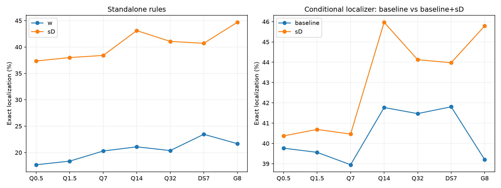

# Новые результаты: направления скрытых состояний, ProcessBench и Lean

Снимок на **2026-11-15T12:28:14.040179+03:00 (МСК)**. Данные и таблицы сформированы на Жоресе из сохранённых метрик; переобучения ради отчёта нет.

**ProcessBench завершён:** 7 читающих моделей, 25 сочетаний слоя и источника направления. **Lean продолжается:** готовы 20 из 76 основных ячеек. Одна ячейка — модель × набор × источник направления; дополнительные слои и полностью замороженные переносы учитываются отдельно.

В этом отчёте объединены новая серия models_projections, контроль позиционных бейзлайнов ProcessBench и две проверки хвостовых методов. Более ранние результаты и их другие популяции перечислены в конце.

## Что именно сравнивается

На последнем токене шага читающая модель даёт состояние $X_t$. Приращение $d_t=X_t-X_{t-1}$. Отбелённая норма — $w_t=\|\widehat\Sigma^{-1/2}(d_t-\widehat\mu)\|_2$. По обучающим задачам строятся направления $n_D$ и $n_H$:

$$s^D_t=\frac{n_D^\top d_t}{\|n_D\|_2},\qquad h_t=\frac{n_H^\top X_t+b}{\|n_H\|_2},\qquad s^H_t=h_t-h_{t-1}.$$

nD обучается по приращениям, nH — по состояниям. Положительные примеры — первые отвергнутые шаги; отрицательные — принятые шаги до отказа и шаги верных решений. Шаги после первого отказа не считаются отрицательными примерами. Случайные направления, модули проекций, сырая норма и перпендикулярная компонента входят в полные таблицы.

Отдельное правило выбирает argmax оценки среди всех шагов. Обученный локализатор — условный логит: вероятность каждого шага нормируется по всему доказательству. Бейзлайн B содержит позицию, относительную позицию, первый/последний шаг, число токенов, сплайн среднего surprisal и его знаковое и абсолютное изменение. Тип тактики постоянен (OTHER), поэтому это не полностью совпадает с более широким историческим бейзлайном геометрической серии.

В таблицах локализатора «+sD» означает B+sD, а «+w» — B+w. Нормаль и локализатор обучаются без оценочных задач во вложенной групповой кросс-валидации 5×3. Нейросетевые веса заморожены. Читающая модель может отличаться от автора текста: результаты не измеряют её собственную способность решать задачи.

Hit — точное попадание в первую ошибку, в процентах; ΔHit — процентные пункты. NLL — отрицательный логарифм вероятности истинного шага; меньше лучше. Веса задач равны. Индивидуальные 95%-интервалы получены 10000 бутстрап-повторами целых групп при фиксированных прогнозах. При менее чем 20 группах интервал не приводится.

В ProcessBench опубликована уже готовая поправка Холма: основное семейство — 540 гипотез; остальные проверки имеют отдельное поисковое семейство. p вычислены заранее выбранным приближением через bootstrap-SE и Student t. Индивидуальный интервал не является одновременно скорректированным интервалом. В Lean полное семейство (2808 гипотез) пока не готово: частичная семья не пересчитывается, окончательных решений по ней нет.

Локализация здесь **ретроспективная**, с доступом ко всему доказательству. AUROC наличия ошибки и префиксная диагностика — отдельные задачи; их нельзя читать как гарантии своевременной тревоги.

## ProcessBench: отдельные правила

| Читающая модель | Слой | Норма w, Hit [CI] | Проекция sD, Hit [CI] | Модуль sD, Hit [CI] | Состояние h, Hit [CI] | Слабые метки, Hit [CI] |
| --- | --- | --- | --- | --- | --- | --- |
| Qwen2.5-0.5B-Instruct | 12 | 17.69 [15.77; 19.63] | 37.35 [34.92; 39.84] | 29.93 [27.61; 32.30] | 34.75 [32.35; 37.20] | 22.76 [20.61; 24.95] |
| Qwen2.5-1.5B-Instruct | 14 | 18.37 [16.41; 20.36] | 38.00 [35.55; 40.51] | 26.35 [24.14; 28.62] | 35.14 [32.77; 37.55] | 23.37 [21.23; 25.59] |
| Qwen2.5-7B-Instruct | 14 | 20.29 [18.23; 22.34] | 38.41 [35.90; 40.92] | 32.04 [29.67; 34.47] | 35.68 [33.24; 38.23] | 26.41 [24.20; 28.67] |
| Qwen2.5-14B-Instruct | 24 | 21.08 [18.99; 23.21] | 43.11 [40.62; 45.61] | 37.75 [35.29; 40.20] | 41.29 [38.83; 43.78] | 30.45 [28.09; 32.81] |
| Qwen2.5-32B-Instruct | 32 | 20.37 [18.33; 22.49] | 41.06 [38.55; 43.62] | 30.96 [28.64; 33.36] | 39.79 [37.32; 42.34] | 27.99 [25.71; 30.29] |
| DeepSeek-Prover-V2-7B | 14 | 23.46 [21.27; 25.61] | 40.71 [38.19; 43.21] | 32.96 [30.63; 35.37] | 38.40 [35.93; 40.85] | 27.03 [24.78; 29.31] |
| Goedel-Prover-V2-8B | 17 | 21.68 [19.58; 23.77] | 44.68 [42.18; 47.22] | 34.02 [31.58; 36.44] | 40.00 [37.58; 42.50] | 30.03 [27.66; 32.36] |

Оценочная популяция: 2361 решений, из них 1555 ошибочных; 1990 групп всего и 1389 групп в локализации. Отдельный PRM даёт 52.15 [49.58; 54.69]% Hit, позиционное правило — 25.47 [23.27; 27.71]%, равномерный уровень — 15.83 [15.46; 16.21]%. Эти общие контролы не меняются при смене читающей модели.

Слабая метка — наличие процессной ошибки во всём решении, а не только правильность финального ответа. Её место не передаётся обучению направления. Лучший основной слой после просмотра результатов не выбирался.

## ProcessBench: обученный локализатор

| Модель | B: Hit / NLL | +w: Hit / NLL | +sD: Hit / NLL | +h: Hit / NLL | +h и sH: Hit / NLL |
| --- | --- | --- | --- | --- | --- |
| Qwen2.5-0.5B-Instruct | 39.76 / 1.5804 | 39.94 / 1.5805 | 40.37 / 1.5378 | 41.56 / 1.5332 | 42.75 / 1.5278 |
| Qwen2.5-1.5B-Instruct | 39.56 / 1.5852 | 39.62 / 1.5857 | 40.69 / 1.5209 | 40.65 / 1.5394 | 40.39 / 1.5364 |
| Qwen2.5-7B-Instruct | 38.95 / 1.5907 | 39.13 / 1.5910 | 40.46 / 1.5382 | 41.42 / 1.5222 | 41.59 / 1.5209 |
| Qwen2.5-14B-Instruct | 41.77 / 1.5420 | 41.80 / 1.5425 | 45.97 / 1.4451 | 45.73 / 1.4417 | 46.35 / 1.4316 |
| Qwen2.5-32B-Instruct | 41.47 / 1.5407 | 41.36 / 1.5412 | 44.13 / 1.4624 | 45.15 / 1.4613 | 44.67 / 1.4558 |
| DeepSeek-Prover-V2-7B | 41.80 / 1.5584 | 41.26 / 1.5575 | 43.98 / 1.5179 | 44.34 / 1.4742 | 45.54 / 1.4995 |
| Goedel-Prover-V2-8B | 39.20 / 1.5899 | 39.22 / 1.5900 | 45.79 / 1.4456 | 45.20 / 1.4419 | 46.33 / 1.4254 |

| Модель | Контраст | ΔHit, п.п. [CI] | Выигрыш NLL [CI] | Holm-p Hit | Holm-p NLL | Размер семьи |
| --- | --- | --- | --- | --- | --- | --- |
| Qwen2.5-0.5B-Instruct | sD-baseline | 0.61 [-1.70; 2.86] | 0.0426 [0.0159; 0.0694] | 1 | 1 | 23869 |
| Qwen2.5-0.5B-Instruct | sD-w | 0.43 [-1.90; 2.72] | 0.0426 [0.0159; 0.0695] | 1 | 0.883 | 540 |
| Qwen2.5-1.5B-Instruct | sD-baseline | 1.13 [-1.07; 3.31] | 0.0643 [0.0409; 0.0878] | 1 | 0.00146 | 23869 |
| Qwen2.5-1.5B-Instruct | sD-w | 1.07 [-1.12; 3.29] | 0.0648 [0.0413; 0.0884] | 1 | 3.09e-05 | 540 |
| Qwen2.5-7B-Instruct | sD-baseline | 1.51 [-0.96; 3.92] | 0.0525 [0.0239; 0.0811] | 1 | 1 | 23869 |
| Qwen2.5-7B-Instruct | sD-w | 1.33 [-1.12; 3.70] | 0.0528 [0.0241; 0.0813] | 1 | 0.153 | 540 |
| Qwen2.5-14B-Instruct | sD-baseline | 4.20 [1.68; 6.72] | 0.0970 [0.0636; 0.1300] | 1 | 0.000252 | 23869 |
| Qwen2.5-14B-Instruct | sD-w | 4.16 [1.64; 6.68] | 0.0974 [0.0641; 0.1304] | 0.557 | 5.14e-06 | 540 |
| Qwen2.5-32B-Instruct | sD-baseline | 2.66 [0.12; 5.24] | 0.0783 [0.0454; 0.1110] | 1 | 0.0667 | 23869 |
| Qwen2.5-32B-Instruct | sD-w | 2.77 [0.23; 5.38] | 0.0789 [0.0460; 0.1116] | 1 | 0.0015 | 540 |
| DeepSeek-Prover-V2-7B | sD-baseline | 2.17 [-0.50; 4.85] | 0.0405 [0.0099; 0.0709] | 1 | 1 | 23869 |
| DeepSeek-Prover-V2-7B | sD-w | 2.71 [0.07; 5.32] | 0.0397 [0.0090; 0.0697] | 1 | 1 | 540 |
| Goedel-Prover-V2-8B | sD-baseline | 6.59 [3.96; 9.28] | 0.1444 [0.1081; 0.1813] | 0.0242 | 8.72e-10 | 23869 |
| Goedel-Prover-V2-8B | sD-w | 6.56 [3.94; 9.23] | 0.1444 [0.1081; 0.1814] | 0.00059 | 2.06e-11 | 540 |

sD−baseline: добавка проекции к B; sD−w: замена добавленной нормы на проекцию при том же B. Положительный выигрыш NLL равен NLL базы сравнения минус NLL нового варианта.

| Модель | Заранее заданное правило направленного сигнала | Правило полезности знака | Правило слабых меток |
| --- | --- | --- | --- |
| Qwen2.5-0.5B-Instruct | False | True | False |
| Qwen2.5-1.5B-Instruct | True | True | False |
| Qwen2.5-7B-Instruct | False | True | False |
| Qwen2.5-14B-Instruct | True | True | True |
| Qwen2.5-32B-Instruct | True | True | False |
| DeepSeek-Prover-V2-7B | False | True | False |
| Goedel-Prover-V2-8B | True | True | True |

False означает, что составное правило не выполнено; это не доказательство отсутствия информации. Проекция может быть полезна при обычном распределении: положительный результат локализации сам по себе не устанавливает тяжёлый хвост, Кестеновский механизм или причинное влияние направления.

## Перенос направления Lean → ProcessBench

| Модель | Источник направления | Argmax sD [CI] | B+sD Hit | B+sD NLL | B+sD минус B+w, п.п. [CI] |
| --- | --- | --- | --- | --- | --- |
| DeepSeek-Prover-V2-7B | pb | 40.71 [38.19; 43.21] | 43.98 | 1.5179 | 2.71 [0.07; 5.32] |
| DeepSeek-Prover-V2-7B | lean | 17.87 [15.91; 19.85] | 41.59 | 1.5588 | 0.32 [-0.43; 1.07] |
| Goedel-Prover-V2-8B | pb | 44.68 [42.18; 47.22] | 45.79 | 1.4456 | 6.56 [3.94; 9.23] |
| Goedel-Prover-V2-8B | lean | 24.35 [22.16; 26.57] | 39.82 | 1.5726 | 0.60 [-1.03; 2.18] |

В строках lean заморожены нормали, обученные на ProofNet; коэффициенты последующего локализатора оцениваются на ProcessBench вне фолда. Это не полностью замороженный перенос предиктора. Направления, обученные на ProcessBench, существенно точнее перенесённых нормалей в отдельных правилах. Слабый классификатор этих строк всё ещё обучен на ProcessBench.

## ProcessBench: наличие ошибки и префиксы

| Модель | AUROC max sD [CI] | AUROC B | AUROC B+sD [CI] | Рекорд на отказе C2, % | Контроль C2, % | Контраст C2, п.п. [CI] |
| --- | --- | --- | --- | --- | --- | --- |
| Qwen2.5-0.5B-Instruct | 0.6816 [0.6580; 0.7050] | 0.7710 | 0.7722 [0.7514; 0.7923] | 46.38 | 35.98 | 10.40 [7.49; 13.33] |
| Qwen2.5-1.5B-Instruct | 0.6704 [0.6462; 0.6941] | 0.7669 | 0.7728 [0.7520; 0.7929] | 43.84 | 35.18 | 8.65 [5.73; 11.62] |
| Qwen2.5-7B-Instruct | 0.6759 [0.6517; 0.6998] | 0.7564 | 0.7634 [0.7426; 0.7838] | 46.64 | 35.79 | 10.84 [7.88; 13.88] |
| Qwen2.5-14B-Instruct | 0.7157 [0.6927; 0.7384] | 0.7742 | 0.7876 [0.7667; 0.8075] | 51.36 | 37.62 | 13.74 [10.74; 16.74] |
| Qwen2.5-32B-Instruct | 0.6848 [0.6609; 0.7082] | 0.7721 | 0.7784 [0.7579; 0.7983] | 49.51 | 37.48 | 12.03 [9.05; 14.99] |
| DeepSeek-Prover-V2-7B | 0.6999 [0.6762; 0.7233] | 0.7951 | 0.7956 [0.7754; 0.8149] | 49.14 | 36.17 | 12.97 [9.99; 16.03] |
| Goedel-Prover-V2-8B | 0.7116 [0.6882; 0.7345] | 0.7939 | 0.7965 [0.7767; 0.8156] | 52.66 | 38.10 | 14.56 [11.49; 17.59] |

C2 использует известное место отказа, исключает первый шаг и сравнивает его с той же позицией в подходящих доказательствах, падающих позже. Это диагностический анализ, а не потоковый прогноз. AUROC выше относится к наличию ошибки во всём решении.

## Lean: завершённые основные ячейки

| Модель | Набор | Источник направления | Всего | С отказом | Групп для Hit | Argmax w [CI] | Argmax sD [CI] | B Hit | B+sD Hit |
| --- | --- | --- | --- | --- | --- | --- | --- | --- | --- |
| Kimina-Prover-Preview-Distill-1.5B | ProofNet | native | 900 | 710 | 181 | 22.73 [18.62; 26.98] | 48.68 [43.27; 54.16] | 42.93 | 51.50 |
| Kimina-Prover-Preview-Distill-1.5B | Putnam | ProofNet | 166 | 166 | 63 | 14.92 [9.18; 21.41] | 33.16 [24.39; 42.20] | 34.50 | 37.77 |
| Kimina-Prover-Preview-Distill-1.5B | miniF2F | ProofNet | 2558 | 975 | 141 | 16.83 [12.70; 21.28] | 33.88 [28.42; 39.54] | 39.51 | 44.74 |
| Kimina-Prover-Preview-Distill-1.5B | miniF2F | native | 2558 | 975 | 141 | 16.83 [12.70; 21.28] | 41.10 [35.46; 46.83] | 39.51 | 44.47 |
| Qwen2.5-0.5B-Instruct | ProofNet | native | 900 | 710 | 181 | 22.72 [18.59; 27.00] | 44.13 [38.85; 49.50] | 43.00 | 47.45 |
| Qwen2.5-0.5B-Instruct | Putnam | ProofNet | 166 | 166 | 63 | 14.78 [8.15; 22.37] | 29.44 [21.02; 38.30] | 32.32 | 33.09 |
| Qwen2.5-0.5B-Instruct | miniF2F | ProofNet | 2558 | 975 | 141 | 17.36 [13.30; 21.73] | 31.02 [25.65; 36.58] | 43.92 | 43.77 |
| Qwen2.5-0.5B-Instruct | miniF2F | native | 2558 | 975 | 141 | 17.36 [13.30; 21.73] | 39.58 [33.68; 45.50] | 43.92 | 45.58 |
| Qwen2.5-1.5B-Instruct | ProofNet | native | 900 | 710 | 181 | 21.47 [17.38; 25.66] | 44.44 [39.04; 49.89] | 41.72 | 47.81 |
| Qwen2.5-1.5B-Instruct | Putnam | ProofNet | 166 | 166 | 63 | 11.99 [6.63; 18.03] | 23.79 [16.01; 32.18] | 35.23 | 34.78 |
| Qwen2.5-1.5B-Instruct | miniF2F | ProofNet | 2558 | 975 | 141 | 17.35 [13.13; 21.91] | 31.81 [26.07; 37.65] | 44.02 | 44.74 |
| Qwen2.5-1.5B-Instruct | miniF2F | native | 2558 | 975 | 141 | 17.35 [13.13; 21.91] | 42.23 [36.54; 47.98] | 44.02 | 45.99 |

Все показанные 2A-доказательства сгенерированы исходными DeepSeek/Goedel. native — направление обучено на том же наборе с OOF-защитой. ProofNet — замороженное направление с ProofNet, но коэффициенты локализатора оцениваются на целевом наборе вне фолда. Полностью замороженные предикторы вынесены отдельно ниже.

| Модель | Набор | Источник | Контраст | ΔHit [индивидуальный CI] | Выигрыш NLL [индивидуальный CI] |
| --- | --- | --- | --- | --- | --- |
| Kimina-Prover-Preview-Distill-1.5B | ProofNet | native | sD-baseline | 8.57 [4.78; 12.51] | 0.2135 [0.1448; 0.2837] |
| Kimina-Prover-Preview-Distill-1.5B | ProofNet | native | sD-w | 7.54 [3.88; 11.36] | 0.2126 [0.1450; 0.2815] |
| Kimina-Prover-Preview-Distill-1.5B | Putnam | ProofNet | sD-baseline | 3.27 [-2.27; 8.40] | 0.1620 [0.0661; 0.2524] |
| Kimina-Prover-Preview-Distill-1.5B | Putnam | ProofNet | sD-w | 3.67 [-1.85; 8.75] | 0.1729 [0.0803; 0.2626] |
| Kimina-Prover-Preview-Distill-1.5B | miniF2F | ProofNet | sD-baseline | 5.23 [2.69; 7.80] | 0.1587 [0.1081; 0.2089] |
| Kimina-Prover-Preview-Distill-1.5B | miniF2F | ProofNet | sD-w | 4.37 [1.94; 6.95] | 0.1587 [0.1085; 0.2087] |
| Kimina-Prover-Preview-Distill-1.5B | miniF2F | native | sD-baseline | 4.96 [0.46; 9.22] | 0.1961 [0.1022; 0.2888] |
| Kimina-Prover-Preview-Distill-1.5B | miniF2F | native | sD-w | 4.11 [-0.40; 8.52] | 0.1961 [0.1034; 0.2863] |
| Qwen2.5-0.5B-Instruct | ProofNet | native | sD-baseline | 4.45 [0.36; 8.54] | 0.1276 [0.0549; 0.2000] |
| Qwen2.5-0.5B-Instruct | ProofNet | native | sD-w | 4.63 [0.53; 8.77] | 0.1289 [0.0574; 0.2008] |
| Qwen2.5-0.5B-Instruct | Putnam | ProofNet | sD-baseline | 0.77 [-5.32; 6.85] | 0.0885 [0.0156; 0.1663] |
| Qwen2.5-0.5B-Instruct | Putnam | ProofNet | sD-w | 0.99 [-5.10; 7.08] | 0.1348 [0.0618; 0.2124] |
| Qwen2.5-0.5B-Instruct | miniF2F | ProofNet | sD-baseline | -0.15 [-1.63; 1.42] | 0.0256 [0.0029; 0.0484] |
| Qwen2.5-0.5B-Instruct | miniF2F | ProofNet | sD-w | 0.04 [-1.66; 1.77] | 0.0336 [0.0118; 0.0556] |
| Qwen2.5-0.5B-Instruct | miniF2F | native | sD-baseline | 1.66 [-1.73; 5.38] | 0.0322 [-0.0292; 0.0949] |
| Qwen2.5-0.5B-Instruct | miniF2F | native | sD-w | 1.85 [-1.39; 5.30] | 0.0402 [-0.0209; 0.1029] |
| Qwen2.5-1.5B-Instruct | ProofNet | native | sD-baseline | 6.09 [2.56; 9.82] | 0.1438 [0.0853; 0.2027] |
| Qwen2.5-1.5B-Instruct | ProofNet | native | sD-w | 4.16 [0.52; 7.98] | 0.1430 [0.0863; 0.2014] |
| Qwen2.5-1.5B-Instruct | Putnam | ProofNet | sD-baseline | -0.45 [-5.93; 5.00] | 0.0924 [0.0300; 0.1536] |
| Qwen2.5-1.5B-Instruct | Putnam | ProofNet | sD-w | 0.34 [-4.84; 5.56] | 0.1019 [0.0413; 0.1616] |
| Qwen2.5-1.5B-Instruct | miniF2F | ProofNet | sD-baseline | 0.71 [-1.89; 3.28] | 0.0578 [0.0310; 0.0852] |
| Qwen2.5-1.5B-Instruct | miniF2F | ProofNet | sD-w | 0.65 [-2.13; 3.33] | 0.0656 [0.0384; 0.0929] |
| Qwen2.5-1.5B-Instruct | miniF2F | native | sD-baseline | 1.97 [-2.18; 6.16] | 0.0331 [-0.0422; 0.1056] |
| Qwen2.5-1.5B-Instruct | miniF2F | native | sD-w | 1.91 [-2.09; 5.83] | 0.0409 [-0.0327; 0.1120] |

Эти индивидуальные интервалы уже рассчитаны; общая поправка Холма второй части ещё ожидает оставшиеся ячейки. На Putnam в этой серии сохранены только ошибочные попытки, поэтому AUROC наличия ошибки там не определён.

### Раздельно по автору доказательства

| Читающая модель | Набор | Автор | Групп Hit | w Hit | sD Hit | B Hit | B+sD Hit |
| --- | --- | --- | --- | --- | --- | --- | --- |
| Kimina-Prover-Preview-Distill-1.5B | ProofNet | author_deepseek | 166 | 23.05 | 43.76 | 40.32 | 46.60 |
| Kimina-Prover-Preview-Distill-1.5B | ProofNet | author_goedel | 133 | 20.51 | 53.03 | 46.45 | 59.54 |
| Kimina-Prover-Preview-Distill-1.5B | miniF2F | author_deepseek | 121 | 18.11 | 47.13 | 46.34 | 52.01 |
| Kimina-Prover-Preview-Distill-1.5B | miniF2F | author_goedel | 122 | 16.49 | 40.30 | 33.93 | 40.55 |
| Qwen2.5-0.5B-Instruct | ProofNet | author_deepseek | 166 | 23.15 | 41.41 | 39.02 | 44.88 |
| Qwen2.5-0.5B-Instruct | ProofNet | author_goedel | 133 | 23.68 | 49.89 | 48.40 | 54.34 |
| Qwen2.5-0.5B-Instruct | miniF2F | author_deepseek | 121 | 19.33 | 42.21 | 52.07 | 50.40 |
| Qwen2.5-0.5B-Instruct | miniF2F | author_goedel | 122 | 16.59 | 38.44 | 39.01 | 44.45 |
| Qwen2.5-1.5B-Instruct | ProofNet | author_deepseek | 166 | 21.49 | 40.19 | 38.67 | 43.82 |
| Qwen2.5-1.5B-Instruct | ProofNet | author_goedel | 133 | 23.18 | 47.67 | 46.39 | 54.16 |
| Qwen2.5-1.5B-Instruct | miniF2F | author_deepseek | 121 | 19.59 | 47.73 | 50.95 | 53.24 |
| Qwen2.5-1.5B-Instruct | miniF2F | author_goedel | 122 | 16.26 | 39.35 | 39.55 | 41.06 |

### Междоменный и полностью замороженный перенос

| Модель | Цель | Источник | Коэффициенты | Argmax sD [CI] | B Hit | B+sD Hit | ΔHit [CI] |
| --- | --- | --- | --- | --- | --- | --- | --- |
| Qwen2.5-0.5B-Instruct | PB | ProofNet | target_OOF | 20.59 [18.55; 22.69] | 39.76 | 39.79 | 0.02 [-1.13; 1.16] |
| Qwen2.5-0.5B-Instruct | ProofNet | PB | target_OOF | 30.52 [25.68; 35.58] | 43.00 | 42.88 | -0.12 [-2.75; 2.40] |
| Qwen2.5-0.5B-Instruct | Putnam | PB | target_OOF | 17.46 [10.19; 25.29] | 32.32 | 32.10 | -0.23 [-3.00; 2.38] |
| Qwen2.5-0.5B-Instruct | miniF2F | PB | target_OOF | 15.37 [11.20; 19.90] | 43.92 | 43.82 | -0.10 [-1.15; 0.97] |
| Qwen2.5-1.5B-Instruct | PB | ProofNet | target_OOF | 18.39 [16.43; 20.40] | 39.56 | 39.90 | 0.34 [-0.30; 1.01] |
| Qwen2.5-1.5B-Instruct | ProofNet | PB | target_OOF | 15.53 [12.00; 19.24] | 41.72 | 42.52 | 0.80 [-0.51; 2.18] |
| Qwen2.5-1.5B-Instruct | Putnam | PB | target_OOF | 15.72 [9.36; 23.12] | 35.23 | 35.10 | -0.13 [-1.59; 1.19] |
| Qwen2.5-1.5B-Instruct | miniF2F | PB | target_OOF | 15.06 [11.35; 19.01] | 44.02 | 45.14 | 1.11 [-0.25; 2.64] |
| Kimina-Prover-Preview-Distill-1.5B | Putnam | ProofNet | entire_PN_predictor | 33.16 [24.39; 42.20] | 31.30 | 39.38 | 8.08 [0.37; 15.93] |
| Kimina-Prover-Preview-Distill-1.5B | miniF2F | ProofNet | entire_PN_predictor | 33.88 [28.42; 39.54] | 36.81 | 39.83 | 3.02 [-1.23; 7.31] |
| Qwen2.5-0.5B-Instruct | Putnam | ProofNet | entire_PN_predictor | 29.44 [21.02; 38.30] | 35.10 | 38.44 | 3.34 [-4.66; 11.22] |
| Qwen2.5-0.5B-Instruct | miniF2F | ProofNet | entire_PN_predictor | 31.02 [25.65; 36.58] | 42.12 | 36.93 | -5.19 [-9.56; -1.03] |
| Qwen2.5-1.5B-Instruct | Putnam | ProofNet | entire_PN_predictor | 23.79 [16.01; 32.18] | 34.61 | 31.13 | -3.48 [-11.42; 4.46] |
| Qwen2.5-1.5B-Instruct | miniF2F | ProofNet | entire_PN_predictor | 31.81 [26.07; 37.65] | 42.61 | 36.57 | -6.04 [-10.98; -1.28] |

target_OOF использует целевые обучающие фолды для коэффициентов. В frozen-постановке направление, стандартизация, регуляризация, коэффициенты и позиционный предиктор заморожены по ProofNet. Эти режимы отвечают на разные вопросы.

## Контроль ProcessBench: равномерное и позиционное правила

| Серия | Срез | Попыток | Групп | Jump | Surprisal | PRM | Uniform | Первый | Последний | Позиционный OOF |
| --- | --- | --- | --- | --- | --- | --- | --- | --- | --- | --- |
| E15 | pooled | 1555 | 1389 | 20.29 | 19.94 | 52.15 | 15.83 | 13.25 | 4.16 | 25.53 |
| E15 | gsm8k | 148 | 147 | 27.89 | 27.21 | 71.09 | 20.92 | 18.03 | 7.82 | 27.21 |
| E15 | math | 422 | 414 | 18.96 | 20.65 | 56.76 | 17.99 | 20.05 | 5.07 | 25.00 |
| E15 | olympiadbench | 440 | 301 | 18.22 | 19.60 | 51.11 | 13.95 | 8.31 | 4.26 | 17.30 |
| E15 | omnimath | 545 | 527 | 20.40 | 17.55 | 43.83 | 13.79 | 9.39 | 2.37 | 25.90 |
| E15 | Qwen_family | 1035 | 958 | 20.44 | 21.45 | 50.23 | 14.95 | 10.65 | 3.69 | 20.84 |
| E15 | other_generator | 520 | 509 | 20.33 | 17.85 | 54.39 | 17.21 | 17.98 | 4.81 | 30.06 |
| E16 | pooled | 1555 | 1389 | 18.37 | 20.71 | 52.15 | 15.83 | 13.25 | 4.16 | 25.53 |
| E16 | gsm8k | 148 | 147 | 19.73 | 23.47 | 71.09 | 20.92 | 18.03 | 7.82 | 27.21 |
| E16 | math | 422 | 414 | 16.43 | 21.26 | 56.76 | 17.99 | 20.05 | 5.07 | 25.00 |
| E16 | olympiadbench | 440 | 301 | 19.32 | 21.82 | 51.11 | 13.95 | 8.31 | 4.26 | 17.30 |
| E16 | omnimath | 545 | 527 | 18.98 | 18.88 | 43.83 | 13.79 | 9.39 | 2.37 | 25.90 |
| E16 | Qwen_family | 1035 | 958 | 18.34 | 23.05 | 50.23 | 14.95 | 10.65 | 3.69 | 20.84 |
| E16 | other_generator | 520 | 509 | 18.86 | 16.76 | 54.39 | 17.21 | 17.98 | 4.81 | 30.06 |

E15 — Qwen2.5-7B-Instruct; E16 — Qwen2.5-1.5B-Instruct. Все точности — проценты с равными весами групп. Позиционный предиктор выбирает моду первой ошибки по корзинам длины; обучение раздельно внутри каждого среза на других задачах.

| Серия | Контраст pooled | ΔHit, п.п. [CI] |
| --- | --- | --- |
| E15 | jump_minus_uniform | 4.46 [2.43; 6.52] |
| E15 | jump_minus_position_oof | -5.24 [-8.05; -2.40] |
| E15 | jump_minus_surprisal | 0.35 [-2.37; 3.05] |
| E16 | jump_minus_uniform | 2.54 [0.60; 4.52] |
| E16 | jump_minus_position_oof | -7.16 [-9.97; -4.36] |
| E16 | jump_minus_surprisal | -2.34 [-4.94; 0.29] |

Архивный контроль: **passed**. Повторно воспроизведены оценки и интервалы архивных правил. В обеих читающих моделях скачок выше равномерного уровня, но ниже позиционного предиктора. Относительно surprisal индивидуальные интервалы pooled включают ноль. Значит, превышение равномерного уровня нельзя само по себе считать добавочной ценностью относительно позиционного контроля.

## Хвостовые проверки: где расчёт остановлен и почему

| Серия | Синтетических наборов | Обязательная проверка | Новые реальные исходы |
| --- | --- | --- | --- |
| Локальные хвосты | 5000 | FAILED_STOP | NOT_EVALUATED |
| Хвосты проекций | 3600 | A: passed; B: failed | False |

Локальные хвосты: калибровка не пройдена в 10 из 25 основных сочетаний; проблемные генераторы — lognormal(0.5), weibull(2.0). Не удалось надёжно трактовать локальный параметр как универсальный асимптотический индекс на коротких наблюдаемых окнах.

| Синтетическая популяция | Истинный механизм | Сравнение | Ложных отклонений / повторов | Частота, % | 99% Monte Carlo CI |
| --- | --- | --- | --- | --- | --- |
| deepseek_ProofNet | scalar_3 | n_minus_perp | 72 / 100 | 72.00 | [59.35; 81.91] |
| deepseek_ProofNet | scalar_3 | n_minus_norm | 73 / 100 | 73.00 | [60.40; 82.74] |
| deepseek_ProofNet | scalar_5 | n_minus_perp | 54 / 100 | 54.00 | [41.32; 66.19] |
| deepseek_ProofNet | scalar_5 | n_minus_norm | 54 / 100 | 54.00 | [41.32; 66.19] |
| deepseek_Putnam | scalar_3 | n_minus_perp | 41 / 100 | 41.00 | [29.28; 53.84] |
| deepseek_Putnam | scalar_3 | n_minus_norm | 39 / 100 | 39.00 | [27.50; 51.87] |
| deepseek_Putnam | scalar_5 | n_minus_perp | 32 / 100 | 32.00 | [21.43; 44.81] |
| deepseek_Putnam | scalar_5 | n_minus_norm | 31 / 100 | 31.00 | [20.59; 43.78] |
| goedel_ProofNet | scalar_3 | n_minus_perp | 50 / 100 | 50.00 | [37.53; 62.47] |
| goedel_ProofNet | scalar_3 | n_minus_norm | 50 / 100 | 50.00 | [37.53; 62.47] |
| goedel_ProofNet | scalar_5 | n_minus_perp | 34 / 100 | 34.00 | [23.14; 46.85] |
| goedel_ProofNet | scalar_5 | n_minus_norm | 35 / 100 | 35.00 | [24.00; 47.87] |

Для хвостов проекций демонстрация маскировки нормой прошла, но на истинном скалярном Кестене локальные сравнения завышают частоту отклонений; проверка мощности против диагональной альтернативы также не прошла. Числа выше относятся к отдельным сравнениям, а не к ошибке первого рода полного объединённого правила. По заранее установленному правилу новые реальные хвостовые исходы не вычислялись. Это результат проверки применимости метода, а не отрицательный результат о распределении реальных состояний.

## Что ещё считается

| Модель | Готово статистических блоков / запланировано в созданном плане | Основных ячеек готово / всего |
| --- | --- | --- |
| DeepSeek-Prover-V2-7B | 0 / 34 | 0 / 8 |
| DeepSeek-Prover-V1.5-RL | 0 / план ещё не создан | 0 / 5 |
| Goedel-Prover-V2-8B | 0 / план ещё не создан | 0 / 8 |
| Goedel-Prover-V2-32B | 0 / план ещё не создан | 0 / 5 |
| Goedel-Prover-SFT | 0 / план ещё не создан | 0 / 5 |
| Kimina-Prover-Preview-Distill-1.5B | 14 / 14 | 4 / 5 |
| Qwen2.5-0.5B-Instruct | 26 / 26 | 8 / 8 |
| Qwen2.5-14B-Instruct | 0 / 26 | 0 / 8 |
| Qwen2.5-1.5B-Instruct | 26 / 26 | 8 / 8 |
| Qwen2.5-32B-Instruct | 0 / план ещё не создан | 0 / 8 |
| Qwen2.5-7B-Instruct | 0 / 26 | 0 / 8 |

| Новый автор | Назначено генераций | Сохранено генераций | Проверено Lean |
| --- | --- | --- | --- |
| Kimina-Prover-Preview-Distill-1.5B | 3336 | 710 | 630 |
| DeepSeek-Prover-V1.5-RL | 3336 | 0 | 0 |
| Goedel-Prover-SFT | 3336 | 0 | 0 |
| Goedel-Prover-V2-32B | 3336 | 0 | 0 |

Статус диспетчера на момент снимка: [] (список сигналов о проблемах). Физическая очередь и ожидающие стадии: [status.json](status.json). Диспетчер продолжает зарегистрированную серию; собственные генерации 2B и чтение чужих доказательств 2A не смешиваются. Подготовка отчёта не меняет и не останавливает задания.

## Ограничения воспроизводимости и сопоставления

- Основные ProcessBench-состояния Qwen1.5B/7B взяты из сохранённых E16/NNG_B2: новый BF16 forward численно не воспроизвёл архив даже при тех же токенах и ревизии. Причина не установлена; допуск не ослаблялся. Новые дополнительные слои используют собственные новые скоры.
- Основные слои DeepSeek/Goedel сохраняют архивные индексы 14/17; буквальные средние слои 15/18 считаются дополнительно. Индексы zero-based.
- Группы Lean канонизированы по задачам и одинаковым формальным утверждениям. Калибровка 2A использует отдельные проверенные miniF2F; это отличается от старых популяций. Нельзя парно вычитать новые цифры из исторической таблицы геометрии.
- Разложение на направленную и перпендикулярную части относится к сырому d; отбелённая норма w имеет другое преобразование. Незначимость длины перпендикулярной части не означает отсутствия информации в полном векторе.
- При argmax и условном логите смещение b сокращается. Успех h не доказывает существование универсального порога расстояния до плоскости.
- Новые генераторы DeepSeek-V1.5/Goedel-SFT используют явно расширенное окно 12 288 при исходном 4096. Это отмеченная в протоколе экстраполяция, не штатная поддержка длины.

## PDF статьи и TeX-проект

Найден полный по структуре проект extreme_value_reasoning_failure_revised_v4_latex: main.tex, sections.tex, app_proofs.tex, app_rest.tex, refs.tex, рисунок и стили ICLR. Все явно подключаемые файлы на месте. Также найден iclr-latex-source-v8.zip с main.tex, appendix.tex, refs.bib и рисунком.

| PDF | Страниц | Дата создания из PDF metadata | Извлечение текста: код выхода |
| --- | --- | --- | --- |
| 49433_An_Extreme_Value_Perspec (2).pdf | 20 | Sat Sep 26 10:55:01 2026 | 0 |
| extreme_value_reasoning_failure_revised_v4.pdf | 24 | Fri Sep 25 21:52:37 2026 | 0 |

Последний скачанный 49433_An_Extreme_Value_Perspec (2).pdf отличается от v4: уже абстракты содержат разные формулировки и наборы результатов. Архив v8 тоже отличается текстом абстракта и введения. Точный TeX-исходник именно скачанного PDF пока не установлен. Сборка TeX не проверена: на выделенном CPU-узле отсутствует pdflatex; наличие зависимостей проекта проверено отдельно. Полные тексты рукописи не включены в эту публикацию отчёта.

## Проверки и файлы

| Команда | Код выхода | Лог |
| --- | --- | --- |
| make test | 2 | [Лог](validation/test.log) |
| make test-all | 2 | [Лог](validation/test-all.log) |

Проверки выполнялись через Slurm в отдельной копии опубликованного исходного кода. Обе команды остановились на ошибках mypy в уже опубликованном исходном коде, до запуска pytest. Ruff и проверка форматирования прошли. [Точные ошибки и границы проверки](VALIDATION_RU.md). При наличии пропусков внешних Lean/ML-тестов их причины сохранены в логах. Метрики этого отчёта сверены с хешами исходных manifests; научные исходы не пересчитаны.

- [Метрики, которые использованы в основных таблицах](metrics.json).
- [Все ProcessBench-метрики, CSV.gz](part1_metrics.csv.gz); [все контрасты, CSV.gz](part1_contrasts.csv.gz).
- [Все готовые Lean-метрики, CSV.gz](part2_metrics.csv.gz); [контрасты, CSV.gz](part2_contrasts.csv.gz). Здесь также дополнительные слои, срезы авторов и полностью замороженный перенос.
- [ProcessBench: контролы](processbench_controls.csv), [их контрасты](processbench_contrasts.csv).
- [Хвостовая калибровка](tail_calibration.json), [исходные протоколы](protocols), [манифест](manifest.json), [генератор отчёта](generate_report.py).

## Где лежат предыдущие отчёты

- [Общий отчёт до новой серии](../complete_20261115/).
- [Surprisal и его изменение: ответ wDaH](../rebuttal_wDaH_surprisal_change_20261115_v1/).
- [Проверка модели шума считывания](../rebuttal_noise_20261115_v1/).
- [Устройство локализатора](../localizer_explained_20261113/), [сводка локализации и потоковых постановок](../localizer_daily_20261113/).
- [Позиции максимумов, ошибок и поправка на длину](../peak_error_distributions_20261111/).

Серверные первоисточники нового отчёта: runs/models_projections_20261115_v1; runs/rebuttal_22Kj_processbench_uniform_20261115_v1; runs/rebuttal_local_tails_20261115_v1; runs/rebuttal_projection_tails_20261115_v1. Манифест перечисляет точные файлы и SHA-256.
