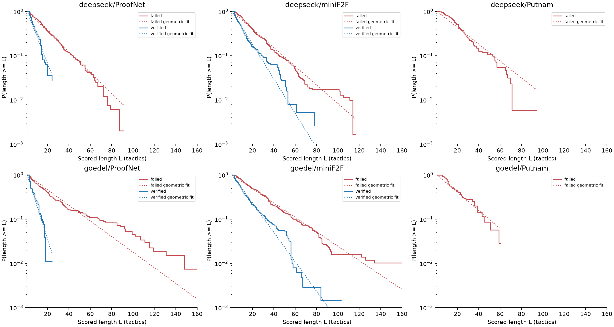
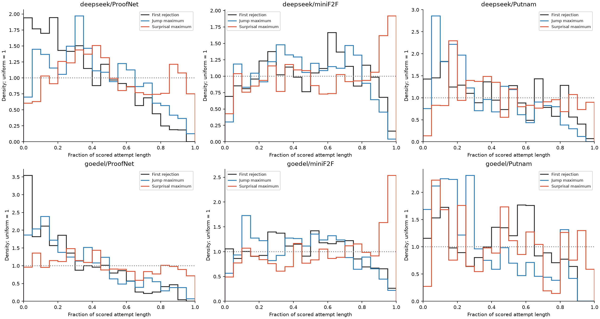
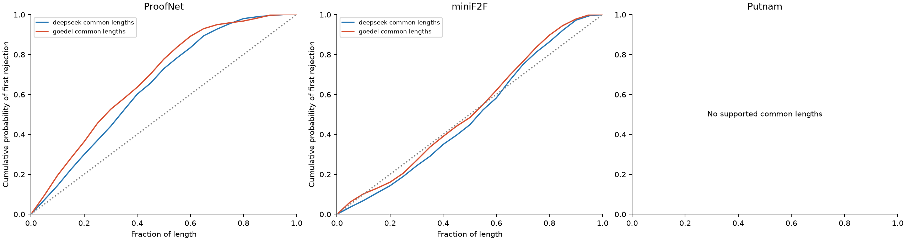
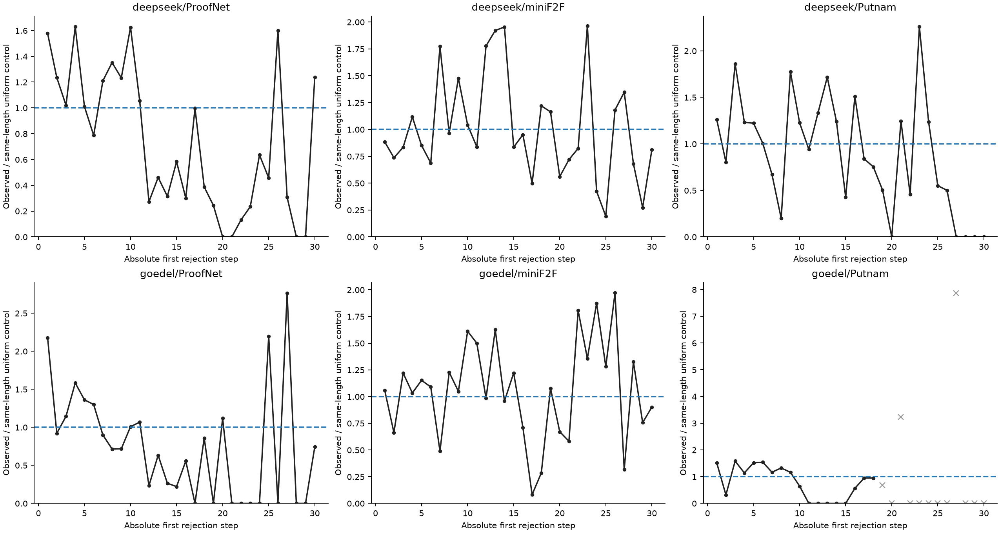
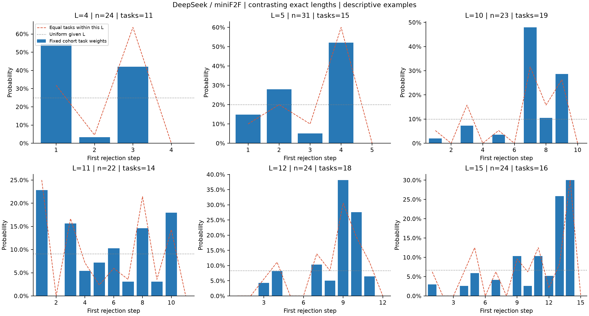
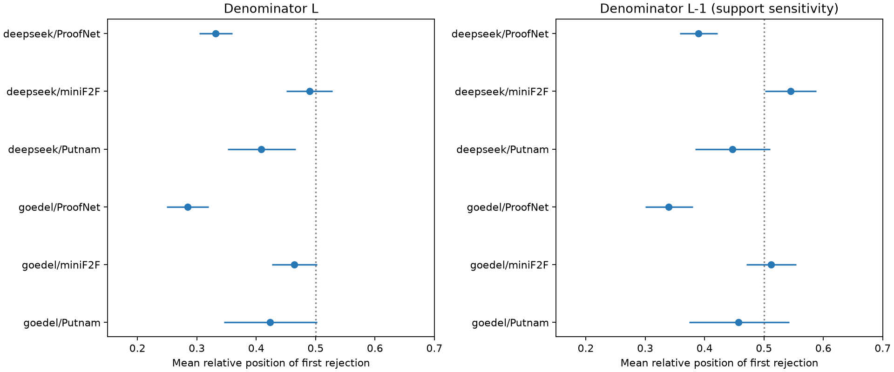

# Длина доказательства и дополнительная информация больших скачков

Дополнение от 12 ноября 2026 к [отчёту о распределениях максимумов и ошибок](REPORT_RU.md). DeepSeek-Prover-V2-7B и Goedel-Prover-V2-8B; ProofNet, miniF2F и Putnam.

Поправка на длину меняет форму общих распределений. Внутри одной точной длины ошибки могут концентрироваться в начале, середине или ближе к концу попытки. Сходство общих гистограмм само по себе не устанавливает информативность скачка. Проверять нужно связь внутри конкретной попытки и прибавку к предсказателю, который уже учитывает позицию, длину и другие доступные признаки.

Ниже приведены результаты анализа длины и существующих позиционных контролей. Разделы о расширенном сравнении предсказателей и фазовой модели задают следующую проверку; эти модели не выдаются за уже обученные и проверенные объяснения.

## Данные и единицы измерения

$T$ — номер первого воспроизводимо отклонённого шага Lean; $M_W$ — позиция максимума whitened-нормы приращения скрытого состояния; $M_Q$ — позиция максимального среднего токенного surprisal. Позиции начинаются с 1.

$L$ — число сохранённых шагов разметки формального текста. Это границы выбранных AST-наблюдений: один шаг может содержать составную тактику, а число шагов не равно числу токенов. Полная попытка может включать сгенерированный суффикс после первого отказа; этот суффикс не считается успешно исполненным в Lean.

Распределения места ошибки ниже относятся только к попыткам с надёжно локализованным отказом. Для оценки наличия ошибки нужны также проверенные правильные попытки. На Putnam в этой feature-cohort правильных попыток нет.

| Модель / набор | Ошибочные попытки | Разные задачи | Точные длины |
|---|---|---|---|
| deepseek/ProofNet | 452 | 166 | 62 |
| deepseek/miniF2F | 528 | 122 | 74 |
| deepseek/Putnam | 118 | 58 | 47 |
| goedel/ProofNet | 259 | 133 | 65 |
| goedel/miniF2F | 448 | 122 | 87 |
| goedel/Putnam | 48 | 35 | 27 |

Всего 362 сочетания модели, датасета и точной длины; новые генерации и GPU не использовались.

Основные веса задаются до отбора по длине: каждой исходной задаче даётся суммарный вес 1 среди её ошибочных попыток. При фиксации $L$ эти веса сохраняются. Отдельно показана чувствительность к равным весам задач непосредственно внутри каждой длины. Интервалы объединённых оценок — 10 000 bootstrap-выборок целых задач; отдельные гистограммы точных длин описательные.

## Как длины создают раннюю общую гистограмму

Если позиция равномерна при каждой длине, то

$$
P(M=t\mid L=\ell)=\frac{1}{\ell},
\qquad
P(M=t)=\sum_{\ell\ge t}\frac{P(L=\ell)}{\ell}.
$$

Отсюда

$$
P(M=t)-P(M=t+1)=\frac{P(L=t)}{t}\ge0.
$$

Убывающая общая гистограмма возникает даже без предпочтения ранних позиций внутри одной длины. Экспоненциальный закон длин для этого не нужен. Для первой ошибки работает та же формула смеси, но её условное распределение $P(T=t\mid L)$ не обязано быть равномерным.

| Модель / набор | Средняя длина | Медиана | 90% квантиль |
|---|---|---|---|
| deepseek/ProofNet | 18,98 | 14 | 42 |
| deepseek/miniF2F | 21,15 | 15 | 44 |
| deepseek/Putnam | 23,36 | 20 | 52 |
| goedel/ProofNet | 25,13 | 14 | 68 |
| goedel/miniF2F | 27,19 | 18 | 57 |
| goedel/Putnam | 21,60 | 15 | 44 |

Геометрическая аппроксимация использует поддержку $L=1,2,\ldots$ и параметр $p=1/\overline L$. Это описательное сравнение: в исследуемых ошибочных попытках минимальная длина не меньше двух шагов, а на части наборов заметны дополнительные отклонения формы и хвоста. Подгонка не устанавливает единый экспоненциальный закон. Последующие контроли сохраняют фактические длины и не требуют такой гипотезы.

## Три способа учесть длину

### Относительное положение шага

Для среднего относительного положения удобно использовать середину интервала шага:

$$
U=\frac{T-\tfrac12}{L}.
$$

При равномерном выборе шага среднее $U$ равно $1/2$ при любой длине. Простое $T/L$ имеет нейтральное среднее $(L+1)/(2L)$, поэтому особенно на коротких попытках оно само создаёт сдвиг.

Для сопоставления дискретных сеток вероятность шага $t$ равномерно распределена по отрезку $[(t-1)/L,t/L]$. Масса пересечения с каждым интервалом гистограммы вычисляется точно; случайные числа не добавляются. Равномерное распределение шагов при любой смеси длин тогда даёт плотность 1 на отрезке от 0 до 1.

Приведение к долям длины уравнивает шкалу координат, но сохраняет исходную смесь длин. Если форма условного распределения зависит от $L$, требуется также стандартизация весов.

### Одинаковая смесь длин

Для сравнения двух моделей выбирается общее распределение длин $q_\ell$:

$$
p_{\mathrm{std}}(t)=
\sum_\ell q_\ell\,\widehat P(T=t\mid L=\ell).
$$

Эквивалентно, исходный вес попытки длины $L_i$ умножается на $q_{L_i}/\widehat P(L=L_i)$. Меняется доля каждой длины, а условное распределение внутри неё сохраняется.

Для каждого датасета взяты общие точные длины с минимум пятью задачами у каждой модели. Вес длины пропорционален меньшей из двух исходных масс этой длины. Такой выбор ограничивает влияние редких длин. Это описательное сопоставление на области перекрытия, а не оценка по всей исходной выборке.

| Набор | Модель | Общих точных длин | Охват исходного веса, % | Средняя относительная позиция ошибки, % |
|---|---|---|---|---|
| ProofNet | deepseek | 16 | 59,66 | 35,38 |
| ProofNet | goedel | 16 | 58,72 | 31,86 |
| miniF2F | deepseek | 23 | 70,05 | 50,71 |
| miniF2F | goedel | 23 | 60,02 | 48,15 |
| Putnam | обе модели | нет общей поддержки | — | — |

### Отношение к контролю с теми же длинами

Для исходной общей гистограммы можно показать индекс

$$
R_T(t)=
\frac{\widehat P(T=t)}
{\sum_{\ell\ge t}\widehat P(L=\ell)/\ell}.
$$

$R_T(t)=1$ соответствует равномерному выбору позиции внутри каждой наблюдаемой длины; значения выше и ниже 1 показывают избыток и дефицит. Это индекс относительно выбранного ориентира, а не вероятностное распределение и не оценка риска следующей ошибки. Он не устраняет различия типов задач или этапов доказательства.

Серые крестики обозначают позиции, до которых по длине доходят менее двадцати разных задач. Даже при большем числе задач редкие события дают нестабильные точечные отношения. Равномерный ориентир требует проверки на границах: в данной выборке нет первой ошибки на последнем шаге.

## Что сохраняется после контроля длины

Для максимума скачка проверена доля попаданий в первые два шага. Контроль сохраняет фактические длины и равномерно выбирает позицию; его ожидание равно среднему $\min(2,L)/L$.

| Модель / набор | Максимум в первых двух шагах, % | Контроль длины, % | Разница, п.п. [95%] |
|---|---|---|---|
| deepseek/ProofNet | 34,58 | 25,11 | 9,47 [5,04; 13,96] |
| deepseek/miniF2F | 18,99 | 19,04 | -0,06 [-4,45; 4,72] |
| deepseek/Putnam | 29,60 | 15,01 | 14,58 [5,21; 24,72] |
| goedel/ProofNet | 42,61 | 26,30 | 16,30 [10,37; 22,30] |
| goedel/miniF2F | 15,27 | 16,88 | -1,61 [-5,13; 2,11] |
| goedel/Putnam | 37,14 | 15,04 | 22,10 [7,95; 36,86] |

На miniF2F избытка именно первых двух позиций относительно этого контроля не видно. На ProofNet и Putnam он сохраняется. Это не утверждение о равномерности всего распределения максимумов и не проверка совпадения максимума с ошибкой конкретной попытки.

## Распределения первой ошибки при каждой точной длине

Все наблюдаемые точные длины представлены в приложениях. Для DeepSeek на miniF2F несколько контрастных примеров выглядят так:

| Точная длина | Попыток / задач | Мода ошибки | Масса на моде, % | Во второй половине, % | Мода при равных весах задач внутри длины |
|---|---|---|---|---|---|
| 4 | 24 / 11 | 1 | 54,57 | 42,05 | 3 |
| 5 | 31 / 15 | 4 | 52,06 | 57,18 | 4 |
| 10 | 23 / 19 | 7 | 47,95 | 87,20 | 7 |
| 11 | 22 / 14 | 1 | 22,82 | 48,97 | 1 |
| 12 | 24 / 18 | 9 | 38,18 | 87,55 | 9 |
| 15 | 24 / 16 | 14 | 30,03 | 84,39 | 14 |

«Вторая половина» означает $t>L/2$. Основные проценты используют фиксированные веса исходной выборки. Мода при альтернативном взвешивании показывает чувствительность пика к повторным попыткам одной задачи. При длине 4 самая частая позиция меняется с первого шага на третий. Пики при длинах 5, 10, 11, 12 и 15 сохраняются при обоих вариантах весов.

Эти гистограммы не имеют единого убывающего профиля: при некоторых длинах основная масса находится во второй половине, при других распределение шире или имеет ранний пик. Небольшие группы и выбор примеров после просмотра данных не позволяют объявить отдельные пики устойчивым законом.

| Модель / набор | Точных длин | Гистограммы |
|---|---|---|
| deepseek/ProofNet | 62 | [PDF всех точных длин](length_distributions/deepseek_ProofNet.pdf) |
| deepseek/miniF2F | 74 | [PDF всех точных длин](length_distributions/deepseek_miniF2F.pdf) |
| deepseek/Putnam | 47 | [PDF всех точных длин](length_distributions/deepseek_Putnam.pdf) |
| goedel/ProofNet | 65 | [PDF всех точных длин](length_distributions/goedel_ProofNet.pdf) |
| goedel/miniF2F | 87 | [PDF всех точных длин](length_distributions/goedel_miniF2F.pdf) |
| goedel/Putnam | 27 | [PDF всех точных длин](length_distributions/goedel_Putnam.pdf) |

### Последний шаг и чувствительность нормировки

Среди 1853 ошибочных попыток в шести сочетаниях модели и датасета число первых отказов на последнем сохранённом шаге равно 0.

В просмотренных исходных текстах ProofNet заключительный шаг часто содержит команду вроде **exact h_main**, а ошибка возникает при построении самого **h_main**. Это настоящий фрагмент исходного ответа, а не добавленная нами фиктивная позиция. Из проверки этих примеров не следует, что ошибки на последнем шаге невозможны для всех доказательств. Выборка включает только определённые категории надёжно локализованных отказов.

Для чувствительности показаны обе координаты: $(T-1/2)/L$ и $(T-1/2)/(L-1)$. Вторая использует наблюдаемую поддержку ошибок, но не устанавливается как универсально правильный знаменатель. Последний шаг не удалялся из исходных данных.

| Модель / набор | Средняя позиция с L, % [95%] | Средняя позиция с L−1, % [95%] |
|---|---|---|
| deepseek/ProofNet | 33,20 [30,41; 36,02] | 38,96 [35,80; 42,15] |
| deepseek/miniF2F | 49,00 [45,09; 52,84] | 54,52 [50,20; 58,81] |
| deepseek/Putnam | 40,86 [35,16; 46,65] | 44,67 [38,45; 51,04] |
| goedel/ProofNet | 28,42 [24,96; 31,99] | 33,97 [30,02; 38,01] |
| goedel/miniF2F | 46,38 [42,67; 50,24] | 51,17 [47,03; 55,42] |
| goedel/Putnam | 42,31 [34,61; 50,26] | 45,70 [37,38; 54,22] |

Раннее среднее положение ошибки на ProofNet сохраняется при обоих вариантах. На miniF2F средние располагаются около середины диапазона; знак небольшого сдвига зависит от нормировки. На Putnam интервалы при использовании $L-1$ включают середину. Общий тезис об универсальном раннем распределении ошибок слишком широк.

## Как отделить информацию скачка от сходства распределений

### Проверка связи внутри попытки

При условной независимости позиций максимума и ошибки ожидаемое совпадение равно

$$
P_0(M=T\mid L)=
\sum_{t=1}^{L}p_M(t\mid L)\,p_T(t\mid L).
$$

Оно может быть больше $1/L$, если обе позиции предпочитают одни и те же участки. Практический контроль уже реализован: истинное место ошибки сохраняется, а максимум берётся из другой задачи точно той же длины. Он сохраняет маргинальные позиционные предпочтения и разрушает индивидуальное соответствие.

| Модель / набор | Свой максимум, % | Чужой максимум той же длины, % | Разница, п.п. [95%] | Семейный интервал |
|---|---|---|---|---|
| deepseek/ProofNet | 24,36 | 18,90 | 5,46 [1,55; 9,84] | [-0,17; 12,09] |
| deepseek/miniF2F | 23,39 | 16,34 | 7,06 [0,77; 13,39] | [-2,31; 15,93] |
| deepseek/Putnam | 19,55 | 13,56 | 5,99 [-3,76; 16,73] | [-8,73; 21,82] |
| goedel/ProofNet | 43,88 | 36,12 | 7,75 [-1,72; 16,82] | [-7,06; 21,16] |
| goedel/miniF2F | 27,10 | 13,64 | 13,46 [6,79; 20,83] | [3,99; 24,60] |
| goedel/Putnam | 5,02 | 10,97 | -5,95 [-24,42; 14,07] | [-35,99; 26,03] |

Обычные интервалы и семейные интервалы для 12 сравнений приведены отдельно. Основной устойчивый избыток точных совпадений скачка остаётся у Goedel на miniF2F. Это отвечает на вопрос о связи сверх общей формы распределений и длины в исследуемой популяции пар.

Для Goedel на miniF2F перенос между разными попытками одной задачи той же длины даёт разницу 4,84 [0,94; 10,46] п.п. при обычном 95% интервале. В этом сравнении 38 разных задач и охват 18,99% исходного веса ошибочных попыток. Это более узкая поисковая проверка, а не подтверждающий результат по новой выборке.

Перенос между разными задачами одной длины не контролирует все различия сложности, типа тактики и surprisal. Небольшой охват более строгого сравнения внутри задачи также ограничивает перенос результата на всю выборку.

### Проверка практического предсказания

В предыдущем отчёте уже есть baseline, обученный только по распределению мест ошибок на других задачах, и сравнение с выбором максимума скачка:

| Модель / набор | OOF позиционный baseline, % | Максимум скачка, % | Разница, п.п. [95%] |
|---|---|---|---|
| deepseek/ProofNet | 22,12 | 18,50 | -3,62 [-10,87; 3,53] |
| deepseek/miniF2F | 9,27 | 18,09 | 8,82 [2,95; 14,71] |
| deepseek/Putnam | 10,49 | 19,83 | 9,34 [0,29; 18,39] |
| goedel/ProofNet | 25,31 | 26,57 | 1,25 [-6,27; 8,90] |
| goedel/miniF2F | 7,36 | 21,46 | 14,10 [8,14; 20,18] |
| goedel/Putnam | 4,29 | 6,67 | 2,38 [-7,14; 11,90] |

OOF означает предсказание на задачах, не использованных для обучения соответствующего baseline. Это полная выборка ошибочных попыток с равным весом задач; её проценты нельзя напрямую сопоставлять с процентами отдельной популяции пар из предыдущей таблицы.

Это сравнение двух отдельных способов выбрать позицию. Оно не заменяет сравнения одного и того же достаточно гибкого предсказателя до и после добавления скачка.

Пусть $Y$ — выбранная цель, $B$ — базовые признаки, а $W$ — признаки скачков. Отсутствие добавочной информации означает

$$
P(Y\mid B,W)=P(Y\mid B).
$$

Следующая проверка должна сравнивать вложенные модели на одних разбиениях:

| Вариант | Признаки |
|---|---|
| Позиционный baseline | Номер шага и доступные характеристики длины |
| Расширенный baseline | Позиционные признаки, число токенов, surprisal и разрешённые структурные признаки |
| Baseline плюс величина скачка | Те же признаки и норма текущего или предыдущих приращений |
| Baseline плюс история скачков | Дополнительно текущий рекорд, число превышений порога и хвостовые характеристики префикса |
| Baseline плюс направление | Нормированный вектор приращения, проверяемый отдельно от нормы |

Норму, позицию максимума и направление вектора следует различать: выигрыш полного скрытого вектора не устанавливает полезность большого скачка как скалярной величины.

Разбиение выполняется по исходным задачам и их эквивалентным группам, а не по попыткам или шагам. Подбор гиперпараметров, нормировка, сглаживание, калибровка и пороги тревоги выполняются только на обучающей и внутренней валидационной частях. Сравниваются предсказания на отложенных задачах. Случайный эффект новой задачи нельзя оценивать по её тестовым ответам.

Основные показатели: разница NLL на уровне попыток с равным весом задач, Brier score, калибровка и чувствительность при одинаковом уровне ложных тревог. Для локализации добавляются точное попадание и заранее выбранное окно вокруг отказа. Интервал разницы строится по целым задачам; улучшение NLL отдельно разбирается на вклад правильных префиксов, ошибочного шага и редких уверенных ошибок предсказателя.

Для проверки индивидуального сигнала нужен отрицательный контроль. Для позиционного baseline можно переносить целые последовательности скачков между задачами одинаковой длины. Для расширенного baseline такой перенос может разрушить связь скачка с surprisal и типом шага. Тогда нужен перенос, сохраняющий эти условные зависимости, либо модель распределения скачков при фиксированных базовых признаках, обученная без тестовых ответов.

Принцип условной рандомизации описан в [Liu, Katsevich, Janson и Ramdas](https://lucasjanson.fas.harvard.edu/papers/Fast_And_Powerful_Conditional_Randomization_Testing_Via_Distillation-Liu_Janson-2020.pdf). Точные гарантии требуют корректного условного распределения и подходящей независимости единиц наблюдения. Приближённое сопоставление наших траекторий нельзя автоматически объявлять точным рандомизационным тестом.

### Обнаружение ошибки и прогноз до её появления

| Цель | Допустимые признаки | Что измеряется |
|---|---|---|
| Место ошибки в готовой ошибочной попытке | Полная длина, полный текст, глобальный максимум | Ретроспективная локализация |
| Наличие ошибки в готовой попытке | Полный текст и его признаки; нужны оба класса исходов | Различение правильных и ошибочных попыток |
| Риск ошибки на следующем шаге | Только префикс до текущего шага | Прогноз до появления ошибки |

Для следующего шага целевая вероятность имеет вид

$$
P(T=t+1\mid T>t,\mathcal H_t),
$$

где $\mathcal H_t$ содержит только информацию, доступную к концу шага $t$. Признаки $W_{t+1}$, $Q_{t+1}$, будущий текст, окончательная длина и глобальный максимум ещё неизвестны. Прогноз должен учитывать возможность завершения доказательства без следующего шага либо явно оцениваться условно на продолжении.

Признак $W_t$ для определения ошибки в уже сгенерированном шаге $t$ относится к обнаружению. Полный AST доказательства также недоступен в стриминге; разрешены только признаки, вычислимые из текущего префикса.

Риск первой ошибки изучается среди ещё корректных префиксов. Сгенерированные шаги после первого отказа не являются дополнительными проверенными ошибочными тактиками. Для события «ошибка уже произошла» возможна отдельная постановка с поглощающей меткой, но она отвечает на другой вопрос.

## Модель распределения ошибок

### Базовая модель условного риска

Пусть $h_t$ — вероятность первой ошибки на шаге $t$ при отсутствии предыдущей ошибки. Для заданной последовательности условий получаем

$$
P(T=t)=h_t\prod_{j<t}(1-h_j).
$$

Если $h_t=p$ постоянно, возникает геометрический закон

$$
P(T=t)=p(1-p)^{t-1}.
$$

Убывающая частота первой ошибки не означает убывающего риска: до позднего шага доживает меньше безошибочных префиксов. Постоянный риск — полезный простой baseline. Связь вероятности события с выживанием и цензурированием изложена в [Stan User Guide](https://mc-stan.org/docs/stan-users-guide/survival.html).

Для уже известной ошибочной попытки фиксированной длины распределение дополнительно условно на $T\le L$. При постоянном риске это усечённая геометрическая модель. В предыдущем отчёте она сравнивалась по NLL с простым сглаженным позиционным baseline: её выигрыш на части наборов может отражать меньшую дисперсию простой модели, а не точность геометрического закона.

Смесь моделей с постоянными индивидуальными рисками также даёт невозрастающую массу по $t$, если каждая компонента имеет геометрическую форму. При фиксированной длине это верно и для смеси усечённых геометрических распределений с неотрицательными весами. Устойчивые внутренние или поздние пики потребовали бы иной структуры риска или отбора. Небольшие эмпирические пики такого вывода о популяции не устанавливают. Если окончательная длина зависит от скрытой траектории и ошибки, простое независимое усечение уже не описывает условный отбор.

### Изменяющийся риск и этапы доказательства

Практическое расширение — дискретная модель риска с изменением по шагам. Для ретроспективного анализа:

$$
h_{i,t}=
\sigma\!\left(
a+f(t)+g(t/L_i)+b_i+\beta^\top C_{i,t}
\right),
\qquad
\sigma(x)=\frac{1}{1+e^{-x}}.
$$

$C_{i,t}$ описывает тип и размер шага и другие базовые признаки; $b_i$ отражает различия задач. Для стриминга член с окончательной длиной исключается, а все признаки ограничиваются наблюдаемым префиксом. Дискретная логистическая модель события с зависящим от времени базовым риском — стандартный подход, описанный у [Allison](https://statisticalhorizons.com/wp-content/uploads/Allison.SM82.pdf).

Более содержательная рабочая гипотеза — последовательность этапов: выбор конструкции, построение промежуточных фактов, трудный завершающий вывод и использование готового результата. Этапы могут иметь разную длительность и разный риск. Их соответствие реальным шагам требует проверки; названия этапов не считаются установленным описанием каждого доказательства.

Такая модель допускает ранний пик при выборе неверной конструкции, поздний пик при трудном завершении и малый риск в простом заключительном **exact**. Смешивание задач, длительностей этапов и длин даёт общую гистограмму, отличающуюся от условных гистограмм.

Для связи скачков с ошибками можно задать общий скрытый этап $S_t$ и трудность $D$:

$$
W_t=s(S_t,D)\,\varepsilon_t,
\qquad
P(T=t\mid T\ge t,S_t,D)=h(S_t,D).
$$

При условной независимости шума скачка и события ошибки после фиксации этапа и трудности обе величины всё равно могут быть связаны в наблюдаемых данных. Их общий источник — этап или трудность; прямого действия скачка на ошибку в этой модели нет. Это генеративная гипотеза для проверки.

Альтернативная модель добавляет собственную связь скачка:

$$
h_t^{(1)}=
\sigma\!\left(a_{S_t}+bD+\gamma\,r(W_t)\right).
$$

Её сравнивают с моделью без $r(W_t)$ по отложенным предсказаниям. Для прогноза будущего шага используются только прошлые скачки. Улучшение предсказания не превращает коэффициент $\gamma$ в причинный эффект вмешательства в скрытое состояние.

В генеративной версии завершение текста задаётся отдельно от первого отказа. Метка ошибки поглощается при $T$, но генерация может продолжаться до $L$ без обратной связи от Lean, как в наших данных. Для правильных завершённых попыток наблюдается отсутствие отказа до завершения; остановка и отбор могут зависеть от той же скрытой трудности. Их нельзя без проверки считать независимым цензурированием.

Теория тяжёлых хвостов ограничивает распределение величин приращений и экстремумов. Она сама по себе не задаёт момент первого логического отказа. Для перехода от больших скачков к месту ошибки необходима дополнительная связь между состоянием модели и верификацией.

## Проверяемые различия между объяснениями

| Объяснение | Ожидание при проверке |
|---|---|
| Только смесь длин и позиционные предпочтения | Перенос максимумов между сопоставимыми попытками почти не меняет совпадения |
| Общие этапы или трудность | Связь может сохраняться после контроля длины, но ослабнуть после контроля типа шага, surprisal и характеристик задачи |
| Дополнительный индивидуальный сигнал нормы | Добавление скачка улучшает предсказание на новых задачах сверх расширенного baseline |
| Информация в направлении скрытого изменения | Вектор улучшает предсказание, а одна норма может не улучшать |
| Сигнал появляется только вместе с отказом | Обнаружение текущей ошибки улучшается, прогноз по предшествующему префиксу — нет |

Практический следующий шаг — сопоставить позиционный baseline, расширенный baseline и те же модели с нормой скачка на общих разбиениях задач. Отдельно проверяются готовая попытка и следующий шаг. Форму ошибок оценивают через риск и распределения при фиксированных длинах, а не только через сходство общих гистограмм.
