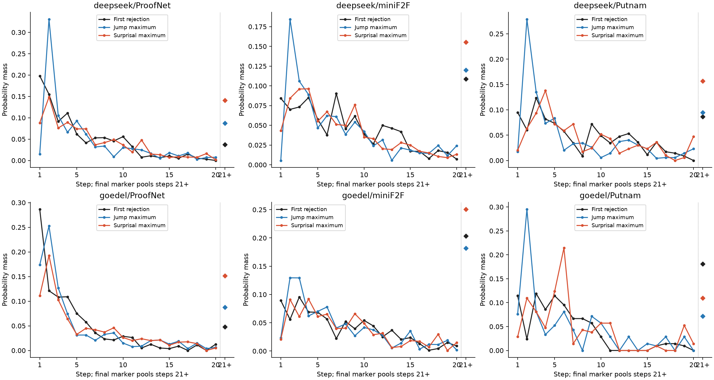
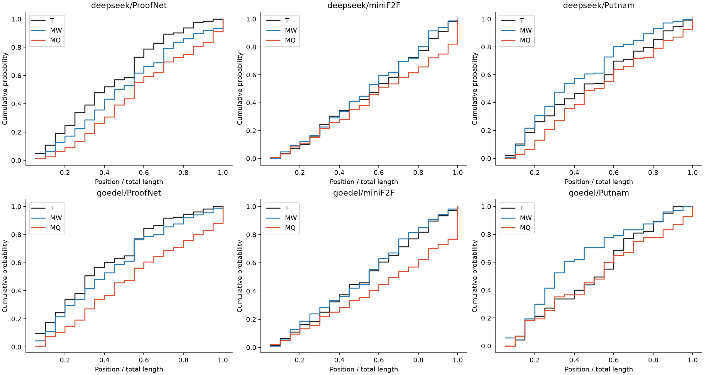
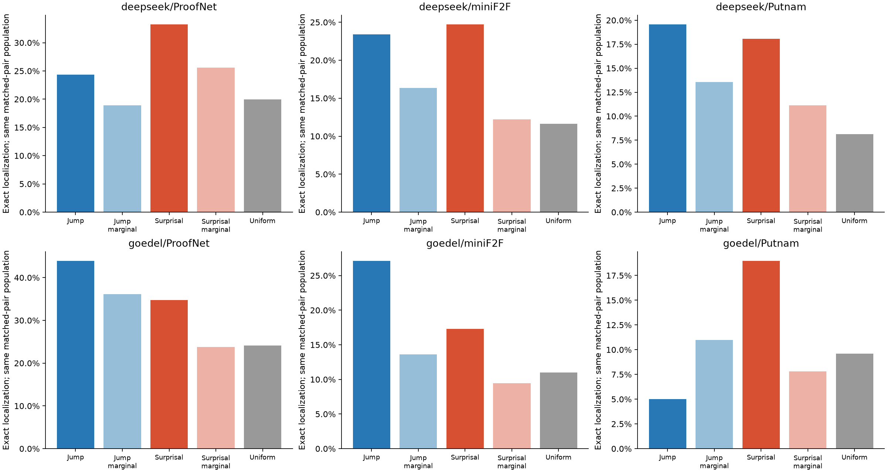
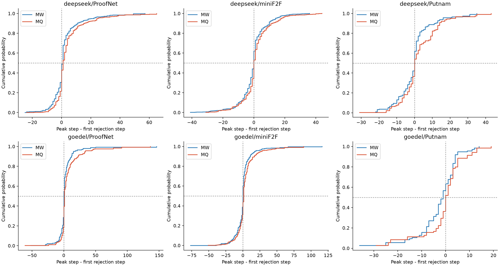
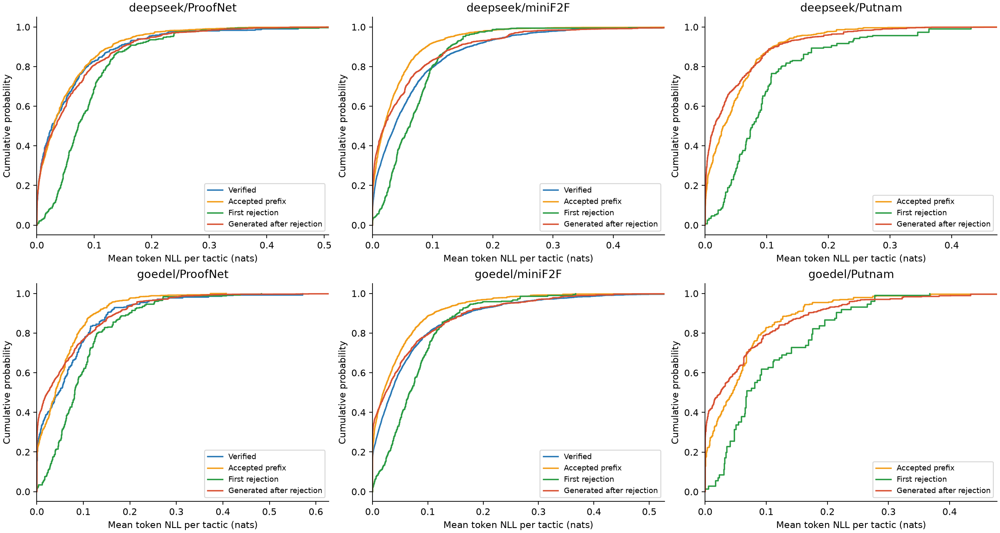
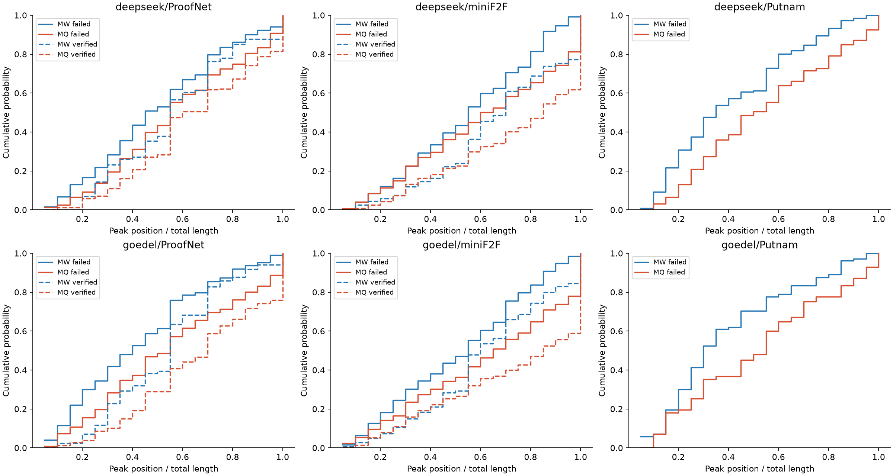
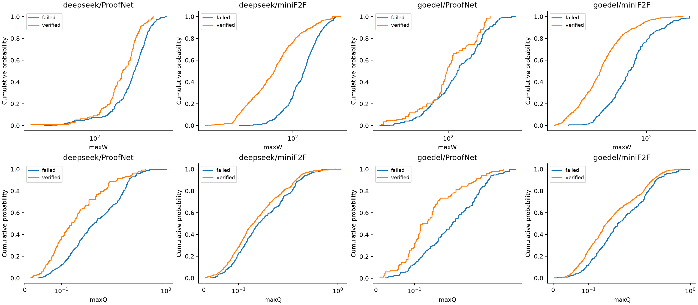
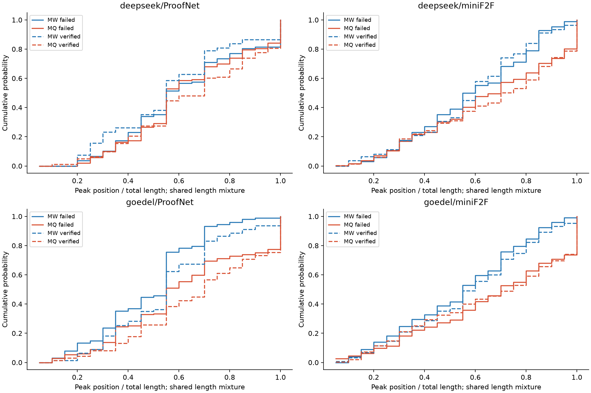
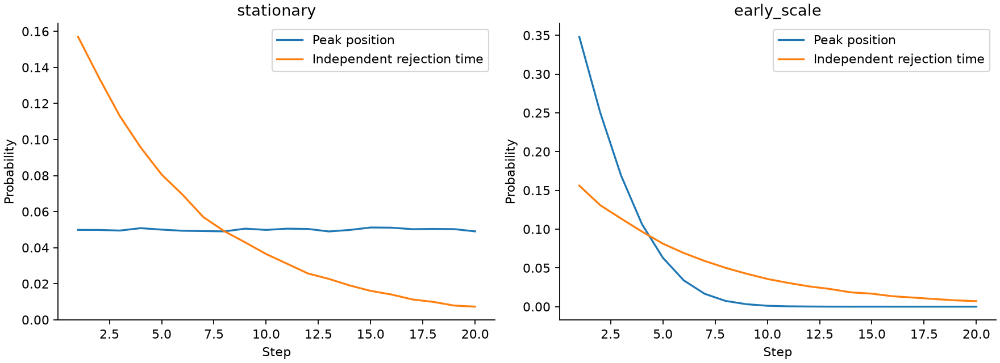

# Максимумы скачков, surprisal и первые отказы Lean: распределения и позиционные контроли

Отчёт от 11 ноября 2026. DeepSeek-Prover-V2-7B и Goedel-Prover-V2-8B; ProofNet, miniF2F и Putnam. Дополнительный анализ архивных траекторий, выполненный на Жоресе. Все сравнения поисковые: эти наборы уже исследовались ранее.

> **Дополнение от 12 ноября 2026:** [поправки на длину, распределения ошибок при каждой точной длине и проверка дополнительной информации скачков](LENGTH_AND_PREDICTION_RU.md). Включены новые графики, контроль последнего шага и модель изменяющегося риска.

## Что проверялось и что получилось

Проверены пять разных вопросов: сходство распределений позиций; совпадение максимума с конкретным отказом сверх общего позиционного смещения; среднее опережение/запаздывание; распределение surprisal; различия между правильными и ошибочными попытками. Эти вопросы не взаимозаменяемы.

Универсальное утверждение «максимум в среднем раньше ошибки» не выполняется. На ProofNet средний максимум скачка позже отказа; на miniF2F среднее смещение близко к нулю; отрицательное среднее у Goedel / Putnam зависит от способа нормирования и уровня учёта множественных сравнений. Большинство максимумов до или на отказе не означает отрицательного среднего: редкие большие запаздывания могут менять его знак.

Позиционное смещение объясняет часть совпадений, но не все. Среди 12 основных сравнений после семейной поправки положительный избыток точных совпадений сохраняется для максимума скачка у Goedel / miniF2F, а для максимума surprisal — у DeepSeek / ProofNet и DeepSeek / miniF2F. Это ассоциация с местом отказа, не доказательство причинного механизма или предупреждения при генерации.

На miniF2F величина максимального скачка различает исходы даже при сопоставлении по длине между разными задачами. Его позиция значительно слабее различает исходы. Проверка разных исходов внутри одной задачи той же длины пока слишком мала; переносить вывод между задачами на эту более строгую постановку нельзя.

## Данные и определения

| Модель / набор | Попытки | Задачи | С отказом | Проверенные правильные | Задачи с отказом / правильными |
|---|---|---|---|---|---|
| deepseek/ProofNet | 563 | 187 | 452 | 111 | 166 / 37 |
| deepseek/miniF2F | 1303 | 202 | 528 | 775 | 122 / 126 |
| deepseek/Putnam | 118 | 58 | 118 | 0 | 58 / 0 |
| goedel/ProofNet | 338 | 144 | 259 | 79 | 133 / 30 |
| goedel/miniF2F | 1256 | 200 | 448 | 808 | 122 / 137 |
| goedel/Putnam | 48 | 35 | 48 | 0 | 35 / 0 |

Модели заморожены; новые генерации, обучение и GPU не использовались. Слои считывания — архивные 14 для DeepSeek и 17 для Goedel. Входы — проверенная полная feature-cohort предыдущего исследования наличия ошибки; не все исходно сгенерированные попытки. Неполные, неоднозначно размеченные и ограниченные ресурсами попытки отфильтрованы исходным протоколом; они не считаются правильными.

В Putnam нет подтверждённых правильных попыток в данной выборке. Поэтому на Putnam можно изучать место отказа, но нельзя оценивать различение правильного и ошибочного доказательства.

Для тактики с номером $t$ берётся скрытое состояние $X_t$ на последнем её токене:

$$
\Delta_t=X_t-X_{t-1},\qquad
W_t=\left\|\Sigma^{-1/2}(\Delta_t-\mu)\right\|_2.
$$

Whitening зафиксирован по отдельной исходной калибровочной выборке. $Q_t$ — средняя отрицательная логарифмическая вероятность токенов тактики:

$$
Q_t=-\frac{1}{n_t}\sum_{j\in s_t}\log p_\theta(x_j\mid x_{<j}).
$$

Единица $Q_t$ — нат на токен. Это surprisal выбранного текста; не вероятность логической ошибки и не энтропия по всем возможным ответам.

Обозначения:

$$
M_W=\arg\max_{1\le t\le L}W_t,\qquad
M_Q=\arg\max_{1\le t\le L}Q_t,\qquad
T=\text{позиция первого отказа Lean}.
$$

Индексация начинается с 1; при равенстве максимумов берётся самый ранний. $T$ не определён для проверенных правильных доказательств. $L$ — длина сохранённого сгенерированного/оценённого формального текста. После первого отказа могут оставаться сгенерированные тактики; их не считаем успешно исполненными в Lean. Все глобальные максимумы в этом отчёте ретроспективны.

## Веса, неопределённость и границы сравнения

Для локализации каждая задача имеет вес 1 среди своих ошибочных попыток, попытки внутри задачи равновесны. Для сравнения исходов вес 1 задаётся по всем попыткам задачи и фиксируется до отбора правильных/ошибочных. Гистограммы локализации в следующем разделе согласованы именно с весами локализации; гистограммы исходов используют вторую схему.

Для сопоставления по длине используется отдельная популяция пар. При весе попытки $a_i=1/n_{g(i)}$ вес упорядоченной пары равен $a_i a_j$. В основной проверке задачи разные, длина точно одинакова. Поэтому длины с большим количеством доступных пар получают больший суммарный вес. Проценты из парных таблиц нельзя напрямую сравнивать с процентами всей выборки.

Интервалы — 10 000 bootstrap-выборок целых задач. В парных оценках заново считаются числители и знаменатели. Копии одной исходной задачи не становятся разными задачами-донорами. Для пар внутри задачи блок учитывается линейно, для разных задач — произведением multiplicities. Интервалы отсутствуют при <20 групп; для сравнения исходов нужны по 20 групп в каждом классе. «—» обозначает недостаточную поддержку, а не отсутствие неопределённости.

Основное семейство: 6 сочетаний модели и набора × 2 статистики (скачок и surprisal), собственный максимум против максимума другой задачи той же длины. Показаны обычные 95% интервалы и семейные интервалы Bonferroni для этих 12 контрастов. Остальные таблицы — поисковые диагностики с точечными 95% интервалами. Поправка не превращает анализ ранее изученных данных в подтверждающее исследование.

## Похожи ли распределения позиций максимумов и ошибок

Ниже TV — total variation, половина суммы абсолютных различий вероятностей по позициям. TV=0 для одинаковых гистограмм. Перекрытие равно 1−TV. JS — Jensen–Shannon divergence в битах. Это описательные расстояния, не тест равенства. Относительная позиция — t/L, 20 заранее фиксированных интервалов. Малые выборки сами увеличивают шум этих расстояний.

| Модель / набор | Мода T | Мода M_W | Мода M_Q | TV W,T: шаг | TV W,T: доля длины | TV Q,T: шаг | TV Q,T: доля длины |
|---|---|---|---|---|---|---|---|
| deepseek/ProofNet | 1 | 2 | 2 | 0.352 | 0.225 | 0.234 | 0.293 |
| deepseek/miniF2F | 7 | 2 | 4 | 0.259 | 0.159 | 0.215 | 0.232 |
| deepseek/Putnam | 3 | 2 | 4 | 0.375 | 0.205 | 0.277 | 0.218 |
| goedel/ProofNet | 1 | 2 | 2 | 0.308 | 0.193 | 0.316 | 0.314 |
| goedel/miniF2F | 3 | 2 | 4 | 0.259 | 0.155 | 0.278 | 0.233 |
| goedel/Putnam | 3 | 2 | 6 | 0.476 | 0.452 | 0.467 | 0.367 |

Последняя точка «21» на рисунке объединяет все позиции 21 и дальше; расчёт расстояний выше использует полную поддержку без такого объединения.

Похожесть распределений по всем доказательствам не означает совпадения на отдельных доказательствах. Две независимо выбранные позиции могут иметь одинаковые распределения и при этом редко совпадать. И наоборот, дополнительное совпадение внутри конкретной траектории возможно при различающихся маргинальных распределениях.

## Бейзлайн, учитывающий распределения

При условной независимости позиций и фиксированной длине:

$$
P_0(M=T\mid L)=\sum_{t=1}^{L}p_M(t\mid L)\,p_T(t\mid L).
$$

При равномерном $p_M$ этот контроль равен $1/L$. Если оба распределения сосредоточены на первых шагах, совпадение может существенно превышать $1/L$ без дополнительной связи внутри попытки.

Эмпирическая проверка использует пары разных задач одинаковой длины. Сравниваются:

$$
A=\frac{\sum_{(i,j)}a_i a_j\,\mathbf{1}\{M_i=T_i\}}{\sum_{(i,j)}a_i a_j},
\qquad
A_0=\frac{\sum_{(i,j)}a_i a_j\,\mathbf{1}\{M_j=T_i\}}{\sum_{(i,j)}a_i a_j}.
$$

Настоящие позиции ошибок сохраняются. Переносится только максимум другой задачи. Это исключает самосопоставление и учитывает неравномерность позиций при точно той же длине. Однако сложность и тип конкретной задачи ещё могут создавать общие причины; для этого ниже приведена более узкая проверка внутри задачи.

### Точное совпадение максимума скачка с отказом

| Модель / набор | Попытки / задачи | Охват веса, % | Свой максимум, % | Чужой максимум, % | Разница, п.п. [95%] | Семейный интервал |
|---|---|---|---|---|---|---|
| deepseek/ProofNet | 438 / 165 | 97.04 | 24.36 | 18.90 | 5.46 [1.55; 9.84] | [-0.17; 12.09] |
| deepseek/miniF2F | 513 / 121 | 97.15 | 23.39 | 16.34 | 7.06 [0.77; 13.39] | [-2.31; 15.93] |
| deepseek/Putnam | 100 / 53 | 84.05 | 19.55 | 13.56 | 5.99 [-3.76; 16.73] | [-8.73; 21.82] |
| goedel/ProofNet | 229 / 117 | 85.03 | 43.88 | 36.12 | 7.75 [-1.72; 16.82] | [-7.06; 21.16] |
| goedel/miniF2F | 423 / 117 | 92.48 | 27.10 | 13.64 | 13.46 [6.79; 20.83] | [3.99; 24.60] |
| goedel/Putnam | 32 / 25 | 64.29 | 5.02 | 10.97 | -5.95 [-24.42; 14.07] | [-35.99; 26.03] |

### Точное совпадение максимума surprisal с отказом

| Модель / набор | Попытки / задачи | Охват веса, % | Свой максимум, % | Чужой максимум, % | Разница, п.п. [95%] | Семейный интервал |
|---|---|---|---|---|---|---|
| deepseek/ProofNet | 438 / 165 | 97.04 | 33.21 | 25.59 | 7.62 [2.69; 13.20] | [0.66; 15.90] |
| deepseek/miniF2F | 513 / 121 | 97.15 | 24.70 | 12.23 | 12.47 [5.72; 19.86] | [3.34; 23.91] |
| deepseek/Putnam | 100 / 53 | 84.05 | 18.07 | 11.14 | 6.93 [-7.43; 21.12] | [-15.31; 28.58] |
| goedel/ProofNet | 229 / 117 | 85.03 | 34.75 | 23.81 | 10.95 [2.34; 20.04] | [-1.49; 24.39] |
| goedel/miniF2F | 423 / 117 | 92.48 | 17.31 | 9.43 | 7.88 [2.03; 14.01] | [-0.86; 17.40] |
| goedel/Putnam | 32 / 25 | 64.29 | 18.96 | 7.81 | 11.15 [-17.53; 37.25] | [-32.67; 49.00] |

Наиболее устойчивый остаточный эффект скачка в основном семействе — Goedel / miniF2F. У DeepSeek / ProofNet и DeepSeek / miniF2F интервалы для скачка положительны при обычном 95% уровне, но включают ноль после семейной поправки. Для surprisal семейную поправку проходят DeepSeek / ProofNet и DeepSeek / miniF2F. На Putnam интервалы широки. Значит, свести абсолютно все совпадения к похожести маргинальных распределений нельзя, но и универсальной связи для всех наборов нет.

### Более строгий контроль: другая попытка той же задачи и той же длины

| Модель / набор | Попытки / задачи | Охват веса, % | Скачок: разница, п.п. [95%] | Surprisal: разница, п.п. [95%] |
|---|---|---|---|---|
| deepseek/ProofNet | 106 / 45 | 18.47 | 3.82 [0.34; 8.36] | -1.45 [-6.48; 2.56] |
| deepseek/miniF2F | 179 / 52 | 25.17 | -5.40 [-16.36; 3.18] | 2.58 [-2.56; 8.99] |
| deepseek/Putnam | 8 / 4 | 4.31 | -21.93 — | 0.00 — |
| goedel/ProofNet | 51 / 22 | 13.53 | -2.55 [-11.51; 6.36] | 3.11 [-3.21; 10.96] |
| goedel/miniF2F | 130 / 38 | 18.99 | 4.84 [0.94; 10.46] | 2.38 [-0.65; 6.31] |
| goedel/Putnam | 4 / 2 | 4.76 | 0.00 — | 34.62 — |

У Goedel / miniF2F избыток совпадений скачка остаётся и в этой более узкой постановке. Это полезная проверка, но её охват существенно меньше основного; сравнение внутри задачи — поисковая чувствительность, не отдельный подтверждающий результат. На Putnam независимых задач для такой проверки слишком мало. Эффект surprisal при дополнительном контроле задачи ослабляется; часть его связи может относиться к общим свойствам задания.

## Бейзлайн, который предсказывает место ошибки по распределению

Другой вопрос — превосходит ли максимум простой практический предсказатель позиции. Построен baseline, который знает только модель, набор и окончательную длину ошибочной попытки. Пять разбиений по задачам: гистограмма позиций ошибок обучается на других задачах. Сглаживание — 0,5 на каждую допустимую позицию; группы длины 1–5, 6–10, 11–20, 21–40, 41+. Если в группе меньше 20 обучающих задач, используется общая гистограмма обучающих задач. Предсказывается её мода, равенства разрешаются в пользу ранней позиции. Это фиксированный простой baseline, а не оптимально настроенный предсказатель.

| Модель / набор | Uniform, % | Всегда шаг 1, % | OOF-мода, % | Макс. скачка, % | Макс. surprisal, % | Скачок − мода, п.п. [95%] | Surprisal − мода, п.п. [95%] |
|---|---|---|---|---|---|---|---|
| deepseek/ProofNet | 12.55 | 19.81 | 22.12 | 18.50 | 21.40 | -3.62 [-10.87; 3.53] | -0.72 [-6.80; 5.52] |
| deepseek/miniF2F | 9.52 | 8.43 | 9.27 | 18.09 | 18.89 | 8.82 [2.95; 14.71] | 9.62 [3.85; 15.47] |
| deepseek/Putnam | 7.51 | 9.48 | 10.49 | 19.83 | 17.53 | 9.34 [0.29; 18.39] | 7.04 [-2.44; 16.52] |
| goedel/ProofNet | 13.15 | 28.66 | 25.31 | 26.57 | 21.27 | 1.25 [-6.27; 8.90] | -4.05 [-11.65; 3.41] |
| goedel/miniF2F | 8.44 | 8.94 | 7.36 | 21.46 | 13.15 | 14.10 [8.14; 20.18] | 5.79 [0.50; 11.12] |
| goedel/Putnam | 7.52 | 11.43 | 4.29 | 6.67 | 15.71 | 2.38 [-7.14; 11.90] | 11.43 [-1.43; 25.24] |

Это полная выборка ошибочных попыток с равным весом задач, в отличие от таблиц сопоставленных пар. На miniF2F максимум скачка превосходит данный OOF-baseline у обеих моделей. На ProofNet такого преимущества над OOF-модой нет. Связь сверх случайного переноса максимума и преимущество над хорошим предсказателем позиции — разные критерии.

Дополнительно обучена геометрическая модель положения ошибки, усечённая известной длиной:

$$
p_{\mathrm{geom}}(T=t\mid T\le L)
=\frac{p(1-p)^{t-1}}{1-(1-p)^L},\qquad t=1,\ldots,L.
$$

Параметр $p$ оценивается только на обучающих задачах максимизацией взвешенного правдоподобия. Ни окончательная длина, ни известный факт ошибки не доступны настоящему streaming-детектору; это offline-baseline локализации.

| Модель / набор | NLL геометрической модели | NLL эмпирической модели | Геометрическая − эмпирическая [95%] |
|---|---|---|---|
| deepseek/ProofNet | 2.365 | 2.405 | -0.040 [-0.100; 0.017] |
| deepseek/miniF2F | 2.701 | 2.723 | -0.022 [-0.074; 0.029] |
| deepseek/Putnam | 2.818 | 2.960 | -0.142 [-0.241; -0.046] |
| goedel/ProofNet | 2.348 | 2.427 | -0.079 [-0.187; 0.031] |
| goedel/miniF2F | 2.891 | 2.957 | -0.066 [-0.120; -0.012] |
| goedel/Putnam | 2.832 | 3.001 | -0.169 [-0.325; -0.021] |

Положительная разница NLL означает преимущество эмпирической модели, отрицательная — геометрической. По точечным оценкам геометрическая модель не хуже этого сглаженного гистограммного baseline во всех шести случаях; на части наборов обычный интервал разницы ниже нуля. Это не устанавливает геометрический закон: простая модель может выигрывать из-за меньшей дисперсии на небольшой выборке. Форма проверялась в условной популяции T≤L, а не как физический закон независимых отказов на каждом шаге.

## Максимум в среднем раньше ошибки — верно ли это

Проверены разные величины:

$$
D=M_W-T,\qquad \mathbb{E}[D],\qquad
\mathbb{E}[D/L],\qquad P(D\le0).
$$

Отрицательное среднее означает опережение, положительное — запаздывание. Вероятность $P(D\le0)>1/2$ характеризует большинство случаев; знак среднего она не определяет.

| Модель / набор | Среднее M_W−T, шаги [95%] | Медиана M_W−T | Среднее (M_W−T)/L, % длины [95%] | M_W≤T, % [95%] | Среднее M_Q−T [95%] |
|---|---|---|---|---|---|
| deepseek/ProofNet | 2.07 [0.89; 3.34] | 1.00 | 8.04 [3.99; 12.04] | 49.07 [43.20; 54.76] | 4.28 [2.98; 5.70] |
| deepseek/miniF2F | -0.29 [-1.35; 0.73] | 0.00 | -1.46 [-5.93; 2.90] | 62.10 [55.22; 68.79] | 1.34 [0.28; 2.42] |
| deepseek/Putnam | -0.15 [-2.20; 2.18] | 0.00 | -6.53 [-13.91; 0.58] | 62.07 [52.01; 71.70] | 2.52 [0.52; 4.64] |
| goedel/ProofNet | 2.53 [0.40; 5.42] | 0.00 | 4.36 [-0.17; 9.02] | 55.16 [47.88; 62.49] | 6.54 [3.82; 9.78] |
| goedel/miniF2F | 0.51 [-1.16; 2.36] | 0.00 | -1.25 [-5.46; 2.83] | 60.41 [53.27; 67.35] | 3.10 [1.20; 5.42] |
| goedel/Putnam | -3.12 [-6.23; -0.55] | -1.00 | -9.54 [-20.13; 1.07] | 63.33 [47.62; 78.11] | -1.02 [-4.28; 1.75] |

На ProofNet точечные средние положительны у обеих моделей. На Goedel / miniF2F большинство максимумов не позже отказа, но среднее смещение положительно: хвост поздних максимумов меняет знак среднего. На Goedel / Putnam обычный 95% интервал среднего числа шагов отрицателен, однако интервал после нормирования на длину включает ноль. При консервативном расширении интервала среднего по той же формуле family12 он также включает ноль; формально это дополнительная чувствительность вне основного семейства локализации. Нельзя описывать опережение как общий установленный закон.

## Распределение surprisal

Показаны эмпирические распределения Q_t для правильных доказательств, принятого префикса ошибочной попытки, первого отказа и сгенерированного суффикса после отказа. Каждая попытка получает свой исходный вес, равномерно распределённый между её шагами внутри рассматриваемого сегмента. Состав доступных попыток в сегментах различается; простое вычитание средних двух сегментов не заменяет парную оценку ниже.

| Модель / набор | Сегмент | Попытки / задачи | Среднее Q | Медиана Q | 90% квантиль | 99% квантиль |
|---|---|---|---|---|---|---|
| deepseek/ProofNet | verified | 111 / 37 | 0.0546 | 0.0260 | 0.1434 | 0.3911 |
| deepseek/ProofNet | failed_full | 452 / 166 | 0.0598 | 0.0398 | 0.1435 | 0.3254 |
| deepseek/ProofNet | pre | 353 / 148 | 0.0498 | 0.0294 | 0.1299 | 0.2919 |
| deepseek/ProofNet | at | 452 / 166 | 0.0877 | 0.0717 | 0.1608 | 0.3254 |
| deepseek/ProofNet | post | 452 / 166 | 0.0578 | 0.0326 | 0.1491 | 0.3409 |
| deepseek/miniF2F | verified | 775 / 126 | 0.0630 | 0.0369 | 0.1609 | 0.3467 |
| deepseek/miniF2F | failed_full | 528 / 122 | 0.0442 | 0.0217 | 0.1128 | 0.2830 |
| deepseek/miniF2F | pre | 488 / 115 | 0.0363 | 0.0197 | 0.0897 | 0.2232 |
| deepseek/miniF2F | at | 528 / 122 | 0.0702 | 0.0623 | 0.1286 | 0.2267 |
| deepseek/miniF2F | post | 528 / 122 | 0.0515 | 0.0207 | 0.1412 | 0.3790 |
| deepseek/Putnam | failed_full | 118 / 58 | 0.0485 | 0.0264 | 0.1199 | 0.2961 |
| deepseek/Putnam | pre | 107 / 56 | 0.0467 | 0.0297 | 0.1099 | 0.2467 |
| deepseek/Putnam | at | 118 / 58 | 0.0961 | 0.0763 | 0.2045 | 0.3628 |
| deepseek/Putnam | post | 118 / 58 | 0.0432 | 0.0143 | 0.1129 | 0.2873 |
| goedel/ProofNet | verified | 79 / 30 | 0.0664 | 0.0474 | 0.1516 | 0.3977 |
| goedel/ProofNet | failed_full | 259 / 133 | 0.0627 | 0.0393 | 0.1627 | 0.3367 |
| goedel/ProofNet | pre | 176 / 105 | 0.0537 | 0.0399 | 0.1265 | 0.2669 |
| goedel/ProofNet | at | 259 / 133 | 0.0966 | 0.0810 | 0.1983 | 0.4071 |
| goedel/ProofNet | post | 259 / 133 | 0.0599 | 0.0232 | 0.1710 | 0.3510 |
| goedel/miniF2F | verified | 808 / 137 | 0.0645 | 0.0342 | 0.1703 | 0.4183 |
| goedel/miniF2F | failed_full | 448 / 122 | 0.0483 | 0.0215 | 0.1292 | 0.3373 |
| goedel/miniF2F | pre | 419 / 115 | 0.0429 | 0.0198 | 0.1108 | 0.2856 |
| goedel/miniF2F | at | 448 / 122 | 0.0787 | 0.0673 | 0.1530 | 0.3163 |
| goedel/miniF2F | post | 448 / 122 | 0.0588 | 0.0239 | 0.1652 | 0.3898 |
| goedel/Putnam | failed_full | 48 / 35 | 0.0620 | 0.0350 | 0.1685 | 0.3517 |
| goedel/Putnam | pre | 44 / 31 | 0.0592 | 0.0449 | 0.1476 | 0.3517 |
| goedel/Putnam | at | 48 / 35 | 0.1031 | 0.0676 | 0.2147 | 0.2768 |
| goedel/Putnam | post | 48 / 35 | 0.0604 | 0.0253 | 0.1693 | 0.4344 |

verified — доказательство целиком проверено; failed_full — весь сохранённый текст ошибочной попытки; pre — до первого отказа; at — первый отказ; post — сгенерированный текст после отказа, не выполненный успешно в Lean. Это не сравнение «логически правильных и неправильных токенов» внутри post.

На графике точная эмпирическая CDF; масштаб горизонтальной оси выбран по 99,5% квантилям для читаемости. Табличные квантили и средние рассчитаны по всем наблюдениям. Отдельное оценивание степенного хвоста surprisal не выполнялось; форма CDF сама по себе не устанавливает тяжёлый хвост.

### Парная проверка локального повышения surprisal

| Модель / набор | Q отказа − Q предыдущей тактики [95%] | Q отказа − среднее Q префикса [95%] | Среднее Q суффикса − Q отказа [95%] |
|---|---|---|---|
| deepseek/ProofNet | 0.0315 [0.0187; 0.0441] | 0.0420 [0.0324; 0.0527] | -0.0370 [-0.0477; -0.0268] |
| deepseek/miniF2F | 0.0259 [0.0143; 0.0372] | 0.0336 [0.0254; 0.0421] | -0.0197 [-0.0293; -0.0101] |
| deepseek/Putnam | 0.0463 [0.0262; 0.0686] | 0.0541 [0.0371; 0.0739] | -0.0569 [-0.0752; -0.0397] |
| goedel/ProofNet | 0.0467 [0.0298; 0.0644] | 0.0528 [0.0385; 0.0685] | -0.0535 [-0.0696; -0.0392] |
| goedel/miniF2F | 0.0313 [0.0200; 0.0433] | 0.0360 [0.0274; 0.0451] | -0.0205 [-0.0326; -0.0088] |
| goedel/Putnam | 0.0525 [0.0272; 0.0782] | 0.0472 [0.0242; 0.0709] | -0.0504 [-0.0785; -0.0232] |

Первые два контраста положительны во всех шести сочетаниях с положительными обычными 95% интервалами. Это относится к отказам после первого шага. Во всех шести случаях средний surprisal последующего сгенерированного суффикса ниже surprisal на отказе. Такое снижение не означает, что доказательство снова стало правильным: после отказа Lean не подтвердил эти шаги.

### Насколько surprisal и скачок выражают одно и то же

| Модель / набор | Средняя внутри попытки Spearman(W,Q) [95%] | Spearman(W,число токенов) [95%] | Spearman(Q,число токенов) [95%] |
|---|---|---|---|
| deepseek/ProofNet | 0.211 [0.172; 0.251] | 0.193 [0.151; 0.236] | 0.218 [0.176; 0.259] |
| deepseek/miniF2F | 0.125 [0.083; 0.165] | 0.157 [0.123; 0.191] | 0.123 [0.081; 0.164] |
| deepseek/Putnam | 0.193 [0.119; 0.265] | 0.242 [0.187; 0.299] | 0.235 [0.176; 0.295] |
| goedel/ProofNet | 0.319 [0.269; 0.368] | 0.283 [0.226; 0.339] | 0.278 [0.220; 0.335] |
| goedel/miniF2F | 0.129 [0.089; 0.168] | 0.207 [0.172; 0.242] | 0.125 [0.084; 0.164] |
| goedel/Putnam | 0.264 [0.154; 0.368] | 0.227 [0.123; 0.324] | 0.299 [0.202; 0.399] |

Используются попытки хотя бы с тремя шагами и непостоянными значениями обеих величин. Корреляция W и Q положительна, но далека от единицы: это разные статистики. Положительные корреляции с длиной тактики указывают на необходимость контроля её типа и сложности; длина уже исключена как простой множитель суммы surprisal, поскольку Q усредняется по токенам.

## Максимумы при наличии ошибки и без неё

Правильные попытки в этой выборке обычно короче. Поэтому относительная позиция t/L полезна, но не устраняет все эффекты длины: например, единственная позиция короткого доказательства автоматически является последней.

| Модель / набор | Медиана длины: ошибка / правильно | Медиана max W: ошибка / правильно | Медиана max Q: ошибка / правильно |
|---|---|---|---|
| deepseek/ProofNet | 14 / 6 | 154.44 / 136.24 | 0.1892 / 0.1265 |
| deepseek/miniF2F | 16 / 6 | 118.55 / 76.30 | 0.1562 / 0.1416 |
| goedel/ProofNet | 15 / 5 | 110.87 / 98.43 | 0.1981 / 0.1195 |
| goedel/miniF2F | 21 / 8 | 77.21 / 51.51 | 0.1810 / 0.1495 |

### Сопоставление правильной и ошибочной попытки одной длины

Ниже AUC — вероятность, что значение признака в ошибочной попытке больше, чем в правильной попытке другой задачи точно той же длины; равенство даёт 0,5. Это условная парная concordance, а не AUROC произвольной смеси длин. Для позиции направление заранее фиксировано: большее t/L считается большим score; значение около 0,5 не исключает нелинейных различий формы распределений.

| Модель / набор | Задачи: ошибка / правильно | Охват веса ошибочных, % | AUC max W [95%] | AUC max Q [95%] | AUC позиции W [95%] | AUC позиции Q [95%] |
|---|---|---|---|---|---|---|
| deepseek/ProofNet | 124 / 37 | 59.30 | 0.490 [0.362; 0.629] | 0.573 [0.477; 0.676] | 0.531 [0.446; 0.614] | 0.451 [0.372; 0.533] |
| deepseek/miniF2F | 117 / 126 | 84.67 | 0.749 [0.684; 0.812] | 0.500 [0.434; 0.564] | 0.480 [0.411; 0.552] | 0.467 [0.384; 0.543] |
| goedel/ProofNet | 89 / 30 | 57.79 | 0.424 [0.303; 0.552] | 0.552 [0.420; 0.682] | 0.406 [0.308; 0.509] | 0.429 [0.311; 0.546] |
| goedel/miniF2F | 117 / 137 | 87.26 | 0.713 [0.629; 0.790] | 0.575 [0.509; 0.640] | 0.462 [0.400; 0.527] | 0.506 [0.447; 0.568] |

На miniF2F величина максимального скачка сохраняет различительную способность при одинаковой длине. На ProofNet обычные интервалы AUC max W включают 0,5. Положение максимума само по себе значительно слабее; интервалы приведённых позиционных AUC включают 0,5.

Дополнительная нормировка max W / median W не универсальна: она может менять картину в зависимости от набора. Её условные AUC приведены ниже, чтобы не выбирать нормировку после просмотра удачного результата.

| Модель / набор | AUC max W / median W при одной длине [95%] |
|---|---|
| deepseek/ProofNet | 0.621 [0.507; 0.723] |
| deepseek/miniF2F | 0.485 [0.400; 0.569] |
| goedel/ProofNet | 0.544 [0.420; 0.675] |
| goedel/miniF2F | 0.564 [0.485; 0.639] |

Для этого рисунка обе категории приводятся к одной смеси точных длин: масса длины пропорциональна минимуму исходных масс двух классов; нужны хотя бы две задачи каждого класса на длину. Это отдельная описательная популяция, а не парная оценка из предыдущей таблицы.

| Модель / набор | Охват общего веса, % | TV позиций W после стандартизации | TV позиций Q после стандартизации |
|---|---|---|---|
| deepseek/ProofNet | 54.00 | 0.218 | 0.203 |
| deepseek/miniF2F | 89.16 | 0.178 | 0.129 |
| goedel/ProofNet | 51.71 | 0.174 | 0.210 |
| goedel/miniF2F | 89.19 | 0.111 | 0.141 |

### Правильная и ошибочная попытка одной и той же задачи

| Модель / набор | Задачи | Пары одной длины | AUC max W [95%] | AUC max Q [95%] |
|---|---|---|---|---|
| deepseek/ProofNet | 7 | 13 | 0.412 — | 0.548 — |
| deepseek/miniF2F | 19 | 46 | 0.417 — | 0.616 — |
| goedel/ProofNet | 8 | 20 | 0.465 — | 0.224 — |
| goedel/miniF2F | 17 | 44 | 0.346 — | 0.305 — |

Во всех четырёх сравнениях поддержки меньше 20 задач, поэтому интервалы не рассчитываются. Некоторые точечные значения меняют направление. Это существенное ограничение: положительная связь max W с ошибкой между задачами ещё не устанавливает аналогичную связь между попытками одной задачи. Нужны дополнительные правильные и ошибочные попытки одних и тех же задач с сопоставимыми длинами.

## Другая объясняющая модель: неоднородные фазы доказательства и отбор по первому отказу

Ниже предложена альтернативная модель, а не установленный механизм работы этих моделей. Она объясняет, как неравномерные распределения и часть совпадений могут возникать без универсального порога нормы и без степенного хвоста.

### 1. Убывающая гистограмма ошибок может возникать при постоянном риске

Если на каждом ещё достигнутом шаге вероятность первого отказа равна $h_t$, то

$$
P(T=t)=h_t\prod_{s<t}(1-h_s).
$$

При постоянном $h_t=p$ получаем геометрическое распределение $p(1-p)^{t-1}$. Его масса убывает, хотя условный риск следующего шага не падает. До поздних позиций просто доживает меньше попыток. При переменных $h_t$ модой может быть и третий, и другой шаг. Завершение правильного доказательства и конечная длина дополнительно меняют наблюдаемую популяцию.

Формула геометрического распределения: [официальная документация SciPy](https://docs.scipy.org/doc/scipy/reference/generated/scipy.stats.geom.html). Это математическая модель, а не вывод о точном законе наших данных.

### 2. Разные типы шагов создают разные распределения скачков

Введём фазу $C_t$: подготовка, выбор ветви/леммы, применение тактик, завершение. Простая модель положительных отклонений:

$$
W_t=a_{C_t}+b_{C_t}|\varepsilon_t|,\qquad
\varepsilon_t\sim N(0,1).
$$

При конечном числе фаз и ограниченных параметрах это светлохвостая модель. Одни фазы могут иметь больший масштаб $b_{C_t}$ и чаще давать глобальные максимумы. Для независимых непрерывных отклонений с различными CDF $F_t$:

$$
P(M_W=t)=\int f_t(z)\prod_{s\ne t}F_s(z)\,dz.
$$

Равномерность позиции максимума гарантирована при перестановочной симметрии шагов; она не следует просто из отсутствия связи с ошибкой. Формула интеграла служит иллюстрацией при независимости; реальные шаги могут быть зависимы.

Фаза и сложность задачи могут одновременно влиять на величину скачка, surprisal и риск отказа. Тогда возникает общая причина: структурно сложный шаг меняет представление сильнее, менее предсказуем в тексте и чаще отклоняется. При этом сама большая норма не обязана вызывать ошибку. Общий whitening удаляет часть анизотропии, но не гарантирует одинаковые распределения всех типов тактик и фаз.

Работа [Massive Activations in Large Language Models](https://arxiv.org/abs/2402.17762) описывает крупные активации, связанные также с архитектурными bias-функциями. Она не доказывает объяснение наших whitened-приращений; это лишь основание не отождествлять крупную активацию с логическим отказом без дополнительных проверок.

### 3. Иллюстрация: совпадения выше uniform при независимых процессах

В отдельной CPU-симуляции T генерируется независимо от всех W по усечённому геометрическому распределению. В первом варианте масштабы W одинаковы; во втором масштаб half-normal отклонений убывает по шагам. Параметры выбраны для иллюстрации, к экспериментальным данным они не подгонялись.

| Сценарий | Траектории | Длина | Совпадение M=T, % | Произведение маргинальных распределений, % | Uniform, % | Среднее M−T | M≤T, % |
|---|---|---|---|---|---|---|---|
| stationary | 100000 | 20 | 5.03 | 4.99 | 5.00 | 4.67 | 29.17 |
| early_scale | 100000 | 20 | 12.66 | 12.57 | 5.00 | -3.34 | 79.93 |

Во втором сценарии одновременно возникают превышение uniform-контроля и отрицательное среднее смещение, хотя максимум и отказ независимы. Маргинальный baseline воспроизводит частоту совпадений. Это контрпример выводу «ранний максимум обязательно обозначает неверный выбор», но не доказательство, что реальные данные устроены именно так.

### 4. Почему surprisal может локально расти на отказе, но слабо различать исход целиком

Неожиданная лемма, сложные аргументы или нетипичная конструкция могут увеличить Q конкретной тактики. На таком шаге выше шанс неверного применения. Остальная часть ошибочного текста может оставаться очень шаблонной и вероятной. Поэтому локальное повышение Q на отказе совместимо с невысоким средним Q всего ошибочного доказательства и со слабым разделением исходов по max Q.

Это объяснение согласуется с наблюдаемой локальной формой, но конкурирует с различиями типов тактик, длины и сложности. Token surprisal измеряет вероятность выбранного текста; он не различает автоматически разные способы выразить один смысл. [Kuhn, Gal и Farquhar](https://arxiv.org/abs/2302.09664) специально разделяют лексическую и семантическую неопределённость. Их результат не переносится автоматически на Lean и не является проверкой нашей фазовой модели.

### 5. Модель раннего неверного выбора с задержкой — отдельная гипотеза

Можно ввести скрытый момент неверного выбора $S$ и задержку обнаружения $D\ge0$:

$$
T=S+D,\qquad M_W=S+J,\qquad M_W-T=J-D.
$$

Опережение получится лишь если смещение пика $J$ в среднем меньше задержки $D$. Это не вывод из одного тяжёлого хвоста и не гарантируется моделью фаз. Исходная точная гипотеза $T=\min\{t:W_t>\tau\}$, напротив, даёт $M_W\ge T$; пик строго раньше отказа несовместим с ней для выбранной статистики.

Наблюдаемые знаки среднего смещения различаются между наборами. Поэтому задержку нельзя использовать как универсальное объяснение всех результатов. Для проверки нужны независимые метки выбора пути — например, контролируемый выбор свидетеля/ветви в Lean — и сравнение максимума с этим моментом и с последующим отказом отдельно.

## Что проверить следующим

1. Собрать больше повторных правильных и ошибочных попыток одних задач. Это устранит главную слабость сравнения исходов: сегодня эффект между задачами нельзя уверенно перенести внутрь задачи.

2. На обучающих задачах оценить распределения W и Q с учётом номера шага, длины тактики и её типа; на новых задачах сравнить исходный максимум с максимумом условно нормированного отклонения. Если эффект преимущественно фазовый, часть совпадений должна исчезнуть после такой нормировки. Все параметры нормирования выбирать без тестовых ошибок.

3. Проверять предсказание первого отказа в следующие 1/3/5 шагов только по доступному принятому префиксу. Сравнить модель позиционного риска с той же моделью плюс прошлые скачки и surprisal при одинаковой частоте ложных тревог. Будущая длина и глобальный максимум готового текста здесь недоступны.

4. В контролируемых задачах отдельно разметить момент неверного выбора и момент его обнаружения Lean. Это позволит отличить раннюю смену стратегии от обычного позиционного смещения и от повышения сложности на самом отказе.

Эти пункты — дальнейшие проверки предложенной интерпретации, не результаты уже выполненного анализа и не поставленные этим отчётом новые обучения.

## Воспроизводимость

Основной расчёт: Slurm job 8533481; CPU, GPU-hours=0. Построение отчёта и согласование весов гистограмм локализации: Slurm job 8533490. Базовый git commit: bf0bdbe21c00fb9bd677da5a0318eac83f1c8f98. Рабочее дерево сервера содержало изменения; вместо утверждения о чистом checkout зафиксированы SHA-256 исходных скриптов и всех входов/выходов.

Проверки: исходные manifests и хеши; допустимые индексы и длины массивов; конечность scores; отсутствие самосопоставления; контроль с постоянным максимумом даёт нулевую дополнительную связь; идеально совпадающий максимум даёт правильный эталон; нормировка гистограмм; согласование разности средних позиций с независимо рассчитанным средним парным lag; раздельные задачи в OOF; нормировка предсказанных PMF.

Публичная версия содержит текст отчёта и его графики. Полные метрики, код анализа и manifests сохранены на сервере и локально; исходные траектории остаются на сервере; идентификаторы задач и внутренние пути в публикацию не включаются. Все научные таблицы этого отчёта сформированы программно из метрик.
