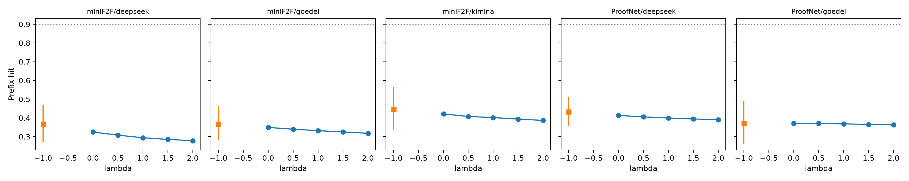

# Проверка шума считывания и проекций остаточных приращений

Закрытый отчёт новой серии. Подготовлен 2026-11-15 00:16 UTC. Срок задания: 17 ноября 2026,10:00 МСК. Публичной публикации этой серии нет.

| Вопрос | Число | Вывод |
|---|---|---|
| Может ли максимум быть до первого отказа? | 28.9–51.0% в восьми ячейках | Точная связь выбранной нормы с корректностью без шума не выполняет это необходимое условие. |
| Устраняет ли оценённый шум отбеливания разрыв prefix→100%? | SIMEX 36.9–44.6%; наибольшая верхняя 95CI 56.5% | Оценённой компоненты шума недостаточно для рубежа 90%; общий класс шумовых моделей этим не проверен. |
| Есть ли полоса, выигравшая в обеих ProofNet ячейках? | 0 | По заранее заданному критерию концентрация в полосах без меток не установлена. |
| Что даёт основной обученный scalar к MD на ProofNet? | deepseek: 0.00 [0.00; 0.00] п.п. / goedel: 0.00 [0.00; 0.00] п.п. | Это перенос информации о целевой метке через обученное направление; не независимое измерение шума. |
| Что даёт X без длины тактики на ProofNet? | deepseek: 9.58 [3.82; 15.31] п.п. / goedel: -1.19 [-8.46; 5.89] п.п. | Сравнение относится к своему baseline без длины, при тех же фолдах. |
| Чем были 0,12 и 0,26? | T=0.6: 0.126018 / 0.255411 / T=1.0: 0.122376 / 0.268383 | Найдены разные исторические коэффициенты: из превышений и из достижения цели; порог первого выбран по Youden на calibration. |
| Что означает «последняя тактика exact»? | deepseek: 442 / goedel: 252 | Это синтаксический вид Lean.Parser.Tactic.exact, а не точность локализатора. |
| Выполнен ли полный требуемый набор? | 9 блоков; 44 новых fits N7 | Основные N1–N9 завершены; все новые результаты остаются закрытыми. |

[CSV этой таблицы](tables/summary.csv)

## Постановка и общие ограничения

Использованы сохранённые доказательства, формальные отказы, состояния и преобразования отбеливания. Новых генераций LLM, нового обучения LLM и новых GPU-forward нет. Старые серии, результаты и манифесты не изменялись. Новые fits относятся к статистическим локализаторам/детекторам.

Состояние X_t берётся после среднего блока на последнем токене тактики: zero-based14 у DeepSeek и 17 у Goedel/Kimina. X_0 — formal-entry. Приращение ΔX_t=X_t−X_(t−1); z_t=Σ^(-1/2)(ΔX_t−μ); w_t=||z_t||₂. Whitening: fold0, shrinkage0.1. Для анализа шума m_t=log(w_t), а не log(1+w_t). Внутренний f нумеруется с нуля; t*=f+1. При равенстве выбирается самый ранний максимум.

Основные веса: равные задачи (ProofNet: exercise groups), затем равные попытки внутри группы. Для моментов по шагам — равные шаги внутри выбранной части попытки. Вторичные веса по попыткам сохранены в JSON/CSV. Ресэмплинг целых групп; при <20 групп интервал не приводится. После первого отказа нет принятых/отвергнутых обучающих меток. Суффикс используется только в явно ретроспективных статистиках или в задаче выбора позиции first-error.

C2 берёт срезы s<t* у попыток, падающих позже, и стандартизует record-indicator к тем же точным длинам целевых t*. Средние доноров и поддержка пересчитываются в bootstrap. При отсутствии доноров длина исключается; полная prefix-доля и доля на поддержке C2 показаны отдельно. Контраст означает prefix−C2 на одной поддержке.

Статистики Table1 и learned cohorts имеют разные знаменатели: восстановлено 528/448/324 miniF2F и 456/262 ProofNet неудач; learned comparisons дополнительно требуют полных метаданных и L≥2. Старые опубликованные проценты с весами по попыткам нельзя напрямую сравнивать с основными групповыми процентами этого отчёта.

[Зафиксированный протокол](protocol.md), [его SHA-256](protocol.sha256), [исходное задание](REQUEST_RU.txt), [все численные метрики](metrics.json), [числовые поля CSV](metrics.csv). Дополнения к протоколу лежат в amendments/. Протокол зафиксирован до первого расчёта новых исходов.

## N1 — независимое отбеливание и SIMEX

Статус: выполнено во всех пяти ячейках. Fold0/fold1 используют непересекающиеся калибровочные задачи. Восстановленные нормы fold0 проверены против архива. Измеряется именно вариабельность оценки отбеливания; общий bias, выбор слоя/токена, нерелевантные направления и сдвиг формальной метки этой оценкой не охватываются.

| Ячейка | R префикс | R внутри попытки | σ_e logw | R все шаги | R внутри, все шаги |
|---|---|---|---|---|---|
| miniF2F/deepseek | 0.8263 | 0.8523 | 0.09042 | 0.8252 | 0.8431 |
| miniF2F/goedel | 0.9146 | 0.9356 | 0.05873 | 0.8913 | 0.8939 |
| miniF2F/kimina | 0.7993 | 0.8761 | 0.06574 | 0.8114 | 0.8728 |
| ProofNet/deepseek | 0.9490 | 0.9451 | 0.04369 | 0.9681 | 0.9683 |
| ProofNet/goedel | 0.9734 | 0.9701 | 0.03597 | 0.9796 | 0.9751 |

[CSV этой таблицы](tables/N1_reliability.csv)

σ_e²=½ Var[(m0−m1)−mean_attempt(m0−m1)]. Внутрипопыточное вычитание удаляет общий сдвиг и даёт нулевой остаток на одношаговых префиксах; это используемое определение, без дополнительной поправки на степени свободы.

SIMEX: λ=0/0.5/1/1.5/2,200 независимых нормальных реализаций на шаг; тот же шум используется на контрольных срезах той же попытки.2000 групповых bootstrap с переоценкой σ_e, поддержки и рангов. Случайный MC-банк общий между λ и bootstrap: интервалы условны на этот банк. Квадратичная экстраполяция в−1 основная, линейная — чувствительность; значения не ограничивались интервалом[0; 1]. Методическая ссылка: [Cook & Stefanski,1994](https://doi.org/10.1080/01621459.1994.10476871). Применение к ранговой доле остаётся диагностической экстраполяцией.

| Ячейка | Исходный prefix,% [95%] | Среднее двух считываний,% | Квадратичный SIMEX,% | Линейный SIMEX,% | Объяснённый разрыв,% | MC SE, п.п. |
|---|---|---|---|---|---|---|
| miniF2F/deepseek | 32.46 [25.92; 39.05] | 31.64 [25.38; 37.98] | 36.86 [27.03; 46.91] | 34.41 [27.45; 41.67] | 6.52 [-0.44; 14.22] | 0.226 |
| miniF2F/goedel | 34.92 [28.23; 42.23] | 32.27 [25.65; 39.64] | 36.87 [28.04; 46.45] | 36.37 [28.92; 44.02] | 3.01 [-2.25; 9.94] | 0.206 |
| miniF2F/kimina | 42.12 [33.14; 50.26] | 39.03 [30.77; 47.43] | 44.62 [33.40; 56.46] | 43.54 [33.89; 52.98] | 4.33 [-2.66; 13.82] | 0.265 |
| ProofNet/deepseek | 41.33 [35.17; 47.62] | 42.28 [35.63; 48.50] | 43.25 [35.62; 51.06] | 42.32 [35.80; 49.21] | 3.27 [-0.99; 8.26] | 0.151 |
| ProofNet/goedel | 37.12 [28.94; 45.10] | 33.11 [25.43; 41.22] | 37.29 [26.14; 49.07] | 37.62 [29.62; 45.77] | 0.26 [-8.04; 9.95] | 0.302 |

[CSV этой таблицы](tables/N1_simex.csv)

| Ячейка | Считывание | N на поддержке | Исключено | Prefix,% | C2,% | Контраст, п.п. |
|---|---|---|---|---|---|---|
| miniF2F/deepseek | fold0 | 487 | 1 | 32.46 [25.92; 39.05] | 25.21 [21.46; 29.22] | 7.25 [2.09; 12.22] |
| miniF2F/deepseek | mean(logw0, logw1) | 487 | 1 | 31.64 [25.41; 37.98] | 24.44 [20.60; 28.53] | 7.20 [1.86; 12.50] |
| miniF2F/goedel | fold0 | 418 | 1 | 34.93 [28.27; 42.24] | 23.12 [19.33; 27.25] | 11.81 [5.33; 18.90] |
| miniF2F/goedel | mean(logw0, logw1) | 418 | 1 | 32.27 [25.69; 39.64] | 23.02 [19.43; 27.02] | 9.25 [2.73; 16.34] |
| miniF2F/kimina | fold0 | 290 | 2 | 42.12 [33.25; 50.28] | 26.37 [21.46; 31.70] | 15.75 [8.52; 23.05] |
| miniF2F/kimina | mean(logw0, logw1) | 290 | 2 | 39.03 [30.83; 47.50] | 25.17 [20.51; 30.46] | 13.86 [6.98; 20.86] |
| ProofNet/deepseek | fold0 | 356 | 1 | 41.33 [35.17; 47.63] | 32.42 [27.97; 37.36] | 8.91 [4.01; 14.05] |
| ProofNet/deepseek | mean(logw0, logw1) | 356 | 1 | 42.28 [35.63; 48.59] | 33.60 [29.11; 38.50] | 8.68 [3.10; 14.32] |
| ProofNet/goedel | fold0 | 178 | 1 | 37.12 [28.95; 45.37] | 25.21 [20.44; 30.73] | 11.91 [4.27; 19.45] |
| ProofNet/goedel | mean(logw0, logw1) | 178 | 1 | 33.11 [25.58; 41.51] | 24.96 [20.38; 30.33] | 8.16 [0.91; 15.82] |

[CSV этой таблицы](tables/N1_C2.csv)

| Ячейка | σ первого | σ последующих | SIMEX first/later,% | Объяснённый разрыв,% |
|---|---|---|---|---|
| miniF2F/deepseek | 0.12370 | 0.08847 | 37.25 [27.62; 47.44] | 7.09 [0.27; 15.11] |
| miniF2F/goedel | 0.06522 | 0.06343 | 37.30 [28.22; 47.03] | 3.66 [-2.06; 10.95] |
| miniF2F/kimina | 0.07671 | 0.06576 | 44.89 [33.48; 56.76] | 4.78 [-2.32; 14.37] |
| ProofNet/deepseek | 0.05778 | 0.04410 | 43.54 [35.92; 51.41] | 3.76 [-0.65; 8.92] |
| ProofNet/goedel | 0.04410 | 0.03927 | 37.53 [26.15; 49.44] | 0.65 [-7.94; 10.65] |

[CSV этой таблицы](tables/N1_first_later.csv)

| Ячейка | mean d первый | mean d далее | Var d первый | Var d далее | corr(d, logtokens) | corr(d², logtokens) |
|---|---|---|---|---|---|---|
| miniF2F/deepseek | 0.07894 | 0.04212 | 0.076460 | 0.033222 | -0.0518 | -0.0816 |
| miniF2F/goedel | -0.04277 | -0.03615 | 0.022683 | 0.020755 | 0.0960 | -0.1009 |
| miniF2F/kimina | -0.08521 | -0.07025 | 0.040501 | 0.019781 | 0.0759 | -0.0366 |
| ProofNet/deepseek | 0.04472 | 0.03546 | 0.012753 | 0.007010 | -0.0636 | -0.0649 |
| ProofNet/goedel | -0.04452 | -0.02741 | 0.009911 | 0.004972 | 0.1212 | -0.0465 |

[CSV этой таблицы](tables/N1_diagnostics.csv)

Подробная разбивка по абсолютной позиции и 10 наиболее частым типам тактики находится в объединённом metrics.json и supplements_v2/metrics.json. Метаданные Kimina восстановлены из архивного AST; для нескольких ProofNet попыток неполные метаданные остаются пропусками. Отсутствие корреляции с одним признаком не устанавливает независимость ошибок двух отбеливаний.

**Вывод N1:** во всех пяти ячейках верхняя 95% граница основной экстраполяции ниже 90%; оценённый шум отбеливания недостаточен для точной связи. Это результат об одной компоненте шума, не подтверждение или опровержение всей Гипотезы 1′.

[График PDF](N1_summary/simex.pdf)

## N2 — векторная часть сохранённых OOF моделей

Статус: выполнено. Восстановлены E4 MD_state/MD_increment и E14 HD_state/HD_increment для обоих ProofNet моделей. Веса не переобучались. E4 выбирает позицию по всему доказательству; E14 — hazard текущего шага. Полная вероятность E4 или hazard E14 воспроизведены с ошибкой<10⁻⁶.

| Источник/модель | Score | N C2 | Полный prefix,% | C2,% | Контраст, п.п. | Ошибка восстановления p |
|---|---|---|---|---|---|---|
| E4/deepseek | norm | 352 | 41.27 [34.62; 48.03] | 32.65 [27.76; 37.91] | 8.63 [3.40; 13.91] | 0.000000000000 |
| E4/deepseek | state_vector | 352 | 65.36 [59.01; 71.47] | 27.65 [24.35; 31.23] | 37.82 [31.36; 44.09] | 0.000000000000 |
| E4/deepseek | state_full | 352 | 59.45 [52.84; 65.85] | 24.55 [21.31; 27.99] | 35.01 [28.54; 41.50] | 0.000000000000 |
| E4/deepseek | increment_vector | 352 | 50.53 [43.80; 57.34] | 23.07 [19.71; 26.70] | 27.68 [20.62; 34.66] | 0.000000000000 |
| E4/deepseek | increment_full | 352 | 48.78 [42.04; 55.54] | 21.42 [18.02; 25.06] | 27.59 [20.77; 34.46] | 0.000000000000 |
| E4/goedel | norm | 175 | 37.62 [29.81; 45.76] | 25.58 [20.73; 31.26] | 12.04 [4.51; 19.70] | 0.000000000000 |
| E4/goedel | state_vector | 175 | 61.19 [52.55; 69.74] | 26.38 [22.07; 31.47] | 34.81 [25.97; 43.84] | 0.000000000000 |
| E4/goedel | state_full | 175 | 57.62 [49.06; 66.18] | 22.17 [18.29; 26.96] | 35.45 [26.46; 44.63] | 0.000000000000 |
| E4/goedel | increment_vector | 175 | 48.73 [40.06; 57.33] | 16.13 [12.99; 19.79] | 32.60 [23.35; 41.66] | 0.000000000000 |
| E4/goedel | increment_full | 175 | 46.03 [37.66; 54.38] | 15.48 [12.35; 19.18] | 30.55 [21.35; 39.28] | 0.000000000000 |
| E14/deepseek | norm | 352 | 41.27 [34.62; 48.03] | 32.65 [27.76; 37.91] | 8.63 [3.40; 13.91] | 0.000000000000 |
| E14/deepseek | state_vector | 352 | 75.88 [70.16; 81.52] | 31.70 [27.92; 35.83] | 44.29 [37.98; 50.40] | 0.000000000000 |
| E14/deepseek | state_full | 352 | 73.34 [67.28; 79.16] | 26.75 [23.43; 30.45] | 46.70 [40.50; 52.89] | 0.000000000000 |
| E14/deepseek | increment_vector | 352 | 53.64 [46.73; 60.36] | 19.42 [16.58; 22.61] | 34.34 [27.50; 40.99] | 0.000000000000 |
| E14/deepseek | increment_full | 352 | 55.55 [48.74; 62.19] | 19.85 [16.88; 23.08] | 35.92 [29.06; 42.64] | 0.000000000000 |
| E14/goedel | norm | 175 | 37.62 [29.81; 45.76] | 25.58 [20.73; 31.26] | 12.04 [4.51; 19.70] | 0.000000000000 |
| E14/goedel | state_vector | 175 | 73.73 [65.99; 81.25] | 32.88 [27.91; 38.65] | 40.85 [33.27; 48.45] | 0.000000000000 |
| E14/goedel | state_full | 175 | 70.40 [62.54; 78.30] | 29.58 [24.68; 35.14] | 40.34 [32.11; 48.45] | 0.000000000000 |
| E14/goedel | increment_vector | 175 | 53.02 [44.13; 61.78] | 19.90 [16.29; 24.09] | 33.11 [23.76; 42.23] | 0.000000000000 |
| E14/goedel | increment_full | 175 | 54.68 [45.79; 63.51] | 20.81 [17.26; 24.96] | 33.87 [24.50; 42.88] | 0.000000000000 |

[CSV этой таблицы](tables/N2_scores.csv)

В prefix−C2 используются prefix и C2 на одной поддержке; колонка «полный prefix» может иметь другой знаменатель. Векторная часть равна коэффициентам вектора, умноженным на train-стандартизированные координаты. Полный score добавляет скалярные признаки, в том числе позицию.

**Вывод N2:** восстановленные scores измеряют информацию о первом отказе в обученном направлении, но не дают независимую оценку шума и не превращают supervised метод в метод без меток.

## N3 — градуированный риск

Статус: выполнено на пяти отдельных ячейках. H_pos: сплайн абсолютной позиции, log(t), первый шаг; H_w дополнительно содержит train-стандартизованный log(w). Probit, ridge, nested5×3 групповые фолды. Risk set заканчивается первым отказом; у verified используются все шаги.

Для heldout пути модельная масса первого отказа пропорциональна h_t∏_(s<t)(1−h_s), с нормировкой на отказ до L. Сопоставление prefix дополнительно условно на t*≥2. Это использует весь путь и L, включая суффикс после отказа; проверяется калибровка, а не механизм или предотвращение ошибки.

| Ячейка | Observed prefix,% | H_pos predicted,% | H_w predicted,% | H_pos risk NLL | H_w risk NLL |
|---|---|---|---|---|---|
| miniF2F/deepseek | 32.46 [25.99; 38.87] | 34.73 [32.25; 37.24] | 48.56 [46.25; 50.80] | 0.3497 [0.3024; 0.4038] | 0.3296 [0.2845; 0.3802] |
| miniF2F/goedel | 34.92 [28.25; 42.17] | 30.70 [28.68; 32.69] | 44.96 [42.79; 47.20] | 0.3117 [0.2691; 0.3604] | 0.2903 [0.2475; 0.3376] |
| miniF2F/kimina | 42.12 [33.62; 51.07] | 31.86 [28.20; 35.92] | 45.72 [42.45; 49.40] | 0.2810 [0.2300; 0.3374] | 0.2589 [0.2113; 0.3153] |
| ProofNet/deepseek | 41.33 [34.92; 48.06] | 48.08 [46.00; 50.11] | 49.99 [47.90; 52.08] | 0.6023 [0.5780; 0.6257] | 0.6029 [0.5772; 0.6278] |
| ProofNet/goedel | 37.12 [29.21; 45.10] | 36.91 [33.48; 40.31] | 41.07 [37.49; 44.57] | 0.6166 [0.5896; 0.6426] | 0.6083 [0.5810; 0.6364] |

[CSV этой таблицы](tables/N3_prefix.csv)

| Ячейка | Фолд | β на logw | 1/β при β>0 | σ_e из N1 |
|---|---|---|---|---|
| miniF2F/deepseek | 0 | 1.05621 | 0.94678 | 0.09042 |
| miniF2F/deepseek | 1 | 1.01588 | 0.98437 | 0.09042 |
| miniF2F/deepseek | 2 | 1.08974 | 0.91765 | 0.09042 |
| miniF2F/deepseek | 3 | 1.09039 | 0.91711 | 0.09042 |
| miniF2F/deepseek | 4 | 0.97709 | 1.02345 | 0.09042 |
| miniF2F/goedel | 0 | 0.82398 | 1.21363 | 0.05873 |
| miniF2F/goedel | 1 | 1.16343 | 0.85953 | 0.05873 |
| miniF2F/goedel | 2 | 1.28495 | 0.77824 | 0.05873 |
| miniF2F/goedel | 3 | 1.27631 | 0.78351 | 0.05873 |
| miniF2F/goedel | 4 | 1.03871 | 0.96273 | 0.05873 |
| miniF2F/kimina | 0 | 1.04206 | 0.95964 | 0.06574 |
| miniF2F/kimina | 1 | 1.35933 | 0.73566 | 0.06574 |
| miniF2F/kimina | 2 | 1.61612 | 0.61877 | 0.06574 |
| miniF2F/kimina | 3 | 1.67148 | 0.59827 | 0.06574 |
| miniF2F/kimina | 4 | 1.15503 | 0.86578 | 0.06574 |
| ProofNet/deepseek | 0 | 0.05161 | 19.37792 | 0.04369 |
| ProofNet/deepseek | 1 | 0.45006 | 2.22192 | 0.04369 |
| ProofNet/deepseek | 2 | 0.24725 | 4.04445 | 0.04369 |
| ProofNet/deepseek | 3 | 0.21744 | 4.59894 | 0.04369 |
| ProofNet/deepseek | 4 | 0.23245 | 4.30200 | 0.04369 |
| ProofNet/goedel | 0 | 0.34768 | 2.87620 | 0.03597 |
| ProofNet/goedel | 1 | 0.23443 | 4.26573 | 0.03597 |
| ProofNet/goedel | 2 | 0.76430 | 1.30838 | 0.03597 |
| ProofNet/goedel | 3 | 0.48412 | 2.06560 | 0.03597 |
| ProofNet/goedel | 4 | 0.46280 | 2.16074 | 0.03597 |

[CSV этой таблицы](tables/N3_beta.csv)

| Ячейка | Train quantile | H_pos observed,% | H_pos predicted,% | H_w observed,% | H_w predicted,% |
|---|---|---|---|---|---|
| miniF2F/deepseek | 0.90 | 4.39 [2.00; 7.28] | 5.31 [4.32; 6.39] | 4.39 [2.00; 7.28] | 10.78 [8.57; 13.26] |
| miniF2F/deepseek | 0.91 | 4.63 [2.14; 7.66] | 4.94 [3.95; 6.02] | 4.63 [2.14; 7.66] | 10.09 [7.92; 12.58] |
| miniF2F/deepseek | 0.92 | 4.60 [2.22; 7.59] | 4.58 [3.61; 5.66] | 4.60 [2.22; 7.59] | 9.27 [7.17; 11.73] |
| miniF2F/deepseek | 0.93 | 5.29 [2.55; 8.32] | 4.00 [3.10; 5.02] | 5.29 [2.55; 8.32] | 8.10 [6.08; 10.51] |
| miniF2F/deepseek | 0.94 | 5.70 [2.82; 8.88] | 3.62 [2.76; 4.65] | 5.70 [2.82; 8.88] | 7.49 [5.51; 9.98] |
| miniF2F/deepseek | 0.95 | 5.74 [3.05; 8.69] | 3.16 [2.30; 4.20] | 5.74 [3.05; 8.69] | 6.71 [4.74; 9.11] |
| miniF2F/deepseek | 0.96 | 3.89 [1.74; 6.46] | 2.52 [1.74; 3.50] | 3.89 [1.74; 6.46] | 5.51 [3.73; 7.73] |
| miniF2F/deepseek | 0.97 | 3.34 [1.12; 6.28] | 2.13 [1.39; 3.04] | 3.34 [1.12; 6.28] | 4.78 [3.03; 6.91] |
| miniF2F/deepseek | 0.98 | 2.17 [0.30; 4.96] | 1.51 [0.84; 2.40] | 2.17 [0.30; 4.96] | 3.60 [1.91; 5.87] |
| miniF2F/deepseek | 0.99 | 0.38 [0.00; 0.97] | 1.15 [0.59; 1.91] | 0.38 [0.00; 0.97] | 2.56 [1.22; 4.45] |
| miniF2F/goedel | 0.90 | 6.43 [3.69; 9.59] | 5.00 [3.90; 6.16] | 6.43 [3.69; 9.59] | 11.09 [8.89; 13.50] |
| miniF2F/goedel | 0.91 | 6.59 [3.53; 9.92] | 4.58 [3.53; 5.65] | 6.59 [3.53; 9.92] | 10.28 [8.20; 12.57] |
| miniF2F/goedel | 0.92 | 7.07 [3.68; 10.64] | 4.10 [3.19; 5.08] | 7.07 [3.68; 10.64] | 9.36 [7.34; 11.60] |
| miniF2F/goedel | 0.93 | 7.22 [3.74; 11.18] | 3.56 [2.73; 4.45] | 7.22 [3.74; 11.18] | 8.31 [6.42; 10.44] |
| miniF2F/goedel | 0.94 | 7.34 [3.85; 11.34] | 3.15 [2.44; 3.94] | 7.34 [3.85; 11.34] | 7.45 [5.72; 9.37] |
| miniF2F/goedel | 0.95 | 6.94 [3.69; 10.64] | 2.64 [2.00; 3.32] | 6.94 [3.69; 10.64] | 6.53 [4.89; 8.41] |
| miniF2F/goedel | 0.96 | 4.48 [2.14; 7.36] | 2.10 [1.51; 2.75] | 4.48 [2.14; 7.36] | 5.36 [3.82; 7.20] |
| miniF2F/goedel | 0.97 | 3.14 [1.25; 5.40] | 1.56 [1.06; 2.16] | 3.14 [1.25; 5.40] | 4.25 [2.78; 5.98] |
| miniF2F/goedel | 0.98 | 2.00 [0.65; 3.73] | 1.06 [0.64; 1.58] | 2.00 [0.65; 3.73] | 3.13 [1.82; 4.70] |
| miniF2F/goedel | 0.99 | 1.49 [0.35; 2.96] | 0.56 [0.27; 0.93] | 1.49 [0.35; 2.96] | 1.65 [0.80; 2.72] |
| miniF2F/kimina | 0.90 | 8.48 [4.48; 13.19] | 5.16 [4.20; 6.23] | 8.48 [4.48; 13.19] | 11.27 [9.20; 13.43] |
| miniF2F/kimina | 0.91 | 8.82 [4.47; 13.95] | 4.98 [4.01; 6.02] | 8.82 [4.47; 13.95] | 11.03 [8.91; 13.19] |
| miniF2F/kimina | 0.92 | 11.37 [6.52; 17.02] | 4.37 [3.41; 5.42] | 11.37 [6.52; 17.02] | 10.02 [7.86; 12.22] |
| miniF2F/kimina | 0.93 | 9.32 [4.86; 14.69] | 3.55 [2.68; 4.52] | 9.32 [4.86; 14.69] | 8.60 [6.57; 10.67] |
| miniF2F/kimina | 0.94 | 10.12 [5.45; 15.69] | 3.08 [2.23; 4.01] | 10.12 [5.45; 15.69] | 7.71 [5.72; 9.86] |
| miniF2F/kimina | 0.95 | 10.07 [5.37; 15.75] | 2.85 [2.02; 3.79] | 10.07 [5.37; 15.75] | 7.25 [5.35; 9.38] |
| miniF2F/kimina | 0.96 | 8.29 [4.11; 13.33] | 2.54 [1.75; 3.49] | 8.29 [4.11; 13.33] | 6.47 [4.64; 8.50] |
| miniF2F/kimina | 0.97 | 7.87 [3.69; 12.76] | 2.10 [1.38; 2.97] | 7.87 [3.69; 12.76] | 5.39 [3.66; 7.27] |
| miniF2F/kimina | 0.98 | 2.00 [0.46; 4.05] | 1.26 [0.79; 1.80] | 2.00 [0.46; 4.05] | 3.41 [2.20; 4.83] |
| miniF2F/kimina | 0.99 | 1.04 [0.16; 2.38] | 0.69 [0.37; 1.09] | 1.04 [0.16; 2.38] | 1.84 [1.03; 2.84] |
| ProofNet/deepseek | 0.90 | 11.78 [8.51; 15.33] | 5.64 [4.62; 6.82] | 11.78 [8.51; 15.33] | 6.06 [4.96; 7.30] |
| ProofNet/deepseek | 0.91 | 9.93 [6.87; 13.20] | 5.12 [4.16; 6.18] | 9.93 [6.87; 13.20] | 5.50 [4.46; 6.64] |
| ProofNet/deepseek | 0.92 | 9.53 [6.43; 12.83] | 4.50 [3.62; 5.45] | 9.53 [6.43; 12.83] | 4.83 [3.87; 5.83] |
| ProofNet/deepseek | 0.93 | 8.31 [5.46; 11.32] | 4.09 [3.23; 5.03] | 8.31 [5.46; 11.32] | 4.40 [3.48; 5.36] |
| ProofNet/deepseek | 0.94 | 7.81 [4.98; 10.77] | 3.78 [2.94; 4.70] | 7.81 [4.98; 10.77] | 4.07 [3.17; 5.01] |
| ProofNet/deepseek | 0.95 | 6.17 [3.75; 8.67] | 3.23 [2.47; 4.03] | 6.17 [3.75; 8.67] | 3.46 [2.65; 4.28] |
| ProofNet/deepseek | 0.96 | 5.86 [3.55; 8.30] | 2.72 [2.01; 3.50] | 5.86 [3.55; 8.30] | 2.93 [2.17; 3.73] |
| ProofNet/deepseek | 0.97 | 4.96 [2.76; 7.44] | 2.13 [1.50; 2.90] | 4.96 [2.76; 7.44] | 2.27 [1.60; 3.07] |
| ProofNet/deepseek | 0.98 | 3.64 [1.69; 5.94] | 1.52 [0.98; 2.18] | 3.64 [1.69; 5.94] | 1.62 [1.06; 2.32] |
| ProofNet/deepseek | 0.99 | 2.30 [0.74; 4.14] | 0.99 [0.56; 1.52] | 2.30 [0.74; 4.14] | 1.06 [0.61; 1.61] |
| ProofNet/goedel | 0.90 | 11.07 [6.50; 15.66] | 5.87 [3.80; 8.12] | 11.07 [6.50; 15.66] | 7.01 [4.62; 9.56] |
| ProofNet/goedel | 0.91 | 9.58 [5.45; 13.85] | 5.65 [3.58; 7.92] | 9.58 [5.45; 13.85] | 6.72 [4.33; 9.32] |
| ProofNet/goedel | 0.92 | 9.33 [5.17; 13.58] | 4.97 [3.12; 7.13] | 9.33 [5.17; 13.58] | 5.92 [3.76; 8.41] |
| ProofNet/goedel | 0.93 | 7.28 [3.73; 11.15] | 4.32 [2.67; 6.36] | 7.28 [3.73; 11.15] | 5.10 [3.23; 7.41] |
| ProofNet/goedel | 0.94 | 6.34 [3.09; 9.91] | 3.43 [1.95; 5.24] | 6.34 [3.09; 9.91] | 3.96 [2.34; 5.92] |
| ProofNet/goedel | 0.95 | 5.97 [2.82; 9.44] | 3.24 [1.77; 5.09] | 5.97 [2.82; 9.44] | 3.73 [2.13; 5.68] |
| ProofNet/goedel | 0.96 | 5.35 [2.32; 8.77] | 2.73 [1.35; 4.52] | 5.35 [2.32; 8.77] | 3.09 [1.57; 4.96] |
| ProofNet/goedel | 0.97 | 3.79 [1.50; 6.41] | 1.99 [0.94; 3.22] | 3.79 [1.50; 6.41] | 2.35 [1.16; 3.72] |
| ProofNet/goedel | 0.98 | 2.92 [0.90; 5.31] | 1.52 [0.69; 2.53] | 2.92 [0.90; 5.31] | 1.81 [0.86; 2.95] |
| ProofNet/goedel | 0.99 | 1.62 [0.12; 3.66] | 1.02 [0.42; 1.78] | 1.62 [0.12; 3.66] | 1.25 [0.52; 2.18] |

[CSV этой таблицы](tables/N3_exceedance.csv)

Квантильные пороги берутся из train risk set с основными весами; одинаковый фиксированный набор 0.90–0.99.1/β имеет интерпретацию масштаба лишь в соответствующей условной probit-параметризации; неположительный β не выдаётся за положительную дисперсию шума.

**Вывод N3:** таблицы показывают, насколько позиционная и позиционно-нормовая модели воспроизводят доли на сохранённых путях; согласие таких долей не идентифицирует причинный механизм.

## N4 — где глобальный максимум относительно первого отказа

Статус: выполнено. Самый ранний глобальный argmax, восемь исходных ячеек Table1; 10000 bootstrap задач. Ниже основные веса, вторичные — в N4/metrics.csv.

| Ячейка | Попытки | Группы | J<t*,% | J=t*,% | J>t*,% |
|---|---|---|---|---|---|
| miniF2F/deepseek/T0.6 | 528 | 122 | 44.01 [37.31; 50.58] | 18.09 [13.16; 23.41] | 37.90 [31.39; 44.86] |
| miniF2F/goedel/T0.6 | 448 | 122 | 38.95 [32.35; 45.78] | 21.46 [16.01; 27.17] | 39.59 [32.52; 46.67] |
| miniF2F/kimina/T0.6 | 324 | 94 | 34.63 [26.84; 42.71] | 20.54 [14.17; 27.50] | 44.83 [36.32; 53.09] |
| ProofNet/deepseek/T0.6 | 456 | 167 | 30.68 [25.19; 36.57] | 18.39 [14.20; 22.74] | 50.93 [45.08; 56.67] |
| ProofNet/goedel/T0.6 | 262 | 134 | 28.86 [22.51; 35.70] | 26.37 [20.15; 32.77] | 44.78 [37.75; 51.93] |
| miniF2F/deepseek/T1.0 | 544 | 140 | 51.02 [44.59; 57.44] | 16.56 [12.24; 21.28] | 32.43 [26.56; 38.61] |
| miniF2F/goedel/T1.0 | 456 | 124 | 44.55 [37.89; 51.19] | 19.26 [13.87; 25.04] | 36.19 [29.77; 42.77] |
| miniF2F/kimina/T1.0 | 498 | 122 | 36.37 [30.59; 42.37] | 21.31 [16.42; 26.76] | 42.32 [36.09; 48.63] |

[CSV этой таблицы](tables/N4_location.csv)

**Вывод N4:** положительная доля J<t* во всех ячейках нарушает необходимое условие точной пороговой связи для данного считывания; из этого не следует невозможность связи с другим считыванием или с шумом.

## N5 — хвостовые оценки с formal-entry

Статус: выполнено для miniF2F, T=0.6, трёх моделей и шести подмножеств. Выбор k: архивный double bootstrap (min_k20, inner200, тот же selector/defaults/fallback), с переоценкой k в 2000 task-bootstrap. Все оценки знаковые.

Основной взвешенный вариант использует group→attempt→step и хвостовую массу k/n; pooled_steps ниже сохраняет стандартные архивные оцениватели. Взвешенные Hill/log-moments/GPD MLE используют взвешенный порог. Число превышений при этом может отличаться от k. Интервалы не приводятся при <20 групп в исходном хвосте/популяции или <80% конечных повторов; GPD без сходимости — пропуск с причиной.

В archive_extensions/metrics.json готовые оценки относятся к ProofNet, а не к этой новой miniF2F таблице. Старый prompt-anchor Table20 отличается также сегментацией/популяцией; это не изолированная абляция одного якоря. Подробное уточнение алгоритма и весов зафиксировано до N5 в amendments/20261115_N5_N8.md.

| Модель/фаза | Шаги | Группы | k | Превышения | Группы хвоста | Hill [95%] | Moment [95%] | GPD [95%] |
|---|---|---|---|---|---|---|---|---|
| deepseek/verified | 6953 | 126 | 20 | 51 | 11 | 0.0866 [CI —] | -0.0888 [CI —] | -0.2679 [CI —] |
| deepseek/failed_all | 11248 | 122 | 562 | 606 | 68 | 0.1227 [0.0357; 0.1389] | -0.2985 [-3.3090; 0.0432] | -0.2918 [-1.5815; 0.0403] |
| deepseek/before | 4756 | 115 | 20 | 5 | 4 | 0.0495 [CI —] | -1.5461 [CI —] | -1.3906 [CI —] |
| deepseek/at | 528 | 122 | 26 | 30 | 15 | 0.0828 [CI —] | -0.4846 [CI —] | -0.2165 [CI —] |
| deepseek/after | 5964 | 122 | 516 | 841 | 68 | 0.1194 [0.0429; 0.1408] | 0.0338 [-0.7032; 0.1450] | -0.0003 [-0.4502; 0.2235] |
| deepseek/at_after | 6492 | 122 | 35 | 58 | 16 | 0.0637 [CI —] | -0.4012 [CI —] | -0.2722 [CI —] |
| goedel/verified | 8938 | 137 | 998 | 1216 | 82 | 0.1961 [0.1026; 0.2262] | 0.1472 [-0.3262; 0.2388] | 0.1405 [-0.3572; 0.3002] |
| goedel/failed_all | 11777 | 122 | 735 | 850 | 76 | 0.1726 [0.1020; 0.2097] | 0.1428 [-0.1535; 0.2086] | 0.1480 [-0.4211; 0.2580] |
| goedel/before | 4785 | 115 | 412 | 409 | 57 | 0.1970 [0.1002; 0.2459] | 0.0137 [-0.6938; 0.2262] | -0.0037 [-1.3230; 0.3224] |
| goedel/at | 448 | 122 | 20 | 21 | 14 | 0.2172 [CI —] | -0.2364 [CI —] | -1.0710 [CI —] |
| goedel/after | 6544 | 122 | 761 | 1133 | 78 | 0.1772 [0.1341; 0.2091] | 0.0801 [-0.1049; 0.2268] | 0.0721 [-0.0560; 0.3379] |
| goedel/at_after | 6992 | 122 | 793 | 1078 | 76 | 0.1801 [0.1258; 0.2017] | 0.0660 [-0.0357; 0.2631] | 0.0586 [-0.0316; 0.5007] |
| kimina/verified | 6489 | 137 | 786 | 1165 | 78 | 0.1587 [0.0988; 0.1983] | 0.1114 [-0.4533; 0.2099] | 0.1037 [-0.4842; 0.2711] |
| kimina/failed_all | 7067 | 94 | 45 | 39 | 19 | 0.0708 [CI —] | 0.0116 [CI —] | -0.0359 [CI —] |
| kimina/before | 2785 | 91 | 490 | 481 | 58 | 0.1806 [0.0778; 0.2135] | -0.0292 [-0.5653; 0.1861] | -0.0734 [-1.2178; 0.2495] |
| kimina/at | 324 | 94 | 20 | 30 | 10 | 0.0835 [CI —] | -0.2717 [CI —] | -0.2700 [CI —] |
| kimina/after | 3958 | 86 | 20 | 11 | 7 | 0.0748 [CI —] | -0.8008 [CI —] | -0.7355 [CI —] |
| kimina/at_after | 4282 | 94 | 31 | 19 | 10 | 0.0677 [CI —] | -0.2350 [CI —] | -0.4651 [CI —] |

[CSV этой таблицы](tables/N5_primary.csv)

| Модель/фаза | Selector | k | Группы хвоста | Hill pooled | Moment pooled | GPD pooled |
|---|---|---|---|---|---|---|
| deepseek/verified | double_bootstrap | 20 | 4 | 0.0314 [CI —] | -0.0690 [CI —] | -0.0235 [CI —] |
| deepseek/failed_all | double_bootstrap:fallback | 562 | 66 | 0.1085 [0.0359; 0.1241] | -0.2433 [-0.8739; -0.0004] | -0.2408 [-0.6278; -0.0416] |
| deepseek/before | double_bootstrap | 20 | 11 | 0.0437 [CI —] | -0.1363 [CI —] | — [CI —] |
| deepseek/at | double_bootstrap:fallback | 26 | 13 | 0.0764 [CI —] | -0.4246 [CI —] | -0.1811 [CI —] |
| deepseek/after | double_bootstrap | 516 | 56 | 0.1221 [0.0561; 0.1362] | -0.0235 [-0.7192; 0.1433] | -0.0880 [-0.5643; 0.2031] |
| deepseek/at_after | double_bootstrap | 35 | 12 | 0.0659 [CI —] | -0.5437 [CI —] | -0.5537 [CI —] |
| goedel/verified | double_bootstrap | 998 | 77 | 0.1810 [0.1029; 0.2014] | 0.1234 [-0.1585; 0.2243] | 0.1136 [-0.1979; 0.2659] |
| goedel/failed_all | double_bootstrap | 735 | 73 | 0.1874 [0.0850; 0.2187] | 0.1208 [-0.6335; 0.2270] | 0.0971 [-0.2643; 0.2987] |
| goedel/before | double_bootstrap | 412 | 57 | 0.1842 [0.0796; 0.2228] | 0.1009 [-0.4784; 0.2051] | 0.0737 [-0.2829; 0.2529] |
| goedel/at | double_bootstrap | 20 | 14 | 0.1926 [CI —] | -0.0839 [CI —] | — [CI —] |
| goedel/after | double_bootstrap | 761 | 69 | 0.1765 [0.1292; 0.2325] | 0.2072 [-0.1339; 0.2544] | 0.2417 [-0.3347; 0.3528] |
| goedel/at_after | double_bootstrap | 793 | 68 | 0.1760 [0.1257; 0.2341] | 0.2021 [-0.1418; 0.2570] | 0.2371 [-0.3363; 0.3583] |
| kimina/verified | double_bootstrap | 786 | 70 | 0.1462 [0.0955; 0.1757] | 0.1069 [-0.4161; 0.1945] | 0.1020 [-0.4580; 0.2506] |
| kimina/failed_all | double_bootstrap | 45 | 20 | 0.0795 [0.0443; 0.1394] | -0.2024 [-0.7185; 0.1140] | -0.3172 [CI —] |
| kimina/before | double_bootstrap | 490 | 58 | 0.1652 [0.0770; 0.1905] | 0.0860 [-0.3772; 0.1917] | 0.0570 [-0.3565; 0.2549] |
| kimina/at | double_bootstrap:fallback | 20 | 10 | 0.0702 [CI —] | -0.0813 [CI —] | — [CI —] |
| kimina/after | double_bootstrap | 20 | 10 | 0.0640 [CI —] | -0.0729 [CI —] | -0.2341 [CI —] |
| kimina/at_after | double_bootstrap | 31 | 15 | 0.0697 [CI —] | -0.2003 [CI —] | -0.2730 [CI —] |

[CSV этой таблицы](tables/N5_pooled.csv)

**Вывод N5:** знаковые оценки и их неопределённость приведены для каждого подмножества; эти конечновыборочные оценки сами по себе не выбирают Kesten-механизм среди альтернатив.

## N6 — включённые и исключённые попытки

Статус: выполнено для пяти T=0.6 ячеек. ProofNet использует взаимоисключающие категории E1; miniF2F — сохранённые категории eligibility-аудита Table1. Количество токенов — полная сохранённая генерация; AST-длина — число точек точного AST observer. Для отсутствующего observer длина не подставлялась.

| Ячейка | Категория | N | N tokens | Tokens Q1/median/Q3 | N AST | AST Q1/median/Q3 | Observer,% |
|---|---|---|---|---|---|---|---|
| miniF2F/deepseek | eligible_Table1 | 528 | 528 | 2576.7 / 4248.4 / 6012.0 | 528 | 9.0 / 15.0 / 28.1 | 100.0 |
| miniF2F/deepseek | localization:failure_reproduced_prefix_incomplete | 2 | 2 | 2090.0 / 2090.0 / 4134.5 | 2 | 13.0 / 13.0 / 16.5 | 100.0 |
| miniF2F/deepseek | localization:not_localized | 73 | 73 | 3999.5 / 5275.2 / 6349.9 | 73 | 6.0 / 12.0 / 19.5 | 100.0 |
| miniF2F/deepseek | localization:replay_resource_limited | 3 | 3 | 1548.0 / 1590.5 / 2550.2 | 3 | 10.0 / 10.0 / 10.0 | 100.0 |
| miniF2F/deepseek | localization:unknown | 8 | 8 | 2250.5 / 2915.0 / 4665.5 | 0 | — | 0.0 |
| miniF2F/deepseek | upstream:context_statement_mismatch | 2 | 2 | 5341.0 / 5341.0 / 6249.5 | 0 | — | 0.0 |
| miniF2F/deepseek | upstream:generation_truncation | 160 | 160 | 8192.0 / 8192.0 / 8192.0 | 0 | — | 0.0 |
| miniF2F/deepseek | upstream:parse_error | 51 | 51 | 1884.1 / 4063.4 / 6481.7 | 0 | — | 0.0 |
| miniF2F/deepseek | upstream:timeout_resource | 85 | 85 | 3663.0 / 5335.8 / 6653.0 | 77 | 9.6 / 21.3 / 32.0 | 93.8 |
| miniF2F/deepseek | verified | 872 | 872 | 1345.5 / 2720.7 / 8192.0 | 775 | 3.0 / 8.0 / 13.0 | 71.3 |
| miniF2F/goedel | eligible_Table1 | 448 | 448 | 2345.9 / 3946.0 / 5432.4 | 448 | 10.0 / 18.0 / 35.0 | 100.0 |
| miniF2F/goedel | localization:failure_reproduced_prefix_incomplete | 6 | 6 | 4394.5 / 4971.0 / 5083.0 | 6 | 8.5 / 20.0 / 50.0 | 100.0 |
| miniF2F/goedel | localization:not_localized | 26 | 26 | 3300.0 / 3770.0 / 7194.0 | 26 | 6.2 / 17.0 / 26.5 | 100.0 |
| miniF2F/goedel | localization:unknown | 16 | 16 | 1468.0 / 2949.0 / 4369.0 | 0 | — | 0.0 |
| miniF2F/goedel | upstream:context_statement_mismatch | 8 | 8 | 2135.5 / 2180.0 / 5444.0 | 0 | — | 0.0 |
| miniF2F/goedel | upstream:generation_truncation | 230 | 230 | 8192.0 / 8192.0 / 8192.0 | 0 | — | 0.0 |
| miniF2F/goedel | upstream:parse_error | 62 | 62 | 1606.1 / 2790.8 / 5899.6 | 0 | — | 0.0 |
| miniF2F/goedel | upstream:timeout_resource | 52 | 52 | 3360.9 / 4696.0 / 6068.3 | 50 | 10.0 / 27.8 / 47.7 | 96.0 |
| miniF2F/goedel | verified | 936 | 936 | 1272.9 / 2811.6 / 8192.0 | 810 | 4.0 / 9.0 / 17.0 | 70.5 |
| miniF2F/kimina | eligible_Table1 | 324 | 324 | 2700.1 / 4047.8 / 5693.6 | 324 | 8.1 / 15.0 / 28.0 | 100.0 |
| miniF2F/kimina | localization:failure_reproduced_prefix_incomplete | 5 | 5 | 3564.0 / 4238.5 / 4672.2 | 5 | 18.5 / 24.0 / 32.5 | 100.0 |
| miniF2F/kimina | localization:not_localized | 38 | 38 | 1941.0 / 3599.0 / 5965.0 | 38 | 2.0 / 10.0 / 16.0 | 100.0 |
| miniF2F/kimina | localization:unknown | 10 | 10 | 2583.3 / 3146.2 / 4750.0 | 0 | — | 0.0 |
| miniF2F/kimina | upstream:context_statement_mismatch | 8 | 8 | 2255.5 / 3946.0 / 5399.7 | 0 | — | 0.0 |
| miniF2F/kimina | upstream:generation_truncation | 380 | 380 | 8192.0 / 8192.0 / 8192.0 | 0 | — | 0.0 |
| miniF2F/kimina | upstream:parse_error | 31 | 31 | 2719.3 / 4676.5 / 7057.5 | 0 | — | 0.0 |
| miniF2F/kimina | upstream:timeout_resource | 13 | 13 | 2998.5 / 4137.0 / 5585.5 | 12 | 8.0 / 9.0 / 23.5 | 83.3 |
| miniF2F/kimina | verified | 975 | 975 | 1170.2 / 1825.6 / 3217.1 | 975 | 1.0 / 5.0 / 12.0 | 100.0 |
| ProofNet/deepseek | accepted_but_unsolved | 22 | 22 | 2417.8 / 3916.0 / 4979.5 | 22 | 4.5 / 8.0 / 12.5 | 100.0 |
| ProofNet/deepseek | ambiguous_localization | 50 | 50 | 2178.5 / 3739.0 / 4761.3 | 50 | 11.0 / 18.2 / 28.0 | 100.0 |
| ProofNet/deepseek | context_mismatch | 9 | 9 | 3639.5 / 4413.0 / 5086.2 | 0 | — | 0.0 |
| ProofNet/deepseek | generation_truncation | 55 | 55 | 8192.0 / 8192.0 / 8192.0 | 0 | — | 0.0 |
| ProofNet/deepseek | included_reproducible_rejection | 452 | 452 | 2453.7 / 3847.7 / 5251.0 | 452 | 6.0 / 14.0 / 26.5 | 100.0 |
| ProofNet/deepseek | parse_error | 38 | 38 | 4632.3 / 5636.5 / 7417.8 | 0 | — | 0.0 |
| ProofNet/deepseek | resource_or_internal | 54 | 54 | 3598.3 / 4181.7 / 6336.8 | 0 | — | 0.0 |
| ProofNet/deepseek | sorry_invalid | 1 | 1 | 6664.0 / 6664.0 / 6664.0 | 0 | — | 0.0 |
| ProofNet/deepseek | token_boundary_incomplete | 4 | 4 | 2162.0 / 2565.0 / 3723.0 | 4 | 15.0 / 17.0 / 55.0 | 100.0 |
| ProofNet/deepseek | verified | 155 | 155 | 1559.0 / 3418.6 / 8192.0 | 111 | 3.0 / 6.0 / 11.0 | 50.0 |
| ProofNet/goedel | accepted_but_unsolved | 14 | 14 | 2717.0 / 4062.0 / 5708.0 | 14 | 5.0 / 13.0 / 22.0 | 100.0 |
| ProofNet/goedel | ambiguous_localization | 48 | 48 | 2542.0 / 3821.2 / 5218.0 | 48 | 11.3 / 25.0 / 36.0 | 100.0 |
| ProofNet/goedel | context_mismatch | 7 | 7 | 1654.0 / 4009.0 / 6970.0 | 0 | — | 0.0 |
| ProofNet/goedel | generation_truncation | 294 | 294 | 8192.0 / 8192.0 / 8192.0 | 0 | — | 0.0 |
| ProofNet/goedel | included_reproducible_rejection | 259 | 259 | 1985.2 / 3345.8 / 5406.7 | 259 | 5.0 / 14.0 / 31.0 | 100.0 |
| ProofNet/goedel | parse_error | 32 | 32 | 4841.1 / 5306.6 / 6612.8 | 0 | — | 0.0 |
| ProofNet/goedel | resource_or_internal | 16 | 16 | 3163.5 / 4486.0 / 5961.5 | 0 | — | 0.0 |
| ProofNet/goedel | token_boundary_incomplete | 3 | 3 | 2916.0 / 3640.0 / 4790.2 | 3 | 25.0 / 41.0 / 73.5 | 100.0 |
| ProofNet/goedel | verified | 167 | 167 | 1884.7 / 8192.0 / 8192.0 | 79 | 2.0 / 3.5 / 9.0 | 32.1 |

[CSV этой таблицы](tables/N6_categories.csv)

| Ячейка | Категория | Тип AST | Попытки с типами | Доля,% |
|---|---|---|---|---|
| miniF2F/deepseek | eligible_Table1 | Lean.Parser.Tactic.tacticHave__ | 528 | 14.133 |
| miniF2F/deepseek | eligible_Table1 | Lean.Parser.Tactic.exact | 528 | 14.629 |
| miniF2F/deepseek | eligible_Table1 | Mathlib.Tactic.linarith | 528 | 10.489 |
| miniF2F/deepseek | eligible_Table1 | Lean.Parser.Tactic.«tactic_<; >_» | 528 | 7.359 |
| miniF2F/deepseek | eligible_Table1 | Lean.Parser.Tactic.rwSeq | 528 | 7.021 |
| miniF2F/deepseek | eligible_Table1 | Mathlib.Tactic.nlinarith | 528 | 4.774 |
| miniF2F/deepseek | eligible_Table1 | Lean.Parser.Tactic.tacticHave__/Lean.Parser.Tactic.«tactic_<; >_» | 528 | 6.767 |
| miniF2F/deepseek | eligible_Table1 | Lean.Parser.Tactic.omega | 528 | 4.511 |
| miniF2F/deepseek | eligible_Table1 | Lean.Parser.Tactic.exact/Lean.Parser.Tactic.tacticHave__ | 528 | 4.273 |
| miniF2F/deepseek | eligible_Table1 | Lean.Parser.Tactic.apply | 528 | 2.499 |
| miniF2F/deepseek | eligible_Table1 | OTHER | 528 | 23.543 |
| miniF2F/deepseek | localization:failure_reproduced_prefix_incomplete | Lean.Parser.Tactic.tacticHave__ | 2 | 35.385 |
| miniF2F/deepseek | localization:failure_reproduced_prefix_incomplete | Lean.Parser.Tactic.exact | 2 | 16.538 |
| miniF2F/deepseek | localization:failure_reproduced_prefix_incomplete | Mathlib.Tactic.linarith | 2 | 7.500 |
| miniF2F/deepseek | localization:failure_reproduced_prefix_incomplete | Lean.Parser.Tactic.«tactic_<; >_» | 2 | 3.846 |
| miniF2F/deepseek | localization:failure_reproduced_prefix_incomplete | Lean.Parser.Tactic.rwSeq | 2 | 3.846 |
| miniF2F/deepseek | localization:failure_reproduced_prefix_incomplete | Mathlib.Tactic.nlinarith | 2 | 0.000 |
| miniF2F/deepseek | localization:failure_reproduced_prefix_incomplete | Lean.Parser.Tactic.tacticHave__/Lean.Parser.Tactic.«tactic_<; >_» | 2 | 11.346 |
| miniF2F/deepseek | localization:failure_reproduced_prefix_incomplete | Lean.Parser.Tactic.omega | 2 | 2.500 |
| miniF2F/deepseek | localization:failure_reproduced_prefix_incomplete | Lean.Parser.Tactic.exact/Lean.Parser.Tactic.tacticHave__ | 2 | 6.346 |
| miniF2F/deepseek | localization:failure_reproduced_prefix_incomplete | Lean.Parser.Tactic.apply | 2 | 0.000 |
| miniF2F/deepseek | localization:failure_reproduced_prefix_incomplete | OTHER | 2 | 12.692 |
| miniF2F/deepseek | localization:not_localized | Lean.Parser.Tactic.tacticHave__ | 73 | 22.503 |
| miniF2F/deepseek | localization:not_localized | Lean.Parser.Tactic.exact | 73 | 14.146 |
| miniF2F/deepseek | localization:not_localized | Mathlib.Tactic.linarith | 73 | 7.148 |
| miniF2F/deepseek | localization:not_localized | Lean.Parser.Tactic.«tactic_<; >_» | 73 | 5.767 |
| miniF2F/deepseek | localization:not_localized | Lean.Parser.Tactic.rwSeq | 73 | 3.534 |
| miniF2F/deepseek | localization:not_localized | Mathlib.Tactic.nlinarith | 73 | 2.777 |
| miniF2F/deepseek | localization:not_localized | Lean.Parser.Tactic.tacticHave__/Lean.Parser.Tactic.«tactic_<; >_» | 73 | 9.009 |
| miniF2F/deepseek | localization:not_localized | Lean.Parser.Tactic.omega | 73 | 3.075 |
| miniF2F/deepseek | localization:not_localized | Lean.Parser.Tactic.exact/Lean.Parser.Tactic.tacticHave__ | 73 | 5.968 |
| miniF2F/deepseek | localization:not_localized | Lean.Parser.Tactic.apply | 73 | 0.282 |
| miniF2F/deepseek | localization:not_localized | OTHER | 73 | 25.791 |
| miniF2F/deepseek | localization:replay_resource_limited | Lean.Parser.Tactic.tacticHave__ | 3 | 13.333 |
| miniF2F/deepseek | localization:replay_resource_limited | Lean.Parser.Tactic.exact | 3 | 10.000 |
| miniF2F/deepseek | localization:replay_resource_limited | Mathlib.Tactic.linarith | 3 | 6.667 |
| miniF2F/deepseek | localization:replay_resource_limited | Lean.Parser.Tactic.«tactic_<; >_» | 3 | 26.667 |
| miniF2F/deepseek | localization:replay_resource_limited | Lean.Parser.Tactic.rwSeq | 3 | 16.667 |
| miniF2F/deepseek | localization:replay_resource_limited | Mathlib.Tactic.nlinarith | 3 | 6.667 |
| miniF2F/deepseek | localization:replay_resource_limited | Lean.Parser.Tactic.tacticHave__/Lean.Parser.Tactic.«tactic_<; >_» | 3 | 0.000 |
| miniF2F/deepseek | localization:replay_resource_limited | Lean.Parser.Tactic.omega | 3 | 0.000 |
| miniF2F/deepseek | localization:replay_resource_limited | Lean.Parser.Tactic.exact/Lean.Parser.Tactic.tacticHave__ | 3 | 10.000 |
| miniF2F/deepseek | localization:replay_resource_limited | Lean.Parser.Tactic.apply | 3 | 0.000 |
| miniF2F/deepseek | localization:replay_resource_limited | OTHER | 3 | 10.000 |
| miniF2F/deepseek | localization:unknown | Lean.Parser.Tactic.tacticHave__ | 0 | — |
| miniF2F/deepseek | localization:unknown | Lean.Parser.Tactic.exact | 0 | — |
| miniF2F/deepseek | localization:unknown | Mathlib.Tactic.linarith | 0 | — |
| miniF2F/deepseek | localization:unknown | Lean.Parser.Tactic.«tactic_<; >_» | 0 | — |
| miniF2F/deepseek | localization:unknown | Lean.Parser.Tactic.rwSeq | 0 | — |
| miniF2F/deepseek | localization:unknown | Mathlib.Tactic.nlinarith | 0 | — |
| miniF2F/deepseek | localization:unknown | Lean.Parser.Tactic.tacticHave__/Lean.Parser.Tactic.«tactic_<; >_» | 0 | — |
| miniF2F/deepseek | localization:unknown | Lean.Parser.Tactic.omega | 0 | — |
| miniF2F/deepseek | localization:unknown | Lean.Parser.Tactic.exact/Lean.Parser.Tactic.tacticHave__ | 0 | — |
| miniF2F/deepseek | localization:unknown | Lean.Parser.Tactic.apply | 0 | — |
| miniF2F/deepseek | localization:unknown | OTHER | 0 | — |
| miniF2F/deepseek | upstream:context_statement_mismatch | Lean.Parser.Tactic.tacticHave__ | 0 | — |
| miniF2F/deepseek | upstream:context_statement_mismatch | Lean.Parser.Tactic.exact | 0 | — |
| miniF2F/deepseek | upstream:context_statement_mismatch | Mathlib.Tactic.linarith | 0 | — |
| miniF2F/deepseek | upstream:context_statement_mismatch | Lean.Parser.Tactic.«tactic_<; >_» | 0 | — |
| miniF2F/deepseek | upstream:context_statement_mismatch | Lean.Parser.Tactic.rwSeq | 0 | — |
| miniF2F/deepseek | upstream:context_statement_mismatch | Mathlib.Tactic.nlinarith | 0 | — |
| miniF2F/deepseek | upstream:context_statement_mismatch | Lean.Parser.Tactic.tacticHave__/Lean.Parser.Tactic.«tactic_<; >_» | 0 | — |
| miniF2F/deepseek | upstream:context_statement_mismatch | Lean.Parser.Tactic.omega | 0 | — |
| miniF2F/deepseek | upstream:context_statement_mismatch | Lean.Parser.Tactic.exact/Lean.Parser.Tactic.tacticHave__ | 0 | — |
| miniF2F/deepseek | upstream:context_statement_mismatch | Lean.Parser.Tactic.apply | 0 | — |
| miniF2F/deepseek | upstream:context_statement_mismatch | OTHER | 0 | — |
| miniF2F/deepseek | upstream:generation_truncation | Lean.Parser.Tactic.tacticHave__ | 0 | — |
| miniF2F/deepseek | upstream:generation_truncation | Lean.Parser.Tactic.exact | 0 | — |
| miniF2F/deepseek | upstream:generation_truncation | Mathlib.Tactic.linarith | 0 | — |
| miniF2F/deepseek | upstream:generation_truncation | Lean.Parser.Tactic.«tactic_<; >_» | 0 | — |
| miniF2F/deepseek | upstream:generation_truncation | Lean.Parser.Tactic.rwSeq | 0 | — |
| miniF2F/deepseek | upstream:generation_truncation | Mathlib.Tactic.nlinarith | 0 | — |
| miniF2F/deepseek | upstream:generation_truncation | Lean.Parser.Tactic.tacticHave__/Lean.Parser.Tactic.«tactic_<; >_» | 0 | — |
| miniF2F/deepseek | upstream:generation_truncation | Lean.Parser.Tactic.omega | 0 | — |
| miniF2F/deepseek | upstream:generation_truncation | Lean.Parser.Tactic.exact/Lean.Parser.Tactic.tacticHave__ | 0 | — |
| miniF2F/deepseek | upstream:generation_truncation | Lean.Parser.Tactic.apply | 0 | — |
| miniF2F/deepseek | upstream:generation_truncation | OTHER | 0 | — |
| miniF2F/deepseek | upstream:parse_error | Lean.Parser.Tactic.tacticHave__ | 0 | — |
| miniF2F/deepseek | upstream:parse_error | Lean.Parser.Tactic.exact | 0 | — |
| miniF2F/deepseek | upstream:parse_error | Mathlib.Tactic.linarith | 0 | — |
| miniF2F/deepseek | upstream:parse_error | Lean.Parser.Tactic.«tactic_<; >_» | 0 | — |
| miniF2F/deepseek | upstream:parse_error | Lean.Parser.Tactic.rwSeq | 0 | — |
| miniF2F/deepseek | upstream:parse_error | Mathlib.Tactic.nlinarith | 0 | — |
| miniF2F/deepseek | upstream:parse_error | Lean.Parser.Tactic.tacticHave__/Lean.Parser.Tactic.«tactic_<; >_» | 0 | — |
| miniF2F/deepseek | upstream:parse_error | Lean.Parser.Tactic.omega | 0 | — |
| miniF2F/deepseek | upstream:parse_error | Lean.Parser.Tactic.exact/Lean.Parser.Tactic.tacticHave__ | 0 | — |
| miniF2F/deepseek | upstream:parse_error | Lean.Parser.Tactic.apply | 0 | — |
| miniF2F/deepseek | upstream:parse_error | OTHER | 0 | — |
| miniF2F/deepseek | upstream:timeout_resource | Lean.Parser.Tactic.tacticHave__ | 77 | 21.305 |
| miniF2F/deepseek | upstream:timeout_resource | Lean.Parser.Tactic.exact | 77 | 12.402 |
| miniF2F/deepseek | upstream:timeout_resource | Mathlib.Tactic.linarith | 77 | 10.918 |
| miniF2F/deepseek | upstream:timeout_resource | Lean.Parser.Tactic.«tactic_<; >_» | 77 | 7.563 |
| miniF2F/deepseek | upstream:timeout_resource | Lean.Parser.Tactic.rwSeq | 77 | 7.838 |
| miniF2F/deepseek | upstream:timeout_resource | Mathlib.Tactic.nlinarith | 77 | 5.049 |
| miniF2F/deepseek | upstream:timeout_resource | Lean.Parser.Tactic.tacticHave__/Lean.Parser.Tactic.«tactic_<; >_» | 77 | 6.981 |
| miniF2F/deepseek | upstream:timeout_resource | Lean.Parser.Tactic.omega | 77 | 3.958 |
| miniF2F/deepseek | upstream:timeout_resource | Lean.Parser.Tactic.exact/Lean.Parser.Tactic.tacticHave__ | 77 | 2.621 |
| miniF2F/deepseek | upstream:timeout_resource | Lean.Parser.Tactic.apply | 77 | 2.330 |
| miniF2F/deepseek | upstream:timeout_resource | OTHER | 77 | 19.035 |
| miniF2F/deepseek | verified | Lean.Parser.Tactic.tacticHave__ | 775 | 11.172 |
| miniF2F/deepseek | verified | Lean.Parser.Tactic.exact | 775 | 19.448 |
| miniF2F/deepseek | verified | Mathlib.Tactic.linarith | 775 | 6.994 |
| miniF2F/deepseek | verified | Lean.Parser.Tactic.«tactic_<; >_» | 775 | 6.585 |
| miniF2F/deepseek | verified | Lean.Parser.Tactic.rwSeq | 775 | 7.119 |
| miniF2F/deepseek | verified | Mathlib.Tactic.nlinarith | 775 | 3.029 |
| miniF2F/deepseek | verified | Lean.Parser.Tactic.tacticHave__/Lean.Parser.Tactic.«tactic_<; >_» | 775 | 16.526 |
| miniF2F/deepseek | verified | Lean.Parser.Tactic.omega | 775 | 2.900 |
| miniF2F/deepseek | verified | Lean.Parser.Tactic.exact/Lean.Parser.Tactic.tacticHave__ | 775 | 4.733 |
| miniF2F/deepseek | verified | Lean.Parser.Tactic.apply | 775 | 3.785 |
| miniF2F/deepseek | verified | OTHER | 775 | 17.710 |
| miniF2F/goedel | eligible_Table1 | Lean.Parser.Tactic.tacticHave__ | 448 | 17.617 |
| miniF2F/goedel | eligible_Table1 | Lean.Parser.Tactic.exact | 448 | 14.447 |
| miniF2F/goedel | eligible_Table1 | Lean.Parser.Tactic.«tactic_<; >_» | 448 | 8.243 |
| miniF2F/goedel | eligible_Table1 | Lean.Parser.Tactic.rwSeq | 448 | 7.331 |
| miniF2F/goedel | eligible_Table1 | Mathlib.Tactic.linarith | 448 | 8.146 |
| miniF2F/goedel | eligible_Table1 | Lean.Parser.Tactic.tacticHave__/Lean.Parser.Tactic.«tactic_<; >_» | 448 | 9.160 |
| miniF2F/goedel | eligible_Table1 | Lean.Parser.Tactic.omega | 448 | 4.809 |
| miniF2F/goedel | eligible_Table1 | Lean.Parser.Tactic.exact/Lean.Parser.Tactic.tacticHave__ | 448 | 4.193 |
| miniF2F/goedel | eligible_Table1 | Mathlib.Tactic.nlinarith | 448 | 5.097 |
| miniF2F/goedel | eligible_Table1 | Lean.Parser.Tactic.apply | 448 | 2.086 |
| miniF2F/goedel | eligible_Table1 | OTHER | 448 | 18.870 |
| miniF2F/goedel | localization:failure_reproduced_prefix_incomplete | Lean.Parser.Tactic.tacticHave__ | 6 | 13.235 |
| miniF2F/goedel | localization:failure_reproduced_prefix_incomplete | Lean.Parser.Tactic.exact | 6 | 17.358 |
| miniF2F/goedel | localization:failure_reproduced_prefix_incomplete | Lean.Parser.Tactic.«tactic_<; >_» | 6 | 5.859 |
| miniF2F/goedel | localization:failure_reproduced_prefix_incomplete | Lean.Parser.Tactic.rwSeq | 6 | 6.677 |
| miniF2F/goedel | localization:failure_reproduced_prefix_incomplete | Mathlib.Tactic.linarith | 6 | 0.667 |
| miniF2F/goedel | localization:failure_reproduced_prefix_incomplete | Lean.Parser.Tactic.tacticHave__/Lean.Parser.Tactic.«tactic_<; >_» | 6 | 3.108 |
| miniF2F/goedel | localization:failure_reproduced_prefix_incomplete | Lean.Parser.Tactic.omega | 6 | 7.389 |
| miniF2F/goedel | localization:failure_reproduced_prefix_incomplete | Lean.Parser.Tactic.exact/Lean.Parser.Tactic.tacticHave__ | 6 | 8.270 |
| miniF2F/goedel | localization:failure_reproduced_prefix_incomplete | Mathlib.Tactic.nlinarith | 6 | 0.980 |
| miniF2F/goedel | localization:failure_reproduced_prefix_incomplete | Lean.Parser.Tactic.apply | 6 | 0.995 |
| miniF2F/goedel | localization:failure_reproduced_prefix_incomplete | OTHER | 6 | 35.462 |
| miniF2F/goedel | localization:not_localized | Lean.Parser.Tactic.tacticHave__ | 26 | 30.113 |
| miniF2F/goedel | localization:not_localized | Lean.Parser.Tactic.exact | 26 | 15.796 |
| miniF2F/goedel | localization:not_localized | Lean.Parser.Tactic.«tactic_<; >_» | 26 | 8.046 |
| miniF2F/goedel | localization:not_localized | Lean.Parser.Tactic.rwSeq | 26 | 6.689 |
| miniF2F/goedel | localization:not_localized | Mathlib.Tactic.linarith | 26 | 2.767 |
| miniF2F/goedel | localization:not_localized | Lean.Parser.Tactic.tacticHave__/Lean.Parser.Tactic.«tactic_<; >_» | 26 | 9.807 |
| miniF2F/goedel | localization:not_localized | Lean.Parser.Tactic.omega | 26 | 0.919 |
| miniF2F/goedel | localization:not_localized | Lean.Parser.Tactic.exact/Lean.Parser.Tactic.tacticHave__ | 26 | 5.570 |
| miniF2F/goedel | localization:not_localized | Mathlib.Tactic.nlinarith | 26 | 0.000 |
| miniF2F/goedel | localization:not_localized | Lean.Parser.Tactic.apply | 26 | 0.476 |
| miniF2F/goedel | localization:not_localized | OTHER | 26 | 19.816 |
| miniF2F/goedel | localization:unknown | Lean.Parser.Tactic.tacticHave__ | 0 | — |
| miniF2F/goedel | localization:unknown | Lean.Parser.Tactic.exact | 0 | — |
| miniF2F/goedel | localization:unknown | Lean.Parser.Tactic.«tactic_<; >_» | 0 | — |
| miniF2F/goedel | localization:unknown | Lean.Parser.Tactic.rwSeq | 0 | — |
| miniF2F/goedel | localization:unknown | Mathlib.Tactic.linarith | 0 | — |
| miniF2F/goedel | localization:unknown | Lean.Parser.Tactic.tacticHave__/Lean.Parser.Tactic.«tactic_<; >_» | 0 | — |
| miniF2F/goedel | localization:unknown | Lean.Parser.Tactic.omega | 0 | — |
| miniF2F/goedel | localization:unknown | Lean.Parser.Tactic.exact/Lean.Parser.Tactic.tacticHave__ | 0 | — |
| miniF2F/goedel | localization:unknown | Mathlib.Tactic.nlinarith | 0 | — |
| miniF2F/goedel | localization:unknown | Lean.Parser.Tactic.apply | 0 | — |
| miniF2F/goedel | localization:unknown | OTHER | 0 | — |
| miniF2F/goedel | upstream:context_statement_mismatch | Lean.Parser.Tactic.tacticHave__ | 0 | — |
| miniF2F/goedel | upstream:context_statement_mismatch | Lean.Parser.Tactic.exact | 0 | — |
| miniF2F/goedel | upstream:context_statement_mismatch | Lean.Parser.Tactic.«tactic_<; >_» | 0 | — |
| miniF2F/goedel | upstream:context_statement_mismatch | Lean.Parser.Tactic.rwSeq | 0 | — |
| miniF2F/goedel | upstream:context_statement_mismatch | Mathlib.Tactic.linarith | 0 | — |
| miniF2F/goedel | upstream:context_statement_mismatch | Lean.Parser.Tactic.tacticHave__/Lean.Parser.Tactic.«tactic_<; >_» | 0 | — |
| miniF2F/goedel | upstream:context_statement_mismatch | Lean.Parser.Tactic.omega | 0 | — |
| miniF2F/goedel | upstream:context_statement_mismatch | Lean.Parser.Tactic.exact/Lean.Parser.Tactic.tacticHave__ | 0 | — |
| miniF2F/goedel | upstream:context_statement_mismatch | Mathlib.Tactic.nlinarith | 0 | — |
| miniF2F/goedel | upstream:context_statement_mismatch | Lean.Parser.Tactic.apply | 0 | — |
| miniF2F/goedel | upstream:context_statement_mismatch | OTHER | 0 | — |
| miniF2F/goedel | upstream:generation_truncation | Lean.Parser.Tactic.tacticHave__ | 0 | — |
| miniF2F/goedel | upstream:generation_truncation | Lean.Parser.Tactic.exact | 0 | — |
| miniF2F/goedel | upstream:generation_truncation | Lean.Parser.Tactic.«tactic_<; >_» | 0 | — |
| miniF2F/goedel | upstream:generation_truncation | Lean.Parser.Tactic.rwSeq | 0 | — |
| miniF2F/goedel | upstream:generation_truncation | Mathlib.Tactic.linarith | 0 | — |
| miniF2F/goedel | upstream:generation_truncation | Lean.Parser.Tactic.tacticHave__/Lean.Parser.Tactic.«tactic_<; >_» | 0 | — |
| miniF2F/goedel | upstream:generation_truncation | Lean.Parser.Tactic.omega | 0 | — |
| miniF2F/goedel | upstream:generation_truncation | Lean.Parser.Tactic.exact/Lean.Parser.Tactic.tacticHave__ | 0 | — |
| miniF2F/goedel | upstream:generation_truncation | Mathlib.Tactic.nlinarith | 0 | — |
| miniF2F/goedel | upstream:generation_truncation | Lean.Parser.Tactic.apply | 0 | — |
| miniF2F/goedel | upstream:generation_truncation | OTHER | 0 | — |
| miniF2F/goedel | upstream:parse_error | Lean.Parser.Tactic.tacticHave__ | 0 | — |
| miniF2F/goedel | upstream:parse_error | Lean.Parser.Tactic.exact | 0 | — |
| miniF2F/goedel | upstream:parse_error | Lean.Parser.Tactic.«tactic_<; >_» | 0 | — |
| miniF2F/goedel | upstream:parse_error | Lean.Parser.Tactic.rwSeq | 0 | — |
| miniF2F/goedel | upstream:parse_error | Mathlib.Tactic.linarith | 0 | — |
| miniF2F/goedel | upstream:parse_error | Lean.Parser.Tactic.tacticHave__/Lean.Parser.Tactic.«tactic_<; >_» | 0 | — |
| miniF2F/goedel | upstream:parse_error | Lean.Parser.Tactic.omega | 0 | — |
| miniF2F/goedel | upstream:parse_error | Lean.Parser.Tactic.exact/Lean.Parser.Tactic.tacticHave__ | 0 | — |
| miniF2F/goedel | upstream:parse_error | Mathlib.Tactic.nlinarith | 0 | — |
| miniF2F/goedel | upstream:parse_error | Lean.Parser.Tactic.apply | 0 | — |
| miniF2F/goedel | upstream:parse_error | OTHER | 0 | — |
| miniF2F/goedel | upstream:timeout_resource | Lean.Parser.Tactic.tacticHave__ | 50 | 18.994 |
| miniF2F/goedel | upstream:timeout_resource | Lean.Parser.Tactic.exact | 50 | 11.908 |
| miniF2F/goedel | upstream:timeout_resource | Lean.Parser.Tactic.«tactic_<; >_» | 50 | 10.600 |
| miniF2F/goedel | upstream:timeout_resource | Lean.Parser.Tactic.rwSeq | 50 | 11.991 |
| miniF2F/goedel | upstream:timeout_resource | Mathlib.Tactic.linarith | 50 | 6.849 |
| miniF2F/goedel | upstream:timeout_resource | Lean.Parser.Tactic.tacticHave__/Lean.Parser.Tactic.«tactic_<; >_» | 50 | 5.891 |
| miniF2F/goedel | upstream:timeout_resource | Lean.Parser.Tactic.omega | 50 | 3.677 |
| miniF2F/goedel | upstream:timeout_resource | Lean.Parser.Tactic.exact/Lean.Parser.Tactic.tacticHave__ | 50 | 3.702 |
| miniF2F/goedel | upstream:timeout_resource | Mathlib.Tactic.nlinarith | 50 | 4.648 |
| miniF2F/goedel | upstream:timeout_resource | Lean.Parser.Tactic.apply | 50 | 1.385 |
| miniF2F/goedel | upstream:timeout_resource | OTHER | 50 | 20.355 |
| miniF2F/goedel | verified | Lean.Parser.Tactic.tacticHave__ | 810 | 10.494 |
| miniF2F/goedel | verified | Lean.Parser.Tactic.exact | 810 | 18.680 |
| miniF2F/goedel | verified | Lean.Parser.Tactic.«tactic_<; >_» | 810 | 7.614 |
| miniF2F/goedel | verified | Lean.Parser.Tactic.rwSeq | 810 | 8.159 |
| miniF2F/goedel | verified | Mathlib.Tactic.linarith | 810 | 6.853 |
| miniF2F/goedel | verified | Lean.Parser.Tactic.tacticHave__/Lean.Parser.Tactic.«tactic_<; >_» | 810 | 16.265 |
| miniF2F/goedel | verified | Lean.Parser.Tactic.omega | 810 | 2.976 |
| miniF2F/goedel | verified | Lean.Parser.Tactic.exact/Lean.Parser.Tactic.tacticHave__ | 810 | 6.078 |
| miniF2F/goedel | verified | Mathlib.Tactic.nlinarith | 810 | 2.242 |
| miniF2F/goedel | verified | Lean.Parser.Tactic.apply | 810 | 3.677 |
| miniF2F/goedel | verified | OTHER | 810 | 16.964 |
| miniF2F/kimina | eligible_Table1 | Lean.Parser.Tactic.rwSeq | 324 | 13.327 |
| miniF2F/kimina | eligible_Table1 | Lean.Parser.Tactic.allGoals | 324 | 2.524 |
| miniF2F/kimina | eligible_Table1 | Lean.Parser.Tactic.tacticHave__ | 324 | 9.423 |
| miniF2F/kimina | eligible_Table1 | Mathlib.Tactic.linarith | 324 | 6.809 |
| miniF2F/kimina | eligible_Table1 | Lean.Parser.Tactic.tacticHave__/Mathlib.Tactic.linarith | 324 | 5.426 |
| miniF2F/kimina | eligible_Table1 | Mathlib.Tactic.normNum | 324 | 3.361 |
| miniF2F/kimina | eligible_Table1 | Mathlib.Tactic.nlinarith | 324 | 4.560 |
| miniF2F/kimina | eligible_Table1 | Lean.Parser.Tactic.tacticHave__/Mathlib.Tactic.nlinarith | 324 | 5.130 |
| miniF2F/kimina | eligible_Table1 | Lean.Parser.Tactic.omega/Lean.Parser.Tactic.tacticHave__ | 324 | 3.870 |
| miniF2F/kimina | eligible_Table1 | Lean.Parser.Tactic.apply | 324 | 2.638 |
| miniF2F/kimina | eligible_Table1 | OTHER | 324 | 42.932 |
| miniF2F/kimina | localization:failure_reproduced_prefix_incomplete | Lean.Parser.Tactic.rwSeq | 5 | 13.493 |
| miniF2F/kimina | localization:failure_reproduced_prefix_incomplete | Lean.Parser.Tactic.allGoals | 5 | 2.876 |
| miniF2F/kimina | localization:failure_reproduced_prefix_incomplete | Lean.Parser.Tactic.tacticHave__ | 5 | 2.937 |
| miniF2F/kimina | localization:failure_reproduced_prefix_incomplete | Mathlib.Tactic.linarith | 5 | 4.676 |
| miniF2F/kimina | localization:failure_reproduced_prefix_incomplete | Lean.Parser.Tactic.tacticHave__/Mathlib.Tactic.linarith | 5 | 0.714 |
| miniF2F/kimina | localization:failure_reproduced_prefix_incomplete | Mathlib.Tactic.normNum | 5 | 13.233 |
| miniF2F/kimina | localization:failure_reproduced_prefix_incomplete | Mathlib.Tactic.nlinarith | 5 | 0.000 |
| miniF2F/kimina | localization:failure_reproduced_prefix_incomplete | Lean.Parser.Tactic.tacticHave__/Mathlib.Tactic.nlinarith | 5 | 2.429 |
| miniF2F/kimina | localization:failure_reproduced_prefix_incomplete | Lean.Parser.Tactic.omega/Lean.Parser.Tactic.tacticHave__ | 5 | 2.222 |
| miniF2F/kimina | localization:failure_reproduced_prefix_incomplete | Lean.Parser.Tactic.apply | 5 | 1.699 |
| miniF2F/kimina | localization:failure_reproduced_prefix_incomplete | OTHER | 5 | 55.720 |
| miniF2F/kimina | localization:not_localized | Lean.Parser.Tactic.rwSeq | 38 | 12.076 |
| miniF2F/kimina | localization:not_localized | Lean.Parser.Tactic.allGoals | 38 | 1.350 |
| miniF2F/kimina | localization:not_localized | Lean.Parser.Tactic.tacticHave__ | 38 | 13.530 |
| miniF2F/kimina | localization:not_localized | Mathlib.Tactic.linarith | 38 | 1.665 |
| miniF2F/kimina | localization:not_localized | Lean.Parser.Tactic.tacticHave__/Mathlib.Tactic.linarith | 38 | 1.342 |
| miniF2F/kimina | localization:not_localized | Mathlib.Tactic.normNum | 38 | 19.227 |
| miniF2F/kimina | localization:not_localized | Mathlib.Tactic.nlinarith | 38 | 0.195 |
| miniF2F/kimina | localization:not_localized | Lean.Parser.Tactic.tacticHave__/Mathlib.Tactic.nlinarith | 38 | 1.897 |
| miniF2F/kimina | localization:not_localized | Lean.Parser.Tactic.omega/Lean.Parser.Tactic.tacticHave__ | 38 | 5.687 |
| miniF2F/kimina | localization:not_localized | Lean.Parser.Tactic.apply | 38 | 0.694 |
| miniF2F/kimina | localization:not_localized | OTHER | 38 | 42.337 |
| miniF2F/kimina | localization:unknown | Lean.Parser.Tactic.rwSeq | 0 | — |
| miniF2F/kimina | localization:unknown | Lean.Parser.Tactic.allGoals | 0 | — |
| miniF2F/kimina | localization:unknown | Lean.Parser.Tactic.tacticHave__ | 0 | — |
| miniF2F/kimina | localization:unknown | Mathlib.Tactic.linarith | 0 | — |
| miniF2F/kimina | localization:unknown | Lean.Parser.Tactic.tacticHave__/Mathlib.Tactic.linarith | 0 | — |
| miniF2F/kimina | localization:unknown | Mathlib.Tactic.normNum | 0 | — |
| miniF2F/kimina | localization:unknown | Mathlib.Tactic.nlinarith | 0 | — |
| miniF2F/kimina | localization:unknown | Lean.Parser.Tactic.tacticHave__/Mathlib.Tactic.nlinarith | 0 | — |
| miniF2F/kimina | localization:unknown | Lean.Parser.Tactic.omega/Lean.Parser.Tactic.tacticHave__ | 0 | — |
| miniF2F/kimina | localization:unknown | Lean.Parser.Tactic.apply | 0 | — |
| miniF2F/kimina | localization:unknown | OTHER | 0 | — |
| miniF2F/kimina | upstream:context_statement_mismatch | Lean.Parser.Tactic.rwSeq | 0 | — |
| miniF2F/kimina | upstream:context_statement_mismatch | Lean.Parser.Tactic.allGoals | 0 | — |
| miniF2F/kimina | upstream:context_statement_mismatch | Lean.Parser.Tactic.tacticHave__ | 0 | — |
| miniF2F/kimina | upstream:context_statement_mismatch | Mathlib.Tactic.linarith | 0 | — |
| miniF2F/kimina | upstream:context_statement_mismatch | Lean.Parser.Tactic.tacticHave__/Mathlib.Tactic.linarith | 0 | — |
| miniF2F/kimina | upstream:context_statement_mismatch | Mathlib.Tactic.normNum | 0 | — |
| miniF2F/kimina | upstream:context_statement_mismatch | Mathlib.Tactic.nlinarith | 0 | — |
| miniF2F/kimina | upstream:context_statement_mismatch | Lean.Parser.Tactic.tacticHave__/Mathlib.Tactic.nlinarith | 0 | — |
| miniF2F/kimina | upstream:context_statement_mismatch | Lean.Parser.Tactic.omega/Lean.Parser.Tactic.tacticHave__ | 0 | — |
| miniF2F/kimina | upstream:context_statement_mismatch | Lean.Parser.Tactic.apply | 0 | — |
| miniF2F/kimina | upstream:context_statement_mismatch | OTHER | 0 | — |
| miniF2F/kimina | upstream:generation_truncation | Lean.Parser.Tactic.rwSeq | 0 | — |
| miniF2F/kimina | upstream:generation_truncation | Lean.Parser.Tactic.allGoals | 0 | — |
| miniF2F/kimina | upstream:generation_truncation | Lean.Parser.Tactic.tacticHave__ | 0 | — |
| miniF2F/kimina | upstream:generation_truncation | Mathlib.Tactic.linarith | 0 | — |
| miniF2F/kimina | upstream:generation_truncation | Lean.Parser.Tactic.tacticHave__/Mathlib.Tactic.linarith | 0 | — |
| miniF2F/kimina | upstream:generation_truncation | Mathlib.Tactic.normNum | 0 | — |
| miniF2F/kimina | upstream:generation_truncation | Mathlib.Tactic.nlinarith | 0 | — |
| miniF2F/kimina | upstream:generation_truncation | Lean.Parser.Tactic.tacticHave__/Mathlib.Tactic.nlinarith | 0 | — |
| miniF2F/kimina | upstream:generation_truncation | Lean.Parser.Tactic.omega/Lean.Parser.Tactic.tacticHave__ | 0 | — |
| miniF2F/kimina | upstream:generation_truncation | Lean.Parser.Tactic.apply | 0 | — |
| miniF2F/kimina | upstream:generation_truncation | OTHER | 0 | — |
| miniF2F/kimina | upstream:parse_error | Lean.Parser.Tactic.rwSeq | 0 | — |
| miniF2F/kimina | upstream:parse_error | Lean.Parser.Tactic.allGoals | 0 | — |
| miniF2F/kimina | upstream:parse_error | Lean.Parser.Tactic.tacticHave__ | 0 | — |
| miniF2F/kimina | upstream:parse_error | Mathlib.Tactic.linarith | 0 | — |
| miniF2F/kimina | upstream:parse_error | Lean.Parser.Tactic.tacticHave__/Mathlib.Tactic.linarith | 0 | — |
| miniF2F/kimina | upstream:parse_error | Mathlib.Tactic.normNum | 0 | — |
| miniF2F/kimina | upstream:parse_error | Mathlib.Tactic.nlinarith | 0 | — |
| miniF2F/kimina | upstream:parse_error | Lean.Parser.Tactic.tacticHave__/Mathlib.Tactic.nlinarith | 0 | — |
| miniF2F/kimina | upstream:parse_error | Lean.Parser.Tactic.omega/Lean.Parser.Tactic.tacticHave__ | 0 | — |
| miniF2F/kimina | upstream:parse_error | Lean.Parser.Tactic.apply | 0 | — |
| miniF2F/kimina | upstream:parse_error | OTHER | 0 | — |
| miniF2F/kimina | upstream:timeout_resource | Lean.Parser.Tactic.rwSeq | 12 | 6.623 |
| miniF2F/kimina | upstream:timeout_resource | Lean.Parser.Tactic.allGoals | 12 | 5.111 |
| miniF2F/kimina | upstream:timeout_resource | Lean.Parser.Tactic.tacticHave__ | 12 | 2.651 |
| miniF2F/kimina | upstream:timeout_resource | Mathlib.Tactic.linarith | 12 | 5.143 |
| miniF2F/kimina | upstream:timeout_resource | Lean.Parser.Tactic.tacticHave__/Mathlib.Tactic.linarith | 12 | 8.214 |
| miniF2F/kimina | upstream:timeout_resource | Mathlib.Tactic.normNum | 12 | 1.333 |
| miniF2F/kimina | upstream:timeout_resource | Mathlib.Tactic.nlinarith | 12 | 0.000 |
| miniF2F/kimina | upstream:timeout_resource | Lean.Parser.Tactic.tacticHave__/Mathlib.Tactic.nlinarith | 12 | 6.429 |
| miniF2F/kimina | upstream:timeout_resource | Lean.Parser.Tactic.omega/Lean.Parser.Tactic.tacticHave__ | 12 | 1.250 |
| miniF2F/kimina | upstream:timeout_resource | Lean.Parser.Tactic.apply | 12 | 1.333 |
| miniF2F/kimina | upstream:timeout_resource | OTHER | 12 | 61.913 |
| miniF2F/kimina | verified | Lean.Parser.Tactic.rwSeq | 975 | 13.660 |
| miniF2F/kimina | verified | Lean.Parser.Tactic.allGoals | 975 | 3.146 |
| miniF2F/kimina | verified | Lean.Parser.Tactic.tacticHave__ | 975 | 4.716 |
| miniF2F/kimina | verified | Mathlib.Tactic.linarith | 975 | 8.846 |
| miniF2F/kimina | verified | Lean.Parser.Tactic.tacticHave__/Mathlib.Tactic.linarith | 975 | 6.045 |
| miniF2F/kimina | verified | Mathlib.Tactic.normNum | 975 | 17.362 |
| miniF2F/kimina | verified | Mathlib.Tactic.nlinarith | 975 | 2.591 |
| miniF2F/kimina | verified | Lean.Parser.Tactic.tacticHave__/Mathlib.Tactic.nlinarith | 975 | 2.283 |
| miniF2F/kimina | verified | Lean.Parser.Tactic.omega/Lean.Parser.Tactic.tacticHave__ | 975 | 3.936 |
| miniF2F/kimina | verified | Lean.Parser.Tactic.apply | 975 | 0.986 |
| miniF2F/kimina | verified | OTHER | 975 | 36.429 |
| ProofNet/deepseek | accepted_but_unsolved | Lean.Parser.Tactic.exact | 22 | 18.677 |
| ProofNet/deepseek | accepted_but_unsolved | Lean.Parser.Tactic.tacticHave__ | 22 | 17.279 |
| ProofNet/deepseek | accepted_but_unsolved | Lean.Parser.Tactic.intro | 22 | 8.500 |
| ProofNet/deepseek | accepted_but_unsolved | Lean.Parser.Tactic.«tactic_<; >_» | 22 | 6.612 |
| ProofNet/deepseek | accepted_but_unsolved | Lean.Parser.Tactic.rwSeq | 22 | 2.806 |
| ProofNet/deepseek | accepted_but_unsolved | Lean.Parser.Tactic.exact/Lean.Parser.Tactic.tacticHave__ | 22 | 3.660 |
| ProofNet/deepseek | accepted_but_unsolved | Lean.Parser.Tactic.apply | 22 | 5.430 |
| ProofNet/deepseek | accepted_but_unsolved | Lean.Parser.Tactic.simp | 22 | 2.154 |
| ProofNet/deepseek | accepted_but_unsolved | Mathlib.Tactic.linarith | 22 | 0.368 |
| ProofNet/deepseek | accepted_but_unsolved | Lean.Parser.Tactic.simpa | 22 | 2.396 |
| ProofNet/deepseek | accepted_but_unsolved | OTHER | 22 | 32.116 |
| ProofNet/deepseek | ambiguous_localization | Lean.Parser.Tactic.exact | 50 | 21.834 |
| ProofNet/deepseek | ambiguous_localization | Lean.Parser.Tactic.tacticHave__ | 50 | 16.275 |
| ProofNet/deepseek | ambiguous_localization | Lean.Parser.Tactic.intro | 50 | 7.711 |
| ProofNet/deepseek | ambiguous_localization | Lean.Parser.Tactic.«tactic_<; >_» | 50 | 7.053 |
| ProofNet/deepseek | ambiguous_localization | Lean.Parser.Tactic.rwSeq | 50 | 6.769 |
| ProofNet/deepseek | ambiguous_localization | Lean.Parser.Tactic.exact/Lean.Parser.Tactic.tacticHave__ | 50 | 6.607 |
| ProofNet/deepseek | ambiguous_localization | Lean.Parser.Tactic.apply | 50 | 4.306 |
| ProofNet/deepseek | ambiguous_localization | Lean.Parser.Tactic.simp | 50 | 2.736 |
| ProofNet/deepseek | ambiguous_localization | Mathlib.Tactic.linarith | 50 | 0.793 |
| ProofNet/deepseek | ambiguous_localization | Lean.Parser.Tactic.simpa | 50 | 2.364 |
| ProofNet/deepseek | ambiguous_localization | OTHER | 50 | 23.552 |
| ProofNet/deepseek | context_mismatch | Lean.Parser.Tactic.exact | 0 | — |
| ProofNet/deepseek | context_mismatch | Lean.Parser.Tactic.tacticHave__ | 0 | — |
| ProofNet/deepseek | context_mismatch | Lean.Parser.Tactic.intro | 0 | — |
| ProofNet/deepseek | context_mismatch | Lean.Parser.Tactic.«tactic_<; >_» | 0 | — |
| ProofNet/deepseek | context_mismatch | Lean.Parser.Tactic.rwSeq | 0 | — |
| ProofNet/deepseek | context_mismatch | Lean.Parser.Tactic.exact/Lean.Parser.Tactic.tacticHave__ | 0 | — |
| ProofNet/deepseek | context_mismatch | Lean.Parser.Tactic.apply | 0 | — |
| ProofNet/deepseek | context_mismatch | Lean.Parser.Tactic.simp | 0 | — |
| ProofNet/deepseek | context_mismatch | Mathlib.Tactic.linarith | 0 | — |
| ProofNet/deepseek | context_mismatch | Lean.Parser.Tactic.simpa | 0 | — |
| ProofNet/deepseek | context_mismatch | OTHER | 0 | — |
| ProofNet/deepseek | generation_truncation | Lean.Parser.Tactic.exact | 0 | — |
| ProofNet/deepseek | generation_truncation | Lean.Parser.Tactic.tacticHave__ | 0 | — |
| ProofNet/deepseek | generation_truncation | Lean.Parser.Tactic.intro | 0 | — |
| ProofNet/deepseek | generation_truncation | Lean.Parser.Tactic.«tactic_<; >_» | 0 | — |
| ProofNet/deepseek | generation_truncation | Lean.Parser.Tactic.rwSeq | 0 | — |
| ProofNet/deepseek | generation_truncation | Lean.Parser.Tactic.exact/Lean.Parser.Tactic.tacticHave__ | 0 | — |
| ProofNet/deepseek | generation_truncation | Lean.Parser.Tactic.apply | 0 | — |
| ProofNet/deepseek | generation_truncation | Lean.Parser.Tactic.simp | 0 | — |
| ProofNet/deepseek | generation_truncation | Mathlib.Tactic.linarith | 0 | — |
| ProofNet/deepseek | generation_truncation | Lean.Parser.Tactic.simpa | 0 | — |
| ProofNet/deepseek | generation_truncation | OTHER | 0 | — |
| ProofNet/deepseek | included_reproducible_rejection | Lean.Parser.Tactic.exact | 452 | 23.134 |
| ProofNet/deepseek | included_reproducible_rejection | Lean.Parser.Tactic.tacticHave__ | 452 | 14.777 |
| ProofNet/deepseek | included_reproducible_rejection | Lean.Parser.Tactic.intro | 452 | 6.890 |
| ProofNet/deepseek | included_reproducible_rejection | Lean.Parser.Tactic.«tactic_<; >_» | 452 | 6.250 |
| ProofNet/deepseek | included_reproducible_rejection | Lean.Parser.Tactic.rwSeq | 452 | 4.861 |
| ProofNet/deepseek | included_reproducible_rejection | Lean.Parser.Tactic.exact/Lean.Parser.Tactic.tacticHave__ | 452 | 6.435 |
| ProofNet/deepseek | included_reproducible_rejection | Lean.Parser.Tactic.apply | 452 | 3.976 |
| ProofNet/deepseek | included_reproducible_rejection | Lean.Parser.Tactic.simp | 452 | 2.340 |
| ProofNet/deepseek | included_reproducible_rejection | Mathlib.Tactic.linarith | 452 | 1.535 |
| ProofNet/deepseek | included_reproducible_rejection | Lean.Parser.Tactic.simpa | 452 | 2.353 |
| ProofNet/deepseek | included_reproducible_rejection | OTHER | 452 | 27.450 |
| ProofNet/deepseek | parse_error | Lean.Parser.Tactic.exact | 0 | — |
| ProofNet/deepseek | parse_error | Lean.Parser.Tactic.tacticHave__ | 0 | — |
| ProofNet/deepseek | parse_error | Lean.Parser.Tactic.intro | 0 | — |
| ProofNet/deepseek | parse_error | Lean.Parser.Tactic.«tactic_<; >_» | 0 | — |
| ProofNet/deepseek | parse_error | Lean.Parser.Tactic.rwSeq | 0 | — |
| ProofNet/deepseek | parse_error | Lean.Parser.Tactic.exact/Lean.Parser.Tactic.tacticHave__ | 0 | — |
| ProofNet/deepseek | parse_error | Lean.Parser.Tactic.apply | 0 | — |
| ProofNet/deepseek | parse_error | Lean.Parser.Tactic.simp | 0 | — |
| ProofNet/deepseek | parse_error | Mathlib.Tactic.linarith | 0 | — |
| ProofNet/deepseek | parse_error | Lean.Parser.Tactic.simpa | 0 | — |
| ProofNet/deepseek | parse_error | OTHER | 0 | — |
| ProofNet/deepseek | resource_or_internal | Lean.Parser.Tactic.exact | 0 | — |
| ProofNet/deepseek | resource_or_internal | Lean.Parser.Tactic.tacticHave__ | 0 | — |
| ProofNet/deepseek | resource_or_internal | Lean.Parser.Tactic.intro | 0 | — |
| ProofNet/deepseek | resource_or_internal | Lean.Parser.Tactic.«tactic_<; >_» | 0 | — |
| ProofNet/deepseek | resource_or_internal | Lean.Parser.Tactic.rwSeq | 0 | — |
| ProofNet/deepseek | resource_or_internal | Lean.Parser.Tactic.exact/Lean.Parser.Tactic.tacticHave__ | 0 | — |
| ProofNet/deepseek | resource_or_internal | Lean.Parser.Tactic.apply | 0 | — |
| ProofNet/deepseek | resource_or_internal | Lean.Parser.Tactic.simp | 0 | — |
| ProofNet/deepseek | resource_or_internal | Mathlib.Tactic.linarith | 0 | — |
| ProofNet/deepseek | resource_or_internal | Lean.Parser.Tactic.simpa | 0 | — |
| ProofNet/deepseek | resource_or_internal | OTHER | 0 | — |
| ProofNet/deepseek | sorry_invalid | Lean.Parser.Tactic.exact | 0 | — |
| ProofNet/deepseek | sorry_invalid | Lean.Parser.Tactic.tacticHave__ | 0 | — |
| ProofNet/deepseek | sorry_invalid | Lean.Parser.Tactic.intro | 0 | — |
| ProofNet/deepseek | sorry_invalid | Lean.Parser.Tactic.«tactic_<; >_» | 0 | — |
| ProofNet/deepseek | sorry_invalid | Lean.Parser.Tactic.rwSeq | 0 | — |
| ProofNet/deepseek | sorry_invalid | Lean.Parser.Tactic.exact/Lean.Parser.Tactic.tacticHave__ | 0 | — |
| ProofNet/deepseek | sorry_invalid | Lean.Parser.Tactic.apply | 0 | — |
| ProofNet/deepseek | sorry_invalid | Lean.Parser.Tactic.simp | 0 | — |
| ProofNet/deepseek | sorry_invalid | Mathlib.Tactic.linarith | 0 | — |
| ProofNet/deepseek | sorry_invalid | Lean.Parser.Tactic.simpa | 0 | — |
| ProofNet/deepseek | sorry_invalid | OTHER | 0 | — |
| ProofNet/deepseek | token_boundary_incomplete | Lean.Parser.Tactic.exact | 4 | 26.192 |
| ProofNet/deepseek | token_boundary_incomplete | Lean.Parser.Tactic.tacticHave__ | 4 | 17.959 |
| ProofNet/deepseek | token_boundary_incomplete | Lean.Parser.Tactic.intro | 4 | 9.030 |
| ProofNet/deepseek | token_boundary_incomplete | Lean.Parser.Tactic.«tactic_<; >_» | 4 | 4.375 |
| ProofNet/deepseek | token_boundary_incomplete | Lean.Parser.Tactic.rwSeq | 4 | 6.513 |
| ProofNet/deepseek | token_boundary_incomplete | Lean.Parser.Tactic.exact/Lean.Parser.Tactic.tacticHave__ | 4 | 3.381 |
| ProofNet/deepseek | token_boundary_incomplete | Lean.Parser.Tactic.apply | 4 | 0.000 |
| ProofNet/deepseek | token_boundary_incomplete | Lean.Parser.Tactic.simp | 4 | 1.681 |
| ProofNet/deepseek | token_boundary_incomplete | Mathlib.Tactic.linarith | 4 | 0.943 |
| ProofNet/deepseek | token_boundary_incomplete | Lean.Parser.Tactic.simpa | 4 | 5.354 |
| ProofNet/deepseek | token_boundary_incomplete | OTHER | 4 | 24.572 |
| ProofNet/deepseek | verified | Lean.Parser.Tactic.exact | 111 | 27.412 |
| ProofNet/deepseek | verified | Lean.Parser.Tactic.tacticHave__ | 111 | 5.417 |
| ProofNet/deepseek | verified | Lean.Parser.Tactic.intro | 111 | 7.075 |
| ProofNet/deepseek | verified | Lean.Parser.Tactic.«tactic_<; >_» | 111 | 3.945 |
| ProofNet/deepseek | verified | Lean.Parser.Tactic.rwSeq | 111 | 5.806 |
| ProofNet/deepseek | verified | Lean.Parser.Tactic.exact/Lean.Parser.Tactic.tacticHave__ | 111 | 11.073 |
| ProofNet/deepseek | verified | Lean.Parser.Tactic.apply | 111 | 6.723 |
| ProofNet/deepseek | verified | Lean.Parser.Tactic.simp | 111 | 2.037 |
| ProofNet/deepseek | verified | Mathlib.Tactic.linarith | 111 | 0.061 |
| ProofNet/deepseek | verified | Lean.Parser.Tactic.simpa | 111 | 1.058 |
| ProofNet/deepseek | verified | OTHER | 111 | 29.392 |
| ProofNet/goedel | accepted_but_unsolved | Lean.Parser.Tactic.exact | 14 | 19.396 |
| ProofNet/goedel | accepted_but_unsolved | Lean.Parser.Tactic.tacticHave__ | 14 | 17.451 |
| ProofNet/goedel | accepted_but_unsolved | Lean.Parser.Tactic.intro | 14 | 8.651 |
| ProofNet/goedel | accepted_but_unsolved | Lean.Parser.Tactic.«tactic_<; >_» | 14 | 2.799 |
| ProofNet/goedel | accepted_but_unsolved | Lean.Parser.Tactic.rwSeq | 14 | 4.274 |
| ProofNet/goedel | accepted_but_unsolved | Lean.Parser.Tactic.exact/Lean.Parser.Tactic.tacticHave__ | 14 | 5.707 |
| ProofNet/goedel | accepted_but_unsolved | Lean.Parser.Tactic.apply | 14 | 4.990 |
| ProofNet/goedel | accepted_but_unsolved | Lean.Parser.Tactic.simpa | 14 | 4.106 |
| ProofNet/goedel | accepted_but_unsolved | Lean.Parser.Tactic.simp | 14 | 3.858 |
| ProofNet/goedel | accepted_but_unsolved | Lean.Parser.Tactic.tacticHave__/Lean.Parser.Tactic.«tactic_<; >_» | 14 | 9.551 |
| ProofNet/goedel | accepted_but_unsolved | OTHER | 14 | 19.217 |
| ProofNet/goedel | ambiguous_localization | Lean.Parser.Tactic.exact | 48 | 25.348 |
| ProofNet/goedel | ambiguous_localization | Lean.Parser.Tactic.tacticHave__ | 48 | 13.017 |
| ProofNet/goedel | ambiguous_localization | Lean.Parser.Tactic.intro | 48 | 6.743 |
| ProofNet/goedel | ambiguous_localization | Lean.Parser.Tactic.«tactic_<; >_» | 48 | 8.188 |
| ProofNet/goedel | ambiguous_localization | Lean.Parser.Tactic.rwSeq | 48 | 6.819 |
| ProofNet/goedel | ambiguous_localization | Lean.Parser.Tactic.exact/Lean.Parser.Tactic.tacticHave__ | 48 | 9.226 |
| ProofNet/goedel | ambiguous_localization | Lean.Parser.Tactic.apply | 48 | 4.181 |
| ProofNet/goedel | ambiguous_localization | Lean.Parser.Tactic.simpa | 48 | 3.029 |
| ProofNet/goedel | ambiguous_localization | Lean.Parser.Tactic.simp | 48 | 3.815 |
| ProofNet/goedel | ambiguous_localization | Lean.Parser.Tactic.tacticHave__/Lean.Parser.Tactic.«tactic_<; >_» | 48 | 2.596 |
| ProofNet/goedel | ambiguous_localization | OTHER | 48 | 17.036 |
| ProofNet/goedel | context_mismatch | Lean.Parser.Tactic.exact | 0 | — |
| ProofNet/goedel | context_mismatch | Lean.Parser.Tactic.tacticHave__ | 0 | — |
| ProofNet/goedel | context_mismatch | Lean.Parser.Tactic.intro | 0 | — |
| ProofNet/goedel | context_mismatch | Lean.Parser.Tactic.«tactic_<; >_» | 0 | — |
| ProofNet/goedel | context_mismatch | Lean.Parser.Tactic.rwSeq | 0 | — |
| ProofNet/goedel | context_mismatch | Lean.Parser.Tactic.exact/Lean.Parser.Tactic.tacticHave__ | 0 | — |
| ProofNet/goedel | context_mismatch | Lean.Parser.Tactic.apply | 0 | — |
| ProofNet/goedel | context_mismatch | Lean.Parser.Tactic.simpa | 0 | — |
| ProofNet/goedel | context_mismatch | Lean.Parser.Tactic.simp | 0 | — |
| ProofNet/goedel | context_mismatch | Lean.Parser.Tactic.tacticHave__/Lean.Parser.Tactic.«tactic_<; >_» | 0 | — |
| ProofNet/goedel | context_mismatch | OTHER | 0 | — |
| ProofNet/goedel | generation_truncation | Lean.Parser.Tactic.exact | 0 | — |
| ProofNet/goedel | generation_truncation | Lean.Parser.Tactic.tacticHave__ | 0 | — |
| ProofNet/goedel | generation_truncation | Lean.Parser.Tactic.intro | 0 | — |
| ProofNet/goedel | generation_truncation | Lean.Parser.Tactic.«tactic_<; >_» | 0 | — |
| ProofNet/goedel | generation_truncation | Lean.Parser.Tactic.rwSeq | 0 | — |
| ProofNet/goedel | generation_truncation | Lean.Parser.Tactic.exact/Lean.Parser.Tactic.tacticHave__ | 0 | — |
| ProofNet/goedel | generation_truncation | Lean.Parser.Tactic.apply | 0 | — |
| ProofNet/goedel | generation_truncation | Lean.Parser.Tactic.simpa | 0 | — |
| ProofNet/goedel | generation_truncation | Lean.Parser.Tactic.simp | 0 | — |
| ProofNet/goedel | generation_truncation | Lean.Parser.Tactic.tacticHave__/Lean.Parser.Tactic.«tactic_<; >_» | 0 | — |
| ProofNet/goedel | generation_truncation | OTHER | 0 | — |
| ProofNet/goedel | included_reproducible_rejection | Lean.Parser.Tactic.exact | 259 | 29.047 |
| ProofNet/goedel | included_reproducible_rejection | Lean.Parser.Tactic.tacticHave__ | 259 | 14.491 |
| ProofNet/goedel | included_reproducible_rejection | Lean.Parser.Tactic.intro | 259 | 6.589 |
| ProofNet/goedel | included_reproducible_rejection | Lean.Parser.Tactic.«tactic_<; >_» | 259 | 6.185 |
| ProofNet/goedel | included_reproducible_rejection | Lean.Parser.Tactic.rwSeq | 259 | 4.407 |
| ProofNet/goedel | included_reproducible_rejection | Lean.Parser.Tactic.exact/Lean.Parser.Tactic.tacticHave__ | 259 | 7.950 |
| ProofNet/goedel | included_reproducible_rejection | Lean.Parser.Tactic.apply | 259 | 4.290 |
| ProofNet/goedel | included_reproducible_rejection | Lean.Parser.Tactic.simpa | 259 | 2.111 |
| ProofNet/goedel | included_reproducible_rejection | Lean.Parser.Tactic.simp | 259 | 1.893 |
| ProofNet/goedel | included_reproducible_rejection | Lean.Parser.Tactic.tacticHave__/Lean.Parser.Tactic.«tactic_<; >_» | 259 | 5.839 |
| ProofNet/goedel | included_reproducible_rejection | OTHER | 259 | 17.197 |
| ProofNet/goedel | parse_error | Lean.Parser.Tactic.exact | 0 | — |
| ProofNet/goedel | parse_error | Lean.Parser.Tactic.tacticHave__ | 0 | — |
| ProofNet/goedel | parse_error | Lean.Parser.Tactic.intro | 0 | — |
| ProofNet/goedel | parse_error | Lean.Parser.Tactic.«tactic_<; >_» | 0 | — |
| ProofNet/goedel | parse_error | Lean.Parser.Tactic.rwSeq | 0 | — |
| ProofNet/goedel | parse_error | Lean.Parser.Tactic.exact/Lean.Parser.Tactic.tacticHave__ | 0 | — |
| ProofNet/goedel | parse_error | Lean.Parser.Tactic.apply | 0 | — |
| ProofNet/goedel | parse_error | Lean.Parser.Tactic.simpa | 0 | — |
| ProofNet/goedel | parse_error | Lean.Parser.Tactic.simp | 0 | — |
| ProofNet/goedel | parse_error | Lean.Parser.Tactic.tacticHave__/Lean.Parser.Tactic.«tactic_<; >_» | 0 | — |
| ProofNet/goedel | parse_error | OTHER | 0 | — |
| ProofNet/goedel | resource_or_internal | Lean.Parser.Tactic.exact | 0 | — |
| ProofNet/goedel | resource_or_internal | Lean.Parser.Tactic.tacticHave__ | 0 | — |
| ProofNet/goedel | resource_or_internal | Lean.Parser.Tactic.intro | 0 | — |
| ProofNet/goedel | resource_or_internal | Lean.Parser.Tactic.«tactic_<; >_» | 0 | — |
| ProofNet/goedel | resource_or_internal | Lean.Parser.Tactic.rwSeq | 0 | — |
| ProofNet/goedel | resource_or_internal | Lean.Parser.Tactic.exact/Lean.Parser.Tactic.tacticHave__ | 0 | — |
| ProofNet/goedel | resource_or_internal | Lean.Parser.Tactic.apply | 0 | — |
| ProofNet/goedel | resource_or_internal | Lean.Parser.Tactic.simpa | 0 | — |
| ProofNet/goedel | resource_or_internal | Lean.Parser.Tactic.simp | 0 | — |
| ProofNet/goedel | resource_or_internal | Lean.Parser.Tactic.tacticHave__/Lean.Parser.Tactic.«tactic_<; >_» | 0 | — |
| ProofNet/goedel | resource_or_internal | OTHER | 0 | — |
| ProofNet/goedel | token_boundary_incomplete | Lean.Parser.Tactic.exact | 3 | 32.860 |
| ProofNet/goedel | token_boundary_incomplete | Lean.Parser.Tactic.tacticHave__ | 3 | 25.354 |
| ProofNet/goedel | token_boundary_incomplete | Lean.Parser.Tactic.intro | 3 | 4.084 |
| ProofNet/goedel | token_boundary_incomplete | Lean.Parser.Tactic.«tactic_<; >_» | 3 | 5.593 |
| ProofNet/goedel | token_boundary_incomplete | Lean.Parser.Tactic.rwSeq | 3 | 7.797 |
| ProofNet/goedel | token_boundary_incomplete | Lean.Parser.Tactic.exact/Lean.Parser.Tactic.tacticHave__ | 3 | 5.665 |
| ProofNet/goedel | token_boundary_incomplete | Lean.Parser.Tactic.apply | 3 | 2.215 |
| ProofNet/goedel | token_boundary_incomplete | Lean.Parser.Tactic.simpa | 3 | 2.898 |
| ProofNet/goedel | token_boundary_incomplete | Lean.Parser.Tactic.simp | 3 | 2.551 |
| ProofNet/goedel | token_boundary_incomplete | Lean.Parser.Tactic.tacticHave__/Lean.Parser.Tactic.«tactic_<; >_» | 3 | 0.000 |
| ProofNet/goedel | token_boundary_incomplete | OTHER | 3 | 10.982 |
| ProofNet/goedel | verified | Lean.Parser.Tactic.exact | 79 | 31.830 |
| ProofNet/goedel | verified | Lean.Parser.Tactic.tacticHave__ | 79 | 5.264 |
| ProofNet/goedel | verified | Lean.Parser.Tactic.intro | 79 | 7.148 |
| ProofNet/goedel | verified | Lean.Parser.Tactic.«tactic_<; >_» | 79 | 3.316 |
| ProofNet/goedel | verified | Lean.Parser.Tactic.rwSeq | 79 | 5.150 |
| ProofNet/goedel | verified | Lean.Parser.Tactic.exact/Lean.Parser.Tactic.tacticHave__ | 79 | 18.401 |
| ProofNet/goedel | verified | Lean.Parser.Tactic.apply | 79 | 3.105 |
| ProofNet/goedel | verified | Lean.Parser.Tactic.simpa | 79 | 1.024 |
| ProofNet/goedel | verified | Lean.Parser.Tactic.simp | 79 | 1.516 |
| ProofNet/goedel | verified | Lean.Parser.Tactic.tacticHave__/Lean.Parser.Tactic.«tactic_<; >_» | 79 | 11.447 |
| ProofNet/goedel | verified | OTHER | 79 | 11.799 |

[CSV этой таблицы](tables/N6_tactics.csv)

Top10 типов выбраны по частоте во всей ячейке; остальные — OTHER. Доли условны на наблюдаемые типы и используют равные группы/попытки, затем шаги. «Verified», технически неопределённые исключения и формальные неудачи не объединялись в одну бинарную метку ошибки.

**Вывод N6:** усечённые генерации имеют большую медианную длину в токенах, чем включённые формальные отказы, а у verified медианная AST-длина меньше; отсутствие точной AST-разметки не интерпретируется как отсутствие ошибок.

## N7 — полное состояние без длины тактики

Статус: выполнено. Goedel — повторно использованы уже завершённые совместимые fits; DeepSeek — отдельные новые fits. Условия: ProofNet OOF, Putnam OOF, замороженный ProofNet→Putnam.5 внешних/3 внутренних групповых фолда; исходная сетка ridge и код no-length; 10000 bootstrap групп по фиксированным OOF предсказаниям.

PST=позиция+surprisal+тип; MD_noN добавляет соседнее знаковое/абсолютное изменение surprisal. Удалены все столбцы log(1+число токенов тактики). Offline оставляет t/L и последний шаг: это не абляция длины всего доказательства. X — все 4096 исходных координат состояния, стандартизированные только по train. ΔHit=новый−baseline, выигрыш NLL=baseline−новый.

| Модель/условие | Добавка | Baseline hit,% | +X hit,% | Δhit, п.п.[95%] | Baseline NLL | +X NLL | NLL gain [95%] |
|---|---|---|---|---|---|---|---|
| deepseek/ProofNet/oof | PST_state | 38.80 | 47.14 | 8.34 [2.67; 14.06] | 1.8281 | 1.6340 | 0.1941 [0.0908; 0.2999] |
| deepseek/ProofNet/oof | MD_noN_state | 37.56 | 47.14 | 9.58 [3.82; 15.31] | 1.8322 | 1.6348 | 0.1974 [0.0945; 0.3038] |
| deepseek/Putnam/oof | PST_state | 36.06 | 40.52 | 4.45 [-5.46; 14.22] | 2.1818 | 1.8338 | 0.3479 [0.1332; 0.5733] |
| deepseek/Putnam/oof | MD_noN_state | 35.34 | 42.67 | 7.33 [-2.44; 17.24] | 2.2549 | 1.8314 | 0.4235 [0.2176; 0.6444] |
| deepseek/ProofNet/frozen | PST_state | 30.46 | 51.15 | 20.69 [8.33; 33.05] | 2.0317 | 1.7282 | 0.3036 [0.1300; 0.4863] |
| deepseek/ProofNet/frozen | MD_noN_state | 31.32 | 51.15 | 19.83 [7.47; 31.90] | 2.0357 | 1.7273 | 0.3085 [0.1339; 0.4919] |
| goedel/ProofNet/oof | PST_state | 50.43 | 49.20 | -1.23 [-8.46; 5.76] | 1.7115 | 1.6938 | 0.0177 [-0.1320; 0.1673] |
| goedel/ProofNet/oof | MD_noN_state | 50.39 | 49.20 | -1.19 [-8.46; 5.89] | 1.7183 | 1.6935 | 0.0248 [-0.1270; 0.1777] |
| goedel/Putnam/oof | PST_state | 34.29 | 43.81 | 9.52 [-3.81; 23.33] | 2.1164 | 1.9833 | 0.1331 [-0.1375; 0.4211] |
| goedel/Putnam/oof | MD_noN_state | 32.86 | 43.81 | 10.95 [-2.86; 25.71] | 2.1338 | 1.9835 | 0.1503 [-0.1220; 0.4297] |
| goedel/ProofNet/frozen | PST_state | 43.33 | 48.10 | 4.76 [-10.00; 19.52] | 2.1763 | 1.8654 | 0.3109 [0.0563; 0.5895] |
| goedel/ProofNet/frozen | MD_noN_state | 46.19 | 48.10 | 1.90 [-11.43; 15.24] | 2.1612 | 1.8633 | 0.2979 [0.0461; 0.5771] |

[CSV этой таблицы](tables/N7_state.csv)

**Вывод N7:** это полная проверка ранее отсутствовавшего X без длины тактики для двух моделей; изменение прироста при удалении длины может отражать изменение baseline и само по себе не устанавливает причинное дублирование признаков.

## N8 — найденные определения исторических результатов

Статус: выполнено поиском в коде/артефактах; исторические коэффициенты заново не оценивались.

### N8a: коэффициенты закона длины

Источник: experiments/NNG_B1_20260925/metrics.json, код run.py. Qwen2.5-7B-Instruct, zero-based блок 14, якорь последнего prompt-токена. c_ext=−log(1−θ_runs1·Fbar), где Fbar — доля шаговых превышений среди eligible calibration попыток, а θ_runs1 — число runs-кластеров, делённое на число превышений. c_goal получен из биномиального likelihood для P(goal|L)=exp(−c_goal L) по всем исходным calibration задачам. Здесь L — заданная глубина задачи.

| T | c_ext | c_goal | Выбранный q | Порог | θ_runs1 | Fbar | Eligible calibration | Все calibration |
|---|---|---|---|---|---|---|---|---|
| 0.6 | 0.126018091 | 0.255411329 | 0.995 | 27.766535 | 0.179220 | 0.660648 | 958 | 1000 |
| 1.0 | 0.122375525 | 0.268383479 | 0.99 | 26.547589 | 0.159810 | 0.720758 | 962 | 1000 |

[CSV этой таблицы](tables/N8_length_coefficients.csv)

Кандидаты порога — заранее заданные квантили successful calibration норм. Выбран максимум Youden(TPR−FPR) по событию превышения максимума всей попытки, только на calibration; при равенстве — больший порог. Whitening и эти квантили использовали те же successful calibration данные. Неопределённость calibration в историческом сравнении коэффициентов не была перенесена в интервал; это не самостоятельный подтверждающий тест механизма.

### N8b: pooled / conditioned в E9

Прогноз для отказа на шаге r: среднее F0_strict(z1)^(r−1) по тренировочным значениям z1 на первом отказе. F0 — взвешенная empirical CDF принятых шагов префикса, со строгим сравнением. Pooled использует все train шаги соответствующей фазы. Conditioned ограничивает обе train-фазы типом последней/ошибочной тактики heldout попытки и бином её длины до отказа 2–4/5–10/11+. При <20 групп хотя бы в одной фазе применяется pooled fallback.

В исходном E9 веса train-фаз — равные группы, затем равные шаги внутри группы, что отличается от новой схемы group→attempt→step. Heldout observed/predicted hit — равные группы, затем попытки. Observed означает earliest argmax на 1..t* равен t*, при t*≥2.

| Модель | Подгруппа | Строка | N | Группы | Observed hit,% | Predicted hit,% | Brier |
|---|---|---|---|---|---|---|---|
| deepseek | all | pooled | 353 | 148 | 41.27 | 30.49 | 0.1812 |
| deepseek | all | conditioned | 353 | 148 | 41.27 | 30.71 | 0.1811 |
| deepseek | all | uniform | 353 | 148 | 41.27 | 24.00 | 0.1991 |
| deepseek | 2-4 | pooled | 173 | 94 | 66.67 | 43.67 | 0.2394 |
| deepseek | 2-4 | conditioned | 173 | 94 | 66.67 | 44.25 | 0.2400 |
| deepseek | 2-4 | uniform | 173 | 94 | 66.67 | 36.79 | 0.2730 |
| deepseek | 5-10 | pooled | 126 | 87 | 22.22 | 21.48 | 0.1648 |
| deepseek | 5-10 | conditioned | 126 | 87 | 22.22 | 21.48 | 0.1648 |
| deepseek | 5-10 | uniform | 126 | 87 | 22.22 | 14.62 | 0.1709 |
| deepseek | 11+ | pooled | 54 | 39 | 14.10 | 11.39 | 0.1167 |
| deepseek | 11+ | conditioned | 54 | 39 | 14.10 | 11.39 | 0.1167 |
| deepseek | 11+ | uniform | 54 | 39 | 14.10 | 6.38 | 0.1228 |
| goedel | all | pooled | 176 | 105 | 37.62 | 31.98 | 0.2014 |
| goedel | all | conditioned | 176 | 105 | 37.62 | 31.98 | 0.2014 |
| goedel | all | uniform | 176 | 105 | 37.62 | 24.64 | 0.2106 |
| goedel | 2-4 | pooled | 88 | 61 | 61.20 | 44.12 | 0.2662 |
| goedel | 2-4 | conditioned | 88 | 61 | 61.20 | 44.12 | 0.2662 |
| goedel | 2-4 | uniform | 88 | 61 | 61.20 | 37.23 | 0.2866 |
| goedel | 5-10 | pooled | 57 | 46 | 18.12 | 23.72 | 0.1550 |
| goedel | 5-10 | conditioned | 57 | 46 | 18.12 | 23.72 | 0.1550 |
| goedel | 5-10 | uniform | 57 | 46 | 18.12 | 15.66 | 0.1516 |
| goedel | 11+ | pooled | 31 | 23 | 21.74 | 12.50 | 0.1708 |
| goedel | 11+ | conditioned | 31 | 23 | 21.74 | 12.50 | 0.1708 |
| goedel | 11+ | uniform | 31 | 23 | 21.74 | 6.04 | 0.1893 |

[CSV этой таблицы](tables/N8_rank_model.csv)

### N8c: «последняя тактика exact»

Источник: E1_last_lineage/metrics.json, поле included_final_AST_tactic_kinds["Lean.Parser.Tactic.exact"]; report_final.py читает именно этот счётчик.
| Модель | Число финальных AST exact |
|---|---|
| deepseek | 442 |
| goedel | 252 |

[CSV этой таблицы](tables/N8_exact.csv)

**Вывод N8:** все три справки разрешены по первичным артефактам; exact обозначает синтаксис последней тактики, а коэффициенты 0,12 и 0,26 относятся к разным процедурам оценки.

## N9 — спектральные полосы и обученные проекции

### N9a: направления без меток

Статус: выполнено в семи ячейках. Полосы собственных направлений калибровочной ковариации заранее заданы:1–16,17–256,257–1024,1025–4096 и все, кроме 1–16.4096-мерные состояния доступны для всех заявленных моделей. Нормы полос вычислены в пространстве отбелённых приращений.

При недостаточном ранге исходных собственных векторов нулевое/изотропное подпространство дополнено детерминированным QR. Внутри вырожденного подпространства базис не уникален; разделение его на полосы зависит от заранее фиксированного дополнения. Это ограничение геометрической интерпретации, а не подбор базиса по меткам.

| Модель | Сохранённых направлений | Положительный ранг | QR-дополнение |
|---|---|---|---|
| deepseek | 3635 | 3634 | False |
| goedel | 4096 | 4096 | False |
| kimina | 3296 | 3295 | False |

[CSV этой таблицы](tables/N9_eigenbasis.csv)

| Ячейка | Кандидаты | Полоса | N global | Exact,% | ±1,% | Full prefix,% | C2,% | Контраст, п.п. | Исключено C2 |
|---|---|---|---|---|---|---|---|---|---|
| miniF2F/deepseek | all_candidates | full_norm | 528 | 18.09 [13.15; 23.27] | 37.71 [30.82; 44.77] | 32.46 [26.00; 39.00] | 25.21 [21.45; 29.17] | 7.25 [2.11; 12.39] | 1 |
| miniF2F/deepseek | all_candidates | band_1_16 | 528 | 15.59 [10.73; 20.73] | 32.59 [26.13; 39.12] | 18.73 [13.28; 24.49] | 13.97 [11.68; 16.51] | 4.76 [-0.69; 10.59] | 1 |
| miniF2F/deepseek | all_candidates | band_17_256 | 528 | 20.46 [15.00; 26.20] | 38.31 [31.45; 45.26] | 34.80 [27.71; 42.07] | 21.56 [18.29; 25.13] | 13.23 [7.16; 19.53] | 1 |
| miniF2F/deepseek | all_candidates | band_257_1024 | 528 | 15.96 [11.31; 20.88] | 37.12 [29.99; 44.27] | 30.58 [24.49; 36.87] | 25.10 [21.60; 28.67] | 5.48 [0.65; 10.42] | 1 |
| miniF2F/deepseek | all_candidates | band_1025_4096 | 528 | 19.00 [14.02; 24.17] | 35.76 [28.99; 42.75] | 33.58 [27.14; 40.15] | 25.33 [21.52; 29.38] | 8.25 [3.06; 13.47] | 1 |
| miniF2F/deepseek | all_candidates | omit_1_16 | 528 | 18.09 [13.15; 23.27] | 37.71 [30.82; 44.77] | 32.46 [26.00; 39.00] | 25.19 [21.43; 29.14] | 7.27 [2.11; 12.42] | 1 |
| miniF2F/deepseek | without_first | full_norm | 488 | 18.98 [13.70; 24.53] | 36.19 [29.03; 43.44] | 32.46 [26.00; 39.00] | 26.61 [22.39; 31.08] | 5.85 [0.70; 11.02] | 1 |
| miniF2F/deepseek | without_first | band_1_16 | 488 | 15.55 [10.75; 20.69] | 34.53 [27.76; 41.33] | 31.72 [24.99; 38.56] | 23.42 [19.26; 27.82] | 8.30 [2.10; 14.86] | 1 |
| miniF2F/deepseek | without_first | band_17_256 | 488 | 21.14 [15.44; 27.20] | 36.44 [29.49; 43.58] | 35.09 [28.01; 42.40] | 24.18 [20.14; 28.44] | 10.90 [5.03; 16.99] | 1 |
| miniF2F/deepseek | without_first | band_257_1024 | 488 | 16.27 [11.47; 21.35] | 35.25 [27.84; 42.59] | 30.87 [24.71; 37.12] | 27.04 [22.87; 31.31] | 3.84 [-0.98; 8.78] | 1 |
| miniF2F/deepseek | without_first | band_1025_4096 | 488 | 20.02 [14.70; 25.62] | 34.61 [27.57; 41.84] | 33.58 [27.14; 40.15] | 26.63 [22.39; 31.12] | 6.95 [1.80; 12.16] | 1 |
| miniF2F/deepseek | without_first | omit_1_16 | 488 | 18.98 [13.70; 24.53] | 36.19 [29.03; 43.44] | 32.46 [26.00; 39.00] | 26.59 [22.37; 31.06] | 5.87 [0.71; 11.05] | 1 |
| miniF2F/goedel | all_candidates | full_norm | 448 | 21.46 [16.00; 27.14] | 40.11 [33.25; 46.99] | 34.92 [27.88; 41.92] | 23.12 [19.39; 26.96] | 11.81 [5.18; 18.32] | 1 |
| miniF2F/goedel | all_candidates | band_1_16 | 448 | 10.85 [6.91; 15.20] | 26.86 [20.81; 33.15] | 17.26 [11.81; 23.12] | 9.75 [8.00; 11.59] | 7.51 [2.25; 13.17] | 1 |
| miniF2F/goedel | all_candidates | band_17_256 | 448 | 18.05 [12.78; 23.71] | 35.21 [28.59; 41.95] | 29.79 [23.09; 36.73] | 20.18 [16.82; 23.81] | 9.69 [3.77; 15.70] | 1 |
| miniF2F/goedel | all_candidates | band_257_1024 | 448 | 21.90 [16.26; 27.54] | 39.54 [32.97; 46.42] | 34.55 [27.40; 41.66] | 22.16 [18.56; 25.89] | 12.41 [5.84; 18.91] | 1 |
| miniF2F/goedel | all_candidates | band_1025_4096 | 448 | 20.56 [15.08; 26.37] | 36.76 [29.86; 43.67] | 35.00 [27.91; 42.03] | 23.95 [20.22; 27.78] | 11.06 [4.45; 17.69] | 1 |
| miniF2F/goedel | all_candidates | omit_1_16 | 448 | 21.46 [16.00; 27.14] | 40.11 [33.25; 46.99] | 34.92 [27.88; 41.92] | 23.21 [19.46; 27.09] | 11.72 [5.09; 18.24] | 1 |
| miniF2F/goedel | without_first | full_norm | 419 | 22.50 [16.59; 28.79] | 40.19 [32.92; 47.32] | 36.22 [29.08; 43.34] | 25.07 [20.77; 29.63] | 11.17 [4.73; 17.59] | 1 |
| miniF2F/goedel | without_first | band_1_16 | 419 | 10.81 [6.65; 15.43] | 30.87 [24.14; 37.66] | 26.72 [20.08; 33.66] | 19.18 [14.95; 23.84] | 7.54 [1.91; 13.39] | 1 |
| miniF2F/goedel | without_first | band_17_256 | 419 | 18.00 [12.37; 24.09] | 36.56 [29.56; 43.77] | 31.72 [24.93; 38.68] | 23.53 [19.11; 28.24] | 8.27 [2.56; 14.02] | 1 |
| miniF2F/goedel | without_first | band_257_1024 | 419 | 23.04 [17.24; 29.26] | 39.35 [32.35; 46.46] | 36.18 [28.99; 43.39] | 24.75 [20.44; 29.36] | 11.45 [5.21; 17.77] | 1 |
| miniF2F/goedel | without_first | band_1025_4096 | 419 | 21.81 [15.87; 28.12] | 37.75 [30.51; 44.96] | 36.59 [29.28; 43.84] | 25.96 [21.70; 30.48] | 10.65 [4.42; 16.99] | 1 |
| miniF2F/goedel | without_first | omit_1_16 | 419 | 22.50 [16.59; 28.79] | 40.19 [32.92; 47.32] | 36.22 [29.08; 43.34] | 25.13 [20.85; 29.66] | 11.11 [4.68; 17.55] | 1 |
| miniF2F/kimina | all_candidates | full_norm | 324 | 20.54 [14.07; 27.37] | 41.70 [33.34; 50.24] | 42.12 [33.24; 50.97] | 26.37 [21.42; 31.88] | 15.75 [8.50; 23.03] | 2 |
| miniF2F/kimina | all_candidates | band_1_16 | 324 | 10.91 [6.39; 16.08] | 27.44 [20.17; 35.16] | 20.80 [14.32; 27.74] | 14.75 [12.41; 17.54] | 6.05 [-0.34; 12.78] | 2 |
| miniF2F/kimina | all_candidates | band_17_256 | 324 | 16.81 [10.91; 23.21] | 34.78 [27.03; 42.77] | 35.45 [27.21; 43.80] | 23.91 [19.48; 28.83] | 11.54 [4.62; 18.58] | 2 |
| miniF2F/kimina | all_candidates | band_257_1024 | 324 | 20.56 [13.81; 27.71] | 40.71 [32.48; 49.08] | 40.15 [31.41; 48.89] | 25.56 [21.03; 30.55] | 14.59 [7.05; 22.15] | 2 |
| miniF2F/kimina | all_candidates | band_1025_4096 | 324 | 20.79 [14.28; 27.72] | 41.64 [33.39; 50.14] | 41.82 [32.94; 50.63] | 26.59 [21.59; 32.12] | 15.23 [7.91; 22.56] | 2 |
| miniF2F/kimina | all_candidates | omit_1_16 | 324 | 20.54 [14.07; 27.37] | 41.70 [33.34; 50.24] | 42.12 [33.24; 50.97] | 26.54 [21.55; 32.06] | 15.58 [8.29; 22.95] | 2 |
| miniF2F/kimina | without_first | full_norm | 292 | 23.07 [16.12; 30.31] | 41.56 [33.12; 50.13] | 42.40 [33.45; 51.35] | 29.96 [23.80; 36.68] | 12.44 [5.65; 19.34] | 2 |
| miniF2F/kimina | without_first | band_1_16 | 292 | 11.57 [6.66; 17.10] | 28.92 [21.32; 36.97] | 33.18 [25.35; 41.35] | 29.65 [23.18; 36.67] | 3.53 [-2.07; 9.38] | 2 |
| miniF2F/kimina | without_first | band_17_256 | 292 | 18.84 [12.45; 25.74] | 35.17 [27.41; 43.22] | 36.55 [28.27; 45.02] | 28.81 [22.63; 35.65] | 7.74 [1.74; 14.01] | 2 |
| miniF2F/kimina | without_first | band_257_1024 | 292 | 23.52 [16.24; 31.14] | 42.07 [33.64; 50.60] | 41.89 [32.95; 50.90] | 29.96 [23.78; 36.64] | 11.94 [5.14; 19.00] | 2 |
| miniF2F/kimina | without_first | band_1025_4096 | 292 | 23.32 [16.39; 30.65] | 41.49 [33.06; 50.08] | 42.09 [33.16; 51.06] | 30.09 [23.89; 36.84] | 12.01 [5.28; 18.92] | 2 |
| miniF2F/kimina | without_first | omit_1_16 | 292 | 23.07 [16.12; 30.31] | 41.56 [33.12; 50.13] | 42.40 [33.45; 51.35] | 30.13 [23.95; 36.87] | 12.27 [5.46; 19.27] | 2 |
| ProofNet/deepseek | all_candidates | full_norm | 456 | 18.39 [14.35; 22.82] | 43.00 [37.21; 48.84] | 41.33 [34.92; 47.87] | 32.42 [27.84; 37.29] | 8.91 [3.71; 14.24] | 1 |
| ProofNet/deepseek | all_candidates | band_1_16 | 456 | 14.37 [10.43; 18.56] | 30.85 [25.22; 36.72] | 14.23 [9.80; 18.97] | 14.00 [11.57; 16.77] | 0.23 [-4.79; 5.39] | 1 |
| ProofNet/deepseek | all_candidates | band_17_256 | 456 | 18.77 [14.34; 23.34] | 40.80 [34.92; 46.71] | 40.15 [33.74; 46.53] | 35.55 [31.19; 40.21] | 4.60 [-0.92; 10.22] | 1 |
| ProofNet/deepseek | all_candidates | band_257_1024 | 456 | 18.30 [14.14; 22.70] | 42.39 [36.52; 48.24] | 39.76 [33.25; 46.20] | 33.82 [29.41; 38.60] | 5.94 [0.13; 11.66] | 1 |
| ProofNet/deepseek | all_candidates | band_1025_4096 | 456 | 18.94 [14.74; 23.45] | 43.35 [37.53; 49.24] | 41.50 [34.97; 48.16] | 32.31 [27.74; 37.17] | 9.19 [3.91; 14.58] | 1 |
| ProofNet/deepseek | all_candidates | omit_1_16 | 456 | 18.39 [14.35; 22.82] | 43.15 [37.35; 49.00] | 41.33 [34.92; 47.87] | 32.42 [27.84; 37.29] | 8.91 [3.71; 14.24] | 1 |
| ProofNet/deepseek | without_first | full_norm | 357 | 21.88 [16.93; 27.23] | 38.95 [32.81; 45.26] | 41.67 [35.14; 48.27] | 34.53 [29.42; 40.01] | 7.14 [2.15; 12.30] | 1 |
| ProofNet/deepseek | without_first | band_1_16 | 357 | 12.96 [8.72; 17.60] | 31.91 [25.78; 38.15] | 40.24 [33.73; 46.68] | 36.86 [31.84; 42.17] | 3.38 [-1.74; 8.67] | 1 |
| ProofNet/deepseek | without_first | band_17_256 | 357 | 21.40 [16.09; 26.99] | 36.68 [30.49; 43.03] | 41.99 [35.39; 48.53] | 38.27 [33.47; 43.50] | 3.72 [-1.59; 9.10] | 1 |
| ProofNet/deepseek | without_first | band_257_1024 | 357 | 21.27 [16.28; 26.41] | 37.77 [31.45; 44.05] | 41.44 [34.96; 47.86] | 36.65 [31.56; 42.09] | 4.79 [-0.39; 9.88] | 1 |
| ProofNet/deepseek | without_first | band_1025_4096 | 357 | 22.49 [17.35; 28.03] | 39.18 [33.02; 45.56] | 41.83 [35.22; 48.52] | 34.42 [29.27; 39.92] | 7.42 [2.25; 12.84] | 1 |
| ProofNet/deepseek | without_first | omit_1_16 | 357 | 21.88 [16.93; 27.23] | 38.95 [32.81; 45.26] | 41.67 [35.14; 48.27] | 34.53 [29.42; 40.01] | 7.14 [2.15; 12.30] | 1 |
| ProofNet/goedel | all_candidates | full_norm | 262 | 26.37 [20.21; 32.65] | 47.76 [39.93; 55.47] | 37.12 [29.28; 45.26] | 25.21 [20.26; 30.79] | 11.91 [4.60; 19.39] | 1 |
| ProofNet/goedel | all_candidates | band_1_16 | 262 | 19.71 [14.37; 25.31] | 38.50 [31.53; 45.58] | 15.25 [9.77; 21.39] | 10.77 [7.97; 13.90] | 4.48 [-1.65; 11.00] | 1 |
| ProofNet/goedel | all_candidates | band_17_256 | 262 | 25.19 [19.09; 31.53] | 39.99 [32.59; 47.33] | 42.50 [33.82; 51.05] | 24.78 [20.36; 29.77] | 17.72 [9.59; 26.10] | 1 |
| ProofNet/goedel | all_candidates | band_257_1024 | 262 | 26.62 [20.34; 33.21] | 45.34 [37.69; 52.99] | 38.22 [30.10; 46.54] | 24.40 [19.87; 29.51] | 13.82 [6.37; 21.10] | 1 |
| ProofNet/goedel | all_candidates | band_1025_4096 | 262 | 24.94 [19.03; 30.97] | 48.38 [40.73; 55.97] | 35.08 [27.25; 43.11] | 24.74 [19.81; 30.39] | 10.33 [3.16; 17.95] | 1 |
| ProofNet/goedel | all_candidates | omit_1_16 | 262 | 26.62 [20.52; 32.90] | 48.01 [40.24; 55.72] | 38.07 [30.07; 46.21] | 25.46 [20.51; 31.09] | 12.60 [5.17; 20.24] | 1 |
| ProofNet/goedel | without_first | full_norm | 179 | 26.26 [19.05; 33.65] | 40.83 [32.15; 49.54] | 44.91 [36.39; 53.47] | 32.80 [26.39; 39.86] | 12.11 [5.61; 18.79] | 1 |
| ProofNet/goedel | without_first | band_1_16 | 179 | 18.08 [11.67; 24.92] | 39.18 [30.85; 47.60] | 42.91 [34.83; 51.17] | 32.33 [25.89; 39.19] | 10.57 [3.57; 18.07] | 1 |
| ProofNet/goedel | without_first | band_17_256 | 179 | 25.58 [18.05; 33.60] | 36.15 [27.95; 44.58] | 49.81 [40.98; 58.50] | 34.89 [28.42; 41.79] | 14.92 [7.80; 22.53] | 1 |
| ProofNet/goedel | without_first | band_257_1024 | 179 | 24.95 [17.77; 32.58] | 37.48 [28.93; 46.42] | 45.06 [36.55; 53.72] | 33.11 [26.67; 40.15] | 11.96 [5.19; 18.74] | 1 |
| ProofNet/goedel | without_first | band_1025_4096 | 179 | 25.94 [18.81; 33.25] | 41.31 [32.75; 50.08] | 43.41 [34.94; 51.79] | 32.08 [25.66; 39.08] | 11.33 [4.98; 18.00] | 1 |
| ProofNet/goedel | without_first | omit_1_16 | 179 | 26.26 [19.08; 33.65] | 40.83 [32.19; 49.74] | 45.85 [37.26; 54.38] | 33.05 [26.61; 40.11] | 12.80 [6.28; 19.64] | 1 |
| Putnam/deepseek | all_candidates | full_norm | 118 | 19.83 [12.79; 27.73] | 36.78 [27.59; 45.98] | 27.68 [18.21; 38.01] | 19.12 [13.50; 25.52] | 8.56 [-0.30; 18.32] | 1 |
| Putnam/deepseek | all_candidates | band_1_16 | 118 | 6.18 [2.59; 10.49] | 20.40 [12.50; 28.88] | 15.92 [8.19; 24.70] | 11.48 [8.36; 15.17] | 4.44 [-4.12; 13.84] | 1 |
| Putnam/deepseek | all_candidates | band_17_256 | 118 | 11.06 [6.32; 16.38] | 20.69 [13.65; 28.45] | 29.91 [20.03; 40.30] | 21.51 [15.90; 27.90] | 7.95 [-2.06; 17.62] | 1 |
| Putnam/deepseek | all_candidates | band_257_1024 | 118 | 18.97 [11.78; 26.87] | 36.21 [26.44; 45.98] | 27.08 [17.88; 37.20] | 19.06 [13.80; 24.97] | 8.03 [-0.69; 17.59] | 1 |
| Putnam/deepseek | all_candidates | band_1025_4096 | 118 | 19.83 [12.79; 27.73] | 36.78 [27.59; 45.98] | 28.57 [19.09; 38.89] | 19.03 [13.38; 25.41] | 9.54 [0.55; 19.10] | 1 |
| Putnam/deepseek | all_candidates | omit_1_16 | 118 | 19.83 [12.79; 27.73] | 36.78 [27.59; 45.98] | 27.68 [18.21; 38.01] | 19.12 [13.50; 25.52] | 8.56 [-0.30; 18.32] | 1 |
| Putnam/deepseek | without_first | full_norm | 107 | 20.24 [12.42; 29.09] | 34.82 [25.30; 44.74] | 28.57 [19.05; 38.89] | 19.50 [13.62; 26.11] | 9.07 [0.62; 18.51] | 1 |
| Putnam/deepseek | without_first | band_1_16 | 107 | 12.50 [5.91; 20.39] | 27.68 [17.96; 38.45] | 33.33 [22.92; 44.40] | 25.28 [19.35; 32.23] | 8.05 [-1.92; 18.69] | 1 |
| Putnam/deepseek | without_first | band_17_256 | 107 | 12.35 [6.52; 19.23] | 22.02 [13.84; 31.02] | 31.70 [22.08; 41.96] | 22.68 [16.61; 29.45] | 8.57 [-0.42; 17.47] | 1 |
| Putnam/deepseek | without_first | band_257_1024 | 107 | 20.24 [12.35; 29.17] | 35.71 [25.60; 45.99] | 28.87 [19.44; 39.29] | 19.80 [14.18; 26.22] | 9.07 [0.57; 18.56] | 1 |
| Putnam/deepseek | without_first | band_1025_4096 | 107 | 20.24 [12.42; 29.09] | 34.82 [25.30; 44.74] | 29.46 [20.00; 39.66] | 19.41 [13.53; 26.06] | 10.05 [1.56; 19.35] | 1 |
| Putnam/deepseek | without_first | omit_1_16 | 107 | 20.24 [12.42; 29.09] | 34.82 [25.30; 44.74] | 28.57 [19.05; 38.89] | 19.50 [13.62; 26.11] | 9.07 [0.62; 18.51] | 1 |
| Putnam/goedel | all_candidates | full_norm | 48 | 6.67 [0.95; 14.29] | 19.05 [8.10; 31.90] | 15.59 [6.32; 26.88] | 18.47 [11.23; 28.15] | -2.36 [-13.18; 9.49] | 1 |
| Putnam/goedel | all_candidates | band_1_16 | 48 | 9.52 [0.95; 20.00] | 13.33 [3.81; 24.76] | 17.20 [5.21; 31.03] | 10.77 [5.10; 19.17] | 7.01 [-6.90; 22.59] | 1 |
| Putnam/goedel | all_candidates | band_17_256 | 48 | 13.33 [4.29; 24.29] | 25.71 [13.33; 39.52] | 23.12 [10.00; 37.75] | 16.28 [10.03; 25.05] | 7.60 [-7.21; 23.11] | 1 |
| Putnam/goedel | all_candidates | band_257_1024 | 48 | 8.10 [1.90; 16.19] | 21.43 [10.95; 33.81] | 18.82 [7.78; 32.26] | 15.12 [8.99; 23.35] | 4.33 [-6.51; 16.78] | 1 |
| Putnam/goedel | all_candidates | band_1025_4096 | 48 | 6.67 [0.95; 14.29] | 16.19 [5.71; 28.57] | 15.59 [6.32; 26.88] | 18.23 [10.93; 27.80] | -2.12 [-12.81; 9.62] | 1 |
| Putnam/goedel | all_candidates | omit_1_16 | 48 | 6.67 [0.95; 14.29] | 19.05 [8.10; 31.90] | 15.59 [6.32; 26.88] | 18.47 [11.23; 28.15] | -2.36 [-13.18; 9.49] | 1 |
| Putnam/goedel | without_first | full_norm | 44 | 6.45 [1.15; 13.22] | 16.13 [5.95; 28.65] | 17.74 [8.05; 29.41] | 19.23 [11.51; 29.51] | -0.90 [-11.55; 10.44] | 1 |
| Putnam/goedel | without_first | band_1_16 | 44 | 8.60 [1.04; 18.89] | 16.13 [4.44; 29.76] | 31.18 [16.18; 46.88] | 19.21 [11.44; 29.27] | 13.02 [-3.39; 30.51] | 1 |
| Putnam/goedel | without_first | band_17_256 | 44 | 11.83 [3.23; 22.41] | 25.81 [13.13; 40.00] | 24.73 [11.62; 39.39] | 17.15 [10.60; 26.15] | 8.40 [-6.52; 24.10] | 1 |
| Putnam/goedel | without_first | band_257_1024 | 44 | 8.06 [1.96; 15.20] | 18.82 [8.62; 30.67] | 20.97 [9.44; 34.44] | 15.93 [9.30; 24.68] | 5.74 [-4.62; 17.69] | 1 |
| Putnam/goedel | without_first | band_1025_4096 | 44 | 6.45 [1.15; 13.22] | 12.90 [3.89; 24.19] | 17.74 [8.05; 29.41] | 18.90 [11.11; 29.01] | -0.57 [-11.05; 10.63] | 1 |
| Putnam/goedel | without_first | omit_1_16 | 44 | 6.45 [1.15; 13.22] | 16.13 [5.95; 28.65] | 17.74 [8.05; 29.41] | 19.23 [11.51; 29.51] | -0.90 [-11.55; 10.44] | 1 |

[CSV этой таблицы](tables/N9a_scores.csv)

| Ячейка | Полоса | Метрика | Δ к fullnorm, п.п.[95%] | Совместный консервативный CI | Holm p |
|---|---|---|---|---|---|
| miniF2F/deepseek | band_1_16 | exact | -2.50 [-9.36; 4.49] | [-14.39; 9.73] | 1.0000 |
| miniF2F/deepseek | band_1_16 | prefix_delta | -2.49 [-9.72; 4.89] | [-15.88; 10.82] | 1.0000 |
| miniF2F/deepseek | band_17_256 | exact | 2.37 [-3.09; 8.09] | [-7.28; 12.34] | 1.0000 |
| miniF2F/deepseek | band_17_256 | prefix_delta | 5.98 [-0.08; 12.24] | [-4.29; 17.11] | 1.0000 |
| miniF2F/deepseek | band_257_1024 | exact | -2.14 [-4.80; 0.57] | [-6.85; 2.64] | 1.0000 |
| miniF2F/deepseek | band_257_1024 | prefix_delta | -1.77 [-4.80; 1.55] | [-7.00; 3.98] | 1.0000 |
| miniF2F/deepseek | band_1025_4096 | exact | 0.91 [-0.15; 2.34] | [-0.64; 3.60] | 1.0000 |
| miniF2F/deepseek | band_1025_4096 | prefix_delta | 1.00 [-0.22; 2.51] | [-0.84; 4.01] | 1.0000 |
| miniF2F/deepseek | omit_1_16 | exact | 0.00 [0.00; 0.00] | [0.00; 0.00] | 1.0000 |
| miniF2F/deepseek | omit_1_16 | prefix_delta | 0.02 [-0.02; 0.08] | [-0.06; 0.13] | 1.0000 |
| miniF2F/goedel | band_1_16 | exact | -10.61 [-17.17; -4.07] | [-22.26; -0.42] | 0.0897 |
| miniF2F/goedel | band_1_16 | prefix_delta | -4.31 [-12.98; 4.70] | [-19.42; 10.18] | 1.0000 |
| miniF2F/goedel | band_17_256 | exact | -3.41 [-9.28; 2.23] | [-13.32; 6.24] | 1.0000 |
| miniF2F/goedel | band_17_256 | prefix_delta | -2.13 [-9.09; 4.60] | [-14.42; 9.17] | 1.0000 |
| miniF2F/goedel | band_257_1024 | exact | 0.44 [-2.47; 3.42] | [-4.62; 5.67] | 1.0000 |
| miniF2F/goedel | band_257_1024 | prefix_delta | 0.60 [-2.24; 3.25] | [-4.31; 5.00] | 1.0000 |
| miniF2F/goedel | band_1025_4096 | exact | -0.90 [-2.35; 0.49] | [-3.40; 1.47] | 1.0000 |
| miniF2F/goedel | band_1025_4096 | prefix_delta | -0.75 [-2.23; 0.66] | [-3.36; 1.62] | 1.0000 |
| miniF2F/goedel | omit_1_16 | exact | 0.00 [0.00; 0.00] | [0.00; 0.00] | 1.0000 |
| miniF2F/goedel | omit_1_16 | prefix_delta | -0.09 [-0.27; 0.04] | [-0.48; 0.12] | 1.0000 |
| miniF2F/kimina | band_1_16 | exact | -9.63 [-17.59; -1.63] | [-23.39; 4.56] | 1.0000 |
| miniF2F/kimina | band_1_16 | prefix_delta | -9.70 [-19.38; 0.13] | [-27.50; 6.07] | 1.0000 |
| miniF2F/kimina | band_17_256 | exact | -3.73 [-10.14; 2.60] | [-15.53; 7.15] | 1.0000 |
| miniF2F/kimina | band_17_256 | prefix_delta | -4.21 [-11.58; 2.92] | [-17.22; 8.38] | 1.0000 |
| miniF2F/kimina | band_257_1024 | exact | 0.01 [-3.67; 3.78] | [-6.57; 6.64] | 1.0000 |
| miniF2F/kimina | band_257_1024 | prefix_delta | -1.16 [-4.85; 2.47] | [-8.23; 5.33] | 1.0000 |
| miniF2F/kimina | band_1025_4096 | exact | 0.24 [-0.65; 1.22] | [-1.34; 1.94] | 1.0000 |
| miniF2F/kimina | band_1025_4096 | prefix_delta | -0.52 [-1.83; 0.65] | [-2.89; 1.50] | 1.0000 |
| miniF2F/kimina | omit_1_16 | exact | 0.00 [0.00; 0.00] | [0.00; 0.00] | 1.0000 |
| miniF2F/kimina | omit_1_16 | prefix_delta | -0.17 [-0.74; 0.07] | [-1.75; 0.16] | 1.0000 |
| ProofNet/deepseek | band_1_16 | exact | -4.02 [-9.69; 1.76] | [-14.09; 5.33] | 1.0000 |
| ProofNet/deepseek | band_1_16 | prefix_delta | -8.68 [-16.22; -1.12] | [-21.41; 4.12] | 1.0000 |
| ProofNet/deepseek | band_17_256 | exact | 0.38 [-4.02; 4.71] | [-7.00; 7.60] | 1.0000 |
| ProofNet/deepseek | band_17_256 | prefix_delta | -4.31 [-10.46; 1.92] | [-14.48; 6.76] | 1.0000 |
| ProofNet/deepseek | band_257_1024 | exact | -0.09 [-2.99; 2.84] | [-5.24; 4.76] | 1.0000 |
| ProofNet/deepseek | band_257_1024 | prefix_delta | -2.97 [-6.98; 0.82] | [-9.62; 3.19] | 1.0000 |
| ProofNet/deepseek | band_1025_4096 | exact | 0.55 [-0.70; 2.15] | [-1.37; 3.70] | 1.0000 |
| ProofNet/deepseek | band_1025_4096 | prefix_delta | 0.28 [-0.77; 1.44] | [-1.47; 2.50] | 1.0000 |
| ProofNet/deepseek | omit_1_16 | exact | 0.00 [0.00; 0.00] | [0.00; 0.00] | 1.0000 |
| ProofNet/deepseek | omit_1_16 | prefix_delta | 0.00 [0.00; 0.00] | [0.00; 0.00] | 1.0000 |
| ProofNet/goedel | band_1_16 | exact | -6.65 [-13.93; 0.75] | [-18.62; 5.83] | 1.0000 |
| ProofNet/goedel | band_1_16 | prefix_delta | -7.43 [-17.28; 2.45] | [-24.70; 10.05] | 1.0000 |
| ProofNet/goedel | band_17_256 | exact | -1.18 [-6.59; 4.42] | [-10.51; 8.57] | 1.0000 |
| ProofNet/goedel | band_17_256 | prefix_delta | 5.81 [-3.87; 15.46] | [-10.03; 21.77] | 1.0000 |
| ProofNet/goedel | band_257_1024 | exact | 0.25 [-3.36; 3.79] | [-5.85; 6.32] | 1.0000 |
| ProofNet/goedel | band_257_1024 | prefix_delta | 1.91 [-2.58; 6.58] | [-5.79; 10.11] | 1.0000 |
| ProofNet/goedel | band_1025_4096 | exact | -1.43 [-3.17; 0.12] | [-4.63; 1.24] | 1.0000 |
| ProofNet/goedel | band_1025_4096 | prefix_delta | -1.58 [-4.24; 0.47] | [-6.84; 1.47] | 1.0000 |
| ProofNet/goedel | omit_1_16 | exact | 0.25 [0.00; 0.75] | [0.00; 1.49] | 1.0000 |
| ProofNet/goedel | omit_1_16 | prefix_delta | 0.69 [-0.58; 2.88] | [-1.17; 5.00] | 1.0000 |
| Putnam/deepseek | band_1_16 | exact | -13.65 [-22.13; -5.75] | [-28.30; -0.62] | 0.0700 |
| Putnam/deepseek | band_1_16 | prefix_delta | -4.11 [-17.52; 9.36] | [-26.61; 18.33] | 1.0000 |
| Putnam/deepseek | band_17_256 | exact | -8.76 [-17.24; -0.86] | [-24.88; 4.60] | 1.0000 |
| Putnam/deepseek | band_17_256 | prefix_delta | -0.60 [-10.38; 8.52] | [-17.50; 15.31] | 1.0000 |
| Putnam/deepseek | band_257_1024 | exact | -0.86 [-5.32; 3.30] | [-8.76; 6.90] | 1.0000 |
| Putnam/deepseek | band_257_1024 | prefix_delta | -0.53 [-4.88; 3.84] | [-8.00; 7.39] | 1.0000 |
| Putnam/deepseek | band_1025_4096 | exact | 0.00 [0.00; 0.00] | [0.00; 0.00] | 1.0000 |
| Putnam/deepseek | band_1025_4096 | prefix_delta | 0.98 [-0.39; 3.10] | [-1.38; 5.09] | 1.0000 |
| Putnam/deepseek | omit_1_16 | exact | 0.00 [0.00; 0.00] | [0.00; 0.00] | 1.0000 |
| Putnam/deepseek | omit_1_16 | prefix_delta | 0.00 [0.00; 0.00] | [0.00; 0.00] | 1.0000 |
| Putnam/goedel | band_1_16 | exact | 2.86 [-5.24; 13.33] | [-10.48; 21.43] | 1.0000 |
| Putnam/goedel | band_1_16 | prefix_delta | 9.37 [-5.63; 27.15] | [-18.24; 39.72] | 1.0000 |
| Putnam/goedel | band_17_256 | exact | 6.67 [-1.43; 16.67] | [-5.71; 24.42] | 1.0000 |
| Putnam/goedel | band_17_256 | prefix_delta | 9.96 [-4.82; 26.55] | [-14.76; 39.73] | 1.0000 |
| Putnam/goedel | band_257_1024 | exact | 1.43 [0.00; 4.29] | [0.00; 7.76] | 1.0000 |
| Putnam/goedel | band_257_1024 | prefix_delta | 6.68 [1.63; 13.58] | [-1.40; 19.85] | 1.0000 |
| Putnam/goedel | band_1025_4096 | exact | 0.00 [0.00; 0.00] | [0.00; 0.00] | 1.0000 |
| Putnam/goedel | band_1025_4096 | prefix_delta | 0.24 [-0.37; 1.90] | [-0.86; 5.06] | 1.0000 |
| Putnam/goedel | omit_1_16 | exact | 0.00 [0.00; 0.00] | [0.00; 0.00] | 1.0000 |
| Putnam/goedel | omit_1_16 | prefix_delta | 0.00 [0.00; 0.00] | [0.00; 0.00] | 1.0000 |

[CSV этой таблицы](tables/N9a_comparisons.csv)

Семья: 5 альтернатив × 2 метрики × 7 ячеек = 70; основной group-weighted вариант со всеми кандидатами. Приведены Holm p и одновременно более строгие Bonferroni-интервалы, а не ошибочно названные обычные 95% интервалы после сортировки p. Критерий требует положительного интервала и Holm p<.05 в обеих ProofNet ячейках для одной полосы. Это заранее записанное консервативное уточнение требования к Holm-интервалу.

**Вывод N9a:** полосы, выбранные без меток, не концентрируют сигнал — в смысле отсутствия установленного выигрыша по заданному критерию, а не доказательства эквивалентности.

### N9b: обученные направления

Статус: выполнено на пяти source OOF ячейках и двух замороженных переносах ProofNet→Putnam. На каждом внешнем train: (1) разность средних rejected−accepted-prefix той же попытки, нормировка и amplitude-shrinkage; (2) conditional logit только по z; (3) weighted PLS, rank1/4/16/64 по inner CV. При t*=1 нет принятого префикса, поэтому такие попытки не используются для обучения направления, но остаются в полном heldout global-score сравнении.

Ненулевой amplitude-shrinkage mean-направления меняет масштаб score, но не его argmax. Условный логит сохраняет геометрию z, используя один train RMS масштаб. PLS использует бинарную метку на принятых/первом отвергнутом шаге; после отказа меток для directions нет. Подпространство ортонормировано. Основной обученный способ — mean; остальные вторичные. Знак и модуль рассматриваются отдельно. Никакой лучший способ не выбирался по test.

Для scalar-addition добавлялся log(1+|score|), а для PLS log(1+проекционная норма). Direction/rank и ridge подбирались совместно во внутренних фолдах, с повторным fit направления на inner-train. Сравнение с log(1+w) и полным raw ΔX использует те же heldout попытки. Минимальный тест на синтетических данных проверил неизменность обученных направлений при замене всех post-failure состояний.

| Ячейка/условие | Кандидаты | Score | Exact,% | ±1,% | Full prefix,% | C2,% | Контраст, п.п. |
|---|---|---|---|---|---|---|---|
| ProofNet/deepseek/oof | all_candidates | norm | 18.50 [14.32; 22.89] | 43.21 [37.26; 49.26] | 41.27 [34.62; 48.16] | 32.65 [27.82; 37.83] | 8.63 [3.48; 14.07] |
| ProofNet/deepseek/oof | all_candidates | mean_signed | 19.81 [14.69; 25.25] | 35.31 [29.22; 41.57] | 0.00 [0.00; 0.00] | 0.00 [0.00; 0.00] | 0.00 [0.00; 0.00] |
| ProofNet/deepseek/oof | all_candidates | mean_absolute | 19.81 [14.69; 25.25] | 35.31 [29.22; 41.57] | 0.00 [0.00; 0.00] | 0.00 [0.00; 0.00] | 0.00 [0.00; 0.00] |
| ProofNet/deepseek/oof | all_candidates | logit_signed | 33.10 [27.63; 38.72] | 43.05 [36.95; 49.19] | 58.89 [52.11; 65.45] | 36.80 [32.30; 41.57] | 22.09 [16.31; 27.97] |
| ProofNet/deepseek/oof | all_candidates | logit_absolute | 23.28 [18.67; 28.20] | 42.64 [36.62; 48.87] | 29.11 [23.46; 34.95] | 9.83 [7.61; 12.23] | 19.29 [13.17; 25.63] |
| ProofNet/deepseek/oof | all_candidates | pls_norm | 18.48 [14.25; 22.92] | 39.54 [33.45; 45.69] | 24.58 [19.21; 30.35] | 9.12 [7.03; 11.47] | 15.46 [9.77; 21.43] |
| ProofNet/deepseek/oof | without_first | norm | 22.03 [16.91; 27.39] | 39.16 [32.79; 45.50] | 41.61 [34.98; 48.44] | 34.67 [29.31; 40.38] | 6.94 [1.90; 12.10] |
| ProofNet/deepseek/oof | without_first | mean_signed | 19.79 [14.40; 25.46] | 32.86 [26.37; 39.72] | 19.79 [14.40; 25.46] | 19.79 [14.41; 25.50] | 0.00 [0.00; 0.00] |
| ProofNet/deepseek/oof | without_first | mean_absolute | 19.79 [14.40; 25.46] | 32.86 [26.37; 39.72] | 19.79 [14.40; 25.46] | 19.79 [14.41; 25.50] | 0.00 [0.00; 0.00] |
| ProofNet/deepseek/oof | without_first | logit_signed | 34.04 [27.68; 40.61] | 40.95 [34.31; 47.78] | 59.62 [52.85; 66.21] | 39.95 [34.70; 45.39] | 19.67 [13.96; 25.45] |
| ProofNet/deepseek/oof | without_first | logit_absolute | 32.02 [25.85; 38.31] | 44.98 [38.25; 51.82] | 53.70 [46.90; 60.30] | 40.10 [35.01; 45.46] | 13.60 [7.95; 19.48] |
| ProofNet/deepseek/oof | without_first | pls_norm | 26.76 [20.74; 32.97] | 40.99 [34.34; 47.60] | 44.49 [37.60; 51.36] | 34.65 [29.24; 40.10] | 9.83 [4.63; 15.50] |
| ProofNet/goedel/oof | all_candidates | norm | 26.57 [20.55; 33.02] | 48.15 [40.56; 55.83] | 37.62 [29.60; 46.10] | 25.58 [20.66; 31.24] | 12.04 [4.47; 20.04] |
| ProofNet/goedel/oof | all_candidates | mean_signed | 23.11 [17.01; 29.66] | 39.59 [32.64; 47.02] | 52.46 [43.64; 61.39] | 33.24 [27.31; 39.83] | 19.22 [11.28; 27.37] |
| ProofNet/goedel/oof | all_candidates | mean_absolute | 18.38 [13.10; 24.05] | 36.64 [29.47; 44.04] | 6.19 [2.63; 10.48] | 2.83 [1.29; 4.76] | 3.36 [-0.54; 7.80] |
| ProofNet/goedel/oof | all_candidates | logit_signed | 25.59 [19.22; 32.36] | 42.44 [35.00; 49.96] | 61.27 [52.72; 69.76] | 38.91 [33.17; 45.13] | 22.36 [14.61; 29.93] |
| ProofNet/goedel/oof | all_candidates | logit_absolute | 22.52 [16.79; 28.63] | 39.94 [32.56; 47.57] | 22.22 [15.33; 29.46] | 7.16 [4.55; 10.24] | 15.07 [8.14; 22.50] |
| ProofNet/goedel/oof | all_candidates | pls_norm | 24.09 [17.98; 30.66] | 39.46 [32.44; 46.99] | 17.46 [11.34; 24.23] | 12.13 [8.91; 15.97] | 5.33 [-1.30; 12.29] |
| ProofNet/goedel/oof | without_first | norm | 26.51 [19.50; 34.22] | 41.27 [32.69; 50.16] | 45.48 [36.96; 54.13] | 33.34 [26.81; 40.55] | 12.14 [5.46; 19.23] |
| ProofNet/goedel/oof | without_first | mean_signed | 29.13 [21.42; 37.22] | 39.84 [31.64; 48.66] | 53.41 [44.58; 62.26] | 34.31 [28.12; 41.23] | 19.11 [11.39; 27.17] |
| ProofNet/goedel/oof | without_first | mean_absolute | 26.98 [19.44; 35.14] | 37.62 [29.25; 46.18] | 50.48 [41.75; 59.28] | 35.38 [28.83; 42.50] | 15.10 [7.88; 22.69] |
| ProofNet/goedel/oof | without_first | logit_signed | 30.16 [22.34; 38.42] | 43.89 [35.17; 52.91] | 62.46 [54.01; 70.87] | 42.02 [35.62; 48.91] | 20.44 [12.86; 28.02] |
| ProofNet/goedel/oof | without_first | logit_absolute | 23.65 [16.50; 31.31] | 39.52 [30.74; 48.64] | 59.37 [50.92; 68.14] | 36.75 [30.32; 43.97] | 22.61 [13.95; 31.41] |
| ProofNet/goedel/oof | without_first | pls_norm | 22.46 [15.67; 29.90] | 35.95 [27.78; 44.50] | 37.78 [29.32; 46.62] | 30.60 [23.96; 37.91] | 7.18 [0.53; 14.07] |
| miniF2F/deepseek/oof | all_candidates | norm | 18.09 [13.30; 23.28] | 37.71 [31.02; 44.77] | 32.46 [26.16; 39.02] | 25.21 [21.46; 29.11] | 7.25 [2.10; 12.48] |
| miniF2F/deepseek/oof | all_candidates | mean_signed | 40.73 [33.90; 47.70] | 49.07 [42.01; 56.16] | 54.81 [47.45; 62.11] | 21.16 [17.90; 24.58] | 33.65 [26.73; 40.63] |
| miniF2F/deepseek/oof | all_candidates | mean_absolute | 38.99 [32.40; 45.82] | 48.30 [41.48; 55.24] | 47.70 [40.78; 54.83] | 14.16 [12.05; 16.53] | 33.54 [26.70; 40.45] |
| miniF2F/deepseek/oof | all_candidates | logit_signed | 45.08 [38.61; 51.78] | 51.22 [44.50; 57.82] | 65.49 [59.16; 71.83] | 23.14 [19.99; 26.44] | 42.35 [36.05; 48.57] |
| miniF2F/deepseek/oof | all_candidates | logit_absolute | 40.01 [33.56; 46.61] | 51.86 [45.22; 58.36] | 52.20 [45.65; 58.90] | 14.81 [12.67; 17.17] | 37.38 [30.65; 44.12] |
| miniF2F/deepseek/oof | all_candidates | pls_norm | 35.39 [28.89; 42.15] | 46.88 [40.20; 53.49] | 44.48 [37.38; 51.84] | 12.79 [10.80; 15.03] | 31.71 [24.56; 38.88] |
| miniF2F/deepseek/oof | without_first | norm | 18.98 [13.82; 24.45] | 36.19 [29.16; 43.63] | 32.46 [26.16; 39.02] | 26.61 [22.38; 31.02] | 5.85 [0.72; 11.05] |
| miniF2F/deepseek/oof | without_first | mean_signed | 42.98 [35.86; 50.32] | 50.11 [42.60; 57.63] | 54.93 [47.57; 62.22] | 24.85 [20.61; 29.25] | 30.08 [23.22; 36.91] |
| miniF2F/deepseek/oof | without_first | mean_absolute | 40.45 [33.33; 47.76] | 50.15 [42.80; 57.52] | 54.65 [47.49; 61.74] | 25.81 [21.58; 30.22] | 28.84 [21.98; 35.71] |
| miniF2F/deepseek/oof | without_first | logit_signed | 47.03 [40.40; 53.85] | 52.70 [45.87; 59.45] | 66.30 [59.93; 72.62] | 26.28 [22.15; 30.53] | 40.03 [33.45; 46.52] |
| miniF2F/deepseek/oof | without_first | logit_absolute | 43.01 [36.18; 50.05] | 51.68 [44.76; 58.49] | 60.98 [54.16; 67.62] | 26.15 [22.12; 30.35] | 34.83 [27.84; 41.73] |
| miniF2F/deepseek/oof | without_first | pls_norm | 38.25 [31.37; 45.40] | 47.92 [40.65; 55.21] | 50.64 [43.33; 57.96] | 23.86 [19.89; 27.98] | 26.79 [19.55; 33.94] |
| miniF2F/goedel/oof | all_candidates | norm | 21.46 [16.00; 27.27] | 40.11 [33.27; 47.05] | 34.92 [28.02; 42.09] | 23.12 [19.35; 27.25] | 11.81 [5.32; 18.54] |
| miniF2F/goedel/oof | all_candidates | mean_signed | 39.93 [33.04; 46.86] | 47.04 [39.94; 53.99] | 56.91 [49.24; 64.47] | 19.76 [15.95; 24.04] | 37.24 [29.83; 44.46] |
| miniF2F/goedel/oof | all_candidates | mean_absolute | 35.42 [28.84; 42.18] | 46.53 [39.39; 53.74] | 47.76 [40.50; 55.12] | 7.91 [6.31; 9.73] | 39.94 [32.44; 47.32] |
| miniF2F/goedel/oof | all_candidates | logit_signed | 42.13 [35.13; 49.23] | 49.46 [42.37; 56.60] | 62.75 [55.27; 70.12] | 21.22 [17.78; 25.22] | 41.62 [34.25; 48.72] |
| miniF2F/goedel/oof | all_candidates | logit_absolute | 36.82 [30.25; 43.42] | 48.74 [41.81; 55.88] | 56.15 [48.68; 63.44] | 12.39 [10.35; 14.63] | 43.86 [36.00; 51.45] |
| miniF2F/goedel/oof | all_candidates | pls_norm | 34.73 [28.15; 41.41] | 46.44 [39.39; 53.50] | 45.57 [38.01; 53.02] | 9.87 [7.92; 12.05] | 35.79 [28.25; 43.13] |
| miniF2F/goedel/oof | without_first | norm | 22.50 [16.64; 28.73] | 40.19 [32.95; 47.57] | 36.22 [29.16; 43.60] | 25.07 [20.79; 29.81] | 11.17 [4.94; 17.58] |
| miniF2F/goedel/oof | without_first | mean_signed | 43.67 [36.37; 51.17] | 50.17 [42.74; 57.59] | 58.65 [50.99; 66.11] | 21.39 [17.08; 26.16] | 37.36 [30.18; 44.57] |
| miniF2F/goedel/oof | without_first | mean_absolute | 40.45 [33.30; 47.61] | 48.27 [40.89; 55.76] | 57.40 [49.73; 64.82] | 22.12 [17.77; 26.96] | 35.37 [28.39; 42.41] |
| miniF2F/goedel/oof | without_first | logit_signed | 43.49 [36.17; 51.00] | 51.27 [43.97; 58.59] | 63.98 [56.43; 71.33] | 23.53 [19.33; 28.35] | 40.55 [33.09; 47.81] |
| miniF2F/goedel/oof | without_first | logit_absolute | 40.53 [33.62; 47.58] | 51.24 [44.06; 58.50] | 62.43 [55.14; 69.67] | 24.35 [20.05; 29.00] | 38.18 [30.47; 45.83] |
| miniF2F/goedel/oof | without_first | pls_norm | 38.66 [31.49; 45.93] | 48.62 [41.32; 55.97] | 50.77 [43.13; 58.37] | 21.69 [17.30; 26.55] | 29.17 [21.66; 36.61] |
| miniF2F/kimina/oof | all_candidates | norm | 20.37 [14.15; 27.37] | 41.61 [33.56; 50.11] | 42.12 [33.44; 51.02] | 26.37 [21.49; 31.92] | 15.75 [8.59; 23.02] |
| miniF2F/kimina/oof | all_candidates | mean_signed | 33.62 [26.34; 41.22] | 46.74 [38.97; 54.79] | 54.20 [45.99; 62.62] | 26.58 [21.53; 32.39] | 27.63 [19.52; 35.78] |
| miniF2F/kimina/oof | all_candidates | mean_absolute | 24.43 [17.60; 31.67] | 39.51 [31.78; 47.19] | 34.76 [27.29; 42.47] | 12.22 [9.86; 15.00] | 22.54 [14.92; 30.51] |
| miniF2F/kimina/oof | all_candidates | logit_signed | 31.65 [24.12; 39.41] | 42.51 [34.25; 50.86] | 54.59 [46.05; 63.05] | 25.92 [21.47; 31.06] | 28.73 [19.32; 37.90] |
| miniF2F/kimina/oof | all_candidates | logit_absolute | 27.82 [20.63; 35.60] | 42.20 [34.15; 50.42] | 43.97 [35.76; 52.26] | 15.21 [12.58; 18.29] | 28.81 [20.26; 37.41] |
| miniF2F/kimina/oof | all_candidates | pls_norm | 17.55 [11.97; 23.71] | 38.98 [31.22; 46.70] | 28.62 [21.13; 36.48] | 16.30 [13.28; 19.75] | 12.32 [4.82; 19.94] |
| miniF2F/kimina/oof | without_first | norm | 23.07 [16.32; 30.38] | 41.56 [33.46; 50.10] | 42.40 [33.61; 51.40] | 29.96 [23.88; 36.76] | 12.44 [5.68; 19.24] |
| miniF2F/kimina/oof | without_first | mean_signed | 35.46 [27.80; 43.30] | 47.57 [39.42; 55.83] | 57.14 [48.76; 65.46] | 29.28 [23.31; 36.12] | 27.85 [19.99; 35.85] |
| miniF2F/kimina/oof | without_first | mean_absolute | 31.48 [24.00; 39.32] | 46.69 [38.57; 54.96] | 53.55 [45.35; 61.70] | 29.99 [24.11; 36.53] | 23.55 [15.90; 31.57] |
| miniF2F/kimina/oof | without_first | logit_signed | 32.89 [24.97; 41.08] | 42.92 [34.46; 51.54] | 58.80 [50.38; 67.21] | 30.39 [24.55; 37.12] | 28.46 [20.16; 37.18] |
| miniF2F/kimina/oof | without_first | logit_absolute | 28.74 [21.33; 36.74] | 41.91 [33.68; 50.49] | 56.15 [47.74; 64.48] | 31.66 [25.68; 38.31] | 24.55 [16.33; 32.89] |
| miniF2F/kimina/oof | without_first | pls_norm | 22.64 [16.09; 29.76] | 43.25 [35.24; 51.40] | 42.11 [33.54; 50.83] | 28.38 [22.19; 35.27] | 13.73 [6.47; 21.00] |
| ProofNet/deepseek/frozen | all_candidates | norm | 19.83 [12.64; 27.44] | 36.78 [27.87; 46.26] | 27.68 [18.18; 37.80] | 19.12 [13.78; 25.52] | 8.56 [-0.35; 18.14] |
| ProofNet/deepseek/frozen | all_candidates | mean_signed | 9.48 [3.74; 16.09] | 15.52 [8.62; 23.13] | 0.00 [0.00; 0.00] | 0.00 [0.00; 0.00] | 0.00 [0.00; 0.00] |
| ProofNet/deepseek/frozen | all_candidates | mean_absolute | 9.48 [3.74; 16.09] | 15.52 [8.62; 23.13] | 0.00 [0.00; 0.00] | 0.00 [0.00; 0.00] | 0.00 [0.00; 0.00] |
| ProofNet/deepseek/frozen | all_candidates | logit_signed | 32.61 [22.99; 42.96] | 41.67 [31.61; 51.87] | 61.31 [50.15; 72.47] | 26.21 [20.63; 32.71] | 35.10 [22.42; 47.12] |
| ProofNet/deepseek/frozen | all_candidates | logit_absolute | 18.82 [10.92; 27.73] | 33.76 [24.28; 43.39] | 26.64 [16.96; 37.20] | 4.28 [2.54; 6.26] | 22.36 [12.61; 32.96] |
| ProofNet/deepseek/frozen | all_candidates | pls_norm | 9.20 [3.74; 15.66] | 19.83 [12.07; 28.59] | 18.45 [9.82; 27.88] | 7.28 [4.66; 10.70] | 11.18 [2.79; 20.29] |
| ProofNet/deepseek/frozen | without_first | norm | 20.24 [12.43; 28.86] | 34.82 [25.30; 44.83] | 28.57 [19.30; 38.69] | 19.50 [13.94; 26.13] | 9.07 [0.60; 18.31] |
| ProofNet/deepseek/frozen | without_first | mean_signed | 6.25 [2.16; 11.61] | 19.94 [11.76; 28.87] | 6.25 [2.16; 11.61] | 6.25 [2.16; 11.82] | 0.00 [0.00; 0.00] |
| ProofNet/deepseek/frozen | without_first | mean_absolute | 6.25 [2.16; 11.61] | 19.94 [11.76; 28.87] | 6.25 [2.16; 11.61] | 6.25 [2.16; 11.82] | 0.00 [0.00; 0.00] |
| ProofNet/deepseek/frozen | without_first | logit_signed | 35.86 [25.43; 46.88] | 45.24 [34.39; 56.55] | 61.31 [50.15; 72.47] | 27.29 [21.33; 34.32] | 34.02 [21.27; 46.00] |
| ProofNet/deepseek/frozen | without_first | logit_absolute | 31.40 [21.13; 42.26] | 51.93 [40.91; 62.95] | 58.78 [47.56; 69.85] | 24.59 [18.83; 31.21] | 34.19 [22.04; 45.87] |
| ProofNet/deepseek/frozen | without_first | pls_norm | 18.90 [10.53; 28.27] | 34.38 [23.85; 45.37] | 33.48 [22.96; 44.64] | 22.14 [16.06; 29.26] | 11.34 [1.46; 21.51] |
| ProofNet/goedel/frozen | all_candidates | norm | 6.67 [0.95; 14.29] | 19.05 [7.62; 31.90] | 15.59 [6.06; 26.47] | 18.47 [11.20; 28.15] | -2.36 [-13.25; 8.99] |
| ProofNet/goedel/frozen | all_candidates | mean_signed | 17.62 [7.14; 29.52] | 33.81 [20.48; 48.10] | 27.42 [13.79; 41.94] | 17.82 [10.11; 28.20] | 10.52 [-4.59; 25.40] |
| ProofNet/goedel/frozen | all_candidates | mean_absolute | 15.71 [5.71; 27.14] | 22.38 [10.00; 35.71] | 8.06 [1.56; 16.67] | 4.27 [1.34; 8.67] | 4.06 [-4.25; 13.77] |
| ProofNet/goedel/frozen | all_candidates | logit_signed | 16.19 [6.19; 28.10] | 28.10 [14.76; 42.38] | 54.30 [37.63; 70.99] | 22.55 [14.27; 33.02] | 33.57 [16.24; 50.67] |
| ProofNet/goedel/frozen | all_candidates | logit_absolute | 16.67 [5.71; 29.52] | 26.19 [13.33; 40.00] | 18.82 [6.90; 32.81] | 5.82 [2.51; 10.63] | 13.63 [-1.05; 29.09] |
| ProofNet/goedel/frozen | all_candidates | pls_norm | 8.57 [1.43; 18.57] | 18.10 [8.10; 30.00] | 9.68 [1.85; 18.75] | 8.40 [3.94; 14.54] | 1.60 [-5.97; 10.09] |
| ProofNet/goedel/frozen | without_first | norm | 6.45 [1.08; 13.33] | 16.13 [5.73; 28.40] | 17.74 [7.78; 28.74] | 19.23 [11.50; 29.34] | -0.90 [-11.56; 10.08] |
| ProofNet/goedel/frozen | without_first | mean_signed | 19.89 [8.33; 32.83] | 38.17 [23.53; 53.43] | 27.42 [13.79; 41.94] | 19.10 [11.11; 29.68] | 9.24 [-6.33; 24.46] |
| ProofNet/goedel/frozen | without_first | mean_absolute | 19.89 [8.33; 32.83] | 30.11 [16.11; 45.00] | 29.03 [14.70; 44.27] | 17.65 [10.64; 26.11] | 12.35 [-1.48; 26.31] |
| ProofNet/goedel/frozen | without_first | logit_signed | 18.28 [7.07; 31.25] | 28.49 [14.58; 43.55] | 54.30 [37.63; 70.99] | 26.21 [17.16; 37.67] | 29.90 [12.85; 46.78] |
| ProofNet/goedel/frozen | without_first | logit_absolute | 12.37 [3.03; 24.14] | 30.65 [16.18; 45.56] | 33.33 [18.39; 49.48] | 17.83 [11.85; 25.95] | 16.61 [0.77; 32.14] |
| ProofNet/goedel/frozen | without_first | pls_norm | 5.38 [1.04; 10.92] | 12.90 [4.69; 22.62] | 16.67 [6.99; 27.42] | 12.34 [6.02; 20.42] | 4.88 [-4.50; 15.77] |

[CSV этой таблицы](tables/N9b_direction_scores.csv)

| Ячейка/условие | Кандидаты | Score | Δ exact к норме, п.п. [95%] | Δ(prefix−C2) к норме, п.п. [95%] |
|---|---|---|---|---|
| ProofNet/deepseek/oof | all_candidates | mean_signed | 1.31 [-5.89; 8.62] | -8.63 [-14.07; -3.48] |
| ProofNet/deepseek/oof | all_candidates | mean_absolute | 1.31 [-5.89; 8.62] | -8.63 [-14.07; -3.48] |
| ProofNet/deepseek/oof | all_candidates | logit_signed | 14.60 [9.33; 20.06] | 13.46 [6.75; 20.33] |
| ProofNet/deepseek/oof | all_candidates | logit_absolute | 4.78 [0.08; 9.76] | 10.66 [4.16; 17.30] |
| ProofNet/deepseek/oof | all_candidates | pls_norm | -0.02 [-4.98; 5.17] | 6.83 [0.54; 13.23] |
| ProofNet/deepseek/oof | without_first | mean_signed | -2.24 [-7.65; 3.17] | -6.94 [-12.10; -1.90] |
| ProofNet/deepseek/oof | without_first | mean_absolute | -2.24 [-7.65; 3.17] | -6.94 [-12.10; -1.90] |
| ProofNet/deepseek/oof | without_first | logit_signed | 12.02 [6.22; 18.06] | 12.73 [6.17; 19.40] |
| ProofNet/deepseek/oof | without_first | logit_absolute | 9.99 [4.21; 16.08] | 6.66 [0.63; 12.98] |
| ProofNet/deepseek/oof | without_first | pls_norm | 4.73 [-0.91; 10.51] | 2.89 [-2.98; 8.92] |
| ProofNet/deepseek/oof | without_first_error_ge3 | mean_signed | -2.24 [-7.65; 3.17] | -9.65 [-16.41; -3.01] |
| ProofNet/deepseek/oof | without_first_error_ge3 | mean_absolute | -2.24 [-7.65; 3.17] | -9.65 [-16.41; -3.01] |
| ProofNet/deepseek/oof | without_first_error_ge3 | logit_signed | 12.02 [6.22; 18.06] | 15.65 [7.45; 23.91] |
| ProofNet/deepseek/oof | without_first_error_ge3 | logit_absolute | 9.99 [4.21; 16.08] | 7.28 [-0.48; 15.30] |
| ProofNet/deepseek/oof | without_first_error_ge3 | pls_norm | 4.73 [-0.91; 10.51] | 3.72 [-3.79; 11.42] |
| ProofNet/goedel/oof | all_candidates | mean_signed | -3.46 [-10.40; 3.47] | 7.18 [-2.39; 16.52] |
| ProofNet/goedel/oof | all_candidates | mean_absolute | -8.18 [-15.10; -1.35] | -8.68 [-16.94; -0.48] |
| ProofNet/goedel/oof | all_candidates | logit_signed | -0.98 [-8.27; 6.53] | 10.32 [0.44; 19.67] |
| ProofNet/goedel/oof | all_candidates | logit_absolute | -4.05 [-10.63; 2.56] | 3.03 [-6.07; 11.94] |
| ProofNet/goedel/oof | all_candidates | pls_norm | -2.48 [-7.48; 2.49] | -6.71 [-14.52; 0.64] |
| ProofNet/goedel/oof | without_first | mean_signed | 2.62 [-4.57; 10.08] | 6.97 [-2.08; 16.02] |
| ProofNet/goedel/oof | without_first | mean_absolute | 0.48 [-6.49; 7.52] | 2.96 [-5.40; 11.41] |
| ProofNet/goedel/oof | without_first | logit_signed | 3.65 [-4.98; 12.46] | 8.31 [-1.55; 17.75] |
| ProofNet/goedel/oof | without_first | logit_absolute | -2.86 [-11.54; 5.81] | 10.48 [1.43; 19.87] |
| ProofNet/goedel/oof | without_first | pls_norm | -4.05 [-10.13; 1.73] | -4.95 [-11.53; 0.97] |
| ProofNet/goedel/oof | without_first_error_ge3 | mean_signed | 2.62 [-4.57; 10.08] | 8.41 [-2.27; 19.17] |
| ProofNet/goedel/oof | without_first_error_ge3 | mean_absolute | 0.48 [-6.49; 7.52] | 4.18 [-5.87; 14.31] |
| ProofNet/goedel/oof | without_first_error_ge3 | logit_signed | 3.65 [-4.98; 12.46] | 9.55 [-2.22; 20.92] |
| ProofNet/goedel/oof | without_first_error_ge3 | logit_absolute | -2.86 [-11.54; 5.81] | 12.63 [1.75; 23.93] |
| ProofNet/goedel/oof | without_first_error_ge3 | pls_norm | -4.05 [-10.13; 1.73] | -5.20 [-13.15; 2.10] |
| miniF2F/deepseek/oof | all_candidates | mean_signed | 22.64 [15.77; 29.63] | 26.40 [19.40; 33.47] |
| miniF2F/deepseek/oof | all_candidates | mean_absolute | 20.90 [13.90; 27.80] | 26.29 [19.31; 33.42] |
| miniF2F/deepseek/oof | all_candidates | logit_signed | 26.98 [20.00; 33.84] | 35.10 [28.09; 42.22] |
| miniF2F/deepseek/oof | all_candidates | logit_absolute | 21.92 [15.13; 28.82] | 30.13 [22.85; 37.39] |
| miniF2F/deepseek/oof | all_candidates | pls_norm | 17.30 [10.19; 24.53] | 24.46 [17.27; 31.66] |
| miniF2F/deepseek/oof | without_first | mean_signed | 24.00 [16.74; 31.32] | 24.23 [17.30; 31.26] |
| miniF2F/deepseek/oof | without_first | mean_absolute | 21.47 [14.39; 28.73] | 22.99 [16.08; 30.09] |
| miniF2F/deepseek/oof | without_first | logit_signed | 28.05 [20.72; 35.21] | 34.18 [26.86; 41.61] |
| miniF2F/deepseek/oof | without_first | logit_absolute | 24.03 [16.73; 31.27] | 28.98 [21.47; 36.67] |
| miniF2F/deepseek/oof | without_first | pls_norm | 19.26 [12.13; 26.55] | 20.94 [14.18; 27.75] |
| miniF2F/deepseek/oof | without_first_error_ge3 | mean_signed | 24.00 [16.74; 31.32] | 25.68 [18.39; 33.11] |
| miniF2F/deepseek/oof | without_first_error_ge3 | mean_absolute | 21.47 [14.39; 28.73] | 24.97 [17.74; 32.39] |
| miniF2F/deepseek/oof | without_first_error_ge3 | logit_signed | 28.05 [20.72; 35.21] | 36.27 [28.58; 43.84] |
| miniF2F/deepseek/oof | without_first_error_ge3 | logit_absolute | 24.03 [16.73; 31.27] | 30.83 [22.95; 38.77] |
| miniF2F/deepseek/oof | without_first_error_ge3 | pls_norm | 19.26 [12.13; 26.55] | 22.93 [15.62; 30.25] |
| miniF2F/goedel/oof | all_candidates | mean_signed | 18.47 [10.45; 26.37] | 25.43 [16.58; 34.07] |
| miniF2F/goedel/oof | all_candidates | mean_absolute | 13.96 [6.31; 21.30] | 28.12 [20.10; 36.38] |
| miniF2F/goedel/oof | all_candidates | logit_signed | 20.67 [12.28; 28.80] | 29.81 [20.74; 38.39] |
| miniF2F/goedel/oof | all_candidates | logit_absolute | 15.36 [8.18; 22.29] | 32.04 [23.34; 40.82] |
| miniF2F/goedel/oof | all_candidates | pls_norm | 13.27 [5.90; 20.69] | 23.98 [15.69; 32.51] |
| miniF2F/goedel/oof | without_first | mean_signed | 21.17 [12.83; 29.44] | 26.19 [17.51; 34.80] |
| miniF2F/goedel/oof | without_first | mean_absolute | 17.95 [10.18; 25.63] | 24.20 [17.22; 31.36] |
| miniF2F/goedel/oof | without_first | logit_signed | 20.98 [12.44; 29.38] | 29.38 [20.47; 38.04] |
| miniF2F/goedel/oof | without_first | logit_absolute | 18.03 [10.42; 25.49] | 27.01 [18.65; 35.26] |
| miniF2F/goedel/oof | without_first | pls_norm | 16.15 [8.35; 23.82] | 18.01 [9.99; 25.97] |
| miniF2F/goedel/oof | without_first_error_ge3 | mean_signed | 21.17 [12.83; 29.44] | 28.92 [19.84; 38.07] |
| miniF2F/goedel/oof | without_first_error_ge3 | mean_absolute | 17.95 [10.18; 25.63] | 26.69 [19.19; 34.30] |
| miniF2F/goedel/oof | without_first_error_ge3 | logit_signed | 20.98 [12.44; 29.38] | 32.18 [22.85; 41.27] |
| miniF2F/goedel/oof | without_first_error_ge3 | logit_absolute | 18.03 [10.42; 25.49] | 29.36 [20.43; 38.10] |
| miniF2F/goedel/oof | without_first_error_ge3 | pls_norm | 16.15 [8.35; 23.82] | 20.01 [11.44; 28.49] |
| miniF2F/kimina/oof | all_candidates | mean_signed | 13.25 [5.39; 21.12] | 11.87 [1.79; 21.89] |
| miniF2F/kimina/oof | all_candidates | mean_absolute | 4.07 [-2.69; 10.90] | 6.79 [-1.67; 15.57] |
| miniF2F/kimina/oof | all_candidates | logit_signed | 11.28 [3.87; 18.73] | 12.98 [2.56; 23.51] |
| miniF2F/kimina/oof | all_candidates | logit_absolute | 7.45 [0.98; 14.33] | 13.06 [4.26; 22.47] |
| miniF2F/kimina/oof | all_candidates | pls_norm | -2.82 [-9.65; 3.71] | -3.43 [-10.78; 4.00] |
| miniF2F/kimina/oof | without_first | mean_signed | 12.39 [4.15; 20.76] | 15.41 [6.22; 24.81] |
| miniF2F/kimina/oof | without_first | mean_absolute | 8.41 [1.32; 15.48] | 11.11 [3.23; 19.54] |
| miniF2F/kimina/oof | without_first | logit_signed | 9.82 [2.08; 17.72] | 16.02 [7.15; 25.32] |
| miniF2F/kimina/oof | without_first | logit_absolute | 5.67 [-1.57; 13.16] | 12.11 [3.32; 21.34] |
| miniF2F/kimina/oof | without_first | pls_norm | -0.43 [-7.41; 6.54] | 1.29 [-5.37; 8.21] |
| miniF2F/kimina/oof | without_first_error_ge3 | mean_signed | 12.39 [4.15; 20.76] | 17.56 [7.12; 28.17] |
| miniF2F/kimina/oof | without_first_error_ge3 | mean_absolute | 8.41 [1.32; 15.48] | 12.66 [3.69; 22.15] |
| miniF2F/kimina/oof | without_first_error_ge3 | logit_signed | 9.82 [2.08; 17.72] | 18.62 [8.55; 29.15] |
| miniF2F/kimina/oof | without_first_error_ge3 | logit_absolute | 5.67 [-1.57; 13.16] | 14.00 [3.91; 24.71] |
| miniF2F/kimina/oof | without_first_error_ge3 | pls_norm | -0.43 [-7.41; 6.54] | 1.74 [-5.88; 9.62] |
| ProofNet/deepseek/frozen | all_candidates | mean_signed | -10.34 [-19.83; -0.72] | -8.56 [-18.14; 0.35] |
| ProofNet/deepseek/frozen | all_candidates | mean_absolute | -10.34 [-19.83; -0.72] | -8.56 [-18.14; 0.35] |
| ProofNet/deepseek/frozen | all_candidates | logit_signed | 12.79 [2.16; 23.71] | 26.55 [11.69; 40.66] |
| ProofNet/deepseek/frozen | all_candidates | logit_absolute | -1.01 [-10.06; 7.90] | 13.81 [3.17; 24.54] |
| ProofNet/deepseek/frozen | all_candidates | pls_norm | -10.63 [-18.39; -3.45] | 2.62 [-7.89; 12.50] |
| ProofNet/deepseek/frozen | without_first | mean_signed | -13.99 [-23.68; -4.54] | -9.07 [-18.31; -0.60] |
| ProofNet/deepseek/frozen | without_first | mean_absolute | -13.99 [-23.68; -4.54] | -9.07 [-18.31; -0.60] |
| ProofNet/deepseek/frozen | without_first | logit_signed | 15.63 [3.80; 27.68] | 24.95 [10.34; 38.81] |
| ProofNet/deepseek/frozen | without_first | logit_absolute | 11.16 [-0.88; 23.28] | 25.12 [12.19; 37.39] |
| ProofNet/deepseek/frozen | without_first | pls_norm | -1.34 [-11.01; 7.73] | 2.27 [-7.43; 11.40] |
| ProofNet/deepseek/frozen | without_first_error_ge3 | mean_signed | -13.99 [-23.68; -4.54] | -9.85 [-19.98; -0.70] |
| ProofNet/deepseek/frozen | without_first_error_ge3 | mean_absolute | -13.99 [-23.68; -4.54] | -9.85 [-19.98; -0.70] |
| ProofNet/deepseek/frozen | without_first_error_ge3 | logit_signed | 15.63 [3.80; 27.68] | 26.89 [11.75; 41.40] |
| ProofNet/deepseek/frozen | without_first_error_ge3 | logit_absolute | 11.16 [-0.88; 23.28] | 26.34 [12.96; 39.01] |
| ProofNet/deepseek/frozen | without_first_error_ge3 | pls_norm | -1.34 [-11.01; 7.73] | 2.86 [-7.37; 12.66] |
| ProofNet/goedel/frozen | all_candidates | mean_signed | 10.95 [-0.48; 22.86] | 12.87 [-4.85; 29.51] |
| ProofNet/goedel/frozen | all_candidates | mean_absolute | 9.05 [0.48; 20.00] | 6.42 [-7.86; 19.29] |
| ProofNet/goedel/frozen | all_candidates | logit_signed | 9.52 [-2.86; 22.86] | 35.92 [16.79; 56.62] |
| ProofNet/goedel/frozen | all_candidates | logit_absolute | 10.00 [-1.43; 22.38] | 15.99 [-1.65; 34.09] |
| ProofNet/goedel/frozen | all_candidates | pls_norm | 1.90 [-2.86; 8.57] | 3.95 [-5.25; 12.56] |
| ProofNet/goedel/frozen | without_first | mean_signed | 13.44 [3.03; 25.86] | 10.14 [-7.61; 26.97] |
| ProofNet/goedel/frozen | without_first | mean_absolute | 13.44 [3.03; 25.86] | 13.25 [-0.80; 28.00] |
| ProofNet/goedel/frozen | without_first | logit_signed | 11.83 [-0.51; 25.76] | 30.80 [11.27; 51.13] |
| ProofNet/goedel/frozen | without_first | logit_absolute | 5.91 [-6.45; 19.35] | 17.51 [-0.92; 36.76] |
| ProofNet/goedel/frozen | without_first | pls_norm | -1.08 [-3.45; 0.00] | 5.78 [1.02; 12.72] |
| ProofNet/goedel/frozen | without_first_error_ge3 | mean_signed | 13.44 [3.03; 25.86] | 11.24 [-7.09; 29.58] |
| ProofNet/goedel/frozen | without_first_error_ge3 | mean_absolute | 13.44 [3.03; 25.86] | 14.46 [-0.61; 30.69] |
| ProofNet/goedel/frozen | without_first_error_ge3 | logit_signed | 11.83 [-0.51; 25.76] | 32.24 [12.27; 53.15] |
| ProofNet/goedel/frozen | without_first_error_ge3 | logit_absolute | 5.91 [-6.45; 19.35] | 19.33 [-0.21; 39.83] |
| ProofNet/goedel/frozen | without_first_error_ge3 | pls_norm | -1.08 [-3.45; 0.00] | 5.51 [-0.03; 12.97] |

[CSV этой таблицы](tables/N9b_direction_comparisons.csv)

| Ячейка/фолд | Способ | Прямая статистика | Добавка к PSC | Добавка к MD | Добавка к PST | Добавка к MD_noN |
|---|---|---|---|---|---|---|
| ProofNet_deepseek/0 | mean | mean/0.0 | PSC/mean/0.0/0.1 | MD/mean/0.0/0.1 | — | — |
| ProofNet_deepseek/0 | logit | logit/1.0 | PSC/logit/10.0/1.0 | MD/logit/10.0/1.0 | — | — |
| ProofNet_deepseek/0 | pls | pls/1 | PSC/pls/16/0.1 | MD/pls/4/1.0 | — | — |
| ProofNet_deepseek/1 | mean | mean/0.0 | PSC/mean/0.0/0.1 | MD/mean/0.0/0.1 | — | — |
| ProofNet_deepseek/1 | logit | logit/1.0 | PSC/logit/10.0/1.0 | MD/logit/10.0/1.0 | — | — |
| ProofNet_deepseek/1 | pls | pls/1 | PSC/pls/64/0.1 | MD/pls/64/0.1 | — | — |
| ProofNet_deepseek/2 | mean | mean/0.0 | PSC/mean/0.0/0.1 | MD/mean/0.0/0.1 | — | — |
| ProofNet_deepseek/2 | logit | logit/1.0 | PSC/logit/10.0/1.0 | MD/logit/10.0/1.0 | — | — |
| ProofNet_deepseek/2 | pls | pls/1 | PSC/pls/16/0.1 | MD/pls/64/0.1 | — | — |
| ProofNet_deepseek/3 | mean | mean/0.0 | PSC/mean/0.0/0.1 | MD/mean/0.0/0.1 | — | — |
| ProofNet_deepseek/3 | logit | logit/1.0 | PSC/logit/10.0/1.0 | MD/logit/10.0/1.0 | — | — |
| ProofNet_deepseek/3 | pls | pls/1 | PSC/pls/64/0.1 | MD/pls/1/0.1 | — | — |
| ProofNet_deepseek/4 | mean | mean/0.0 | PSC/mean/0.0/0.1 | MD/mean/0.0/0.1 | — | — |
| ProofNet_deepseek/4 | logit | logit/1.0 | PSC/logit/10.0/1.0 | MD/logit/10.0/1.0 | — | — |
| ProofNet_deepseek/4 | pls | pls/1 | PSC/pls/1/0.1 | MD/pls/1/0.1 | — | — |
| ProofNet_deepseek/frozen | mean | mean/0.0 | PSC/mean/0.0/0.1 | MD/mean/0.0/0.1 | — | — |
| ProofNet_deepseek/frozen | logit | logit/1.0 | PSC/logit/10.0/1.0 | MD/logit/10.0/1.0 | — | — |
| ProofNet_deepseek/frozen | pls | pls/1 | PSC/pls/64/0.1 | MD/pls/64/0.1 | — | — |
| ProofNet_goedel/0 | mean | mean/0.25 | PSC/mean/0.0/0.1 | MD/mean/0.0/0.1 | PST/mean/0.0/0.1 | MD_noN/mean/0.0/0.1 |
| ProofNet_goedel/0 | logit | logit/1.0 | PSC/logit/0.0001/1.0 | MD/logit/0.0001/1.0 | PST/logit/0.0001/1.0 | MD_noN/logit/0.0001/1.0 |
| ProofNet_goedel/0 | pls | pls/64 | PSC/pls/16/1.0 | MD/pls/16/1.0 | PST/pls/16/0.1 | MD_noN/pls/16/0.1 |
| ProofNet_goedel/1 | mean | mean/0.25 | PSC/mean/0.0/0.1 | MD/mean/0.0/0.1 | PST/mean/0.0/0.1 | MD_noN/mean/0.0/0.1 |
| ProofNet_goedel/1 | logit | logit/1.0 | PSC/logit/0.0001/1.0 | MD/logit/0.0001/1.0 | PST/logit/10.0/1.0 | MD_noN/logit/10.0/1.0 |
| ProofNet_goedel/1 | pls | pls/4 | PSC/pls/64/0.1 | MD/pls/64/0.1 | PST/pls/64/0.1 | MD_noN/pls/64/0.1 |
| ProofNet_goedel/2 | mean | mean/0.25 | PSC/mean/0.0/0.1 | MD/mean/0.0/0.1 | PST/mean/0.0/0.1 | MD_noN/mean/0.0/0.1 |
| ProofNet_goedel/2 | logit | logit/1.0 | PSC/logit/0.0001/1.0 | MD/logit/0.0001/1.0 | PST/logit/0.0001/1.0 | MD_noN/logit/0.0001/1.0 |
| ProofNet_goedel/2 | pls | pls/64 | PSC/pls/64/0.1 | MD/pls/64/0.1 | PST/pls/64/0.1 | MD_noN/pls/64/0.1 |
| ProofNet_goedel/3 | mean | mean/0.25 | PSC/mean/0.0/0.1 | MD/mean/0.0/0.1 | PST/mean/0.0/0.1 | MD_noN/mean/0.0/0.1 |
| ProofNet_goedel/3 | logit | logit/1.0 | PSC/logit/0.0001/1.0 | MD/logit/0.0001/1.0 | PST/logit/0.0001/1.0 | MD_noN/logit/0.0001/1.0 |
| ProofNet_goedel/3 | pls | pls/16 | PSC/pls/64/0.1 | MD/pls/64/0.1 | PST/pls/4/0.1 | MD_noN/pls/64/0.1 |
| ProofNet_goedel/4 | mean | mean/0.25 | PSC/mean/0.0/0.1 | MD/mean/0.0/0.1 | PST/mean/0.0/0.1 | MD_noN/mean/0.0/0.1 |
| ProofNet_goedel/4 | logit | logit/1.0 | PSC/logit/10.0/1.0 | MD/logit/10.0/1.0 | PST/logit/10.0/1.0 | MD_noN/logit/10.0/1.0 |
| ProofNet_goedel/4 | pls | pls/64 | PSC/pls/4/1.0 | MD/pls/4/1.0 | PST/pls/4/0.1 | MD_noN/pls/4/0.1 |
| ProofNet_goedel/frozen | mean | mean/0.25 | PSC/mean/0.0/0.1 | MD/mean/0.0/0.1 | PST/mean/0.0/0.1 | MD_noN/mean/0.0/0.1 |
| ProofNet_goedel/frozen | logit | logit/1.0 | PSC/logit/0.0001/1.0 | MD/logit/0.0001/1.0 | PST/logit/0.0001/1.0 | MD_noN/logit/0.0001/1.0 |
| ProofNet_goedel/frozen | pls | pls/64 | PSC/pls/64/0.1 | MD/pls/64/0.1 | PST/pls/64/0.1 | MD_noN/pls/64/0.1 |
| miniF2F_deepseek/0 | mean | mean/0.25 | PSC/mean/0.0/0.1 | MD/mean/0.0/0.1 | — | — |
| miniF2F_deepseek/0 | logit | logit/1.0 | PSC/logit/10.0/1.0 | MD/logit/10.0/1.0 | — | — |
| miniF2F_deepseek/0 | pls | pls/1 | PSC/pls/16/0.1 | MD/pls/16/0.1 | — | — |
| miniF2F_deepseek/1 | mean | mean/0.25 | PSC/mean/0.0/0.1 | MD/mean/0.0/0.1 | — | — |
| miniF2F_deepseek/1 | logit | logit/1.0 | PSC/logit/10.0/1.0 | MD/logit/10.0/1.0 | — | — |
| miniF2F_deepseek/1 | pls | pls/1 | PSC/pls/64/0.1 | MD/pls/64/0.1 | — | — |
| miniF2F_deepseek/2 | mean | mean/0.25 | PSC/mean/0.0/0.1 | MD/mean/0.0/0.1 | — | — |
| miniF2F_deepseek/2 | logit | logit/1.0 | PSC/logit/10.0/1.0 | MD/logit/10.0/1.0 | — | — |
| miniF2F_deepseek/2 | pls | pls/1 | PSC/pls/64/0.1 | MD/pls/64/0.1 | — | — |
| miniF2F_deepseek/3 | mean | mean/0.25 | PSC/mean/0.0/0.1 | MD/mean/0.25/0.1 | — | — |
| miniF2F_deepseek/3 | logit | logit/1.0 | PSC/logit/10.0/1.0 | MD/logit/10.0/1.0 | — | — |
| miniF2F_deepseek/3 | pls | pls/1 | PSC/pls/1/0.1 | MD/pls/1/0.1 | — | — |
| miniF2F_deepseek/4 | mean | mean/0.25 | PSC/mean/0.0/0.1 | MD/mean/0.0/0.1 | — | — |
| miniF2F_deepseek/4 | logit | logit/1.0 | PSC/logit/10.0/1.0 | MD/logit/10.0/1.0 | — | — |
| miniF2F_deepseek/4 | pls | pls/1 | PSC/pls/64/0.1 | MD/pls/64/0.1 | — | — |
| miniF2F_goedel/0 | mean | mean/0.5 | PSC/mean/0.25/0.1 | MD/mean/0.25/0.1 | PST/mean/0.25/0.1 | MD_noN/mean/0.25/0.1 |
| miniF2F_goedel/0 | logit | logit/1.0 | PSC/logit/10.0/1.0 | MD/logit/10.0/1.0 | PST/logit/10.0/1.0 | MD_noN/logit/10.0/1.0 |
| miniF2F_goedel/0 | pls | pls/1 | PSC/pls/16/0.1 | MD/pls/16/0.1 | PST/pls/16/0.1 | MD_noN/pls/16/0.1 |
| miniF2F_goedel/1 | mean | mean/0.5 | PSC/mean/0.25/0.1 | MD/mean/0.25/0.1 | PST/mean/0.25/0.1 | MD_noN/mean/0.25/0.1 |
| miniF2F_goedel/1 | logit | logit/1.0 | PSC/logit/10.0/1.0 | MD/logit/10.0/1.0 | PST/logit/10.0/1.0 | MD_noN/logit/10.0/1.0 |
| miniF2F_goedel/1 | pls | pls/1 | PSC/pls/16/0.1 | MD/pls/16/0.1 | PST/pls/16/0.1 | MD_noN/pls/16/0.1 |
| miniF2F_goedel/2 | mean | mean/0.5 | PSC/mean/0.25/1.0 | MD/mean/0.25/1.0 | PST/mean/0.25/0.1 | MD_noN/mean/0.25/0.1 |
| miniF2F_goedel/2 | logit | logit/1.0 | PSC/logit/10.0/1.0 | MD/logit/10.0/1.0 | PST/logit/10.0/1.0 | MD_noN/logit/10.0/1.0 |
| miniF2F_goedel/2 | pls | pls/1 | PSC/pls/16/0.1 | MD/pls/16/0.1 | PST/pls/16/0.1 | MD_noN/pls/16/0.1 |
| miniF2F_goedel/3 | mean | mean/0.5 | PSC/mean/0.25/0.1 | MD/mean/0.25/0.1 | PST/mean/0.25/0.1 | MD_noN/mean/0.25/0.1 |
| miniF2F_goedel/3 | logit | logit/1.0 | PSC/logit/10.0/1.0 | MD/logit/10.0/1.0 | PST/logit/10.0/1.0 | MD_noN/logit/10.0/1.0 |
| miniF2F_goedel/3 | pls | pls/1 | PSC/pls/16/0.1 | MD/pls/16/0.1 | PST/pls/16/0.1 | MD_noN/pls/16/0.1 |
| miniF2F_goedel/4 | mean | mean/0.5 | PSC/mean/0.0/0.1 | MD/mean/0.0/0.1 | PST/mean/0.25/0.1 | MD_noN/mean/0.25/0.1 |
| miniF2F_goedel/4 | logit | logit/1.0 | PSC/logit/10.0/1.0 | MD/logit/10.0/1.0 | PST/logit/10.0/1.0 | MD_noN/logit/10.0/1.0 |
| miniF2F_goedel/4 | pls | pls/1 | PSC/pls/64/0.1 | MD/pls/64/0.1 | PST/pls/64/0.1 | MD_noN/pls/64/0.1 |
| miniF2F_kimina/0 | mean | mean/0.25 | PSC/mean/0.25/1.0 | MD/mean/0.25/1.0 | — | — |
| miniF2F_kimina/0 | logit | logit/10.0 | PSC/logit/10.0/1.0 | MD/logit/10.0/1.0 | — | — |
| miniF2F_kimina/0 | pls | pls/16 | PSC/pls/4/1.0 | MD/pls/1/1.0 | — | — |
| miniF2F_kimina/1 | mean | mean/0.25 | PSC/mean/0.25/1.0 | MD/mean/0.25/1.0 | — | — |
| miniF2F_kimina/1 | logit | logit/10.0 | PSC/logit/10.0/1.0 | MD/logit/10.0/1.0 | — | — |
| miniF2F_kimina/1 | pls | pls/4 | PSC/pls/1/1.0 | MD/pls/1/1.0 | — | — |
| miniF2F_kimina/2 | mean | mean/0.25 | PSC/mean/1.0/1.0 | MD/mean/1.0/1.0 | — | — |
| miniF2F_kimina/2 | logit | logit/10.0 | PSC/logit/10.0/1.0 | MD/logit/10.0/1.0 | — | — |
| miniF2F_kimina/2 | pls | pls/16 | PSC/pls/1/1.0 | MD/pls/1/1.0 | — | — |
| miniF2F_kimina/3 | mean | mean/0.25 | PSC/mean/0.25/1.0 | MD/mean/0.25/1.0 | — | — |
| miniF2F_kimina/3 | logit | logit/1.0 | PSC/logit/10.0/1.0 | MD/logit/10.0/1.0 | — | — |
| miniF2F_kimina/3 | pls | pls/4 | PSC/pls/16/1.0 | MD/pls/16/1.0 | — | — |
| miniF2F_kimina/4 | mean | mean/0.25 | PSC/mean/0.5/1.0 | MD/mean/0.5/1.0 | — | — |
| miniF2F_kimina/4 | logit | logit/1.0 | PSC/logit/10.0/1.0 | MD/logit/10.0/1.0 | — | — |
| miniF2F_kimina/4 | pls | pls/4 | PSC/pls/64/1.0 | MD/pls/64/1.0 | — | — |

[CSV этой таблицы](tables/N9_selected_parameters.csv)

Нулевая амплитуда — допустимый исход внутреннего выбора mean-направления. При amplitude=0 все scores равны, и правило раннего argmax выбирает первого кандидата; нулевой scalar не добавляет информации к baseline. Такие строки сохранены как результат заданной процедуры и не интерпретируются как полезная найденная проекция. Значения выбранных параметров приведены выше; после просмотра test они не менялись.

| Ячейка/условие | Добавка | Baseline hit,% | Новый hit,% | Δhit, п.п.[95%] | NLL gain [95%] |
|---|---|---|---|---|---|
| ProofNet/deepseek/oof | PSC/W | 40.85 | 43.51 | 2.66 [0.45; 5.12] | 0.0088 [-0.0043; 0.0217] |
| ProofNet/deepseek/oof | PSC/mean | 40.85 | 40.85 | 0.00 [0.00; 0.00] | -0.0000 [-0.0000; 0.0000] |
| ProofNet/deepseek/oof | PSC/logit | 40.85 | 42.56 | 1.71 [-2.42; 6.07] | -0.0985 [-0.1549; -0.0410] |
| ProofNet/deepseek/oof | PSC/pls | 40.85 | 42.44 | 1.59 [-1.10; 4.52] | -0.0036 [-0.0287; 0.0211] |
| ProofNet/deepseek/oof | MD/W | 39.39 | 42.20 | 2.81 [0.90; 4.97] | 0.0092 [-0.0040; 0.0222] |
| ProofNet/deepseek/oof | MD/mean | 39.39 | 39.39 | 0.00 [0.00; 0.00] | -0.0000 [-0.0000; 0.0000] |
| ProofNet/deepseek/oof | MD/logit | 39.39 | 43.06 | 3.67 [-0.85; 8.43] | -0.0938 [-0.1507; -0.0359] |
| ProofNet/deepseek/oof | MD/pls | 39.39 | 41.64 | 2.24 [-0.50; 5.18] | -0.0374 [-0.0666; -0.0077] |
| ProofNet/deepseek/oof | MD/increment | 39.39 | 46.82 | 7.43 [1.27; 13.90] | -0.0078 [-0.1047; 0.0907] |
| ProofNet/goedel/oof | PSC/W | 57.82 | 57.13 | -0.69 [-3.20; 1.50] | -0.0562 [-0.0925; -0.0227] |
| ProofNet/goedel/oof | PSC/mean | 57.82 | 57.82 | 0.00 [0.00; 0.00] | 0.0000 [-0.0000; 0.0000] |
| ProofNet/goedel/oof | PSC/logit | 57.82 | 50.49 | -7.33 [-13.66; -0.88] | -0.1454 [-0.2362; -0.0515] |
| ProofNet/goedel/oof | PSC/pls | 57.82 | 54.56 | -3.26 [-7.33; 0.38] | -0.0801 [-0.1362; -0.0225] |
| ProofNet/goedel/oof | MD/W | 57.32 | 55.69 | -1.63 [-4.39; 0.63] | -0.0556 [-0.0929; -0.0210] |
| ProofNet/goedel/oof | MD/mean | 57.32 | 57.32 | 0.00 [0.00; 0.00] | 0.0000 [-0.0000; 0.0000] |
| ProofNet/goedel/oof | MD/logit | 57.32 | 50.74 | -6.58 [-13.03; -0.13] | -0.1372 [-0.2305; -0.0394] |
| ProofNet/goedel/oof | MD/pls | 57.32 | 54.56 | -2.76 [-6.77; 0.63] | -0.0811 [-0.1379; -0.0225] |
| ProofNet/goedel/oof | MD/increment | 57.32 | 51.49 | -5.83 [-12.03; 0.25] | -0.1709 [-0.3204; -0.0132] |
| miniF2F/deepseek/oof | PSC/W | 51.53 | 51.38 | -0.15 [-1.48; 1.07] | -0.0042 [-0.0196; 0.0096] |
| miniF2F/deepseek/oof | PSC/mean | 51.53 | 51.53 | 0.00 [0.00; 0.00] | -0.0000 [-0.0000; 0.0000] |
| miniF2F/deepseek/oof | PSC/logit | 51.53 | 53.63 | 2.10 [-1.26; 5.33] | -0.0690 [-0.1480; 0.0092] |
| miniF2F/deepseek/oof | PSC/pls | 51.53 | 51.12 | -0.41 [-3.19; 2.11] | -0.0581 [-0.1211; -0.0064] |
| miniF2F/deepseek/oof | MD/W | 51.60 | 51.26 | -0.34 [-1.67; 0.91] | -0.0036 [-0.0187; 0.0101] |
| miniF2F/deepseek/oof | MD/mean | 51.60 | 52.05 | 0.44 [-0.58; 1.67] | -0.0471 [-0.1037; -0.0027] |
| miniF2F/deepseek/oof | MD/logit | 51.60 | 53.33 | 1.73 [-1.55; 4.91] | -0.0677 [-0.1465; 0.0108] |
| miniF2F/deepseek/oof | MD/pls | 51.60 | 51.00 | -0.60 [-3.43; 1.90] | -0.0564 [-0.1187; -0.0050] |
| miniF2F/deepseek/oof | MD/increment | 51.60 | 54.67 | 3.07 [-2.48; 8.54] | -0.0438 [-0.1632; 0.0758] |
| miniF2F/goedel/oof | PSC/W | 36.15 | 36.04 | -0.11 [-2.97; 2.82] | 0.0248 [-0.0085; 0.0577] |
| miniF2F/goedel/oof | PSC/mean | 36.15 | 42.43 | 6.28 [1.78; 11.13] | 0.0371 [-0.0810; 0.1552] |
| miniF2F/goedel/oof | PSC/logit | 36.15 | 43.53 | 7.38 [2.27; 12.64] | 0.0717 [-0.0460; 0.1908] |
| miniF2F/goedel/oof | PSC/pls | 36.15 | 38.70 | 2.55 [-0.56; 5.82] | 0.0516 [-0.0193; 0.1203] |
| miniF2F/goedel/oof | MD/W | 37.03 | 37.93 | 0.90 [-1.23; 3.46] | 0.0270 [-0.0063; 0.0600] |
| miniF2F/goedel/oof | MD/mean | 37.03 | 42.86 | 5.82 [1.28; 10.72] | 0.0335 [-0.0841; 0.1514] |
| miniF2F/goedel/oof | MD/logit | 37.03 | 43.17 | 6.13 [0.99; 11.45] | 0.0716 [-0.0464; 0.1904] |
| miniF2F/goedel/oof | MD/pls | 37.03 | 38.51 | 1.48 [-1.63; 4.69] | 0.0557 [-0.0152; 0.1242] |
| miniF2F/goedel/oof | MD/increment | 37.03 | 45.36 | 8.33 [1.97; 14.63] | 0.1006 [-0.1111; 0.3037] |
| miniF2F/kimina/oof | PSC/W | 29.79 | 32.27 | 2.48 [-2.04; 7.27] | 0.0489 [0.0087; 0.0963] |
| miniF2F/kimina/oof | PSC/mean | 29.79 | 32.37 | 2.59 [-3.69; 9.08] | 0.1110 [0.0347; 0.1923] |
| miniF2F/kimina/oof | PSC/logit | 29.79 | 33.75 | 3.96 [-3.00; 11.18] | 0.1719 [0.0648; 0.2848] |
| miniF2F/kimina/oof | PSC/pls | 29.79 | 34.64 | 4.86 [-0.44; 10.51] | 0.0888 [0.0315; 0.1506] |
| miniF2F/kimina/oof | MD/W | 30.59 | 32.80 | 2.22 [-2.13; 6.86] | 0.0397 [-0.0050; 0.0904] |
| miniF2F/kimina/oof | MD/mean | 30.59 | 32.37 | 1.79 [-4.13; 7.93] | 0.1061 [0.0306; 0.1857] |
| miniF2F/kimina/oof | MD/logit | 30.59 | 34.55 | 3.96 [-2.86; 11.17] | 0.1666 [0.0620; 0.2770] |
| miniF2F/kimina/oof | MD/pls | 30.59 | 33.70 | 3.12 [-1.71; 8.16] | 0.0806 [0.0259; 0.1395] |
| miniF2F/kimina/oof | MD/increment | 30.59 | 38.70 | 8.12 [-1.08; 17.09] | 0.3148 [0.1621; 0.4666] |
| ProofNet/deepseek/frozen | PSC/W | 34.05 | 34.20 | 0.14 [-2.16; 2.16] | 0.0156 [-0.0104; 0.0408] |
| ProofNet/deepseek/frozen | PSC/mean | 34.05 | 34.05 | 0.00 [0.00; 0.00] | -0.0000 [-0.0000; 0.0000] |
| ProofNet/deepseek/frozen | PSC/logit | 34.05 | 33.62 | -0.43 [-8.05; 7.04] | -0.1206 [-0.2144; -0.0223] |
| ProofNet/deepseek/frozen | PSC/pls | 34.05 | 35.92 | 1.87 [-0.57; 4.74] | -0.0105 [-0.0539; 0.0308] |
| ProofNet/deepseek/frozen | MD/W | 33.48 | 34.20 | 0.72 [-1.87; 3.16] | 0.0156 [-0.0103; 0.0409] |
| ProofNet/deepseek/frozen | MD/mean | 33.48 | 33.48 | 0.00 [0.00; 0.00] | -0.0000 [-0.0000; -0.0000] |
| ProofNet/deepseek/frozen | MD/logit | 33.48 | 33.33 | -0.14 [-7.90; 7.47] | -0.1127 [-0.2056; -0.0151] |
| ProofNet/deepseek/frozen | MD/pls | 33.48 | 35.92 | 2.44 [-0.14; 5.46] | -0.0119 [-0.0555; 0.0296] |
| ProofNet/deepseek/frozen | MD/increment | 33.48 | 35.06 | 1.58 [-5.46; 9.20] | -0.1149 [-0.2872; 0.0688] |
| ProofNet/goedel/frozen | PSC/W | 45.71 | 40.00 | -5.71 [-14.29; 0.00] | -0.0352 [-0.0775; 0.0069] |
| ProofNet/goedel/frozen | PSC/mean | 45.71 | 45.71 | 0.00 [0.00; 0.00] | -0.0000 [-0.0000; 0.0000] |
| ProofNet/goedel/frozen | PSC/logit | 45.71 | 42.38 | -3.33 [-16.68; 9.52] | -0.0230 [-0.2190; 0.1830] |
| ProofNet/goedel/frozen | PSC/pls | 45.71 | 37.14 | -8.57 [-20.00; 0.00] | -0.1063 [-0.1917; -0.0220] |
| ProofNet/goedel/frozen | MD/W | 45.71 | 45.71 | 0.00 [0.00; 0.00] | -0.0343 [-0.0771; 0.0080] |
| ProofNet/goedel/frozen | MD/mean | 45.71 | 45.71 | 0.00 [0.00; 0.00] | -0.0000 [-0.0000; 0.0000] |
| ProofNet/goedel/frozen | MD/logit | 45.71 | 42.38 | -3.33 [-16.19; 9.52] | -0.0281 [-0.2231; 0.1766] |
| ProofNet/goedel/frozen | MD/pls | 45.71 | 44.29 | -1.43 [-11.43; 8.57] | -0.1034 [-0.1885; -0.0200] |
| ProofNet/goedel/frozen | MD/increment | 45.71 | 36.19 | -9.52 [-26.67; 6.67] | -0.0350 [-0.4000; 0.3420] |

[CSV этой таблицы](tables/N9b_scalar.csv)

| Ячейка/условие | Способ/метрика | Scalar gain | MD_increment gain | Доля | 95% CI | Устойчиво положительный знаменатель |
|---|---|---|---|---|---|---|
| ProofNet/deepseek/oof | mean/hit | 0.00000 | 0.07428 | 0.0000 | [0.0, 0.0] | True |
| ProofNet/deepseek/oof | logit/hit | 0.03670 | 0.07428 | 0.4941 | [-0.23817791728728357, 1.620215365125327] | True |
| ProofNet/deepseek/oof | pls/hit | 0.02245 | 0.07428 | 0.3022 | [-0.11913769041603124, 1.3103827504943524] | True |
| ProofNet/deepseek/oof | mean/nll | -0.00000 | -0.00780 | — | — | False |
| ProofNet/deepseek/oof | logit/nll | -0.09379 | -0.00780 | — | — | False |
| ProofNet/deepseek/oof | pls/nll | -0.03741 | -0.00780 | — | — | False |
| ProofNet/goedel/oof | mean/hit | 0.00000 | -0.05827 | — | — | False |
| ProofNet/goedel/oof | logit/hit | -0.06579 | -0.05827 | — | — | False |
| ProofNet/goedel/oof | pls/hit | -0.02757 | -0.05827 | — | — | False |
| ProofNet/goedel/oof | mean/nll | 0.00000 | -0.17086 | — | — | False |
| ProofNet/goedel/oof | logit/nll | -0.13718 | -0.17086 | — | — | False |
| ProofNet/goedel/oof | pls/nll | -0.08105 | -0.17086 | — | — | False |
| miniF2F/deepseek/oof | mean/hit | 0.00444 | 0.03070 | 0.1446 | — | False |
| miniF2F/deepseek/oof | logit/hit | 0.01729 | 0.03070 | 0.5633 | — | False |
| miniF2F/deepseek/oof | pls/hit | -0.00600 | 0.03070 | -0.1955 | — | False |
| miniF2F/deepseek/oof | mean/nll | -0.04709 | -0.04381 | — | — | False |
| miniF2F/deepseek/oof | logit/nll | -0.06767 | -0.04381 | — | — | False |
| miniF2F/deepseek/oof | pls/nll | -0.05640 | -0.04381 | — | — | False |
| miniF2F/goedel/oof | mean/hit | 0.05824 | 0.08328 | 0.6992 | [0.16246502104452065, 2.2710638239301875] | True |
| miniF2F/goedel/oof | logit/hit | 0.06133 | 0.08328 | 0.7364 | [0.12650730379592962, 2.2395321578841902] | True |
| miniF2F/goedel/oof | pls/hit | 0.01481 | 0.08328 | 0.1779 | [-0.3483819597078397, 0.7351655186034833] | True |
| miniF2F/goedel/oof | mean/nll | 0.03350 | 0.10061 | 0.3329 | — | False |
| miniF2F/goedel/oof | logit/nll | 0.07164 | 0.10061 | 0.7120 | — | False |
| miniF2F/goedel/oof | pls/nll | 0.05565 | 0.10061 | 0.5531 | — | False |
| miniF2F/kimina/oof | mean/hit | 0.01790 | 0.08119 | 0.2204 | — | False |
| miniF2F/kimina/oof | logit/hit | 0.03961 | 0.08119 | 0.4879 | — | False |
| miniF2F/kimina/oof | pls/hit | 0.03119 | 0.08119 | 0.3842 | — | False |
| miniF2F/kimina/oof | mean/nll | 0.10614 | 0.31480 | 0.3372 | [0.12316921193478246, 0.59601462021908] | True |
| miniF2F/kimina/oof | logit/nll | 0.16659 | 0.31480 | 0.5292 | [0.24050646219951707, 0.9127331819062149] | True |
| miniF2F/kimina/oof | pls/nll | 0.08057 | 0.31480 | 0.2560 | [0.09554138420628065, 0.47435325219304686] | True |
| ProofNet/deepseek/frozen | mean/hit | 0.00000 | 0.01580 | 0.0000 | — | False |
| ProofNet/deepseek/frozen | logit/hit | -0.00144 | 0.01580 | -0.0909 | — | False |
| ProofNet/deepseek/frozen | pls/hit | 0.02443 | 0.01580 | 1.5455 | — | False |
| ProofNet/deepseek/frozen | mean/nll | -0.00000 | -0.11485 | — | — | False |
| ProofNet/deepseek/frozen | logit/nll | -0.11272 | -0.11485 | — | — | False |
| ProofNet/deepseek/frozen | pls/nll | -0.01189 | -0.11485 | — | — | False |
| ProofNet/goedel/frozen | mean/hit | 0.00000 | -0.09524 | — | — | False |
| ProofNet/goedel/frozen | logit/hit | -0.03333 | -0.09524 | — | — | False |
| ProofNet/goedel/frozen | pls/hit | -0.01429 | -0.09524 | — | — | False |
| ProofNet/goedel/frozen | mean/nll | -0.00000 | -0.03498 | — | — | False |
| ProofNet/goedel/frozen | logit/nll | -0.02812 | -0.03498 | — | — | False |
| ProofNet/goedel/frozen | pls/nll | -0.10339 | -0.03498 | — | — | False |

[CSV этой таблицы](tables/N9b_vector_gain_fraction.csv)

Доля векторного выигрыша определена относительно одного MD baseline. При неположительном знаменателе она не вычисляется; CI не приводится, если bootstrap знаменателя пересекает ноль. Интервалы N9b/c описательные для заранее заданных сравнений, без выбора лучшей test-строки.

**Вывод N9b:** выигрыш обученной проекции, где он наблюдается, показывает предсказательную информацию о метке first-error в выбранной проекции; он не является независимой оценкой шума или причинным «направлением ошибки».

### N9c: Goedel без длины тактики

Статус: выполнено для Goedel ProofNet/miniF2F OOF и frozen Putnam. Ровно те же additions, но baseline PST или MD_noN.

| Ячейка/условие | Добавка | Baseline hit,% | Новый hit,% | Δhit, п.п.[95%] | NLL gain [95%] |
|---|---|---|---|---|---|
| ProofNet/goedel/oof | PST/W | 50.43 | 50.93 | 0.50 [-2.44; 3.57] | 0.0138 [-0.0167; 0.0437] |
| ProofNet/goedel/oof | PST/mean | 50.43 | 50.43 | 0.00 [0.00; 0.00] | 0.0000 [-0.0000; 0.0000] |
| ProofNet/goedel/oof | PST/logit | 50.43 | 42.41 | -8.02 [-14.54; -1.75] | -0.1526 [-0.2449; -0.0581] |
| ProofNet/goedel/oof | PST/pls | 50.43 | 47.48 | -2.94 [-8.15; 2.07] | -0.0201 [-0.0770; 0.0364] |
| ProofNet/goedel/oof | MD_noN/W | 50.39 | 51.05 | 0.66 [-2.31; 3.84] | 0.0145 [-0.0161; 0.0445] |
| ProofNet/goedel/oof | MD_noN/mean | 50.39 | 50.39 | 0.00 [0.00; 0.00] | 0.0000 [0.0000; 0.0000] |
| ProofNet/goedel/oof | MD_noN/logit | 50.39 | 42.59 | -7.79 [-14.50; -1.44] | -0.1458 [-0.2404; -0.0475] |
| ProofNet/goedel/oof | MD_noN/pls | 50.39 | 47.98 | -2.41 [-7.46; 2.39] | 0.0003 [-0.0515; 0.0531] |
| miniF2F/goedel/oof | PST/W | 35.68 | 36.82 | 1.14 [-3.20; 5.55] | 0.0415 [0.0012; 0.0811] |
| miniF2F/goedel/oof | PST/mean | 35.68 | 39.66 | 3.98 [-1.59; 9.33] | 0.1329 [-0.0056; 0.2742] |
| miniF2F/goedel/oof | PST/logit | 35.68 | 42.73 | 7.04 [0.83; 13.31] | 0.1090 [-0.0139; 0.2326] |
| miniF2F/goedel/oof | PST/pls | 35.68 | 38.00 | 2.32 [-2.90; 7.59] | 0.0825 [0.0096; 0.1543] |
| miniF2F/goedel/oof | MD_noN/W | 36.58 | 36.51 | -0.07 [-4.80; 4.72] | 0.0446 [0.0040; 0.0846] |
| miniF2F/goedel/oof | MD_noN/mean | 36.58 | 39.63 | 3.05 [-2.56; 8.48] | 0.1314 [-0.0068; 0.2729] |
| miniF2F/goedel/oof | MD_noN/logit | 36.58 | 42.60 | 6.02 [-0.23; 12.28] | 0.1094 [-0.0137; 0.2319] |
| miniF2F/goedel/oof | MD_noN/pls | 36.58 | 39.02 | 2.44 [-2.24; 7.38] | 0.0873 [0.0144; 0.1596] |
| ProofNet/goedel/frozen | PST/W | 43.33 | 40.00 | -3.33 [-12.86; 4.29] | -0.0237 [-0.0754; 0.0253] |
| ProofNet/goedel/frozen | PST/mean | 43.33 | 43.33 | 0.00 [0.00; 0.00] | 0.0000 [0.0000; 0.0000] |
| ProofNet/goedel/frozen | PST/logit | 43.33 | 34.29 | -9.05 [-21.90; 2.86] | -0.0602 [-0.2446; 0.1343] |
| ProofNet/goedel/frozen | PST/pls | 43.33 | 31.90 | -11.43 [-22.86; -2.86] | -0.0959 [-0.1949; -0.0024] |
| ProofNet/goedel/frozen | MD_noN/W | 46.19 | 45.71 | -0.48 [-7.62; 5.24] | -0.0229 [-0.0751; 0.0265] |
| ProofNet/goedel/frozen | MD_noN/mean | 46.19 | 46.19 | 0.00 [0.00; 0.00] | 0.0000 [0.0000; 0.0000] |
| ProofNet/goedel/frozen | MD_noN/logit | 46.19 | 32.86 | -13.33 [-27.14; 0.00] | -0.0662 [-0.2503; 0.1267] |
| ProofNet/goedel/frozen | MD_noN/pls | 46.19 | 31.90 | -14.29 [-25.71; -2.86] | -0.0933 [-0.1923; 0.0005] |

[CSV этой таблицы](tables/N9c_scalar.csv)

**Вывод N9c:** прирост оценивается относительно соответствующего baseline без явной длины; сохранение информации о длине в самих векторах и типе тактики этим не исключается.

Во всех вариантах «без первого кандидата» оставлены t*≥2 и кандидаты t≥2, как в задании. При t*=2 prefix и C2 на срезе 2 равны 1 механически. Поэтому в JSON дополнительно сохранена заранее заданная чувствительность without_first_error_ge3 с минимум двумя кандидатами. Она не подменяет основной вариант.

## Полнота, проверки и расположение файлов

Требуемые N1–N9 завершены. Необязательное отдельное обучение N9 на Putnam OOF не запускалось; запрошенный frozen перенос выполнен, а обязательный Putnam OOF N7 выполнен. Полная presence/forecast серия и незавершённые ячейки 39-вариантной матрицы не затронуты.

Проверки: синтетическое literal-сравнение C2 и его группового bootstrap; совпадение восьми архивных Table1 ячеек; восстановление fold0 норм; непересечение fold0/fold1 calibration; воспроизведение 200-MC record-событий; OOF probability/hazard reconstruction; численный градиент probit; PLS orthonormality и post-failure invariance. Отдельный audit_integrity.json проверяет SHA-256 и полноту файлов.

Технические первые попытки N6 (тип массива весов) и N8 (путь к архивному коду) сохранены вместе с логами; их исправленные результаты находятся в N6_v2 и N8_final. Диагностические условные веса N1 уточнены отдельным supplement (см. amendments/20261115_N1_diagnostic_weights.md), без изменения основной оценки σ_e или SIMEX. Старые успешные результаты не перезаписывались.

Пути внутри закрытой серии:

- protocol.md, protocol.sha256, REQUEST_RU.txt, amendments/ — постановка и уточнения.
- REPORT_RU.md, metrics.json, metrics.csv, tables/ — этот отчёт и все таблицы.
- N1_summary/, N1/, supplements_v2/ — шум, bootstrap, диагностики и график.
- N2/E4/, N2/E14/ — восстановленные векторные и полные scores.
- N3/, N4/, N5/, N6_v2/ — риск, положение максимума, хвосты и аудит.
- N7_summary/, N7/ — новая симметричная абляция полного состояния.
- N8_final/ — исторические определения и ссылки на артефакты.
- N9a_summary/, N9a/, N9_summary/, N9learn/, N9_metadata/ — все проекции, OOF/frozen fits, параметры и метаданные.
- manifest.json, audit_integrity.json — происхождение, версии, железо, git commit/dirty и хеши.

Все численные таблицы созданы кодом из metrics.json/CSV. Этот каталог не публиковался в публичном GitHub.
