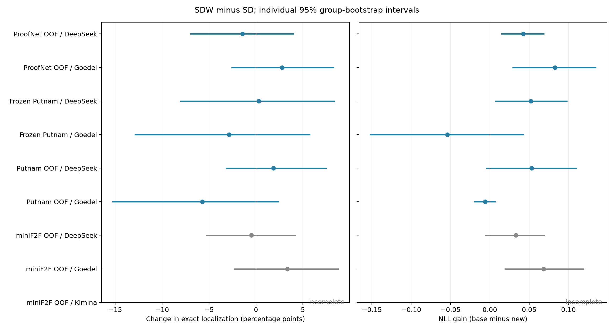

# Добавляет ли скачок информацию к surprisal и его изменению

Проверка для ответа рецензенту wDaH, В2. Публикация отчёта по последующему указанию пользователя. Создан 2026-11-15T02:17:18.538864+00:00.

Основное сравнение: SDW − SD. S — средний surprisal шага; D — знаковое изменение между соседними шагами и его модуль; W — скаляр скачка. Все варианты обучены отдельно на сохранённых данных.

## Основной результат

| Режим / модель | SD: Hit / NLL | SDW: Hit / NLL | ΔHit, п.п. [95%] | Выигрыш NLL [95%] | Holm p: Hit / NLL |
| --- | --- | --- | --- | --- | --- |
| ProofNet OOF / DeepSeek | 27.61% / 2.2329 | 26.17% / 2.1905 | -1.44 [-6.93; +3.98] | +0.0424 [+0.0150; +0.0685] | 1.0000 / 0.1034 |
| ProofNet OOF / Goedel | 28.31% / 2.2662 | 31.08% / 2.1834 | +2.77 [-2.54; +8.25] | +0.0828 [+0.0293; +0.1345] | 1.0000 / 0.0967 |
| ProofNet → Putnam (замороженный перенос) / DeepSeek | 17.39% / 2.4695 | 17.67% / 2.4174 | +0.29 [-8.05; +8.33] | +0.0521 [+0.0074; +0.0977] | 1.0000 / 0.8621 |
| ProofNet → Putnam (замороженный перенос) / Goedel | 16.19% / 2.4276 | 13.33% / 2.4817 | -2.86 [-12.86; +5.71] | -0.0541 [-0.1520; +0.0429] | 1.0000 / 1.0000 |
| Putnam OOF / DeepSeek | 14.94% / 2.4741 | 16.81% / 2.4210 | +1.87 [-3.16; +7.47] | +0.0531 [-0.0043; +0.1102] | 1.0000 / 1.0000 |
| Putnam OOF / Goedel | 13.33% / 2.5150 | 7.62% / 2.5210 | -5.71 [-15.24; +2.38] | -0.0060 [-0.0194; +0.0066] | 1.0000 / 1.0000 |

Положительное ΔHit означает улучшение. Выигрыш NLL = NLL(SD) − NLL(SDW), поэтому положительное значение тоже означает улучшение. Интервалы индивидуальные; поправка Holm приведена отдельно.

## Популяции и режимы

Обязательные три режима завершены для обеих моделей. Дополнительная miniF2F завершена для DeepSeek и Goedel. У Kimina один внешний фолд не завершился: исходный оптимизатор дважды вернул ABNORMAL при одинаковых настройках. Неполная OOF-оценка не вычислялась; ячейки Kimina показаны как отсутствующие. Размер дополнительного семейства Holm сохранён равным заранее заданному; недоступные тесты не уменьшают поправку.

| Неполная ячейка | Попытки / группы | Готовые / все внешние фолды | Причина |
| --- | --- | --- | --- |
| miniF2F_OOF / Kimina | 320 / 94 | 4 / 5 | Archived optimizer returned ABNORMAL with gradient max 1.6174562106341384e-08 twice; no change of settings, no incomplete-OOF score. |

| Режим | Модель | Попытки | Группы |
| --- | --- | --- | --- |
| ProofNet OOF | DeepSeek | 452 | 166 |
| ProofNet → Putnam (замороженный перенос) | DeepSeek | 118 | 58 |
| ProofNet OOF | Goedel | 259 | 133 |
| ProofNet → Putnam (замороженный перенос) | Goedel | 48 | 35 |
| Putnam OOF | DeepSeek | 118 | 58 |
| Putnam OOF | Goedel | 48 | 35 |
| miniF2F OOF | DeepSeek | 528 | 122 |
| miniF2F OOF | Goedel | 448 | 122 |

Обязательные популяции полностью совпали с заданием. Дополнительная miniF2F-серия использует сохранённые eligible-попытки и общий реестр групп вторичного сравнения MD/MDW, без изменения отбора.

Это ретроспективная локализация первого формально отвергнутого шага среди доказательств с известным отказом. Кандидаты — все шаги готового доказательства, включая сгенерированные после первого отказа. Здесь не измеряется вероятность наличия ошибки и не ставится стриминговая задача.

Для ProofNet сохранены исходные внешние и внутренние фолды абляций. Для Putnam OOF использованы сохранённые offline-фолды. В одном архиве названия групп Putnam имеют префикс Putnam:, в другом — нет. Сопоставление взаимно однозначно; исходные разбиения и таблицы имён сохранены, членство попыток в фолдах не менялось.

## Точные признаки

| Блок / столбец | Определение | Преобразование |
| --- | --- | --- |
| S: surprisal:k | Средний token surprisal текущего шага q_t | Те же train-only кубические сплайны, узлы и стандартизация, что у архивного S |
| D: delta_surprisal_signed | q[t]-q[t-1] for t>1; 0 at t=1 | Отдельная train-only стандартизация каждого из двух столбцов; без сплайна |
| D: delta_surprisal_absolute | abs(q[t]-q[t-1]) for t>1; 0 at t=1 | Отдельная train-only стандартизация каждого из двух столбцов; без сплайна |
| W: log1p_jump | log(1 + w_t), где w_t — сохранённая отбеленная норма скачка | Те же train-only среднее и масштаб, что у архивного SW |

D — ровно два последних столбца archived MD после M0. Отдельного индикатора отсутствующего предыдущего шага в D нет. Метаданные старого кода говорят existing first indicator, no duplicate column: first принадлежит позиционному блоку P и в эти варианты не входит. Поэтому вариант без такого индикатора совпадает с основным и повторно не обучался.

На первом шаге обе разности заданы нулём до стандартизации. Это правило может косвенно выделять начало доказательства; D нельзя считать гарантированно свободным от любой информации о позиции.

Порядок столбцов: S; [S,D] для SD; [S,D,W] для SDW; D; [D,W] для DW; [S,W] для SW. Нет прямых признаков позиции, относительной позиции, first/last, типа или длины тактики. Точные имена всех spline-столбцов каждого fit сохранены в result.json.

## Обучение и неопределённость

Условный логит задаёт вероятность шага: p_t = exp(βᵀφ_t) / Σ_j exp(βᵀφ_j). Минимизируется средняя по группам отрицательная логарифмическая вероятность истинного места отказа плюс λ‖β‖²/2. Внутри группы попытки имеют равные веса.

Каждый вариант переобучен во вложенной групповой кросс-валидации 5×3. Сетка λ, сплайны, выбор lambda и настройки оптимизатора совпадают с исходным кодом и зафиксированы до новых исходов в protocol.md. Узлы и масштабы определяются только по train; при настройке λ используется NLL, а не Hit.

Для замороженного переноса λ выбирается по среднему inner-NLL пяти внешних ProofNet-фолдов, затем признаки и коэффициенты переобучаются на всём ProofNet. На Putnam они применяются без настройки. Putnam OOF — отдельное обучение и оценка на других группах Putnam.

Парный bootstrap: 20000 повторов целых групп, seed 2026111307; предсказания фиксированы, веса равны по группам, затем по попыткам. При числе групп меньше 20 интервал и p не приводятся. Эта неопределённость не включает переобучение и повторный выбор регуляризации.

Основная поправка Holm объединяет 48 тестов: две модели × три режима × четыре контраста × Hit/NLL. Для miniF2F отдельное семейство из 24 тестов. Используется двусторонний bootstrap-тест с центрированием относительно нулевой гипотезы. Поправка Holm не превращает индивидуальные интервалы в одновременные.

Это исследовательский анализ уже изучавшихся траекторий. Положительная добавка W означает добавочную предсказательную ценность в данной постановке; она сама по себе не устанавливает причинность и не выделяет конкретный механизм хвостов.

## Все варианты: Hit / NLL

### ProofNet OOF

| Модель | S | SD | SDW | D | DW | SW |
| --- | --- | --- | --- | --- | --- | --- |
| DeepSeek | 20.47% / 2.2340 | 27.61% / 2.2329 | 26.17% / 2.1905 | 21.08% / 2.5183 | 24.02% / 2.4355 | 27.92% / 2.1950 |
| Goedel | 24.06% / 2.2802 | 28.31% / 2.2662 | 31.08% / 2.1834 | 17.69% / 2.5558 | 27.38% / 2.3626 | 26.90% / 2.2212 |

### ProofNet → Putnam (замороженный перенос)

| Модель | S | SD | SDW | D | DW | SW |
| --- | --- | --- | --- | --- | --- | --- |
| DeepSeek | 16.95% / 2.4613 | 17.39% / 2.4695 | 17.67% / 2.4174 | 13.79% / 2.8433 | 20.69% / 2.7217 | 21.41% / 2.4094 |
| Goedel | 20.48% / 2.4485 | 16.19% / 2.4276 | 13.33% / 2.4817 | 20.95% / 2.7235 | 8.10% / 2.7880 | 12.86% / 2.5046 |

### Putnam OOF

| Модель | S | SD | SDW | D | DW | SW |
| --- | --- | --- | --- | --- | --- | --- |
| DeepSeek | 16.67% / 2.4603 | 14.94% / 2.4741 | 16.81% / 2.4210 | 13.79% / 2.7927 | 19.11% / 2.6811 | 19.40% / 2.4081 |
| Goedel | 15.71% / 2.4974 | 13.33% / 2.5150 | 7.62% / 2.5210 | 20.95% / 2.7482 | 12.86% / 2.7282 | 12.38% / 2.5263 |

### miniF2F OOF

| Модель | S | SD | SDW | D | DW | SW |
| --- | --- | --- | --- | --- | --- | --- |
| DeepSeek | 22.62% / 2.3248 | 23.06% / 2.3316 | 22.56% / 2.2986 | 19.90% / 2.6820 | 16.95% / 2.6452 | 25.77% / 2.2921 |
| Goedel | 15.29% / 2.5159 | 16.50% / 2.5330 | 19.84% / 2.4646 | 12.52% / 2.8890 | 17.34% / 2.7888 | 22.29% / 2.4557 |
| Kimina | — (неполный OOF) | — (неполный OOF) | — (неполный OOF) | — (неполный OOF) | — (неполный OOF) | — (неполный OOF) |

## Попадание в окно ±1

| Режим / модель | S | SD | SDW | D | DW | SW |
| --- | --- | --- | --- | --- | --- | --- |
| ProofNet OOF / DeepSeek | 37.27% | 45.24% | 46.39% | 35.59% | 42.24% | 46.69% |
| ProofNet OOF / Goedel | 41.40% | 42.81% | 48.90% | 36.98% | 48.21% | 50.74% |
| ProofNet → Putnam (замороженный перенос) / DeepSeek | 28.88% | 35.92% | 35.34% | 21.98% | 33.91% | 34.34% |
| ProofNet → Putnam (замороженный перенос) / Goedel | 34.76% | 29.05% | 25.71% | 36.19% | 17.62% | 30.00% |
| Putnam OOF / DeepSeek | 29.17% | 27.16% | 31.75% | 21.98% | 30.46% | 31.75% |
| Putnam OOF / Goedel | 33.81% | 30.95% | 28.10% | 36.19% | 32.38% | 32.86% |
| miniF2F OOF / DeepSeek | 40.24% | 37.43% | 37.89% | 35.91% | 36.27% | 39.55% |
| miniF2F OOF / Goedel | 34.50% | 37.62% | 43.08% | 31.89% | 36.03% | 43.04% |
| miniF2F OOF / Kimina | — | — | — | — | — | — |

## Все контрасты

### ProofNet OOF

| Модель | Контраст | ΔHit, п.п. [95%] | Выигрыш NLL [95%] | Индивидуальное p Hit / NLL | Holm p Hit / NLL |
| --- | --- | --- | --- | --- | --- |
| DeepSeek | SDW − SD | -1.44 [-6.93; +3.98] | +0.0424 [+0.0150; +0.0685] | 0.6098 / 0.0023 | 1.0000 / 0.1034 |
| DeepSeek | DW − D | +2.95 [-1.16; +7.06] | +0.0828 [+0.0435; +0.1199] | 0.1580 / 0.0000 | 1.0000 / 0.0024 |
| DeepSeek | SD − S | +7.14 [+2.46; +11.96] | +0.0010 [-0.0183; +0.0180] | 0.0031 / 0.9081 | 0.1323 / 1.0000 |
| DeepSeek | SW − S | +7.45 [+2.31; +12.65] | +0.0390 [+0.0120; +0.0643] | 0.0046 / 0.0039 | 0.1813 / 0.1560 |
| Goedel | SDW − SD | +2.77 [-2.54; +8.25] | +0.0828 [+0.0293; +0.1345] | 0.3122 / 0.0021 | 1.0000 / 0.0967 |
| Goedel | DW − D | +9.69 [+3.42; +15.98] | +0.1932 [+0.0894; +0.2922] | 0.0026 / 0.0003 | 0.1118 / 0.0164 |
| Goedel | SD − S | +4.25 [-3.05; +11.47] | +0.0139 [-0.0175; +0.0436] | 0.2551 / 0.3728 | 1.0000 / 1.0000 |
| Goedel | SW − S | +2.84 [-3.27; +8.96] | +0.0590 [-0.0166; +0.1263] | 0.3637 / 0.1045 | 1.0000 / 1.0000 |

### ProofNet → Putnam (замороженный перенос)

| Модель | Контраст | ΔHit, п.п. [95%] | Выигрыш NLL [95%] | Индивидуальное p Hit / NLL | Holm p Hit / NLL |
| --- | --- | --- | --- | --- | --- |
| DeepSeek | SDW − SD | +0.29 [-8.05; +8.33] | +0.0521 [+0.0074; +0.0977] | 0.9490 / 0.0233 | 1.0000 / 0.8621 |
| DeepSeek | DW − D | +6.90 [-0.29; +14.51] | +0.1216 [+0.0548; +0.1877] | 0.0681 / 0.0005 | 1.0000 / 0.0230 |
| DeepSeek | SD − S | +0.43 [-8.91; +9.91] | -0.0082 [-0.0281; +0.0108] | 0.9385 / 0.4136 | 1.0000 / 1.0000 |
| DeepSeek | SW − S | +4.45 [-4.17; +13.22] | +0.0519 [+0.0080; +0.0967] | 0.3247 / 0.0200 | 1.0000 / 0.7619 |
| Goedel | SDW − SD | -2.86 [-12.86; +5.71] | -0.0541 [-0.1520; +0.0429] | 0.5769 / 0.2777 | 1.0000 / 1.0000 |
| Goedel | DW − D | -12.86 [-26.67; +0.00] | -0.0645 [-0.2377; +0.1094] | 0.0641 / 0.4681 | 1.0000 / 1.0000 |
| Goedel | SD − S | -4.29 [-17.14; +8.57] | +0.0209 [-0.0272; +0.0666] | 0.5863 / 0.3870 | 1.0000 / 1.0000 |
| Goedel | SW − S | -7.62 [-22.38; +6.19] | -0.0561 [-0.1531; +0.0404] | 0.3022 / 0.2577 | 1.0000 / 1.0000 |

### Putnam OOF

| Модель | Контраст | ΔHit, п.п. [95%] | Выигрыш NLL [95%] | Индивидуальное p Hit / NLL | Holm p Hit / NLL |
| --- | --- | --- | --- | --- | --- |
| DeepSeek | SDW − SD | +1.87 [-3.16; +7.47] | +0.0531 [-0.0043; +0.1102] | 0.4938 / 0.0690 | 1.0000 / 1.0000 |
| DeepSeek | DW − D | +5.32 [-0.72; +12.07] | +0.1116 [+0.0379; +0.1852] | 0.1031 / 0.0032 | 1.0000 / 0.1332 |
| DeepSeek | SD − S | -1.72 [-3.88; +0.00] | -0.0138 [-0.0270; -0.0018] | 0.1288 / 0.0323 | 1.0000 / 1.0000 |
| DeepSeek | SW − S | +2.73 [-3.45; +9.34] | +0.0522 [-0.0054; +0.1095] | 0.4089 / 0.0763 | 1.0000 / 1.0000 |
| Goedel | SDW − SD | -5.71 [-15.24; +2.38] | -0.0060 [-0.0194; +0.0066] | 0.2280 / 0.3633 | 1.0000 / 1.0000 |
| Goedel | DW − D | -8.10 [-19.52; +1.43] | +0.0199 [-0.0420; +0.0951] | 0.1349 / 0.5681 | 1.0000 / 1.0000 |
| Goedel | SD − S | -2.38 [-13.33; +8.57] | -0.0176 [-0.1238; +0.0614] | 0.6903 / 0.7176 | 1.0000 / 1.0000 |
| Goedel | SW − S | -3.33 [-13.81; +5.71] | -0.0288 [-0.0574; -0.0039] | 0.5222 / 0.0330 | 1.0000 / 1.0000 |

### miniF2F OOF

| Модель | Контраст | ΔHit, п.п. [95%] | Выигрыш NLL [95%] | Индивидуальное p Hit / NLL | Holm p Hit / NLL |
| --- | --- | --- | --- | --- | --- |
| DeepSeek | SDW − SD | -0.50 [-5.29; +4.17] | +0.0330 [-0.0054; +0.0695] | 0.8299 / 0.0854 | 1.0000 / 1.0000 |
| DeepSeek | DW − D | -2.95 [-7.90; +1.76] | +0.0368 [-0.0030; +0.0744] | 0.2267 / 0.0622 | 1.0000 / 1.0000 |
| DeepSeek | SD − S | +0.43 [-3.34; +4.24] | -0.0068 [-0.0178; +0.0034] | 0.8237 / 0.2048 | 1.0000 / 1.0000 |
| DeepSeek | SW − S | +3.15 [-2.53; +8.90] | +0.0327 [-0.0082; +0.0710] | 0.2813 / 0.1038 | 1.0000 / 1.0000 |
| Goedel | SDW − SD | +3.34 [-2.25; +8.77] | +0.0685 [+0.0195; +0.1185] | 0.2336 / 0.0058 | 1.0000 / 0.1334 |
| Goedel | DW − D | +4.82 [-0.15; +9.86] | +0.1003 [+0.0361; +0.1643] | 0.0593 / 0.0021 | 1.0000 / 0.0516 |
| Goedel | SD − S | +1.21 [-3.88; +6.47] | -0.0171 [-0.0372; +0.0010] | 0.6427 / 0.0768 | 1.0000 / 1.0000 |
| Goedel | SW − S | +7.00 [+1.64; +12.41] | +0.0603 [+0.0124; +0.1083] | 0.0111 / 0.0135 | 0.2442 / 0.2845 |
| Kimina | SDW − SD | — — | — — | — / — | — / — |
| Kimina | DW − D | — — | — — | — / — | — / — |
| Kimina | SD − S | — — | — — | — / — | — / — |
| Kimina | SW − S | — — | — — | — / — | — / — |

## Контроль S/SW

| Модель | Вариант | Новый Hit / NLL | Архивный Hit / NLL | Совпадение |
| --- | --- | --- | --- | --- |
| DeepSeek | S | 20.47% / 2.2340 | 20.47% / 2.2340 | да |
| DeepSeek | SW | 27.92% / 2.1950 | 27.92% / 2.1950 | да |
| Goedel | S | 24.06% / 2.2802 | 24.06% / 2.2802 | да |
| Goedel | SW | 26.90% / 2.2212 | 26.90% / 2.2212 | да |

Максимальное отличие контрольных OOF-вероятностей от архива: 0; несовпадений argmax: 0. Выбранные λ совпали во всех контрольных фолдах. Контроль успешно завершился до обучения новых вариантов.

Замороженные S/SW на Putnam тоже воспроизвелись: максимальное отличие вероятностей 0. Архивные контрасты SW−S и их bootstrap-интервалы воспроизведены, максимальное отличие 0.

Проверено 3888 сохранённых inner/outer/frozen fits. Все эти сохранённые fits сошлись; максимальная компонента градиента 6.72e-07.

## Готовая вставка ⟨TODO, В2⟩

**RU:** Если локализатор использует surprisal и его изменение между соседними шагами, добавление скачка на ProofNet даёт следующие результаты: DeepSeek: точное попадание 27.61% → 26.17% (изменение -1.44 п.п., индивидуальный 95% интервал [-6.93; +3.98]; Holm p=1.0000); выигрыш NLL +0.0424, интервал [+0.0150; +0.0685], Holm p=0.1034; Goedel: точное попадание 28.31% → 31.08% (изменение +2.77 п.п., индивидуальный 95% интервал [-2.54; +8.25]; Holm p=1.0000); выигрыш NLL +0.0828, интервал [+0.0293; +0.1345], Holm p=0.0967. На PutnamBench при замороженном переносе с ProofNet: DeepSeek: точное попадание 17.39% → 17.67% (изменение +0.29 п.п., индивидуальный 95% интервал [-8.05; +8.33]; Holm p=1.0000); выигрыш NLL +0.0521, интервал [+0.0074; +0.0977], Holm p=0.8621; Goedel: точное попадание 16.19% → 13.33% (изменение -2.86 п.п., индивидуальный 95% интервал [-12.86; +5.71]; Holm p=1.0000); выигрыш NLL -0.0541, интервал [-0.1520; +0.0429], Holm p=1.0000. При отдельном обучении на PutnamBench с оценкой OOF: DeepSeek: точное попадание 14.94% → 16.81% (изменение +1.87 п.п., индивидуальный 95% интервал [-3.16; +7.47]; Holm p=1.0000); выигрыш NLL +0.0531, интервал [-0.0043; +0.1102], Holm p=1.0000; Goedel: точное попадание 13.33% → 7.62% (изменение -5.71 п.п., индивидуальный 95% интервал [-15.24; +2.38]; Holm p=1.0000); выигрыш NLL -0.0060, интервал [-0.0194; +0.0066], Holm p=1.0000. Приведены равные веса групп, индивидуальные интервалы bootstrap при фиксированных предсказаниях и поправка Holm внутри заранее заданного семейства новых контрастов.

**EN:** When the localizer uses surprisal and its change between adjacent steps, adding the jump yields the following ProofNet results: DeepSeek: exact localization 27.61% → 26.17% (change -1.44 percentage points, individual 95% CI [-6.93; +3.98]; Holm p=1.0000); NLL gain +0.0424, CI [+0.0150; +0.0685], Holm p=0.1034; Goedel: exact localization 28.31% → 31.08% (change +2.77 percentage points, individual 95% CI [-2.54; +8.25]; Holm p=1.0000); NLL gain +0.0828, CI [+0.0293; +0.1345], Holm p=0.0967. On PutnamBench with frozen transfer from ProofNet: DeepSeek: exact localization 17.39% → 17.67% (change +0.29 percentage points, individual 95% CI [-8.05; +8.33]; Holm p=1.0000); NLL gain +0.0521, CI [+0.0074; +0.0977], Holm p=0.8621; Goedel: exact localization 16.19% → 13.33% (change -2.86 percentage points, individual 95% CI [-12.86; +5.71]; Holm p=1.0000); NLL gain -0.0541, CI [-0.1520; +0.0429], Holm p=1.0000. With separate training and out-of-fold evaluation on PutnamBench: DeepSeek: exact localization 14.94% → 16.81% (change +1.87 percentage points, individual 95% CI [-3.16; +7.47]; Holm p=1.0000); NLL gain +0.0531, CI [-0.0043; +0.1102], Holm p=1.0000; Goedel: exact localization 13.33% → 7.62% (change -5.71 percentage points, individual 95% CI [-15.24; +2.38]; Holm p=1.0000); NLL gain -0.0060, CI [-0.0194; +0.0066], Holm p=1.0000. Groups are equally weighted. Intervals are individual fixed-prediction group-bootstrap intervals, and Holm p-values use the prespecified family of new contrasts.

## График основного контраста

## Файлы и воспроизводимость

[Метрики JSON](metrics.json) · [Метрики CSV](csv/metrics.csv) · [Контрасты CSV](csv/contrasts.csv) · [Столбцы D](csv/D_columns.csv) · [Популяции](csv/cohorts.csv).

[Протокол](protocol.md) · [SHA протокола](protocol.sha256) · [Проверка исходного расчёта](validation.json) · [Примечание о публикации](PUBLICATION_RU.md).

Эта публикация содержит отчёт и сводные результаты. Подробные предсказания, bootstrap-массивы и исходники сохранены на Жоресе и в локальной копии исследования. Метрики и численная часть отчёта перенесены без изменений.
